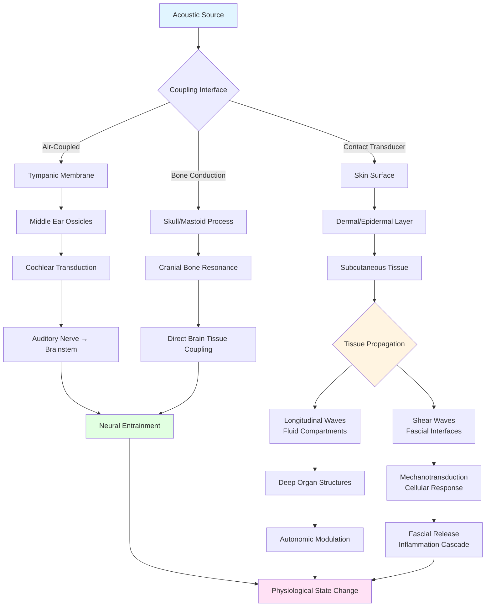

# Lesson 1: Acoustic Foundations of Sound Therapy

## 1. First-Principles Intuition & Invariants

Sound therapy operates at the intersection of classical physics, biological tissue mechanics, and neurological entrainment phenomena. Unlike pharmacological interventions that rely on molecular binding kinetics or surgical procedures that alter anatomical structure, sound therapy leverages the fundamental property that biological systems are both mechanical oscillators and electrochemical signal processors. Every cell membrane, every fluid-filled cavity, every bone-tissue interface possesses inherent resonant frequencies and damping coefficients. When external acoustic energy couples into these systems, predictable phase transitions occur: muscle fascia relaxes under sustained low-frequency vibration, autonomic nervous system tone shifts in response to rhythmic auditory patterns, and cerebrospinal fluid dynamics alter under precisely timed pressure waves.

The mechanistic foundation begins with the wave equation itself. Sound propagates as longitudinal compression waves through any elastic medium, whether air, water, or dense connective tissue. The velocity of propagation depends on the medium's bulk modulus and density—approximately 343 meters per second in air at sea level and 20°C, but accelerating to roughly 1540 meters per second through human soft tissue due to water's incompressibility. This velocity differential creates critical implications for therapeutic application: a 40 Hz signal traveling through air possesses a wavelength of 8.575 meters, but when that same frequency enters the thoracic cavity, the wavelength compresses to 38.5 meters within tissue. The spatial scale of the wave relative to anatomical structures determines whether we observe bulk tissue displacement, standing wave formation, or localized cellular membrane perturbation.

Frequency defines the oscillation rate measured in Hertz, representing cycles per second. The human auditory system transduces frequencies from approximately 20 Hz to 20,000 Hz, but therapeutic impact extends far beyond conscious perception. Infrasonic frequencies below 20 Hz—particularly the 7 Hz to 13 Hz alpha brainwave band—do not register as audible tones yet profoundly influence autonomic regulation through direct mechanical coupling to vestibular structures and brainstem nuclei. Conversely, ultrasonic frequencies above 20 kHz penetrate tissue without auditory perception, enabling focused mechanical disruption of scar tissue adhesions or targeted vasodilation through localized thermal deposition.

Amplitude represents the magnitude of particle displacement from equilibrium, quantified in pascals for pressure waves or meters for physical displacement. In therapeutic contexts, we measure amplitude as sound pressure level in decibels, a logarithmic scale where every 6 dB increase represents a doubling of acoustic pressure. The threshold of human hearing sits at 0 dB SPL (20 micropascals), while sustained exposure above 85 dB SPL initiates cumulative cochlear damage. Therapeutic applications typically operate in the 40 dB to 80 dB range for auditory entrainment protocols, but bone conduction transducers and subwoofer-driven whole-body vibration platforms may deliver mechanical energy at equivalent intensities far exceeding 100 dB SPL without air-coupled sound transmission.

Resonance emerges when driving frequency matches a system's natural frequency, causing exponential amplitude magnification limited only by damping losses. Every anatomical structure possesses characteristic resonant modes: the skull exhibits primary resonances between 300 Hz and 600 Hz, the thoracic cavity resonates around 60 Hz to 80 Hz, and individual organs maintain distinct modal patterns. When therapeutic sound matches these natural frequencies, energy absorption efficiency maximizes, enabling lower input amplitudes to achieve clinically significant mechanical displacement. However, this same principle creates risk: uncontrolled resonant excitation of the eyeball at approximately 18 Hz can induce transient visual disturbances, while cardiac resonance frequencies around 5 Hz to 7 Hz must be avoided to prevent arrhythmia induction.

Entrainment describes the phenomenon where oscillating biological rhythms synchronize to external periodic stimuli. First documented by Christiaan Huygens in 1665 observing pendulum clock synchronization, entrainment governs how auditory rhythms phase-lock brainwave activity, how binaural beat frequencies modulate cortical oscillations, and how rhythmic vibration patterns reset autonomic nervous system cadence. The mechanism operates through coupled oscillator dynamics: when an external periodic signal provides sufficient energy and maintains temporal coherence, internal biological oscillators—whether neuronal firing patterns, respiratory cycles, or heart rate variability—gradually align their phase and frequency to the external driver. This alignment occurs not through volitional control but through passive mechanical and electrochemical coupling, making entrainment a powerful tool for shifting physiological state without requiring conscious cognitive engagement.

## 2. Core Architecture & Mechanics

The propagation of therapeutic sound through biological tissue follows a hierarchical cascade beginning with transduction, progressing through mechanical coupling, and culminating in physiological response. At the entry point, whether air-coupled sound striking the tympanic membrane or direct contact transducers vibrating against skin, acoustic energy converts from pressure waves into mechanical displacement of tissue structures. The efficiency of this energy transfer depends critically on impedance matching—the ratio of mechanical impedance between source and tissue. Air possesses an acoustic impedance of approximately 415 rayls, while soft tissue impedance measures around 1.5 million rayls. This three-orders-of-magnitude mismatch means that air-coupled sound experiences massive reflection at the air-skin interface, with only 0.1% of incident energy penetrating into tissue. This explains why direct contact transducers, bone conduction devices, and water immersion protocols achieve far greater tissue penetration depth than conventional loudspeaker systems.

Once acoustic energy enters tissue, propagation mechanics bifurcate into parallel pathways. Longitudinal compression waves travel as pressure fluctuations through fluid compartments—blood, lymph, cerebrospinal fluid, and interstitial spaces. These pressure waves propagate rapidly with minimal attenuation, capable of reaching deep structures like the brainstem, visceral organs, and bone marrow cavities. Simultaneously, shear waves develop at tissue interfaces where density or elasticity changes abruptly, such as fascial planes between muscle groups or the periosteal boundary of bone. Shear waves travel more slowly and attenuate more rapidly than longitudinal waves, but they deposit significantly higher mechanical stress on cellular structures, making them particularly effective for releasing fascial adhesions and stimulating mechanotransduction pathways in fibroblasts.

The frequency-dependent attenuation of sound through tissue follows an approximately linear relationship, with higher frequencies experiencing greater absorption per unit distance traveled. At 100 Hz, attenuation in soft tissue measures roughly 0.01 dB per centimeter, allowing deep penetration throughout the torso. At 1000 Hz, attenuation increases to approximately 0.1 dB per centimeter, limiting effective depth to superficial tissues. This frequency-depth tradeoff dictates therapeutic strategy: low-frequency protocols (20 Hz to 100 Hz) target deep visceral structures, autonomic ganglia, and whole-body systemic effects, while mid-frequency applications (200 Hz to 800 Hz) focus on musculoskeletal structures, and high-frequency ultrasound (1 MHz to 3 MHz) restricts itself to millimeter-scale superficial treatments.

Resonance phenomena manifest at multiple hierarchical scales within biological systems. At the organ level, the thoracic cavity functions as a Helmholtz resonator, with the trachea serving as the neck and the lung volume as the chamber body. The resonant frequency of this system sits near 65 Hz for average adult anatomy, which explains why low-frequency bass tones in this range produce palpable chest vibration and why frequencies slightly below this threshold (40 Hz to 50 Hz) effectively stimulate vagal tone through mechanical coupling to cardiac and pulmonary baroreceptors. At the cellular scale, lipid bilayer membranes exhibit characteristic vibrational modes in the megahertz range, but these high-frequency modes can be parametrically excited through nonlinear coupling with lower-frequency driving signals, a mechanism potentially underlying ultrasound-mediated drug delivery enhancement and sonoporation.

Standing wave formation occurs when incident and reflected waves interfere constructively, creating spatial patterns of maximal and minimal pressure amplitude. In therapeutic applications, standing waves pose both opportunity and hazard. Within enclosed treatment chambers or water immersion tanks, deliberate standing wave engineering can create zones of intense acoustic pressure for focused tissue stimulation. However, unintended standing waves within the cranial vault or thoracic cavity may concentrate energy at anatomical locations that do not align with therapeutic targets, potentially causing discomfort or adverse effects. Practitioners must account for patient-specific anatomical dimensions and adjust frequency selection to avoid unintended resonant amplification at sensitive structures.

Binaural beat entrainment exploits the brain's frequency-following response through a specific mechanism: when slightly different frequencies are presented independently to each ear—for example, 200 Hz to the left ear and 210 Hz to the right ear—the brainstem's superior olivary complex detects the 10 Hz phase difference and generates a perceived beat frequency. This perceived beat does not exist as an acoustic pressure wave but emerges as a neural oscillation pattern that propagates through thalamocortical circuits. When the beat frequency matches target brainwave bands—delta (0.5 Hz to 4 Hz) for deep sleep, theta (4 Hz to 8 Hz) for meditative states, alpha (8 Hz to 13 Hz) for relaxed alertness, or beta (13 Hz to 30 Hz) for focused cognition—cortical activity gradually synchronizes to the external rhythm through entrainment coupling. The latency for measurable entrainment onset typically ranges from six to ten minutes of continuous exposure, with individual variability depending on baseline cortical state and entrainment susceptibility.

Whole-body vibration therapy delivers mechanical oscillation through direct physical contact, typically via vibrating platforms or specialized massage devices. These systems operate in the 5 Hz to 50 Hz range, with amplitude settings from 0.5 millimeters to 10 millimeters peak-to-peak displacement. The mechanical energy propagates through the skeletal system, exciting muscle spindle reflexes, stimulating proprioceptive afferents, and inducing transient increases in muscle perfusion through rhythmic compression of vascular beds. Research-grade protocols for neuromuscular facilitation typically employ 25 Hz to 35 Hz stimulation with 2 millimeter to 4 millimeter amplitude for three to five minute intervals, while protocols targeting bone density enhancement use lower frequencies (12 Hz to 20 Hz) with higher amplitudes (4 millimeter to 8 millimeter) to maximize osteoblast mechanotransduction signaling.

## 3. High-Performance Optimization & Failure Modes

Optimizing sound therapy protocols requires precise calibration of frequency selection, amplitude dosing, exposure duration, and temporal patterning. The frequency selection process begins with anatomical target identification and tissue depth calculation. For superficial musculoskeletal targets within the first five centimeters of tissue depth, frequencies between 200 Hz and 500 Hz provide optimal penetration with manageable attenuation. For deep visceral targets or whole-body systemic effects, frequencies below 100 Hz become necessary, with the 30 Hz to 60 Hz band offering the best balance between tissue penetration, resonant coupling to major anatomical cavities, and minimal patient discomfort from excessive vibrotactile sensation.

Amplitude dosing follows a therapeutic window principle similar to pharmacological interventions: insufficient amplitude fails to achieve threshold stimulation of target mechanoreceptors and cellular mechanotransduction pathways, while excessive amplitude risks tissue damage, patient discomfort, and adverse autonomic responses. For auditory entrainment protocols using headphones or speakers, sound pressure levels between 50 dB SPL and 70 dB SPL provide adequate stimulus intensity without risking hearing damage during extended sessions. For contact-based vibroacoustic therapy, acceleration levels between 0.2 g and 0.8 g (where g equals 9.81 meters per second squared) deliver sufficient mechanical energy for therapeutic effect while remaining below the 1.5 g threshold associated with discomfort and potential microvascular trauma in sensitive tissues.

Temporal patterning strategies dramatically influence therapeutic outcomes through differential activation of adaptation versus sensitization pathways in sensory systems. Continuous sustained stimulation at fixed frequency and amplitude triggers rapid neural adaptation, with mechanoreceptor firing rates declining to baseline within two to five minutes despite continued stimulus presence. This adaptation limits therapeutic efficacy for protocols requiring sustained neural activation. In contrast, amplitude-modulated protocols that vary intensity in slow rhythmic patterns (0.05 Hz to 0.2 Hz modulation frequency) maintain receptor sensitivity through periodic release from adaptation, extending effective treatment duration. Frequency-sweep protocols that gradually transition across a target band (for example, 30 Hz to 60 Hz over ten minutes) prevent resonance-dependent tissue damage while ensuring comprehensive coverage of individual anatomical resonant frequencies that vary between patients.

Treatment duration optimization balances cumulative dose requirements against physiological tolerance limits and adaptation kinetics. For acute interventions targeting immediate autonomic state shifts—such as pre-surgical anxiety reduction or acute pain management—sessions of fifteen to twenty-five minutes provide sufficient entrainment time for measurable brainwave and heart rate variability changes. For chronic applications targeting tissue remodeling, such as fascial release or bone density enhancement, longer sessions of thirty to forty-five minutes increase mechanical stimulus accumulation, but sessions exceeding sixty minutes show diminishing returns due to deep neural adaptation and the onset of treatment fatigue. Frequency of application also matters: daily sessions produce faster initial response but risk treatment habituation, while three to four sessions per week maintain therapeutic momentum while allowing adequate recovery intervals.

Individual patient variability introduces significant complexity into protocol optimization. Anatomical differences in body composition, skeletal dimensions, and tissue density alter acoustic propagation properties and resonant frequencies. A sixty-kilogram individual with low body fat percentage and dense musculature will exhibit faster sound propagation velocities and higher resonant frequencies compared to a ninety-kilogram individual with higher adiposity, whose tissues demonstrate greater acoustic damping and lower resonant modes. Age-related changes in tissue elasticity, bone density, and cardiovascular compliance further modify treatment response. Practitioners must conduct baseline assessment using impedance measurements, resonance frequency scanning, or subjective threshold testing to individualize frequency and amplitude parameters.

Failure modes in sound therapy arise from several distinct mechanisms. Excessive amplitude exposure, particularly at resonant frequencies, can induce transient adverse effects including nausea, vertigo, headache, and in extreme cases, cardiac arrhythmia. These effects result from overstimulation of vestibular apparatus, uncontrolled cranial resonance, or direct cardiac mechanical interference. Mitigation requires adherence to established safety thresholds: whole-body vibration acceleration below 1.0 g, auditory sound pressure below 85 dB SPL for extended exposure, and avoidance of the 5 Hz to 7 Hz cardiac resonance band and the 18 Hz ocular resonance frequency.

Contraindications and relative cautions include pregnancy (particularly during first trimester when organogenesis vulnerabilities peak), presence of implanted electronic devices (pacemakers, cochlear implants, deep brain stimulators), acute thrombophlebitis or deep vein thrombosis (risk of mechanical thrombus dislodgement), recent surgical implants or fractures (potential hardware loosening or delayed healing), and severe osteoporosis (risk of compression fracture under vibration loading). Patients with epilepsy require careful screening, as certain frequency bands may lower seizure threshold through neural entrainment effects, particularly photic and acoustic stimulation in the 10 Hz to 20 Hz range.

Equipment calibration and maintenance directly impact treatment fidelity and safety. Transducers degrade over time, developing nonlinear distortion, frequency response drift, and amplitude inconsistency. Monthly calibration using reference microphones and accelerometers ensures output accuracy within ±3 dB across the therapeutic frequency range. Headphone impedance mismatch or driver imbalance can compromise binaural beat protocols by introducing amplitude asymmetry between ears, disrupting the phase coherence necessary for effective brainstem beat generation. Vibration platforms require periodic inspection of mounting hardware and damping elements to prevent introduction of harmonic distortion or spurious resonances that contaminate the intended stimulus frequency with uncontrolled spectral components.

Environmental acoustic factors often receive insufficient attention but profoundly affect treatment outcomes. Background noise in clinical spaces masks lower-amplitude therapeutic signals, forcing practitioners to increase stimulus intensity and potentially exceed optimal dosing windows. Ambient noise below 40 dB SPL enables clear delivery of auditory entrainment protocols, while noisy environments exceeding 60 dB SPL compromise treatment efficacy. Room acoustic properties also matter: highly reverberant spaces with long decay times create temporal smearing of rhythmic stimuli, degrading the temporal precision necessary for entrainment, while overdamped spaces with excessive absorption may create spatial amplitude heterogeneity requiring patients to maintain fixed positioning for consistent exposure.

## 4. Summary & Verification Matrix

| Governing Invariant | Mechanical Mechanism | Diagnostic Criterion | Primary Failure Mode |
|---------------------|----------------------|----------------------|----------------------|
| Sound velocity in tissue (1540 m/s) determines wavelength compression and penetration depth relative to air propagation (343 m/s); wavelength must be considered relative to anatomical target dimensions | Longitudinal compression waves propagate through fluid compartments; shear waves develop at tissue interfaces with differential impedance; frequency-dependent attenuation increases linearly with frequency (0.01 dB/cm at 100 Hz, 0.1 dB/cm at 1000 Hz) | Measure tissue penetration depth using ultrasound imaging or hydrophone arrays in tissue-equivalent phantoms; verify target structure receives adequate mechanical displacement using Doppler vibrometry or MRI elastography | High-frequency protocols (>500 Hz) fail to reach deep anatomical targets due to excessive attenuation; air-coupled sources lose 99.9% of energy at air-tissue interface due to impedance mismatch |
| Resonance occurs when driving frequency matches natural frequency of anatomical structures, causing amplitude magnification limited by tissue damping; thoracic cavity resonates at 65 Hz, skull between 300-600 Hz | Energy absorption efficiency maximizes at resonance, requiring lower input amplitude for equivalent mechanical displacement; standing wave formation creates spatial pressure maxima and minima in enclosed cavities | Conduct frequency sweep analysis while monitoring patient-reported vibrotactile sensation and autonomic markers (heart rate variability, skin conductance); identify resonant peaks as local maxima in response amplitude | Uncontrolled resonant excitation at 18 Hz (ocular), 5-7 Hz (cardiac), or individual skull modes may cause visual disturbance, arrhythmia, or discomfort; requires frequency avoidance or amplitude reduction |
| Neural entrainment requires 6-10 minutes of continuous periodic stimulation to phase-lock brainwave activity; binaural beats generate perceived frequency equal to the difference between frequencies presented to each ear | Superior olivary complex in brainstem detects interaural phase difference and generates neural oscillation at beat frequency; thalamocortical circuits synchronize to external rhythm through coupled oscillator dynamics | Quantify entrainment using EEG spectral analysis showing increased power at target frequency band and phase coherence between stimulus and cortical oscillations; measure latency to entrainment onset | Insufficient exposure duration (< 6 minutes) prevents entrainment establishment; ambient noise >60 dB SPL masks therapeutic signal; headphone amplitude imbalance >3 dB disrupts binaural beat generation |
| Amplitude dosing follows therapeutic window: 50-70 dB SPL for auditory protocols, 0.2-0.8 g acceleration for vibroacoustic therapy; excessive amplitude triggers adverse effects while insufficient amplitude fails to reach mechanoreceptor threshold | Mechanoreceptors exhibit nonlinear threshold behavior; Pacinian corpuscles respond optimally to 200-300 Hz at 0.1-1.0 g; muscle spindles activate at 10-100 Hz above 0.3 g; cellular mechanotransduction pathways require minimum shear stress magnitude | Calibrate output using sound level meter (IEC 61672 Class 1) for auditory systems or triaxial accelerometer (ISO 8041 compliant) for vibration platforms; verify patient perception threshold and tolerance ceiling | Excessive amplitude (>85 dB SPL or >1.5 g) induces nausea, vertigo, tissue damage; insufficient amplitude fails to activate target receptors; transducer drift over time causes calibration error requiring monthly verification |
