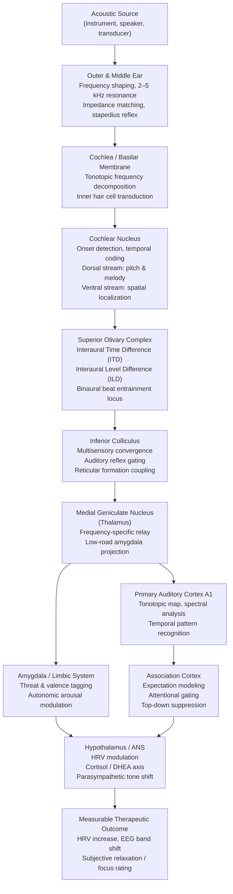

# Lesson 2: Psychoacoustics in Therapeutic Contexts

## 1. First-Principles Intuition & Invariants

Sound is not simply a physical phenomenon that the brain passively receives. It is an active construction, assembled by overlapping neural systems that compare, filter, predict, and assign emotional weight to acoustic signals before a practitioner's client ever consciously perceives a tone. This distinction between the physics of sound waves and the psychology of sound *experience* is the central problem space of psychoacoustics, and it is the reason that two clients lying in identical acoustic environments can report profoundly different therapeutic outcomes. Understanding the machinery that mediates that gap is not an academic exercise; it is the clinical prerequisite for designing sound therapy sessions that reliably produce measurable physiological and psychological effects.

The auditory system begins its work at the cochlea, where the basilar membrane performs a continuous mechanical frequency analysis. This structure is not uniform; its mass and stiffness vary continuously along its length, causing different regions to resonate maximally at different frequencies. High-frequency tones (8–16 kHz) drive peak displacement at the basal end, near the oval window, while low-frequency tones (20–500 Hz) travel further toward the apical end before reaching peak amplitude. The inner hair cells seated along this gradient convert mechanical displacement into graded receptor potentials, encoding frequency through location. This spatial encoding is called **tonotopic organization**, and it is preserved with remarkable fidelity all the way from the cochlear nucleus through the inferior colliculus, the medial geniculate body of the thalamus, and into primary auditory cortex (A1). The cortical map of frequency is not random; it is a faithful topographic projection of the basilar membrane, with isofrequency bands running in parallel strips across Heschl's gyrus.

For the sound therapy practitioner, the clinical invariant here is this: the auditory system is a frequency-resolving instrument with hard limits. Tones separated by less than one **critical bandwidth** (roughly defined by the Bark scale, with bandwidth widening at lower frequencies) are processed within the same cochlear filter and cannot be perceptually distinguished as separate pitches. This phenomenon, called **spectral masking**, has immediate practical consequences for session design. When a practitioner layers multiple tonal elements in a therapeutic soundscape, frequencies that fall within the same critical band will compete, smear, and partially cancel each other's perceptual clarity. Intentional masking of intrusive environmental noise exploits the same mechanism constructively: a broadband pink noise floor at 45–55 dB SPL will mask the irregular spike of an HVAC compressor or passing traffic by raising the auditory threshold across the relevant frequency range, effectively rendering those disruptions sub-perceptual.

The emotional and autonomic dimensions of sound perception are routed through a parallel pathway that runs beneath conscious analysis. Projections from the medial geniculate nucleus reach the basolateral amygdala directly, bypassing cortical processing entirely. Joseph LeDoux's work on this "low road" pathway established that the nervous system can initiate a fear or threat response to acoustic signals before the auditory cortex has finished constructing a conscious percept. For the therapeutic context, this architecture is both an asset and a liability. It means that carefully chosen tonal qualities, particularly sustained low-frequency drones and slowly modulated harmonic intervals, can bypass the client's analytical resistance and directly modulate arousal state. It also means that an inadvertent sharp transient, a sudden change in timbre, or a jarring frequency jump can trigger a subcortical threat response that undoes minutes of carefully built parasympathetic engagement.

The governing invariants that anchor all sound therapy design follow from this architecture. First, the auditory system is fundamentally predictive; the brain continuously generates forward models of expected acoustic input, and violations of those predictions generate orienting responses that elevate arousal. This means that session soundscapes must evolve slowly, with rate-of-change in frequency, amplitude, and timbre kept well within the brain's expectation window. Second, binaural processing is a locus of genuine therapeutic leverage because it involves inter-hemispheric coordination at the level of the superior olivary complex, a structure with direct influence on reticular formation arousal tone. Third, therapeutic effects require cumulative exposure across a session; the autonomic nervous system does not shift states in response to a single stimulus event but responds to sustained statistical regularities in the acoustic environment over time spans of several minutes.

---

## 2. Core Architecture & Mechanics

The functional signal path of psychoacoustic processing, from physical wavefront to therapeutic outcome, can be understood as a cascade of transformations, each stage adding complexity and clinical relevance. The practitioner who internalizes this architecture gains the ability to intervene at any stage rather than treating the acoustic environment as a monolithic, untunable variable.

**Binaural Beat Mechanics and Clinical Calibration.** When two pure tones of slightly different frequencies are presented separately to each ear, the superior olivary complex detects the periodic fluctuation in interaural phase difference and generates a perceived "beat" at the difference frequency. If the left ear receives 200 Hz and the right ear receives 206 Hz, the brain constructs a phantom oscillation at 6 Hz, which falls within the theta band. This is not an acoustic phenomenon audible to a microphone placed in the room; it is an entirely neural construction, produced by the phase-comparison circuitry that normally serves spatial localization. The therapeutic premise is that sustained exposure to a binaural beat at a target frequency can nudge EEG power distribution toward the corresponding band through a process called **frequency-following response (FFR)**, whereby cortical oscillations phase-lock to the imposed temporal structure.

The clinical calibration of binaural beats requires several constraints to be respected simultaneously. The carrier tones must be below approximately 1,000 Hz; above that threshold, the interaural phase difference becomes ambiguous to the superior olivary complex and the beat percept collapses. The difference frequency must fall within the range of the target brainwave band: delta (0.5–4 Hz) for deep sleep facilitation, theta (4–8 Hz) for meditative and creative states, alpha (8–13 Hz) for relaxed wakefulness and anxiety reduction, and low beta (14–20 Hz) for sustained attention protocols. Practitioners must use high-quality over-ear headphones, since binaural beats require acoustic isolation between the two ears; loudspeakers allow the two signals to mix in the air before reaching the cochlea, destroying the interaural difference and converting what would have been a binaural beat into a simple monaural amplitude modulation.

**Auditory Masking and the Design of Therapeutic Noise Floors.** Auditory masking occurs when the detection threshold for one sound (the signal) is elevated by the simultaneous presence of another sound (the masker). Simultaneous masking operates within critical bands: a masker raises the threshold primarily for signals within the same Bark-scale filter. Temporal masking extends this effect across time, with forward masking (the masker precedes the signal) lasting up to 200 ms and backward masking (the masker follows the signal) operating over a shorter 20–30 ms window. For practitioners working in clinically noisy environments, pink noise, whose spectral density rolls off at 3 dB per octave, provides a more perceptually uniform masking floor than white noise because it matches the equal-loudness contours of the human auditory system more closely. Brown noise, rolling off at 6 dB per octave, concentrates energy in the low-frequency range and is frequently preferred by clients seeking deep relaxation, as it mimics the spectral character of sustained natural environments such as rivers and rainfall.

**Harmonic Intervals and Autonomic Entrainment.** The choice of harmonic intervals within a therapeutic soundscape is not arbitrary. Consonant intervals, particularly the perfect fifth (frequency ratio 3:2) and the perfect fourth (4:3), produce stable, low-beating combination tones that impose minimal computational demand on the auditory cortex. Dissonant intervals, such as the tritone (45:32) or the minor second (16:15), generate high rates of amplitude fluctuation in overlapping cochlear filters, activating the anterior cingulate cortex and sustaining a low-grade orienting response. This neurological roughness has been measured in studies using functional MRI and is not merely a cultural preference; it reflects a universal property of cochlear mechanics. Practitioners working with highly anxious clients, or clients in acute sympathetic arousal, should anchor their soundscapes in consonant harmonic intervals and avoid complex polyphony, which multiplies the number of simultaneously active critical band masking interactions.

---

## 3. High-Performance Optimization & Failure Modes

The gap between theoretically sound (in both senses) session design and reliable clinical outcomes is bridged by execution discipline and by an honest accounting of where the model breaks down. Advanced practitioners tend to attribute client non-response to individual variation, but the more common root causes are acoustic delivery failures, protocol calibration errors, and session structure problems that the psychoacoustic model predicts clearly once you know where to look.

**Session Architecture and the Rate-of-Change Constraint.** The single most common structural error in therapeutic sound sessions is abrupt state transition. Because the auditory cortex maintains a continuously updated prediction model of incoming sound, any sudden shift in frequency center, amplitude envelope, or timbral character generates a novelty response mediated by the locus coeruleus norepinephrine system, sharply elevating arousal and interrupting any parasympathetic state that has been accumulating. The practical rule is that all intentional transitions in a session must occur over durations of at least 60–90 seconds for frequency shifts and at least 30 seconds for amplitude changes. Practitioners using digital audio workstations such as Ableton Live, Logic Pro, or Reaper should automate all parameter changes using long automation curves rather than step changes. For practitioners working with live instruments or singing bowls, the equivalent constraint is to ensure that physical playing technique avoids sharp attack transients during the induction and deepening phases of a session, reserving dynamic range for intentional activation phases.

**Calibrating Binaural Beat Protocols by Target State.** A coherent clinical protocol matches the target brainwave state to the session objective, selects carrier tones that are audible but not irritating at the listening volume (typically 55–65 dB SPL at the ear), and maintains the beat frequency continuously for a minimum of 10 minutes to allow measurable EEG frequency-following response to develop. Delta protocols (1–3 Hz beat) are indicated for sleep-onset facilitation and trauma-informed work where complete cortical quieting is the goal; they require carrier tones in the 100–250 Hz range and listening volumes at the lower end of the therapeutic window. Theta protocols (5–7 Hz beat) are the clinical standard for anxiety reduction, hypnagogic imagery facilitation, and depth psychotherapy adjunct work. Alpha protocols (9–11 Hz beat) suit focus-enhancement and mild anxiety applications. The practitioner should not layer multiple simultaneous binaural beat frequencies, as the superior olivary complex will process only one interaural beat at a time, and multiple competing difference frequencies produce listener confusion rather than additive entrainment.

**Acoustic Delivery Failures and Hardware Thresholds.** The fidelity of binaural beat delivery degrades predictably at the hardware level. Consumer earbuds with single balanced-armature drivers have response curves that roll off sharply below 80 Hz, making them unsuitable for delta and low-theta carrier work. The minimum specification for clinical binaural beat delivery is a circumaural headphone with a frequency response from 20 Hz to 20 kHz (±3 dB), channel separation above 45 dB, and a total harmonic distortion below 0.1% at clinical listening levels. Impedance mismatch between the headphone driver and the audio interface output will introduce channel-dependent phase errors that corrupt the interaural phase difference on which binaural beat generation depends. When practitioners use tablet-based playback, they must route audio through a dedicated interface (such as an Apogee Duet or Focusrite Scarlett Solo) rather than the device's built-in DAC, which typically has insufficient channel separation and phase accuracy.

**Individual Variability and the Failure of Standardized Protocols.** The most consequential failure mode in psychoacoustic therapy is the assumption that a protocol calibrated for population-level averages will produce equivalent outcomes across all clients. Cochlear anatomy varies, and the tonotopic gradient shifts measurably with age-related high-frequency hearing loss; a client with even mild presbycusis will have a degraded FFR to carrier tones above 500 Hz, reducing binaural beat efficacy at standard carrier frequencies and requiring downward recalibration to 150–300 Hz. Clients with tinnitus present a further complication: the phantom tone generated by maladaptive cortical reorganization following hair cell damage can interact destructively with therapeutic carrier tones if frequencies are not screened against the client's tinnitus frequency beforehand. A brief audiometric screen, or at minimum a structured intake interview asking about tinnitus, hearing asymmetry, and history of noise exposure, is therefore a clinical prerequisite rather than an optional enhancement.

Hypervigilance, common in PTSD presentations, creates a specific failure mode rooted in the low-road amygdala pathway described in Section 1. These clients have a lowered threshold for subcortical threat detection, meaning that even mild acoustic novelty, a slight increase in low-frequency energy, an unexpected harmonic partial, or a room-mode resonance activating during a session, can trigger a threat response that overrides any cortically mediated relaxation. For this population, session onset should use narrowband, spectrally stable tones at low amplitude, with slow fade-in over five or more minutes, and the practitioner should conduct a brief verbal check-in after the first ten minutes to confirm that the client's arousal trajectory is downward. Attempting to accelerate depth of relaxation by increasing sound intensity or complexity in this population reliably produces the opposite effect.

---

## 4. Summary & Verification Matrix

| Domain | Governing Invariant | Clinical Mechanism | Diagnostic Criterion | Failure Mode & Mitigation |
|---|---|---|---|---|
| **Tonotopic Organization** | Frequency-to-place mapping is preserved from cochlea to cortex; critical bandwidth limits spectral resolution | Basilar membrane resonance encodes frequency spatially; Bark-scale filters define perceptual resolution limits | Client reports tonal clarity; spectral components in therapeutic content are separated by ≥1 critical band | Layered frequencies within the same critical band produce masking and tonal smear; separate therapeutic tones by >1.5 Bark units |
| **Binaural Beat Entrainment** | Beat frequency = difference between left and right carrier tones; efficacy requires carrier tones below 1,000 Hz and circumaural headphone isolation | Superior olivary complex phase-comparison generates FFR; cortical oscillations phase-lock to beat frequency over ≥10 minutes sustained exposure | EEG power increase in target band (delta/theta/alpha) after 10–15 min; subjective depth-of-relaxation rating ≥6/10 | Earbuds with poor low-frequency response, inadequate channel separation (<45 dB), or loudspeaker delivery destroy interaural phase difference; use calibrated circumaural headphones and a dedicated audio interface |
| **Auditory Masking** | Masker elevates signal detection threshold within the same critical band; forward masking extends up to 200 ms post-masker | Pink noise (−3 dB/octave) or brown noise (−6 dB/octave) floor raises threshold for environmental intrusions; matches equal-loudness contours | Environmental intrusions rated sub-perceptual by client; HVAC and traffic noise masked at 45–55 dB SPL pink noise floor | White noise floor causes high-frequency fatigue over sessions >45 min; switch to pink or brown noise and limit continuous masking noise sessions to ≤60 minutes |
| **Harmonic Interval Selection** | Consonant intervals (3:2, 4:3) minimize cochlear beating and cortical processing load; dissonant intervals sustain orienting response | Overlapping critical bands of dissonant partials generate amplitude fluctuation; activates anterior cingulate and locus coeruleus | Anxious or hypervigilant clients show stable HRV during consonant-anchored soundscapes; dissonant passages produce measurable HRV dip | Using complex polyphony or dissonant intervals in induction phase of sessions with anxious or PTSD presentations elevates arousal; anchor all induction material in perfect fourths and fifths |
| **Rate-of-Change & Prediction Error** | Auditory cortex maintains a forward model of incoming sound; violations generate locus coeruleus norepinephrine release and arousal spike | Novelty detection is automatic and pre-attentive; abrupt frequency, amplitude, or timbre shifts interrupt accumulated parasympathetic state | Smooth HRV progression upward through session; absence of client startle or reported distraction | Abrupt automation steps, sudden transients from live instruments, or unintended room-mode activation interrupt state; automate all transitions over ≥60-second curves and perform room acoustic check before session |
| **Individual Cochlear & Neurological Variability** | Presbycusis, tinnitus, and hypervigilance each alter the cochlear or subcortical processing baseline; standard protocols calibrated to population averages will misfire | High-frequency hair cell loss reduces FFR to carriers above 500 Hz; tinnitus frequency interacts with carrier tones; hypervigilance lowers amygdala threat threshold | Pre-session audiometric screen or structured intake identifies hearing asymmetry, tinnitus frequency, and trauma history | Applying standard carrier frequencies to presbycusis or tinnitus clients without frequency adjustment produces weak or aversive entrainment; recalibrate carriers to 150–300 Hz and screen tinnitus frequency before every initial session |
