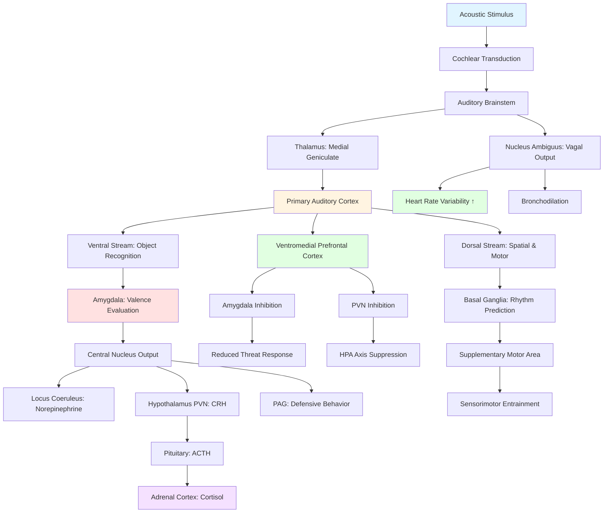

# Lesson 3: Neurophysiological Mechanisms of Sound Healing

## 1. First-Principles Intuition & Invariants

Sound healing operates at the intersection of acoustic physics and adaptive neurobiology, where rhythmic pressure waves induce measurable changes in neural oscillatory patterns, autonomic balance, and neuroendocrine signaling cascades. The fundamental premise rests on the brain's intrinsic capacity for frequency-following response, a phenomenon whereby populations of neurons synchronize their firing rates to match the periodicity of external auditory stimuli. This entrainment principle represents far more than passive sensory reception; it constitutes an active reorganization of cortical and subcortical network dynamics, wherein the temporal structure of sound becomes encoded as neural phase coherence across distributed assemblies spanning the auditory cortex, thalamus, limbic system, and brainstem autonomic nuclei.

The acoustic signal chain begins at the cochlea, where the basilar membrane performs mechanical frequency decomposition through tonotopic organization. High-frequency components induce maximal displacement near the oval window base, while low-frequency content propagates to the apex, creating a spatial map of spectral energy that inner hair cells transduce into graded electrical potentials. These signals ascend through the spiral ganglion to the cochlear nucleus, superior olivary complex, inferior colliculus, and medial geniculate body before reaching primary auditory cortex in Heschl's gyrus. At each synaptic relay, the temporal precision of phase-locked firing encodes not merely pitch and timbre, but also the rhythmic envelope structure that drives entrainment phenomena. Critically, this ascending pathway bifurcates to engage both conscious perceptual systems in the cortex and unconscious regulatory circuits in the reticular activating system, amygdala, and hypothalamus, establishing the anatomical substrate for sound to modulate arousal, emotion, and stress physiology simultaneously.

The governing invariants of neurophysiological sound healing rest on three mechanistic pillars. First, frequency entrainment obeys a resonance bandwidth constraint: neural populations most readily synchronize to external rhythms within approximately ±15% of their intrinsic oscillation frequencies, meaning delta band neurons (0.5–4 Hz) entrain efficiently to binaural beats or isochronic tones in that range, while gamma band networks (30–100 Hz) require faster modulation envelopes. Second, the autonomic nervous system exhibits a biphasic dose-response curve to acoustic stimulation intensity and complexity; moderate-intensity, low-complexity sounds activate parasympathetic vagal outflow and reduce sympathetic tone, whereas high-intensity or chaotic acoustic environments trigger defensive orienting responses mediated by the hypothalamic-pituitary-adrenal axis and locus coeruleus noradrenergic system. Third, neuroplastic remodeling from chronic auditory exposure follows Hebbian consolidation principles—repeated pairing of specific acoustic features with relaxation states strengthens the functional connectivity between auditory cortex and limbic-regulatory circuits, progressively lowering the threshold for autonomic de-arousal in response to those soundscapes. These invariants define the operational boundaries within which therapeutic protocols must be designed: frequency selection must match target brainwave bands, intensity must remain within the parasympathetic activation window, and session repetition must provide sufficient exposure for synaptic consolidation without habituation-induced extinction.

Brainwave entrainment protocols exploit the phase-locking capacity of thalamocortical networks, where rhythmic sensory input at specific frequencies biases the timing of action potentials across large neural populations, effectively tuning the dominant oscillatory mode of cortical activity. Delta entrainment (0.5–4 Hz) enhances slow-wave sleep architecture and promotes glymphatic clearance of metabolic waste through expanded interstitial spaces, supporting cognitive recovery and memory consolidation. Theta entrainment (4–8 Hz) amplifies hippocampal oscillations associated with memory encoding and emotional processing, making theta-band stimulation particularly effective for trauma integration and mindfulness induction. Alpha entrainment (8–13 Hz) reinforces thalamocortical idle rhythms that gate sensory input and support relaxed wakefulness, reducing rumination and attentional hypervigilance. Beta entrainment (13–30 Hz) sustains executive function and focused attention, though excessive beta activity correlates with anxiety and cognitive rigidity. Gamma entrainment (30–100 Hz) enhances binding of distributed sensory features into unified perceptual representations, supporting insight and creative problem-solving. Each band exhibits distinct neural generators, synaptic mechanisms, and behavioral correlates, requiring practitioners to select entrainment frequencies that align with therapeutic objectives while accounting for individual baseline EEG profiles and psychiatric comorbidities.

The autonomic nervous system's response to acoustic stimuli unfolds through parallel sympathetic and parasympathetic pathways that converge on cardiorespiratory, vascular, and endocrine effector organs. Sound-induced activation of the ventromedial prefrontal cortex and anterior cingulate cortex inhibits amygdala threat-detection circuits, disinhibiting vagal motor neurons in the nucleus ambiguus and dorsal motor nucleus that project to the sinoatrial node, atrioventricular node, and bronchial smooth muscle. This vagal activation manifests as reduced heart rate, increased heart rate variability with amplified high-frequency spectral power, bronchodilation, and enhanced baroreceptor sensitivity, collectively shifting autonomic balance toward parasympathetic dominance. Simultaneously, prefrontal inhibition of the hypothalamic paraventricular nucleus reduces corticotropin-releasing hormone secretion, attenuating the HPA axis cascade that would otherwise elevate cortisol, suppress immune function, and promote gluconeogenesis. Acoustic parameters that maximize parasympathetic engagement include predictable rhythmic structure, fundamental frequencies in the 60–80 Hz range corresponding to resting heart rate, spectral emphasis below 500 Hz, and gradual tempo deceleration that mimics respiratory sinus arrhythmia. Conversely, sudden transients, high-frequency spectral energy above 4 kHz, irregular rhythms, and high peak amplitudes activate the sympathetic defense cascade through direct brainstem reflex arcs, producing startle responses, cortisol spikes, and sustained hyperarousal incompatible with therapeutic outcomes.

## 2. Core Architecture & Mechanics

The neurophysiological architecture mediating sound healing integrates hierarchical auditory processing streams with distributed limbic-autonomic control networks, creating multiple points of intervention where acoustic parameters can modulate neural state. Understanding this architecture requires dissecting both the ascending sensory pathways that encode acoustic features and the descending regulatory pathways that translate those features into systemic physiological changes.

Primary auditory cortex in the superior temporal gyrus performs initial spectrotemporal analysis, decomposing complex sounds into frequency channels and temporal modulation rates through specialized neuronal tuning curves. Layer IV stellate cells receive thalamic input and exhibit narrow frequency selectivity, while supragranular pyramidal cells integrate across frequency bands to extract harmonicity and spectral contour. Temporal modulation is analyzed by neurons tuned to specific envelope frequencies, with preferential representation of modulation rates between 4 and 16 Hz that correspond to speech prosody and musical meter. This cortical representation feeds forward to belt and parabelt association areas that encode invariant sound objects, separating acoustic figure from ground and extracting categorical features like phonemic identity or musical genre. Critically, this ventral "what" stream projects to the amygdala and orbitofrontal cortex, where learned associations link specific sounds to emotional valence and motivational relevance, forming the basis for individualized therapeutic responses.

Parallel to the ventral stream, a dorsal "where and how" pathway projects from posterior auditory cortex through the parietal lobe to premotor regions, encoding spatial location and supporting sensorimotor integration for action-oriented responses. This pathway plays a crucial role in rhythmic entrainment by coupling auditory phase information to motor planning circuits in the supplementary motor area and basal ganglia, enabling spontaneous synchronization of movement to musical beat. The basal ganglia contribution extends beyond motor coordination to temporal prediction; striatal medium spiny neurons learn to anticipate rhythmic event timing through dopaminergic reward prediction error signals, creating an internal model that generates expectation violations when rhythms deviate from established patterns. These prediction errors engage the anterior cingulate cortex and insular cortex, which monitor internal bodily states and signal the need for autonomic adjustments. When acoustic rhythms conform to physiological periodicities such as resting heart rate or respiratory frequency, prediction error magnitude decreases, reducing insular activation and promoting interoceptive ease that subjectively manifests as relaxation and flow.

The limbic interface between auditory processing and autonomic regulation centers on the amygdala, a structure whose basolateral complex receives both sensory information from auditory cortex and contextual information from hippocampus, enabling rapid evaluation of sound-threat associations. Neurons in the lateral nucleus exhibit plasticity through NMDA receptor-dependent long-term potentiation, allowing single-trial learning of acoustic danger signals. The central nucleus projects to brainstem autonomic effector sites including the locus coeruleus (norepinephrine release for arousal and attention), ventrolateral periaqueductal gray (freezing and analgesia), and lateral hypothalamus (sympathetic activation). Therapeutic sound protocols aim to activate the ventromedial prefrontal cortex, which sends GABAergic inhibitory projections to the amygdala's intercalated cell masses, providing extinction learning that suppresses conditioned threat responses. Low-frequency sounds with gradual onsets, moderate intensity, and consonant harmonic structure preferentially engage ventromedial prefrontal cortex through predictability and safety signaling, whereas sudden, loud, or dissonant sounds bypass prefrontal control to directly activate amygdala threat circuits.

The hypothalamic-pituitary-adrenal axis represents the neuroendocrine effector arm of stress physiology, translating acoustic stress signals into hormonal cascades that alter metabolism, immune function, and neural plasticity over minutes to hours. Acoustic stressors activate parvocellular neurons in the paraventricular nucleus that secrete corticotropin-releasing hormone into the hypophyseal portal system, stimulating anterior pituitary corticotrophs to release adrenocorticotropic hormone. This hormone reaches the adrenal cortex via systemic circulation, triggering cortisol synthesis and secretion. Cortisol exerts genomic effects through cytoplasmic glucocorticoid receptors that translocate to the nucleus and modulate transcription of hundreds of genes involved in energy mobilization, inflammation suppression, and synaptic scaling. Chronic HPA axis activation produces hippocampal atrophy through excitotoxicity and dendritic retraction, impairs prefrontal executive function, and desensitizes glucocorticoid receptors in a feed-forward pathological cycle. Sound healing interventions target HPA axis downregulation by activating prefrontal inhibition of paraventricular nucleus activity, measurable through salivary cortisol reduction, normalized cortisol awakening response slopes, and restored circadian HPA axis rhythmicity.

Neuroplastic remodeling from chronic rhythmic auditory stimulation occurs through both rapid synaptic mechanisms and slower structural changes in dendritic architecture and myelination. Short-term plasticity manifests as spike-timing-dependent potentiation, where repeated coincidence of presynaptic auditory input and postsynaptic depolarization strengthens excitatory synapses between auditory cortex and target structures like the hippocampus or prefrontal cortex. When therapeutic sound sessions reliably co-occur with relaxation states induced by breathing exercises or body scanning, synaptic weights increase along the auditory-to-limbic-to-autonomic pathway, progressively automating the relaxation response to specific acoustic cues. This mechanism underlies the enhanced efficacy of sound healing with repeated exposure; the same binaural beat protocol produces stronger parasympathetic shifts after ten sessions than after one session, reflecting cumulative synaptic consolidation.

Long-term structural plasticity involves activity-dependent gene transcription, dendritic spine remodeling, and oligodendrocyte myelination of frequently activated axonal pathways. Brain-derived neurotrophic factor serves as a critical signaling molecule linking neural activity to structural growth; acoustic stimulation that enhances theta and gamma oscillations increases BDNF expression in hippocampus and prefrontal cortex, supporting dendritic branching and spine density increases that expand synaptic capacity. Myelination changes are particularly pronounced in white matter tracts connecting auditory cortex to medial temporal lobe structures, with increased fractional anisotropy observable via diffusion tensor imaging after eight weeks of daily rhythmic auditory stimulation. These structural changes translate into lower perceptual thresholds for detecting therapeutic sound features, enhanced discrimination of subtle acoustic variations, and more robust entrainment responses that persist even during distracting environmental noise or internal rumination.

## 3. High-Performance Optimization & Failure Modes

Optimizing therapeutic outcomes from sound healing requires calibrating acoustic parameters to individual neurophysiological baselines while accounting for state-dependent variations in entrainment susceptibility and autonomic reactivity. Practitioners must first assess baseline brainwave profiles through quantitative EEG, identifying dominant frequencies during eyes-closed rest and evaluating spectral power distribution across delta, theta, alpha, beta, and gamma bands. Individuals exhibiting excessive beta activity with deficient alpha power demonstrate cortical hyperarousal that responds optimally to alpha entrainment protocols using isochronic tones at 10 Hz or binaural beats with a carrier frequency of 200 Hz and a beat frequency of 10 Hz. Conversely, individuals with elevated theta and delta power relative to alpha and beta may exhibit under-arousal or dissociative tendencies that benefit from beta-band entrainment to enhance alertness and executive engagement before transitioning to alpha protocols for relaxation consolidation.

Heart rate variability assessment provides complementary autonomic profiling, revealing sympathovagal balance through time-domain metrics like RMSSD and frequency-domain metrics like the low-frequency to high-frequency power ratio. Low baseline HRV with elevated LF/HF ratio indicates sympathetic dominance and reduced vagal tone, warranting acoustic interventions that emphasize slow tempos matched to extended exhalation phases, fundamental frequencies below 100 Hz, and predictable rhythmic structures that minimize orienting responses. Practitioner execution involves using a digital audio workstation with precise tempo control, starting at 80 beats per minute and gradually decelerating to 60 BPM over a 20-minute session while maintaining 4:6 inhalation-to-exhalation cueing through amplitude envelope modulation. Real-time HRV biofeedback displayed to the practitioner allows dynamic adjustment of tempo and spectral content in response to the client's instantaneous autonomic state, closing the therapeutic loop and maximizing entrainment efficiency.

Session architecture must balance sufficient duration for entrainment consolidation against habituation-induced response extinction. Neural populations require approximately 3–5 minutes of continuous rhythmic exposure to achieve stable phase-locking, with maximal coherence emerging at 8–12 minutes for alpha and theta bands. Sessions shorter than 15 minutes produce transient state changes that decay within minutes post-exposure, failing to engage synaptic consolidation mechanisms. However, sessions exceeding 45 minutes risk habituation, wherein repeated stimulation desensitizes receptor populations and reduces neural response amplitude through calcium-dependent potassium channel activation and synaptic vesicle depletion. Optimal session length falls between 20 and 35 minutes, divided into three phases: a 5-minute induction with gradual tempo deceleration and spectral filtering to remove high-frequency content, a 15–20 minute maintenance phase sustaining target entrainment frequency, and a 5-minute emergence phase with gradual tempo acceleration and spectral broadening to facilitate return to alert wakefulness without disorientation.

Frequency selection must account for interindividual variability in intrinsic oscillation rates, which vary by ±1.5 Hz around population means due to genetic polymorphisms affecting ion channel kinetics and synaptic density. Practitioners should conduct an initial entrainment sensitivity test, presenting a series of isochronic tones spanning 8–12 Hz in 0.5 Hz increments while monitoring subjective relaxation ratings and objective measures like respiration rate and EMG frontal muscle tension. The frequency eliciting maximal response defines the individual's alpha resonance frequency, which should be used as the target for subsequent therapeutic sessions. Failure to individualize frequency selection leads to suboptimal entrainment, particularly in clients with atypical peak alpha frequencies who may experience discomfort or increased arousal when presented with standardized 10 Hz protocols mismatched to their neural dynamics.

Acoustic intensity calibration requires balancing audibility against autonomic defense activation. Sound pressure levels above 70 dB SPL measured at the listener's position risk triggering acoustic startle reflexes mediated by caudal pontine reticular formation, producing transient sympathetic surges that disrupt parasympathetic consolidation. Conversely, intensities below 50 dB SPL may be insufficient to overcome ambient noise and internal cognitive chatter, failing to capture attentional resources necessary for entrainment. The optimal range falls between 55 and 65 dB SPL, measured using a calibrated sound level meter positioned at ear level. Practitioners must account for frequency-dependent loudness perception through A-weighting corrections, and consider individual hearing threshold variations by conducting pure-tone audiometry screening to identify frequency-specific hearing loss that would necessitate spectral equalization to ensure balanced perception across the therapeutic frequency range.

Failure modes in sound healing practice arise from several predictable mechanisms that practitioners must proactively mitigate. Paradoxical arousal responses occur in approximately 15% of clients, wherein relaxation-intended protocols trigger anxiety or hypervigilance through activation of trauma-associated auditory memories or misinterpretation of altered states as loss of control. This failure mode disproportionately affects individuals with post-traumatic stress disorder or panic disorder, and can be mitigated through pre-session psychoeducation emphasizing client autonomy, use of naturalistic soundscapes rather than synthetic tones to reduce perceived artificiality, and incorporation of grounding techniques like weighted blankets or hand-held tactile objects that anchor awareness in physical sensation. When paradoxical arousal occurs, immediate intervention requires stopping the acoustic stimulus, returning ambient lighting to full brightness, and guiding the client through oriented breathing with verbal counting to re-engage prefrontal control.

Entrainment resistance manifests as absent or minimal physiological response despite appropriate parameter selection, often reflecting excessive cognitive engagement that maintains beta-dominant cortical activity through rumination or task-oriented thinking. This failure mode requires augmentation of auditory protocols with concurrent practices that occupy verbal-analytical networks, such as body scan meditation, progressive muscle relaxation, or guided imagery. The added cognitive load prevents default mode network activation that would otherwise sustain self-referential thought, allowing acoustic stimuli to capture thalamocortical dynamics. Alternatively, increasing stimulus salience through headphone delivery with stereo panning effects or adding tactile vibroacoustic stimulation through transducer-equipped mats can enhance entrainment through multisensory integration that bypasses habituation mechanisms.

Rebound hyperarousal following session termination occurs when abrupt stimulus cessation leaves autonomic systems in parasympathetic dominance without gradual transition to baseline, producing orthostatic hypotension, disorientation, or emotional lability. This failure mode is prevented through structured emergence protocols that incrementally increase tempo, broaden spectral content, and introduce rhythmic complexity over 5–7 minutes while guiding clients to deepen respiration, perform gentle stretching, and progressively open eyes to reorient to the environment. Post-session integration time of 3–5 minutes with ambient lighting and silence allows autonomic recalibration before transitioning to full activity demands. Documentation of client-specific emergence needs ensures protocol refinement across repeated sessions, personalizing the reactivation trajectory to match individual autonomic recovery kinetics.

## 4. Summary & Verification Matrix

| Mechanism | Governing Invariant | Optimal Parameters | Diagnostic Criteria | Failure Mode & Mitigation |
|-----------|---------------------|-------------------|---------------------|---------------------------|
| **Brainwave Entrainment** | Neural populations phase-lock to external rhythms within ±15% of intrinsic frequency; consolidation requires 8–12 minutes sustained exposure | Individualized frequency via 0.5 Hz resolution testing; 20–35 minute sessions; isochronic or binaural delivery at 55–65 dB SPL | Quantitative EEG showing increased spectral power at target frequency; subjective relaxation; reduced frontal EMG tension | Entrainment resistance from cognitive rumination—mitigate through concurrent body scan meditation or vibroacoustic augmentation; prevent habituation by limiting sessions to 35 minutes maximum |
| **Autonomic Modulation** | Parasympathetic activation requires predictable low-frequency content (< 500 Hz fundamental) with gradual tempo deceleration; sympathetic defense triggered by sudden transients or intensities >70 dB SPL | 60–80 BPM tempo matched to resting heart rate; 4:6 inhalation-exhalation envelope cueing; spectral emphasis 80–200 Hz | Heart rate variability increase with elevated high-frequency power; reduced LF/HF ratio; decreased heart rate and blood pressure | Paradoxical arousal in trauma populations—mitigate through naturalistic soundscapes, pre-session psychoeducation on autonomy, and grounding tactile anchors; stop stimulus immediately if hypervigilance emerges |
| **HPA Axis Downregulation** | Prefrontal inhibition of paraventricular nucleus reduces CRH secretion when acoustic stimuli signal safety through predictability and consonance; chronic cortisol elevation requires 8+ weeks structural plasticity | Consonant harmonic intervals (perfect fifths, major thirds); absence of sudden amplitude or spectral changes; 20-minute minimum exposure per session, 4–5 sessions weekly | Salivary cortisol reduction post-session; normalized cortisol awakening response after 4 weeks; improved sleep latency and continuity | Insufficient session frequency (< 3 weekly) prevents synaptic consolidation—ensure minimum 4 sessions weekly for HPA axis restructuring; monitor cortisol slopes biweekly to verify trajectory |
| **Synaptic Plasticity & BDNF Expression** | Repeated pairing of acoustic cues with relaxation states strengthens auditory-limbic-autonomic pathways through spike-timing-dependent potentiation; structural changes require 8–12 weeks daily exposure | Daily 20–30 minute sessions using consistent acoustic signature (same fundamental frequency, harmonic structure); pair with controlled breathing or progressive relaxation | Progressive reduction in time-to-relaxation onset across sessions; enhanced subjective response to familiar acoustic cues; increased HRV reactivity to sound | Rebound hyperarousal from abrupt termination—implement 5–7 minute emergence phase with gradual tempo increase and spectral broadening; allow 3–5 minute post-session integration before activity resumption |
