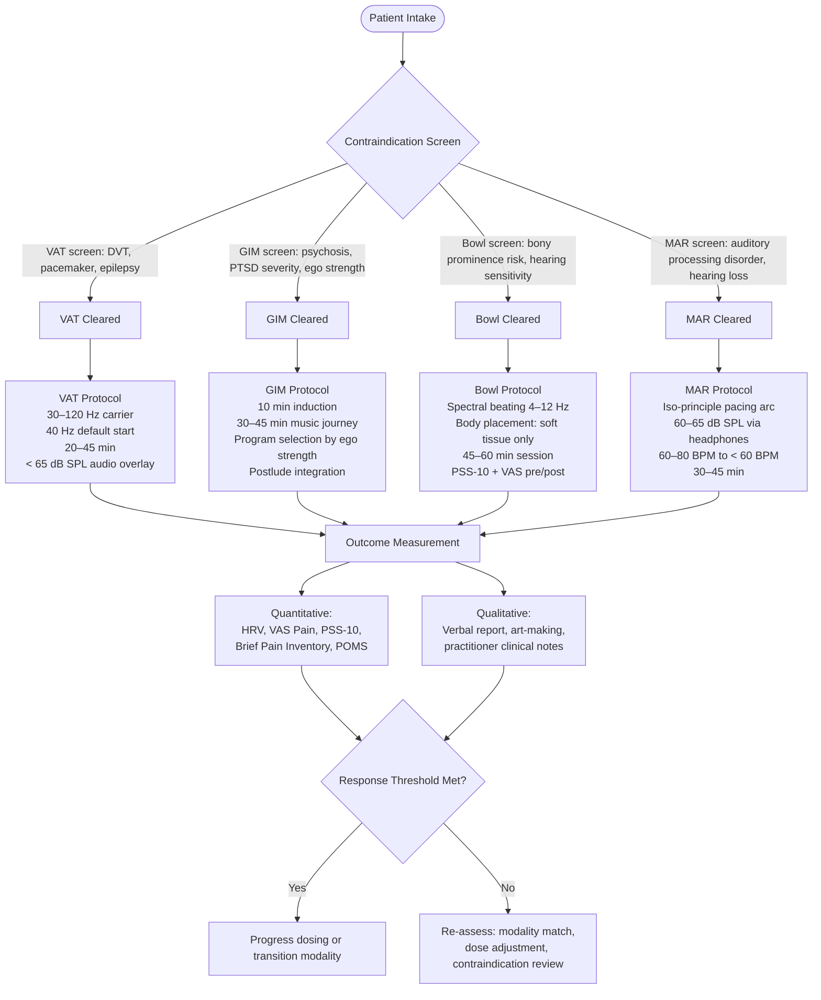

# Lesson 4: Therapeutic Modalities in Clinical Practice

## 1. First-Principles Intuition & Invariants

Sound, at its physical foundation, is mechanical pressure propagating through a medium. What distinguishes sound therapy from ambient acoustic experience is intentionality: the deliberate application of frequency, amplitude, and temporal patterning to produce measurable physiological and psychological change. Advanced practitioners must hold this distinction firmly, because the clinical legitimacy of sound therapy depends entirely on the precision with which mechanical and psychoacoustic variables are controlled, dosed, and evaluated.

The body is not a passive receiver of sound. It is a mechanically resonant system. Bone conducts vibration at frequencies the outer ear never processes. The vagus nerve responds to low-frequency resonance in the thoracic cavity. The vestibular system registers infrasound below the threshold of conscious hearing. Skin, fascia, and visceral organs each carry their own resonant bandwidths. This distributed transduction architecture means that therapeutic sound operates simultaneously across multiple physiological channels, and no two modalities activate those channels in the same proportions. Vibroacoustic therapy, Guided Imagery with Music (GIM), Tibetan singing bowl therapy, and music-assisted relaxation (MAR) are not variations on a single theme—they are mechanistically distinct interventions that share only the common medium of acoustic energy.

The first clinical invariant governing all four modalities is the dose-response relationship. Sound therapy is not homeopathic: more is not always better, and the relationship between stimulus intensity and therapeutic response is nonlinear. At low amplitudes, insufficient mechanical energy fails to entrain autonomic processes. At high amplitudes, the same frequencies that reduce pain at 40 dB SPL may trigger sympathetic activation or auditory fatigue at 85 dB SPL. Practitioners must internalize that every session has an effective therapeutic window defined by frequency range, amplitude envelope, duration, and patient-specific physiological state at intake.

The second invariant is neurological entrainment. The brain does not merely perceive sound—it synchronizes to it. Brainwave frequencies shift measurably in response to rhythmic auditory input, a phenomenon documented across EEG studies using binaural beats, rhythmic drumming, and isochronic tones. At the autonomic level, heart rate variability (HRV) synchronizes to slow respiratory rhythms embedded in musical phrasing. This entrainment mechanism is the primary action mechanism shared across all four modalities, even when their delivery platforms, contraindication profiles, and clinical goals diverge substantially.

The third invariant is the therapeutic relationship as moderating variable. Unlike pharmaceutical dosing, sound therapy outcomes are significantly modulated by the patient's psychological context, cultural relationship to the specific sounds used, prior trauma history with auditory stimuli, and the quality of the therapeutic alliance. A practitioner who treats sound therapy as purely mechanical—ignoring the relational container—will consistently underperform relative to one who integrates both dimensions. This does not reduce sound therapy to placebo; it reflects the well-documented neuroscience of top-down modulation of sensory processing via prefrontal cortex and limbic pathways. The practitioner's role is to manage both channels simultaneously.

---

## 2. Core Architecture & Mechanics

### Vibroacoustic Therapy (VAT)

Vibroacoustic therapy delivers low-frequency sinusoidal vibration—typically in the 30 Hz to 120 Hz range—directly through a solid contact surface: a purpose-built table, chair, or mattress embedded with low-frequency transducers (speakers functioning as mechanical actuators rather than air-coupled drivers). The patient lies or sits in full-body contact with the transducer surface, so the acoustic energy bypasses the air-to-eardrum pathway almost entirely and enters the body as direct mechanical displacement of soft tissue.

The clinical rationale rests on two mechanisms. First, mechanoreceptors in skin and deep fascia—Meissner's corpuscles, Pacinian corpuscles, Ruffini endings—respond to deformation frequencies that map onto the 30–120 Hz range. Sustained excitation of these receptors at therapeutic amplitudes produces descending inhibition of spinal nociceptive pathways through gate control mechanisms, which is why VAT has the most robust evidence base in chronic pain management, spasticity reduction, and palliative care applications. Second, at the cellular level, low-frequency vibration at specific amplitudes stimulates osteoblast activity and has been investigated for applications in osteoporosis and post-surgical bone rehabilitation, though practitioners should note this evidence remains preliminary.

Patient assessment for VAT must address contraindications with particular care. Active deep vein thrombosis is an absolute contraindication because mechanical vibration applied to the lower extremities can dislodge venous thrombi. Pacemaker and implanted electronic device patients require cardiologist clearance before any vibroacoustic contact session, as transducer fields can interfere with device sensing circuitry. Acute inflammation, open wounds at contact sites, and uncontrolled epilepsy (given vibration's potential to trigger photosensitive or somatosensory seizure variants) round out the core absolute contraindications.

For dosing, the standard initial protocol uses 40 Hz as the primary carrier frequency at an amplitude producing between 0.5 and 1.5 g of acceleration at the transducer surface, confirmed with a contact accelerometer during equipment calibration. Session duration begins at 20 minutes for first-contact patients, escalating by 5-minute increments across subsequent sessions to a ceiling of 45 minutes for most chronic pain applications. The practitioner overlays recorded music or tonal drones selected to reinforce the carrier frequency harmonically, maintaining the total SPL of the audio component below 65 dB SPL at ear level to avoid auditory fatigue compounding the vibrotactile input.

### Guided Imagery with Music (GIM)

Guided Imagery with Music, formalized by Helen Bonny in the 1970s from her work at the Maryland Psychiatric Research Center, represents the most psychotherapeutically sophisticated of the four modalities. It is a formal music psychotherapy method in which a trained practitioner guides a client through an altered, deeply relaxed state of consciousness while carefully selected classical music acts as a co-therapist, evoking imagery, emotion, and symbolic material that the client narrates in real time. The practitioner listens, reflects, and uses verbal interventions to deepen or redirect the imagery journey without interpreting prematurely.

The clinical architecture of GIM has four sequential phases. The prelude conversation establishes the therapeutic focus—a presenting concern or felt sense the client brings to the session. The relaxation induction transitions the client from ordinary waking consciousness to a hypnagogic-adjacent state using progressive muscle relaxation, breath awareness, or brief body-scan techniques lasting approximately 10 minutes. The music journey itself occupies 30–45 minutes, during which the client maintains spoken contact with the practitioner while the music program plays. The postlude integration phase uses verbal processing, art-making, or written reflection to consolidate insights from the imagery experience.

Music program selection is a clinical decision, not an aesthetic one. Bonny developed approximately seventeen canonical programs, each with specific therapeutic indications. The program "Nurturing/Caring" uses pieces with stable harmonic rhythm and slow melodic descent—appropriate for clients with early attachment disruption. "Death-Rebirth" employs dramatic orchestral climaxes and is reserved for advanced GIM clients working with existential themes. The practitioner must assess the client's ego strength—their capacity to remain in contact with intense emotional material without dissociating or becoming overwhelmed—before selecting any high-affect program. This assessment uses clinical interview, observation of affect regulation capacity in prior sessions, and sometimes formal measures such as the Dissociative Experiences Scale.

Contraindications for GIM are primarily psychological rather than physical. Active psychosis, acute suicidality, untreated PTSD with fragile ego strength, and acute grief without adequate therapeutic support all contraindicate the full GIM format. Modified approaches such as Music Imagery (MI)—shorter, less evocative music selections, lighter induction, more directive verbal guidance—serve as stepwise introductions for clients not yet ready for the full Bonny method.

### Tibetan Singing Bowl Therapy

Tibetan singing bowls occupy a different clinical territory than VAT or GIM, though they share the entrainment mechanism. Handcrafted singing bowls—traditionally cast from an alloy of five to seven metals—produce complex, inharmonic partial spectra when struck or rimmed with a mallet. This spectral complexity is clinically significant: unlike pure-tone generators, bowls produce sustained, slowly beating partials that create audible interference patterns in the 4–8 Hz range (theta brainwave territory) and the 8–12 Hz range (alpha territory), measurable with electroencephalography. It is this organic beating pattern that distinguishes bowl therapy from simple relaxation music.

In clinical practice, bowls are placed in proximity to or in gentle contact with the clothed patient's body. The practitioner positions bowls at points selected according to either anatomical landmarks (over major muscle groups, along the spine, over the sternum) or traditional Tibetan and Ayurvedic energetic frameworks that the practitioner may choose to frame in culturally appropriate terms without making unfounded physiological claims. Bowl placement on the body requires that contact vibration amplitude is kept low enough to avoid bruising or periosteal discomfort; bowls should never be placed directly on bony prominences, the skull, or the anterior neck.

Outcome measurement in singing bowl therapy presents challenges because the intervention is inherently multimodal: patients receive vibroacoustic contact vibration, complex auditory stimulation, visual stimulus from the practitioner's movement, and the proprioceptive experience of controlled breath during induction. Isolating which element produces the effect is not currently possible in clinical practice settings. The practitioner's measurement framework should therefore target the clinical outcome rather than the mechanism, using validated tools: the Perceived Stress Scale (PSS-10), the Visual Analog Scale for pain and anxiety, HRV biofeedback as an objective autonomic marker, and the Profile of Mood States (POMS) for session-to-session affective change tracking.

### Music-Assisted Relaxation (MAR)

Music-assisted relaxation is the most accessible and most widely applicable of the four modalities, and it is frequently underestimated precisely because of that accessibility. MAR uses live or recorded music—selected according to the iso-principle: beginning with music that matches the patient's current arousal state and gradually transitioning toward the target state—to facilitate progressive autonomic downregulation. It is used across oncology wards, ICU settings, labor and delivery, preoperative suites, and outpatient chronic pain clinics because it requires no specialized equipment beyond a calibrated playback system and trained clinical judgment.

The iso-principle deserves careful attention because misapplication is the most common practitioner failure mode. Beginning a session for an anxious, hyperaroused patient with slow, minimalist ambient music creates a perceptual mismatch that many patients experience as alienating or even irritating, deepening sympathetic activation rather than reducing it. The correct execution starts with music at approximately the patient's current heart rate tempo, harmonic complexity that mirrors their emotional texture, and then executes a deliberate, graduated pacing arc—typically across 20–30 minutes—toward 60 BPM or below, sparse harmonic content, and long sustained melodic lines. The practitioner monitors the patient's visible physiological indicators throughout: respiratory rate, shoulder position, facial muscle tension, and verbally reported comfort level.

Dosing parameters for MAR are defined by the clinical context. In perioperative settings, the evidence literature supports 30 minutes of patient-selected or practitioner-selected slow-tempo music (60–80 BPM) at 60–65 dB SPL via headphones beginning 30 minutes preoperatively, continued through induction if the anesthetic protocol permits, and resumed in recovery. For chronic pain outpatient sessions, 45-minute biweekly sessions with structured progression across eight sessions represents a sufficient course to generate measurable outcomes on the PSS-10 and Brief Pain Inventory. Shorter single-dose applications—as brief as 15 minutes—produce measurable cortisol reduction and anxiety score improvement in acute care settings, though without the cumulative neurological adaptation benefits of a structured course.

### Signal Flow and Clinical Decision Architecture

The following diagram maps the practitioner's decision architecture across all four modalities, from initial assessment through modality selection, session execution, and outcome measurement.

---

## 3. High-Performance Optimization & Failure Modes

The highest-yield optimization a practitioner can make is systematic intake calibration. Most adverse events and non-responses in sound therapy are traceable not to the modality itself but to a mismatch between modality selection and patient profile—specifically, selecting the modality the practitioner is most trained in rather than the one best suited to the patient's current physiological and psychological state. A practitioner trained predominantly in GIM who defaults to it for every presenting complaint will produce excellent outcomes with clients who have adequate ego strength, verbal processing capacity, and tolerance for emotional intensity, while producing re-traumatization or treatment dropout in fragile or medically acute patients who would have responded well to MAR.

Equipment calibration in VAT represents a persistent failure point that is preventable with routine maintenance protocols. Transducer frequency response degrades over time as the mechanical coupling between driver and surface loses compliance. A transducer rated at 40 Hz that is delivering 52 Hz due to mechanical loosening changes the clinical effect profile substantially—the therapeutic window for spasticity reduction is narrow, and drift outside it can produce patient discomfort or simply fail to engage the target mechanoreceptor populations. Practitioners should use a contact accelerometer and spectrum analyzer (or a smartphone FFT app with appropriate calibration) to verify transducer output at the patient contact surface at monthly intervals and after any equipment transport.

In GIM, the most critical failure mode is premature verbal interpretation by the practitioner during the music journey. When a client narrates imagery, the practitioner's role is to reflect the imagery back ("You're at the edge of the forest—what do you notice?") rather than to interpret its symbolic content in real time. Interpretation activates the client's left-hemisphere analytical processing, drawing them out of the hypnagogic state and collapsing the depth of the imagery experience. This is not merely a stylistic preference; it represents a failure of the core therapeutic mechanism. Supervision, peer consultation, and audio-recorded session review are the standard quality-control tools for detecting and correcting this pattern.

The iso-principle misapplication in MAR, described in the preceding section, is compounded in group settings such as hospital ward relaxation programs. When treating a group of patients simultaneously, the practitioner cannot calibrate the starting point to any individual's arousal state, so the pacing arc must be constructed more conservatively—a longer plateau at the mid-arousal transition zone—with individual headphone delivery rather than room speaker delivery to allow volume self-adjustment. Room speaker delivery in clinical settings creates a secondary failure risk: sound spill into adjacent patient areas, both reducing the acoustic privacy of the session and potentially disturbing other patients.

Contraindication screening failures represent the highest-severity failure class, particularly for VAT in patients with undiagnosed or underreported coagulation disorders or implanted devices. The standard mitigation is a written intake screening form combined with a verbal confirmation protocol at every session, not only at the initial intake. Patients acquire medical devices, begin anticoagulation therapy, or develop new vascular pathology between sessions, and a screening process that runs only once creates persistent risk exposure. The verbal confirmation takes under two minutes and should be non-negotiable as a session-opening protocol.

Outcome measurement is both a clinical quality tool and a legal and professional documentation standard. Practitioners who rely on verbal patient report without structured measurement instruments have no defensible record of treatment response, cannot adjust dosing systematically, and cannot contribute to the evidence base for the field. The minimum measurement battery for any sound therapy course should include a validated anxiety or stress measure (PSS-10 or GAD-7), a validated pain measure when pain is a presenting complaint (VAS or BPI), and at least one session of objective HRV measurement to establish an autonomic baseline. Session notes should record the specific modality parameters used—not just "singing bowl session" but bowl mass range, session duration, body placement sites, and the patient's subjective and objective response indicators.

---

## 4. Summary & Verification Matrix

| Modality | Primary Mechanism | Key Dosing Parameters | Core Contraindications | Outcome Measurement Tools | Critical Failure Mode |
|---|---|---|---|---|---|
| **Vibroacoustic Therapy (VAT)** | Mechanoreceptor stimulation via direct contact vibration; descending nociceptive inhibition | 30–120 Hz carrier; 40 Hz default; 0.5–1.5 g surface acceleration; 20–45 min; audio overlay < 65 dB SPL | Active DVT; pacemaker or implanted electronic devices; uncontrolled epilepsy; acute inflammation at contact site | VAS Pain, Brief Pain Inventory, HRV, PSS-10 | Transducer frequency drift from mechanical coupling degradation; uncalibrated equipment delivering off-target frequency |
| **Guided Imagery with Music (GIM)** | Neurological entrainment in altered consciousness state; limbic-prefrontal imagery processing via co-therapeutic music | 10 min induction; 30–45 min music journey; program selection matched to ego strength; full Bonny method vs. modified MI format | Active psychosis; acute suicidality; untreated fragile-ego PTSD; acute uncontained grief | POMS, Dissociative Experiences Scale at intake, qualitative session narrative, verbal report | Premature interpretation by practitioner collapsing hypnagogic depth; inappropriate program selection relative to ego strength |
| **Tibetan Singing Bowl Therapy** | Inharmonic partial spectra producing 4–12 Hz beating patterns; auditory and vibroacoustic entrainment toward theta/alpha | Bowls on soft tissue only; avoid bony prominences and anterior neck; 45–60 min session; beating partials in 4–12 Hz range | Cochlear implants; hypersensitivity to complex tonal stimuli; active periosteal pain at placement sites | PSS-10, VAS for anxiety and pain, HRV biofeedback, POMS | Placement on bony prominences causing periosteal discomfort; overclaiming specific energetic mechanisms without evidence-based framing |
| **Music-Assisted Relaxation (MAR)** | Autonomic entrainment via iso-principle tempo and harmonic pacing arc; HRV synchronization to musical phrase rhythm | Iso-principle arc: match current arousal, pace to < 60 BPM; 60–65 dB SPL via headphones; 30–45 min; biweekly over 8 sessions for chronic applications | Severe auditory processing disorder; hyperacusis; acute hearing loss without audiologist clearance | PSS-10, GAD-7, VAS, HRV, BPI (pain contexts), cortisol saliva sample in research settings | Iso-principle misapplication: beginning with low-arousal music for hyperaroused patient; room speaker delivery in shared clinical spaces |
| **Cross-Modality Invariants** | Neurological entrainment as shared mechanism; therapeutic relationship as moderating variable; dose-response nonlinearity | Effective therapeutic window defined per session by frequency range, amplitude, duration, and patient intake state | Full contraindication screen at every session, not only at initial intake | Minimum battery: PSS-10 or GAD-7, VAS, one baseline HRV session per treatment course | Modality selection driven by practitioner training preference rather than patient profile; absent or non-validated outcome documentation |
