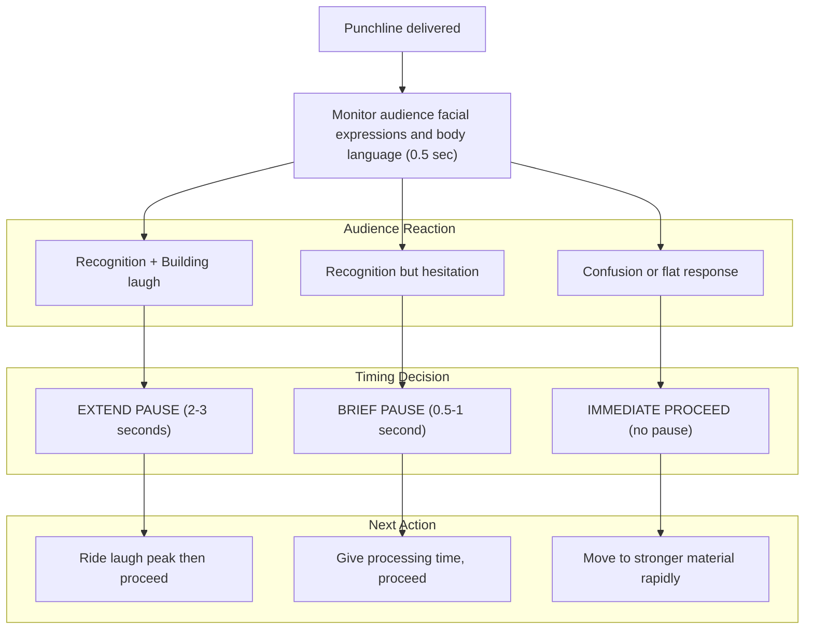

# Lesson 4: Performance Theory, Delivery, Audience Dynamics

## 1. First-Principles Intuition & Invariants

Comedy exists as a live transaction between performer and audience, a temporal art form where the medium is human attention and the product is laughter—a neurological discharge triggered by the resolution of incongruity, the puncturing of tension, or the recognition of shared truth. Unlike static arts where the artifact persists independently of observation, comedic performance evaporates in real-time, leaving only memory and the physiological afterglow of endorphin release. This ephemeral nature establishes the foundational constraint: comedy cannot be separated from its delivery mechanism. A joke on paper is merely potential energy; a joke performed becomes kinetic, converting scripted structure into embodied experience through vocal tone, physical gesture, timing precision, and the electromagnetic feedback loop of audience energy.

The invariant principle governing all comedic performance is the **delay-and-release pattern**, a fundamental rhythm embedded in human cognition. The brain continuously generates predictions about incoming sensory data, and comedy exploits the gap between expectation and reality. Setup establishes a predictive frame; punchline violates that frame in a non-threatening manner. The performer's task is to engineer this violation with surgical precision, controlling information flow through voice, body, and persona to maximize the perceptual surprise while minimizing confusion or discomfort. Every technical choice in performance—pause duration, vocal inflection, physical gesture—serves this primary function: managing the audience's predictive model to create optimal conditions for laughter discharge.

Performance theory begins with understanding that the comedian is not merely reciting material but constructing and inhabiting a **performance persona**, a theatrical entity distinct from the performer's private self. This persona functions as an interpretive lens through which all material is filtered, providing consistent logic for tone, perspective, and behavioral choices. The persona answers implicit questions the audience asks unconsciously: Who is speaking? What do they want? What are their limitations and blind spots? Why should I trust their perspective? The strength of persona determines the audience's willingness to follow the performer into uncomfortable territory, to accept absurdist premises, or to tolerate unconventional delivery rhythms. A comedian without clear persona generates cognitive dissonance; the audience expends mental energy trying to categorize the speaker rather than processing the material.

The mechanics of live comedy performance operate through three interconnected subsystems: **vocal architecture**, **physical embodiment**, and **relational calibration**. Vocal architecture encompasses all auditory elements—pitch variation, tempo modulation, volume dynamics, tonal quality, and rhythmic phrasing. Physical embodiment includes gesture, facial expression, spatial positioning, movement patterns, and the manipulation of physical tension in the performer's body. Relational calibration describes the feedback-sensitive adjustments a performer makes in response to audience energy, cognitive load, and emotional state. These three systems do not operate independently; vocal choices shape audience expectations which the physical body either confirms or contradicts, while relational awareness determines when to accelerate pacing or when to extend pauses for maximum effect.

The foundational invariant of audience dynamics is that **laughter is socially contagious but individually gatekept**. Each audience member possesses their own threshold for comedic response, determined by cultural background, current emotional state, cognitive processing speed, personal trauma history, and social context. However, the act of laughing in a group setting lowers individual thresholds through social proof and neurological resonance. The performer's challenge is to cross enough individual thresholds rapidly enough to trigger cascade effects, where initial laughers signal permission for marginal laughers to release inhibition. This creates the phenomenon of "warming up" an audience—not improving the material, but systematically lowering collective resistance through repeated small successes that build social momentum.

Cultural context functions as the electromagnetic field through which all comedic signals must pass, bending meaning and altering reception in ways that vary by geography, demographic composition, historical moment, and shared reference frameworks. A joke premised on familiarity with suburban American parenting culture will pass through that cultural filter with minimal distortion but encounter massive resistance or complete incomprehensibility in audiences lacking that context. The performer must develop **cultural resonance mapping**, an intuitive sense of which references, linguistic patterns, and assumed value systems will activate recognition versus confusion. This is not about self-censorship but about strategic framing—providing sufficient context to make the violation legible without over-explaining and destroying the surprise mechanism.

The temporal dimension of performance introduces the critical concept of **attention management**. Human attention operates as a depletable resource with natural oscillation patterns. Audiences cannot maintain peak focus indefinitely; cognitive engagement follows wave patterns with approximately 7-12 minute cycles in typical performance environments. The performer must structure material and energy expenditure to align with these natural rhythms, placing high-density conceptual material during attention peaks and allowing recuperation valleys through callback jokes, crowd work, or physical bits that require less cognitive processing. Failure to respect attention cycles results in jokes landing poorly not because of content weakness but because they arrive when the audience lacks the cognitive bandwidth to process them.

## 2. Core Architecture & Mechanics

The construction of comedic persona begins with **archetype selection and specificity layering**. Archetypal foundations provide immediate legibility—the cynic, the innocent, the intellectual, the everyman, the provocateur, the weirdo. These templates activate pre-existing neural patterns in audience cognition, allowing rapid categorization and expectation-setting. However, pure archetype produces generic performance; the performer must layer specific behavioral traits, speech patterns, and perspective quirks that individuate the persona while maintaining archetypal coherence. A cynical persona might be specified as "disillusioned middle manager who maintains elaborate conspiracy theories about office supply procurement," grounding the general archetype in concrete behavioral texture.

The technical implementation of persona requires **consistency enforcement across modalities**. Voice, body, and content must express unified perspective. A persona characterized by high-status confidence cannot simultaneously exhibit low-status physical collapse without intentional comic incongruity. The performer constructs a constraint system where each modality checks the others for alignment. Voice pitch and rhythm should match the persona's social positioning and energy level. Physical space occupation should reflect the persona's comfort with attention and authority. Material selection should arise organically from the persona's worldview and observational focus. When modalities conflict without strategic purpose, the audience experiences uncanny valley effects—sensing inauthenticity without conscious awareness of the source.

Vocal modulation operates through five primary parameters: **pitch range, tempo variation, volume dynamics, tonal quality, and rhythmic phrasing**. Pitch functions as an emotional signaling system, with higher registers suggesting excitement, urgency, or vulnerability, while lower registers convey authority, intimacy, or threat. The comedian's pitch range establishes the persona's emotional bandwidth and shapes audience perception of stakes. A monotone delivery with minimal pitch variation signals detachment or depression, potentially useful for deadpan personas but catastrophic for enthusiastic storytellers. Strategic pitch variation creates melodic contour in speech, preventing auditory monotony and using pitch climbs to build tension and pitch drops to signal resolution.

Tempo control governs information density and processing time. Rapid-fire delivery compresses information, creating cognitive pressure that amplifies surprise when punchlines arrive with velocity. Decelerated tempo allows space for audience processing, useful when material requires conceptual assembly or when callbacks reference earlier segments. The critical skill is **adaptive tempo scaling**, where the performer monitors audience comprehension in real-time and adjusts pacing accordingly. Signs of cognitive overload include delayed laughter, confused facial expressions, and attention drift. The corrective action is not merely slowing down but strategic pause insertion, allowing the audience's internal processing to complete before introducing new information.

```text
Tempo-Pressure Relationship Model:

High Tempo (4-6 words/sec)  →  Cognitive pressure  →  Heightened surprise
Medium Tempo (3-4 words/sec) →  Standard processing  →  Comfortable comprehension
Low Tempo (2-3 words/sec)   →  Emphasis mode       →  Dramatic weight

Strategic Pattern for Dense Material:
[High tempo setup] → [Calculated pause 1.5-2 sec] → [Medium tempo punchline] → [Extended pause 2-3 sec for laugh] → [Resume medium tempo]
```

Volume dynamics create spatial intimacy and emphasis hierarchy. Quiet delivery forces audience focus, creating intimacy and making listeners work slightly harder to receive information, which increases perceived value. Loud delivery signals high emotion and commands attention through auditory dominance. The most effective volume control uses **dynamic range exploitation**, contrasting quiet and loud moments to prevent adaptation. Sustained loudness numbs audience response through sensory habituation; sustained quietness loses energy and projects weakness. The performer oscillates strategically, using volume spikes to punctuate key words and volume drops to draw listeners into vulnerable moments.

Tonal quality—the timbre and texture of voice—carries enormous subcommunication about persona authenticity and emotional state. Nasal tones suggest neurosis or whining; throaty tones suggest sensuality or authority; breathy tones suggest vulnerability or intimacy. The performer must identify the natural tonal quality that aligns with persona and then maintain that quality consistently throughout performance. Tonal shifts without motivation break the performance contract. However, intentional tonal code-switching—adopting different vocal qualities for different characters or perspectives within material—creates clear markers for audience to track perspective shifts.

Rhythmic phrasing determines the musical quality of speech, the pattern of stressed and unstressed syllables that creates flow and momentum. Comedy benefits from awareness of **iambic and trochaic patterns** not in strict poetic meter but in natural speech rhythm that feels inevitable rather than arbitrary. Consider the difference: "I went to the STORE" (trochaic, stress-first) versus "I WENT to the store" (iambic, building to stress). Punchlines land with greater impact when the stress pattern places emphasis on the surprise word. The rule of three, a fundamental comedic structure, succeeds partly because of rhythmic expectation—two items establish pattern, third item arrives at the expected rhythmic moment but with unexpected content.

Physical embodiment begins with **spatial positioning and stage geometry**. The performer's relationship to physical space communicates status, vulnerability, and energy. Center-stage positioning claims high status and demands attention; off-center positioning suggests humility or conversational approach. Forward stage proximity creates intimacy and intensity; upstage positioning creates distance and observational perspective. The comedian must make conscious choices about default spatial positioning that aligns with persona, then use positional shifts to mark transitions in material or emotional register.

Gesture functions as **visual punctuation and emphasis vectoring**, directing audience attention to key concepts and providing physical metaphor for abstract ideas. Pointing gestures assign spatial location to concepts, useful when juggling multiple story elements or perspectives. Descriptive gestures illustrate size, shape, movement, creating mental imagery that enhances comprehension. Emblematic gestures carry specific cultural meaning—thumbs up, middle finger, shrugging—that function as visual shorthand. The critical principle is **gesture economy**: excessive gesture creates visual noise and dilutes emphasis, while absent gesture produces static flatness. Each gesture must serve communicative purpose, appearing at moments of emphasis and retreating into neutral position otherwise.

Facial expression operates at higher temporal resolution than spoken language, capable of communicating micro-reactions and emotional nuance at millisecond speed. The comedian's face serves dual functions: expressing the persona's reaction to material and providing **meta-commentary** on content. A deadpan face while describing absurd situations creates ironic distance; an animated face showing full emotional investment creates identification. The performer must decide whether the persona is aware of the absurdity being described or genuinely believes in their skewed perspective. This decision determines facial expression strategy throughout performance.

Physical tension and relaxation patterns communicate comfort, anxiety, confidence, and vulnerability through body posture and movement quality. High physical tension—locked joints, rigid spine, shallow breathing—signals anxiety or aggression depending on context. Physical relaxation—loose joints, curved spine, deep breathing—signals confidence or exhaustion depending on energy level. The comedian manipulates personal physical tension to create embodied emotional states that the audience reads subconsciously. A performer describing anxiety while physically relaxed creates cognitive dissonance; describing anxiety while physically tense creates authentic resonance that amplifies the material's emotional reality.

```mermaid
flowchart TD
    Root["Persona Embodiment Matrix"]
    
    Root --> A1["ARCHETYPE: The Anxious Overthinker"]
    A1 --> A1V["Vocal: Higher pitch baseline, rapid tempo with interruption patterns"]
    A1 --> A1P["Physical: Elevated shoulder tension, compressed spatial occupation"]
    A1 --> A1G["Gesture: Small, tight, repetitive movements near body centerline"]
    A1 --> A1F["Facial: Furrowed brow default, frequent eye widening at 'realizations'"]
    
    Root --> A2["ARCHETYPE: The Confident Provocateur"]
    A2 --> A2V["Vocal: Lower pitch baseline, controlled tempo with strategic pauses"]
    A2 --> A2P["Physical: Expanded spatial occupation, relaxed joint positioning"]
    A2 --> A2G["Gesture: Large, sweeping movements into audience space"]
    A2 --> A2F["Facial: Slight smirk default, direct eye contact, minimal surprise"]
    
    Root --> A3["ARCHETYPE: The Bewildered Observer"]
    A3 --> A3V["Vocal: Mid-range pitch with confusion inflections, uneven tempo"]
    A3 --> A3P["Physical: Neutral spine, frequent weight shifts, head tilts"]
    A3 --> A3G["Gesture: Open-palm questioning gestures, pointing at imagined scenarios"]
    A3 --> A3F["Facial: Raised eyebrows, slight head shake, genuine puzzlement"]
```



The mechanics of **audience relationship construction** begin with eye contact patterns that establish connection without intimidation. The performer must distribute visual attention across the audience geography, creating the illusion of individual connection while maintaining awareness of collective energy. The technical pattern involves sectional scanning—focusing on different audience zones for 3-5 second intervals, making brief eye contact with individuals within each section without sustained staring. This creates inclusion while preventing the awkwardness of prolonged direct contact that transforms comedy into confrontation.

Crowd work, the practice of improvisational interaction with specific audience members, serves multiple strategic functions beyond entertainment value. It **lowers the fourth wall**, transforming the theatrical one-directional relationship into conversational exchange that increases intimacy. It demonstrates performer competence through unrehearsed success, building credibility. It provides recovery time for both performer and audience, offering cognitive rest between high-density material segments. However, crowd work carries risk: audience members may respond with hostile resistance, lengthy incoherence, or such effective humor that they upstage the performer. The skilled comedian develops **risk-assessment protocols**, identifying audience members likely to provide productive interaction based on body language, positioning, group dynamics, and initial energy.

Callback structure exploits **recognition reward mechanisms** in audience cognition. When the performer references material from earlier in the set, audience members who successfully retrieve the earlier moment experience a micro-achievement, a small dopamine reward for memory accuracy. This creates affection for the performer who facilitated that reward. Structurally, callbacks function as inside jokes with the audience, creating in-group cohesion and elevating listeners from passive consumers to active participants. The technical implementation requires strategic setup, where early material is constructed with callback potential—distinctive phrases, memorable images, unusual concepts—that can be re-invoked later with minimal explanation.

Adaptive timing represents the highest-order performance skill, the real-time calibration of pause duration, pace, and rhythm based on audience response patterns. The fundamental tool is the **post-punchline pause**, the silence following a joke that provides space for laughter discharge and prevents the performer from stepping on their own laugh. Novice performers fear silence and rush through it, cutting off laughter prematurely and training the audience not to laugh since sound will be immediately covered. The professional performer extends the pause until laughter peaks and begins subsiding, then rides the declining edge to resume speech as the laugh naturally completes.

The technical challenge of adaptive timing emerges when jokes fail. A failed joke creates awkward silence that must be addressed or transcended. The options form a decision tree: acknowledge the failure with meta-commentary that transforms failure into new material, plow forward with confidence that reframes silence as intentional pause, or deploy a prepared rescue callback that redirects attention. The choice depends on persona—a vulnerable persona can acknowledge failure authentically, a confident persona must reframe or ignore. The critical invariant is that **hesitation and apology amplify failure**; the performer must commit fully to their chosen recovery strategy without visible panic.



## 3. High-Performance Optimization & Failure Modes

The optimization of comedic performance begins with **energy management across set duration**. Human physiology cannot maintain peak performance intensity indefinitely; adrenaline depletes, vocal cords fatigue, cognitive sharpness degrades. The performer must architect the set as an energy wave with strategic peaks and valleys. Opening material establishes credibility and persona through strong, accessible jokes that build initial momentum. The middle section can venture into riskier, more complex material once trust is established. The closing sequence returns to high-energy, proven material that ensures strong final impression. This wave structure allows physiological recovery periods while maintaining perceived momentum.

Vocal fatigue represents the primary physical constraint in extended performance. The vocal mechanism operates through precise muscular control of laryngeal structures and breath support from the diaphragm. Improper technique—speaking from throat rather than diaphragm, maintaining excessive tension in neck and jaw, insufficient hydration—accelerates vocal degradation and can cause acute damage. The optimization protocol involves **diaphragmatic breath support** where air pressure originates from abdominal compression rather than throat constriction, reducing strain on delicate vocal tissue. Proper hydration maintains mucosal flexibility, preventing the dry scratchiness that distorts tonal quality. Vocal warm-up exercises—humming, lip trills, gentle scales—prepare the mechanism for performance demands.

The failure mode of **over-modulation** occurs when the performer becomes so focused on technical delivery that spontaneity and authentic presence disappear. Comedy requires the paradox of rehearsed spontaneity, where material is memorized and optimized through repetition but delivered with the freshness of discovery. Over-modulation produces robotic, mannered performance where every gesture and inflection feels calculated. The correction involves **technical internalization**, practicing delivery mechanics until they become subconscious habit rather than conscious execution. The performer must reach the state where persona, vocal choices, and physical embodiment feel natural rather than constructed, freeing conscious attention to focus on audience connection and in-the-moment responsiveness.

Audience heterogeneity presents the challenge of **multi-threshold optimization**. A diverse audience contains subgroups with different cultural references, political orientations, generational contexts, and humor sensibilities. Material that resonates strongly with one demographic may alienate or confuse another. The performer faces a tradeoff between targeting specific demographics with highly resonant specific material versus pursuing broader accessibility with more general material. The optimization strategy depends on performance context: niche audiences in specialized venues reward specificity and insider references, while broad audiences in mainstream venues require accessible common denominators. The sophisticated performer develops **layered material** that functions at multiple levels—surface narrative accessible to all, with embedded references and implications that reward specific knowledge without requiring it for basic comprehension.

The failure mode of **persona drift** occurs during extended touring or when performing the same material repeatedly. The performer begins to feel disconnected from their own words, leading to vocal flatness, physical listlessness, and emotional detachment that the audience reads as inauthenticity. The material remains identical but the delivery loses vitality. The correction requires **perspective refresh techniques**: finding new emphasis patterns in familiar material, discovering new physical choices, identifying contemporary references that update static content, or deliberately varying delivery speed and rhythm to break habitual patterns. The goal is to rediscover genuine connection to the material's emotional core or conceptual surprise.

Environmental variables dramatically impact performance outcomes through acoustic properties, sightline geometry, audience density, and ambient conditions. Acoustically dead rooms with heavy sound absorption require the performer to project more forcefully and can dampen laugh response since audience members can't hear each other easily. Reverberant rooms with hard surfaces create echo and muddy verbal clarity, requiring slower, more articulated speech. The performer must develop **environmental adaptability**, quickly assessing venue acoustics during sound check and adjusting delivery accordingly. Sightline problems—columns blocking views, excessive stage height, poor lighting—prevent portions of the audience from fully engaging, requiring the performer to maximize vocal clarity when visual connection is compromised.

Audience density affects social contagion dynamics profoundly. Tightly packed audiences create stronger laughter cascade effects through physical proximity and auditory saturation. Sparsely distributed audiences feel isolated, increasing individual inhibition and reducing laughter intensity. The performer cannot control attendance but can manipulate **perceived density** through audience positioning and spatial framing. Requesting that sparse audiences move forward and center creates artificial density that improves response. Using lighting to create intimate darkness around the audience while illuminating the performer reduces the visibility of empty space that psychologically dampens energy.

The challenge of **cultural code-switching** arises when performing for audiences with significantly different cultural frameworks than the performer's native context. References, linguistic patterns, values hierarchies, and acceptable transgression boundaries vary dramatically across cultures. A performer trained in American metropolitan comedy who attempts to perform for rural audiences in different countries encounters massive reference frame mismatch. The optimization strategy involves research, humility, and strategic universality. Research identifies cultural touchstones and taboo zones. Humility acknowledges knowledge gaps and allows the audience to guide calibration. Strategic universality focuses on human experiences that transcend specific cultural context—physical comedy, relationship dynamics, existential anxieties—while minimizing culture-specific references.

Technical failure recovery protocols address the inevitable moments when material fails, technical equipment malfunctions, or external disruptions occur. The critical principle is **maintaining relational authority**—the audience's perception that the performer controls the frame even in chaos. When a joke fails, the performer who apologizes or displays visible distress transfers authority to the audience, who now possess the power to judge and withhold approval. The performer who acknowledges failure with amused detachment or meta-commentary maintains authority by framing the failure as interesting data rather than personal catastrophe. The underlying psychology exploits confidence signaling: if the performer treats the failure as inconsequential, the audience adopts that frame.

Heckler management represents a specific case of disruption handling where an audience member attempts to seize conversational control through unsolicited commentary. The performer's response options form a tactical matrix. Ignore the heckler if the disruption is minor and acknowledgment would amplify it. Engage briefly with humorous dismissal if the heckler can be dispatched quickly without extended conflict. Engage extensively only if the heckler provides material for extended crowd work that entertains the broader audience. The failure mode is allowing the heckler to dictate the performance rhythm or creating hostile confrontation that makes the audience uncomfortable. The optimization strategy treats the heckler as unwitting straight man, using their disruption as setup for additional jokes that demonstrate performer competence while reestablishing frame control.

The phenomenon of **performer anxiety** and its physiological manifestations—elevated heart rate, shallow breathing, trembling, cognitive fixation—degrades performance through vocal instability, physical rigidity, and reduced cognitive flexibility. The optimization protocol involves reframing anxiety as excitement, which shares identical physiological markers but different psychological interpretation. Controlled breathing exercises—particularly extended exhalation which activates parasympathetic nervous system—reduce physical symptoms. Extensive rehearsal builds confidence through preparation, reducing uncertainty. Pre-performance rituals create psychological anchoring that signals readiness. The critical insight is that moderate anxiety enhances performance by elevating alertness and focus, while excessive anxiety creates paralysis; the goal is calibration rather than elimination.

Long-term career optimization requires **material evolution and persona development** that prevents artistic stagnation while maintaining audience connection. Performers who repeat identical material for years encounter diminishing returns as novelty fades and cultural relevance decays. However, radical persona shifts alienate existing audiences who connected with the original version. The optimization path involves gradual evolution where core persona elements remain consistent while perspective, material focus, and technical sophistication advance. The performer who began as anxious twenty-something can evolve into anxious forty-something, maintaining the personality architecture while updating context and concerns to reflect authentic life progression.

The failure mode of **premature stylistic ambition** occurs when developing performers attempt advanced techniques before mastering fundamentals. A novice who attempts complex callbacks without first establishing clear setup, or who pursues experimental non-linear structure before demonstrating linear competence, creates confusion rather than artistry. The optimization sequence follows skill dependency chains: master basic joke structure and timing before attempting subversion of those structures, establish strong persona before experimenting with meta-theatrical persona commentary, succeed with prepared material before attempting extensive improvisation. Each advanced technique requires foundation skills as prerequisites.

Performance analysis and iteration complete the optimization cycle through systematic review and targeted improvement. Recording performances allows objective analysis of technical execution—identifying unintentional verbal fillers, noticing physical habits that distract rather than enhance, measuring actual pause duration against intended duration. Audience response patterns reveal which material lands consistently versus sporadically, indicating reliability differences. The critical distinction separates **variance from failure**: material that succeeds wildly with some audiences and fails completely with others suffers from narrow targeting, while material that consistently generates moderate response indicates safe but unambitious construction. The performer must decide whether to file down the sharp edges of polarizing material or sharpen them further for audiences who will appreciate maximum edge.

The ultimate performance optimization recognizes that technical excellence serves connection rather than replacing it. The audience does not consciously appreciate optimal pause duration or sophisticated gesture economy; they experience the resulting clarity, emphasis, and emotional resonance. The performer who masters technical mechanics creates the infrastructure for authentic presence, where delivery feels effortless and natural rather than constructed. This state of **integrated mastery** allows the performer to focus entirely on the relationship with the audience, using technical tools subconsciously while conscious attention remains fully present to the living moment of shared experience. The technique disappears into transparency, leaving only the laughter it was designed to produce.
