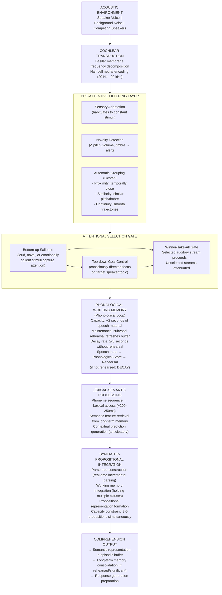

# Lesson 1: Perceptual Foundations of Active Listening

## 1. First-Principles Intuition & Invariants

Active listening is not a passive reception of acoustic information but a cognitively demanding performance that operates under strict physiological and neural constraints. Before we can master the strategic deployment of attention, empathetic reflection, or interpretive questioning, we must first understand the fundamental perceptual machinery that transforms acoustic pressure waves into comprehensible semantic content. This transformation occurs through a multi-stage pipeline where signal detection, perceptual filtering, attentional selection, and working memory integration operate under severe bandwidth and capacity constraints.

The human auditory system processes sound through a cascade of transformations beginning at the cochlea, where mechanical vibrations are converted into neural impulses, and culminating in the superior temporal gyrus where phonemic patterns are recognized and assembled into words. However, the acoustic signal reaching our ears contains far more information than our conscious processing systems can handle. Background noise, overlapping conversations, environmental acoustics, and the speaker's prosodic variations all compete for limited attentional resources. The fundamental constraint governing listening is that attention operates as a selective bottleneck, not a parallel broadcast receiver.

Signal Detection Theory, originally developed in the 1950s for radar operators distinguishing enemy aircraft from noise, provides the mathematical foundation for understanding how listeners discriminate meaningful signals from background interference. Every listening situation presents a decision problem: is the acoustic pattern I am detecting a genuine linguistic signal requiring cognitive processing, or is it noise that should be filtered out? This decision operates along two dimensions of accuracy. A "hit" occurs when a genuine signal is correctly identified and attended to. A "miss" occurs when a genuine signal is present but goes undetected, often because attentional resources are allocated elsewhere. A "false alarm" occurs when noise is mistakenly interpreted as signal, consuming cognitive resources on irrelevant stimuli. A "correct rejection" occurs when noise is appropriately ignored.

The critical insight from Signal Detection Theory is that the threshold for discriminating signal from noise is not fixed but adjustable based on motivational factors, environmental context, and cognitive strategy. A listener in a noisy cocktail party environment may adopt a liberal criterion, accepting more false alarms in exchange for fewer misses, ensuring they catch potentially important conversational content even at the cost of occasional misinterpretation. Conversely, a clinician conducting a psychiatric intake may adopt a conservative criterion, demanding higher certainty before concluding that a patient has expressed suicidal ideation, accepting more misses to avoid false alarms that could lead to inappropriate interventions.

The perceptual filtering mechanisms that govern what reaches conscious awareness operate both pre-attentively and through controlled attentional selection. Pre-attentive filtering occurs automatically and outside conscious control through neural adaptation and habituation processes. Neurons responsive to constant stimuli reduce their firing rate over time, a phenomenon known as sensory adaptation. This is why the hum of an air conditioning unit fades from awareness within minutes, but a sudden change in pitch immediately captures attention. This automatic filtering conserves neural resources by deprioritizing unchanging background stimuli, allowing the system to remain sensitive to novelty and change, which historically signaled potential threats or opportunities.

Controlled attentional selection, by contrast, involves the deliberate allocation of limited cognitive resources to specific auditory streams. The most famous demonstration of this capacity is the "cocktail party effect," first described by Colin Cherry in 1953. When presented with two simultaneous speech streams, one in each ear through headphones, listeners can selectively attend to one stream and report its content in detail while remaining largely oblivious to the content of the unattended stream. This selective listening is not a simple volume control that turns down unattended channels. Rather, it involves active neural enhancement of attended signals through top-down modulation of sensory processing areas. Functional neuroimaging studies reveal that attending to a particular speaker increases neural activity in auditory cortex regions tuned to that speaker's voice characteristics, while simultaneously suppressing activity in regions responsive to competing speakers.

The attention-comprehension pipeline represents a staged processing architecture where information flows through increasingly sophisticated levels of analysis, with each stage subject to capacity constraints and potential failure modes. At the acoustic-phonetic stage, raw auditory input is segmented into phonemic units. This process is surprisingly robust to degradation; listeners can comprehend speech even when significant portions of the acoustic signal are masked by noise, because the linguistic system uses contextual constraints to reconstruct missing information. However, this reconstructive process consumes working memory resources and increases cognitive load.

At the lexical-semantic stage, phonemic sequences are mapped onto stored word representations, and semantic features are retrieved from long-term memory. This process operates with remarkable speed—listeners can recognize words within 200-250 milliseconds of their acoustic onset, often before the word is completely spoken. This temporal efficiency is achieved through predictive processing, where the linguistic system generates expectations about likely upcoming words based on syntactic and semantic context. When predictions are confirmed, processing is facilitated. When predictions are violated, additional cognitive resources must be recruited to revise the interpretive model.

At the syntactic-propositional stage, individual words are integrated into structured representations of meaning. This requires holding multiple words simultaneously in working memory while computing their grammatical relationships. The capacity constraints of working memory create a fundamental bottleneck in comprehension. Complex sentences with multiple embedded clauses, long-distance dependencies, or ambiguous phrase attachments tax working memory severely and increase the probability of comprehension failure.

Cognitive load theory, developed by John Sweller, provides a framework for understanding how the finite capacity of working memory constrains learning and comprehension. Working memory can be conceptualized as having three components following Alan Baddeley's model: the phonological loop, which temporarily stores verbal and acoustic information through subvocal rehearsal; the visuospatial sketchpad, which maintains visual and spatial information; and the central executive, which coordinates attention, manipulates information, and interfaces with long-term memory. The phonological loop has a capacity of approximately two seconds of speech material, refreshed through rehearsal. When incoming speech exceeds this capacity and rehearsal is prevented, information decays rapidly.

Intrinsic cognitive load refers to the inherent complexity of the material being processed. A technical lecture on quantum field theory imposes higher intrinsic load than a conversation about weekend plans because it requires simultaneous activation of more knowledge structures and more complex inferential processes. Extraneous cognitive load refers to load imposed by poor presentation or environmental factors that do not contribute to learning or comprehension. A speaker with a heavy accent, poor articulation, or inconsistent volume imposes extraneous load by forcing listeners to expend cognitive resources on low-level signal processing that would otherwise be automatic. Germane cognitive load refers to the productive cognitive work of schema construction and knowledge integration.

The practical implication of cognitive load theory for active listening is that listeners operate under a fixed cognitive budget. When excessive resources are consumed at lower levels of processing due to poor acoustics, attentional competition, or speech disfluencies, fewer resources remain available for higher-level comprehension, critical evaluation, and memory consolidation. Elite listeners optimize their cognitive budget through strategic allocation of attention, environmental management, and metacognitive monitoring of their own comprehension state.

Perceptual constancy mechanisms allow listeners to maintain stable interpretations despite massive variability in the acoustic signal. The same phoneme spoken by different talkers, in different emotional states, at different speaking rates, and in different phonetic contexts produces vastly different acoustic patterns. Yet listeners effortlessly map this variability onto stable phonemic categories. This process of normalization requires the auditory system to maintain calibrated internal models of talker characteristics, continuously adjusting these models based on recent exposure. When a new speaker begins talking, there is a brief recalibration period during which comprehension is slightly degraded. Elite listeners minimize this transition cost by rapidly extracting speaker-specific features and updating their perceptual models.

The concept of informational masking, distinct from energetic masking, is critical for understanding failures in selective attention. Energetic masking occurs when background noise has sufficient acoustic power in the same frequency range as the target speech to physically obscure the signal. Informational masking occurs when competing speech or complex auditory stimuli interfere with perceptual processing even when they occupy different frequency ranges. The interference occurs at the level of perceptual object formation and attentional selection. When two speakers produce similar voice characteristics or overlapping temporal patterns, the perceptual system struggles to segregate the acoustic input into distinct auditory objects, leading to comprehension breakdown even when the acoustic signal-to-noise ratio is favorable.

The duplex theory of speech perception, proposed by Liberman and Mattingly, suggests that speech processing involves both a general auditory processing stream and a specialized phonetic processing module. This specialized module is hypothesized to process speech with reference to the articulatory gestures that produced it, not merely as abstract acoustic patterns. Evidence for this motor theory comes from observations that listening to speech activates motor areas involved in speech production, and that disrupting motor cortex function with transcranial magnetic stimulation can impair speech perception. For active listening practitioners, this suggests that internal simulation of speaker articulation may facilitate comprehension, particularly when dealing with degraded or ambiguous signals.

## 2. Core Architecture & Mechanics

The sensory attention mechanism that enables selective listening can be modeled as a three-component architecture consisting of bottom-up salience detection, top-down goal-directed control, and a dynamic gating system that adjudicates between competing attentional demands. This architecture operates continuously and largely automatically, though skilled listeners learn to exert strategic control over its parameters.

The cochlear transduction stage operates as a mechanical frequency analyzer. The basilar membrane within the cochlea is structured such that high-frequency sounds cause maximal displacement at the base, while low-frequency sounds cause maximal displacement at the apex. This tonotopic organization is preserved throughout the ascending auditory pathway, with different neural populations tuned to different frequency ranges. Inner hair cells transduce mechanical displacement into neural action potentials with remarkable temporal precision, capable of phase-locking to stimulus frequencies up to approximately 4-5 kHz. This temporal coding, combined with place coding from tonotopic organization, allows the auditory system to achieve extraordinary frequency discrimination on the order of 0.2% for pure tones in the mid-frequency range.

The pre-attentive filtering layer implements automatic organizational principles first described by Gestalt psychologists. The principle of auditory stream segregation, elaborated by Albert Bregman, explains how the auditory system parses complex acoustic environments into distinct perceptual objects. When two sequences of tones alternate rapidly, listeners may perceive them as a single galloping rhythm if the frequency difference is small. As the frequency separation increases, a perceptual bifurcation occurs, and listeners suddenly hear two distinct melodic streams. This phenomenon demonstrates that auditory grouping is not simply a matter of conscious decision but reflects mandatory organizational processes operating before attentional selection.

Temporal coherence serves as a primary cue for stream segregation. Acoustic features that start and stop together, modulate together, or show correlated frequency trajectories are bound into unified auditory objects. A speaker's fundamental frequency, formant frequencies, and amplitude envelope all covary as they articulate phonemes, providing a coherent signature that distinguishes their voice from environmental noise or competing speakers. The auditory system exploits these correlations through neurons in the auditory cortex that respond preferentially to co-modulated sounds, effectively implementing a neural correlator that groups correlated features.

The attentional selection gate operates through a competitive process where multiple stimulus representations vie for access to limited-capacity processing resources. The biased competition model, developed by Desimone and Duncan, proposes that this competition is resolved through a combination of stimulus-driven salience and goal-directed bias signals. A loud, sudden sound generates strong bottom-up activation that can override ongoing top-down attentional focus. This involuntary attention capture has obvious evolutionary advantages, allowing organisms to orient rapidly to potential threats. However, it also represents a vulnerability for active listeners, as unexpected acoustic events can disrupt comprehension of ongoing speech.

Top-down attentional control is implemented through descending projections from frontal and parietal regions that modulate sensory processing in auditory cortex. These projections implement a form of neural gain control, amplifying responses to attended stimuli while suppressing responses to unattended stimuli. The effect is not simply equivalent to turning up the volume on attended streams; rather, it enhances the neural signal-to-noise ratio by increasing the difference between stimulus-driven activity and baseline noise. Electrophysiological recordings show that attention increases the reliability and temporal precision of neural responses, making it easier for downstream areas to decode stimulus identity.

The winner-take-all gating mechanism ensures that only one auditory stream receives full processing resources at any moment. This creates the subjective experience of unitary conscious awareness—we cannot simultaneously comprehend two overlapping conversations in detail. However, unattended streams are not completely blocked. They undergo partial processing sufficient to detect personally significant stimuli, as demonstrated by the observation that hearing one's own name in an unattended conversation captures attention. This suggests a two-stage model where all incoming streams receive shallow perceptual analysis, but only attended streams receive deep semantic processing.

The phonological loop component of working memory operates as a temporary buffer that maintains verbal information in an accessible state. The buffer has both a storage component that retains phonological representations and a rehearsal component that refreshes these representations through subvocal articulation. The rehearsal process is not merely passive repetition but active regeneration of the phonological code. Neuroimaging studies reveal that silent rehearsal activates motor and premotor areas involved in speech production, supporting the hypothesis that rehearsal involves covert articulation.

The capacity limitation of the phonological loop, conventionally measured as the memory span for digit sequences (approximately seven items for adults), reflects both storage decay and the time required for rehearsal. Items presented rapidly in succession may exceed the rehearsal rate, causing earlier items to decay before they can be refreshed. The word-length effect demonstrates this constraint: memory span is greater for short words than long words because short words can be rehearsed more quickly, allowing more items to be maintained before decay. Similarly, the phonological similarity effect shows that acoustically similar items are more prone to confusion errors, suggesting that the phonological store represents items in terms of their acoustic-phonetic features rather than abstract lexical identities.

Lexical access during speech comprehension occurs through activation of word representations in the mental lexicon based on incoming phonological input. The cohort model, proposed by Marslen-Wilson and Welsh, describes this process as progressive elimination of candidate words. At the onset of a spoken word, all words beginning with the initial phoneme are activated, forming the initial cohort. As subsequent phonemes arrive, words inconsistent with the input are deactivated, progressively narrowing the cohort until a unique word is identified at the recognition point. This process typically completes within 200-250 milliseconds of word onset, often before the word is fully articulated.

Contextual prediction plays a crucial role in facilitating lexical access. When a word is highly predictable from preceding context, listeners can identify it from minimal acoustic input. Conversely, unpredictable words require more complete phonological information for recognition. This predictive processing is implemented through spreading activation in semantic networks, where activation of a concept pre-activates related concepts, reducing their recognition thresholds. The N400 component in event-related brain potentials, a negative deflection occurring approximately 400 milliseconds after stimulus onset, reflects this predictive process. Semantically incongruous words elicit larger N400 responses, indicating greater processing difficulty when predictions are violated.

Syntactic parsing during comprehension operates incrementally, with the parser constructing and revising structural analyses in real-time as words arrive. The parser operates under principles of economy, initially committing to the simplest structural analysis consistent with the input. When subsequent input contradicts this analysis, the parser must revise its structure, a process known as garden-pathing. The classic example "The horse raced past the barn fell" initially appears ungrammatical because most readers parse "raced" as the main verb, only to encounter "fell" and realize that "raced past the barn" is a reduced relative clause modifying "horse." This revision process imposes cognitive load and produces measurable delays in reading times and comprehension accuracy.

Working memory capacity constraints on syntactic processing are particularly evident in sentences with center-embedded structures. The sentence "The patient who the nurse who the clinic hired met Jack" requires holding multiple incomplete phrases simultaneously while processing intervening material. Most listeners find such sentences nearly incomprehensible despite their grammatical well-formedness, because they exceed working memory capacity for maintaining partial structural representations.

## 3. High-Performance Optimization & Failure Modes

Elite listening performance requires strategic optimization of the entire perceptual pipeline to maximize signal extraction while minimizing cognitive load expenditure on non-critical processes. The first optimization principle is environmental control. Whenever possible, skilled listeners position themselves to maximize acoustic signal quality. This means minimizing distance to the speaker, positioning oneself to avoid sound shadows created by physical barriers, and orienting so that visual access to the speaker's face is available to exploit lipreading cues. Studies of audiovisual integration demonstrate that visual speech information, particularly visible articulatory gestures, significantly enhances speech comprehension in noisy environments. The McGurk effect, where dubbed visual articulation can alter perceived phoneme identity, illustrates the mandatory integration of auditory and visual speech information. Skilled listeners unconsciously exploit this integration by maintaining eye contact and monitoring lip movements, particularly during critical portions of discourse.

Acoustic environmental management extends beyond positioning to include active noise reduction strategies. When possible, skilled listeners reduce background noise sources before communication begins. In uncontrollable environments such as restaurants or conference halls, they may employ adaptive strategies such as requesting table changes, suggesting conversation timing around quieter periods, or explicitly acknowledging acoustic challenges to the speaker, which often prompts the speaker to increase vocal effort and articulation clarity.

The second optimization principle is attentional resource budgeting. Skilled listeners continuously monitor their own cognitive load and adjust processing strategies accordingly. When intrinsic load is high due to complex content, they employ compensatory strategies such as requesting slower presentation rates, asking for pauses to consolidate information, or requesting redundant presentation through rephrasing. This metacognitive monitoring distinguishes expert listeners from novices who may perseverate with failing comprehension strategies.

Rehearsal strategy optimization is particularly critical when listening to extended discourse that must be retained. Rather than attempting to maintain verbatim phonological representations, skilled listeners engage in elaborative rehearsal, actively connecting incoming information to existing knowledge structures and generating meaningful paraphrases. This semantic recoding reduces the burden on the phonological loop while enhancing long-term retention through elaboration and organization. The levels-of-processing framework developed by Craik and Lockhart demonstrates that deep semantic processing produces superior retention compared to shallow phonological processing.

Predictive listening represents an advanced optimization where listeners actively generate expectations about upcoming content based on discourse structure, speaker characteristics, and contextual knowledge. This prediction is not passive guessing but active hypothesis testing where the listener continuously compares incoming input against predictions, allocating additional processing resources only when predictions are violated. This strategy dramatically reduces cognitive load because predicted content can be confirmed with minimal acoustic sampling, freeing resources for unpredicted or ambiguous segments.

Strategic attention allocation requires recognizing that not all speech segments carry equal information content. Function words such as articles, prepositions, and auxiliary verbs are highly predictable from syntactic context and carry minimal semantic content. Content words—nouns, verbs, adjectives, adverbs—carry the bulk of semantic information. Skilled listeners may allocate less attentional resource to function words, relying on grammatical reconstruction, while focusing intensively on content words. This differential allocation is sustainable only because function words follow highly constrained grammatical patterns, allowing their reconstruction from minimal acoustic cues.

The most sophisticated optimization strategy involves adaptive criterion adjustment for signal detection. In high-stakes listening situations where missing critical information has severe consequences, skilled listeners adopt liberal detection criteria, accepting higher false alarm rates to ensure low miss rates. In therapeutic contexts, a clinician listening for suicidal ideation indicators may interpret ambiguous statements with heightened sensitivity, preferring to investigate false positives rather than risk missing genuine distress signals. Conversely, in low-stakes social listening, a conservative criterion that filters out ambiguous or partially heard utterances may be appropriate, with listeners relying on social backchanneling to signal non-comprehension rather than expending resources on reconstruction.

Failure modes in active listening fall into several distinct categories, each with characteristic signatures and intervention strategies. Signal detection failures occur when genuine speech content fails to reach conscious awareness, either through attentional capture by competing stimuli or through failure to adequately separate signal from noise. The characteristic signature of signal detection failure is that listeners are unaware of having missed content—they do not register a gap in comprehension. This makes signal detection failures particularly insidious in professional contexts where missing critical information may have cascading consequences.

Intervention for signal detection failures requires prospective environmental and attentional management. Listeners in high-noise environments must compensate through increased attentional effort, positioning optimization, and explicit requests for redundancy. Recording devices serve as external memory buffers that eliminate signal detection failures by allowing retrospective review, though they introduce workflow overhead and potential privacy concerns.

Perceptual parsing failures occur when acoustic input is correctly detected but incorrectly segmented or categorized. Word boundary misperception represents a common parsing failure, particularly in rapid casual speech where phonological reduction and coarticulation blur boundaries. The phrase "I scream" and "ice cream" are acoustically nearly identical in casual speech, with disambiguation dependent entirely on semantic context. Similarly, accent-related parsing failures occur when listeners accustomed to one phonological variant encounter systematic variations produced by speakers with different dialectal backgrounds. The initial phase of accent comprehension imposes extraneous cognitive load as listeners recalibrate their phonological expectations.

Intervention for parsing failures requires active perceptual learning, which occurs automatically with sustained exposure but can be accelerated through explicit attention to variant phonological patterns. Listeners experiencing persistent parsing difficulty should focus on extracting word-level semantic content rather than demanding perfect phonological clarity, allowing top-down semantic constraints to resolve ambiguous bottom-up input.

Working memory capacity failures occur when discourse exceeds the listener's ability to maintain and integrate information units. The signature of working memory failure is successful perception of individual utterances but failure to integrate them into coherent higher-level meaning structures. A listener may accurately perceive all words in a complex multi-clause sentence yet fail to extract the propositional content because working memory capacity was exceeded before integration could complete.

Intervention for working memory capacity failures requires chunking strategies where complex information is segmented into smaller processable units. Skilled listeners interject brief summative paraphrases that consolidate processed information into compact semantic representations, offloading detail to long-term memory and clearing working memory capacity for subsequent input. Note-taking serves a similar function, externalizing detail to allow continued processing.

Comprehension monitoring failures occur when listeners fail to detect that comprehension has broken down. These meta-comprehension failures are particularly problematic because they prevent corrective action. A listener experiencing comprehension monitoring failure continues processing subsequent input without realizing that foundational prerequisite information was not understood, leading to increasingly degraded comprehension as misunderstandings compound.

Intervention for comprehension monitoring failures requires cultivating metacognitive awareness through explicit comprehension checking. Skilled listeners maintain continuous awareness of their comprehension state, noting subjective feelings of understanding versus confusion. They employ verification strategies such as internal paraphrasing—mentally restating content in their own words—and prospective questioning—generating questions that should be answerable if comprehension is adequate.

Sustained attention failures, often termed vigilance decrements, occur during extended listening periods where attentional focus gradually degrades. The signature is increasing miss rates and slower response times over time, even when stimulus difficulty remains constant. Vigilance research demonstrates that sustained attention tasks produce reliable performance decrements within 20-30 minutes, with the decrement accelerating in low-stimulation environments.

Intervention for vigilance decrements requires strategic breaks and attention reset behaviors. The Pomodoro technique, involving 25-minute work intervals followed by 5-minute breaks, aligns with empirical vigilance decrement timecourses. During high-stakes extended listening such as lengthy negotiations or therapeutic sessions, skilled practitioners structure explicit break points rather than attempting continuous sustained attention.

Emotional interference represents a particularly challenging failure mode where emotionally arousing content disrupts attentional control and working memory function. Strong emotional responses, whether positive or negative, activate limbic structures that compete with prefrontal executive control for limited processing resources. The signature is sudden comprehension disruption coinciding with emotionally charged content, often accompanied by intrusive thoughts or rumination that further disrupts ongoing processing.

Intervention for emotional interference requires emotion regulation strategies including cognitive reappraisal, where listeners actively reframe emotional content to reduce arousal, and attentional deployment, where listeners strategically direct attention away from emotion-eliciting features while maintaining focus on semantic content. In professional contexts such as healthcare or crisis intervention, practitioners develop deliberate emotional detachment protocols that allow processing of distressing content without disruptive emotional activation.

The optimized listener continuously cycles through perception, comprehension monitoring, resource allocation, and strategic adjustment. This dynamic control loop requires substantial metacognitive capacity but yields robust comprehension even under challenging conditions. The developmental trajectory toward expert listening involves progressive automation of lower-level perceptual processes, freeing metacognitive resources for strategic control. Novice listeners expend substantial effort on basic perceptual processing, leaving minimal resources for comprehension monitoring and strategic adjustment. Expert listeners have sufficiently automated perceptual processing that strategic control operates nearly continuously, allowing rapid detection and correction of comprehension failures before they cascade into larger breakdowns.
