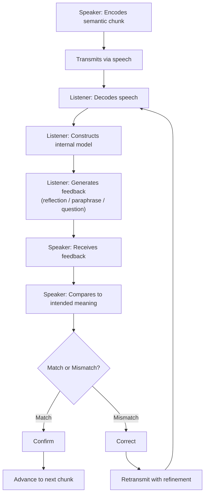

# Lesson 3: Feedback Protocols

## 1. First-Principles Intuition & Invariants

Communication is not a unidirectional broadcast but a bidirectional signal exchange requiring continuous verification. Active listening demands that the listener does not passively receive information but actively reconstructs the speaker's mental model within their own cognitive architecture, then transmits verification signals back to confirm fidelity. This closed-loop feedback mechanism transforms listening from a lossy, one-way data dump into a high-reliability synchronization protocol.

The fundamental invariant of active listening is that **understanding cannot be assumed—it must be verified**. Human speech encodes meaning through multiple simultaneous channels: lexical content, prosodic patterns, gestural cues, and contextual framing. Each channel carries semantic payload, but the aggregate meaning emerges only when the listener integrates all streams and reconciles them against their existing knowledge structures. Because speaker and listener possess asymmetric mental models, cognitive schemas, and experiential contexts, the probability of perfect transmission on first pass approaches zero. Feedback protocols exist to detect and correct transmission errors in real time.

Consider the mechanical analogy of TCP versus UDP network protocols. UDP transmits packets without acknowledgment or retransmission—it is fast but unreliable, suitable only when occasional data loss is acceptable. TCP implements acknowledgment packets, sequence numbering, and retransmission logic to guarantee delivery. Active listening operates as a cognitive TCP layer, inserting verification checkpoints throughout the conversational stream. Without feedback, communication degrades into cognitive UDP: the speaker broadcasts their thoughts into the void, the listener silently constructs an interpretation, and both parties exit the interaction with misaligned mental models, unaware that synchronization never occurred.

The core invariants governing feedback protocols are threefold. First, feedback must be **timely**: verification must occur within the speaker's working memory window, typically every thirty to sixty seconds of continuous speech, before the speaker's cognitive buffer overflows and earlier content decays. Second, feedback must be **specific**: vague affirmations like "I understand" or "that makes sense" carry no information content and provide no error detection. Effective feedback must reference concrete semantic units—specific claims, causal relationships, or propositional structures—demonstrating that the listener has reconstructed the speaker's logic. Third, feedback must be **non-intrusive**: the verification mechanism must not derail the speaker's cognitive flow or force them to context-switch away from their primary narrative thread. Skilled listeners inject feedback into natural conversational pauses, signaling comprehension without interrupting momentum.

The listener-speaker synchronization model operates through iterative refinement cycles. The speaker transmits a semantic unit—a claim, a narrative segment, a causal explanation. The listener decodes this unit, constructs an internal representation, and transmits a verification signal: a paraphrase, a clarifying question, a nonverbal acknowledgment. The speaker receives this signal and performs error-checking: does the listener's reconstruction match the intended meaning? If yes, the speaker proceeds to the next semantic unit. If no, the speaker issues a correction, refining the transmission until synchronization is achieved. This loop repeats continuously throughout the conversation, maintaining alignment as the dialogue evolves.

Crucially, feedback is not merely a politeness ritual or social lubricant. It serves three functional purposes that directly impact information transfer quality. First, it provides **error detection**: by externalizing their interpretation, the listener exposes misunderstandings for correction before they cascade into larger comprehension failures. Second, it provides **cognitive offloading for the speaker**: when listeners paraphrase key points, they free the speaker from rehearsing those points internally, reducing cognitive load and allowing the speaker to advance their reasoning. Third, it provides **social proof of engagement**: speakers modulate their communication strategy based on listener feedback—if a listener appears lost, the speaker will slow down, add examples, or restructure their explanation. Feedback is the control signal that allows speakers to adapt their transmission protocol in real time.

## 2. Core Architecture & Mechanics

Feedback protocols decompose into five primary mechanisms, each optimized for different verification requirements and conversational contexts. These mechanisms form a toolkit that listeners dynamically select from based on the semantic complexity of the incoming information, the speaker's communication style, and the listener's current confidence in their interpretation.

**Reflection** is the foundational feedback technique, functioning as a simple echo or mirror of the speaker's content. The listener repeats back a condensed version of what the speaker said, using the speaker's own vocabulary and phrasing. Reflection serves as a low-overhead acknowledgment signal, confirming that the listener has registered the lexical content without yet demonstrating deeper comprehension. The mechanical structure of reflection is straightforward: extract the semantic core of the speaker's utterance and restate it with minimal transformation. For example, if the speaker says, "I've been struggling with the transition to remote work because I lose the informal hallway conversations that used to spark new ideas," a reflection might be, "So you're missing those spontaneous hallway brainstorming moments." Reflection operates as a cognitive echo—it bounces the signal back to verify that transmission occurred, but it does not yet confirm that the listener has decoded the underlying meaning structure.

The primary failure mode of reflection is mechanical parroting without comprehension. Unskilled listeners sometimes repeat the speaker's words verbatim without processing semantic content, treating reflection as a performative ritual rather than a genuine verification mechanism. This creates an illusion of understanding that collapses when the conversation advances to topics requiring deeper integration. To avoid this failure, reflection must be selective—the listener identifies the semantic nucleus of the utterance and reflects only that core, demonstrating that they have performed abstraction and prioritization.

**Paraphrasing** represents a higher-order feedback protocol that requires semantic transformation. Where reflection uses the speaker's vocabulary, paraphrasing translates the speaker's message into the listener's own words, demonstrating that the listener has not merely cached the lexical surface but has decoded it into an abstract semantic representation and then re-encoded it using their own linguistic structures. Paraphrasing proves comprehension because successful translation requires the listener to identify the underlying propositional content, strip away the speaker's specific wording, and reconstruct the meaning using alternative linguistic packaging.

The mechanics of paraphrasing involve three cognitive operations: abstraction, synonymization, and structural reconfiguration. First, the listener abstracts the speaker's message into its core propositional form—the fundamental claim, relationship, or observation being communicated. Second, the listener substitutes synonyms or semantically equivalent phrases for the speaker's key terms, demonstrating that they have mapped the vocabulary to underlying concepts rather than treating words as opaque tokens. Third, the listener may restructure the syntax, reordering clauses or shifting emphasis while preserving semantic content. For example, if the speaker says, "The reason we're seeing declining engagement in Q3 is that our competitor launched a feature that directly addresses our users' top pain point," a paraphrase might be, "So our users are switching because the competitor solved their main problem." The listener has preserved the causal relationship (competitor feature → user departure) while transforming vocabulary and syntax.

Paraphrasing introduces risk: because the listener is performing semantic transformation, they may accidentally distort meaning. The verification loop becomes critical here—after paraphrasing, the listener must pause and allow the speaker to confirm or correct. The speaker's response provides immediate feedback: if the speaker says "exactly" or "yes, that's right," synchronization is achieved. If the speaker says "not quite" or "close, but actually...," the listener receives an error signal and can refine their model. This iterative exchange is where true comprehension crystallizes.

**Clarifying questions** shift the feedback protocol from verification to active error correction. Where reflection and paraphrasing assume the listener has constructed an interpretation and merely seeks confirmation, clarifying questions acknowledge that the listener's current model is incomplete or ambiguous and requires additional data from the speaker. Clarifying questions serve three functions: resolving lexical ambiguity (when the speaker uses unfamiliar terminology or jargon), disambiguating structural relationships (when the causal or logical connections between ideas are unclear), and requesting additional context (when the listener needs background information to properly situate the speaker's claims).

The architecture of clarifying questions follows a strict constraint: they must be **narrowly scoped and hypothesis-driven**. Poor clarifying questions are vague, open-ended, or force the speaker to repeat large semantic chunks they have already transmitted. Examples of weak clarifying questions: "Can you explain that again?" or "What do you mean?" These questions provide no signal about what specifically the listener failed to decode, forcing the speaker to guess which component needs retransmission. Strong clarifying questions pinpoint the specific ambiguity and propose a hypothesis for the speaker to confirm or deny. Examples: "When you say 'stakeholders,' do you mean internal executives or external clients?" or "Are you saying the delay was caused by the vendor or by our internal review process?" These questions expose the listener's current interpretation and the precise point of uncertainty, allowing the speaker to issue a targeted correction.

The syntax of clarifying questions follows predictable patterns. For lexical disambiguation: "By [term], do you mean [interpretation A] or [interpretation B]?" For causal relationships: "So the [event X] led to [outcome Y] because [mechanism Z]?" For temporal sequencing: "Did [event A] happen before or after [event B]?" For quantitative precision: "When you say 'significant,' are we talking about a 10% increase or closer to 50%?" Each question structure isolates a specific semantic variable and requests the speaker to supply a value.

The failure mode of clarifying questions is over-interrogation, where the listener interrupts the speaker's flow with excessive granular questions, fragmenting the narrative and disrupting cognitive continuity. Skilled listeners batch clarifying questions, holding minor ambiguities in a mental buffer and waiting for a natural pause or the end of a semantic segment before issuing requests. This preserves the speaker's momentum while still ensuring that critical ambiguities are resolved before they compound.

**Nonverbal acknowledgment signals** provide continuous, low-bandwidth feedback without requiring verbal interruption. These signals confirm that the listener is tracking the speaker's content and maintaining engagement, even during long uninterrupted monologues. Nonverbal signals include head nodding (vertical oscillation at approximately 1–2 Hz, synchronized with the speaker's prosodic emphasis points), facial micro-expressions (raised eyebrows to signal surprise or confusion, furrowed brows to indicate concentration, slight smiles to show agreement), postural mirroring (subtly adopting the speaker's body orientation and openness), and vocal backchanneling (brief interjections like "mm-hmm," "I see," "right," timed to coincide with the speaker's natural phrase boundaries).

The information-theoretic function of nonverbal signals is to provide the speaker with a continuous monitoring channel, analogous to TCP keep-alive packets. The speaker uses this feedback to gauge whether the listener is still synchronized or has fallen behind. A sudden cessation of nodding or vocal backchanneling alerts the speaker that the listener has encountered a comprehension obstacle, prompting the speaker to slow down or add clarification. Conversely, enthusiastic nodding signals strong alignment, giving the speaker confidence to advance to more complex material.

The mechanics of nonverbal acknowledgment require precise timing. Nodding must occur at prosodic stress points—when the speaker emphasizes a key word or completes a semantic clause. Poorly timed nodding (random or continuous bobblehead motion) loses its signal value and becomes mere noise. Vocal backchanneling must align with the speaker's breathing pauses, not interrupt mid-sentence. The listener monitors the speaker's intonation contour: when pitch drops and speech rate slows slightly, signaling the end of a clause, the listener inserts a brief "mm-hmm" into the gap. This requires the listener to predict prosodic boundaries approximately 300 milliseconds in advance, a skill that develops through deliberate practice.

**Verification loops** represent the meta-protocol that governs the sequencing and escalation of feedback mechanisms. A verification loop is the complete cycle: speaker transmits → listener decodes → listener feeds back → speaker confirms or corrects. The loop terminates when the speaker confirms synchronization or when both parties agree that sufficient mutual understanding has been achieved for the conversation's purposes.

The escalation ladder for verification loops proceeds from low-cost, low-fidelity signals to high-cost, high-fidelity signals. The listener begins with nonverbal acknowledgment during continuous speech, escalates to reflection or paraphrasing at natural segment boundaries, deploys clarifying questions when ambiguity arises, and requests full restatement only when the previous mechanisms fail to resolve confusion. This escalation strategy minimizes conversational overhead while maintaining adequate error detection.

The temporal structure of verification loops depends on semantic chunking. Human working memory buffers approximately three to five semantic propositions before requiring consolidation. Skilled listeners insert verification checkpoints every thirty to sixty seconds of speaker monologue—not by interrupting arbitrarily, but by waiting for the speaker to complete a semantic cluster and then reflecting or paraphrasing the cluster before the speaker continues. This rhythm matches the speaker's natural cognitive cadence: encode and transmit a chunk, receive confirmation, encode and transmit the next chunk.

This cycle repeats throughout the conversation, maintaining synchronization as the dialogue evolves. Each iteration refines the shared mental model, reducing the error accumulation that would otherwise occur in unverified communication.

## 3. High-Performance Optimization & Failure Modes

Optimizing feedback protocols for high-stakes, high-complexity communication requires addressing three primary bottlenecks: cognitive load management, timing precision, and failure recovery. Expert practitioners develop fluency in feedback mechanics to the point where verification becomes automatic, freeing cognitive resources for deeper analysis of the speaker's content.

**Cognitive load management** begins with recognition that feedback itself consumes working memory. While listening, the practitioner must simultaneously decode incoming speech, construct an internal model, hold earlier content in buffer, and plan feedback utterances—all in real time. Untrained listeners often experience buffer overflow: they concentrate so intensely on formulating a paraphrase that they stop tracking new incoming information, losing the thread of the conversation. The solution is **incremental consolidation**: rather than attempting to hold an entire multi-minute monologue in working memory before paraphrasing, the listener performs micro-consolidations every fifteen to thirty seconds, compressing each semantic chunk into a compact abstraction and storing it in long-term memory. This frees working memory buffer space for the next chunk.

The mechanical implementation involves subvocalization and mental note-taking. As the speaker transmits a semantic unit, the listener mentally rehearses a compressed summary using inner speech. For example, if the speaker describes a three-step process, the listener subvocalizes, "Step one: data collection. Step two: analysis. Step three: report generation." This subvocalization forces active encoding, transforming the speaker's words into the listener's own semantic structures. When the speaker pauses, the listener externalizes these mental notes as paraphrases, offloading them from working memory entirely.

Advanced practitioners develop **dual-track processing**, where one cognitive thread tracks content (what the speaker is saying) and a parallel thread tracks meta-content (how the speaker is saying it, what emotional subtext is present, what the speaker is avoiding or emphasizing). This dual-track architecture allows the listener to provide both content-level feedback ("So the project deadline slipped by two weeks") and meta-level feedback ("It sounds like the delay was frustrating for your team"). Meta-level feedback demonstrates that the listener is not merely recording facts but is attuned to the speaker's subjective experience, deepening rapport and psychological safety.

**Timing precision** separates competent listeners from masters. Poorly timed feedback disrupts cognitive flow; well-timed feedback enhances it. The critical timing variable is the **natural conversational pause**, typically occurring at clause boundaries, sentence boundaries, or topic transitions. These pauses last one to three seconds—long enough for the speaker to take a breath and mentally shift to the next semantic unit, but short enough that the pause does not feel awkward. The listener must train pattern recognition to detect these boundaries through prosodic cues: the speaker's pitch drops, speech rate decelerates slightly, and vocal energy decreases at the end of a clause.

Inserting feedback into these natural pauses creates a seamless verification loop. The speaker completes a thought, the listener paraphrases during the pause, and the speaker resumes with the next thought—all without perceptible interruption. Contrast this with premature interruption (cutting off the speaker mid-sentence) or delayed feedback (waiting so long that the speaker has already advanced three topics ahead, making retrospective paraphrasing feel jarring and out-of-sync).

The failure mode of premature interruption is particularly destructive in high-complexity technical or emotional conversations. When a speaker is laboriously constructing a nuanced argument or articulating a difficult emotional experience, interrupting fragments their cognitive process, forcing them to expend energy re-establishing context and rebuilding momentum. If the listener detects an urgent need for clarification mid-sentence, the optimal protocol is to use a nonverbal hold signal (raised hand, slight forward lean) combined with a brief verbal flag: "Hold on—quick clarification before you continue." This signals the interruption, frames it as temporary, and gives the speaker permission to pause without losing their place.

**Failure recovery** addresses what happens when feedback reveals a significant synchronization error—the listener's model and the speaker's intent are severely misaligned. The immediate risk is conversational derailment: the speaker becomes frustrated, the listener becomes defensive, and the dialogue stalls. Skilled practitioners treat synchronization errors as diagnostic data rather than failures. The protocol is: acknowledge the mismatch explicitly, request retransmission without blame, and identify the source of confusion to prevent recurrence.

The verbal formula for failure recovery is: "I want to make sure I'm following you correctly. Let me check my understanding: [paraphrase]. Is that accurate, or did I miss something?" This framing accomplishes three things. First, it positions the verification as the listener's responsibility, avoiding implicit criticism of the speaker's clarity. Second, it externalizes the listener's current model, giving the speaker a concrete target for correction. Third, it invites the speaker to issue a correction without defensiveness, framing the correction as a collaborative refinement rather than a judgment.

When the speaker issues a correction, the listener's task is to **localize the error source**: was the misunderstanding lexical (the listener misinterpreted a key term), structural (the listener reversed a causal relationship), contextual (the listener lacked background knowledge), or attentional (the listener simply missed a critical detail)? Identifying the error source allows the listener to adjust their decoding strategy for the remainder of the conversation. For example, if the error was lexical, the listener might preemptively ask for definitions of unfamiliar terms. If the error was structural, the listener might request that the speaker explicitly state causal connections rather than leaving them implicit.

A subtle but critical failure mode is **false synchronization**, where both listener and speaker believe they are aligned but their mental models remain divergent. This occurs when paraphrases are sufficiently vague that they appear to match the speaker's intent without actually doing so. For example, the speaker describes a complex technical architecture, and the listener paraphrases, "So it's a multi-tier system with a caching layer." The speaker, relieved to hear any acknowledgment, confirms, "Yes, exactly." But the listener's model lacks the critical detail that the caching layer uses a write-through strategy, not write-back—a detail that will become mission-critical later in the conversation. False synchronization is more dangerous than obvious misunderstanding because it remains undetected until the error cascades into a costly mistake.

The mitigation strategy is **precision escalation**: when the topic is high-stakes or technically complex, the listener must demand higher fidelity from their own paraphrases. Instead of accepting vague confirmation, the listener should paraphrase with specific technical details and quantitative parameters, forcing the speaker to either confirm the precise details or issue corrections. For example: "So the caching layer uses a write-through strategy, meaning writes go to both cache and database synchronously, correct?" This level of precision leaves no room for false synchronization—the speaker must either confirm the exact mechanism or correct it.

Finally, the meta-skill underlying all feedback protocols is **calibration**—the listener's ability to accurately assess their own comprehension confidence. Poorly calibrated listeners suffer from the Dunning-Kruger effect in reverse: they underestimate their understanding and over-verify, annoying speakers with redundant paraphrases. Or they overestimate their understanding and under-verify, leading to silent divergence. Calibration develops through deliberate practice with immediate feedback: after conversations, the listener should test their understanding by attempting to explain the speaker's content to a third party or by writing a summary. Gaps between the listener's reconstruction and the speaker's original intent reveal calibration errors, training the listener to more accurately sense when their model is solid versus when it requires additional verification.

The ultimate measure of feedback protocol mastery is conversational invisibility. Novice listeners' feedback feels mechanical and intrusive, a series of clunky interruptions that slow the dialogue. Expert listeners' feedback is so seamlessly woven into the conversational fabric that speakers barely notice it—they simply feel heard, understood, and energized to continue. The verification loop operates continuously in the background, maintaining synchronization without friction, allowing the content itself to occupy center stage. This is the paradox of active listening: the most powerful technique is the one that disappears, leaving only clarity and connection in its wake.
