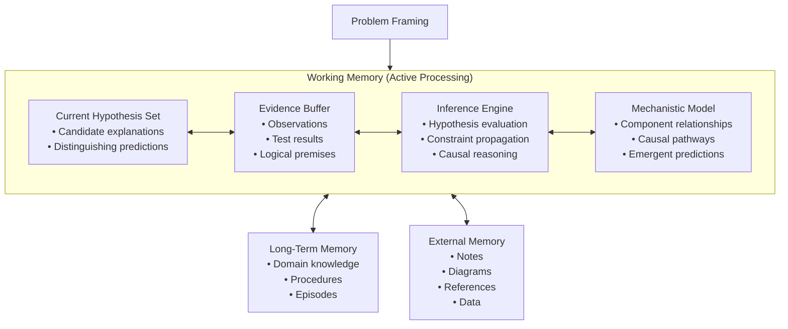

# Lesson 1: Foundations of Analytical Thinking

## 1. First-Principles Intuition & Invariants

Analytical thinking represents the cognitive capacity to systematically decompose complex phenomena into constituent elements, examine relationships between those elements, and reconstruct understanding through principled reasoning. Unlike intuitive pattern recognition, which operates through rapid heuristic matching against experiential templates, analytical thinking proceeds through deliberate, structured examination of causal mechanisms and logical dependencies. This distinction marks the fundamental watershed between reflexive judgment and rigorous analysis.

The term "analytical" derives from the Greek *analusis*, meaning "a breaking up" or "a loosening"—a dissolution of wholes into parts for examination. This etymological root captures the essence of analytical operation: the intentional fragmentation of complex systems into tractable components, followed by systematic investigation of how those components interact, constrain one another, and produce emergent properties. Where synthesis assembles parts into integrated wholes, analysis performs the inverse transformation, rendering opaque complexity transparent through methodical decomposition.

At its foundation, analytical thinking operates on three invariant principles that remain constant across all domains of application. First, the principle of decomposition asserts that complex phenomena can be meaningfully subdivided into simpler constituent elements without catastrophic loss of essential information. This principle does not claim that wholes reduce entirely to sums of parts—emergent properties exist and matter—but rather that productive understanding requires examining systems at multiple scales of granularity. A social movement cannot be understood solely through aggregate statistics, but neither can it be grasped without examining individual actors, institutional structures, and resource flows as distinct analytical objects.

Second, the principle of relational structure posits that understanding emerges not merely from cataloging elements but from mapping the dependencies, constraints, and causal pathways that connect them. A car engine comprises hundreds of components, but simply listing those components provides no mechanical understanding. Analytical comprehension requires tracing how fuel injection timing affects combustion chamber pressure, how crankshaft rotation couples to valve timing through the camshaft, and how cooling system capacity constrains sustainable operating temperatures. The relationships constitute the mechanism; the parts merely instantiate it.

Third, the principle of evidential grounding demands that analytical conclusions maintain explicit traceability to observable data, logical inference rules, or axiomatic foundations. Unlike rhetorical persuasion, which may rely on emotional resonance or authority, analytical reasoning binds conclusions to premises through chains of valid inference. When an analyst claims that increased customer churn correlates with support ticket resolution time, that claim must rest on quantified correlation coefficients, controlled comparisons, or mechanistic models—not on plausible narrative or expert intuition. This principle does not eliminate judgment or interpretation, but it mandates that interpretive leaps be acknowledged as such rather than disguised as inevitable logical consequences.

These three principles—decomposition, relational structure, and evidential grounding—form the invariant core of analytical thinking across mathematics, engineering, diagnostic medicine, investigative journalism, and strategic planning. The surface methods vary dramatically: a mathematician manipulates symbolic expressions, a physician orders diagnostic tests, an investigator interviews witnesses. Yet beneath these domain-specific techniques lies the common cognitive architecture of systematic decomposition, structural mapping, and evidence-based inference.

Analytical thinking diverges sharply from several neighboring cognitive capabilities that superficially resemble it. Critical thinking, while overlapping substantially with analytical thinking, emphasizes evaluative judgment—assessing the validity of arguments, detecting hidden assumptions, and identifying logical fallacies. A critical thinker examining a policy proposal asks whether the evidence supports the claims, whether unstated assumptions hold, and whether alternative explanations exist. An analytical thinker performing the same examination would additionally decompose the policy mechanism into causal pathways, model how implementation constraints propagate through the system, and trace second-order effects through feedback loops. Critical thinking asks "is this reasoning sound?" while analytical thinking asks "how does this mechanism actually work?"

Creative thinking operates through divergent ideation, generating multiple novel possibilities through associative leaping and constraint relaxation. Where analytical thinking converges toward singular mechanistic explanations through systematic elimination of alternatives, creative thinking deliberately proliferates alternatives, often by relaxing the very constraints that analytical thinking treats as fixed. An analytical approach to urban traffic congestion might decompose traffic flow into vehicle density, intersection timing, and route capacity, then optimize within those structural parameters. A creative approach might question the assumption that personal vehicles constitute the appropriate transportation modality altogether, generating alternatives like pneumatic tube networks or aerial cable cars. Both modes prove essential to sophisticated problem-solving, but they proceed through opposite cognitive operations: convergence versus divergence, constraint satisfaction versus constraint relaxation.

Systems thinking shares analytical thinking's emphasis on structural relationships but operates at a different level of abstraction. Where analytical thinking dissects mechanisms into linear causal chains, systems thinking maps circular feedback loops, delays, and nonlinear dynamics. An analytical examination of corporate knowledge retention might trace how documentation practices affect information availability, which affects employee productivity. A systems approach would additionally identify reinforcing loops: when experienced employees leave, documentation quality declines because institutional knowledge walks out the door, which accelerates further attrition as remaining employees struggle with undocumented systems. The analytical view captures local causality; the systems view captures emergent dynamics. Mastery requires both lenses, applied appropriately to the problem scale.

The cognitive architecture underlying analytical thinking comprises several distinct mental operations that must be executed in coordination. First, problem framing establishes the boundaries of investigation, identifies key variables and entities, and formulates specific analytical questions. Poor problem framing—examining the wrong question or operating at the wrong level of granularity—renders subsequent analysis useless regardless of execution quality. When a business suffers declining revenue, framing the problem as "how do we cut costs?" versus "why are customers switching to competitors?" leads to fundamentally different analytical paths with divergent implications.

Second, hypothesis generation produces candidate explanations or mechanisms that might account for observed phenomena. This operation requires sufficient domain knowledge to generate plausible hypotheses while maintaining enough epistemic humility to avoid premature convergence on a single explanation. A physician diagnosing chest pain must generate a differential diagnosis spanning cardiac ischemia, pulmonary embolism, gastroesophageal reflux, and musculoskeletal strain—then systematically test distinguishing predictions of each hypothesis through targeted examination and diagnostic testing. Hypothesis generation without systematic testing devolves into speculation; testing without hypothesis generation reduces to aimless data collection.

Third, evidence gathering collects observational data, experimental results, or logical premises required to evaluate competing hypotheses. Effective evidence gathering requires understanding what constitutes discriminating evidence—information that meaningfully distinguishes between alternatives rather than remaining consistent with all hypotheses. If a server experiences intermittent failures, observing that failures occur under load consistent with all plausible causes provides no discriminatory power. Observing that failures correlate specifically with memory allocation patterns implicates memory leaks or fragmentation, while correlation with network packet rates points toward bandwidth saturation or protocol implementation bugs.

Fourth, inference execution applies logical rules, statistical methods, or domain-specific analytical techniques to derive conclusions from gathered evidence. This operation demands technical facility with inference methods appropriate to the problem domain: statistical hypothesis testing for empirical data, formal deductive logic for mathematical proofs, causal modeling for complex systems, or diagnostic algorithms for troubleshooting. Inference quality depends critically on method selection—applying frequentist significance testing to small samples, using correlation to infer causation, or extrapolating beyond the range of supporting data represent common inference failures that corrupt analytical conclusions.

Fifth, synthesis integration assembles component-level findings into coherent system-level understanding. Where decomposition fragments wholes into parts, synthesis reconstructs integrated comprehension from analytical fragments. A security analyst investigating a data breach might analyze authentication logs, network traffic patterns, and file access records as separate analytical threads, but the final understanding must synthesize these threads into a unified narrative: attackers compromised credentials through phishing, moved laterally through the network by exploiting unpatched vulnerabilities, and exfiltrated data through encrypted channels disguised as legitimate traffic. Each analytical component provides necessary information, but understanding emerges from synthetic integration.

The fundamental mental operation that unifies these five components might be termed "mechanistic modeling"—the construction of explicit mental representations of how systems produce observed behavior through the interaction of constituent elements under governing constraints. A mechanistic model need not be mathematical or even fully explicit, but it must specify components, relationships, and causal pathways with sufficient precision to generate testable predictions. When an analyst claims to understand a phenomenon, they implicitly claim possession of a mechanistic model that explains how inputs transform into outputs through intermediate causal steps.

Consider the analytical process of diagnosing why a software application experiences degraded performance during peak usage hours. Problem framing establishes that we investigate response time degradation specifically during high-concurrency periods rather than baseline performance or functional correctness. Hypothesis generation produces candidates: database connection pool exhaustion, CPU saturation from inefficient algorithms, memory pressure causing garbage collection pauses, network bandwidth saturation, or lock contention in shared data structures. Evidence gathering instruments the application to collect timing traces, resource utilization metrics, and concurrency profiles under load. Inference execution correlates performance degradation with specific resource patterns, potentially revealing that response times spike precisely when database connection acquisition delays exceed thresholds, while CPU and memory remain underutilized. Synthesis integration constructs the mechanistic model: the connection pool size limits concurrent database operations below the request arrival rate during peak load, causing requests to queue for available connections, which manifests as response time degradation. This model generates the testable prediction that increasing pool size should eliminate degradation up to the point where database server capacity becomes the bottleneck.

The power of analytical thinking lies not in the sophistication of any individual operation but in the systematic execution of all five operations in disciplined coordination. Amateur analysts frequently execute only fragments of this process: they gather data without clear hypotheses, generate hypotheses without systematic testing, or draw inferences without validating underlying assumptions. Expert analysts distinguish themselves not through superior intelligence but through methodical completeness—they frame problems crisply, generate comprehensive hypothesis sets, gather discriminating evidence, apply inference methods appropriate to available data, and synthesize component findings into mechanistic understanding.

Analytical thinking develops through deliberate practice in domain-specific contexts rather than through abstract mental exercise. While certain cognitive capacities like working memory and attention control provide foundational substrate, analytical skill emerges from accumulated experience decomposing problems, testing hypotheses, and refining mental models within particular knowledge domains. A chess grandmaster analyzing board positions exercises analytical thinking, but that skill transfers minimally to diagnosing automotive malfunctions or evaluating statistical claims. The surface content differs so dramatically that the analytical patterns learned in one domain provide limited scaffolding for another. This domain-specificity implies that becoming analytically proficient requires extensive immersion in the specific problem types, evidence forms, and inference methods characteristic of target domains.

Yet certain meta-analytical skills do transfer across domains because they operate at the architectural level of how analytical thinking proceeds rather than at the content level of what gets analyzed. Recognizing that correlation does not imply causation applies equally to medical research, marketing analytics, and climate science. Understanding that decomposition must respect natural joints in the causal structure—dividing systems at boundaries where coupling is weak rather than through the middle of tightly integrated mechanisms—generalizes across engineering, organizational design, and conceptual taxonomy. Learning to generate hypothesis sets that span the possibility space rather than fixating on the most salient candidate transfers from debugging code to investigating accidents to evaluating competing theories. These meta-analytical patterns constitute the teachable core of analytical thinking as a general cognitive skill.

The relationship between analytical thinking and domain expertise creates a productive tension. Deep domain knowledge enables more sophisticated hypothesis generation, more accurate evidence interpretation, and more nuanced synthesis. An expert database administrator analyzing query performance draws on internalized knowledge of index structures, query optimization strategies, and storage engine architectures that a novice cannot access. Yet expertise also introduces systematic biases: experts develop habitual problem-solving patterns that work reliably within familiar territory but fail when confronting genuinely novel situations. The expert sees new problems through the lens of past solutions, sometimes forcing novel phenomena into familiar categories rather than recognizing their novelty. Optimal analytical performance often emerges from collaboration between domain experts who provide knowledge depth and analytical generalists who contribute methodological rigor and freedom from established mental ruts.

## 2. Core Architecture & Mechanics

The cognitive architecture of analytical thinking comprises a hierarchical processing system where higher-level operations orchestrate lower-level cognitive primitives. At the foundation lie basic perceptual and memory operations: attending to specific stimuli, retrieving relevant knowledge from long-term memory, and maintaining information in working memory during active processing. These primitive operations provide the raw computational substrate upon which analytical thinking constructs more elaborate processing structures.

Working memory serves as the primary computational workspace for analytical thinking, providing temporary storage for intermediate results during multi-step reasoning. The classic Baddeley-Hitch model partitions working memory into specialized components: a phonological loop maintaining acoustic-verbal information through subvocal rehearsal, a visuospatial sketchpad manipulating visual and spatial representations, and a central executive allocating attention across processing demands. Analytical thinking makes intensive demands on working memory because maintaining multiple hypotheses, tracking causal dependencies, and evaluating logical inferences all require simultaneously active representations of premises, intermediate steps, and tentative conclusions.

The capacity limitations of working memory—typically characterized as retaining four to seven discrete chunks of information—impose fundamental constraints on analytical complexity. When problem decomposition produces more elements than working memory can simultaneously maintain, the analyst must either further decompose into smaller sub-problems, externalize intermediate results through written notes or diagrams, or rely on automated procedures that execute without consuming working memory capacity. An analyst debugging a complex software interaction spanning six microservices cannot simultaneously maintain detailed mental representations of the state of all six services. Instead, they must systematically narrow the problem space, use logging and tracing to externalize state information, or rely on practiced diagnostic heuristics that compress complex patterns into manageable chunks.

Long-term memory provides the knowledge base that informs hypothesis generation, evidence interpretation, and inference execution. This knowledge exists in multiple forms that serve distinct analytical functions. Declarative knowledge represents facts, concepts, and propositions: database indexes improve query performance for certain access patterns, Newton's third law states that forces occur in equal and opposite pairs, market demand curves typically slope downward. Procedural knowledge encodes how to execute specific operations: how to calculate a correlation coefficient, how to isolate variables in an equation, how to trace execution through a call stack. Episodic knowledge captures memory of specific experiences: the time a similar problem turned out to be caused by clock skew, the case where initial symptoms suggested one diagnosis but testing revealed another.

The interplay between working memory and long-term memory forms the core computational loop of analytical thinking. Long-term memory supplies candidate patterns, hypotheses, and analytical procedures relevant to the problem at hand. Working memory provides the active workspace where these retrieved elements are manipulated, combined, and tested against evidence. When working memory processing produces novel insights or solves sub-problems, those results get encoded back into long-term memory as new episodic experiences or refined procedural knowledge. Over thousands of repetitions, this loop gradually builds the extensive pattern libraries and automated procedures that characterize domain expertise.

Problem representation constitutes the first critical architectural component of analytical processing. The way an analyst mentally represents a problem—which elements are treated as primitives versus composites, which relationships are made explicit versus implicit, which variables are foregrounded versus backgrounded—profoundly shapes which solution paths become accessible. Representing a transportation problem as a graph with nodes representing locations and edges representing routes enables applying graph algorithms like shortest path finding. Representing the same problem as a constrained optimization with variables for vehicle assignments and constraints for capacity and timing enables applying linear programming. Different representations make different analytical techniques applicable and render different solution approaches natural versus opaque.

Effective problem representation requires identifying the essential structure of the problem while abstracting away irrelevant surface details. When analyzing customer churn, the essential structure involves the relationship between customer attributes, engagement patterns, competitive alternatives, and retention outcomes. Surface details like customer names, specific dates, or idiosyncratic personal circumstances matter for individual cases but obscure structural patterns when analyzing aggregate behavior. The analytical challenge lies in determining which details constitute signal versus noise—a judgment that requires domain knowledge and often iterative refinement as analysis proceeds.

Decomposition strategies form the second architectural component, providing systematic methods for fragmenting complex problems into tractable sub-problems. Functional decomposition divides systems according to distinct functions or purposes: a business process decomposes into customer acquisition, order fulfillment, and customer support; a software application decomposes into user interface, business logic, and data persistence. Structural decomposition follows physical or organizational boundaries: a supply chain decomposes into suppliers, manufacturers, distributors, and retailers; an electrical circuit decomposes into power supply, signal processing, and output stages.

The optimal decomposition strategy depends on the specific analytical goals and the intrinsic structure of the target system. When diagnosing failures, functional decomposition often proves most effective because failures typically manifest as functional deficits—the system fails to perform some intended function. When optimizing performance, structural decomposition that isolates bottleneck components proves more useful. When assessing security vulnerabilities, decomposition along trust boundaries separates components with different privilege levels and exposure to untrusted input. No single decomposition strategy dominates across all analytical contexts; skilled analysts maintain a repertoire of decomposition approaches and select appropriately based on problem characteristics.

Hypothesis space management comprises the third architectural component, governing how analysts generate, maintain, and winnow candidate explanations. Generating an adequate hypothesis set requires sufficient breadth to capture the true explanation while maintaining sufficient focus to enable systematic evaluation. Too narrow a hypothesis set risks missing the actual explanation entirely—the classic mistake of premature convergence on an initially plausible but ultimately incorrect theory. Too broad a hypothesis set overwhelms working memory capacity and dilutes analytical resources across excessive alternatives.

Effective hypothesis generation employs several systematic strategies. Analogical reasoning retrieves similar problems from episodic memory and adapts their solutions to the current context. If server latency issues previously stemmed from connection pool exhaustion, that explanation becomes a natural hypothesis when similar latency patterns appear in a new context. Causal modeling generates hypotheses by reasoning forward from potential root causes to observable symptoms or backward from symptoms to possible causes. If application response times degrade under load, forward reasoning from resource constraints suggests candidates like CPU saturation, memory pressure, or I/O bottlenecks, while backward reasoning from the timing pattern suggests causes that scale with concurrency or request volume.

Hypothesis testing proceeds through systematic comparison against discriminating evidence—observations that differentially support or contradict competing alternatives. A robust hypothesis withstands multiple independent tests across different evidence types and survives attempts at falsification through stress cases designed to break it. Weak hypotheses collapse when confronted with contradictory evidence or fail to account for key observations. The Bayesian framework formalizes this process as probability updating: initial hypothesis probabilities (priors) get updated by the likelihood of observed evidence under each hypothesis, producing posterior probabilities that reflect accumulated evidence. While analysts rarely perform explicit Bayesian calculations, the underlying logic—that hypotheses gain or lose credibility based on how well they predict observations—guides informal hypothesis evaluation.

Inference methods constitute the fourth architectural component, providing the technical machinery for deriving conclusions from premises. Deductive inference applies logical rules that guarantee truth preservation: if all mammals are warm-blooded and whales are mammals, then whales are warm-blooded with logical certainty. Deductive inference provides the gold standard for analytical rigor but requires premises that are either axiomatically true or previously established through deductive chains extending back to axioms. Mathematical proofs exemplify pure deductive reasoning, building certainty through chains of valid logical steps.

Inductive inference generalizes from specific observations to broader patterns or laws, trading deductive certainty for empirical scope. Observing that every swan examined so far is white provides inductive support for the hypothesis that all swans are white, though the inference remains vulnerable to future counterexamples—as Europeans discovered when they encountered black swans in Australia. Scientific theories emerge primarily through inductive inference: repeated observations that objects accelerate downward at approximately 9.8 meters per second squared support the generalization that this pattern holds universally near Earth's surface. Inductive strength depends on sample size, diversity, and representativeness—larger and more varied samples provide stronger inductive support than small or biased samples.

Abductive inference, also called inference to the best explanation, selects the hypothesis that best explains available evidence even when deductive proof or strong inductive support remain unavailable. Medical diagnosis relies heavily on abductive reasoning: given a constellation of symptoms, the physician infers the disease that best accounts for those symptoms. Abductive inference proves essential when dealing with incomplete information, complex causation, or unique events that resist inductive generalization. The quality of abductive inference depends critically on the comprehensiveness of the hypothesis set—the best explanation among considered alternatives may still be wrong if the true explanation was never generated as a candidate.

Statistical inference applies probability theory to quantify uncertainty and test hypotheses against data. Frequentist methods ask whether observed data would be surprising under a null hypothesis, rejecting the null when data are sufficiently improbable assuming the null is true. Bayesian methods update probability distributions over hypotheses based on observed data, providing graded credence levels rather than binary accept-reject decisions. Causal inference methods attempt to distinguish correlation from causation by controlling for confounds, exploiting natural experiments, or using instrumental variables. Mastery of statistical inference requires technical training in probability theory, experimental design, and statistical methods—domain-specific knowledge that does not emerge automatically from general analytical thinking but must be deliberately acquired.

Model construction and simulation form the fifth architectural component, building explicit representations of system mechanisms that can be manipulated and tested. Mental models exist as largely implicit neural activation patterns—a database administrator's intuitive sense of how query optimizers work derives from years of experience encoded in synaptic weights rather than explicit symbolic rules. Externalized models make mechanistic understanding explicit and communicable: a flowchart documenting a business process, a mathematical equation describing population dynamics, or a software simulation of network traffic patterns.

Externalized models enable analytical operations difficult or impossible with purely mental models. They support systematic sensitivity analysis, exploring how changes in parameters or assumptions affect outcomes. They enable quantitative prediction, calculating expected results under specified conditions. They facilitate communication, allowing multiple analysts to examine, critique, and refine a shared mechanistic understanding. They persist independently of any individual analyst's working memory, supporting analysis that extends over days or weeks without information loss. The overhead cost of model externalization—the time and effort required to formalize understanding into explicit representations—pays dividends when problems prove sufficiently complex to exceed mental model capacity or when analytical work requires coordination across multiple contributors.

The analytical workflow integrates these five architectural components into a coherent process that systematically transforms vague puzzlement into mechanistic understanding. The workflow begins with problem framing, establishing boundaries and formulating specific analytical questions. This framing draws on domain knowledge retrieved from long-term memory and may require iterative refinement as initial analysis reveals unexpected complexity or misconceived assumptions. Poor problem framing cannot be rescued by excellent execution of downstream analytical steps—the most rigorous analysis of the wrong question produces useless results.

With the problem framed, hypothesis generation produces candidate explanations by combining analogical reasoning, causal modeling, and domain expertise. This generation process should explicitly aim for comprehensiveness within practical constraints, systematically considering different causal categories and checking for blind spots introduced by cognitive biases. Anchoring bias tempts analysts to fixate on the first plausible hypothesis generated; confirmation bias leads to preferentially noticing evidence supporting initial hypotheses while dismissing contradictory signals. Consciously generating multiple competing hypotheses before examining detailed evidence provides some protection against these biases, forcing consideration of alternatives before attachment to any particular explanation develops.

Evidence gathering proceeds by identifying observations that discriminate between competing hypotheses. Not all evidence provides equal analytical value: information consistent with all hypotheses fails to update their relative probability, while information that strongly supports one hypothesis over alternatives provides high discriminating power. Efficient evidence gathering prioritizes high-discrimination observations, seeking the critical tests that most sharply distinguish between alternatives. This prioritization requires understanding the logical structure relating hypotheses to observable predictions—what specific observations would we expect to see if hypothesis A is true but not if hypothesis B is true?

Inference execution applies appropriate analytical methods to evaluate hypothesis support given accumulated evidence. The specific methods employed depend on evidence type and problem domain: statistical tests for quantitative data, logical deduction for formal systems, diagnostic algorithms for troubleshooting, causal models for complex systems. Inference quality depends both on method appropriateness and execution correctness. Applying sophisticated statistical methods to data that violate method assumptions, or correctly applying inappropriate methods, both produce unreliable conclusions. Inference execution often reveals that initial evidence proves insufficient to discriminate between hypotheses, prompting additional evidence gathering in a iterative cycle.

Synthesis integration assembles component-level analytical results into system-level understanding. Where earlier stages decomposed the problem into tractable pieces analyzed independently, synthesis reconstructs the big picture by identifying how component-level findings compose into emergent system behavior. This synthesis may reveal that local optimizations produce global dysfunction through unexpected interactions, that components assumed independent actually share hidden dependencies, or that the problem as initially framed reflects symptoms rather than root causes. Synthesis provides the opportunity to validate analytical conclusions against holistic understanding—do the component-level findings cohere into a mechanistically plausible account of system behavior, or do contradictions and gaps suggest analytical errors requiring correction?

The complete analytical cycle from problem framing through synthesis rarely executes linearly in practice. Instead, analysts iterate, refining problem framing based on initial findings, generating additional hypotheses when evidence contradicts initial candidates, gathering more evidence when inference reaches ambiguous conclusions, and cycling back to reconsider assumptions when synthesis reveals inconsistencies. This iterative refinement reflects the fundamental nature of analytical thinking as a search process through a space of possible explanations, progressively narrowing toward the true account through successive rounds of hypothesis generation, evidence gathering, and inference.

## 3. High-Performance Optimization & Failure Modes

Optimizing analytical performance requires understanding both the cognitive bottlenecks that constrain analytical throughput and the systematic errors that corrupt analytical accuracy. Working memory capacity limits how much information can be simultaneously maintained during active reasoning, creating a fundamental throughput constraint. When problem complexity exceeds working memory capacity, analysts must either decompose into smaller sub-problems that fit within capacity limits, externalize intermediate results to offload working memory, or develop automated procedures that execute without consuming working memory resources.

Externalization strategies systematically reduce working memory load by recording intermediate analytical results in external storage. Simple note-taking captures hypotheses, evidence, and interim conclusions, freeing working memory for active processing rather than retention. Structured diagrams like decision trees, causal graphs, or argument maps provide spatial organization that leverages visuospatial processing to supplement verbal reasoning. Spreadsheets enable quantitative exploration without mental arithmetic. Simulation models automate complex calculations and enable systematic sensitivity analysis. As problem complexity increases, analysts necessarily shift from purely mental reasoning toward increasingly externalized analytical workflows, with the most complex analyses conducted almost entirely through external representations that working memory merely coordinates rather than contains.

Chunking provides the complementary strategy of compressing complex patterns into compact units that consume less working memory capacity. An expert chess player analyzing board positions does not separately represent the location of each piece but rather recognizes higher-level patterns—a king-side castle defense structure, a central pawn chain, a queenside pawn majority—each of which compresses multiple piece positions into a single chunk. Similarly, an expert software architect reviewing a system design recognizes patterns like layered architectures, publish-subscribe messaging, or cache-aside strategies rather than tracking individual components and connections separately. Chunking develops through extensive domain experience that gradually identifies recurring patterns and compresses them into recognition units.

The development of analytical expertise follows a characteristic progression from effortful conscious reasoning toward increasingly automated pattern recognition. Novices employ deliberate analytical procedures, consciously applying rules and methods with significant working memory load and slow execution speed. As experience accumulates, frequent patterns become automatized—recognized and processed without conscious effort or working memory consumption. Eventually, experts develop intuitions that instantly pattern-match against extensive libraries of past cases, identifying likely explanations or appropriate analytical approaches before conscious reasoning begins. This progression does not eliminate analytical thinking but rather creates a division of labor: automated processes handle routine pattern recognition while conscious analytical effort focuses on genuinely novel situations that lack matching patterns in the expert's library.

The expertise progression creates both gains and costs. The gain: dramatically increased analytical throughput for problems that match acquired patterns. An expert database administrator instantly recognizes query performance signatures characteristic of missing indexes, inefficient join orders, or lock contention without executing lengthy diagnostic procedures. The cost: reduced flexibility and increased vulnerability to situations where established patterns mislead. When problems deviate from familiar territory, experts may force-fit novel situations into familiar categories rather than recognizing their novelty. The automatic pattern matching that accelerates routine analysis can trap experts in mental ruts when problems require fresh thinking.

Cognitive biases represent systematic deviations from rational analytical processing that corrupt hypothesis generation, evidence interpretation, and inference execution. Confirmation bias leads analysts to preferentially notice and credit evidence supporting initial hypotheses while dismissing or minimizing contradictory evidence. Once an analyst develops attachment to a particular explanation—often the first plausible hypothesis generated—confirmation bias systematically skews evidence interpretation toward confirming that favored explanation. This bias proves particularly insidious because it operates unconsciously and feels subjectively like objective analysis.

Anchoring bias causes initial estimates or hypotheses to excessively influence subsequent judgment even when those initial values were arbitrary or uninformative. If asked to estimate the population of a city after first being presented with an obviously wrong anchor value, people's estimates systematically skew toward the anchor despite consciously recognizing its irrelevance. In analytical contexts, initial problem framing or first-generated hypotheses serve as anchors that insufficiently adjust as additional evidence accumulates. Analysts may recognize that initial framings prove inadequate but fail to fully escape their gravitational pull.

Availability bias overweights easily recalled information relative to its actual diagnostic value. Recent events, vivid examples, and emotionally salient cases come readily to mind and disproportionately influence judgment. When diagnosing problems, analysts often overweight causes that recently occurred or that featured prominently in memorable cases while underweighting statistically more common but less salient alternatives. A physician who recently diagnosed a rare disease may inappropriately elevate its probability when evaluating new patients with superficially similar symptoms, even when base rates suggest common diagnoses prove overwhelmingly more likely.

Base rate neglect causes analysts to insufficiently weight prior probabilities when evaluating hypothesis likelihood. Shown that a medical test with 95% accuracy returns a positive result, people dramatically overestimate disease probability while neglecting base rates. If the disease affects only 1% of the population, most positive tests are false positives despite 95% accuracy—a conclusion that follows straightforwardly from applying Bayes' theorem but that violates untutored intuition. Analytical thinking demands consciously counteracting the intuitive neglect of base rates by explicitly incorporating prior probabilities into hypothesis evaluation.

Sunk cost fallacy leads analysts to continue investing in approaches that have proven unproductive, justifying continued investment through past effort rather than expected future returns. After pursuing an analytical approach for hours or days, the natural reluctance to declare that time wasted leads to perseveration even when evidence suggests alternative approaches would prove more productive. Rational analysis evaluates options based solely on expected future costs and benefits, treating past investments as irrelevant sunk costs. The psychological difficulty of accepting wasted effort causes systematic deviation from this rational standard.

Mitigating cognitive biases requires both awareness and systematic procedural safeguards. Awareness alone provides limited protection—knowing about confirmation bias does not prevent its operation since the bias occurs largely at unconscious levels of processing. Effective mitigation requires procedural interventions that change analytical workflow to limit bias opportunities. Generating multiple competing hypotheses before examining detailed evidence limits both anchoring and confirmation bias by preventing premature attachment to a single explanation. Conducting blind analysis where hypothesis evaluation occurs without knowledge of which hypothesis an evidence item supports reduces confirmation bias in evidence interpretation. Explicitly documenting base rates and using formal Bayesian updating counteracts base rate neglect.

Pre-commitment strategies establish analytical plans before observing evidence, limiting post-hoc rationalization. Preregistration in scientific research commits researchers to specific hypotheses, methods, and success criteria before data collection, preventing the post-hoc selection of favorable analyses from a larger set of attempted approaches. Analogous pre-commitment in applied analysis might establish specific evidence types and inference criteria that will be used to evaluate hypotheses, documented before evidence examination begins. While perfect pre-commitment often proves impractical—unexpected findings legitimately require analytical pivots—even partial pre-commitment limits rationalization opportunities.

Adversarial collaboration intentionally structures analytical teams to include perspectives that differ in background, priors, or initial hypothesis preferences. When analysts with different viewpoints jointly examine evidence and must reach consensus on conclusions, confirmation bias and anchoring get at least partially cancelled by the diversity of initial biases. The confrontation with alternative interpretations forces explicit justification of inferential steps rather than allowing unconscious bias to operate unchallenged. High-stakes analytical contexts like intelligence analysis, medical diagnosis, and accident investigation often employ formal adversarial structures—red teams, differential diagnosis, and alternate hypothesis panels—specifically to counteract individual analyst biases through structured disagreement.

Premature convergence represents a higher-level failure mode where analysts settle on explanations before accumulating sufficient discriminating evidence. The psychological pressure to reach closure, combined with cognitive biases favoring initial hypotheses, creates systematic tendencies toward premature convergence. Combating this failure mode requires cultivating comfort with ambiguity and maintaining multiple candidate explanations longer than feels natural. The heuristic of requiring positive evidence for each maintained hypothesis rather than merely lacking definitive disconfirming evidence helps prevent hypothesis accumulation without promoting premature convergence—hypotheses remain in consideration only when they have positive support, not merely when they have not been definitively ruled out.

Excessive decomposition fragments problems into pieces so small that structural relationships and emergent properties disappear from view. Optimal decomposition produces components large enough to preserve meaningful functional identity while small enough to enable focused analysis. Decomposing too far reduces analysis to irrelevant minutiae that fail to illuminate system-level behavior. When troubleshooting software performance, decomposing to individual instruction timing rarely proves useful because performance emerges from algorithmic complexity and data structure choices that manifest at higher granularity levels. The art of effective decomposition lies in selecting granularity that matches the causal scale of the problem being investigated.

Analysis paralysis occurs when extended analytical effort continues without converging toward actionable conclusions. The analyst accumulates evidence, evaluates hypotheses, and refines models but never reaches sufficient confidence to recommend decisions or actions. This failure mode often stems from perfectionist standards that demand certainty before commitment, even when problems lack sufficient information to achieve certainty. Effective analysis balances thoroughness against time constraints and decision stakes, recognizing that decisions must often proceed with incomplete information and residual uncertainty.

The analytical workflow must include explicit termination criteria that specify when analysis has provided sufficient basis for decision even if questions remain unresolved. For high-stakes decisions with adequate time, thorough analysis that explores multiple hypotheses and accumulates substantial discriminating evidence proves warranted. For low-stakes decisions or time-constrained situations, less thorough analysis suffices. Mis-matching analytical depth to decision context wastes resources on over-analyzing trivial decisions or under-analyzing critical ones.

Failure to validate analytical conclusions through downstream testing or prediction verification allows analytical errors to persist undetected. When analysis produces explanations or recommendations, those conclusions should generate testable predictions about future observations or outcomes of interventions. Implementing recommended actions and observing results provides critical feedback about whether the analytical model captured essential causal mechanisms or missed key factors. Without this validation loop, analysts never learn from errors and failed analyses do not trigger model refinement.

The quality of analytical thinking ultimately depends on maintaining productive tension between confidence and humility. Confidence enables decisive action based on analytical conclusions rather than endless reconsideration. Humility acknowledges the limitations of analysis, the inevitable gaps in evidence, and the possibility that conclusions may prove wrong despite rigorous process. Optimal analytical performance requires projecting confidence in conclusions proportional to the strength of supporting evidence and inference quality, while maintaining epistemic humility that remains open to revising conclusions when new evidence emerges or prior analysis proves flawed. This calibration—projecting neither false certainty that ignores limitations nor paralyzing doubt that prevents action—marks the hallmark of mature analytical thinking.
