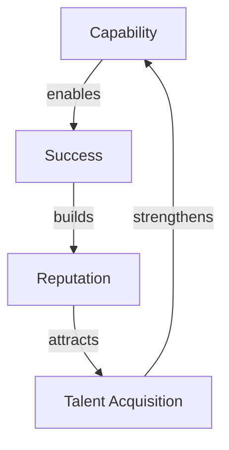
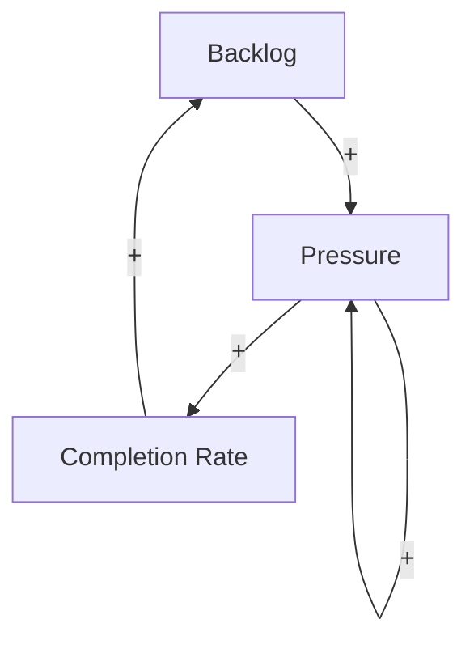

# Lesson 2: Agility Frameworks in Complex Systems

## 1. First-Principles Intuition & Invariants

Leadership in the twenty-first century operates within environments characterized by accelerating change, interconnected dependencies, and emergent behaviors that defy linear prediction. The classical hierarchical command structure, optimized for stable industrial contexts, fails catastrophically when confronted with what military strategists term VUCA conditions: Volatility, Uncertainty, Complexity, and Ambiguity. To lead effectively in such environments requires a fundamental shift from mechanistic control paradigms to organic adaptive frameworks grounded in systems thinking.

At its core, systems thinking recognizes that the behavior of complex systems emerges from the interaction patterns among components rather than from the properties of individual elements in isolation. A leader who attempts to optimize each department, team, or process independently will inevitably create suboptimal global outcomes because local optimization often degrades system-wide performance. This counterintuitive principle stems from the mathematical reality that complex systems exhibit nonlinear dynamics where small perturbations can cascade into disproportionate effects, and where feedback mechanisms can amplify or dampen initial signals in ways that elude intuitive prediction.

The foundational invariant of agile leadership in complex systems is **homeostatic equilibrium through distributed sensing and response**. Biological organisms maintain stability not through centralized control but through countless local feedback loops operating simultaneously. Your body temperature regulation involves peripheral thermoreceptors, hypothalamic integration centers, sympathetic nervous system activation, and behavioral responses, all functioning as coupled feedback mechanisms without requiring conscious executive oversight. Similarly, organizational agility emerges when decision-making authority migrates to the periphery where information asymmetry is lowest and response latency is minimized.

A second invariant concerns **cognitive load distribution across temporal horizons**. Human working memory capacity, famously constrained to approximately seven chunks of information, creates a fundamental bottleneck in decision-making. Leaders operating in complex environments face an exponentially expanding decision surface as interconnections multiply. The only sustainable strategy involves decomposing cognitive burden across three temporal bands: operational decisions handled through automated heuristics and delegated authority at the tactical edge, adaptive decisions managed through periodic retrospectives and pattern recognition at the mid-range, and strategic decisions reserved for infrequent deep analysis of invariant principles and boundary conditions.

The third invariant addresses **constraint propagation as the primary leverage mechanism**. In systems theory, constraints shape possibility space more powerfully than direct interventions. Eliyahu Goldratt's Theory of Constraints demonstrates that every system possesses exactly one bottleneck that limits throughput at any given moment. Leaders who diffuse effort across multiple improvement initiatives squander resources, while those who identify and systematically exploit the constraint achieve disproportionate returns. This principle extends beyond manufacturing into cognitive and organizational domains: the constraint might be decision-making bandwidth, information flow latency, skill acquisition capacity, or cultural permission structures.

VUCA environments specifically amplify the challenge because the constraint itself shifts dynamically. Volatility implies that the statistical distribution of outcomes exhibits high variance, rendering historical averages poor predictors of future states. Uncertainty indicates that cause-effect relationships remain obscured, preventing confident prediction even when historical patterns exist. Complexity refers to the multiplicity of interacting variables and feedback loops that generate emergent behaviors irreducible to component analysis. Ambiguity denotes the existence of multiple valid interpretations of the same evidence, creating irresolvable perspective conflicts.

Each VUCA dimension demands a specific cognitive countermeasure. Volatility requires resilience engineering: building slack capacity, redundant pathways, and rapid recovery mechanisms that absorb shocks without cascade failure. Uncertainty demands rigorous experimentation frameworks that treat organizational action as hypothesis testing, with clear success metrics and predetermined decision gates. Complexity necessitates systems mapping to externalize mental models, identify feedback loops, and surface hidden dependencies. Ambiguity calls for narrative synthesis and sensemaking rituals that forge shared meaning from disparate perspectives.

The failure mode that destroys most leaders in complex environments stems from **cognitive mismatch between problem complexity and response sophistication**. When confronted with ambiguous complexity, the human brain reflexively retreats to familiar heuristics optimized for simpler domains. This manifests as premature pattern-matching, where leaders perceive illusory certainty by forcing novel situations into existing mental categories. It appears as reductionism, collapsing multidimensional tradeoffs into false binary choices. It emerges as action bias, where the psychological discomfort of uncertainty drives hasty intervention that forecloses superior options.

Agility frameworks counteract this failure mode by institutionalizing cognitive discipline through ritual structure. The Scrum sprint cycle, the OODA loop, the Cynefin framework, and Lean startup methodology all function as **exocortical scaffolds** that externalize and distribute cognitive load. They transform abstract principles into concrete behavioral protocols that teams can execute even under duress when prefrontal executive function degrades. The frameworks do not eliminate complexity but rather compartmentalize it into manageable decision surfaces with explicit temporal boundaries and information flows.

Understanding emergence properties remains essential because the most critical system behaviors arise not from designed components but from interaction dynamics. Emergence occurs when local rules generate global patterns that possess properties absent from any individual element. Traffic jams emerge from individual driving decisions without any driver intending to create congestion. Market bubbles emerge from rational individual investment choices. Organizational culture emerges from thousands of interpersonal interactions without explicit design. Leaders cannot directly control emergent properties but can shape them by adjusting the local rules and interaction topologies that generate the global patterns.

The mathematical substrate underlying agility frameworks derives from control theory, information theory, and complex adaptive systems research. A control system requires three elements: a sensor measuring current state, a comparator evaluating deviation from desired state, and an actuator applying corrective intervention. The feedback loop's stability depends on loop gain (amplification factor), time delay (latency between sensing and actuation), and signal-to-noise ratio (measurement fidelity). When loop gain exceeds critical thresholds or time delays introduce phase lags, the system oscillates or diverges rather than converging on target states. Organizational agility frameworks essentially implement distributed control systems with human-in-the-loop sensing and actuation.

Information theory contributes the concept of entropy reduction through measurement. In the absence of information, all possible system states appear equiprobable, creating maximum uncertainty. Each measurement collapses the probability distribution, reducing entropy and enabling more informed action. However, measurement itself consumes resources and introduces distortion through the observer effect. Agile frameworks optimize information gathering by identifying minimum viable metrics that provide maximum entropy reduction relative to collection cost. The daily standup meeting, the sprint retrospective, and the stakeholder demo all function as structured information extraction rituals.

Complex adaptive systems theory reveals that agents following simple local rules while adapting based on feedback can generate sophisticated collective behavior. Ant colonies optimize foraging routes through stigmergic pheromone trails without any ant possessing global knowledge. Immune systems recognize novel pathogens through somatic hypermutation and clonal selection without centralized coordination. Markets allocate resources through price signals without central planning. These systems exhibit robustness, scalability, and adaptive capacity that centralized control architectures cannot match. Agile leadership frameworks attempt to harness these principles within human organizations by creating conditions for productive self-organization while preventing destructive emergent pathologies.

The constraint theory invariant provides the conceptual bridge between systems thinking and actionable intervention. Every system contains multiple components operating at different utilization levels. The constraint, or bottleneck, is the component with the highest utilization that limits total system throughput. Improving non-constraint components wastes effort because excess capacity cannot be exploited. The Five Focusing Steps provide a systematic protocol: identify the constraint, exploit it by maximizing utilization without additional investment, subordinate all other processes to support constraint optimization, elevate the constraint through capacity expansion, and repeat as the constraint shifts to a new location.

In cognitive and organizational systems, constraints manifest as decision-making bottlenecks, information flow restrictions, skill scarcity, cultural permission structures, or attention allocation conflicts. A leadership team might possess abundant strategic vision but lack tactical execution capacity, making implementation the constraint. An engineering organization might have surplus development velocity but insufficient user research, making product-market fit discovery the constraint. A sales organization might generate ample leads but lack qualification rigor, making conversion optimization the constraint. Identifying the true constraint requires systems mapping and quantitative flow analysis rather than anecdotal intuition.

Cognitive load management emerges as a critical agility competency because human attention and working memory constitute non-replenishable resources subject to depletion and interference effects. Cognitive load theory distinguishes intrinsic load (inherent difficulty of the material), extraneous load (imposed by poor presentation or process), and germane load (productive effort building schema and expertise). Leaders in complex environments face perpetual cognitive overload as information volume, decision density, and interruption frequency exceed processing capacity. Sustainable performance requires aggressive extraneous load reduction through automation, delegation, and process simplification, while strategically investing germane load in building mental models and decision heuristics that reduce future intrinsic load.

The agility frameworks examined in this lesson represent distinct approaches to managing complexity, each optimized for specific constraint profiles and environmental conditions. Understanding their mechanical operation, applicability boundaries, and failure modes enables leaders to select, adapt, and combine frameworks appropriate to their operational context rather than cargo-culting methodological orthodoxy.

## 2. Core Architecture & Mechanics

Systems thinking provides the conceptual foundation for all agility frameworks, so we begin by dissecting its core primitives: stocks, flows, feedback loops, delays, and nonlinearities. A **stock** represents any accumulation or reservoir within a system—inventory, knowledge, capital, morale, technical debt. A **flow** represents the rate of change of a stock, either inflow (increasing) or outflow (decreasing). The fundamental accounting identity governs all stock dynamics: the stock level at time t+1 equals the stock level at time t plus all inflows minus all outflows during the interval.

```
Stock(t+1) = Stock(t) + Σ(Inflows) - Σ(Outflows)
```

This deceptively simple equation generates rich dynamics because flows themselves depend on stock levels, creating feedback loops. A **reinforcing feedback loop** occurs when a stock influences a flow in a manner that amplifies the initial change. Consider organizational capability as a stock: higher capability enables successful project delivery, which builds reputation, attracting better talent, further increasing capability. This virtuous cycle can generate exponential growth under favorable conditions. The mathematical signature of reinforcing feedback appears as an even number of negative relationships around the loop, or more simply, net positive polarity.



Conversely, a **balancing feedback loop** drives the system toward equilibrium by counteracting deviation from a target state. Workload regulation provides a canonical example: as task backlog grows, pressure increases, teams work harder, completion rate rises, backlog shrinks, pressure decreases, pace moderates. This negative feedback maintains homeostasis. The mathematical signature involves an odd number of negative relationships around the loop, yielding net negative polarity.



Real systems contain multiple interacting feedback loops operating simultaneously, creating complex dynamics. Delays introduce temporal separation between cause and effect, generating oscillation and instability. If hiring decisions lag six months behind workload changes, organizations perpetually overshoot and undershoot optimal staffing levels, creating feast-or-famine cycles. Nonlinearities arise when relationships between variables shift based on operating region—marginal productivity increases linearly at low utilization but degrades exponentially beyond 85% capacity as coordination overhead dominates.

The OODA loop, formulated by military strategist John Boyd, provides a decision-making framework optimized for dynamic adversarial environments. The acronym stands for Observe, Orient, Decide, Act. The framework's power lies not in the individual phases but in the loop closure rate: the side that completes more OODA cycles within a given timeframe gains decisive advantage by operating inside the opponent's decision cycle, rendering their actions reactive and obsolete.

**Observe** involves systematic information gathering from multiple sensing modalities. In military contexts, this includes radar, visual reconnaissance, signals intelligence, and human intelligence. In organizational contexts, this encompasses quantitative metrics, user research, competitive analysis, and internal feedback channels. The critical discipline involves distinguishing signal from noise, avoiding confirmation bias by actively seeking disconfirming evidence, and recognizing when sensors provide degraded or deceptive information.

**Orient** represents the cognitive bottleneck where raw observations undergo interpretation through mental models, cultural traditions, genetic heritage, and previous experience. Boyd emphasized that orientation shapes perception more powerfully than objective reality—two observers witnessing identical events will construct radically different situational awareness based on their orienting frames. Leaders must continuously examine and update their mental models, deliberately seeking perspectives that challenge existing assumptions. The orient phase demands the highest cognitive investment because flawed orientation propagates errors through subsequent decide and act phases.

**Decide** involves selecting an action from the possibility space revealed by orientation. Decision quality depends on both the accuracy of situational awareness and the sophistication of decision heuristics. In time-critical scenarios, leaders employ recognition-primed decision-making, pattern-matching current situations to stored exemplars and selecting proven responses. In novel ambiguous scenarios, leaders must engage deliberate analysis, constructing causal models and evaluating counterfactuals. The decide phase must balance speed against fidelity, accepting satisficing solutions rather than pursuing optimization that incurs unacceptable latency.

**Act** translates decisions into observable interventions that modify the environment. Action effectiveness depends on execution precision, resource availability, and environmental responsiveness. The act phase closes the loop by generating new observations, initiating the next cycle. Critically, actions create consequences that extend beyond immediate intent, triggering feedback loops and unintended side effects that subsequent observation must detect.

The OODA loop's architecture inherently supports distributed execution because each agent can operate their own loop asynchronously while contributing to collective situational awareness. Junior personnel execute tactical OODA loops with rapid cycle times addressing immediate threats and opportunities. Mid-level leaders operate operational loops at intermediate tempos coordinating tactical actions. Senior executives run strategic loops at slower frequencies establishing boundary conditions and resource allocation. This temporal nesting enables both rapid local adaptation and coherent global strategy.

The Cynefin framework, developed by Dave Snowden, provides a sense-making scaffold that matches response strategies to problem complexity. The framework partitions decision contexts into five domains: Clear (formerly Simple), Complicated, Complex, Chaotic, and Confused (the central domain). Each domain exhibits distinct cause-effect characteristics that demand tailored approaches.

In the **Clear** domain, cause-effect relationships are obvious to all observers, enabling best-practice application. The appropriate response pattern follows Sense-Categorize-Respond: perceive the situation, match it to an established category, execute the standard procedure. Manufacturing quality control, customer service ticket routing, and compliance checklists operate in the clear domain. The failure mode involves complacency, where practitioners continue applying best practices even as the situation shifts to a different domain, and rigid constraints that prevent necessary adaptation.

The **Complicated** domain contains situations where cause-effect relationships exist but require expertise to discern. Multiple valid solutions exist, and expert analysis determines the optimal approach. The response pattern follows Sense-Analyze-Respond: gather information, engage expert analysis, select and implement the appropriate good practice. Engineering design, financial modeling, and medical diagnosis operate in the complicated domain. The failure mode involves analysis paralysis, where excessive deliberation delays action, and expert overconfidence, where specialists dismiss signals outside their domain expertise.

The **Complex** domain exhibits emergent cause-effect relationships that can only be perceived in retrospect. The system's behavior cannot be predicted through analysis alone; experimentation is required. The response pattern follows Probe-Sense-Respond: conduct safe-to-fail experiments, observe emergent patterns, amplify what works and dampen what fails. Organizational culture change, market innovation, and ecosystem development operate in the complex domain. The failure mode involves premature convergence, where leaders lock onto initial patterns before sufficient exploration, and inappropriate metric fixation, where measurement distorts the emergent dynamics.

The **Chaotic** domain presents situations where no cause-effect relationships can be discerned. Immediate action is required to establish stability before analysis becomes possible. The response pattern follows Act-Sense-Respond: take decisive action to contain damage, seek to understand the new stability regime, work to transition from chaotic to complex domain. Crisis response, emergency triage, and disaster recovery operate in the chaotic domain. The failure mode involves overreaction, where leaders impose excessive control that prevents transition to more stable domains, and trauma response, where chaotic-domain behaviors persist inappropriately after stabilization.

The central **Confused** domain represents the state of not knowing which domain applies. When confused, the human tendency involves applying responses from one's preferred domain, typically creating mismatch between problem and solution. The prescription for confusion is decomposition: break the situation into constituent elements, classify each element into its appropriate domain, and apply the matching response strategy to each component.

The framework's architecture reveals that problems naturally transition between domains. Systems in the clear domain can shift catastrophically into chaos when constraints fail—a routine procedure encounters an edge case that triggers cascade failure. Chaotic situations stabilize into complexity through successful intervention. Complex situations crystallize into complicated or clear domains as cause-effect relationships become understood and codified. Leaders must continuously assess which domain they occupy and adjust their decision-making approach accordingly, resisting the temptation to apply familiar methods inappropriate to the current context.

Constraint theory, formalized through Goldratt's Theory of Constraints (TOC), provides a systematic method for identifying and exploiting system bottlenecks. Every system attempting to achieve a goal possesses at least one constraint that limits performance. The Five Focusing Steps create a continuous improvement cycle that systematically relocates constraints to less critical positions.

**Step One: Identify the Constraint.** This requires mapping the complete process flow and measuring throughput, work-in-progress, and cycle time at each stage. The constraint manifests as the stage with the highest utilization, the largest work-in-progress queue, or the longest cycle time. In cognitive systems, the constraint might be decision-making bandwidth, information access latency, or skill availability. Identification demands quantitative measurement rather than intuitive assessment because humans systematically misjudge bottleneck locations, often fixating on the most visible problem rather than the true throughput limiter.

**Step Two: Exploit the Constraint.** This involves maximizing constraint utilization through improved work quality, reduced downtime, and enhanced focus. If senior leadership attention represents the constraint, exploitation means aggressive meeting hygiene, decision delegation, and interruption batching. If product development velocity is constrained by code review bandwidth, exploitation includes review checklist automation, junior reviewer training, and pull request size reduction. Exploitation requires zero capital investment, yielding immediate throughput gains through operational discipline.

**Step Three: Subordinate Everything to the Constraint.** Non-constraint resources must operate in service of constraint optimization even when this reduces their individual utilization. If manufacturing capacity exceeds sales capability, production should reduce output to match sales rate rather than building inventory that consumes cash and storage. If developer productivity exceeds testing bandwidth, developers should assist testing rather than accumulating untested features. Subordination feels counterintuitive because it accepts apparent inefficiency to optimize global throughput, but local optimization of non-constraints merely builds queues that increase cycle time without improving delivery rate.

**Step Four: Elevate the Constraint.** When exploitation and subordination have been fully implemented, capacity expansion through capital investment becomes justified. Elevation might involve hiring additional personnel, acquiring automation tools, outsourcing commodity work, or architectural refactoring. The critical discipline involves deferring elevation until exploitation and subordination are exhausted, because premature elevation wastes capital on capacity that cannot be utilized due to operational inefficiencies.

**Step Five: Return to Step One.** Elevation shifts the constraint to a new location. If hiring expands the constrained function, a different function becomes the new bottleneck. The cycle repeats indefinitely as the constraint migrates through the system. The failure mode involves psychological inertia, where organizational attention remains fixated on the former constraint even after it has been elevated, continuing to invest resources in areas no longer limiting performance.

Cognitive load management frameworks distinguish three load types that compete for limited working memory capacity. **Intrinsic load** derives from the inherent difficulty of the material and cannot be reduced without simplifying the problem itself. Learning category theory imposes higher intrinsic load than learning arithmetic because the conceptual dependencies run deeper. Leaders cannot eliminate intrinsic complexity in genuinely difficult domains but can sequence exposure to build prerequisite schema before introducing advanced concepts.

**Extraneous load** arises from poor information presentation, process inefficiency, and environmental distraction. Poorly formatted documentation, ambiguous terminology, excessive meeting duration, context-switching overhead, and open-plan office interruptions all impose extraneous load that consumes cognitive capacity without advancing goals. Extraneous load represents pure waste, offering a high-return optimization target. Leaders reduce extraneous load through documentation standardization, communication protocol establishment, focus-time protection, and tool consolidation.

**Germane load** constitutes productive cognitive effort directed toward schema construction and expertise development. Germane load is the desired cognitive investment that builds long-term capability, transforming effortful deliberation into automated heuristics. Leaders maximize germane load by creating practice opportunities with immediate feedback, encouraging analogical reasoning across domains, and protecting time for deliberate reflection.

The mathematical constraint states that total cognitive load must remain below working memory capacity to maintain effective performance. When total load exceeds capacity, performance degrades catastrophically through task-switching overhead, error propagation, and decision fatigue. The optimization objective involves minimizing extraneous load, managing intrinsic load through appropriate sequencing, and maximizing germane load within the remaining capacity budget.

```
Cognitive_Capacity ≥ Intrinsic_Load + Extraneous_Load + Germane_Load
```

Effective agility frameworks incorporate cognitive load management by chunking complexity into manageable decision surfaces, establishing clear protocols that reduce extraneous load, and creating rhythm through time-boxing that prevents open-ended cognitive drain.

## 3. High-Performance Optimization & Failure Modes

High-performance agile leadership requires continuous calibration of feedback loop parameters, constraint identification accuracy, and cognitive load allocation. The optimization objective involves maximizing adaptive capacity while maintaining system stability, navigating the tension between exploitation of known strategies and exploration of novel approaches.

Feedback loop optimization begins with measuring and reducing time delays between sensing and actuation. In the OODA loop, cycle time determines competitive advantage. Organizations achieve cycle time reduction through decision delegation that positions authority at the information-rich periphery, automated measurement systems that provide real-time visibility, and pre-established decision protocols that eliminate deliberation latency for routine scenarios. The elite military units that inspired Boyd's framework achieved OODA loop dominance not through superior firepower but through decentralized command, cross-functional training, and rehearsed contingency responses that collapsed decision latency.

However, excessive loop gain creates instability. If performance metrics trigger immediate reactive interventions, measurement noise and random fluctuations generate oscillation rather than steady improvement. A marketing team that adjusts campaign strategy daily based on volatile engagement metrics will thrash between approaches without accumulating sufficient signal to evaluate effectiveness. Damping mechanisms stabilize feedback loops through statistical smoothing, hysteresis bands that require threshold crossings before triggering action, and deliberate response delays that allow transients to settle.

The optimal strategy combines fast tactical loops operating within bounded domains with slower strategic loops operating at higher abstraction levels. Tactical loops respond to operational deviations using pre-approved playbooks without escalation. Strategic loops evaluate aggregate patterns over extended time horizons, adjusting boundary conditions and resource allocations. This temporal hierarchy prevents local noise from contaminating strategic decisions while enabling rapid tactical adaptation.

Constraint identification accuracy determines improvement leverage. Misidentifying the constraint directs optimization effort toward non-limiting resources, wasting investment while leaving actual bottlenecks unaddressed. The diagnostic discipline involves comprehensive flow mapping with quantitative measurement at each stage, statistical analysis to distinguish random variation from structural bottlenecks, and validation that proposed constraints actually limit end-to-end throughput.

Common constraint identification errors include confusing symptoms with root causes, mistaking visible problems for throughput limiters, and neglecting policy constraints. A software team might identify testing bandwidth as a constraint when the true constraint is ambiguous requirements that create rework loops. An executive team might fixate on budget limitations when cultural norms preventing cross-functional collaboration represent the actual constraint. Policy constraints—self-imposed rules that limit throughput—prove particularly insidious because organizations defend them as immutable even when they serve no current purpose.

Once correctly identified, constraint exploitation must precede elevation. Organizations exhibit systematic bias toward elevation because capacity expansion feels like progress while exploitation requires uncomfortable operational discipline. Hiring additional personnel appears more decisive than improving onboarding quality, purchasing tools seems more tangible than optimizing workflows, and expanding facilities looks more impressive than reducing waste. Yet premature elevation merely relocates queues without improving throughput, consuming capital that could have been reserved until exploitation fully prepared the system for expansion.

The subordination principle generates the most organizational resistance because it requires accepting local inefficiency for global optimization. When non-constraint resources reduce utilization to match constraint capacity, stakeholders perceive underutilization as waste and pressure leaders to "keep everyone busy." This pressure must be resisted through education on system dynamics and relentless focus on end-to-end throughput metrics rather than local utilization measures. Building work-in-progress inventory to maintain utilization merely increases cycle time and masks quality problems, degrading rather than enhancing performance.

Cognitive load optimization demands aggressive extraneous load elimination. Leaders should conduct regular cognitive load audits, mapping all recurring activities and categorizing their load contribution. Meetings that lack clear agendas and decision authority impose pure extraneous load. Reports that duplicate information available through automated dashboards waste cognitive capacity on formatting rather than analysis. Communication tools that fragment conversations across multiple platforms impose context-switching overhead. Each identified source of extraneous load becomes a candidate for automation, consolidation, or elimination.

Intrinsic load management requires deliberate sequencing and prerequisite establishment. When introducing complex strategic initiatives, leaders must identify the conceptual dependencies and ensure foundational understanding exists before layering advanced concepts. A digital transformation initiative that assumes cultural agility, technical literacy, and process discipline will fail if those prerequisites are absent. The effective approach sequences capability building, establishing each foundation before constructing the next layer, even when this extends timeline. Premature exposure to complexity beyond current schema capacity generates cognitive overload and defensive resistance.

Germane load maximization involves creating structured opportunities for expertise development. After-action reviews, retrospective analyses, cross-functional rotations, and deliberate practice sessions all invest cognitive capacity in schema building that reduces future intrinsic load. Organizations that eliminate germane load investment through relentless operational urgency mortgage future capability for current throughput, creating long-term technical and cognitive debt.

The VUCA response strategies integrate these optimization principles into environmental-specific protocols. Volatility mitigation through resilience engineering involves building slack capacity at non-constraint resources, creating diverse capability portfolios that prevent single-point failures, and establishing rapid recovery protocols that minimize disruption duration. The investment trade-off balances redundancy cost against disruption risk, typically targeting 15-25% capacity buffer at critical non-constraint resources.

Uncertainty management through experimentation frameworks requires hypothesis discipline, measurement rigor, and learning integration. Each experimental initiative should articulate explicit hypotheses, define falsifiable success criteria, establish predetermined decision gates, and allocate resources appropriate to uncertainty level. Early-stage experiments warrant minimal investment with rapid iteration cycles, while later-stage validation justifies larger commitment with more rigorous measurement. The failure mode involves escalating commitment to failed experiments based on sunk cost fallacy rather than objective evidence evaluation.

Complexity navigation through systems mapping externalizes mental models into shared artifacts that enable collective sense-making. Causal loop diagrams, value stream maps, and dependency networks transform tacit individual understanding into explicit collaborative knowledge. The mapping process itself generates insight as participants surface hidden assumptions, identify conflicting mental models, and discover unexpected feedback loops. Effective systems mapping involves diverse perspectives, iterative refinement, and deliberate search for disconfirming evidence that challenges comfortable narratives.

Ambiguity resolution through narrative synthesis and sensemaking rituals creates shared meaning from disparate interpretations. Structured storytelling sessions, scenario planning exercises, and perspective-taking protocols help teams construct coherent narratives that honor multiple viewpoints while establishing actionable direction. The objective is not consensus through averaging conflicting views but rather integration that synthesizes perspectives into a more complete understanding. Effective sensemaking tolerates paradox and contradiction as signals of genuine complexity rather than forcing premature resolution into oversimplified explanations.

The failure modes that destroy agility under high performance pressure stem from predictable psychological and organizational pathologies. **Premature convergence** occurs when leaders lock onto initial hypotheses before accumulating sufficient evidence, driven by action bias and discomfort with ambiguity. The countermeasure involves explicit exploration quotas that mandate investigating multiple alternatives before selection, pre-commitment to decision criteria before data collection to prevent post-hoc rationalization, and red team adversarial review that challenges preferred solutions.

**Thrashing** manifests when feedback loops operate too rapidly relative to system time constants, generating oscillation rather than convergence. Strategy shifts announced monthly, priority changes cascaded weekly, and metric targets revised daily prevent initiatives from accumulating sufficient momentum to generate meaningful signal. The countermeasure involves time-boxing at appropriate scales, establishing minimum commitment durations before reassessment, and distinguishing strategic stability from tactical flexibility.

**Learned helplessness** emerges when individuals perceive that outcomes are independent of their actions, typically resulting from inconsistent leadership decisions or opaque decision processes that create arbitrary-seeming consequences. The pathology manifests as passive compliance, initiative suppression, and responsibility avoidance. The countermeasure involves transparent decision-making with explicit criteria, consistent application of principles across situations, and deliberate agency cultivation through expanding decision authority.

**Coordination overhead** scales nonlinearly with participant count, eventually consuming all productivity gains from additional resources. Brooks's Law observes that adding personnel to late projects makes them later because communication overhead grows as O(n²) while productivity grows linearly. The countermeasure involves aggressive team size limitation, architectural decomposition that minimizes inter-team dependencies, and asynchronous communication protocols that reduce synchronous coordination requirements.

**Strategic debt** accumulates when short-term expedient decisions foreclose superior long-term options, analogous to technical debt in software systems. Leaders facing immediate pressure accept suboptimal solutions that satisfy current constraints but create future liabilities through locked-in architectures, contractual commitments, or organizational expectations. The countermeasure involves explicit debt acknowledgment with repayment plans, architectural options preservation that maintains strategic flexibility, and periodic debt audits that prevent insidious accumulation.

The highest-performing agile leaders cultivate what military theorists term **strategic intuition**—the capacity to recognize patterns across disparate domains and synthesize novel responses without conscious deliberation. This capability emerges from extensive germane load investment that builds rich schema libraries, deliberate practice across varied contexts that promotes transfer, and reflective routines that extract generalizable principles from specific experiences. Strategic intuition enables leaders to operate effectively in time-critical scenarios where analytical deliberation is infeasible, while maintaining the metacognitive awareness to recognize when intuition proves inadequate and deliberate analysis is required.

The ultimate optimization objective involves constructing organizational systems that exhibit requisite variety, the cybernetic principle that a control system must possess internal complexity matching the complexity of the environment it regulates. Organizations with rigid hierarchies, narrow expertise, and brittle processes lack the variety necessary to respond to turbulent environments. Building requisite variety requires cultivating diverse perspectives, maintaining capability portfolios spanning multiple approaches, and preserving organizational slack that enables adaptive reconfiguration. The trade-off involves accepting apparent inefficiency during stable periods to maintain adaptive capacity for inevitable disruption.

Mastering agility frameworks in complex systems transforms leadership from heroic individual effort into systematic organizational capability. The frameworks provide exocortical scaffolding that distributes cognitive load, institutionalizes adaptive rituals, and channels emergence toward productive rather than pathological patterns. Leaders who internalize these mechanics position their organizations to thrive amid turbulence, systematically outmaneuvering competitors trapped in industrial-era command paradigms increasingly obsolete in complexity-defined contexts.
