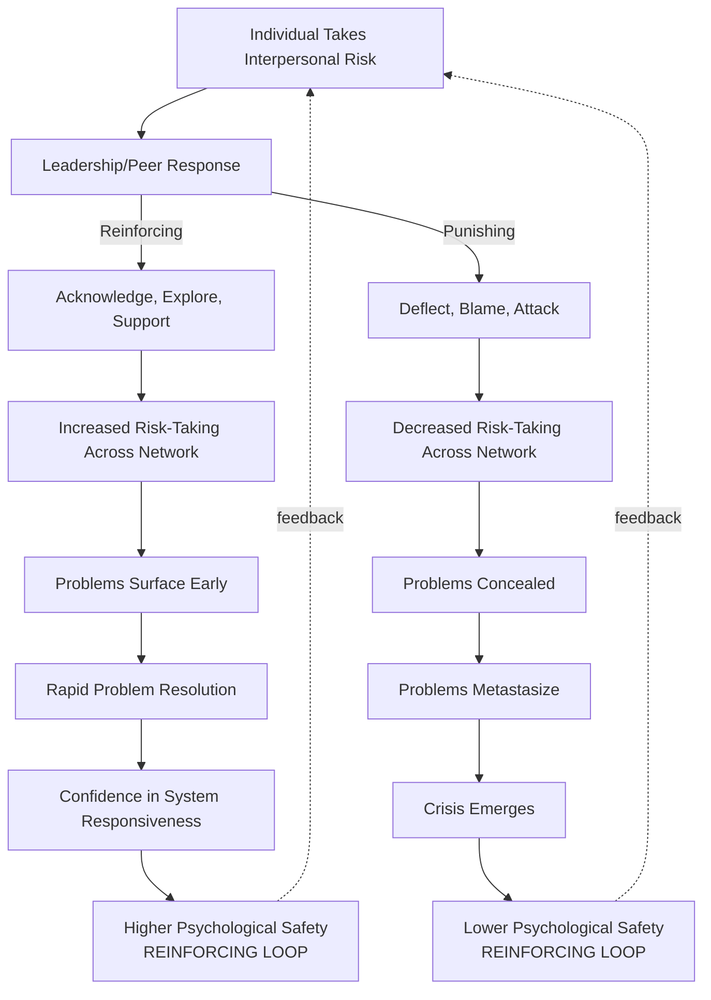
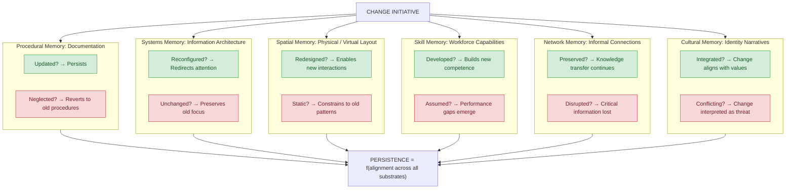

# Lesson 3: Change Psychology Through Organizational Dynamics

## 1. First-Principles Intuition & Invariants

Organizational change is not a singular event but a psychological transition that unfolds across multiple cognitive and social layers simultaneously. When leadership announces a strategic pivot, a technological transformation, or a structural reorganization, the formal declaration represents only the surface phenomenon. Beneath lies a complex adaptive system where individual sense-making collides with collective memory, where established neural pathways of habit resist the metabolic cost of rewiring, and where social identity mechanisms trigger defensive responses that can amplify or dampen the change signal across the network.

The fundamental error most change practitioners commit is treating organizational transformation as a communication problem or an implementation project. This misdiagnosis stems from a category confusion: confusing the *artifact* of change (the new process, the reorganized structure, the updated technology) with the *psychological process* of transition. The artifact can be installed in days. The transition unfolds across months or years because it requires cognitive restructuring at both individual and collective levels, operating against the fundamental entropy of habit formation and the homeostatic forces of social equilibrium.

At the individual cognitive level, change demands that established mental models be questioned, deconstructed, and rebuilt. Daniel Kahneman's dual-process framework provides the foundational insight: System 1 thinking operates through fast, automatic, pattern-matching heuristics that have been hardened through repetition into unconscious competence. System 2 thinking engages deliberate, effortful analytical reasoning that consumes significant metabolic resources. Organizational change forces prolonged System 2 activation across the workforce, creating cognitive fatigue and resistance that manifests as skepticism, passive non-compliance, or active sabotage. The individual experiencing change must simultaneously maintain operational performance while allocating scarce attention to learning new procedures, questioning old assumptions, and managing the emotional turbulence of uncertainty.

The social dimension introduces additional complexity through identity threat mechanisms. Social identity theory, articulated by Henri Tajfel and John Turner, demonstrates that individuals derive significant psychological value from their group memberships and the status hierarchies within those groups. When organizational change disrupts team structures, reporting relationships, or role definitions, it triggers identity discontinuity. The engineer who has spent fifteen years mastering a legacy system suddenly finds that expertise devalued when the organization migrates to a new architecture. The middle manager whose authority derived from information gatekeeping loses positional power when transparency initiatives flatten communication hierarchies. These are not merely professional setbacks but threats to core self-concept, activating the same neural regions associated with physical pain and social rejection.

Collective sensemaking operates through distributed cognitive processes that no single individual controls. Karl Weick's framework illuminates how organizations construct shared understanding through ongoing cycles of action, interpretation, and retrospective narrative-building. When change initiatives disrupt this process, the organization temporarily loses its ability to generate coherent meaning from environmental signals. Employees cannot discern which information channels remain authoritative, which performance metrics now matter, or which behaviors will be rewarded versus punished. This ambiguity creates anxiety that cascades through informal networks, often generating emergent narratives that leadership never intended and cannot easily correct once they achieve memetic velocity.

Organizational memory compounds these challenges through path-dependent lock-in effects. The concept of institutional memory encompasses not merely documented procedures but the tacit knowledge embedded in workflow patterns, the informal workarounds that evolved to compensate for system inadequacies, and the cultural narratives about "what works here" that new employees absorb through social learning. James March and Herbert Simon's behavioral theory of the firm emphasizes that organizations are repositories of learned routines that economize on bounded rationality. Change initiatives that ignore this embedded intelligence risk destroying functional adaptations alongside dysfunctional habits, often without conscious awareness until critical capabilities mysteriously degrade.

The psychological safety construct, rigorously defined by Amy Edmondson, represents the environmental precondition that determines whether change efforts will unlock learning or trigger defensive routines. Psychological safety is not comfort, camaraderie, or the absence of accountability. It is the shared belief that interpersonal risk-taking will not result in punishment or humiliation. In psychologically safe environments, employees can admit confusion, report implementation failures, question leadership decisions, and experiment with novel approaches without fearing retribution. This condition is necessary for the double-loop learning that organizational change requires: the willingness to examine and modify the underlying assumptions that generated current practices rather than merely adjusting surface-level tactics.

Resistance to change is not irrationality or obstinance but a predictable response to perceived threat under conditions of uncertainty. Kurt Lewin's force field analysis provides the mechanical model: every organizational state exists in quasi-equilibrium between driving forces pushing toward change and restraining forces defending the status quo. Naive change management attempts to amplify driving forces through increased pressure, urgency messaging, or incentive alignment. This approach predictably triggers equal and opposite restraining force amplification as threatened parties mobilize defensive resources. Superior change strategy focuses on reducing restraining forces by addressing legitimate concerns, building capability before demanding performance, and sequencing interventions to create early wins that generate momentum rather than exhaustion.

The transition curve, synthesized from Elisabeth Kübler-Ross's grief stages and William Bridges' transition model, maps the predictable psychological trajectory individuals traverse during change. The journey begins with shock and denial as the change announcement disrupts existing mental models. This gives way to anger and resistance as individuals recognize the personal implications and perceive threats to competence, identity, or security. A trough of despair or depression follows when resistance proves futile and the individual must confront the necessity of adaptation. Only after passing through this valley can exploration and experimentation emerge, gradually rebuilding confidence through small successes until integration and commitment crystallize. Leadership that fails to recognize this non-linear progression will misinterpret legitimate transition responses as character flaws or disloyalty, often escalating pressure precisely when patience and support are most needed.

Social learning theory, articulated by Albert Bandura, reveals that most organizational behavior is acquired through observation and modeling rather than explicit instruction. Employees watch which behaviors leaders actually reward versus the values they espouse in town hall meetings. They observe which rule violations receive sanctions versus which ones tacitly signal "we don't really mean that policy." When change initiatives demand new behaviors but leadership continues modeling old patterns, the dissonance teaches employees that the announced change is performative rather than substantive. Conversely, when leaders visibly demonstrate vulnerability, admit uncertainty, and experiment with new approaches, they grant implicit permission for others to do likewise.

The architecture of organizational memory determines which changes will persist versus which ones will erode once leadership attention shifts. Embedding change requires altering the structural affordances that shape daily behavior: the information systems that make certain data visible, the physical layouts that enable or constrain collaboration, the workflow tools that automate new processes, and the performance measurement systems that redirect attention toward new priorities. Without these structural modifications, organizations inevitably drift back toward established patterns through the cumulative effect of thousands of small decisions that follow the path of least resistance.

## 2. Core Architecture & Mechanics

The psychological architecture of organizational change operates across four interconnected subsystems: the individual cognitive layer, the interpersonal relational layer, the collective sensemaking layer, and the structural-material layer. Understanding the signal flows and feedback loops within and between these subsystems allows change leaders to diagnose resistance patterns, identify high-leverage intervention points, and sequence change initiatives to minimize defensive responses while building adaptive capacity.

### Individual Cognitive Transition Architecture

At the individual level, change processing unfolds through a predictable cognitive pipeline that mirrors the neuroscience of habit formation and extinction. Existing behavioral patterns are encoded in procedural memory as automated routines that require minimal prefrontal cortex activation. These habits conserve cognitive resources but create path dependency: the ease of executing familiar routines makes alternative behaviors metabolically expensive by comparison.

The transition process begins with **disruption awareness**, when environmental signals indicate that current routines no longer produce expected outcomes. This triggers elevated prefrontal cortex activation as the individual shifts from automatic System 1 processing to deliberate System 2 analysis. The disruption creates cognitive dissonance: the discrepancy between expected and actual outcomes violates established cause-and-effect mental models.

**Mental model diagnosis** follows as the individual attempts to localize the source of the discrepancy. Three possible attributions emerge: external environmental change that requires tactical adjustment, inadequacy of personal execution that requires skill development, or flawed underlying assumptions that require mental model reconstruction. The attribution selected determines the depth of cognitive restructuring required.

**Exploratory search** activates when individuals recognize that existing routines are insufficient. This phase involves hypothesis generation about alternative approaches, often through social comparison (observing peer behaviors), analogical reasoning (adapting solutions from adjacent domains), or experimentation (trial-and-error testing of variations). Search behavior incurs high cognitive costs and performance temporarily degrades as individuals sacrifice execution efficiency for learning.

**Provisional adoption** occurs when exploratory search identifies a candidate replacement behavior. The individual commits cognitive resources to deliberate practice of the new routine while maintaining awareness that the pattern remains provisional pending validation. Performance remains effortful and error-prone during this phase.

**Consolidation** marks the transition from deliberate System 2 execution back to automatic System 1 processing. Through repetition, the new routine becomes encoded in procedural memory, execution becomes fluent, and cognitive load returns to baseline. Only at this stage has individual-level change fully embedded.

The timeline for traversing this pipeline varies dramatically based on the complexity of the required change and the individual's baseline cognitive flexibility. Simple procedural changes may consolidate within weeks. Changes requiring new conceptual frameworks or value realignments may require months or years.

```
Individual Cognitive Transition Pipeline:

[Stable State]
     ↓
[Disruption Awareness] ← Environmental signal / Performance feedback
     ↓
[Mental Model Diagnosis] → External / Execution / Assumptions
     ↓
[Exploratory Search] ← Social comparison / Analogy / Experimentation
     ↓                   (HIGH COGNITIVE LOAD / PERFORMANCE DIP)
[Provisional Adoption]
     ↓
[Consolidation] → Procedural memory encoding
     ↓
[New Stable State]
```

### Interpersonal Psychological Safety Architecture

Psychological safety functions as the distributed trust protocol that enables or blocks information flow across organizational networks. In low psychological safety environments, individuals engage in impression management, concealing confusion, mistakes, and dissenting perspectives to avoid status loss. This information suppression creates blind spots in organizational awareness, preventing leadership from detecting implementation failures until they metastasize into crises.

The interpersonal dynamics that generate psychological safety operate through repeated trust-building interactions that follow a consistent pattern. When an individual takes an interpersonal risk—admitting ignorance, reporting a failure, challenging a decision—the response from authority figures and peers either reinforces or punishes that vulnerability. Reinforcement occurs through responses that acknowledge the contribution, explore the substance of the concern, and avoid attribution of blame. Punishment occurs through responses that deflect, minimize, or attack the credibility of the person raising the issue.

These micro-interactions accumulate into shared beliefs about interpersonal norms. If vulnerability consistently receives punitive responses, observers learn that safety requires silence. If vulnerability consistently receives supportive responses, observers learn that candor is valued. The belief becomes self-reinforcing: psychologically safe teams surface problems early, enabling rapid correction and building confidence in leadership responsiveness. Psychologically unsafe teams suppress problems until they become undeniable, confirming beliefs that leadership is unreceptive and vindictive.

Leaders establish psychological safety through four behavioral patterns that employees monitor with acute attention. **Acknowledging fallibility** involves leaders explicitly naming their own uncertainties, mistakes, and knowledge gaps. This grants permission for others to do likewise without status penalty. **Inviting input** through specific, genuine questions signals that dissenting perspectives are valued rather than tolerated. Vague "any questions?" inquiries read as pro forma rather than authentic invitations. **Responding productively to bad news** by focusing on problem-solving rather than blame attribution teaches employees that surfacing issues accelerates careers rather than ending them. **Sanctioning safety violations** when individuals punish others for speaking up demonstrates that psychological safety norms carry real consequences.

The fragility of psychological safety becomes evident during organizational change. Change initiatives inherently increase error rates as individuals execute unfamiliar routines. If leadership responds to elevated failure rates with criticism or punishment, employees rationally conclude that the safest strategy is to hide difficulties and wait for the initiative to collapse under its own weight. If leadership responds by normalizing struggle and providing support, employees conclude that transparency accelerates help and increases change success probability.



### Collective Sensemaking Architecture

Organizations do not possess unified consciousness but generate shared understanding through distributed sensemaking processes that operate continuously across formal and informal communication networks. Karl Weick's model identifies seven properties that characterize this process: sensemaking is grounded in identity construction, retrospective, enactive of sensible environments, social, ongoing, focused on extracted cues, and driven by plausibility rather than accuracy.

The identity grounding means that individuals interpret organizational events through the lens of "what does this mean for people like me?" A technical change initiative will be interpreted differently by engineers who see opportunities for skill development versus by project managers who see threats to schedule predictability. These divergent interpretations are not errors but inevitable consequences of different identity positions within the organizational system.

The retrospective nature means that meaning is constructed after events occur, through narrative-building that imposes coherent causal logic on inherently ambiguous situations. Leadership cannot simply inject official interpretations into organizational consciousness. Instead, employees construct explanatory stories by connecting the current change to historical precedents: "Remember the last time leadership announced a transformation? Nothing fundamentally changed and the executives who championed it were gone within a year." These retrospective narratives shape expectations about current initiatives.

The enactive property means that organizations shape the environments they interpret through their interpretive actions. If employees interpret a change initiative as threatening and respond with resistance, their resistance becomes evidence confirming the threatening nature of the initiative, creating a self-fulfilling prophecy. If employees interpret an initiative as opportunity and respond with engagement, their engagement generates early wins that confirm the opportunity interpretation.

The social dimension means that sensemaking unfolds through dialogue, often in informal settings where official narratives can be questioned and alternative interpretations tested. The break room, the hallway conversation, and the private Slack channel function as the venues where collective understanding actually crystallizes. Leadership communications represent inputs to this process but do not control its outputs.

The ongoing characteristic means that sensemaking never stops and never achieves definitive conclusions. Each new datum triggers reinterpretation of prior understanding. A change initiative that initially appeared threatening may be reinterpreted as beneficial if early participants report positive experiences. Conversely, an initiative that initially appeared beneficial may be reinterpreted as threatening if implementation problems emerge.

The extracted cues property means that individuals construct elaborate interpretations from minimal signals. A single offhand leadership comment, a perceived hesitation in executive commitment, or a rumored budget cut can become the organizing cue around which comprehensive narratives crystallize. Change leaders who underestimate the interpretive weight assigned to small signals will find their initiatives derailed by stories they never intended to tell.

The plausibility driver means that socially constructed organizational narratives prioritize coherence and social acceptability over empirical accuracy. The question is not "is this interpretation objectively correct?" but "does this interpretation make sense given what we know, and will asserting this interpretation damage my standing with my peer group?" Plausible but inaccurate narratives can therefore dominate organizational consciousness if accurate but implausible alternatives threaten group cohesion or individual status.

Change initiatives disrupt collective sensemaking by introducing high-velocity ambiguity that exceeds the organizational capacity for interpretation. When too many changes occur simultaneously, or when changes occur without adequate explanation, employees cannot construct coherent narratives. This narrative vacuum becomes filled by anxiety-driven speculation that often interprets change as threat by default, triggering defensive responses that leadership never anticipated.

### Organizational Memory & Structural Embedding Architecture

Organizational memory exists in multiple substrates simultaneously: documented procedures, information systems, physical infrastructure, skill distributions, social network structures, and cultural narratives. Change that fails to address all relevant memory substrates will experience drift as the system gravitates back toward embedded patterns.

**Procedural memory** resides in documented workflows, checklists, templates, and formal protocols. These artifacts encode accumulated organizational learning about how to execute recurrent tasks reliably. Change initiatives that replace procedures without understanding the functional logic those procedures evolved to serve often destroy invisible adaptations. The elaborate procurement approval process that appears bureaucratic may actually function as a critical control preventing catastrophic vendor failures that occurred in past decades. Eliminating the control without understanding its purpose risks relearning hard lessons.

**Systems memory** manifests in the information architectures that structure organizational attention. The CRM system that makes certain customer attributes visible while omitting others shapes which customer needs receive attention. The dashboard that displays certain metrics while burying others directs problem-solving focus. Change initiatives that ignore systems affordances will find that daily work patterns gradually revert to supporting whatever behaviors the information architecture makes easy rather than whatever behaviors leadership desires.

**Spatial memory** embeds in physical layouts that enable or constrain interaction patterns. Open-plan offices increase spontaneous information exchange while reducing deep focus capacity. Private offices enhance concentration while fragmenting awareness across organizational silos. Remote-work configurations eliminate commute costs while eroding informal knowledge transfer through proximity. Changes to work modes alter which organizational capabilities flourish versus atrophy.

**Skill memory** distributes across the workforce in patterns shaped by hiring decisions, training investments, and career development paths accumulated over decades. An organization that historically promoted technical specialists into management possesses leadership with strong domain expertise but potentially weak people-development skills. An organization that historically hired generalists possesses workforce flexibility but potentially shallow technical depth. Change initiatives that demand capabilities misaligned with the historical skill distribution will struggle unless accompanied by substantial capability-building investments.

**Network memory** crystallizes in the informal communication structures that route information efficiently around formal hierarchies. The engineer who knows which procurement officer to contact to expedite urgent orders, the analyst who can interpret conflicting data from multiple systems, the administrative assistant who understands the unwritten executive priorities—these individuals function as critical network nodes. Organizational changes that disrupt network structures through layoffs, reorganizations, or policy changes often destroy institutional knowledge that exists nowhere in formal documentation.

**Cultural memory** persists in the stories organizations tell about their identity, history, and values. These narratives encode lessons from past successes and failures: "We tried that approach ten years ago and it nearly bankrupted us" or "Our founders succeeded by refusing to compromise on quality even when competitors cut corners." Cultural narratives create interpretive frames that shape how new initiatives are understood. Change leaders who fail to connect new initiatives to positive cultural narratives will find their proposals interpreted through historical failure stories rather than success stories.

Effective change embeds new patterns by deliberately modifying all relevant memory substrates in coordinated fashion. New procedures are documented, but also encoded into workflow automation tools. Information systems are reconfigured to make desired metrics visible. Physical or virtual collaboration spaces are redesigned to enable required interaction patterns. Training programs build necessary skills. Key network nodes are identified and supported rather than disrupted. Cultural narratives are cultivated that connect the change to organizational identity and values.



## 3. High-Performance Optimization & Failure Modes

Optimizing organizational change requires deliberately sequencing interventions to build momentum through early wins, managing cognitive load to prevent exhaustion, targeting high-leverage points in the system architecture, and continuously monitoring for emergent resistance patterns that signal deeper structural conflicts. The failure modes that derail change initiatives are predictable and preventable when change leaders understand the psychological and social mechanics at play.

### Sequencing Strategy: Progressive Stabilization

Naive change programs attempt comprehensive transformation simultaneously across all organizational dimensions. This approach maximizes disruption, overwhelms adaptive capacity, and triggers widespread defensive responses. Superior sequencing follows progressive stabilization: establishing stable footholds in limited domains before expanding scope.

The initial phase focuses on **contained experimentation** within volunteer teams that possess intrinsic motivation for change. These early adopters provide psychologically safe environments for discovering implementation challenges, refining execution protocols, and generating proof points before scaling. Volunteer teams accept higher cognitive load and tolerate greater ambiguity than conscripted teams, preventing early failures from poisoning broader organizational attitudes.

**Proof-point cultivation** documents and amplifies early successes to shift collective sensemaking from skepticism toward possibility. The most persuasive proof points come from credible peers rather than leadership pronouncements. When respected individual contributors or middle managers report tangible benefits from adopting new approaches, their testimony carries weight that executive communications cannot match. Change leaders should deliberately invest in capturing and broadcasting these peer testimonials through multiple channels.

**Expanding adoption** occurs through social proof mechanisms rather than mandates. As proof points accumulate and early adopter testimonials spread through informal networks, a tipping point emerges where remaining skeptics experience social pressure to join the new normal rather than pressure to resist. This transition from lagging-edge resistance to trailing-edge adoption marks the moment when organizational momentum shifts decisively.

**Consolidation and routinization** embeds changes into organizational memory substrates as described in the previous section. The goal is transitioning from change initiative to "how we work now," making the new patterns disappear into unconscious competence rather than remaining explicit objects of attention.

The timeline for progressive stabilization varies with change magnitude. Procedural refinements may stabilize within months. Cultural transformations may require years. Attempting to compress timelines beyond organizational absorption capacity triggers the cognitive overload failure mode.

### Cognitive Load Management: Bounded Rationality Constraints

Herbert Simon's bounded rationality principle establishes that organizational actors possess finite attention, working memory, and decision-making capacity. Change initiatives that ignore these constraints create cognitive overload that manifests as paralysis, error cascades, or reversion to familiar routines regardless of official directives.

The primary cognitive load mitigation strategy is **sequential rather than parallel change**. When organizations attempt multiple transformation initiatives simultaneously—digital transformation plus agile adoption plus diversity initiatives plus cost reduction—employees face impossible prioritization dilemmas and default to preserving operational performance at the expense of change adoption. Superior strategy sequences changes to maintain acceptable cognitive load: complete or substantially stabilize one transition before introducing the next.

**Simplification of execution pathways** reduces the working memory demands of implementing new behaviors. The classic usability principle applies: reducing the number of decisions required and the complexity of each decision increases adoption probability. Change protocols that require employees to consult lengthy documentation, navigate complex approval processes, or master elaborate new tools face adoption resistance purely from cognitive friction rather than ideological disagreement.

**Automation of transitional scaffolding** offloads cognitive work to systems rather than humans. Checklists, decision trees, workflow automation, and intelligent defaults reduce the mental effort required during the provisional adoption phase when individuals are simultaneously learning new patterns and maintaining performance. As consolidation proceeds and behaviors become automatic, scaffolding can be withdrawn.

**Protected learning time** acknowledges that individuals cannot simultaneously maintain production performance and learn fundamentally new approaches. Organizations that demand constant performance optimization while also demanding continuous learning create double-bind constraints that rational actors resolve by abandoning learning. Explicit allocation of time, budget, and permission for experimentation signals that learning is valued rather than merely tolerated.

The cognitive overload failure mode manifests through distinctive symptoms: increasing error rates, emotional exhaustion, passive non-compliance where employees agree to changes in meetings but never implement them, and talent attrition as high performers exit to less chaotic environments. These symptoms indicate that change pace exceeds organizational absorption capacity and requires deceleration rather than additional pressure.

### Leverage Point Identification: High-Impact Interventions

Donella Meadows' hierarchy of leverage points for system intervention provides the framework for identifying where change efforts yield disproportionate impact. Low-leverage interventions tinker with parameters or material flows within existing system structures. High-leverage interventions modify the system structure itself, the information flows that drive decisions, or the paradigms that determine what the system optimizes for.

**Parameter adjustments** represent the lowest leverage: changing quantities within existing structures. Increasing training budgets, adjusting performance targets, or reallocating headcount operate within current system logic and generate predictable marginal returns. These interventions are necessary but insufficient for transformational change.

**Material flow alterations** modify the physical or information resources moving through the system. Redesigning communication channels, relocating teams, or changing reporting relationships alter interaction patterns and can shift emergent behaviors. These interventions carry moderate leverage but face constraints from deeper structural forces.

**Feedback loop modifications** represent higher leverage by changing how the system self-regulates. Installing real-time performance dashboards creates new information feedback that redirects attention. Modifying incentive structures changes which feedback loops amplify versus dampen. Reducing feedback delays between action and consequence accelerates organizational learning. The psychological safety interventions described earlier function as feedback loop modifications: changing how the system responds to interpersonal risk-taking.

**System structure redesign** achieves high leverage by fundamentally altering the relationships between system components. Shifting from functional to cross-functional team structures, implementing platform architectures, or adopting self-managing team models change not merely what flows through the system but the topology of the system itself.

**Paradigm shifts** represent maximum leverage but maximum difficulty: changing the shared mental models, values, and goals that determine system purpose. The shift from viewing employees as production resources to viewing them as sources of innovation, or from viewing organizational performance through quarterly financial metrics to viewing it through stakeholder value creation across temporal scales—these paradigm transformations redefine what the system optimizes for and cascade through all lower leverage points.

Change leaders should target the highest leverage interventions that organizational readiness permits. Attempting paradigm shifts before establishing structural and feedback loop foundations creates disconnect between aspiration and execution capacity. Conversely, limiting interventions to parameter adjustments when structural forces drive dysfunctional patterns wastes effort fighting symptoms rather than addressing root causes.

### Resistance Pattern Diagnosis & Response

Resistance is information about system dynamics rather than obstruction requiring elimination. Diagnostic skill differentiates between resistance patterns that signal legitimate concerns requiring accommodation versus resistance patterns that signal misunderstanding requiring clarification.

**Competence anxiety resistance** emerges when individuals fear they lack the skills required for success under new systems. This resistance manifests through technical objections about feasibility or timeline concerns. The appropriate response is capability building through training, coaching, and scaffolding rather than pressure or persuasion. Attempting to overcome competence anxiety through motivational appeals insults intelligence and amplifies anxiety.

**Identity threat resistance** emerges when changes undermine sources of status, expertise, or belonging. This resistance manifests through value-based objections about the rightness or alignment of proposed changes with organizational mission. The appropriate response acknowledges identity concerns as legitimate, explores how the change can preserve valued aspects of identity, and where necessary, provides alternative sources of status and belonging. Dismissing identity concerns as "resistance to change" or "lack of adaptability" guarantees escalation.

**Trust deficit resistance** emerges from historical patterns where leadership announcements did not align with subsequent actions, or where past change initiatives damaged employee interests. This resistance manifests through cynicism, demands for guarantees, or passive compliance without genuine commitment. The appropriate response is demonstrating consistency between words and actions over time, acknowledging past breaches, and building credibility through transparent communication and follow-through on commitments.

**Systems conflict resistance** emerges when new requirements conflict with existing incentives, constraints, or dependencies that leadership has not addressed. Engineers may resist documentation requirements because performance reviews reward code velocity over maintainability. Sales teams may resist CRM discipline because quota pressure rewards customer acquisition over data hygiene. This resistance signals misalignment between change demands and structural realities. The appropriate response addresses the structural conflicts rather than attempting to motivate employees to act against their rational self-interest.

**Change saturation resistance** emerges when cumulative change volume exceeds absorption capacity. This resistance manifests through exhaustion, disengagement, or active rebellion against "change theater." The appropriate response is reducing change velocity, consolidating existing initiatives before launching new ones, and creating recovery periods for organizational metabolism.

Misdiagnosing resistance patterns leads to intervention mismatch: attempting to build competence when the root problem is identity threat, or attempting to build trust when the root problem is systems conflict. Pattern recognition requires listening to the content and emotional tenor of objections rather than dismissing all resistance as generic obstruction.

### Failure Mode Catalog & Prevention

**Premature scaling** occurs when change leaders expand initiatives beyond volunteer early adopters before achieving stable execution protocols and proof points. The enthusiastic reception from self-selected volunteers does not predict reception from the broader population. Premature scaling exposes implementation flaws to skeptical audiences, generating failures that confirm skeptics' predictions and make subsequent adoption more difficult. Prevention requires patience and discipline to fully stabilize practices within limited scope before expansion.

**Sensemaking vacuum** occurs when leadership announces changes without adequate explanation of rationale, expected impact, or connection to organizational purpose. Employees fill explanatory voids with anxiety-driven speculation that often interprets ambiguity as threat. Prevention requires comprehensive communication that addresses not merely what is changing but why, what success looks like, what support is available, and how the change aligns with organizational values and individual interests.

**Structural neglect** occurs when change initiatives demand new behaviors without modifying the systems, incentives, and constraints that made old behaviors rational. Employees face double-bind dilemmas where complying with change directives conflicts with delivering performance that existing systems reward. Prevention requires analyzing and addressing structural forces before or concurrent with behavior change demands.

**Capability assumption** occurs when change initiatives presume employees possess skills they lack. Training programs that provide information about what to do differently without building capability to execute differently leave employees stranded between incompetence in old systems and incompetence in new ones. Prevention requires investment in genuine skill building through practice, coaching, and scaffolding rather than information transfer.

**Safety erosion** occurs when change stress degrades psychological safety as error rates increase and pressure intensifies. Leadership responses that punish struggling individuals rather than supporting learning trigger defensive routines and information suppression. Prevention requires explicit psychological safety reinforcement during transitions and leadership discipline to respond productively to elevated failure rates.

**Memory substrate misalignment** occurs when change embeds in some organizational memory substrates but not others, creating fragmentation where formal policies diverge from systems affordances, skill distributions, or cultural narratives. Prevention requires comprehensive assessment and modification across all relevant memory substrates rather than assuming that policy changes will automatically propagate through organizational consciousness.

**Network disruption** occurs when changes sever informal communication pathways or eliminate critical network nodes without understanding their functional role. Restructuring that displaces individuals who served as cross-functional bridges, layoffs that remove institutional knowledge holders, or policy changes that prevent historically valuable informal connections destroy organizational capabilities that exist nowhere in documentation. Prevention requires network analysis before structural changes and deliberate preservation or reconstitution of critical information flows.

The overarching meta-failure is treating organizational change as a technical implementation problem rather than a psychological transition process. Change artifacts can be installed through project management discipline. Change psychology requires sustained attention to cognitive load, sensemaking dynamics, identity concerns, structural alignment, and memory embedding across timescales that exceed typical project horizons. Leadership impatience that attempts to compress these timelines creates the conditions for most other failure modes.
