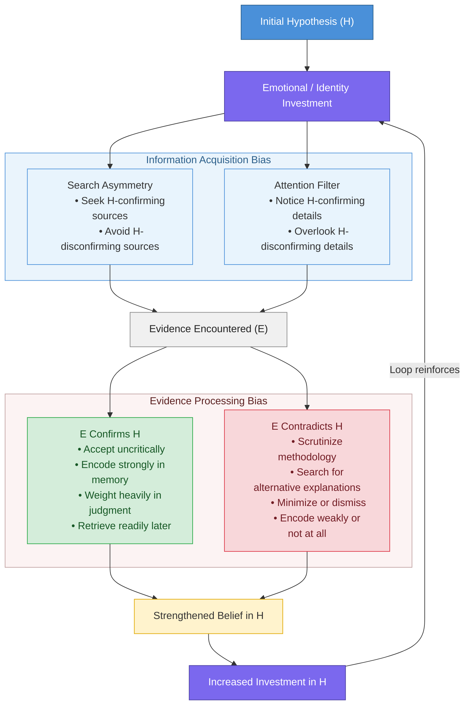
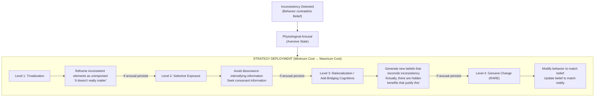
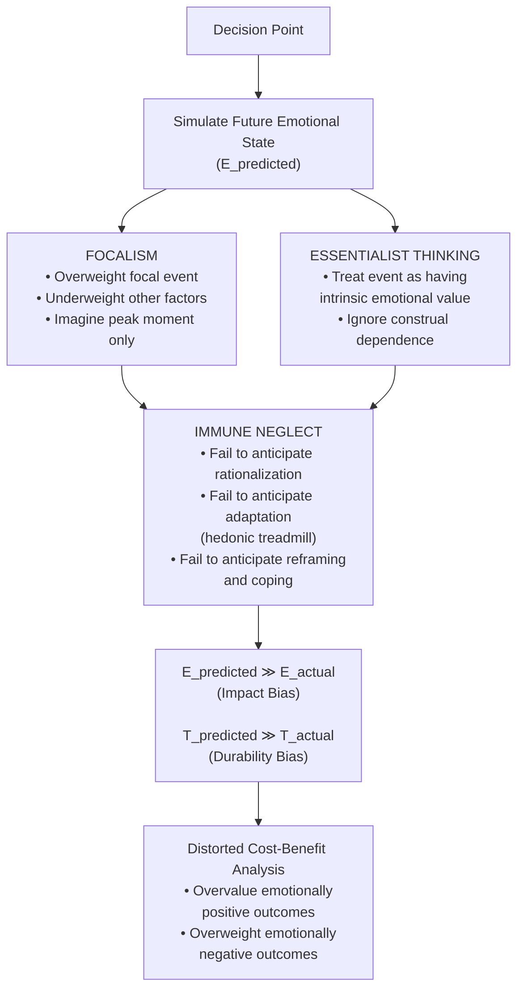

# Lesson 4: Motivated Reasoning, Emotional Biases

## 1. First-Principles Intuition & Invariants

Human reasoning does not operate as a dispassionate logic engine. Decades of empirical research in cognitive psychology have demonstrated that our inferential machinery is fundamentally intertwined with our emotional architecture, creating systematic distortions in how we process evidence, form beliefs, and predict future states. These distortions are not mere noise or random error; they exhibit reliable, predictable patterns that emerge from the deep evolutionary substrates of human cognition. Understanding these patterns—and more critically, learning to detect and compensate for them in real-time—constitutes one of the most powerful meta-cognitive capabilities an analyst, strategist, or decision-maker can develop.

At the foundation of motivated reasoning lies a deceptively simple invariant: humans are not neutral hypothesis-testing machines but rather motivated agents whose cognitive processes serve psychological needs beyond truth-seeking. We possess what Ziva Kunda termed a "directional goal" in reasoning—the desire to arrive at particular conclusions rather than simply accurate ones. This directional motivation interacts with our cognitive apparatus to produce a phenomenon where the same evidence is processed differently depending on whether it supports or threatens our pre-existing beliefs, identity commitments, or emotional investments.

The architecture of motivated reasoning rests on three fundamental pillars. First, selective exposure and attention: we gravitationally drift toward information sources and interpretive frameworks that align with our existing worldview while experiencing genuine psychological discomfort when confronted with disconfirming evidence. Second, asymmetric evidence evaluation: we subject unwelcome evidence to withering scrutiny while accepting congenial evidence with minimal verification, a double standard so automatic that most practitioners remain entirely unaware of its operation. Third, creative interpretation and rationalization: when disconfirming evidence cannot be ignored, our cognitive machinery engages in elaborate post-hoc justification to reconcile the threatening information with our established belief system, often producing explanations that appear rigorous but serve primarily defensive functions.

Confirmation bias represents the most extensively documented manifestation of motivated reasoning. This bias does not merely describe a tendency to notice supporting evidence more readily than contradicting evidence—though that occurs—but rather encompasses a deeper architectural feature of human cognition. When we hold a hypothesis, our attentional systems, memory retrieval patterns, and inferential processes all subtly shift to privilege information consistent with that hypothesis. This creates a self-reinforcing feedback loop: initial hypotheses shape which evidence we encounter and how we interpret it, which in turn strengthens the original hypothesis, making subsequent disconfirmation progressively more difficult.

The persistence of beliefs despite overwhelming contradictory evidence—belief perseverance—reveals an even more troubling invariant. Research by Craig Anderson and colleagues demonstrated that beliefs can survive the complete destruction of their evidential foundation. In experimental paradigms, participants formed beliefs based on fabricated evidence, then were explicitly told the evidence was false and why it had been fabricated. Despite this complete debunking, participants retained significantly weakened but still measurable versions of their original beliefs. This occurs because belief formation triggers the construction of elaborate causal narratives and explanatory schemas that become cognitively independent of the original evidence. Once these explanatory structures exist, they possess their own psychological momentum and resist dismantling even when their foundation crumbles.

Cognitive dissonance—the psychological discomfort arising from simultaneously holding contradictory beliefs or from behavior that conflicts with beliefs—operates as a powerful motivational force driving bias. Leon Festinger's original theory posited that humans experience dissonance as aversive arousal, motivating cognitive and behavioral adjustments to reduce the inconsistency. However, subsequent research revealed that dissonance reduction strategies overwhelmingly favor belief adjustment over behavioral change or genuine integration of contradictory information. When faced with evidence that we made a poor decision, invested in a failing project, or hold an indefensible position, we rarely respond by updating our beliefs to match reality. Instead, we engage in elaborate rationalization, selectively attend to consonant information, trivialize the importance of contradictory evidence, or add new cognitions that bridge the inconsistency without genuinely resolving it.

Emotional reasoning introduces a distinct but interconnected distortion: the tendency to treat emotional reactions as evidence about external reality rather than information about our internal state. When we feel anxious about an upcoming presentation, we interpret the anxiety as evidence that the presentation will go poorly rather than merely as information about our current physiological state. When we feel morally outraged by a policy proposal, we treat the intensity of our outrage as probative of the policy's objective wrongness rather than as data about our values, identity commitments, or tribal affiliations. This conflation of emotional intensity with evidential weight systematically distorts probabilistic reasoning, causing us to overweight emotionally charged scenarios regardless of their actual likelihood.

Affective forecasting errors—systematic mistakes in predicting our future emotional states—create additional layers of bias in decision-making. Daniel Gilbert and Timothy Wilson's research demonstrated that humans consistently misjudge both the intensity and duration of future emotional reactions. We exhibit impact bias, overestimating how much events will affect us emotionally, and durability bias, overestimating how long those emotional effects will persist. These errors stem from focalism (overweighting the event in question while underweighting other life factors), immune neglect (failing to account for our psychological immune system's capacity to rationalize and adapt), and misconstrual (misunderstanding the event's actual characteristics). When we make decisions based on predicted emotional outcomes—career choices, relationship commitments, major purchases—these forecasting errors systematically distort our cost-benefit analyses.

Optimism and pessimism biases represent dispositional tendencies that filter all evidence through emotionally valenced lenses. Unrealistic optimism causes individuals to systematically underestimate their vulnerability to negative events while overestimating the likelihood of positive outcomes, particularly for events perceived as under personal control. This bias contributes to systematic underpreparation for adverse scenarios, inadequate risk mitigation, and persistent surprise when negative outcomes materialize. Conversely, pessimism bias—though less extensively studied due to optimism's greater prevalence—produces parallel distortions in the opposite direction, causing chronic overestimation of threat probability, catastrophic interpretation of ambiguous information, and paralysis in the face of manageable risk.

The common architecture underlying all these biases involves the interaction between fast, automatic, emotion-laden processing (often described through dual-process frameworks as System 1) and slower, deliberative reasoning (System 2). Motivated reasoning biases emerge primarily when System 1 processes generate strong emotional reactions or identity-relevant implications before System 2 can engage in careful analysis. By the time deliberative reasoning activates, it operates in an environment already shaped by emotional reactions, attentional biases, and directional goals. Rather than correcting these distortions, System 2 often rationalizes and intellectually elaborates them, providing sophisticated-seeming justifications for conclusions reached on emotional or motivated grounds.

The fundamental invariant practitioners must internalize is this: these biases are not intellectual failures or signs of irrationality in any simple sense. They emerge from cognitive architectures that served genuine adaptive functions in ancestral environments. Confirmation bias accelerated decision-making in contexts where exhaustive evidence gathering was costly or impossible. Belief perseverance provided stability in social hierarchies and cultural transmission. Cognitive dissonance reduction maintained psychological coherence and commitment to chosen paths. Emotional reasoning provided rapid heuristic judgments when analytical processing was too slow. The problem is not that these mechanisms exist but that they operate automatically in modern decision contexts where their distortions systematically degrade judgment quality, often with catastrophic consequences.

## 2. Core Architecture & Mechanics

To effectively diagnose and counteract motivated reasoning biases, practitioners require precise understanding of their operational mechanics. Each bias exhibits characteristic signatures—observable patterns in evidence processing, argumentation, and decision-making that enable real-time detection even in the subjective flow of one's own reasoning.

Confirmation bias operates through four distinct but interrelated mechanisms. The search asymmetry mechanism drives individuals to preferentially seek out evidence supporting their hypothesis while failing to search for or attend to potentially disconfirming evidence. An intelligence analyst convinced that a foreign power intends hostile action will actively search classified databases for signs of military buildup or threatening rhetoric while failing to search for evidence of diplomatic overtures or domestic political constraints limiting aggressive action. The interpretation asymmetry mechanism processes ambiguous evidence through hypothesis-congruent lenses. A manager believing that a particular employee lacks competence will interpret mixed performance data as confirming incompetence, attributing successes to external factors while attributing failures to dispositional inadequacy. The memory asymmetry mechanism preferentially encodes and retrieves hypothesis-consistent information. When later asked to recall evidence bearing on the hypothesis, individuals disproportionately remember supporting instances while forgetting or minimizing contradictory cases. The weighting asymmetry mechanism subjects uncongenial evidence to intense methodological scrutiny while accepting congenial evidence with minimal verification, creating what Philip Tetlock termed "asymmetric skepticism."

Belief perseverance mechanisms operate through the construction of self-sustaining causal narratives. When individuals encounter initial evidence for a proposition, they do not merely encode the evidence itself but immediately begin generating explanatory stories connecting the evidence to broader schemas and causal models. These explanations proliferate rapidly through associative memory networks, linking the focal belief to related concepts, personal experiences, and general theories. Once constructed, these narrative structures become psychologically real and accessible independent of the original evidence. When that evidence is later discredited, individuals have difficulty dismantling the intricate web of explanations, counterfactual scenarios, and causal attributions they constructed. The belief becomes embedded in a rich cognitive context that survives the destruction of its original foundation.

The diagnostic signature of belief perseverance appears in post-debunking justifications. When individuals defend beliefs after their evidential basis has been destroyed, they rarely reference the discredited evidence directly. Instead, they appeal to the explanatory narratives they constructed: "It just makes sense that X would lead to Y," or "Based on everything I know about this domain, the original conclusion still seems reasonable." These statements reveal that the belief now rests on the generated explanations rather than the original evidence. Effective debiasing therefore requires not merely discrediting evidence but systematically deconstructing the explanatory edifice built upon it.

Cognitive dissonance reduction exhibits a characteristic temporal and strategic pattern. The initial encounter with inconsistency produces measurable physiological arousal—elevated skin conductance, increased heart rate—signaling the aversive quality of the inconsistency. This discomfort motivates rapid deployment of dissonance reduction strategies, typically in a hierarchical sequence reflecting their psychological cost. The least costly strategy involves trivialization: reframing the inconsistent elements as unimportant or peripheral. A person who smokes despite knowing the health risks might minimize the importance of health relative to immediate pleasure or stress relief. If trivialization proves insufficient, individuals deploy selective exposure, actively avoiding information that would intensify the dissonance while seeking consonant information. The smoker stops reading articles about lung cancer while attending to any research suggesting confounding factors or individual variation in susceptibility.

When these strategies fail, individuals engage in more elaborate rationalization, adding new cognitions that bridge the inconsistency without genuinely resolving it. The smoker might adopt beliefs about the stress-reduction benefits of smoking outweighing health costs, or embrace fatalistic beliefs about mortality making health-protective behavior pointless. Only when all these strategies prove inadequate do individuals undertake the most psychologically costly strategy: genuine belief or behavior change aligned with reality. The asymmetry is striking—cognitive dissonance motivates change, but the change is overwhelmingly directed toward belief adjustment, rationalization, and defensive information processing rather than behavioral adaptation or accurate belief updating.

Emotional reasoning operates through a process of affect-as-information, where emotional states serve as heuristic cues about external reality. The mechanism begins with automatic emotional reactions triggered by stimuli—a proposal, a person, a scenario. These reactions occur rapidly, often before conscious awareness or deliberative analysis. The critical step involves misattributing these emotional reactions: instead of recognizing them as information about our internal state, values, or past experiences, we interpret them as evidence about the external stimulus itself. Fear about air travel becomes evidence that air travel is dangerous, despite statistical evidence of its safety. Moral disgust toward a policy becomes evidence of the policy's objective wrongness, independent of consequentialist analysis of its effects.

The diagnostic signature appears in reasoning that substitutes emotional intensity for probabilistic or logical assessment. Individuals make claims like "I just know this will fail" based primarily on anxiety, or "This policy is clearly unjust" based primarily on outrage, treating these emotional reactions as sufficient warrant for factual or normative conclusions. The emotional tail wags the evidential dog. Effective debiasing requires metacognitive awareness: recognizing the emotional reaction, acknowledging it as information about oneself rather than the world, and then deliberately engaging in separate evidential assessment independent of the emotional signal.

Affective forecasting errors emerge from systematic failures in mental simulation of future emotional states. When individuals attempt to predict how they will feel after an event—landing a job, experiencing a breakup, winning an award—they engage in focused simulation of the event itself, typically imagining the peak moment of the experience. This focalism causes several distortions. First, individuals fail to account for the hedonic treadmill: our remarkable capacity to adapt to changed circumstances and return toward baseline emotional states. The initial euphoria of the promotion or devastation of the rejection fades much faster than predicted because other life factors reassert themselves and because our psychological immune system rationalizes, reframes, and adapts.

Second, individuals engage in essentialist thinking about emotional impacts, treating major events as possessing intrinsic emotional qualities rather than recognizing that emotional responses depend heavily on construal, context, and comparison. The significance of losing a competition depends entirely on whether you expected to win, whether you value the domain, and whether you have alternative sources of self-worth. Yet when forecasting, individuals treat the event as having fixed emotional consequences independent of these contextual factors.

Third, individuals neglect their own psychological immune system—the constellation of rationalization, reframing, and coping mechanisms that will activate post-event. We predict feeling devastated by rejection but fail to anticipate that we will generate explanations minimizing the rejection's significance, discover hidden benefits in the alternative path, and recruit social support that buffers the emotional impact. These forecasting errors systematically distort decision-making whenever expected emotional consequences factor into cost-benefit analysis, which is almost always.

Optimism and pessimism biases exhibit characteristic signatures in probability estimation and risk assessment. Unrealistic optimism manifests as systematically lower risk estimates for oneself compared to statistical base rates for similar individuals. When asked to estimate the likelihood of divorce, job loss, serious illness, or accident, optimistically biased individuals provide estimates well below actuarial frequencies, particularly for negative events perceived as controllable. The mechanism involves an illusion of control: individuals overweight the influence of their own skill, effort, and intentionality while underweighting situational factors, random variation, and base rates. This creates a predictable asymmetry: I am less likely than others to experience negative controllable events because I am more careful, skilled, or attentive, while statistical others suffer misfortune due to their carelessness or inadequacy.

Pessimism bias operates through complementary mechanisms: heightened attention to threatening information, catastrophic interpretation of ambiguous cues, and retrieval bias favoring negative precedents. A pessimistically biased individual scanning a business environment notices threats, warning signs, and vulnerabilities while overlooking opportunities and strengths. Ambiguous signals—a delayed email response, an unclear comment in a meeting—receive worst-case interpretations. When considering analogous past situations, memory preferentially retrieves failures and disasters rather than successes, skewing probability estimates toward negative outcomes.

## 3. High-Performance Optimization & Failure Modes

Effective debiasing requires moving beyond mere awareness of biases toward implementing systematic cognitive countermeasures that operate reliably under the degraded conditions of real-world decision-making: time pressure, emotional arousal, ego involvement, and high stakes. Theoretical knowledge of bias provides necessary but insufficient protection. High-performance reasoning demands concrete operational protocols that can override automatic biased processing even when practitioners are tired, stressed, or personally invested in conclusions.

The foundational debiasing protocol for confirmation bias involves forced disconfirmation. Rather than passively hoping to notice contradictory evidence, practitioners must actively construct and test the strongest possible case against their working hypothesis. This requires specific procedural steps. First, articulate the focal hypothesis explicitly in falsifiable terms. Vague beliefs resist testing; precise claims enable targeted disconfirmation attempts. Second, generate alternative hypotheses that would explain the currently available evidence equally well. This counteracts the tendency to treat one's initial hypothesis as the only possible explanation. Third, identify the most diagnostic evidence that would discriminate between the focal hypothesis and alternatives—evidence whose presence or absence would substantially shift relative probabilities. Fourth, actively search for that diagnostic evidence, with particular emphasis on searching for disconfirming cases.

The critical discipline lies in searching for disconfirmation with the same energy and creativity ordinarily devoted to finding confirmation. This proves psychologically difficult because disconfirmation threatens ego investment and requires entertaining the possibility that one's current belief is wrong. The operational solution involves reframing the goal: the objective is not to prove one's hypothesis correct but to stress-test it against the strongest possible objections. A hypothesis that survives determined disconfirmation attempts earns genuine confidence; one that crumbles provides valuable early warning before committing resources or reputation to a flawed position.

Consider-the-opposite techniques provide a lightweight but surprisingly effective debiasing intervention. When reaching a provisional conclusion, practitioners explicitly pose the question: "What are the strongest reasons this conclusion might be wrong?" This simple prompt triggers search through memory and evidence space for contradictory information that would otherwise remain dormant. Merely asking the question activates different retrieval pathways and interrupts the automatic confirmation-biased processing. Research demonstrates that even minimal consider-the-opposite interventions produce measurable reductions in overconfidence and improvements in probability calibration.

More elaborate implementations involve structured red-teaming: designating team members or dedicating cognitive time to developing the strongest possible critique of a proposal. The red team's goal is not balanced assessment but maximally effective attack, identifying vulnerabilities, questioning assumptions, and stress-testing arguments. This institutionalizes disconfirmation, embedding it in organizational decision processes rather than relying on individual virtue or awareness. For solo decision-making, practitioners can implement personal red-teaming by scheduling dedicated time for devil's advocacy, during which the explicit task is generating objections to one's preferred position.

Belief perseverance demands more aggressive intervention because merely exposing contradictory evidence proves insufficient. The operational protocol requires explicating and then systematically dismantling the causal narratives supporting the belief. First, externalize the belief structure by writing out the explanatory story: Why do I believe X? What causal mechanisms or general principles does this belief invoke? How does X connect to other beliefs in my worldview? This externalization makes implicit reasoning visible and manipulable. Second, deliberately generate alternative causal stories that explain the original evidence differently. If the evidence that initially supported belief X can be equally well explained by mechanism Y or Z, the original belief loses its unique claim to explanatory adequacy. Third, identify the most questionable links in the causal chain and subject them to focused scrutiny. Causal narratives typically contain several speculative inferences; questioning even one link can destabilize the entire structure.

The most powerful intervention involves explaining the opposite: how the world would look if the belief were false. This forces construction of an alternative narrative framework that competes with the original belief's explanatory coherence. Without such an alternative framework, individuals cling to discredited beliefs simply because they possess no competing cognitive structure to occupy the explanatory space. Building the opposite case provides that alternative structure, creating genuine competition between narratives rather than merely attacking one narrative in isolation.

Cognitive dissonance reduction requires catching the bias during its characteristic temporal window: the initial encounter with inconsistency before rationalization machinery fully deploys. The operational signature involves noticing emotional discomfort or defensiveness arising specifically when encountering information that contradicts behavior or cherished beliefs. This affective signal serves as an early warning system. The moment of discomfort marks the inflection point where genuine belief updating remains possible before elaborate rationalizations crystallize.

The intervention protocol involves three steps executed rapidly during the window of dissonance arousal. First, explicitly acknowledge the inconsistency in concrete terms: "I believe X but did Y, which contradicts X." Verbalizing the contradiction prevents automatic trivialization. Second, resist the immediate impulse to explain away or minimize the inconsistency. Notice and label rationalization attempts as they arise: "I'm now generating reasons why this doesn't really matter; that's rationalization." This metacognitive labeling creates psychological distance from the rationalization, reducing its persuasive force. Third, seriously consider whether the inconsistency reveals a problem with belief or behavior, engaging in genuine deliberation rather than automatic defensive processing.

This protocol proves difficult to execute because dissonance creates urgency to escape the aversive arousal through any available rationalization. The countermeasure involves normalizing dissonance: treating inconsistency detection not as ego threat but as valuable diagnostic information indicating areas where beliefs may require updating or behavior may need correction. Organizations can institutionalize this by creating psychological safety for acknowledging inconsistencies, treating them as learning opportunities rather than occasions for criticism or status loss.

Emotional reasoning debiasing requires installing a consistent metacognitive monitoring routine that distinguishes emotional reactions from evidential assessment. The core intervention involves a simple but rigorous question posed whenever strong emotions arise in reasoning contexts: "Is my emotional reaction evidence about the external situation or evidence about my internal state?" This question redirects attention from the object of emotion (the stimulus) to the emotion itself (the response), enabling examination of what the emotion actually signals.

Following the initial question, practitioners execute a structured analysis. First, identify the specific emotion: anxiety, anger, disgust, excitement, moral outrage. Different emotions carry different informational content. Anxiety signals perceived threat or uncertainty; anger signals perceived goal obstruction or injustice; disgust signals norm violation or contamination; excitement signals opportunity or reward. Second, analyze what triggered the emotion. Does the trigger relate to evidence quality, or does it relate to identity, values, past experiences, or situational factors? If an argument triggers moral outrage, is that because the argument's logic is flawed or because it contradicts deeply held values? The emotion itself does not answer this question. Third, conduct separate evidential analysis with explicit effort to set emotional reactions aside: "If I felt completely neutral about this, what would the evidence actually indicate?"

This protocol does not eliminate emotions from decision-making—emotions provide valuable information about values and preferences—but prevents emotions from masquerading as factual evidence. The distinction crystallizes in the question: "What is this emotion telling me about what I care about versus what is true?" A policy might be objectively effective (truth claim) while violating my values (preference claim). Emotional reasoning conflates these; disciplined analysis separates them.

Affective forecasting error correction requires two interventions: debiasing predictions and restructuring decisions to reduce dependence on unreliable forecasts. For debiasing predictions, the most effective technique involves anchoring on actual measured emotional trajectories rather than intuitive forecasts. Research has measured how quickly people adapt to major life events: job changes, relationship formations and dissolutions, geographic moves, health events. These trajectories reveal consistent patterns of rapid adaptation, with most emotional impacts substantially attenuated within weeks to months. When forecasting one's own emotional future, explicitly consulting these empirical trajectories rather than relying on intuitive simulation dramatically improves accuracy.

The operational protocol involves three adjustments to intuitive forecasts. First, reduce intensity: when intuition predicts emotional impact at level 10, empirical trajectories suggest actual impact will likely be 6 or 7. Second, reduce duration: when intuition predicts lasting impact measured in years, empirical trajectories suggest months. Third, account for psychological immune system activation: generate specific predictions about how you will likely rationalize, reframe, or cope with the event, then incorporate these predicted adaptations into your emotional forecast.

The more radical intervention involves designing decisions to minimize dependence on affective forecasts by focusing on objectively measurable consequences rather than predicted emotional outcomes. Instead of "Which job will make me happier?" (requiring affective forecasting), ask "Which job provides better skill development, financial security, and optionality?" Instead of "How devastated will I be if this relationship ends?" ask "What concrete resources and relationships do I need to ensure resilience regardless of emotional trajectory?" This reframing doesn't eliminate affective considerations but reduces the decision's dependence on unreliable emotional predictions.

Optimism bias correction requires systematic confrontation with base rates and statistical thinking. The core intervention involves forced consideration of reference classes: identifying a comparison group of similar individuals in similar circumstances and using their outcomes as the starting point for personal predictions. An entrepreneur estimating the probability of startup success must begin not with assessments of personal talent or dedication but with the base rate of startup failure in the relevant industry and stage. Personal factors then serve as adjustments from this base rate rather than replacing it entirely.

The operational protocol follows a strict sequence. First, define the reference class as narrowly as possible while maintaining sufficient sample size: not "all startups" but "enterprise SaaS startups at seed stage in competitive markets." Second, obtain actual outcome statistics for this reference class from reliable sources rather than intuitive estimates. Third, make the initial prediction using the base rate: "For businesses in this reference class, the five-year survival rate is 22 percent." Fourth, identify specific factors that distinguish your case from the reference class: unique proprietary technology, exceptional team background, favorable regulatory changes. Fifth, adjust from the base rate using these distinguishing factors, but apply modest adjustment magnitudes. Research consistently shows that individuating information should shift estimates less than intuition suggests; base rates deserve heavy weight.

Pessimism bias correction requires analogous but opposite interventions: forced consideration of success precedents and systematic search for opportunity rather than threat. A pessimistically biased risk assessment exhibits characteristic signs: exclusive focus on vulnerabilities, worst-case scenario planning, and retrieval bias toward past failures. The debiasing protocol involves deliberate counterbalancing. For every identified risk, practitioners must generate at least two potential opportunities or strengths. For every failure precedent retrieved from memory, practitioners must retrieve at least two success precedents. This quantitative forcing function counteracts the asymmetric attention and retrieval that sustains pessimism bias.

The deeper intervention involves examining the narrative frame through which scenarios are interpreted. Pessimism bias often reflects an underlying threat-focused narrative where the world is hostile, resources are scarce, and errors prove catastrophic. This frame selectively highlights information consistent with threat while minimizing information suggesting opportunity or resilience. Narrative reframing involves explicitly articulating the threat-focused frame, then deliberately constructing alternative frames: a learning-focused frame where errors provide information and adaptation is possible, or a resource-focused frame emphasizing available capabilities and support. These alternative frames are not delusional optimism but legitimate alternative construals that highlight different aspects of reality. Deliberately rotating through multiple frames provides more comprehensive situation assessment than remaining locked in a single pessimistic construal.

The ultimate failure mode in debiasing efforts involves what might be termed "bias bias": overconfidence in one's ability to detect and correct biases, leading to premature termination of debiasing efforts. Awareness of bias does not confer immunity; motivated reasoning operates largely through automatic processes that persist despite explicit knowledge of their operation. The pernicious aspect of bias awareness is that it creates an illusion of control, leading practitioners to believe they have corrected for bias when they have merely renamed their motivated reasoning as "debiased judgment."

The operational safeguard involves institutionalizing external accountability and structured decision processes that do not depend on individual bias awareness. Formal decision protocols—pre-commitment to decision criteria before seeing outcomes, blinded evaluation where possible, adversarial collaboration between advocates of competing positions, quantitative tracking of prediction accuracy with feedback—create environmental constraints that force more rigorous reasoning regardless of individual bias recognition. High-performance debiasing relies less on cultivating virtuous reasoning and more on designing decision environments that make biased reasoning more costly and obvious than accurate reasoning.

The practitioner's goal is not eliminating motivated reasoning, which appears to be an intrinsic feature of human cognition, but rather constructing reliable countermeasures that operate even under conditions of emotional investment, time pressure, and ego involvement. This requires moving beyond conceptual understanding toward concrete, operationalized protocols that can be deployed systematically in real-world reasoning contexts where bias consequences matter most.
