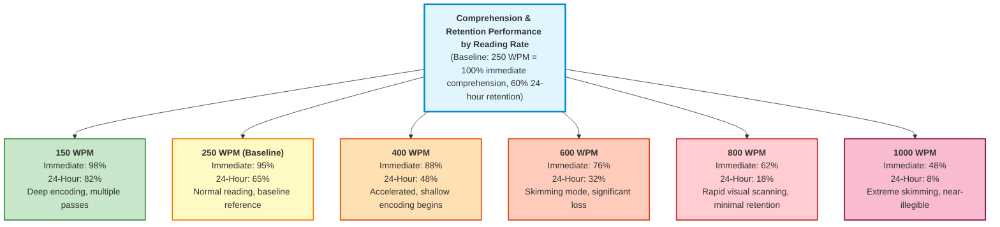

# Lesson 2: Comprehension-Speed Tradeoffs

## 1. First-Principles Intuition & Invariants

The central paradox of speed reading lies not in velocity itself, but in the fundamental constraints imposed by human cognition. To understand this paradox, we must first establish what happens neurologically and cognitively when you read, then map how increasing reading speed affects each layer of that process.

Reading is not a single unified act. It is a cascade of sequential cognitive operations: visual perception of orthographic symbols, lexical access (retrieving word meaning from memory), syntactic parsing (understanding grammatical structure), semantic integration (constructing propositional meaning), and episodic encoding (storing the content into long-term memory for later retrieval). Each of these stages has its own processing bottleneck, its own capacity ceiling, and its own failure mode. The speed-comprehension tradeoff emerges because these stages are coupled: you cannot arbitrarily accelerate one without creating pressure on the others.

Begin with a first-principles observation about working memory, the cognitive workspace where active meaning-making occurs. Working memory is severely capacity-limited—approximately three to four meaningful chunks can be held in conscious attention simultaneously. This is not arbitrary; it reflects the biological constraint of prefrontal cortex neural firing patterns. When you read at normal conversational pace (roughly 250 words per minute), your working memory receives a continuous stream of lexical and syntactic information, processes it into propositional units, integrates those units with prior context, and then discards them to make room for the next sentence. This rhythm is sustainable because the cognitive load remains within the working memory envelope.

Now compress that timeline. Increase reading speed to 600 words per minute, then to 1,000. What happens? The influx of lexical information into working memory accelerates, but working memory capacity does not expand. The prefrontal cortex cannot suddenly gain additional slots. Instead, one of two consequences follows: either you begin dropping information (reducing comprehension), or you begin employing cognitive shortcuts that bypass deep semantic processing.

This is the invariant: **the speed-comprehension tradeoff is not a soft preference but a hard cognitive law rooted in finite working memory capacity and the sequential nature of language processing.** You cannot violate this constraint any more than you can fit five gallons of water into a three-gallon bucket by pouring faster.

The second foundational invariant concerns subvocalization—the internalized phonological activation that accompanies reading. Many speed-reading methodologies treat subvocalization as an enemy to be eradicated, a vestigial holdover from childhood read-aloud practices. This diagnosis is partially correct but incomplete. Subvocalization does consume processing time; articulating each word silently, even at unconscious speeds, introduces a phonological bottleneck that approximately mirrors speech rate (120–150 words per minute for natural speech). However, subvocalization also plays a crucial cognitive role: it maintains phonological information in working memory, aids in ambiguity resolution, and supports syntactic parsing, especially for grammatically complex sentences. Eliminating subvocalization entirely does accelerate visual scanning speed, but it simultaneously degrades comprehension for challenging material. The invariant here is **subvocalization represents a tradeoff between processing speed and semantic depth, not a pure inefficiency.**

The third invariant concerns the structure of text itself and its interaction with reading rate. Not all text types impose equal cognitive load. A technical manual with dense propositional content (mathematical notation, specialized terminology, recursive clausal structures) demands high semantic integration depth. A narrative novel with familiar vocabulary and straightforward syntax places less demand on the semantic integration stage. A list of familiar facts places minimal working memory pressure at all. Speed reading thus has a natural domain boundary: it works effectively when text is semantically shallow and working memory load is low. It fails catastrophically when comprehension requires deep semantic processing, when text is semantically dense, or when retention is critical.

This brings us to the retention curve—the inevitable temporal decay of memory traces. The Ebbinghaus forgetting curve, refined through a century of cognitive psychology research, demonstrates that memory traces decay most rapidly in the first few hours after encoding, with weakly encoded information typically dropping to 25–33% retention within 24 hours. When you read at extreme speed (1,000+ words per minute), semantic encoding is typically shallow—information enters working memory briefly, is minimally elaborated (connected to prior knowledge), and produces weak memory traces. The result is rapid forgetting. Even if you achieved 90% comprehension immediately after reading, retention drops to 40–50% within 24 hours. This is not a comprehension failure in the moment; it is an encoding failure that manifests as memory failure downstream.

## 2. Core Architecture & Mechanics

Understanding the mechanical architecture of reading reveals why certain optimizations work and others produce false gains. Reading involves three principal processing streams: the visual-orthographic stream (perceiving letter sequences), the lexical-semantic stream (accessing word meanings and syntactic roles), and the integration stream (constructing propositional meaning from words and integrating that meaning with prior context). These streams operate in rough parallel, but they have hard sequential dependencies: you cannot access word meaning without first perceiving the orthographic form, and you cannot integrate meaning without first accessing it.

```text
┌─────────────────────────────────────────────────────────────────────────┐
│                    Reading Processing Pipeline                          │
├─────────────────────────────────────────────────────────────────────────┤
│                                                                          │
│  Visual Perception     Lexical Access        Syntactic Parsing           │
│  (Orthography)        (Meaning Retrieval)   (Grammatical Role)          │
│         │                     │                      │                   │
│    Saccade/Fixate      Phonological Route   Identify Arguments,          │
│    Recognize Shapes    Semantic Route       Adjuncts, Dependencies       │
│         │                     │                      │                   │
│         └─────────────────────┴──────────────────────┘                   │
│                              │                                           │
│                    Semantic Integration                                  │
│                    (Construct Propositional                              │
│                     Meaning + Update Context)                            │
│                              │                                           │
│                    Episodic Encoding                                     │
│                    (Transfer to Long-Term                                │
│                     Memory if Attended)                                  │
│                              │                                           │
│                           Output                                         │
│                    (Comprehension / Retention)                           │
│                                                                          │
└─────────────────────────────────────────────────────────────────────────┘
```

The visual-orthographic stream operates as a bottom-up feature detection system. Your eyes do not scan text smoothly; they make rapid jerking movements called saccades, punctuated by brief stable fixations lasting approximately 200–250 milliseconds. During each fixation, orthographic information enters early visual cortex, is matched against learned letter templates, and is transmitted upward to language areas. The perceptual span—the region from which usable information can be extracted during a single fixation—extends approximately three letters to the left of fixation point and fourteen to the right. This asymmetry reflects the directional flow of English orthography (left to right) and the parafoveal preview benefit: peripheral vision can extract upcoming word shapes and beginnings, which accelerates subsequent lexical access. Reading speed correlates strongly with fixation duration and saccade amplitude. A skilled 250-words-per-minute reader typically makes fixations of 200–220 milliseconds and saccades spanning seven to nine characters. A rapid skimmer, reading at 800 words per minute, reduces fixation duration to 80–120 milliseconds and extends saccades to twenty characters or more.

Here is the mechanical constraint: reducing fixation duration below approximately 100 milliseconds begins to degrade orthographic processing. Letters enter visual cortex but do not receive sufficient integration time to form stable letter identities. Saccading farther than twenty-five characters forces you to rely on parafoveal preview, which is coarse and error-prone; you begin missing small words and function words, and your syntactic parsing becomes fragmentary. There is a hard floor on how fast you can move your eyes through text while maintaining visual acuity.

The lexical-semantic stream operates through two routes: phonological (converting orthography to sound form, then accessing meaning) and direct semantic (visual form directly accesses meaning). For high-frequency, familiar words (common verbs, nouns, prepositions), the direct semantic route dominates, and word access occurs in 200–250 milliseconds. For low-frequency, technical, or ambiguous words, phonological mediation becomes necessary, extending access time to 400–600 milliseconds or longer. Subvocalization (the phonological activation during reading) partially reflects this phonological route; your brain is literally coarticulating word sounds, even if those sounds do not reach your vocal apparatus. When you attempt to suppress subvocalization entirely and force pure visual-direct-semantic access, you accelerate lexical processing for familiar words but simultaneously increase error rates on low-frequency and ambiguous terms. For technical reading, this produces a hidden comprehension cost: you misidentify or skip unfamiliar technical terms, introducing systematic gaps in semantic understanding.

The integration stream is where semantic comprehension actually occurs—where individual word meanings are combined into propositional structures and integrated with prior context. This stage is cognitively expensive and cannot be accelerated without cost. Consider a moderately complex sentence: "The corporation's strategic pivot, driven by regulatory pressure and declining market share, necessitated a complete restructuring of its supply chain." Parsing this sentence requires holding multiple embedded clausal relationships in working memory simultaneously: the corporation (agent), the pivot (action), the two causal drivers (regulatory pressure, market decline), the consequence (restructuring), and the object of restructuring (supply chain). Constructing this propositional structure takes time—typically 400–600 milliseconds beyond the lexical access time for the individual words. This integration time is largely invariant; you cannot arbitrarily compress it without loss of accuracy. If you attempt to read this sentence at 1,500 words per minute (approximately 40 milliseconds per word), integration never completes. Comprehension collapses.

This leads to a practical classification of text types and their reading-rate ceilings:

**Semantically shallow, high-frequency text** (familiar narratives, news summaries, lists of known facts) tolerates reading rates of 600–1,000 words per minute because working memory load remains low. Integration is straightforward; there are few embedded dependencies, and most words are frequent. Subvocalization can be aggressively suppressed because phonological processing is unnecessary.

**Semantically intermediate text** (most academic articles, professional reports, moderately complex explanations) has a practical ceiling around 300–400 words per minute for adequate comprehension and retention. Attempting higher speeds produces shallow encoding; retention drops below 60% within 24 hours. Subvocalization should be allowed, especially on first reading, to support syntactic parsing and ambiguity resolution.

**Semantically dense text** (mathematical proofs, technical specifications, philosophical arguments, legal contracts) has a ceiling of 150–250 words per minute for adequate comprehension and near-zero tolerance for skimming. These texts demand multiple passes: a slow first reading for semantic intake, followed by analytical re-reading for critical evaluation. Subvocalization is essential; it provides phonological scaffolding for complex syntactic structures.

The chart below illustrates the comprehension-retention curve across different reading rates for a representative academic text (business strategy article, approximately 2,500 words, moderate semantic density):



## 3. High-Performance Optimization & Failure Modes

Speed reading is not a monolithic skill; it is a portfolio of techniques, each with specific domain applicability and cost-benefit tradeoffs. The practitioner's task is to match technique to context, not to maximize reading speed universally.

**Technique 1: Controlled Subvocalization Suppression for Low-Semantic-Load Text.** For familiar narratives, news articles, and routine informational text where comprehension depends primarily on lexical access rather than complex semantic integration, systematically reducing subvocalization can increase effective reading rate from 250 to 500–600 words per minute with minimal comprehension loss. The execution mechanism involves deliberate attention to visual form processing: instead of allowing words to spontaneously trigger phonological activation, you actively suppress phonological coarticulation and direct attention to orthographic-semantic pathways. In practice, this requires approximately two weeks of deliberate practice, twenty minutes daily, using texts of known low semantic density. The suppression is never complete; residual subvocalization persists unconsciously, typically accounting for 40–60% of the original phonological activation. Attempting total subvocalization elimination is counterproductive; it introduces cognitive strain (active inhibition is effortful) without proportional speed gains.

The failure mode occurs when this technique is applied to semantically complex text. Technical material, philosophical arguments, and legally precise language all depend on phonological processing to resolve ambiguity and maintain syntactic relationships. Suppressing subvocalization degrades comprehension accuracy, producing what appears to be comprehension (you are aware of word meanings) but is actually semantic misunderstanding (you miss nuanced relationships between concepts). This failure is insidious because it is often invisible; comprehension self-assessment is poor, and you may not notice the accuracy loss without external testing.

**Technique 2: Parafoveal Preview Optimization and Saccade Extension.** The parafoveal region—visual information available peripherally, outside the fovea—provides shape and beginning-letter information about upcoming words. Skilled readers exploit this preview by making larger saccades (fifteen to twenty characters rather than seven to nine), allowing their parafoveal system to pre-process upcoming words before foveal fixation. This reduces fixation duration on those words and accelerates overall scanning speed. The execution involves training your eye movements through targeted exercises: use a pointer or finger to guide saccade targets, deliberately jumping farther ahead than your natural tendency, and practicing with low-semantic-load text until the extended saccade pattern becomes automatic. Over three to four weeks of practice, this can increase reading speed by approximately 20–30% with minimal comprehension cost for familiar text.

The failure mode occurs with unfamiliar words, technical terminology, and low-frequency terms. Parafoveal preview cannot extract meaning from unfamiliar words; it only provides shape information. When you saccade past a technical term you have not encountered before, parafoveal preview provides no useful information, and foveal processing must handle the entire word alone, typically resulting in misidentification or skipping. For text containing technical vocabulary, extended saccades introduce systematic comprehension errors.

**Technique 3: Strategic Skimming with Structural Cueing.** Not all reading requires complete semantic processing. When your goal is rapid information extraction (finding specific facts, assessing whether detailed reading is warranted, or reviewing material you have already studied deeply), strategic skimming can extract useful information at 800–1,200 words per minute. Strategic skimming is not random visual scanning; it is structured attention to text organization. Most formal writing—academic articles, technical documentation, business reports—follows predictable structural patterns. The abstract or introduction establishes the main claim. Topic sentences at the beginning of paragraphs state the paragraph's contribution. The conclusion restates main findings. By directing attention selectively to these structural landmarks and rapidly scanning intervening material, you can extract the skeleton of meaning while remaining ignorant of supporting details. The execution involves training pattern recognition for document structure: learn standard academic article structure (Abstract → Introduction → Methods → Results → Discussion → Conclusion), standard report structure (Executive Summary → Methodology → Findings → Recommendations), and narrative structure (exposition → rising action → climax → resolution). When you encounter a new document, rapidly scan for these structural markers, then fixate on them with normal reading pace while skipping details.

The failure mode occurs when you need comprehensive understanding or when text structure is non-standard or deliberately obscured. Skimming extracts only the high-level propositional skeleton; details, nuances, counterarguments, and limitations remain unprocessed. If you subsequently need to understand those details or defend your comprehension against expert scrutiny, skimming has failed. Additionally, non-standard text (creative writing, opinion essays, dense philosophical arguments) does not follow predictable structural patterns; skimming produces fragmented, inaccurate understanding.

**Technique 4: Context-Based Prediction and Inference.** Language is highly redundant and predictable. High-frequency words and common syntactic patterns allow readers to predict upcoming content with substantial accuracy. Rather than laboriously processing every word, skilled readers can accelerate comprehension by relying on contextual prediction: given the semantic context established so far, the upcoming words are highly constrained, and full lexical processing can be abbreviated. For example, the sentence "The programmer debugged the software and fixed the..." strongly predicts that the next word will be "bug" or "issue" or "error." Foveal processing can be minimized on that word; parafoveal preview combined with contextual prediction provides sufficient information. The execution involves deliberately practicing prediction: read the first part of sentences and predict their completions before fixating on the final words. Over time, this prediction process becomes automatic, and your reading rate accelerates without conscious effort.

The failure mode is prediction error—when context leads you to predict the wrong continuation, and that misprediction contaminates subsequent comprehension. This occurs most readily when text contains plot twists, counterintuitive arguments, or deliberate misdirection. If you predict "The economy recovered" but the next phrase is "the economy collapsed despite analyst predictions," your initial prediction contaminates semantic integration, and you may misunderstand the actual claim. Technical writing is particularly vulnerable to this failure mode because technical prose often contains unexpected semantic turns (conditions under which normal assumptions fail, counterexamples, edge cases) that deliberately violate prediction.

**Integrating Techniques Into a Practitioner Workflow.** Speed reading expertise is not a single monolithic capability but a portfolio of context-sensitive techniques.

The practitioner workflow therefore demands **strategic technique selection based on text properties and reading goals**. Narrative fiction benefits maximally from expanded saccades and predictive reading—the semantic redundancy is high, plot structure is conventional, and moderate prediction errors are tolerable since narrative comprehension is robust to local misunderstandings. Technical documentation, legal contracts, and mathematical proofs demand the opposite profile: reduced saccade distance, increased fixation duration, deliberate subvocalization on critical definitions and logical connectives, and conservative prediction (or prediction disabled entirely in sections with high information density). Academic reading often requires a hybrid approach: rapid skimming with expanded saccades during literature review to assess relevance, followed by intensive close reading with subvocalization and reduced saccade distance when extracting methodological details or evaluating empirical claims. The expert speed reader is not someone who reads everything at 800 wpm; the expert is someone who accurately selects 800 wpm for low-density text, 400 wpm for moderate-density text, and 150 wpm for high-density text, and who transitions fluidly between these regimes without conscious deliberation. Mastery is **contextual calibration**, not maximal speed.

The governing principle across all techniques is **information bandwidth matching**: your reading rate should match the information density of the text and the precision required by your comprehension goals. Reading faster than the text's information density permits yields correct comprehension with reduced time cost. Reading slower than necessary yields correct comprehension but wastes time. Reading faster than the text's information density permits yields comprehension failure—either missing critical content entirely (skipping past it) or constructing incorrect semantic representations (prediction errors, inadequate integration). The optimization problem is therefore to identify the maximum sustainable rate for each text type and purpose, and to develop automatic calibration so that technique selection occurs without executive control overhead. This calibration is acquired through deliberate practice with feedback: read passages at varying rates, test comprehension, and identify the rate at which accuracy begins to degrade for each text category.

## Summary & Verification Matrix

| **Invariant / Mechanism** | **Core Principle** | **Failure Mode** | **Diagnostic Test** | **Mitigation Strategy** |
|---------------------------|-------------------|------------------|---------------------|------------------------|
| **Foveal bottleneck** | Only ~15 characters processable per fixation; parafoveal preview is degraded | Attempting to process too many words per fixation yields skipping or misrecognition | Read technical term-dense text at high speed; check for term confusion or omission | Reduce saccade distance in high-density text; increase fixation count on unfamiliar terms |
| **Subvocalization constraint** | Articulatory loop limits processing to ~250 wpm when phonological encoding is required | Suppressing subvocalization on semantically complex or ambiguous text yields comprehension loss | Read conditional logic or nested clauses at 600+ wpm without subvocalization; test logical inference | Selectively enable subvocalization for complex syntax, definitions, logical operators |
| **Semantic integration demand** | Working memory must assemble sentence-level and discourse-level representations; integration failures accumulate | High speed with inadequate integration time yields local comprehension without global coherence | Speed-read multi-paragraph argument, then summarize the logical structure; check for missing steps or incoherence | Insert deliberate pauses at paragraph boundaries; reduce speed during argumentative transitions |
| **Prediction-verification tradeoff** | Contextual prediction accelerates processing but introduces error risk when predictions fail | Over-reliance on prediction in technical or twist-heavy text yields persistent misunderstanding | Speed-read text with deliberate misdirection or counterexamples; check for prediction-contaminated interpretations | Disable or limit prediction in low-redundancy text; verify predictions when semantic context shifts unexpectedly |
| **Contextual calibration** | Optimal reading rate varies by text density and comprehension goal; technique selection must match context | Applying uniform high-speed techniques across all text types yields either time waste (too slow) or comprehension failure (too fast) | Read three passages (narrative, expository, technical) at same rate; measure comprehension and efficiency across types | Develop automatic technique switching; practice deliberate rate adjustment based on text properties and reading purpose |
| **Regressions as diagnostic signal** | Regression frequency indicates comprehension difficulty; suppressing regressions eliminates error-correction mechanism | Forced elimination of regressions in difficult text yields undetected comprehension failures that propagate forward | Read challenging text while monitoring regression impulses; correlate regression frequency with post-reading accuracy | Allow regressions on first-pass reading of dense material; use regression frequency to trigger technique downshift (slower rate, more fixations) |
