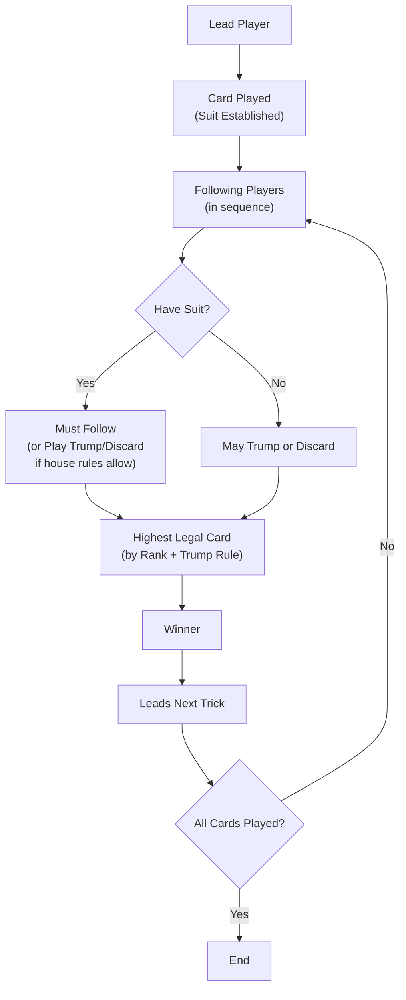
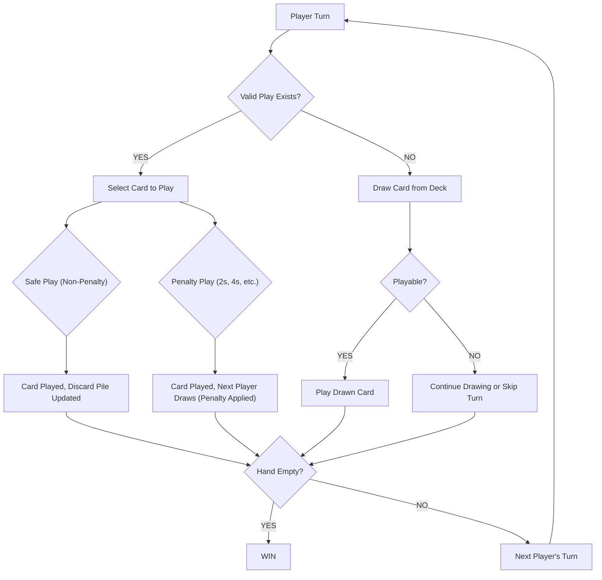
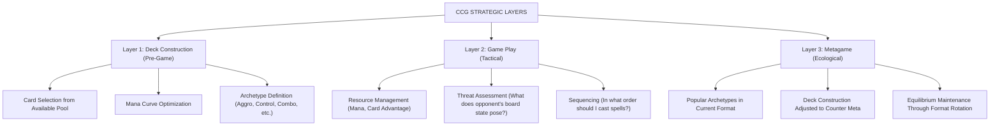

# Lesson 2: Major Game Families

## 1. First-Principles Intuition & Invariants

Card games occupy a peculiar architectural space in the ludic landscape. Unlike board games, which anchor players to spatial positioning and territory control, or dice games, which distribute randomness through discrete probability events, card games operate through information asymmetry, sequencing constraints, and what we might call *mechanic layering*—the systematic stacking of decision-making zones across play phases.

At their foundation, all card games inherit from a small set of invariant problems. First is the **draw problem**: how does a shuffled deck become useful information in a player's hand? Second is the **action problem**: given known and hidden information, what legal moves constitute meaningful choice? Third is the **resolution problem**: how do individual card plays combine into aggregate game states and score determination? Fourth is the **fairness problem**: does the rule architecture prevent dominant strategies that trivialize the game for skilled players?

These problems exist in tension. A game that solves the draw problem elegantly by giving players perfect information (all cards visible) often fails the action problem—there is no meaningful choice if every player can compute the optimal move. Conversely, a game that maximizes hidden information and creates deep decision-making often stumbles on the fairness problem, where luck overwhelms skill.

The major game families we examine in this lesson represent distinct solutions to this invariant problem space. They are not arbitrary categories but rather structural responses to specific design constraints and player experience goals. A trick-taking game like Bridge solves the problem by creating *hierarchical information revelation*—suits trump, ranks within suits trump, and play order creates tactical asymmetry. A shedding game like Crazy Eights solves it through *aggressive hand reduction*—players win by eliminating their cards, creating constant pressure and a clear winning condition. A collectible card game solves it through *ecosystem asymmetry*—players construct decks before play begins, making pre-game deck engineering as important as in-game decision-making.

Understanding these families requires moving beyond mere rule memorization. You must develop structural intuition for *why* a particular mechanic exists, what player problem it solves, and where its failure modes emerge under stress conditions. This intuition becomes your design vocabulary when evaluating existing games or creating new ones.

## 2. Core Architecture & Mechanics

### Trick-Taking Games: Hierarchical Resolution and Sequential Authority

Trick-taking games represent perhaps the oldest and most mathematically elegant card game architecture. In the simplest formulation, players play one card in sequence around the table, and a predetermined rule (the trump suit, or rank dominance within suit) determines which card "wins" the trick. The winner of each trick typically leads the next, creating a cascading decision-making structure.

The core mechanic is deceptively simple, yet its implications unfold across multiple decision layers. When you lead a trick—play the first card—you establish a *suit commitment*. Other players, bound by the rule of "following suit," must play a card of that suit if they possess one. Only when a player lacks that suit can they play a different suit, potentially trumping the trick or conceding it. This creates a fundamental strategic tension: leading high cards risks losing the trick to a trump, while leading low cards risks wasting cards that could win later tricks.

Consider the information architecture of a four-player game of Bridge or Whist. At the moment you lead, you possess complete information about your own hand but only probabilistic information about partners' and opponents' hands. As cards are played around the table, you observe which cards remain in circulation and begin inferring hand compositions. By the final tricks, uncertainty collapses significantly. A player who led the Ace of Hearts early learns, through observation, that the King and Queen of Hearts remain in opponents' hands. This *perfect information asymmetry*—the game begins as a hidden-information game but becomes progressively more transparent—creates the entire strategic depth.

The ranking problem in trick-taking games is non-trivial. A standard 52-card deck contains 13 ranks (2 through 10, J, Q, K, A), but the *value* of each rank fluctuates based on context. In some games, Ace ranks highest; in others, it ranks lowest or acts as a special card. Many trick-taking games use multiple trump rules: perhaps Hearts are always trump, or the last card dealt is trump, or trump rotates with each deal. This variability is not accident but rather a deliberate solution to the fairness problem. If every player knew the trump suit before bidding, games like Bridge would collapse into computational determinism—optimal bids would emerge from poker-solver mathematics.

The sequence of play introduces timing asymmetry. The player who leads a trick holds first-mover advantage—they choose which suit is "active" for that trick. Trailing players must decide whether to play low (conceding the trick but preserving high cards for future tricks) or compete for it. This sequential dependency creates a form of *information revelation that is strategically meaningful*. Your decision to play the Jack of Diamonds on a Diamond trick is not merely about that individual trick; it signals to observant opponents that you no longer hold higher Diamonds, which constrains their future calculations.

In many trick-taking games, the concept of the *bid* or *contract* adds a layer of pre-play negotiation. In Bridge, players auction for the right to specify trump and a target number of tricks. This auction itself becomes a game-within-the-game: players signal hand strength through bidding sequences, and opponents must decide whether to compete or concede. The losing bidders (those who do not secure the contract) still play the hand but with reduced strategic agency—they are defending against, not directing, play.

The tension in trick-taking games arises from the disconnect between *winning tricks* and *winning the game*. In many variants, you do not simply count tricks won; instead, specific tricks (often the last few) carry disproportionate weight, or your target is to win exactly a predetermined number. This creates a sophistication layer: a player who has already won enough tricks faces the inverse problem—they must now *lose* tricks strategically, surrendering cards to opponents without wasting high cards that might be needed defensively.

### Matching Games: Pattern Recognition and Sequential Depletion

Matching games operate on fundamentally different principles. Rather than hierarchical resolution of simultaneous plays, matching games typically involve a public tableau—cards laid face-up on the table—and players drawing from a deck to find matches. The match condition is explicit: identical ranks (Go Fish), identical colors or suits (basic Memory), or sets of three cards that form a valid pattern (Set).

The elegance of matching games lies in their information structure. Unlike trick-taking, where hidden hands create strategic depth, matching games often use perfect information. In Go Fish, both players know which ranks the opponent has requested; in Memory, both players know the location of every card on the board from the moment it is first flipped. The game becomes a test of observation, memory fidelity, and—crucially—the psychology of inferring opponent intent from their questioning patterns.

Set, one of the most mathematically sophisticated matching games, illustrates the power of this architecture. Players draw cards from a deck of 81 cards (4 attributes × 3 values each: color, shape, count, shading). A valid set consists of three cards where each attribute is either all-identical or all-different across the three cards. The game becomes a visual pattern-recognition puzzle: players race to identify valid sets from the tableau, and the player who identifies the most sets wins.

The computational space of Set is deterministic but non-obvious. Given any two cards, exactly one third card completes a valid set—the rules of set completion are mathematically closed. However, finding that third card rapidly, under time pressure, and while opponents race to do the same, separates expert players from novices. This creates a curious inversion of the skill gradient: the game requires no hidden information, yet skill is not about calculation (which can be done perfectly by any player given time) but about *perceptual speed and pattern instantiation*.

Matching games typically solve the fairness problem through symmetry and chance. In Go Fish, both players face identical information and identical draw randomness. In Memory, success depends entirely on observation and recall—both reproducible skills. The draw problem (how shuffled cards become useful) is solved through tableau revelation: cards are placed face-down or face-up gradually, and players must track revealed information to build advantage.

The failure mode of matching games emerges when the pattern becomes too obvious or too obscure. If matches are trivial to spot (all cards are identical), the game collapses into drawing cards until the deck empties. If matches are cryptic (requiring deduction rather than perception), the game becomes frustrating rather than engaging. The design sweet spot lies in moderate pattern complexity—clear enough that skilled players identify matches consistently but obscure enough that luck and human perception create variance.

### Shedding Games: Aggressive Hand Reduction and Escalating Pressure

Shedding games invert the accumulation logic of trick-taking and matching games. Rather than building points or collecting cards, players win by *eliminating* their cards. The simplest shedding game is Crazy Eights: players play cards matching the rank or suit of the top card of the discard pile, and any Eights are wild cards (can be played on anything). The first player to empty their hand wins.

The strategic texture of shedding games differs sharply from other families. In trick-taking, you sometimes want to *keep* cards strategically (preserving high cards for endgame scenarios). In shedding games, you always want to reduce your hand, creating a constant pressure dynamic. This pressure manifests in the *playability constraint*: if you cannot play a legal card, you draw from the deck until you can. The psychological effect is significant—accumulating cards in hand is a visible failure state, creating tension and urgency.

The matching condition in shedding games is typically simple (same rank or suit), which means decision-making focuses not on identifying plays but on *optimizing which play to make*. This is where strategic depth emerges. If you hold multiple legal plays (say, you have both a King of Hearts and a King of Diamonds, and the discard pile shows a King), which should you play? Playing the King of Hearts might leave you with fewer Hearts in hand, making it harder to play Hearts in future turns; playing King of Diamonds preserves more Hearts for later plays. Playing the King of Diamonds might force an opponent to draw if they lack Diamonds.

Many shedding games introduce *penalties* for specific card plays. In some variants, playing a 2 forces the next player to draw two cards; playing a 4 forces a skip (that player's turn is skipped). This creates a secondary decision layer: do you play a penalty card strategically to disrupt opponents, or do you play a safe card to progress your own hand reduction? The tradeoff is acute: penalty cards are powerful but reveal your remaining hand composition to observant opponents.

Shedding games also often incorporate *stack reversal* or *direction-change* mechanics. If the discard pile contains multiple cards of the same rank (say, three Kings were played in sequence), the direction of play might reverse, sending the turn back to the previous player. This mechanic solves a fairness problem: without reversal, the player who gains an early advantage (reduces their hand) can maintain it simply by playing cards faster than opponents recover. Reversal creates comeback dynamics—a player who is behind can suddenly become advantaged if the right cards are played in the right sequence.

The endgame in shedding games becomes increasingly important as hands shrink. When you hold only three cards, every card you play is a significant commitment. Drawing cards becomes catastrophic—you move from near-victory to mid-range competition instantly. This creates psychological pressure that some players enjoy (the tension of mounting-pressure games) and others find exhausting.

### Banking and Casino Games: Probabilistic Adversarialism

Banking games represent a distinct family where one player—the banker—plays against all others simultaneously, and the banker's role often rotates. Blackjack exemplifies this architecture: players play against a dealer (banker), aiming to accumulate cards totaling 21 without exceeding it. Each player plays their own hand independently, and the dealer's play follows fixed algorithmic rules (typically "hit on 16, stand on 17").

The strategic asymmetry in banking games is fundamental. Players make decisions; the banker follows predetermined rules. This is not an accident but a fairness mechanism. If the banker could make discretionary choices (deciding when to draw based on what players are doing), the banker would have informational advantage that trivializes the game. By constraining the banker to algorithmic play, the game becomes symmetric—each player can compute the optimal strategy against the dealer's fixed rules.

The draw problem in banking games is solved through *open tableau* mechanics. Most cards are face-up and visible to all players, making information perfect. However, one card is often hidden (the dealer's hole card in Blackjack), creating limited hidden information. The moment of revelation—when the dealer flips their hole card—represents a dramatic information collapse. This sudden shift from uncertainty to certainty is psychologically potent and is why banking games remain pervasive in casinos.

Betting introduces an economic dimension absent in many other card games. In Blackjack, players place wagers before cards are dealt, then optionally adjust exposure (by "doubling down" after seeing initial cards) as information arrives. The betting mechanism creates a secondary game: not just the card game itself but the metagame of risk management. A player might have a mathematically favorable hand but choose not to double down due to bankroll constraints. Conversely, a hand with negative expectation might be worth doubling if the player believes the variance works in their favor given their specific financial position.

The variance in banking games is typically high compared to other card game families. A single hand can swing significantly on the next card drawn. This variance is intentional—it creates excitement and the perception of comeback opportunities. However, high variance also means that unskilled play can occasionally beat skilled play over short sessions, which some players find appealing (the "luck element") and others find frustrating (the "randomness overwhelms strategy").

### Collectible Card Games: Constructed Deck Asymmetry and Metagame Layers

Collectible card games (CCGs) like Magic: The Gathering represent a revolutionary architecture where deck construction occurs *before play begins*, and each player's deck is distinct (not randomly shuffled from a common pool). This pre-play asymmetry fundamentally changes the game's character.

In Magic, players construct 60-card decks (in the Standard format) selecting from thousands of available cards, each with unique abilities. Two players with different deck archetypes might have wildly different capabilities: one deck focuses on fast, weak creatures; another focuses on powerful spells that take time to deploy. The outcome of any individual game depends not just on play decisions but on the *matchup*—how well the two deck archetypes interact.

This creates a meta-layer absent in other card game families: the *format metagame*. In a competitive Magic environment, certain decks become dominant, which causes players to shift their deck construction to counter those decks. This causes a new deck archetype to rise, which gets countered in turn. The metagame is a dynamic equilibrium where no single deck is unbeatable but rather various decks exist in a rock-paper-scissors relationship.

The resource system in CCGs introduces economic constraints. In Magic, players accumulate *mana* (magical energy) each turn, which limits how many spells can be cast. This mana system creates a natural curve: early turns have limited mana, so players play weak creatures; mid-game mana allows more complex plays; late-game mana allows powerful spells. Deck construction revolves around optimizing this curve—ensuring you have plays available at each mana level without wasting slots on redundant effects.

The draw problem in CCGs is solved through controlled randomization. You draw cards from your constructed deck, which means you have some predictability (you built the deck, so you know what might appear) but not perfect information (shuffling ensures you do not know the exact order). This creates a balance: unlike trick-taking games where hidden information is absolute, CCGs provide semi-transparent information—you know what *types* of cards opponent might play but not their exact hand.

Hidden information management is critical in CCGs. Your hand is typically private, but your board state (cards you have already played) is public. This creates asymmetric information: opponent knows you have cards in hand but not what they are. Skilled players infer hand composition from play patterns. If you are holding three cards but have not cast spells in two turns, opponent might infer you are either holding threats you are afraid to deploy or you are holding removal spells to disrupt their plays. This inference becomes part of the tactical layer.

### Solitaire Patterns: Solitary Constraint Satisfaction

Solitaire games represent a unique category where the "opponent" is not another player but rather the constraint structure of the game itself. In classic Solitaire (Klondike), you attempt to build four foundation piles (one per suit, Ace through King) by moving cards strategically from a tableau, often constrained by specific sequencing rules (in many variants, cards must descend in rank and alternate in color).

The problem-solving character of solitaire differs fundamentally from multiplayer games. There is no bluffing, no information asymmetry, and no opponent adaptation. Instead, solitaire becomes a *puzzle* where success or failure is often predetermined by the initial shuffle. This raises an interesting question: Is solitaire truly a game, or is it a puzzle? The distinction matters because a true game implies meaningful decision-making and variance in outcomes based on skill, while a puzzle implies a path to victory or failure that is objectively solvable.

In many solitaire variants, this distinction becomes blurred. In Klondike, you make numerous decisions (which card to uncover, which sequence to build), and these decisions affect whether you reach a winning state. Some shuffles are unwinnable regardless of play quality; others are guaranteed to win with perfect play. The skill gradient is moderate: better players win more often, but luck heavily influences individual games.

Solitaire variants range from purely deterministic (FreeCell, where perfect play always leads to victory if a solution exists, which it does for 99.9% of possible shuffles) to moderately random (Pyramid, where luck and strategy intermix) to nearly pure luck (War, where you have virtually no decisions). The design challenge in solitaire is creating constraint satisfaction that is *solvable but not trivial*, where skilled players can improve their win rate through better decision-making but where variance remains high enough to prevent boredom through repetition.

Solitaire games often employ *undo mechanics* liberally, allowing players to reverse moves and explore alternative paths. This is fundamentally different from multiplayer games, where undoing moves would corrupt the game state. In solitaire, undo serves as a *learning tool*—players explore branches of the decision tree, discovering which paths lead to dead ends and which lead to victory. Some solitaire implementations strictly forbid undo, increasing difficulty and making single plays more consequential.

## 3. High-Performance Optimization & Failure Modes

### Decision Tree Explosion and Computational Limits

Understanding the performance characteristics of card games requires grappling with the *decision tree complexity*. In trick-taking games like Bridge, the number of possible game states is astronomically large. With 52 cards distributed among four players, and numerous possible trump configurations and bidding sequences, the state space exceeds human calculation capacity. This is, paradoxically, why Bridge remains engaging for humans—no player can compute the "perfect" bid or play, so decisions require judgment, experience, and educated guessing.

However, this same complexity creates a threshold where computational approaches become viable. Chess has approximately 10^43 possible positions; Bridge has fewer possible arrangements (estimated at around 10^26 contract-play possibilities alone). Yet modern computers have been programmed to play Bridge at grandmaster levels by combining techniques: card counting (probabilistic inference about hidden cards), pattern matching (recognizing similar positions to known strong plays), and alpha-beta pruning (eliminating branches of the decision tree that cannot possibly lead to better outcomes).

For practitioners optimizing card game experiences, this computational reality has immediate implications. If you are designing a digital version of a card game, you need to understand whether the decision tree is computationally tractable. Games like Chess and Go, where decision trees are enormous but branching factors are moderate, are amenable to tree search algorithms. Games like Poker, which combine hidden information with simultaneous moves, require different approaches (game theory, Nash equilibrium computation, neural networks trained on millions of hands).

### Information Asymmetry and Player Agency

The relationship between information and decision-making is non-linear.

In card games, information asymmetry creates what game theorists call a "fog of war" effect—players must make optimal decisions under uncertainty about opponent holdings, future draws, or hidden community information. This asymmetry is not merely a gameplay feature; it fundamentally determines the skill ceiling and the nature of expertise. In perfect-information games like open-hand Bridge variants, optimal play is theoretically determinable (though computationally expensive). In imperfect-information games like Poker or Hearts, optimal play requires modeling opponents' beliefs, which in turn requires modeling their model of your beliefs—an infinite regress that game theory resolves through Nash equilibria and mixed strategies. The practical consequence is that player agency in asymmetric-information games involves both strategic reasoning (what is the mathematically correct play given probabilities) and psychological reasoning (what will my opponent *believe* I will do). This dual layer is why games like Poker remain compelling: the optimal strategy is not just to maximize expected value, but to be unpredictable, which paradoxically requires *sometimes making suboptimal plays* to prevent exploitation. For designers and operators, this means that information structure is not decorative—it determines whether a game rewards pure calculation, psychological insight, or some mixture of both, and whether computational approaches can achieve superhuman performance or merely competent play.

The entropy of hidden information also governs fairness and engagement dynamics. In games where luck dominates (high entropy, low skill influence), weaker players can win through variance, sustaining engagement but limiting depth. In games where skill dominates (low entropy, high information availability), stronger players win reliably, creating depth but risking discouragement for novices. The sweet spot—games like Bridge, Skat, or competitive Poker formats—calibrates information asymmetry such that skill advantage compounds over many hands (the law of large numbers ensures better players win in aggregate) while individual hands retain enough variance to feel winnable for all participants. This is why professional card game design involves extensive playtesting to tune the ratio of hidden cards, hand size, and decision frequency: these parameters directly control the slope of the skill curve and the number of hands required for skill to overcome luck. When optimizing for engagement versus competitive integrity, you are fundamentally engineering the rate at which information entropy decays across rounds.

## Summary & Verification Matrix

| **Game Family** | **Core Mechanism** | **Information Structure** | **Skill Determinants** | **Diagnostic Test** |
|-----------------|-------------------|---------------------------|------------------------|---------------------|
| **Trick-Taking** | Sequential card plays; highest card (or trump) wins trick; scoring from tricks won or specific cards captured | Partial observability: own hand visible, played cards revealed, remaining cards hidden | Card counting, probability estimation, signaling (partnerships), tempo control, inferring distributions | Does winning require tracking played cards and inferring opponents' remaining holdings? Can partnerships signal legally? |
| **Rummy / Melding** | Collect sets/runs, discard unwanted cards; first to meld all cards (or achieve target) wins | Asymmetric: own hand visible, discard pile partially visible, draw pile hidden | Pattern recognition (meld potential), discarding safety, probability of drawing needed cards, opponent hand inference from discards | Does optimal play require tracking discards to estimate opponents' collection goals? Is there tension between advancing own melds and denying opponents? |
| **Shedding** | Play cards matching rank/suit/sequence; first to empty hand wins | Symmetric information about plays; hidden information about remaining hands | Sequencing (avoiding dead-end positions), timing (when to use power cards), defensive blocking, counting outs | Can a player be forced into unwinnable positions based on card sequencing? Do special cards create complex chain reactions? |
| **Vying / Betting** | Wager on relative hand strength; best hand or last remaining bettor wins pot | Hidden hand strength; visible community cards (Texas Hold'em) or none (Draw Poker); opponent behavior provides signals | Hand strength evaluation, pot odds calculation, bet sizing, bluffing equilibria, opponent modeling | Does equilibrium strategy require randomized (mixed) actions to prevent exploitation? Can strong players profit from weak players even with identical cards over time? |
| **Patience / Solitaire** | Arrange cards according to ruleset constraints; win by clearing tableau or building foundations | Perfect information (after initial deal) or partial (hidden stock/reserves) | Constraint satisfaction, lookahead planning, recognizing dead positions, maximizing option preservation | Is success deterministic given perfect play, or does initial deal determine winnability? Are there critical decision points with irreversible consequences? |
| **Climbing / Shedding-Climbing Hybrids** | Play progressively stronger combinations; pass if unable/unwilling; control passes to strongest play | Symmetric (all plays visible), asymmetric (own hand hidden), bomb/rocket cards create nonlinear power spikes | Combination optimization, tempo control (taking control vs. conserving strength), hand management, passing strategy | Does the game reward controlling the round (playing last) versus conserving powerful combinations for later? Can weaker hands win through strategic passing? |
