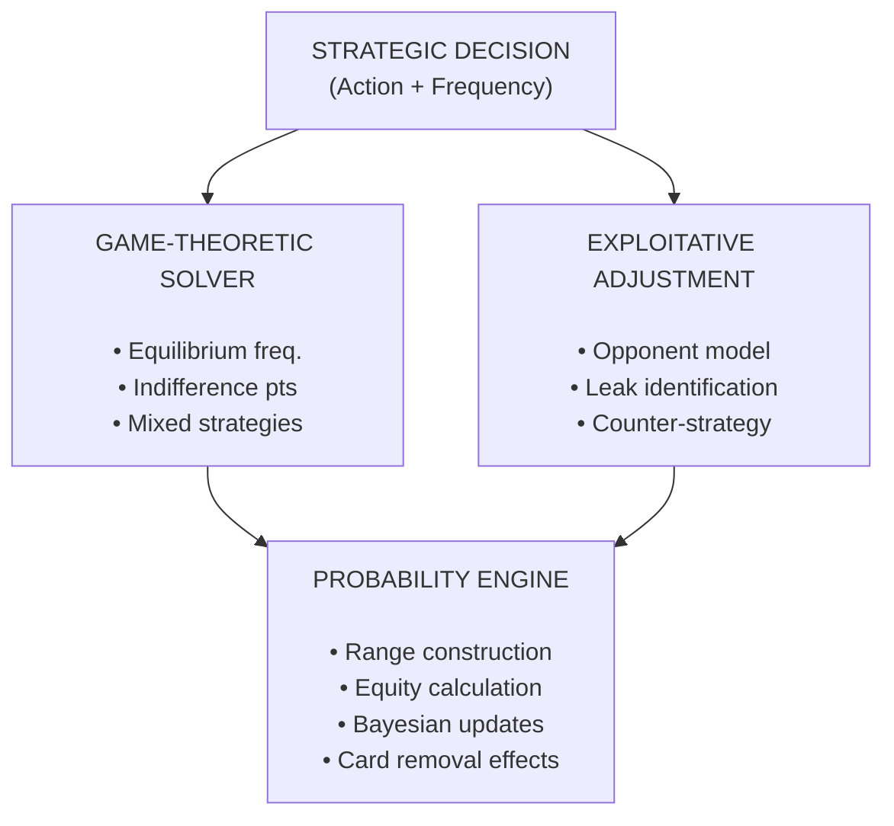

# Lesson 3: Strategic Theory

## 1. First-Principles Intuition & Invariants

The mathematics of card games rests on a single, inviolable foundation: incomplete information generates strategic leverage. Unlike chess, where all pieces occupy visible squares, card games partition knowledge asymmetrically across players, creating a tension between statistical inference and behavioral signaling that defines advanced play. The strategic depth of poker, bridge, and even seemingly simple games like gin rummy emerges not from complex rules but from the exponential decision space created when each player must simultaneously model opponents' holdings, manage their own probabilistic expectations, and manipulate the information they reveal through action.

At the most fundamental level, every card game decision reduces to a comparison between expected value and variance tolerance. Expected value—the long-run average outcome of a decision weighted by all possible results and their probabilities—provides the mathematical north star for optimal play. A poker player contemplating a river call must calculate not merely the pot odds (the ratio of potential winnings to the cost of calling) but the equity of their hand against the opponent's perceived range of holdings. If the pot offers 3:1 odds, the calling hand needs only 25% equity to break even in expectation. Yet this mechanical calculation tells only half the story. The player must also estimate the frequency with which the opponent would take this betting line with strong hands versus bluffs, adjusting their calling range based on observed patterns, board texture, and positional dynamics.

This interplay between frequentist probability and game-theoretic equilibrium creates the core strategic invariant: optimal play exists at the intersection of mathematical expectation and strategic unpredictability. A player who always makes the highest expected-value decision in isolation becomes exploitable, because opponents can reverse-engineer their strategy and adjust accordingly. The solution lies in mixed strategies—probabilistic action distributions that prevent opponents from gaining exploitative reads. In game theory terms, these are Nash equilibria: strategy profiles where no player can improve their outcome by unilaterally deviating. When both players in a poker hand randomize their actions according to optimal frequencies, neither can exploit the other, and the game reduces to its mathematical essence.

The second fundamental invariant governs information asymmetry and its decay over time. At the start of any hand, information distributes maximally unevenly: each player knows their own cards with certainty and nothing about opponents' holdings. As the hand progresses, every action—each bet, check, raise, or fold—functions as a Bayesian update, narrowing the range of possible hands an opponent could hold. The skilled player tracks this informational convergence with precision, maintaining mental probability distributions over opponent ranges and updating them in real-time based on observed actions. This process of range construction and refinement separates expert players from competent ones. Where an intermediate player sees individual hands, the expert sees probability clouds that shift and collapse as new information arrives.

Card counting, the systematic tracking of cards already played to adjust probability estimates for remaining cards, exemplifies this informational edge in pure form. In blackjack, the house edge derives from the rule requiring players to act before the dealer—when both bust, the house wins. A deck rich in high cards (tens and aces) shifts the advantage toward the player, because both players benefit from increased blackjack frequency, but the player can adjust bet sizing and strategy while the dealer cannot. The canonical Hi-Lo counting system assigns values to cards (+1 for 2-6, 0 for 7-9, -1 for 10-A) and maintains a running count that increases when low cards appear and decreases with high cards. Dividing this running count by the estimated number of remaining decks produces the true count, a metric directly correlated with player advantage. At true counts above +3, the player holds a mathematical edge and increases bet sizing accordingly; at negative counts, the house advantage grows and the player minimizes exposure.

Yet even this mechanical advantage requires strategic obfuscation. Casinos employ countermeasures ranging from frequent shuffling to outright expulsion of suspected counters. The advanced card counter thus embeds their advantage within variance-hiding behaviors: varying bet spreads conservatively, occasionally making suboptimal plays at low counts to camouflage strategy, and managing session length to avoid pattern detection. The information edge means nothing if casino security removes the player from the game.

In partnership games like bridge, information flow operates under strict communicative constraints. Partners must convey hand strength and distribution through the bidding system alone, with no table talk or behavioral tells permitted. The bidding sequence becomes a compressed communication protocol, where each bid carries layered semantic content. A one notrump opening in Standard American bidding promises 15-17 high-card points and balanced distribution, allowing partner to immediately narrow their range estimate. Subsequent bids refine this information through forcing bids (compelling partner to continue bidding), sign-off bids (requesting no further action), and invitational bids (suggesting game but leaving the decision to partner). The partnership's pre-agreed conventional system—whether natural bidding, precision club, or two-over-one game forcing—functions as a shared encoding scheme that maximizes information density within the constraints of legal communication.

The strategic landscape also encompasses metagame considerations that transcend individual hands. The metagame refers to the evolving strategic environment shaped by opponent adaptation, table dynamics, and population-level trends. In tournament poker, the metagame shifts dramatically across stages: early play rewards tight-aggressive strategies that accumulate chips at minimal risk, middle stages demand escalating aggression to stay ahead of rising blinds, and bubble play (approaching prize-paying positions) creates extreme pressure where fold equity—the value derived from opponents folding rather than hand strength itself—becomes the dominant factor. The skilled tournament player continuously recalibrates their strategy in response to these shifting incentives, tightening ranges when opponents over-fold and widening ranges when opponents over-call.

Population tendencies also shape optimal strategy. In low-stakes online poker, where recreational players predominate, the metagame favors straightforward value betting and tight ranges—opponents call too frequently with weak hands, making bluffs unprofitable and strong hands maximally profitable. Conversely, high-stakes games populated by sophisticated regulars require higher bluffing frequencies and more complex mixed strategies to avoid exploitation. The optimal strategy emerges not from abstract game theory but from precise calibration to the specific opponent pool.

Bluffing equilibria illustrate the game-theoretic precision required at the highest levels. In a simplified river scenario where one player can bet or check and the opponent can call or fold, game theory dictates specific bluffing and calling frequencies that create indifference points—situations where the opponent's expected value remains identical across all actions, preventing exploitation. If the pot contains $100 and the final bet is $50, the bettor must bluff with a frequency that makes calling exactly break-even for the opponent. Since the opponent needs 33% equity to call profitably (risking $50 to win $150), the bettor must bluff once for every two value bets, creating a 2:1 value-to-bluff ratio. At this equilibrium, the opponent cannot exploit the bettor by over-folding (bluffs become profitable) or over-calling (value bets extract maximum value). The bettor similarly cannot exploit the opponent, as the calling frequency renders bluffing exactly expectation-neutral.

This equilibrium thinking extends to range construction across all streets of betting. Preflop ranges—the initial selection of hands worth playing—must balance value (hands strong enough to win at showdown), implied odds (hands that can improve dramatically on later streets), and positional advantage (acting last provides informational leverage). A tight range under the gun (first to act) might include only the top 10% of hands, while a late position facing no prior action can profitably raise with 40-50% of hands. Each range balances immediate pot equity against postflop playability, hand disguise, and opponent tendencies.

The mathematical substrate underlying all strategic decisions is combinatorial probability. A standard 52-card deck generates 2,598,960 possible five-card poker hands, distributed across ranked categories from high card through royal flush. The probability of any specific hand type derives from counting favorable outcomes divided by total possible outcomes. A flush (five cards of one suit) occurs in 5,108 combinations, yielding a probability of 0.197%. These base rates anchor all strategic calculations, but live play requires dynamic probability updates based on observed cards. If a player holds two hearts and the flop contains two hearts, nine remaining hearts complete the flush on the turn. With 47 unseen cards, the probability of immediate completion is 9/47 ≈ 19.1%. Incorporating the river card as well, the cumulative probability becomes (9/47) + (38/47)(9/46) ≈ 35%, using the complement rule to account for missing the turn and hitting the river.

Expected value calculations integrate these probabilities with payoff structures. Consider a turn decision facing a $200 bet into a $400 pot, holding the flush draw described above. If the player estimates a 35% chance of completing the flush (which wins the entire pot) and 0% chance of winning otherwise, the expected value of calling equals (0.35)($600) - (0.65)($200) = $210 - $130 = $80. Folding yields $0, so calling gains $80 in expectation. This calculation assumes perfect information about opponent holdings, which never exists in practice. The realistic calculation must account for uncertainty: the opponent might hold a higher flush draw, the completed flush might lose to a full house, or the opponent might fold to a river bet even when the draw misses. These adjustments require constructing probability distributions over opponent ranges and potential river scenarios, integrating combinatorial card probabilities with opponent modeling.

Signaling theory provides the behavioral framework for interpreting opponent actions. Every decision—bet sizing, timing, verbal statements (in live play), physical tells—potentially conveys information about hand strength. Strong hands prefer extracting maximum value through carefully calibrated bet sizing, while weak hands seek either cheap showdowns (via checking) or fold equity (via bluffing). The challenge lies in distinguishing genuine signals from manufactured ones. An opponent who consistently bets small with strong hands and large with bluffs reveals an exploitable pattern; the skilled player adjusts by calling large bets and raising small ones. Sophisticated opponents randomize their bet sizing and action timing to prevent such reads, forcing opponents back toward theoretically optimal frequencies rather than exploitative adjustments.

Physical tells—unconscious behavioral cues like breathing patterns, hand tremors, or eye movements—exist primarily in live play and vary widely across individuals. The reliability of tell-based reads falls dramatically against experienced opponents who either suppress tells or intentionally produce false ones. The modern expert prioritizes mathematical and strategic analysis while treating behavioral information as weak supplementary evidence rather than primary decision factors. Online play eliminates physical tells entirely, reducing the game to pure mathematical and strategic competition, yet introduces new timing tells and bet sizing patterns that convey information through the digital medium.

The fundamental strategic invariant emerges clearly: card games reward the synthesis of mathematical precision, strategic unpredictability, and opponent modeling. Pure mathematics provides the foundation, game theory dictates the equilibrium frequencies, and psychological acuity enables exploitative adjustments against suboptimal opponents. The highest level of play occurs when these three dimensions align—when the player executes mathematically sound strategies while randomizing appropriately to prevent exploitation and continuously updating opponent models to identify profitable deviations from equilibrium.

## 2. Core Architecture & Mechanics

The strategic architecture of card games decomposes into three interlocking layers: the probability engine that calculates base rates and conditional likelihoods, the game-theoretic solver that determines equilibrium frequencies, and the opponent modeling system that enables exploitative play. Each layer operates on different timescales and requires distinct cognitive tools, yet they must integrate seamlessly during live play to produce optimal decisions under time pressure.

The probability engine forms the foundational layer, providing the raw statistical material for all higher-level strategic decisions. At its core sits combinatorial analysis: the systematic enumeration of possible outcomes and their frequencies. For any given hand, the player must calculate the probability distribution over opponent holdings, the likelihood of improving their own hand on subsequent cards, and the conditional probabilities that emerge from observed actions. Consider a simplified example in Texas Hold'em: the player holds ace-king of hearts on a flop of king-nine-four with two hearts. To evaluate hand strength, the player must enumerate threats from overpairs (aces), sets (trips of kings, nines, or fours), and potential straight draws. The probability that any single opponent holds pocket aces given that they called preflop depends on their calling range. If their range includes all pairs and all ace-x hands, approximately 3 combinations contain pocket aces (all offsuit, since the player holds one ace). If their total calling range spans 200 combinations, pocket aces constitute 8% of their range.

This range-based thinking replaces the beginner's question "What does my opponent have?" with the expert's question "What distribution of hands does this action represent?" Each opponent action functions as a filter that removes inconsistent hands from their range. A preflop raise eliminates most weak hands, while a call allows both strong hands (slowplaying) and medium hands (seeking implied odds). The flop action provides additional filtering: a continuation bet suggests either strength or a semi-bluff, while a check might indicate weakness or a trapping play with a strong hand. The expert maintains a mental probability distribution that starts maximally wide preflop and progressively narrows as actions accumulate.

Card removal effects—also called blockers—introduce second-order probability adjustments. When the player holds the ace of spades, exactly one fewer ace-x combination exists in opponent ranges, reducing the likelihood of opponents holding aces by approximately 25% compared to situations where the player holds no ace. In high-level play, blockers become central to bluffing strategy: holding blocker cards to opponent folding ranges makes bluffs less profitable (opponents have fewer hands to fold), while holding blockers to calling ranges makes bluffs more profitable (opponents have fewer hands to call with). A player considering a river bluff with ace-high benefits when their ace blocks opponents' value-calling hands more than their folding range.

The mathematical structure underlying these calculations is Bayesian probability: updating prior probability distributions based on observed evidence. Formally, Bayes' theorem states that P(H|E) = P(E|H) × P(H) / P(E), where P(H|E) represents the posterior probability of hypothesis H given evidence E, P(E|H) is the likelihood of observing E if H were true, P(H) is the prior probability of H, and P(E) is the total probability of observing E. In poker terms, H represents an opponent holding a specific hand category (e.g., overpair), E represents their observed action (e.g., raising the flop), P(H) is the prior probability of that holding (derived from their preflop range), P(E|H) is the likelihood they would raise with that holding, and P(E) is the total probability of a raise across all possible holdings. The calculation yields the updated probability that the opponent holds an overpair after observing the raise.

Expert players rarely perform explicit Bayesian calculations during play, instead relying on internalized heuristics developed through thousands of hours of practice. The cognitive architecture resembles pattern recognition more than deliberate calculation: the player recognizes the configuration of opponent action, board texture, and positional dynamics as matching a stored template, instantly accessing the associated strategic response. This expertise develops through both live play and offline study using equity calculators and game theory solver software that computes exact equilibrium strategies for specified scenarios.

The game-theoretic solver layer translates probability distributions into optimal action frequencies. At the highest level of abstraction, poker and similar games are extensive-form games with imperfect information, where players make sequential decisions without full knowledge of the game state. Classical game theory guarantees that such games possess a Nash equilibrium—a strategy profile where no player can improve their expected value by unilaterally changing strategy. Modern solver algorithms like counterfactual regret minimization (CFR) approximate these equilibria by iteratively simulating hands, tracking regret for suboptimal decisions, and adjusting strategy toward lower-regret actions. After millions of iterations, the algorithm converges to a strategy that resists exploitation.

The practical output of solver analysis takes the form of mixed strategies: probability distributions over available actions. On a specific river decision facing a bet, the solver might prescribe calling 65% of the time with a medium-strength hand, folding 35% of the time. This randomization prevents opponents from exploiting a purely deterministic strategy. If the player always called with this holding, the opponent would never bluff; if they always folded, the opponent would always bluff. The mixed strategy creates indifference: the opponent's expected value from bluffing equals their expected value from checking, so they cannot exploit the player's strategy regardless of their own choice.

Implementing mixed strategies during live play requires randomization mechanisms that resist pattern formation. Simple approaches include glancing at a watch second hand (calling if seconds are 0-38, folding if 39-59 for a 65% calling frequency) or using randomization apps between hands. More subtle approaches involve correlating decisions with board cards or stack sizes in ways that approximate correct frequencies without requiring explicit randomization. The key constraint is that the randomization must remain genuinely unpredictable; any pattern in the randomization reintroduces exploitability.

The architecture of equilibrium strategies exhibits recursive structure across betting rounds. Preflop strategy determines opening ranges, which constrain flop strategies, which in turn constrain turn strategies, which determine river decisions. Each street's equilibrium depends on the anticipated equilibrium of future streets, creating a backward induction structure. The solver computes river strategies first (where no future streets exist), then uses those river strategies to determine optimal turn play, then uses turn strategies to solve the flop, finally working back to preflop. This recursive dependency means that errors in late-street play propagate backward, distorting earlier decisions. A player who over-folds rivers will be exploited by increased bluffing, which reduces the value of calling earlier streets, which encourages tighter preflop ranges.

The opponent modeling layer enables exploitative deviations from equilibrium by identifying and targeting opponent mistakes. While game-theoretic equilibrium guarantees a minimum baseline value against any opponent, greater profit comes from exploiting opponent leaks—systematic deviations from optimal play. A player who over-folds to aggression invites increased bluffing; a player who calls too frequently demands tighter value betting and fewer bluffs. The modeling process requires maintaining statistical summaries of opponent tendencies: preflop raising frequency by position, continuation bet frequency on various board textures, fold-to-three-bet percentage, and showdown hand distributions.

The architecture of an opponent model consists of a set of frequency statistics (e.g., "this opponent raises 18% of hands from the button") combined with hand range estimates conditional on observed actions (e.g., "given this betting sequence, their range contains primarily overpairs and top-pair hands"). These models require continuous updating as new hands provide evidence. Early in a session, the model relies on population defaults—baseline frequencies typical of similar player pools. As hand history accumulates, the model incorporates opponent-specific data, weighting recent observations more heavily than distant past performance to account for potential strategy shifts.

The mathematical foundation for opponent modeling is maximum likelihood estimation: inferring the probability distribution most consistent with observed data. If an opponent has raised the button 15 times out of 70 opportunities, the maximum likelihood estimate of their raising frequency is 15/70 ≈ 21.4%. Confidence intervals quantify estimation uncertainty: with 70 samples, a 95% confidence interval spans approximately 21.4% ± 9.6%, meaning the true frequency likely lies between 11.8% and 31.0%. Larger sample sizes narrow these intervals, increasing confidence in frequency estimates. The skilled player implicitly accounts for this uncertainty, making more confident exploitative adjustments against players with extensive hand histories while defaulting toward equilibrium against unknown opponents.

Metagame adaptation introduces the highest strategic layer, where players adjust not only to current opponent tendencies but to anticipated future adjustments. If the table recognizes a player as hyper-aggressive, they will face increased calling frequencies, making bluffs less profitable. The sophisticated player then shifts toward tighter value betting, exploiting opponents' widened calling ranges. This creates a strategic spiral where each player adjusts to opponents' adjustments in an endless cycle. Equilibrium strategies provide a fixed point in this spiral: if all players converge to equilibrium, further adjustment yields no advantage. In practice, most players deviate from equilibrium in exploitable ways, making metagame reads and adaptive adjustments highly profitable.

Partnership communication in bridge operates under entirely different architectural constraints. The bidding system functions as a formal language with strict syntax and semantics. Each bid occupies one cell in a matrix defined by level (one through seven) and strain (clubs, diamonds, hearts, spades, notrump). Bids must increase in rank, with level taking precedence (two clubs exceeds one notrump). The semantic content of each bid depends entirely on partnership agreements, which must be disclosed to opponents. A one club opening might be natural (promising club length), conventional (showing a strong hand regardless of suits), or part of a relay system (initiating a question-answer sequence to explore hand distributions).

The information-theoretic architecture of bridge bidding balances maximizing partnership information exchange against minimizing information leakage to opponents. Each bid consumes one step in the bidding sequence, a scarce resource because the auction ends when three consecutive players pass. Efficient bidding systems pack maximum information into minimum bids, using forcing bids to guarantee further description and relay systems to explore specific hand features. The partnership must also coordinate defensive signaling during cardplay: leads and discards carry coded information about suit holdings and defensive priorities, using agreed conventions like attitude signals (high card shows strength in the led suit), count signals (high card shows even count), or suit preference signals (high card suggests interest in a specific side suit).

The strategic architecture of card counting in blackjack requires three interlocking components: the counting system that tracks card composition, the betting ramp that adjusts wager sizing to advantage magnitude, and the strategy deviations that modify basic strategy based on count. The Hi-Lo system assigns values (+1, 0, -1) designed so that the sum across a full deck equals zero, making the running count track deck composition in real-time. Positive counts indicate excess high cards remaining, benefiting the player; negative counts indicate excess low cards, benefiting the dealer.

Converting running count to true count requires estimating remaining decks. A running count of +6 with three decks remaining yields a true count of +6/3 = +2. A running count of +6 with one deck remaining yields a true count of +6. The true count provides a standardized metric of advantage: in typical six-deck blackjack, each +1 true count adds approximately 0.5% to player edge. At true count +2, the player holds roughly 1% advantage; at +5, approximately 2.5% advantage. The betting ramp translates true count to wager size: minimum bet at true counts below +1, escalating in proportion to advantage at higher counts. A conservative ramp might use 1 unit at TC ≤ 0, 2 units at TC = +1, 5 units at TC = +2, 10 units at TC = +3, and 15 units at TC ≥ +4.

Basic strategy deviations exploit count-dependent situations where optimal play diverges from zero-count strategy. The famous "insurance" bet illustrates this clearly: basic strategy always declines insurance (a side bet that pays 2:1 if the dealer's up card is an ace and their hole card is a ten), because at neutral count, the probability of a dealer ten is 16/52 ≈ 30.8%, making the bet unprofitable (break-even requires 33.3% probability). However, at true counts above +3, ten density exceeds the break-even threshold, making insurance profitable. Similarly, the player stands on 16 versus dealer 10 at neutral count but hits at very negative counts where small cards predominate, and doubles down on 10 versus dealer 10 at high positive counts where excess high cards make 20+ outcomes more likely.

The structural diagram below illustrates the information flow architecture connecting these strategic layers:

Each decision cycle begins at the probability engine, which computes the statistical landscape of possible hands and outcomes. This probability distribution feeds both into the game-theoretic solver (which determines equilibrium frequencies that resist exploitation) and into the opponent modeling system (which identifies deviations from equilibrium). The final decision integrates these streams: defaulting toward equilibrium frequencies while making exploitative adjustments when opponent models justify them. High-confidence models warrant larger deviations; uncertain models recommend staying closer to equilibrium to minimize reverse exploitation.

The execution latency of this architecture varies dramatically between online and live play. Online poker operates on timescales measured in seconds, with typical time banks of 15-30 seconds per decision and fast-fold variants reducing decisions to 2-3 seconds. This compression demands highly automated decision-making where most probability calculations and range assessments occur preflop, with in-game decisions primarily selecting from precomputed strategy templates. Live play operates on much longer timescales, with decisions taking 30-90 seconds or more, permitting more deliberate calculation and opponent observation. Tournament structures introduce additional temporal dynamics through escalating blinds that force progressively more aggressive play to maintain viable stack sizes.

The mathematical precision required in probability calculations admits significant approximation in practice. Exact combinatorial calculations are unnecessary; rough equity estimates within 5-10% suffice for most decisions. The player who estimates 45% equity when the true value is 48% makes nearly identical decisions to a player with perfect calculation. This tolerance for approximation enables the rapid heuristic processing required in live play. The expert internalizes probability ranges through practice, instantly recognizing that a flush draw offers roughly 35% equity to complete, a gutshot straight draw roughly 17%, and an overpair roughly 80% equity against a flush draw. These anchor points guide decisions without requiring explicit calculation.

## 3. High-Performance Optimization & Failure Modes

Optimizing strategic performance in card games demands systematic attention to both technical execution and psychological resilience. The technical dimension encompasses calculation accuracy, decision speed, strategic coverage, and pattern recognition. The psychological dimension addresses tilt management, bankroll dynamics, focus maintenance, and learning rate optimization. High-level play integrates both dimensions into a cohesive performance system resistant to the variance and pressure inherent in competitive play.

Calculation accuracy improvements follow a clear training progression. Novice players begin with basic probability memorization: pre-calculated equity values for common scenarios, pot odds conversion between fractions and percentages, and standard combinatorial results. Intermediate players develop range-based thinking by studying preflop charts, analyzing hand histories with equity calculators, and internalizing how specific actions filter opponent ranges. Advanced players study game-theoretic solutions using solver software, analyzing not only what the solver recommends but why specific frequencies achieve equilibrium. This progression moves from memorizing results through understanding principles to internalizing strategic patterns that activate automatically during play.

Solver study methodology requires systematic approach to avoid cognitive overload. Rather than attempting to memorize entire solution trees spanning all possible betting sequences, the effective student identifies high-frequency decision points and focuses on understanding strategic principles at those nodes. For example, continuation betting frequency on the flop depends primarily on board texture and range advantage. Dry boards (king-high rainbow with no straight draws) favor high continuation betting because the preflop raiser's range connects better than the caller's range. Wet boards (nine-eight-seven with flush draws) favor more checking because both ranges contain numerous straight draws and pairs, reducing the raiser's advantage. The student extracts these principles from solver outputs rather than memorizing specific frequencies at each node.

Pattern recognition training accelerates through deliberate practice with immediate feedback. Equity calculation drills using flashcard-style software develop automatic recognition of common matchups. Hand history review with equity calculators provides ground truth for in-game estimates, highlighting systematic biases. Live play interspersed with solver analysis creates feedback loops where theoretical study informs practical play, and practical difficulties identify theoretical gaps requiring further study. This cycle continues indefinitely; even world-class players dedicate substantial time to theoretical study and hand history review.

Decision speed optimization requires finding the balance between accuracy and tempo. In live play, excessive deliberation telegraphs hand strength and invites opponent scrutiny, while rushed decisions sacrifice accuracy. The optimal tempo maintains consistency across decisions, neither pausing noticeably on difficult spots nor rushing through routine decisions. This consistency prevents timing tells while allowing adequate processing for complex situations. Online play introduces the time bank mechanism: a reservoir of extra time for difficult decisions. Optimal time bank management reserves this resource for genuinely marginal spots while making routine decisions at standard speed. A player who burns time bank on every decision invites opponents to make exploitative timing reads; a player who never uses time bank likely sacrifices accuracy on close decisions.

Strategic coverage—the breadth of scenarios for which the player has prepared—determines resilience against unfamiliar situations. Complete coverage is impossible; the decision space is too vast. Instead, the expert develops a hierarchical strategy library organized by fundamental categories: preflop play by position and action, flop play by board texture and range dynamics, turn play by equity distribution and betting history, river play by hand strength and opponent tendencies. Each category contains core strategies covering the most frequent scenarios plus principles for extrapolating to novel situations. A player facing an unfamiliar spot identifies the relevant category and applies the associated principles rather than memorizing every specific scenario.

Failure modes in technical execution cluster around four categories: computational errors, strategic gaps, exploitability leaks, and adaptation failures. Computational errors include miscounting outs, misestimating pot odds, and incorrect equity calculations. These errors compound: an incorrect out count propagates to incorrect equity estimates, which produce incorrect expected value calculations, culminating in wrong decisions. The remedy is systematic verification using structured calculation methods. When computing outs for a draw, enumerate each completing card rather than relying on intuition. When calculating pot odds, convert to percentages and compare directly to equity estimates rather than comparing ratios. These verification steps add minimal time while dramatically reducing error rates.

Strategic gaps manifest as unfamiliarity with specific game situations: three-bet pots, four-way multiway pots, shallow stack play, deep stack play, bubble dynamics in tournaments. Each context demands adapted strategy that may deviate substantially from standard play. Three-bet pots play differently because ranges are polarized toward strong hands and bluffs, excluding the medium hands that dominate single-raised pots. Multiway pots demand tighter value ranges and fewer bluffs because multiple opponents increase the probability someone holds a strong hand. Shallow stacks emphasize shoving and calling ranges because limited remaining bets reduce postflop maneuvering room. Deep stacks reward speculative hands with implied odds potential because large stack-to-pot ratios enable large future bets when draws complete. The expert identifies which context applies and accesses the appropriate strategic template.

Exploitability leaks arise from overly predictable patterns: always continuation betting dry flops, never bluffing scary boards, checking back all marginal hands in position. Each pattern invites a counter-strategy: opponents float (call with weak hands to bluff later streets) against automatic continuation bets, opponents over-bluff when the player never bluffs scary boards themselves, opponents bet large when the player checks back range is capped at medium strength. Leak identification requires hand history review supplemented by opponent feedback when available. Modern tracking software aggregates statistics across thousands of hands, revealing frequency imbalances that suggest exploitable patterns. The player who continuation bets 80% of flops might be over-betting marginal hands; the player who folds to three-bets 95% of the time is exploitable by increased three-betting.

Adaptation failures occur when the player fails to adjust to opponent tendencies or metagame shifts. Early in a session, equilibrium strategy provides a robust default against unknown opponents. As hand history accumulates, exploitative adjustments become profitable: bluffing more against opponents who over-fold, value betting thinner against calling stations, tightening ranges against maniacs who three-bet excessively. The failure to adapt leaves profit on the table. Equally damaging is overadjustment to small samples: wildly shifting strategy based on ten hands of data introduces variance without meaningful edge. The optimal approach balances baseline equilibrium with progressive adjustments as sample sizes grow, weighting recent behavior more heavily while retaining some memory of long-term tendencies.

Psychological optimization addresses the mental and emotional dimensions of sustained performance. Tilt—emotionally driven suboptimal play triggered by frustration, anger, or disappointment—represents the primary psychological failure mode. Variance is intrinsic to card games; even optimal decisions frequently lose due to statistical fluctuation. A player who cannot tolerate this variance without emotional degradation will make increasingly poor decisions as sessions progress. Tilt manifests in multiple forms: aggression tilt (over-betting and over-bluffing after losses), passive tilt (checking and calling excessively due to fear of further losses), and quitting tilt (ending sessions prematurely after bad beats). Each form destroys expected value.

Tilt prevention strategies operate on multiple timescales. Immediate emotional regulation techniques include tactical breathing (deep diaphragmatic breaths to activate parasympathetic calming), cognitive reframing (treating bad beats as correct decisions with unlucky outcomes rather than mistakes), and physical reset rituals (standing, stretching, brief walks between sessions). Longer-term strategies include bankroll management that reduces financial pressure, session time limits that prevent fatigue-induced tilt, and regular review of tilt triggers to identify patterns. The player who recognizes that three consecutive losses trigger aggressive tilt can implement a rule: after three losing hands, take a five-minute break regardless of table dynamics.

Bankroll management provides the financial foundation for psychological stability. The fundamental principle is that session stakes must be small relative to total bankroll to absorb inevitable variance without risk of ruin. Professional players typically maintain bankrolls of 50-100 buy-ins for cash games and 200-300 buy-ins for tournaments, ensuring that even catastrophic downswings (multiple standard deviations below expectation) cannot deplete the bankroll. Recreational players should apply even more conservative ratios given lower volume and higher psychological attachment to losses. A player with a $5000 bankroll should play $1/$2 cash games (with $200 buy-ins) or $20 tournaments, not $5/$10 cash games or $200 tournaments. This conservative staking reduces financial pressure and insulates decision-making from bankroll anxiety.

Focus maintenance over extended sessions requires both physical and cognitive discipline. Physical factors include ergonomics (proper seating and posture to prevent fatigue), hydration and nutrition (stable blood sugar prevents cognitive decline), and regular breaks (mental reset every 60-90 minutes). Cognitive factors include managing attention during inactive hands (observing opponents rather than distraction), maintaining mental energy through strategic complexity management (deferring marginal decisions when fatigued), and recognizing focus degradation signals (increased mental effort on routine decisions, slowed reaction times). The professional treats focus as a depletable resource, budgeting it strategically and quitting sessions when focus falls below effective thresholds rather than grinding through fatigue.

Learning rate optimization addresses how quickly players improve through practice and study. Deliberate practice—focused repetition with immediate feedback—generates faster improvement than unfocused volume. Hand history review with equity calculators provides higher learning bandwidth than simply playing more hands, because review allows detailed analysis of alternative lines and precise equity calculations impossible during live play. Solver study provides theoretical grounding that generalizes across specific situations, while hand histories provide concrete scenarios that make abstract theory tangible. The optimal training regimen alternates between these modalities: playing sessions to generate experience and hand histories, reviewing sessions to identify mistakes and strategic gaps, studying solver solutions to understand principles behind correct play, then returning to playing with refined strategy.

Partnership development in bridge requires synchronized effort spanning conventions, trust calibration, and communication optimization. Convention selection balances complexity against reliability: sophisticated relay systems extract maximum information but require precise memory and flawless execution, while natural bidding systems sacrifice some precision for robustness. Partnerships must drill conventions through practice hands until responses become automatic, because real-time thinking about bidding meanings during competitive play introduces error. Trust calibration addresses the risk-reward tradeoff in marginal contracts: aggressive partnerships bid thin games and slams that require favorable breaks, accepting higher failure rates for higher expected value when successful. Conservative partnerships bid only cold contracts, sacrificing potential gains for reliability. Neither approach dominates; the optimal balance depends on partnership skill level and risk tolerance.

Communication optimization in bridge extends beyond formal bidding to defensive carding agreements. Standard signals include attitude (high card shows strength in the led suit, encouraging continuation; low card discourages), count (high card shows even number of cards in the suit; low card shows odd), and suit preference (when attitude and count are irrelevant, card rank indicates interest in other suits). Partnerships must agree which signal takes priority in specific contexts and practice reading partner's signals under pressure. Defensive errors—failing to recognize partner's signal or giving partner wrong information through careless signaling—often determine contract outcomes in close games.

Card counting optimization for blackjack requires three technical refinements beyond basic Hi-Lo: true count conversion precision, bet ramp concealment, and strategy deviation accuracy. True count estimation requires tracking both running count and approximate remaining deck composition, typically estimated by counting dealt cards against casino shoe size. A six-deck shoe contains 312 cards; if approximately 156 cards have been dealt (half the shoe), three decks remain. This estimation must occur continuously and automatically during play to avoid suspicious pauses during betting decisions. Practice drills include shuffling a six-deck shoe, dealing hands while maintaining running count, estimating remaining decks, and calculating true count—all at casino-speed pace.

Bet ramp concealment addresses casino countermeasures. A player who bets minimum until the count spikes, then suddenly bets 10x minimum, screams "card counter" to surveillance. Concealment strategies include ramping bets gradually rather than abruptly, occasionally making sub-optimal high bets at neutral counts to camouflage strategy, and limiting session length before shifting tables or casinos. Some counters employ team play: the big player only sits down when spotters signal a favorable count, making the big player's bet sizing appear consistent because they always enter at high counts. This coordination requires secure signaling protocols and careful bankroll management to distribute risk across team members.

Strategy deviation accuracy determines the practical value of counting. The player who correctly maintains the count but fails to execute strategy deviations sacrifices substantial edge. The most valuable deviations include insurance (take insurance at true count +3 or higher), 16 versus 10 (hit at negative counts; stand at neutral and positive counts), 15 versus 10 (hit until true count +4), and 10 versus 10/A (double down at true count +4 or higher). These deviations contribute far more to expected value than rare plays like splitting tens. The practical counter prioritizes memorizing the top 10-20 deviations by expected value contribution rather than attempting to memorize all possible deviations.

Meta-game navigation at the highest competitive levels demands continuous strategic evolution. Tournaments and high-stakes games publish results, allowing opponents to study each other's patterns and tendencies. A player who wins a major tournament through ultra-aggressive play will face adjusted strategies in subsequent events: tighter calling ranges, more frequent three-betting to punish aggression, and reduced fold equity overall. The successful player anticipates this adaptation and counter-adapts: tightening ranges after gaining an aggressive reputation, then loosening again once opponents overadjust to the tightening. This multi-level strategic thinking—adjusting to opponent adjustments to your original adjustment—characterizes the highest levels of play.

The resource economics of tournament poker introduce time pressure absent from cash games. Blind levels increase at fixed intervals, consuming a larger fraction of player stacks over time. A player who maintains constant stack size is actually losing ground relative to the increasing blinds. This creates pressure to accumulate chips through aggression rather than waiting for premium hands. Early tournament play resembles cash game strategy: deep stacks relative to blinds permit patient, selective play. Middle stages demand increasing aggression: steal attempts from late position, resteal three-bets against frequent stealers, and thinner value betting. Bubble play (approaching prize positions) creates extreme pressure where many players tighten dramatically to secure min-cash payouts, enabling aggressive players to accumulate chips by exploiting fold equity. Late tournament play with shallow stacks reduces to preflop all-in strategy: push-fold decisions where players either shove all-in or fold, with calling and raising eliminated by shallow stack-to-pot ratios.

Each tournament stage requires adapted strategy, yet many players apply consistent strategies across all stages, hemorrhaging edge. The player who plays early stages too loosely depletes their stack before reaching profitable late stages; the player who plays late stages too tightly fails to accumulate chips and gets blinded away. Optimal play requires dynamic strategy selection calibrated to current stack size, blind level, proximity to payouts, and opponent tendencies at the specific table.

The ultimate optimization is building a strategic framework resilient to both variance and opponent adaptation: mathematically sound default strategies that prevent exploitation, opponent models that identify profitable deviations, psychological discipline that maintains performance through inevitable downswings, and continuous learning that adapts to evolving metagames. This integrated system, refined through thousands of hours of play and study, separates elite players from merely competent ones—not through superior card luck but through systematic strategic advantage compounded over millions of decisions.
