# Lesson 3: Tactical Systems: Positional Play, Strategic Patterns, Competitive Frameworks

## 1. First-Principles Intuition & Invariants

Table tennis operates under a deceptively simple constraint: a 2.74-meter by 1.525-meter battlefield separated by a 15.25-centimeter net, where two opponents exchange a 40-millimeter celluloid sphere at velocities exceeding 100 kilometers per hour. Within this confined geometric space, tactical supremacy emerges not from random aggression but from systematic exploitation of positional asymmetries, temporal advantages, and psychological pressure gradients. The master player recognizes that every rally constitutes a dynamic optimization problem where court positioning, stroke selection, and spin variation interact to create exploitable weaknesses in the opponent's defensive geometry.

The foundational invariant governing all tactical systems in table tennis is the principle of geometric control: the player who dictates the opponent's return angles and response windows holds the strategic initiative. This principle manifests through three irreducible mechanical constraints. First, the physical limitation of human reaction time imposes a temporal boundary of approximately 200 to 300 milliseconds for visual processing, decision-making, and motor execution. Second, the biomechanical envelope of human reach and weight transfer restricts the lateral coverage zone to roughly 2.5 meters from a neutral ready position. Third, the Newtonian physics of ball trajectory creates deterministic relationships between racket angle, spin axis, and resultant flight path, rendering certain defensive positions mathematically superior to others.

Strategic depth in table tennis emerges from the recursive interplay between offensive pressure and defensive resilience. Offensive tactics seek to compress the opponent's decision-making window by maximizing ball velocity, minimizing arc predictability, and exploiting positional displacement. Defensive tactics aim to extend rally duration, neutralize spin asymmetries, and force attacking errors through controlled pace variation and deep placement. The all-round playing style represents a meta-strategy that dynamically switches between offensive and defensive modes based on real-time assessment of positional advantage, opponent fatigue state, and score context.

The concept of rally construction provides the architectural framework for understanding tactical sequences. Every rally operates as a directed acyclic graph where each stroke serves as a node, and the set of possible opponent responses defines the outgoing edges. Elite players mentally pre-compute several moves ahead, selecting strokes that maximize the probability of reaching terminal nodes favorable to their scoring objectives. This forward-looking decision tree construction requires pattern recognition systems trained on thousands of previous rally archetypes, allowing players to match current board states to memorized winning sequences.

Opponent exploitation constitutes the highest-order tactical skill, requiring real-time inference of the adversary's motor preferences, cognitive biases, and physiological limitations. Through systematic observation during warm-up rallies and early game exchanges, the analytical player constructs a mental model of the opponent's stroke repertoire, identifying which service returns trigger anxiety, which lateral positions induce footwork breakdown, and which spin variations disrupt timing consistency. This reconnaissance phase transforms subsequent rallies into deliberate hypothesis testing, where each stroke serves dual purposes: immediate scoring potential and information extraction about opponent capabilities.

Match strategy integrates tactical execution with psychological warfare and energy management across the full match duration. The strategic player recognizes that optimal stroke selection at 0-0 differs fundamentally from optimal play at 9-10 in the fifth game. Score context modulates risk tolerance, with trailing players rationally accepting higher-variance aggressive tactics while leading players adopt conservative high-percentage placements. Momentum psychology introduces non-linear dynamics where consecutive point wins create confidence cascades, altering the opponent's motor execution consistency through anxiety-induced muscle tension and decision paralysis.

The scoring psychology dimension recognizes that table tennis operates under a bounded point system where individual rallies carry non-uniform strategic weight. The first point to 11 format with deuce extensions at 10-10 creates critical inflection points where single rallies determine game outcomes. Elite players deliberately engineer these pressure situations to exploit opponents with inferior mental resilience, employing timeout tactics, deliberate pace disruption, and strategic service variations to maximize cognitive load at decision points.

## 2. Core Architecture & Mechanics

The playing style taxonomy provides the structural framework for categorizing tactical approaches based on court positioning preferences, stroke velocity distributions, and risk-reward trade-off surfaces. The offensive style player operates with a neutral stance positioned 1 to 1.5 meters from the table edge, minimizing ball flight time and maximizing spin generation through close-proximity topspin loops and counter-drives. This geometric positioning sacrifices defensive lateral coverage in exchange for temporal pressure, forcing opponents into reactive mode where response windows compress below comfortable motor execution thresholds. The offensive player's stroke library emphasizes topspin variants—forehand loops with 80 to 120 revolutions per second, backhand flicks with upward trajectory angles exceeding 30 degrees, and third-ball attacks executed within 0.4 seconds of service contact.

The defensive style player stations 2.5 to 4 meters behind the table baseline, transforming temporal disadvantage into spatial abundance. This extended positioning provides additional visual tracking time and enables full-body weight transfer during stroke production, generating defensive blocks and chops with heavy backspin rotation exceeding 100 revolutions per second in the reverse direction. The defensive architecture exploits the fundamental trade-off between ball velocity and spin magnitude: as offensive players increase topspin to curve the ball downward over the net, they introduce rotational kinetic energy that defensive backspin can reverse, neutralizing offensive pace through spin cancellation mechanics. The defensive player's tactical objective centers on rally prolongation, forcing multiple offensive attempts until biomechanical fatigue or impatience triggers attacking errors.

The all-round style represents a hybrid architecture that dynamically modulates court positioning and stroke selection based on ball depth, spin orientation, and positional displacement. The all-round player maintains a neutral stance 1.5 to 2 meters from the table, enabling rapid transitions between offensive topspin loops and defensive pushes within the same rally sequence. This adaptive positioning requires superior footwork mechanics and cognitive flexibility, as the player must continuously re-evaluate the risk-reward surface based on evolving rally geometry. The all-round tactical system excels against specialists by denying them preferred rally patterns: responding to defensive chops with patient pushing rather than premature attacking, and countering offensive aggression with well-timed blocks rather than passive defense.

Positioning theory decomposes the table surface into strategic zones with distinct tactical implications. The central reference point establishes the neutral position at the table's lateral midpoint, one meter from the edge, with weight distributed evenly on the balls of both feet. From this geometric anchor, lateral displacement follows opponent ball placement with the invariant principle of maintaining central recovery: after executing any stroke, the player immediately returns toward the neutral position to minimize the maximum distance to subsequent ball placements. This geometric optimization ensures that the opponent cannot exploit cumulative positional displacement through sequential wide-angle attacks.

The diagonal coverage principle recognizes that the table's rectangular geometry creates asymmetric vulnerability zones. Cross-court rallies from backhand to backhand or forehand to forehand establish longer ball flight paths compared to down-the-line attacks, providing additional reaction time. Consequently, the optimal defensive position slightly favors coverage of the down-the-line angle, accepting marginal cross-court vulnerability in exchange for protection against the geometrically shorter, temporally compressed down-the-line attack. Elite players exploit this asymmetry by patterning opponents with repetitive cross-court sequences before executing sudden down-the-line finishes that target the geometrically under-defended zone.

Rally construction operates through structured sequences where each stroke serves as a building block toward terminal scoring opportunities. The service phase initiates rally construction with maximal control, as the server commands ball placement, spin axis, and velocity distribution without opponent interference. Elite servers design service variations that constrain opponent return angles, deliberately forcing weak returns to predetermined court zones where pre-planned third-ball attacks await execution. The service-return-attack trilogy constitutes the fundamental tactical module in offensive play, with each component mechanically linked: short, low-trajectory serves with heavy sidespin force long, high return arcs that position the ball optimally for forehand loop attacks.

The principle of rally tempo modulation recognizes that consistent ball velocity creates predictable motor timing for opponents, enabling rhythm-based defensive mechanics. Strategic players deliberately vary shot pace within rallies, mixing fast topspin drives with slower, spinnier loops and occasional blocking returns. This velocity variance disrupts the opponent's temporal prediction models, forcing continuous re-calibration of backswing timing and weight transfer initiation. The tactical implementation follows a sawtooth pattern: establish fast tempo for three to four strokes to entrain opponent timing, then inject a sudden slow, heavy spin stroke that arrives 200 milliseconds later than expected, inducing premature weight commitment and forced errors.

Pattern recognition systems enable elite players to compress complex rally states into memorized tactical archetypes. Through thousands of hours of match experience and deliberate practice, players develop an extensive pattern library where current court positions, spin orientations, and momentum states trigger automatic stroke selections. This pattern-matching architecture operates below conscious cognitive processing, enabling sub-200-millisecond decision latencies that conscious analysis cannot achieve. The training methodology for pattern development requires deliberate variation during practice, exposing players to hundreds of distinct rally configurations rather than repetitive drilling of single patterns, thereby building robust classification systems that generalize across match contexts.

```mermaid
flowchart TD
    Start["Rally State Classification System"]
    
    Start --> InputFeatures["Input Features"]
    Start --> PatternResponse["Pattern-Response Mapping"]
    Start --> TerminalConditions["Terminal Conditions"]
    
    InputFeatures --> BallProps["Ball Properties"]
    InputFeatures --> PositionalState["Positional State"]
    InputFeatures --> TacticalContext["Tactical Context"]
    
    BallProps --> SpinAxis["Spin Axis"]
    BallProps --> Velocity["Velocity"]
    BallProps --> Trajectory["Trajectory"]
    
    SpinAxis --> SA1["Topspin"]
    SpinAxis --> SA2["Backspin"]
    SpinAxis --> SA3["Sidespin"]
    SpinAxis --> SA4["No-spin"]
    
    Velocity --> V1["Slow: <30km/h"]
    Velocity --> V2["Medium: 30-60km/h"]
    Velocity --> V3["Fast: >60km/h"]
    
    Trajectory --> T1["High arc"]
    Trajectory --> T2["Mid arc"]
    Trajectory --> T3["Flat"]
    
    PositionalState --> SelfPos["Self Position"]
    PositionalState --> OpponentPos["Opponent Position"]
    PositionalState --> BallDepth["Ball Depth"]
    
    SelfPos --> SP1["Neutral"]
    SelfPos --> SP2["Left displaced"]
    SelfPos --> SP3["Right displaced"]
    SelfPos --> SP4["Far from table"]
    
    OpponentPos --> OP1["Neutral"]
    OpponentPos --> OP2["Displaced"]
    OpponentPos --> OP3["Recovered"]
    OpponentPos --> OP4["Off-balance"]
    
    BallDepth --> BD1["Short: <40cm from net"]
    BallDepth --> BD2["Mid"]
    BallDepth --> BD3["Deep: >120cm from net"]
    
    TacticalContext --> RallyCount["Rally Count"]
    TacticalContext --> ScoreState["Score State"]
    TacticalContext --> Momentum["Momentum"]
    
    RallyCount --> RC1["0-3: Setup"]
    RallyCount --> RC2["4-8: Mid-rally"]
    RallyCount --> RC3["9+: Endurance"]
    
    ScoreState --> SS1["Leading"]
    ScoreState --> SS2["Tied"]
    ScoreState --> SS3["Trailing"]
    
    Momentum --> M1["Positive"]
    Momentum --> M2["Neutral"]
    Momentum --> M3["Negative"]
    
    PatternResponse --> PatternA["Offensive Pattern A:<br/>Short backspin serve → Long push return<br/>→ Forehand loop to forehand"]
    PatternResponse --> PatternB["Offensive Pattern B:<br/>Fast sidespin serve → Weak flick<br/>→ Backhand counter-drive"]
    PatternResponse --> PatternC["Defensive Pattern C:<br/>Deep topspin to backhand → Block return<br/>→ Forehand chop with heavy backspin"]
    PatternResponse --> PatternD["Transition Pattern D:<br/>Opponent topspin loop → Mid-distance block<br/>→ Positional reset to neutral"]
    
    TerminalConditions --> ScoringShot["Scoring Shot"]
    TerminalConditions --> OpponentScore["Opponent Score"]
    TerminalConditions --> RallyExtension["Rally Extension"]
    
    ScoringShot --> SC1["Unreturnable placement"]
    ScoringShot --> SC2["Opponent forced error"]
    ScoringShot --> SC3["Net/edge winner"]
    
    OpponentScore --> OS1["Unforced error"]
    OpponentScore --> OS2["Net/edge loss"]
    OpponentScore --> OS3["Out-of-position vulnerability"]
    
    RallyExtension --> RE1["Neutral exchange continues"]
    RallyExtension --> RE2["Pattern recognition incomplete"]
```

Opponent exploitation begins with systematic reconnaissance during warm-up and early game phases. The analytical player observes stroke preferences under various ball characteristics: does the opponent favor backhand blocks or forehand topspins when receiving fast serves to the middle? Does lateral displacement to the forehand side trigger cross-court returns or down-the-line attempts? Does the opponent struggle with short, low serves compared to long, fast serves? These observations populate a dynamic opponent model that continuously updates throughout the match as new data emerges.

The exploitation phase implements targeted attacks against identified weaknesses. If reconnaissance reveals poor backhand flick mechanics, the tactical player systematically delivers short backspin serves to the backhand corner, forcing uncomfortable flick attempts that yield weak returns for third-ball attacks. If the opponent demonstrates anxiety when displaced wide to the forehand, the player patterns rallies with forehand-side attacks, accumulating positional displacement until the opponent's recovery footwork breaks down. The exploitation framework follows a hypothesis-testing loop: identify potential weakness, design stroke sequence to test hypothesis, observe opponent response quality, and either confirm the weakness for repeated exploitation or discard the hypothesis and test alternatives.

The concept of tactical deception introduces strategic unpredictability into stroke selection, preventing opponents from developing confident prediction models. While pattern-based play provides efficiency for the executing player, excessive predictability enables opponents to pre-position and anticipate stroke locations. Elite players deliberately inject randomness into their tactical systems at controlled frequencies, executing occasional irrational stroke selections—down-the-line attacks from disadvantageous positions, defensive chops during offensive momentum—to maintain uncertainty in the opponent's mental model. This strategic noise prevents the opponent from converging on accurate predictions while maintaining sufficient pattern consistency to preserve the executing player's motor efficiency.

Match strategy across multi-game formats requires energy management and tactical adaptation as match context evolves. The five-game match to 11 points per game creates distinct strategic phases. Early games favor exploratory tactics where players test opponent weaknesses while conserving physical and mental energy reserves. Middle games escalate tactical intensity as both players implement confirmed exploitation patterns. Late games, particularly fifth-game deciders, demand maximal risk-taking from trailing players and conservative high-percentage play from leading players.

The timeout mechanism introduces strategic discontinuities where players can disrupt opponent momentum, regroup mentally, and adjust tactical frameworks. The optimal timeout deployment occurs during opponent momentum surges—immediately after conceding three or four consecutive points—to break the psychological cascade before it becomes insurmountable. The timeout interval provides opportunity for tactical recalibration: if current serve variations are yielding weak returns, maintain them; if offensive loops are generating errors, temporarily shift to safer block returns; if the opponent appears fatigued, escalate rally pace to accelerate breakdown.

Service rotation tactics exploit the alternating service rule by designing complementary service pairs that share setup mechanics but yield distinct returns. A canonical service pair combines a short, low-topspin serve to the forehand with a fast, long serve to the same target zone. Both services employ identical preparatory racket positioning and body rotation, rendering them visually indistinguishable until ball contact. However, the short serve forces a push or flick return with upward trajectory, while the fast serve induces a blocking return with flatter trajectory. This return bifurcation enables the server to pre-position for distinct third-ball attack opportunities based on which service variant was executed, maximizing third-ball success rates through opponent return predictability.

Scoring psychology recognizes that point valuation exhibits non-linear dependence on score context. Game points at 10-9 carry disproportionate psychological weight compared to mid-game points at 5-5, as they directly determine game outcomes. Elite players deliberately engineer high-pressure situations by extending rallies during game points when leading, forcing opponents to execute multiple high-quality shots under maximal anxiety. Conversely, when trailing at game point, the rational strategy shifts toward aggressive, low-percentage attacking, accepting elevated error risk in exchange for outright winner potential.

The deuce scenario at 10-10 creates a bounded sudden-death format where consecutive two-point leads determine game victory. Optimal deuce strategy favors serve-receive tactics that maximize control and minimize errors. Servers employ ultra-safe service placements—short, low-spin serves to the middle or backhand—that reduce double-fault risk while still constraining return options. Receivers adopt conservative return strategies, favoring push returns over aggressive flicks to ensure ball continuity rather than risking unforced errors. This risk-minimization framework reflects the asymmetric payoff structure where unforced errors cost two-point swings—conceding the current point and forfeiting the subsequent serve—while conservative play preserves the opportunity to capitalize on opponent errors.

## 3. High-Performance Optimization & Failure Modes

Advanced tactical optimization begins with systematic pattern variation to prevent opponent adaptation. While pattern-based rally construction provides cognitive efficiency, exclusive reliance on fixed patterns enables opponents to memorize and counter them. Elite players implement structured pattern libraries containing eight to twelve distinct service-return-attack sequences, randomly sampling from this repertoire to maintain unpredictability. The optimal pattern distribution follows a power-law: deploy the three most effective patterns with 60% frequency to maximize scoring efficiency, while preserving the remaining 40% for tactical variation that prevents confident opponent prediction.

The footwork optimization principle recognizes that positional recovery speed constitutes the primary bottleneck limiting tactical execution. Advanced players adopt a two-step recovery protocol after every stroke: the first explosive step returns the center of mass toward the neutral position, while the second adjustment step fine-tunes lateral positioning based on opponent ball placement. This two-phase recovery architecture balances speed and precision, enabling rapid repositioning without sacrificing positional accuracy. Training methodologies emphasize plyometric lateral shuffles and split-step timing drills to minimize recovery latency below 0.5 seconds.

Spin exploitation tactics leverage the physics of angular momentum conservation to generate compound spin effects. When a topspin loop contacts a defensive backspin chop, the resulting spin combines both rotations algebraically: if the offensive topspin magnitude exceeds the defensive backspin, the net spin remains topspin with reduced magnitude; if backspin dominates, the ball carries reverse spin. Advanced players actively compute this spin arithmetic during rallies, adjusting racket angles to amplify or cancel opponent spin based on tactical objectives. A canonical exploit targets players with weak spin-reading skills by delivering alternating topspin and backspin shots to identical court locations, forcing opponents to misjudge racket angle requirements and generate net errors or long returns.

The temporal manipulation technique employs deliberate pace variation to disrupt opponent motor timing. Research in motor control reveals that human stroke mechanics rely on predictive timing models that initiate backswing preparation 300 to 400 milliseconds before ball arrival. Elite players exploit this anticipatory mechanism by injecting sudden slow shots that arrive 200 milliseconds later than expected, causing premature weight commitment and off-balance contact. The inverse tactic deploys sudden fast drives after establishing slow rally tempo, compressing opponent reaction windows below comfortable thresholds. Optimal tempo variation follows a 3:1 ratio: maintain consistent pace for three strokes to establish timing expectations, then inject one contrasting tempo shot to induce timing errors.

Energy management across match duration requires strategic prioritization of physical and mental resources. Analysis of professional match data reveals that peak physical performance decays by approximately 15% after 30 minutes of high-intensity play, with measurable declines in lateral movement speed, stroke velocity, and decision quality. Elite players implement active recovery protocols during opponent service games, deliberately reducing chase distance on obvious wide placements to conserve leg strength for subsequent self-service games where scoring control is higher. This asymmetric effort allocation maximizes win probability by preserving resources for high-leverage game phases.

Failure mode analysis identifies common tactical breakdowns and mitigation strategies. The most prevalent failure mode involves premature attacking from defensive positions, where players attempt offensive topspins while displaced far from the table or off-balance. This high-risk, low-percentage shot selection typically yields unforced errors or weak attacking balls that opponents easily counter. The mitigation protocol enforces a positional discipline rule: offensive attacking requires neutral stance within 1.5 meters of the table with balanced weight distribution; any deviation mandates conservative blocking or defensive pushing to recover position before resuming offense.

The momentum collapse failure mode occurs when players concede multiple consecutive points, triggering anxiety cascades that degrade motor execution quality. Physiological stress responses increase muscle tension, reduce fine motor control, and narrow attentional focus, creating a self-reinforcing performance degradation loop. The intervention strategy employs cognitive reset rituals between points—controlled breathing cycles, deliberate racket toweling, explicit verbal self-reminders of tactical plans—to interrupt the anxiety spiral and restore executive function. Additionally, tactical downshifting to ultra-safe, high-percentage shots reduces error variance, stabilizing performance until psychological equilibrium returns.

The over-complication failure mode emerges when players attempt excessively complex tactical sequences that exceed their motor execution reliability. Aspirational players often emulate professional-level spin variations and multi-shot combinations without possessing the requisite motor precision, resulting in elevated unforced error rates. The optimization principle enforces a reliability threshold: only deploy tactical patterns that succeed at greater than 70% frequency in practice conditions; reserve complex, low-percentage shots for desperate trailing scenarios where expected-value calculations favor high-variance tactics.

Opponent adaptation represents a dynamic failure mode where initially effective tactical patterns lose efficacy as opponents identify and counter them. Mid-match pattern recognition by opponents typically requires exposure to eight to twelve repetitions before confident counters emerge. Proactive mitigation employs pattern rotation cadences that limit consecutive repetitions to four occurrences before switching to alternative patterns. Additionally, meta-patterns incorporate deliberate false signals—preparatory motions associated with one pattern that execute a different variant—to corrupt opponent pattern recognition and delay confident counter-tactics.

The scoring psychology trap involves excessive risk-aversion when leading, where players abandon previously effective offensive tactics in favor of ultra-conservative play. While defensive play minimizes immediate error risk, it cedes initiative to opponents, enabling them to establish comfortable offensive rhythms. The optimal leading strategy maintains tactical aggression at 80% of trailing intensity, preserving offensive pressure while marginally reducing error-prone low-percentage attempts. This calibrated aggression prevents opponent momentum development while exploiting the confidence advantage conferred by score leadership.

Environmental adaptation tactics account for external factors that modulate optimal play. Table surface friction varies across venues, with newer surfaces providing higher ball bounce and faster pace, while worn surfaces reduce bounce height and slow ball speed. Elite players conduct surface testing during warm-up, executing identical stroke mechanics and observing resultant ball trajectories to calibrate stroke power and spin magnitude. Similarly, lighting conditions affect ball visibility and spin perception, requiring pupil dilation time and potential tinted eyewear to optimize visual tracking.

The tournament pressure gradient creates distinct psychological environments across match contexts. Early-round matches against lower-ranked opponents permit experimental tactics and conservative energy expenditure, while late-round matches against elite opponents demand maximal tactical intensity and risk-taking. Strategic periodization across tournament stages balances immediate match-win probability against cumulative fatigue for subsequent rounds. Players rationally accept marginally reduced win probability in early rounds by conserving physical resources, banking this energy for late-round encounters where accumulated fatigue differentials provide competitive advantage.

Advanced scouting protocols employ video analysis of opponent matches to construct detailed tactical profiles before competition. Analysts code opponent service patterns, return preferences, rally shot distributions, and positional tendencies, generating quantitative models of opponent play style. Pre-match tactical planning synthesizes this intelligence into targeted exploitation strategies: if video reveals the opponent struggles with short serves to the forehand, allocate 60% of service attempts to this zone; if backhand blocks exhibit inconsistent depth control, attack the backhand side preferentially. This intelligence-driven tactical design maximizes exploitation efficiency by concentrating attacks on empirically validated weaknesses rather than speculative hypotheses.

The meta-game dimension recognizes that tactical systems evolve through competitive selection pressure as successful patterns proliferate and opponents develop counter-tactics. Contemporary professional play exhibits cycles where offensive topspin styles dominate until defensive backspin counters emerge, which then succumb to all-round adaptive styles, which eventually yield to refined offensive systems with superior spin generation. Individual players optimize long-term competitive success by anticipating these meta-game shifts and proactively incorporating emergent tactical innovations before they become mandatory requirements for competitive viability. This strategic foresight transforms tactical development from reactive adaptation into proactive innovation, providing transient advantages during meta-game transition periods.
