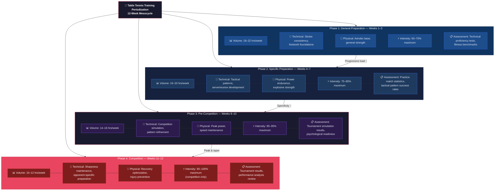

# Lesson 4: Training Methodology: Skill Acquisition, Competitive Structures, Performance Optimization

## 1. First-Principles Intuition & Invariants

Table tennis stands as one of the most demanding cognitive-motor sports in existence, requiring the integration of visual perception, decision-making, and motor execution within temporal windows often narrower than 300 milliseconds. The ball travels at velocities exceeding 100 kilometers per hour in elite play, with spin rates reaching 150 revolutions per second on heavy topspin loops. Within this demanding physical envelope, training methodology must address a fundamental paradox: the sport demands both explosive power and microscopic precision, requiring athletes to generate force through the kinetic chain while maintaining contact intervals with the ball lasting only 3 to 5 milliseconds.

The foundational invariant governing table tennis skill acquisition derives from the closed-loop sensorimotor system that connects visual input, predictive modeling, motor planning, and ballistic execution. Unlike open-skill sports where environmental unpredictability dominates, table tennis operates in a bounded spatial domain—the table measures exactly 2.74 meters by 1.525 meters, and the net height remains fixed at 15.25 centimeters. This constraint paradoxically creates infinite variability through the manipulation of spin, speed, placement, and trajectory within these rigid boundaries. Every stroke represents a solution to a differential equation where initial ball velocity, spin vector, contact point, racket angle, and stroke acceleration determine the parabolic flight path and subsequent bounce characteristics.

Training methodology must therefore construct what we might term a "solution space library" within the athlete's motor memory—a repertoire of movement patterns that can be retrieved and executed with minimal cognitive load under time pressure. This library-building process follows principles of deliberate practice first articulated by Anders Ericsson: skills must be broken into component elements, practiced with immediate feedback, performed at the edge of current capability, and repeated with sufficient volume to achieve automaticity. However, table tennis introduces an additional constraint that distinguishes it from purely technical skills like musical performance—the opponent actively seeks to present stimuli outside your trained solution space, exploiting gaps in your motor vocabulary through strategic variation.

The sport's competitive architecture reflects this adversarial dynamic. Modern tournament structures ranging from Olympic team formats to World Tour singles events create distinct tactical environments that demand specialized preparation. A best-of-seven singles match imposes different psychological demands than a team competition where individual performance affects collective outcome. The scoring system itself—games to 11 points with a two-point margin required—creates non-linear pressure curves where leads can evaporate and momentum shifts dramatically. Understanding these competitive structures allows training periodization to simulate the specific stressors athletes will encounter, rather than simply accumulating undifferentiated practice volume.

Performance optimization in table tennis emerges from the intersection of biomechanical efficiency, tactical pattern recognition, and psychological resilience under pressure. The kinetic chain must transfer energy from the ground through the legs, hips, trunk, shoulder, arm, and finally into the 85-gram racket with minimal energy leakage at each joint. Simultaneously, the visual system must parse incoming ball trajectories, extracting spin information from the ball's rotation and predicting bounce behavior while the motor system prepares the appropriate stroke. Elite players achieve this through what researchers call "predictive control"—they begin stroke preparation before the ball leaves the opponent's racket, using postural cues and contextual information to narrow the solution space preemptively.

The equipment regulations imposed by the International Table Tennis Federation create additional constraints that shape training methodology. The racket blade must be flat, rigid, and at least 85% natural wood by thickness, with rubber coverings no thicker than 4 millimeters including adhesive. The 40-millimeter celluloid ball transitioned to poly-plastic in 2014, reducing speed and spin potential while demanding adjustments to stroke mechanics across the competitive population. These specifications are not arbitrary—they define the boundary conditions within which technique evolves, and training programs must prepare athletes to execute within these precise material constraints.

## 2. Core Architecture & Mechanics

The architectural foundation of table tennis training methodology rests on periodization models that partition the training calendar into distinct phases, each targeting specific physiological, technical, and psychological adaptations. Linear periodization progresses from high-volume, low-intensity general preparation through increasingly specific and intense work, culminating in competition periods where volume drops sharply and intensity peaks. This model originated in strength training and endurance sports but translates imperfectly to table tennis, where technical skill maintenance requires consistent practice and detraining occurs rapidly with extended breaks from table work.

Undulating periodization offers superior adaptation for table tennis by varying training emphasis within shorter cycles—typically weekly or even daily. A microcycle might structure Monday as high-intensity multiball footwork training, Tuesday as tactical pattern work with training partners, Wednesday as strength and conditioning off-table, Thursday as service and receive practice, and Friday as match simulation. This variation prevents monotony, allows for recovery of specific muscle groups and neural pathways, and maintains multiple qualities simultaneously rather than developing them sequentially.

Block periodization represents the most sophisticated approach for advanced athletes preparing for major competitions. This model concentrates specific training loads into 2-to-4-week blocks with focused objectives, accepting temporary performance decrements in other areas. An accumulation block might emphasize aerobic capacity and general strength, followed by a transmutation block focusing on explosive power and stroke speed, and finally a realization block minimizing fatigue while maintaining sharpness through reduced volume and competition-specific work. The Chinese National Team has employed variations of block periodization with devastating effectiveness, structuring year-long campaigns around Olympic cycles with precision rarely seen in Western programs.

Within these macroscopic periodization frameworks, drill design principles govern the microscopic construction of practice sessions. Effective drills must satisfy several criteria simultaneously: they must present movement patterns relevant to competition, provide sufficient repetition to drive motor learning, challenge the athlete's current capability level without exceeding adaptive capacity, and permit objective measurement of performance. The spectrum of drill complexity ranges from blocked practice—repetitive execution of identical strokes—to random practice where stroke type, placement, and timing vary unpredictably.

Blocked practice accelerates early skill acquisition by allowing the motor system to refine a specific movement pattern through massed repetition. A beginner learning the forehand loop might execute 100 consecutive loops against identical topspin balls fed to the forehand corner at moderate pace. This consistency allows focus on weight transfer, racket path, contact point, and follow-through without the cognitive load of adaptation. However, blocked practice produces brittle skills that transfer poorly to competitive contexts where variability dominates. Motor learning research consistently demonstrates that while blocked practice yields faster short-term improvement, random practice produces superior retention and transfer despite slower apparent progress during training.

Advanced drill design therefore incorporates structured randomness that bridges the gap between pure blocked repetition and chaotic free play. A sophisticated footwork drill might specify a pattern—forehand corner, backhand corner, middle—but randomize the stroke type, requiring the athlete to read spin and adjust technique while executing the prescribed footwork sequence. This preserves the movement pattern objective while introducing the perceptual-cognitive demands of competition.

Multiball training represents the highest-density skill acquisition method available to table tennis players. A coach or training partner feeds balls continuously at intervals of 2 to 3 seconds, allowing the athlete to execute 20 to 30 strokes per minute compared to 5 to 10 in conventional rally practice. This volume acceleration dramatically compresses the time required to accumulate repetitions, particularly for attacking strokes like loops and smashes where rally-based practice often breaks down before sufficient volume accumulates. However, multiball introduces artificial temporal rhythms and removes the reactive component of responding to opponent variation, limiting its transfer to competition when used in isolation.

Footwork training systems constitute the physical foundation supporting stroke execution. Table tennis footwork differs fundamentally from running or general agility—the stance remains low with the center of gravity displaced forward, weight distribution favors the balls of the feet, and movements emphasize explosive first steps rather than sustained locomotion. The primary footwork patterns form a finite vocabulary: side shuffle for lateral movement, crossover step for extended lateral reach, forward-backward adjustment steps for depth management, and the pivot step for transitioning from backhand to forehand coverage.

The Chinese national training system codifies footwork into structured progressions that develop from stationary stroke execution through increasingly complex movement patterns. Beginning athletes master the split-step timing—a small preparatory hop that coincides with the opponent's ball contact, allowing explosive movement in any direction. Intermediate players develop the two-step pattern: the adjustment step that positions the body behind the ball, followed by the stroke step that transfers weight into contact. Advanced players integrate multi-step sequences like the forehand corner three-step pattern: side shuffle right, crossover step, recovery step back to ready position.

Physical conditioning for table tennis must address the sport's unique physiological demands. Match durations range from 10 minutes for one-sided contests to over 90 minutes for extended five-set battles, requiring both anaerobic power for explosive strokes and rallies, and aerobic capacity to sustain intensity across multiple games. Rally structures typically last 3 to 10 seconds with work-to-rest ratios of 1:2 during continuous play, but extend to 1:3 or 1:4 when including changeovers and between-point delays.

The energy system profile resembles high-intensity interval training more than steady-state endurance work. Phosphagen system dominance characterizes explosive attacking strokes, while glycolytic pathways support extended rallies. Training must therefore emphasize repeated sprint ability—the capacity to execute maximal-intensity efforts with incomplete recovery—rather than either pure strength or pure endurance. Circuit training combining footwork drills, multiball sequences, and rally play with controlled rest intervals develops this specific fitness quality effectively.

Tournament formats create distinct tactical and psychological environments that training must prepare athletes to navigate. Singles competition represents the purest test of individual ability, with matches typically played as best-of-five or best-of-seven games. The player serving first alternates every two points, and after 10-10 in any game, service alternates every point. This format rewards consistent execution—a single lapse rarely proves fatal, and the two-point margin requirement prevents lucky 11-9 victories from deciding close contests.

Doubles competition introduces teamwork dimensions absent from singles while constraining stroke options through alternating hit requirements. Partners must hit in strict rotation, preventing both players from attacking simultaneously and demanding choreographed movement patterns where partners must clear space for each other while maintaining ready positions. The service and receive advantage amplifies in doubles because the returning team's first shot must travel diagonally from right court to right court, constraining options and often leading to predictable patterns. Elite doubles teams develop specialized partnerships where one player's strengths complement the partner's weaknesses—a lefty-righty combination provides particularly strong coverage because forehand zones overlap minimally.

Team competitions structure matches as sequences of individual singles encounters, typically best-of-five or best-of-nine matches depending on format. The Olympic team event employs a best-of-five structure with four singles matches and one doubles, requiring teams to field at least two strong singles players. Team formats introduce strategic layers absent from individual events: coaches must decide playing order, manage substitutions, and balance the psychological impact of early results on subsequent matches. A team that falls behind 0-2 faces enormous pressure in the third match, knowing that defeat eliminates comeback possibilities.

The ranking system employed by the International Table Tennis Federation assigns points based on tournament tier and opponent strength, with points decaying over a rolling 12-month window. This system creates incentives for consistent performance across multiple events rather than single peak achievements. However, the exponential point distribution favoring major championships means that a single Olympic medal or World Championship result can offset an entire season of lesser tournament success. Understanding ranking dynamics influences competitive scheduling—players must balance the injury and fatigue risks of high tournament volume against the ranking benefits of accumulating points across multiple events.

Equipment regulations shape technique development and constrain equipment optimization strategies. The racket blade's natural wood requirement prevents the use of carbon fiber or other synthetic materials as primary construction, though thin layers of compressed fiber are permitted within the blade structure. This maintains a degree of equipment parity while allowing manufacturers to create blades with distinct vibration characteristics and sweet spots. The rubber covering regulations distinguish between pimpled rubber—where protrusions face outward—and inverted rubber where a smooth topsheet covers internal sponge. Long pimple rubbers exceeding 4 millimeters in length create unpredictable spin reversal effects but sacrifice speed and consistency, limiting their use to defensive specialists and unorthodox attackers.

The ball specifications underwent a significant transition from 38-millimeter celluloid to 40-millimeter poly-plastic balls, ostensibly improving visibility for spectators and television viewers while also eliminating the flammable and environmentally problematic celluloid material. This seemingly minor 2-millimeter diameter increase reduced maximum ball velocity by approximately 10% and decreased spin potential by similar magnitudes. The transition forced wholesale technique adjustments across the competitive population—strokes required longer acceleration distances and increased racket speeds to generate equivalent power, and service techniques evolved to maximize the reduced spin potential through exotic contact points and elaborate wind-ups.

Performance analysis frameworks integrate video analysis, statistical tracking, and biomechanical measurement to identify performance bottlenecks and guide training priorities. Video analysis dissects stroke mechanics, footwork patterns, and tactical decision-making, typically captured at 60 to 240 frames per second depending on analysis requirements. Slow-motion review reveals racket angles at contact, weight transfer timing, and follow-through completion that remain invisible at full speed. Comparative analysis between successful and unsuccessful stroke executions identifies mechanical inconsistencies—perhaps the racket face closes excessively on forehand loops down the line compared to crosscourt shots, or the recovery step after wide forehands is delayed compared to central shots.

Statistical tracking quantifies tactical patterns and outcome distributions across matches. Modern analysis software captures every rally's opening sequence, stroke distribution, placement zones, and conclusion type—winner, error, or setup for winner. This data reveals strategic tendencies: perhaps a player's backhand flip receive succeeds 65% against short backspin serves but only 40% against short no-spin serves, indicating a read deficiency. Or rally statistics might show that forehand counter-attacks from mid-distance produce winners only 15% of the time while generating errors 35% of the time, suggesting tactical adjustments toward more controlled shots or position-building rather than immediate finishing attempts.

Biomechanical measurement employs force plates, motion capture systems, and electromyography to analyze the kinetic chain's efficiency and identify injury risk factors. Force plate data reveals ground reaction forces during strokes—elite players generate vertical forces exceeding 1.5 times body weight during powerful forehand loops, with the force peaking just before racket-ball contact. Motion capture quantifies joint angles, segment velocities, and temporal coordination between body parts. EMG recordings measure muscle activation patterns, potentially revealing compensations where secondary muscles activate excessively to compensate for primary mover weakness or timing errors.

## 3. High-Performance Optimization & Failure Modes

The boundary between optimal training load and counterproductive overtraining represents perhaps the most critical optimization challenge in table tennis development. The sport's technical demands require enormous practice volume—Chinese national team members reportedly practice 6 to 8 hours daily at peak training periods—yet excessive volume without adequate recovery produces performance decrements, injury accumulation, and psychological burnout. The dose-response relationship between training volume and performance improvement is non-linear and highly individualized, typically following a pattern where initial volume increases produce large gains, followed by diminishing returns, and eventually performance decrements beyond an individual-specific threshold.

Monitoring systems must therefore track both training load and recovery status continuously. Training load quantification combines volume metrics—hours practiced, number of strokes executed—with intensity indicators such as heart rate data, perceived exertion ratings, and technical difficulty of drills performed. Session rating of perceived exertion multiplies subjective intensity on a 1-to-10 scale by session duration in minutes, providing a composite load metric that correlates reasonably well with more sophisticated physiological measurements. Accumulated weekly load should increase gradually—generally no more than 10% week-over-week during building phases—with planned recovery weeks reducing load by 30-50% every third or fourth week to allow supercompensation.

Recovery status indicators include resting heart rate variability, subjective wellness questionnaires assessing sleep quality, muscle soreness, stress level, and mood state, and objective performance markers like serve accuracy or multiball consistency. Heart rate variability—the beat-to-beat variation in cardiac rhythm—reflects autonomic nervous system status, with reduced variability indicating accumulated fatigue or inadequate recovery. Significant deviations from individual baseline values signal the need for load reduction or additional recovery time before accumulated fatigue transitions to overtraining syndrome.

Technical practice efficiency depends critically on the quality versus quantity optimization. Mindless repetition of 500 serves generates less adaptive stimulus than 100 serves executed with intense focus on specific targets, spin variations, and follow-up positioning. The concept of deliberate practice demands that each repetition includes a performance goal, immediate feedback on achievement, and mental engagement with the execution process. Coaches must structure training to maintain this engagement level—sessions exceeding 90 minutes without substantial breaks typically see attention and execution quality deteriorate, reducing practice effectiveness despite continued time investment.

Video feedback presents a double-edged optimization tool. Immediate visual feedback showing stroke mechanics or tactical patterns can accelerate learning by making errors concrete and highlighting successful execution characteristics. However, excessive video review can create "analysis paralysis" where conscious attention to mechanics that should be automatic disrupts fluent execution. The optimal application typically involves video review during breaks or after training sessions rather than between every drill repetition, allowing verbal or simple outcome feedback during practice while reserving detailed mechanical analysis for lower-arousal review contexts.

Tactical pattern training must balance scripted pattern work against adaptive problem-solving. Scripted patterns—for example, serve short backspin to forehand, receive with push crosscourt, attack with forehand loop to backhand—allow both players to execute high-quality sequences and develop automated responses to specific ball configurations. However, overreliance on scripted patterns creates robotic players who excel in familiar sequences but struggle when opponents disrupt established patterns. Advanced training therefore introduces adaptive elements: "If the receive goes long, attack immediately; if short, continue building." These conditional branches force real-time decision-making while maintaining some structure that prevents practice from devolving into random play.

The psychological dimension of performance optimization addresses the substantial mental skills component determining success under competition pressure. Table tennis scoring creates numerous pivotal moments—game points, fifth-game deciding points, post-timeout rallies—where psychological factors often determine outcomes between physically and technically matched opponents. Mental skills training must therefore target arousal regulation, attention control, and resilience to setback.

Arousal regulation techniques help athletes achieve optimal activation levels for performance—typically a state of relaxed intensity where the body operates explosively while the mind remains calm and clear. Progressive muscle relaxation, controlled breathing protocols, and pre-performance routines all contribute to arousal management. Breathing techniques particularly affect autonomic balance: extended exhales activate parasympathetic nervous system responses that reduce heart rate and muscle tension, while shorter, sharper breathing patterns increase arousal. Athletes must experiment to discover their optimal pre-match and between-point arousal management strategies.

Attention control training develops the capacity to maintain focus on task-relevant cues while filtering distractions. Table tennis demands narrow external focus during rallies—attention locked on the ball and opponent's racket—but benefits from broader awareness between points when tactical adjustments occur. Mindfulness meditation practices where attention repeatedly returns to a focus object after inevitable wandering strengthens the attentional control capacity that transfers to competition. Simulation training that introduces artificial distractions—crowd noise, adverse officiating decisions, equipment problems—inoculates athletes against real competition stressors.

Resilience to setback addresses the inevitable performance fluctuations and adverse circumstances that characterize competition. Even the world's best players lose approximately 40% of matches against top-100 opponents, and everyone experiences poor execution days, unlucky net cords, and questionable officiating decisions. Cognitive reframing techniques help athletes interpret setbacks as information rather than catastrophe: an early deficit reveals opponent tendencies and tactical approaches that inform adjustment, while errors provide feedback for mechanical or tactical corrections. Self-talk protocols that replace negative rumination—"I'm playing terribly, this is a disaster"—with constructive process focus—"Adjust timing, stay low on defense, open the racket on receives"—maintain performance levels despite adverse circumstances.

Injury prevention and management represent critical performance optimization components given the sport's repetitive stress demands. Shoulder overuse injuries from excessive overhead serving and loop execution plague players who neglect rotator cuff strengthening and scapular stabilization work. Knee and ankle issues emerge from the constant directional changes and low ready position stance. Lower back stress accumulates from the forward-flexed posture and rotational forces during stroke production.

Preventive strategies include structured warm-up protocols that activate key muscle groups and gradually increase tissue temperature before intense training. Dynamic stretching sequences targeting hip flexors, hamstrings, shoulder external rotators, and trunk rotators prepare tissues for the movement demands while potentially reducing injury risk compared to static stretching. Strength training emphasizing single-leg stability, rotational core strength, and posterior chain development addresses common weakness patterns that predispose athletes to injury.

Recovery modalities optimize adaptation and readiness between training sessions. Sleep represents the most potent recovery intervention, with evidence suggesting that elite athletes benefit from 8 to 10 hours nightly during heavy training periods. Sleep deprivation impairs motor skill consolidation—the process where new movement patterns transfer from working memory to more permanent storage—and reduces both physical performance capacity and cognitive function. Nutrition timing strategies that provide carbohydrate and protein within 30 minutes post-training accelerate glycogen replenishment and muscle protein synthesis compared to delayed feeding.

Periodization failures occur when training loads exceed recovery capacity for extended periods, when competition schedules demand peak performance too frequently, or when phase emphasis mismatches upcoming competition demands. The most common error involves excessive volume or intensity during the competition phase—athletes and coaches often feel compelled to "make up" for perceived training deficits immediately before major events, introducing high loads when the body should be recovering and sharpening. This produces fatigued, overtrained athletes at precisely the moment when peak form is required.

Another common failure mode involves inadequate deload weeks during building phases. The drive to improve creates temptation to eliminate or minimize recovery weeks, viewing them as wasted time rather than necessary adaptation periods. However, the body's adaptive processes require periods of reduced stress to consolidate training stimuli into actual performance improvements. Continuous hard training without strategic recovery leads to accumulated fatigue, elevated injury risk, and eventual performance plateaus or decrements.

Equipment optimization presents a nuanced challenge where individual preferences, playing style, and competitive level intersect with equipment characteristics. Blade selection involves choosing the substrate material composition, blade thickness, handle shape, and overall weight. Softer blades with increased wood thickness provide greater ball control and dwell time but sacrifice speed, benefiting defensive players and close-to-table blockers. Harder blades with carbon fiber reinforcement layers maximize speed and power for aggressive attackers but demand exceptional timing and technique to control.

Rubber selection proves equally complex, with sponge hardness, topsheet tackiness, and rubber composition dramatically affecting stroke characteristics. Hard sponges rated 42 to 47 degrees on the Shore hardness scale generate maximum speed and spin for advanced players with complete stroke mechanics, while softer sponges around 35 to 40 degrees offer more forgiveness and easier control for developing players. Tacky Chinese rubbers grip the ball intensely during contact, enabling extreme spin generation but requiring fast stroke speeds to overcome the grip that can otherwise slow shots. European tensor rubbers employ internal tension and specialized topsheets that generate speed more easily but typically sacrifice some spin potential.

The equipment-player matching process requires systematic experimentation where players trial different combinations during training periods rather than immediately before competitions. Switching equipment disrupts timing and ball feel, typically requiring 2 to 4 weeks of adjustment before competitive performance returns to baseline levels. Equipment changes therefore should occur during preparation phases with adequate time for adaptation, and players should maintain backup rackets with identical specifications to minimize disruption if primary equipment is damaged.

Performance analysis implementation failures often stem from data collection without systematic interpretation and action planning. Recording match statistics generates no value unless the data drives specific training focus adjustments. A complete analysis workflow includes data collection during competition, post-event review identifying performance patterns and bottlenecks, hypothesis generation about underlying causes, targeted training interventions addressing identified weaknesses, and reassessment in subsequent competition to validate whether improvements occurred.

The integration of technical, tactical, physical, and psychological training components represents the ultimate optimization challenge. These domains interact complexly—physical fatigue degrades technical precision, psychological stress reduces tactical clarity, technical deficiencies force compensatory physical outputs that accelerate fatigue. Holistic training design considers these interactions explicitly, structuring sessions and training blocks to address multiple domains simultaneously when possible while recognizing that some elements require dedicated focus periods.

Elite performance in table tennis ultimately emerges from the accumulation of small optimization gains across every trainable dimension—each percentage point improvement in serve placement accuracy, each millisecond reduction in first-step reaction time, each incremental increase in psychological resilience compounds with others to separate champions from near-champions. The athletes and coaches who systematically address every controllable variable, monitor progress rigorously, and adapt programming based on evidence rather than tradition achieve the marginal advantages that determine success at the highest competitive levels.
