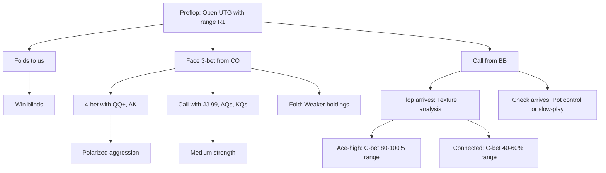

# Lesson 3: Strategic Frameworks, Game Theory Optimal Play

## 1. First-Principles Intuition & Invariants

The transformation from competent poker player to strategic master hinges on a fundamental shift in perspective: moving from thinking about individual hands to thinking about ranges, from seeking exploitative edges to understanding equilibrium play, and from reactive decision-making to constructing theoretically sound strategic architectures. This lesson establishes the mathematical and game-theoretic foundations that separate professionals from amateurs, providing the conceptual machinery necessary to navigate the modern poker landscape where solvers and equilibrium strategies have fundamentally altered optimal play.

At its core, poker is a sequential, imperfect-information, two-player zero-sum game when played heads-up, and a multiplayer non-cooperative game in full-ring contexts. The imperfect information component—the hidden hole cards—creates the fundamental strategic tension that makes poker intellectually rich. Unlike chess, where both players see the entire board state, poker players must construct probabilistic models of opponent holdings and make decisions under uncertainty. This uncertainty creates the space for deception, the value of position, and the strategic depth that has captivated game theorists since John von Neumann first analyzed simplified poker variants in his foundational work on game theory in 1928.

The concept of a hand range represents the first critical abstraction. A range is the complete distribution of possible holdings a player could have given their actions in a hand. When a competent player opens from early position, they are not playing a single hand—they are playing a carefully constructed distribution that might include premium pairs, strong broadways, suited connectors, and occasionally weaker hands for balance. The opponent must defend or attack not against a specific holding, but against this entire distribution. This distributional thinking fundamentally changes the strategic calculus. A hand like ace-king offsuit is not inherently strong or weak; its value derives entirely from how it performs against the opponent's range in the current game tree node.

Range construction begins with an understanding of combinatorics. There are exactly 1,326 distinct starting hands in Texas Hold'em when we account for suit combinations: thirteen ranks of pocket pairs (six combinations each, for seventy-eight total), and seventy-eight distinct unpaired holdings (sixteen combinations each when we separate suited from unsuited, yielding 312 suited combinations and 936 offsuit combinations). When we observe board cards or assign ranges to opponents, we must continuously update these combinatorics. If the board shows two aces, the number of remaining ace-king combinations drops from sixteen to six. If we hold ace-king ourselves, only nine combinations of aces remain in the deck rather than sixteen. This combinatorial bookkeeping, while tedious, provides the quantitative foundation for all range-based reasoning.

The second foundational concept is game theory optimal play, commonly abbreviated as GTO. A GTO strategy is one that cannot be exploited—no matter what adjustments an opponent makes, they cannot achieve a profit rate higher than the theoretical game value when facing a perfectly balanced GTO strategy. In heads-up poker, GTO strategies exist and can be computed (within practical approximations) using counterfactual regret minimization algorithms, the computational technique that powers modern solver software. The Nash equilibrium, named for mathematician John Nash, represents the strategic fixed point where no player can improve their expected value by unilaterally deviating from their strategy. In a two-player zero-sum game like heads-up no-limit hold'em, the Nash equilibrium guarantees that neither player can be exploited, though both players may be able to achieve higher win rates through exploitative adjustments if their opponent deviates from equilibrium.

The practical implications of GTO play extend beyond the theoretical elegance. Against unknown opponents or strong regulars who are themselves playing near-equilibrium strategies, GTO provides a robust baseline that guarantees we will not lose in the long run beyond the rake and variance. GTO strategies specify exact frequencies for actions: in a particular spot, a solver might determine that we should continuation bet 67% of our range, check-call 18%, check-fold 10%, and check-raise 5%. These frequencies are not arbitrary—they are mathematically derived to make our opponent indifferent between their available actions, a condition known as balancing. If we bet too frequently, our opponent can exploit us by over-folding or by calling with weaker hands knowing we are bluffing too often. If we bet too infrequently, they can exploit us by calling less often and stealing pots we would have won with aggressive action.

However, the practical application of GTO in live play contains a crucial paradox: perfectly balanced play is not maximally profitable against imperfect opponents. If we know an opponent folds too often to three-bets, the GTO response is not to three-bet at the equilibrium frequency—it is to three-bet more often, exploiting their specific weakness. If an opponent calls too often on the river, we should bluff less frequently than equilibrium prescribes and value bet thinner. This creates the central strategic tension in modern poker: the balance between playing a fundamentally sound, unexploitable baseline and making profitable exploitative adjustments based on opponent tendencies.

The mathematical structure underlying this tension can be formalized through the concept of indifference. In equilibrium, when we construct a betting range, we must include enough value hands to make our opponent indifferent to calling with their marginal holdings, and enough bluffs to make them indifferent to folding those same hands. Consider a river spot where we bet pot-sized, risking one hundred big blinds to win one hundred already in the pot. Our opponent must call one hundred to win two hundred, getting 2:1 odds, requiring 33% equity to break even. If we want them to be indifferent, our range must contain 67% value hands and 33% bluffs. If we deviate from this ratio—say, by bluffing 50% of the time—we are no longer balanced, and a perfect opponent could exploit us by calling too often. But if our opponent actually folds 70% of the time regardless of our true bluff frequency, then bluffing 50% of the time yields a higher profit than the balanced 33%.

The tension between exploitative and GTO play introduces a meta-game consideration: game theory optimal strategies are most valuable precisely when we face opponents who are themselves capable of exploiting our imbalances. Against weak recreational players who make consistent, exploitable errors, abandoning balance in favor of maximum exploitation is strictly correct. Against tough regulars who are actively adjusting to our tendencies, maintaining balance becomes essential to avoid being counter-exploited. The practical heuristic employed by most professionals involves establishing a GTO baseline through solver study, then making targeted exploitative adjustments based on observed opponent behaviors while maintaining balance in spots where we lack reliable information about opponent tendencies.

Range construction in practice requires understanding range morphology—how ranges change composition as actions proceed through the game tree. A preflop opening range contains a wide distribution of hand types: premium pairs, strong broadways, suited connectors, suited aces. After facing a three-bet, the original raiser's continuing range becomes more polarized, containing strong value hands that can call or four-bet, and some bluff candidates, while folding medium-strength holdings that cannot profitably continue. The three-bettor's range also polarizes, weighted toward premiums but containing some semi-bluffs. By the river, ranges have typically narrowed and polarized further, with each player's range increasingly divided between strong hands and bluffs, with fewer medium-strength holdings remaining.

This range morphology creates strategic opportunities and constraints. On a board texture that heavily favors one player's preflop range—for example, a low, disconnected board after the button opens and the big blind defends—the player with the range advantage can apply significant pressure through frequent betting, knowing their opponent's range contains many weak hands that cannot profitably continue. Conversely, on dynamic boards with many straight and flush possibilities, ranges remain wider and less polarized, limiting aggressive frequencies because both players retain many medium-strength hands with showdown value.

The concept of the equity-realization gap provides another critical invariant. Raw equity measures the probability a hand wins if all cards are dealt out with no further betting. Realized equity accounts for the fact that out-of-position players must realize their equity through imperfect decision trees where they face difficult decisions on later streets and sometimes cannot extract value or must fold the best hand. A hand like middle pair has significant raw equity against many ranges but poor equity realization out of position, because it faces awkward decisions when the opponent bets on later streets. This gap explains why positional advantage is so valuable: in-position players realize more of their range's equity, while out-of-position players leak value through difficult decision points and information disadvantage.

## 2. Core Architecture & Mechanics

The practical construction of optimal strategies requires understanding the architectural layers through which decisions flow: range construction, frequency determination, hand selection within frequencies, and bet sizing. Each layer builds upon the previous, creating a hierarchical decision architecture that mirrors the game tree structure of poker itself.

Range construction begins with establishing preflop opening ranges, the foundation upon which all postflop play is built. These ranges vary systematically by position due to the information and positional advantage gained by acting later. Under the gun in a nine-handed game, a conservative opening range might include approximately 15% of hands: pocket pairs from deuces through aces, ace-king through ace-jack suited and offsuit, king-queen suited, and occasionally suited connectors like jack-ten suited for balance. This range can be mathematically expressed through a weight matrix where each holding receives a fractional weight between zero and one, with one indicating always playing the hand and fractional values indicating mixed strategies.

From middle position, the range expands to roughly 20%, adding more suited broadway combinations, suited connectors down to eight-seven suited, and some suited aces. The button, enjoying maximum positional advantage, can profitably open approximately 45-50% of hands, including all pairs, all suited aces, all suited kings, suited connectors down to five-four suited, and many offsuit broadway combinations. The cutoff position, one seat right of the button, opens roughly 35-40% of hands, while the hijack opens 25-30%. These percentages represent theoretically sound baselines derived from solver analysis, though exploitative adjustments based on blind defense tendencies can substantially alter optimal frequencies.

The mechanical process of three-betting introduces the first major postflop range manipulation. A three-bet range from a player in position against an early position open should be polarized, containing strong value hands (queens-plus, ace-king) and some bluff candidates chosen for their blocking effects and postflop playability. Suited connectors like nine-eight suited and suited aces like ace-five suited make excellent three-bet bluffs because they block fewer value combinations in the opponent's continuing range, have reasonable equity when called, and can make strong but disguised hands postflop. The ratio of value hands to bluffs in a three-betting range follows the same indifference principle discussed earlier: if we three-bet to twelve big blinds from an initial raise to three big blinds, the original raiser must call nine more to win fifteen (including the big blind and small blind), getting 15:9 or 1.67:1 odds, requiring 37.5% equity. Our three-betting range should therefore contain roughly 62.5% value and 37.5% bluffs to keep them indifferent.

Postflop play operates through a series of decision nodes where we must determine continuation betting frequencies, sizing, and range selection. On a flop texture like ace-high rainbow (ace-seven-three with no flush draw), the preflop raiser enjoys a massive range advantage because their range contains far more aces and overpairs than the defender's range. Solvers typically prescribe high continuation betting frequencies on such boards—often 80-100% of the range—using a mixed strategy of small c-bets (25-33% pot) with the vast majority of the range and larger bets (75% pot) with polarized value and bluffs. The small c-bet allows the raiser to apply pressure with their entire range efficiently, forcing folds from the defender's weakest hands while building a pot with value hands. The occasional large bet provides balance and disguises hand strength.

Conversely, on a coordinated board like nine-eight-seven rainbow, ranges remain closer in strength, and the preflop raiser cannot bet with impunity. Solvers prescribe much lower continuation betting frequencies, often 40-60%, with more checking. The raiser's range contains many medium-strength holdings like overpairs and weak aces that prefer to check and control pot size rather than face raises, while the defender's range contains many strong made hands and draws that can aggressively respond to bets. This illustrates a critical architectural principle: continuation betting frequencies should scale with range advantage, not hand strength in isolation.

The turn and river decisions build upon flop actions, with ranges continuously updating based on observed actions. If the flop bettor faces a call, their turn range should be constructed to put continued pressure on the defender's marginal made hands while balancing with some slower-played value. The defender's calling range on the flop typically contains many medium-strength hands that will fold to sustained pressure, some draws that will fold if they miss, and some traps (strong hands that merely called the flop rather than raising). The turn bettor must navigate this distribution, typically betting at a moderate frequency (50-70% depending on turn card and flop action) with value hands, semi-bluffs with equity, and some pure bluffs for balance.

River play represents the final decision point where all uncertainty about relative hand strength resolves. River betting strategy divides into value betting, bluffing, and pot control. Value betting requires understanding how thin we can bet—meaning, what is the weakest hand that can profitably bet for value given the opponent's likely calling range. On a board of ace-king-nine-four-two rainbow after we bet flop and turn and got called twice, our opponent's range likely contains strong aces, some kings, maybe a set or two-pair, and some bluff-catchers like queen-jack or ace-x with a weak kicker. If we hold ace-queen, we can typically bet for value because we beat all the bluff-catchers and weak aces in their range, though we lose to better aces and sets. The sizing of this value bet influences the opponent's incentive structure: a larger bet makes them more likely to fold marginal hands, while a smaller bet induces more calls from hands we beat.

Bluffing on the river requires selecting hands that have blocker effects—cards that reduce the number of strong combinations the opponent can hold. If we are considering bluffing on an ace-king-nine-four-two board, holding an ace ourselves significantly reduces the likelihood the opponent has an ace (from sixteen possible ace-king combinations to only nine), making our bluff more likely to succeed. Similarly, bluffing with a busted flush draw removes combinations of flushes from the opponent's range. The frequency of river bluffs must maintain the indifference condition: if we bet pot, our opponent gets 2:1 odds and needs 33% equity to call, so we should be bluffing roughly 33% of the time and value betting 67%.

Bet sizing strategy forms another critical architectural layer. Modern solvers employ multiple bet sizes at most decision points: a small bet (25-33% pot), a medium bet (50-66% pot), and a large bet (75-150% pot). Each size serves different strategic purposes. Small bets apply pressure efficiently across a wide range, extracting value from marginal hands and forcing folds from weak holdings without risking too much capital. Medium bets build pots with strong but vulnerable hands that want to charge draws and protect against improving hands. Large bets polarize ranges, typically indicating either very strong value or bluffs, putting maximum pressure on the opponent's medium-strength holdings. The mix of sizes prevents opponents from exploiting a predictable betting pattern and allows for more nuanced range construction.

The mathematical structure of pot odds and equity creates forcing relationships between bet sizes and range construction. If we bet half pot on the river, our opponent gets 3:1 odds and needs 25% equity to call profitably. To make them indifferent, we must be value betting 75% of the time and bluffing 25%. If we instead bet pot, they need 33% equity, and we should bluff 33% of the time. If we overbet twice the pot, they need 40% equity, and we should bluff 40% of the time. Larger bets allow for more bluffs in absolute terms but require more value hands to balance. This relationship explains why pot-sized bets or larger are dangerous without sufficient value hands to support them—we become too bluff-heavy and can be exploited by opponents who call down light.

The concept of minimum defense frequency provides a complementary perspective. When facing a bet, a player should defend (call or raise) frequently enough to prevent the bettor from profitably betting any two cards as a pure bluff. If the bettor bets pot, the defender should defend at least 50% of the time; if they defend less, the bettor can bluff at any frequency and make an immediate profit. If the bettor bets half pot, the defender should defend at least 67% of the time. This relationship creates a fundamental tension: the bettor wants to apply maximum pressure through larger bets, but larger bets require defending less frequently, allowing the defender to fold more often without being exploited. Smaller bets force the defender to continue more often but risk less and build smaller pots.

Range organization can be visualized through a matrix representation where rows represent hand categories (premium pairs, strong broadways, suited connectors, suited aces, offsuit broadways, weak pairs, weak aces) and columns represent actions (open, call, fold, three-bet, four-bet). Each cell contains a frequency value. For an under-the-gun opening range:

```
Hand Category          | Open % | Call % | Fold % | Notes
-----------------------|--------|--------|--------|------------------------
AA-QQ                  | 100    | 0      | 0      | Always open, never flat
JJ-99                  | 100    | 0      | 0      | Pure opens
88-22                  | 100    | 0      | 0      | Pure opens, set mining
AKs-AJs                | 100    | 0      | 0      | Premium broadways
AKo-AQo                | 100    | 0      | 0      | Offsuit premiums
KQs                    | 100    | 0      | 0      | Suited broadway
ATs, A9s               | 50     | 0      | 50     | Mixed strategy, balance
KJs, KTs               | 80     | 0      | 20     | Mostly open
QJs, JTs               | 60     | 0      | 40     | Suited connectors
T9s, 98s               | 20     | 0      | 80     | Occasional balance
```

This matrix evolves as position improves, with all frequencies shifting toward more opening and less folding as we move closer to the button. The disciplined application of these frequencies, rather than playing by feel, separates theoretical rigor from undisciplined speculation.

Postflop decision trees can be represented through nested conditional structures where each node branches based on actions:



This tree structure, when fully enumerated across all board textures and bet sizes, contains millions of nodes, which is why solver software requires substantial computational resources to approximate equilibrium solutions.

## 3. High-Performance Optimization & Failure Modes

The translation of game-theoretic principles into practical execution requires addressing computational constraints, human cognitive limitations, and dynamic table conditions. The optimization process involves three parallel tracks: solver-based strategy refinement, exploitative adjustment frameworks, and real-time decision-making heuristics.

Solver-based training provides the foundation for modern strategic development. Software tools like PioSolver, GTO+, and Simple Postflop employ counterfactual regret minimization algorithms to compute approximate Nash equilibrium strategies for specified game tree structures. The practical workflow involves defining a scenario—for example, under the gun opens to three big blinds, big blind calls, flop is ace-king-seven rainbow—then specifying allowed bet sizes, stack depths, and ranges. The solver iterates millions of times, adjusting strategy frequencies to minimize regret (the difference between actual strategy performance and the best possible strategy in hindsight) until reaching a stable equilibrium where no player can improve by deviating.

The computational complexity of solving complete game trees requires careful abstraction. Full no-limit hold'em cannot be solved exactly with current computational resources due to the immense size of the game tree (the number of distinct decision points multiplies combinatorially with the number of streets, bet sizes, and card combinations). Solvers manage this complexity through discretization—limiting available bet sizes to a small set rather than allowing any amount—and bucketing—grouping similar hands together for strategic purposes. A typical solver run might allow three bet sizes per street and solve for aggregated hand buckets rather than individual combinations, completing in hours rather than decades.

The critical skill in solver training is translating solver output into executable heuristics. Memorizing exact frequencies for every possible board texture and game tree path is cognitively impossible. Instead, practitioners extract patterns and principles. A solver analysis of continuation betting might reveal that range advantage correlates strongly with betting frequency, that small bets are preferred when betting wide ranges, and that certain hand categories (overcards with backdoor draws) make excellent small bets. These patterns, once identified, become executable heuristics that can be applied in real time without perfect recall.

The exploitative adjustment framework layers on top of the GTO baseline by identifying opponent deviations and constructing counter-strategies. The taxonomy of exploitable tendencies includes:

**Preflop imbalances:** Opponents who open too tight from late position can be three-bet with a wider, more aggressive range. Opponents who open too wide can be three-bet tighter for value, since they will frequently hold weak hands that cannot continue. Opponents who fold too often to three-bets can be three-bet at nearly any frequency profitably. Opponents who call three-bets too wide can be four-bet more frequently for value with a tighter range, or bet smaller postflop to extract value from their capped range.

**Postflop frequency errors:** Opponents who fold too often to continuation bets can be c-bet 100% of the time regardless of hand strength or board texture. Opponents who call too often can be c-bet more selectively with only strong hands and strong draws, abandoning balance in favor of pure value. Opponents who raise flop bets too often can be exploited by checking with medium-strength hands that would otherwise bet, inducing bluffs, then calling or raising. Opponents who rarely raise can be bet more frequently with a bluff-heavy range, knowing they will not apply pressure.

**Bet sizing tells:** Opponents whose bet sizes correlate strongly with hand strength create massive exploitative opportunities. If an opponent always bets small with weak hands and large with strong hands, we can fold to large bets and call or raise small bets, capturing enormous value. The counter-strategy involves randomizing bet sizes or using solvers' multi-size approach to obfuscate strength.

**Turn and river passivity:** Opponents who check back too often on the turn after betting the flop can be exploited by calling flop bets with a wider range, planning to check-raise the turn when they show weakness. Opponents who check-call too frequently on the river with bluff-catchers can be exploited by over-bluffing, converting hands with zero showdown value into profitable bluffs.

The practical implementation of exploitative adjustments requires tracking systems. Live players rely on mental note-taking, categorizing opponents into archetypes (tight-passive, loose-aggressive, calling station, maniac) and adjusting strategies accordingly. Online players employ tracking software like PokerTracker or Hold'em Manager, which record every hand played and compute statistical indicators: voluntarily put money in pot percentage (VPIP), preflop raise percentage (PFR), three-bet percentage, continuation bet percentage, fold-to-three-bet percentage, and dozens of other metrics. A VPIP of 15% indicates a tight player who enters pots infrequently; a VPIP of 35% indicates a loose player. A PFR close to VPIP indicates an aggressive player who raises rather than calls; a large gap between VPIP and PFR indicates a passive player who calls too often.

The challenge in exploitative play lies in sample size requirements and dynamic equilibrium. A single observed fold to a three-bet provides weak evidence about an opponent's true tendency; fifty observed folds to three-bets provides strong evidence. Bayesian updating provides the mathematical framework: we begin with a prior belief about opponent tendencies (typically assuming near-optimal play), then update that belief as we observe actions, with the posterior belief moving toward the observed frequency weighted by sample size. A player who has folded to three-bets five times out of five might truly fold 100% of the time, or they might have been dealt weak hands that correctly fold; we need more data to distinguish.

Dynamic equilibrium considerations arise when opponents actively adjust to our exploitative strategies. If we begin over-bluffing a player who folds too often, and they notice and begin calling more, we must counter-adjust by bluffing less and value betting thinner. This creates a strategic arms race where each player tries to stay one adjustment ahead. The equilibrium outcome of this meta-game depends on relative skill: against weaker opponents who adjust slowly or incorrectly, we can maintain exploitative strategies for extended periods. Against strong opponents who adjust quickly, we must remain closer to GTO to avoid being counter-exploited.

Real-time decision-making under cognitive load requires automatic heuristics that compress game-theoretic principles into instant pattern recognition. The practical workflow during a hand involves:

**Step one: Range construction.** Immediately upon seeing an opponent's action, mentally construct their range. If they open from middle position, assign them a 20% range. If they three-bet from the button, assign them a polarized range of strong value and bluffs. Update this range as the hand progresses and more cards appear.

**Step two: Equity calculation.** Estimate the equity of our hand against their range. With pocket jacks facing an under-the-gun open, we have approximately 70% equity against their opening range but only 40% equity against their four-betting range. These estimates need not be precise—within 10% is sufficient for decision-making.

**Step three: Frequency determination.** Based on the board texture, position, and stack depth, determine the appropriate action frequency. On an ace-high flop after we defend big blind versus a button open, we should check-call approximately 50% of our range, check-raise 15%, and check-fold 35%. Locate our hand within this frequency distribution.

**Step four: Sizing selection.** Choose a bet size from the allowable set (typically small, medium, large) based on range composition and objective. If betting a polarized range, use larger sizes. If betting a condensed range with many medium-strength hands, use smaller sizes.

**Step five: Execution.** Execute the decision with consistent timing to avoid timing tells. Deliberate for a similar duration regardless of hand strength.

This five-step process must execute in seconds, which requires extensive drilling and pattern recognition. The training method involves running solver simulations, analyzing output, identifying patterns, then drilling specific scenarios until pattern recognition becomes automatic. Flash-card training for equity estimation—for example, pocket tens versus ace-king all-in preflop (57-43), or ace-king versus a random hand (65-35)—builds intuition for equity comparisons. Postflop equity drills involve estimating hand equity against ranges on specific board textures until estimation error drops below 10%.

Failure modes in strategic execution cluster into several categories:

**Over-leveling:** Attempting to make complex plays against opponents who are not thinking at the required level. Bluffing with a hand that blocks the opponent's calling range is sophisticated, but meaningless if the opponent is not thinking about ranges and will call or fold based on their own hand strength alone. The corrective involves matching strategic complexity to opponent sophistication, playing straightforward value-heavy strategies against weak opponents and reserving complex balancing for strong opponents.

**Unbalanced aggression:** Betting and raising too often without sufficient value hands to support the bluff frequency. This is the most common failure mode among intermediate players who have learned that aggression is profitable but have not internalized the mathematical constraints on bluff frequency. The corrective involves tracking bluff-to-value ratios and ensuring they match the pot odds being laid. If betting pot, no more than one-third of the betting range should be bluffs.

**Static strategy:** Playing a memorized strategy without adjusting to opponent tendencies. The GTO baseline is unexploitable but not maximally profitable. The corrective involves active observation and note-taking, identifying opponent deviations, and making targeted exploitative adjustments while maintaining balance in unexplored spots.

**Tilt and emotional compromise:** Allowing frustration from bad beats or coolers to degrade strategic discipline. Tilt causes players to abandon ranges, make angry bluffs, call down light seeking justice, and generally revert to emotional rather than game-theoretic reasoning. The corrective involves pre-commitment to session bankroll stop-losses (quitting if down more than a specified amount), mindfulness practices to observe emotional states without acting on them, and regular review of tilt-contaminated sessions to identify warning signs.

**Insufficient bet sizing granularity:** Using only one or two bet sizes across all scenarios, allowing opponents to exploit predictable sizing. The corrective involves adopting a three-size system (33%, 66%, 100% pot) as a baseline and adjusting based on board texture and range advantage.

**Range merging errors:** Incorrectly grouping hands together that require different strategic treatments. For example, treating all flush draws identically when some have better blockers or better backup equity. The corrective involves finer-grained range organization and pattern recognition for hand categories.

The long-term development path for strategic mastery involves cycling between theoretical study, solver analysis, practical implementation, and results review. A disciplined player might spend ten hours per week studying solver outputs, identifying patterns and building heuristics, then ten hours playing while implementing the studied strategies, then five hours reviewing hand histories to identify execution errors and exploitable opponent tendencies. This cycle compounds over months and years, gradually building an intuitive strategic architecture that can execute game-theoretic principles in real time under cognitive load.

Advanced players extend this framework through game tree simplification techniques, where complex multi-street scenarios are broken into simplified sub-games that can be solved independently. For example, river play can often be analyzed in isolation given estimated ranges from earlier streets, allowing focused study of thin value betting and optimal bluff frequencies without requiring perfect turn play. Turn play can be analyzed with estimated flop ranges, and so forth. This modular approach to skill development allows practitioners to achieve expert-level execution in specific game tree regions before mastering the complete game tree.

The integration of live reads and physical tells provides an additional exploitative layer beyond pure range-based reasoning. Observing bet timing (instant bets often indicate weakness or very strong hands, while deliberation suggests marginal strength), physical demeanor (hand trembles often indicate strong hands, relaxed posture suggests comfort with hand strength), and betting patterns (the player who has been tight for an hour suddenly overbet-shoves likely has a very strong hand) adds information that can shift ranges and alter optimal strategy. However, physical tells are dangerous to over-weight; population tendencies and range-based reasoning should provide the foundation, with live reads serving as tiebreakers in marginal decisions rather than primary factors.

The culmination of strategic mastery is the ability to think in ranges, construct balanced strategies, identify and exploit opponent imbalances, and execute complex game trees in real time while managing cognitive load and emotional equilibrium. This synthesis of game theory, pattern recognition, Bayesian updating, and psychological discipline separates professionals from amateurs and represents the frontier of strategic poker execution in the modern solver era.
