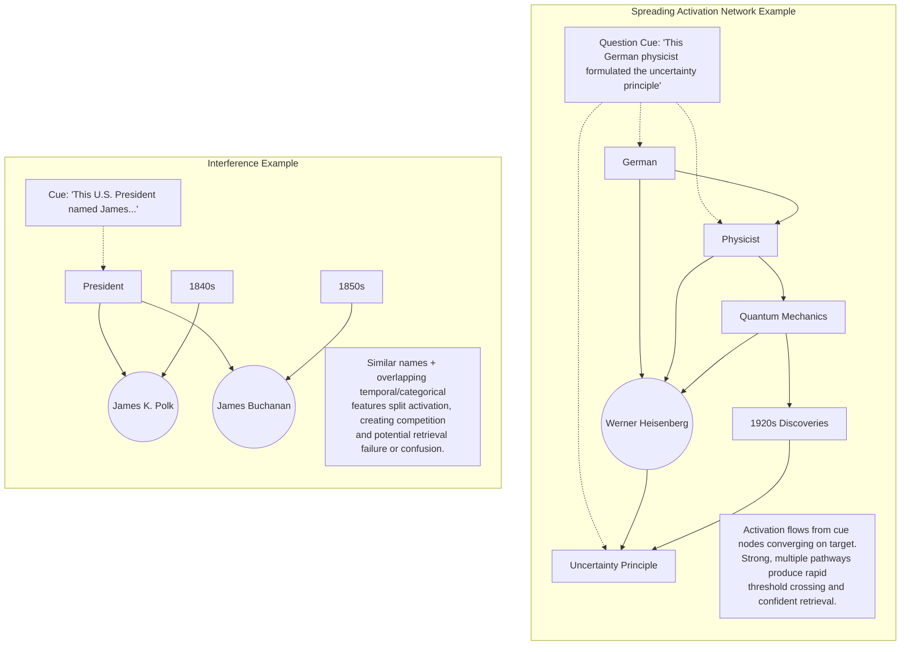

# Lesson 2: Retrieval Architectures, Cuing Systems, Interference Patterns

## 1. First-Principles Intuition & Invariants

The trivia competitor who has encoded ten thousand facts faces a singularly brutal problem: the human brain does not operate as a indexed database with random access lookup. Storage is not retrieval. A fact successfully committed to long-term memory exists in a dormant, distributed state across networks of neural assemblies, and the critical bottleneck in competitive trivia performance lies not in capacity but in the speed and reliability of retrieval pathways. Championship-level performance demands that practitioners construct, maintain, and protect efficient retrieval architectures—the neural scaffolding that transforms dormant knowledge into accessible answers within the two-to-three-second window that separates winning buzzers from silence.

Retrieval fundamentally operates through associative activation rather than exhaustive search. When a trivia question presents the prompt "This physicist formulated the uncertainty principle," the brain does not linearly scan through every physicist ever encoded. Instead, the semantic features of the question—*physicist*, *uncertainty*, *principle*, *quantum*—serve as retrieval cues that send activation energy propagating through associative networks. The correct answer node, Werner Heisenberg, receives converging activation from multiple pathways: the *quantum mechanics* cluster, the *German physicists* cluster, the *1920s discoveries* temporal cluster, and the distinctive phonological pattern of his surname. When accumulated activation exceeds a threshold, the memory becomes accessible to conscious retrieval and can be articulated as an answer.

This spreading activation model reveals the first core invariant: retrieval speed and reliability scale directly with the density and diversity of associative pathways connecting a target memory to potential retrieval cues. A fact encoded through a single, narrow pathway—perhaps only its categorical label—becomes fragile and slow to access. A fact embedded within a rich associative web, connected to multiple semantic features, temporal contexts, phonological patterns, visual imagery, and emotional valence, can be reached through numerous independent routes. The elite trivia practitioner does not merely memorize facts; they engineer redundant retrieval infrastructure.

The second invariant governs the relationship between encoding context and retrieval context, known as the encoding specificity principle. Memory retrieval demonstrates maximal efficiency when the cognitive and environmental context during retrieval matches the context present during encoding. This phenomenon, termed context-dependent memory, creates both opportunities and vulnerabilities. A competitor who studies capital cities while seated at a specific desk, in a specific room, with specific background music, has inadvertently bound those memories to contextual features that will be absent during competition. The championship environment—stage lighting, audience noise, adrenaline response, the physical presence of competitors—represents a radically different retrieval context. Effective training protocols must either encode knowledge in neutral, context-independent conditions or, more powerfully, deliberately practice retrieval under simulated competition conditions to build context-invariant access pathways.

The third invariant addresses the phenomenon of interference, the degradation of retrieval pathways caused by competition between similar memories. Human memory networks demonstrate catastrophic sensitivity to similarity-based confusion. When a competitor encodes the fact that **James K. Polk** was the 11th U.S. President, and later encodes that **James Buchanan** was the 15th President, the shared features—both named James, both presidents, both from the mid-19th century, both associated with pre-Civil War politics—create overlapping activation patterns. When a question cue arrives containing the feature *James* plus *President* plus *1840s*, both memory nodes receive activation, and the retrieval system faces ambiguity. This interference manifests in two temporal directions: **proactive interference**, where old memories obstruct new learning, and **retroactive interference**, where new learning degrades access to previously stable memories. Managing interference through strategic encoding differentiation constitutes a primary engineering challenge in building robust trivia knowledge bases.

The fourth invariant concerns the recognition-versus-recall asymmetry, a fundamental performance gap in retrieval architecture. Recognition tasks, which present the target memory and require only verification ("Is this the correct answer?"), require substantially less activation energy than recall tasks, which demand generation of the target from retrieval cues alone ("What is the answer?"). This asymmetry emerges because recognition can succeed through partial activation—a sense of familiarity below the threshold required for full reconstruction—while recall demands sufficient activation to reconstruct the complete memory representation. In multiple-choice trivia formats, competitors can leverage recognition pathways to access memories that would remain inaccessible under pure recall conditions. Conversely, open-recall formats, which dominate quiz bowl and Jeopardy-style competition, impose maximal demands on retrieval infrastructure and expose any weaknesses in encoding quality or associative connectivity.

The phenomenon called **tip-of-the-tongue state** (TOT) reveals the granular structure of memory representations and the vulnerability of phonological retrieval pathways. A competitor in TOT state possesses semantic access—they know the answer's meaning, category, and associated concepts—but cannot retrieve the phonological form required to articulate the answer. They might know the target word is a three-syllable surname starting with a specific letter, might recall semantic features like "Russian composer" and "The Firebird," yet remain unable to produce *Stravinsky*. This dissociation demonstrates that semantic and phonological information are stored in partially independent networks, and retrieval failure can occur at the phonological bottleneck even when semantic activation succeeds. For trivia competitors, TOT states represent agonizing near-misses, where the knowledge exists but the articulatory output pathway remains blocked. Preventing TOT states requires encoding protocols that strengthen phonological pathways through deliberate articulation practice and phonological elaboration during study.

These invariants collectively define the constraint space within which trivia competitors must operate. Retrieval architecture is not optional infrastructure—it is the determinant of competitive performance. Practitioners who treat memory as pure storage and neglect retrieval engineering will accumulate vast stores of inaccessible knowledge, facts that exist in theory but cannot be mobilized under time pressure. The subsequent sections dissect the mechanical structure of retrieval systems and provide concrete protocols for building high-performance access architectures.

## 2. Core Architecture & Mechanics

The operational model of human memory retrieval centers on spreading activation networks, a computational architecture in which memories are represented as nodes in a semantic network, connected by weighted edges that encode associative strength. When a retrieval cue enters the system—typically through perceptual input or internally generated search queries—it directly activates nodes corresponding to the cue's semantic features. Activation energy then propagates outward along connecting edges, with the quantity of transmitted activation proportional to edge weight. Nodes accumulate incoming activation from multiple sources, and when a node's activation exceeds its threshold, it enters an active state and becomes available for conscious retrieval. This process unfolds in parallel across the entire network, with activation spreading simultaneously along all pathways until target nodes reach threshold or the activation wave dissipates below effective levels.

The architecture exhibits several critical mechanical properties. First, activation decays with distance: each propagation step along an associative edge attenuates the signal, such that remote associations transmit weaker activation than proximal ones. Second, activation demonstrates temporal decay: energy dissipates over time if not refreshed, typically on timescales of seconds. Third, the network demonstrates priming effects: a node that has recently been activated retains residual excitation, reducing the threshold for subsequent reactivation. Fourth, the system operates under limited-capacity constraints: total available activation energy is finite, creating competition between simultaneously active retrieval attempts.

Consider a concrete retrieval scenario. A quiz bowl question begins: "This novel by Gabriel García Márquez features the Buendía family..." The phonological pattern *Gabriel García Márquez* directly activates the author node with high intensity. The semantic feature *novel* activates the broader literary fiction cluster. The feature *Buendía family* provides a strong, distinctive cue that connects to relatively few works. Activation spreads from the author node to his major works: *One Hundred Years of Solitude*, *Love in the Time of Cholera*, *Chronicle of a Death Foretold*. Simultaneously, activation spreads from the *Buendía family* cue. The intersection—the node receiving converging activation from both author and family name pathways—is *One Hundred Years of Solitude*. If encoding was strong and associative pathways robust, this convergence occurs within 400-800 milliseconds, and the competitor buzzes with confidence.

The quality of retrieval pathways depends on encoding protocols. Shallow encoding, which processes only surface features—reading "*One Hundred Years of Solitude* by García Márquez" once and moving forward—creates weak, sparse connections. The memory node connects primarily to the author's name and perhaps a generic *magical realism* tag, but lacks rich associative infrastructure. Deep encoding protocols build redundant pathways through elaborative rehearsal: semantic elaboration (connecting the novel to themes of cyclical time, solitude, Colombian history, magical realism tradition, multigenerational family saga structure), phonological elaboration (repeatedly articulating "Buendía" to strengthen phonological traces, noting the Spanish pronunciation, distinguishing it from similar surnames), visual elaboration (constructing mental imagery of the family tree, the town of Macondo, iconic scenes), and temporal elaboration (situating the 1967 publication date within the Latin American Boom alongside Cortázar, Fuentes, and Vargas Llosa). Each elaboration dimension creates an additional retrieval pathway, such that the memory becomes accessible from numerous entry points.

Retrieval cue effectiveness depends on two properties: **distinctiveness** and **encoding specificity**. A distinctive cue connects to a small set of potential targets, minimizing retrieval competition. The cue "Buendía family" is highly distinctive because few literary works feature characters with that surname, whereas "American president" is a low-distinctiveness cue connecting to forty-five separate targets, creating substantial competition. Encoding specificity requires that cues available at retrieval were incorporated during encoding. If a competitor encodes *One Hundred Years of Solitude* exclusively through author name and publication date, but the question cue provides only thematic content ("a novel exploring cyclical time and multigenerational destiny in a Colombian town"), the encoded pathways do not align with the available cues. The memory exists but remains unreachable through the provided retrieval route.

The mechanics of context-dependent memory operate through incidental binding of environmental and internal state features to target memories. During encoding, the hippocampus binds together all features active in working memory at the moment of consolidation: the target information plus ambient contextual features like physical location, emotional state, time of day, physiological arousal level, and concurrent sensory input. These contextual features become part of the memory trace, and their reinstatement during retrieval provides additional activation energy. Classic experimental demonstrations involve study and test in matched versus mismatched environments—subjects who study material underwater recall substantially more when tested underwater than on land, and vice versa.

For trivia competitors, context dependence creates systematic vulnerabilities. Studying exclusively in quiet, low-stress environments produces memories bound to calm, focused cognitive states. The competition environment—high arousal, time pressure, social evaluation stress, physical tension—represents a mismatched retrieval context that degrades access. The mechanical solution requires encoding under varied contexts to prevent binding to specific situational features, or more effectively, encoding under simulated competition conditions to align study and test contexts. Practical implementations include using timed buzzers during study sessions, practicing in noisy environments, conducting mock competitions with teammates, and deliberately studying while experiencing moderate physiological arousal (post-exercise, caffeinated states).

Interference patterns manifest through competition in spreading activation networks. When two memories share substantial semantic overlap, retrieval cues activate both nodes, dividing available activation energy and potentially preventing either from reaching threshold. The interference magnitude scales with similarity: highly similar memories produce severe interference, while dissimilar memories coexist without competition. **Proactive interference** occurs when established memories block encoding or retrieval of new, similar material. A competitor who has deeply encoded "**Ludwig van Beethoven** composed nine symphonies" will experience proactive interference when later learning "**Johannes Brahms** composed four symphonies." The cue *symphonies* + *German composer* + *Romantic era* activates the stronger, established Beethoven trace, obstructing access to the weaker Brahms trace. **Retroactive interference** flows in the opposite temporal direction: newly learned material degrades access to previously stable memories. Learning detailed information about **James Buchanan**'s presidency can retroactively interfere with recall of **James K. Polk**, particularly if the two presidents were encoded without adequate differentiation.

The mechanical structure of interference suggests mitigation strategies centered on maximizing distinctiveness during encoding. Rather than encoding U.S. presidents as an undifferentiated list, effective protocols emphasize distinctive features that reduce overlap. For Polk: aggressive territorial expansionism (Mexican-American War, Oregon Territory acquisition), dark horse candidacy, campaign slogan "54-40 or Fight," connection to manifest destiny ideology, deliberate single-term presidency. For Buchanan: immediate pre-Civil War context, Kansas-Nebraska crisis, Dred Scott decision during his presidency, perceived inaction as the Union collapsed, bachelor status (only unmarried president). These distinctive semantic features create differentiated activation patterns that minimize confusion under retrieval pressure.

The recognition-recall asymmetry emerges from differences in required activation thresholds. Recognition tasks provide the target item as an external stimulus, which directly activates its memory node and requires only threshold detection—does this stimulus feel familiar? Familiarity can be assessed through weak, partial activation insufficient for full reconstruction. Recall tasks provide only indirect cues and require the system to generate the target representation from spreading activation alone, demanding stronger convergent activation from multiple pathways. This architectural difference creates the common experience of recognizing a correct answer upon seeing it ("Yes, that's right!") despite inability to generate it independently ("I have no idea").

Trivia competitors can exploit this asymmetry in mixed-format competitions. Multiple-choice or matching formats allow leveraging of recognition pathways: scanning the provided options while holding the question in working memory, assessing each option for familiarity resonance, and selecting the strongest match even when recall would fail. However, pure recall formats—quiz bowl, Jeopardy, short-answer tournaments—demand robust recall architecture and expose any weakness in encoding depth or associative connectivity. Training protocols must emphasize recall rather than recognition practice, because recognition practice does not strengthen the generation pathways required for recall performance.

Tip-of-the-tongue states arise from dissociation between semantic and phonological retrieval pathways. Memory representations are distributed across multiple subsystems: semantic networks encode conceptual meaning and associative relationships, while phonological networks encode sound patterns and articulatory motor programs. These networks are connected but partially independent. In TOT states, semantic retrieval succeeds—the competitor accesses conceptual knowledge, knows the answer's meaning and category—but the connecting pathway to phonological representation remains below threshold. The system generates partial phonological information: word length, syllable count, initial phoneme, stress pattern, even orthographic features, but cannot complete the full reconstruction required for articulation.

The mechanical dynamics of TOT states reveal strategic opportunities and vulnerabilities. The phenomenology of TOT—strong conviction that the answer is known, partial phonological access, semantic certainty—often indicates that continued retrieval effort will succeed. Activation continues to accumulate, priming strengthens with sustained attention, and the blocked phonological pathway may cross threshold within seconds. However, TOT states also create time-pressure risks: a competitor locked in TOT cannot redirect attention to alternative retrieval strategies or move to subsequent questions. Optimal protocols involve brief, intensive retrieval effort (three to five seconds), followed by strategic abandonment if threshold is not reached. The memory system continues background processing, and the answer may spontaneously surface seconds or minutes later—too late for competitive value but validating that the knowledge existed.

Prevention of TOT states requires strengthening phonological pathways during encoding. Passive reading creates strong semantic encoding but weak phonological traces. Effective protocols incorporate explicit phonological processing: reading target terms aloud, exaggerating articulation of difficult phoneme sequences, writing target words by hand to reinforce orthographic-phonological binding, creating phonological mnemonics that link sound patterns to meaning (e.g., "Dostoyevsky's novels are *dusty* with existential angst"), and conducting retrieval practice that requires speaking answers rather than merely recognizing them. These interventions build robust phonological access that resists TOT blockage under competition stress.

## 3. High-Performance Optimization & Failure Modes

The construction of high-performance retrieval architecture begins with deliberate encoding protocols that maximize associative density and cue diversity. Elite competitors do not passively read facts; they actively construct multi-dimensional memory traces through systematic elaboration. The practical implementation involves a structured encoding sequence applied to each new fact: first, semantic elaboration, generating multiple conceptual connections to existing knowledge networks (What broader category? What contrasting examples? What causal mechanisms? What historical context?); second, phonological elaboration, articulating the target term multiple times with attention to pronunciation, syllable stress, and distinctive phoneme sequences; third, visual elaboration, constructing vivid mental imagery that binds the fact to sensory representations; fourth, temporal elaboration, situating the fact within historical chronology and identifying temporal landmarks; fifth, mnemonic elaboration, creating deliberate associative hooks—bizarre imagery, phonetic wordplay, acronyms, or narrative stories—that provide additional retrieval pathways.

This elaborative encoding process appears time-intensive, but the investment pays exponential returns in retrieval speed and reliability. A fact encoded through five minutes of deep, multi-dimensional elaboration becomes accessible within milliseconds and resists interference and forgetting far more effectively than a fact encoded through thirty seconds of shallow reading. The competitive return on investment favors depth over breadth in initial encoding, because inaccessible knowledge has zero competitive value regardless of quantity.

Retrieval practice constitutes the second pillar of high-performance architecture. Encoding creates potential retrieval pathways, but retrieval practice strengthens and consolidates those pathways through use-dependent plasticity. Each successful retrieval attempt reinforces the activated pathways, increasing connection weights and reducing future activation thresholds. The mechanism, termed the testing effect or retrieval practice effect, demonstrates that retrieval practice produces substantially greater long-term retention than additional encoding study, even when total time investment is controlled. A competitor who spends twenty minutes encoding a set of facts and forty minutes practicing retrieval will outperform a competitor who spends sixty minutes on repeated encoding with no retrieval practice.

Optimal retrieval practice protocols emphasize **spaced repetition** and **desirable difficulty**. Spaced repetition schedules retrieval attempts at expanding intervals: initial retrieval shortly after encoding (minutes to hours), subsequent retrievals at progressively longer delays (days, weeks, months). This spacing pattern exploits the dynamics of memory consolidation and reconsolidation, strengthening pathways during the vulnerable period when forgetting risk is highest while avoiding wasteful practice of already-strong memories. Practical implementations include spaced repetition software (Anki, SuperMemo, Mnemosyne) that algorithmically schedules reviews based on retrieval performance, ensuring efficient allocation of practice time.

Desirable difficulty requires that retrieval practice impose significant cognitive effort—retrieval must be challenging enough to require substantial activation but achievable enough to succeed regularly. Practice that is too easy (recognition-based review, multiple-choice with obvious distractors, immediate feedback before retrieval attempt) provides minimal strengthening. Practice that is too difficult (retrieval attempts that consistently fail, questions beyond current knowledge boundaries) produces frustration without consolidation. The optimal difficulty zone lies at approximately seventy to eighty-five percent success rate, where most retrieval attempts succeed after moderate effort, with occasional failures signaling items requiring additional encoding or practice.

Context-independent encoding requires systematically varying study environments and internal states. Rather than studying exclusively at a single desk with consistent ambient conditions, high-performance protocols incorporate environmental diversity: different physical locations (library, coffee shop, home, outdoor spaces), different times of day, different arousal levels (calm morning study, post-exercise afternoon sessions, late-night review), different sensory contexts (silence, background music, ambient noise). This variation prevents binding of target memories to specific contextual features, ensuring that knowledge remains accessible across diverse retrieval contexts including the unpredictable competition environment.

More powerfully, encoding under simulated competition conditions aligns study and test contexts through deliberate environmental matching. Practical implementations include using electronic buzzer systems during study sessions to practice retrieval under time pressure and motor response constraints, conducting timed mock competitions with teammates to reproduce social evaluation stress, practicing recall while standing under bright lights to match stage conditions, and deliberately studying while experiencing moderate physiological arousal through controlled stress induction or post-exercise states. These interventions may feel awkward or inefficient during training, but they build context-matched retrieval pathways that remain stable under competition pressure where context-mismatched pathways collapse.

Interference mitigation requires strategic encoding that maximizes distinctiveness for similar materials. When learning sets of highly similar facts—U.S. presidents, European capitals, chemical elements, Shakespeare plays—undifferentiated encoding guarantees catastrophic interference. The systematic solution involves **contrastive encoding**: explicitly comparing similar items during study, identifying distinctive features that differentiate them, and deliberately constructing elaborations that emphasize uniqueness rather than shared properties.

For concrete implementation, consider encoding the four U.S. presidents named James (Madison, Monroe, Polk, Buchanan). Undifferentiated encoding treats each independently: "James Madison, 4th president, 1809-1817, father of Constitution." "James Monroe, 5th president, 1817-1825, Monroe Doctrine." This approach guarantees interference because the shared name feature and adjacent temporal positions create massive overlap. Contrastive encoding explicitly constructs distinctions: **Madison** as the intellectual architect (smallest president physically, largest intellectual contribution, primary Constitution author, Federalist Papers, scholarly demeanor); **Monroe** as the unifying administrator (Era of Good Feelings, final Founding Father president, last Revolutionary War veteran, expansive doctrine of hemispheric influence); **Polk** as the aggressive expansionist (dark horse nobody expected, militant manifest destiny, deliberate single term, died three months post-presidency, youngest president at that time); **Buchanan** as the tragic failure (only bachelor, immediately pre-Civil War, perceived passivity as Union collapsed, generally ranked worst or near-worst president). These distinctive elaborations create differentiated semantic signatures that reduce retrieval competition.

Phonological interference requires similar attention to distinctive articulatory features. Learning multiple terms with similar phonology—*Dostoyevsky*, *Tchaikovsky*, *Stravinsky*, *Kandinsky*—creates confusion if phonological encoding is weak. The solution involves exaggerated phonological practice emphasizing distinctive features: *Dosto**yev**sky* with stress on the second syllable and emphasis on the *yev* diphthong; *Tchai**kov**sky* with attention to the initial palatal affricate and stress shift; *Stra**vin**sky* with sharp initial cluster and bright *i* vowel. Creating phonological mnemonics that link sound patterns to meaning further reduces confusion: "**Dos**toyevsky wrote **dos**es of despair" or "**Tchai**kovsky's tea-cakes were chef-quality."

Managing tip-of-the-tongue states under competition requires tactical protocols for both prevention and real-time resolution. Prevention centers on phonological strengthening during encoding as previously detailed. Real-time resolution involves systematic strategies when TOT occurs mid-competition. First, immediate retrieval effort: focus intensely on semantic features, allowing spreading activation three to five seconds to reach the phonological threshold. Second, alphabet search: systematically generate initial letters (*Does it start with A? B? C?*) until phonological recognition triggers. Third, syllable reconstruction: recall the number of syllables and stress pattern, then attempt to fill phonological slots systematically. Fourth, strategic abandonment: after five to eight seconds without success, redirect cognitive resources to subsequent questions while allowing background processing to continue, remaining alert for spontaneous breakthrough.

The recognition-recall gap creates strategic considerations for mixed-format competitions. When facing multiple-choice questions after training primarily through recall practice, competitors must resist the cognitive ease of recognition-based selection and briefly attempt recall before examining options. This prevents false familiarity from weakly-encoded lures and leverages the strong recall pathways built through training. When facing pure recall formats, competitors must accept that recognition-based study provides minimal preparation and invest training time in generation practice: flashcards with answer-production requirements, timed mock recalls, oral recitation, and written response drills.

Catastrophic failure modes in retrieval architecture stem from systematic encoding or practice errors. **Shallow encoding failure** occurs when competitors attempt to maximize quantity of facts encoded while sacrificing depth, creating vast stores of inaccessible knowledge that collapses under retrieval pressure. Symptoms include frequent TOT states, high recognition but low recall, and inability to retrieve under time pressure despite subjective feeling of knowing. The correction requires radical reduction in encoding rate combined with deep, elaborative processing of smaller fact sets. **Context-dependent fragility** emerges when all study occurs in homogeneous environments, producing knowledge that evaporates in the competition context. Symptoms include strong performance during practice but catastrophic competition underperformance despite intact knowledge. Correction requires environmental variation and simulated competition training. **Interference accumulation** results from undifferentiated encoding of similar materials, creating progressively worsening confusion as knowledge base grows. Symptoms include increasing error rates on similar items, substitution errors (answering with related but incorrect items), and declining confidence. Correction requires contrastive re-encoding emphasizing distinctive features.

**Retrieval practice neglect** produces knowledge that decays rapidly despite initial strong encoding, because pathways remain weak through lack of use. Symptoms include strong immediate retention followed by severe forgetting, poor performance on material learned months prior, and continual need for re-study. Correction requires implementing spaced retrieval practice schedules that maintain pathway strength through systematic review. **Phonological encoding weakness** creates vulnerability to TOT states and slow articulatory access even when semantic retrieval succeeds. Correction requires oral recitation practice, phonological elaboration, and articulation-focused encoding.

Advanced optimization involves metacognitive monitoring and calibration of subjective confidence to objective accuracy. Competitors frequently exhibit poor metacognitive accuracy: overconfidence on weakly-encoded material that feels familiar through repeated exposure, and underconfidence on strongly-encoded material accessed through unfamiliar retrieval cues. High-performance protocols include systematic confidence rating during retrieval practice (rate predicted accuracy before receiving feedback), tracking calibration statistics (comparing predicted versus actual accuracy across confidence levels), and adjusting study allocation based on calibration errors rather than subjective difficulty. Well-calibrated competitors allocate study time efficiently, avoiding wasteful over-study of already-strong material and identifying genuinely weak items that require additional encoding or practice.

The ultimate goal of retrieval architecture optimization is automaticity: reducing the cognitive effort required for successful retrieval to the point where access feels effortless and instantaneous. Automatic retrieval occurs when spreading activation pathways are so strong that question cues trigger immediate threshold crossing without conscious search effort. Facts at automatic access levels remain stable under extreme time pressure, cognitive load, and physiological stress. Building automaticity requires sustained, long-term retrieval practice well beyond the point of initial successful recall—the difference between knowledge that can be retrieved with effort and knowledge that surfaces instantly without conscious control. Championship-level trivia performance depends not on knowing more facts than competitors, but on accessing relevant knowledge faster and more reliably through superior retrieval architecture.
