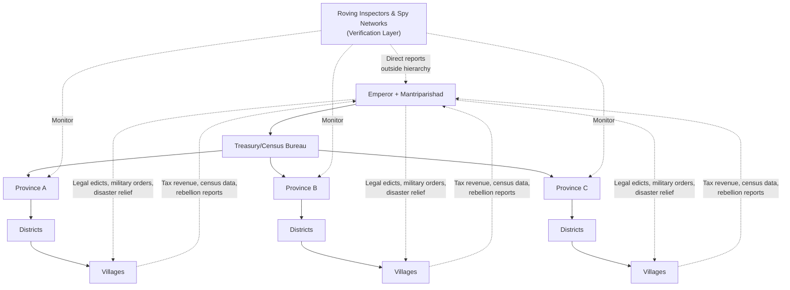
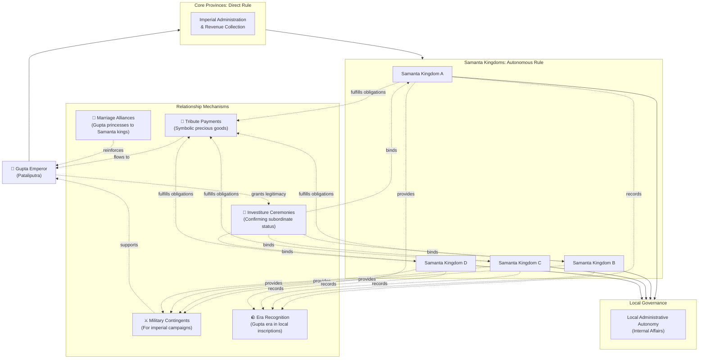
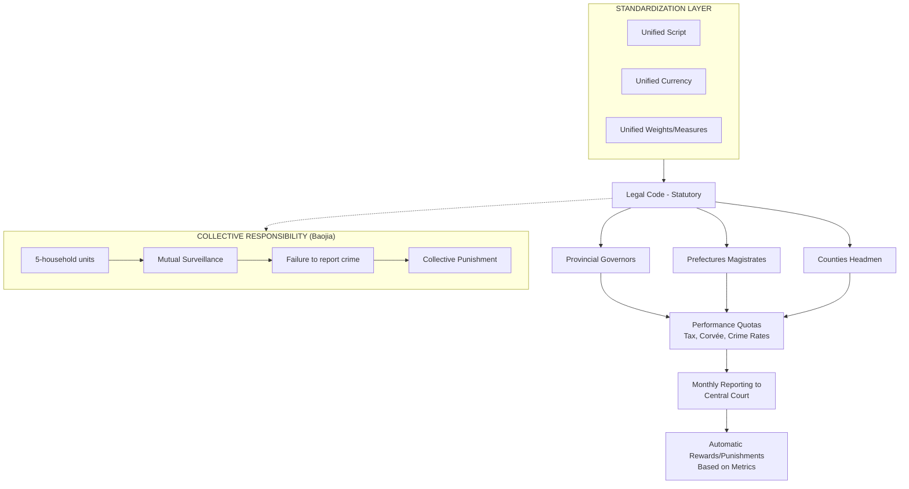
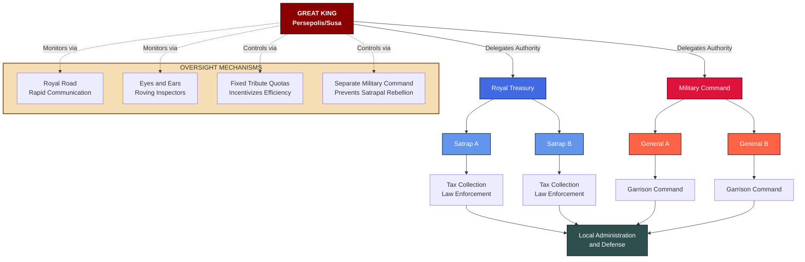

# Lesson 6: Ancient India, China, Persia

## 1. First-Principles Intuition & Invariants

The emergence of centralized governance across the Mauryan, Qin, Han, and Achaemenid empires represents one of the most profound administrative revolutions in human history. Between approximately 550 BCE and 500 CE, these civilizations independently developed solutions to an identical problem: how to maintain territorial cohesion, extract resources, and enforce legal uniformity across vast geographic distances without modern communication technology. The invariant challenge was information asymmetry—the center possessed neither real-time knowledge of provincial conditions nor mechanisms to verify local compliance with imperial directives.

Ancient India under the Mauryas (circa 322–185 BCE) solved this problem through a hybrid model combining military garrisons, economic surveillance networks, and ideological conformity enforced through Ashoka's dhamma pillars. The Mauryan state did not merely conquer territory; it constructed a legible information architecture. Chandragupta Maurya and his advisor Kautilya (author of the *Arthashastra*, a treatise on statecraft) understood that administrative control required converting the chaos of diverse tribal customs, languages, and economic practices into standardized, auditable data streams. The *Arthashastra* prescribes meticulous record-keeping for tax collection, detailing grain yields, livestock inventories, and trade volumes with the precision of a modern accounting ledger. This was not bureaucratic ornamentation but an operational necessity: without quantified knowledge of provincial resources, the central treasury could neither fund military campaigns nor respond to famine.

The system's architectural foundation rested on a hierarchical provincial structure where the emperor appointed governors (*mahamatyas*) who reported through a chain of intermediaries back to Pataliputra, the capital. These governors were deliberately rotated to prevent the formation of local power bases—a recognition that long-term tenure in a single province would inevitably produce loyalty networks that competed with central authority. The Mauryan intelligence apparatus, as documented in the *Arthashastra*, employed a sophisticated network of spies organized into five operational categories: stationary agents embedded in key institutions, wandering agents who moved through markets gathering economic intelligence, agents provocateurs who tested official loyalty through staged corruption opportunities, poisoners who eliminated threats, and double agents who penetrated rival states. This was not paranoia but rational design. In the absence of telegraph or railroad, the only mechanism for detecting provincial rebellion before it matured into existential threat was human signal transmission.

Ashoka's transformation of the Mauryan state after the Kalinga War (circa 261 BCE) introduced a second control mechanism: ideological standardization through dhamma, a syncretic ethical framework blending Buddhist non-violence, Brahmanical duty, and Jain asceticism. The famous Ashokan edicts, carved on pillars and rock faces across the subcontinent, served dual functions. Superficially, they communicated moral exhortations—respect for parents, kindness to servants, tolerance toward religious sects. Structurally, they were geospatial markers of imperial presence, physical proof that Pataliputra's authority extended to remote frontier zones. The inscriptions were written in local scripts (Brahmi, Kharosthi, Greek, Aramaic), demonstrating that the Mauryan chancellery possessed the cartographic knowledge and scribal expertise to communicate with peripheral populations in their own linguistic registers. This was administrative virtuosity: the pillars simultaneously projected power and collected information, since their installation required local cooperation that revealed the political topology of each region.

The Gupta Empire (circa 320–550 CE) operated under fundamentally different constraints. Unlike the Mauryas, who ruled through direct administrative penetration, the Guptas constructed a feudal-tributary hybrid where local kings retained autonomy in exchange for military service and tax remittances. This was not administrative weakness but adaptive strategy. The Guptas recognized that the cost of maintaining the Mauryan surveillance infrastructure exceeded its benefits in an era where Buddhism's universalizing ideology had fragmented into localized schools and regional dynasties had developed institutional resilience. Instead, the Guptas invested in cultural synthesis—patronizing Sanskrit literature, codifying Hindu legal traditions in the *Dharmashastra* texts, and sponsoring the mathematicians and astronomers who developed the decimal place-value system and calculated planetary motions with remarkable precision.

Gupta statecraft rested on an implicit bargain: the center provided military protection against external invaders (Huns, Shakas) and internal bandits while permitting substantial local variation in governance practices. The invariant was not administrative uniformity but economic integration through standardized coinage and trade infrastructure. The Gupta gold *dinaras* circulated from the Ganges valley to Southeast Asian ports, functioning as a monetary commons that reduced transaction costs and facilitated long-distance commerce. This was sophisticated economic engineering. By maintaining the purity and weight consistency of gold coinage, the Gupta treasury created a credible commitment device: merchants could trust that currency issued under Chandragupta II would retain value under his successors, enabling multi-generational trade relationships and credit instruments.

The transition from Mauryan direct rule to Gupta federalism reflected a fundamental insight: the sustainability of centralized states depends not merely on coercive capacity but on the cost-benefit ratio of administrative overhead. When information costs are high and transportation networks are poor, attempting to micromanage peripheral provinces produces diminishing returns. The Guptas understood that allowing local elites to retain power while extracting predictable tribute created a stable equilibrium. The cultural efflorescence of the Gupta period—the plays of Kalidasa, the cave paintings of Ajanta, the metallurgical mastery of the Delhi iron pillar—was not incidental to this political architecture but integral. By patronizing Sanskritic high culture, the Guptas created a shared elite identity that transcended regional boundaries, generating horizontal loyalty networks among provincial rulers who might otherwise have had no incentive to cooperate.

China's unification under the Qin dynasty (221–206 BCE) represents the most radical experiment in administrative standardization attempted in the ancient world. Qin Shi Huang's reforms—unification of script, currency, weights, measures, and axle widths—constituted a deliberate assault on local variation. The logic was ruthlessly functional. Before unification, China's warring states had developed mutually unintelligible writing systems, incompatible chariot axle widths that made cross-state transportation impossible, and chaotic regional currencies that fragmented markets. These variations were not merely inconvenient; they were existential barriers to imperial control. A decree written in Qin script could not be read by Chu officials. Tax grain measured in Qin *dan* could not be audited against Zhao records using different volumetric standards. Roads built to Yan axle specifications could not accommodate Wei supply wagons.

The Qin solution was to erase heterogeneity through legal compulsion. The standardized *small seal script* became mandatory for all official documents, enforced through penalties ranging from tattooing to execution. The bronze Qin *ban liang* cash coins replaced hundreds of local currency forms, creating a unified monetary zone. The standardized road gauge—cart axles set to precisely 6 *chi* (approximately 1.4 meters)—transformed China's transportation infrastructure from a patchwork of incompatible regional networks into an integrated imperial highway system. This was not arbitrary authoritarianism but engineering necessity. The Qin state's competitive advantage over rival kingdoms had derived from its superior logistics, particularly the ability to mobilize grain and soldiers rapidly across long distances. Extending these logistical efficiencies empire-wide required physical and informational interoperability.

The Qin legal code, partially preserved in the Shuihudi bamboo slips discovered in 1975, reveals the system's operational detail. The laws prescribed exact procedures for tax assessment, granary management, and corvée labor mobilization. Provincial officials were required to submit monthly reports documenting crop yields, criminal cases, and infrastructure repairs. Failure to meet quotas triggered automatic penalties calibrated to the severity of deviation. The system operated on the Legalist principle that human behavior could be mechanically shaped through rewards and punishments, with no residual space for moral discretion or customary practice. This was governance as algorithmic execution: reduce complex social phenomena to quantifiable metrics, specify target values, and impose negative feedback loops to correct deviations.

The Qin system collapsed within fifteen years of unification, not because its architecture was technically deficient but because it imposed unsustainable compliance costs. The relentless demands for corvée labor on the Great Wall and imperial tomb projects, combined with draconian punishments for minor infractions, generated widespread rebellion. The lesson was crucial: administrative systems can achieve short-term efficiency through coercion, but long-term stability requires some alignment between state demands and population capacity to comply.

The Han dynasty (206 BCE–220 CE) inherited the Qin's administrative infrastructure but recalibrated its ideological foundation. Where the Qin had relied on Legalist mechanisms of reward and punishment, the Han synthesized Legalist institutional forms with Confucian moral philosophy. This was not mere window dressing but a profound structural modification. Confucianism provided a legitimation framework that transformed bureaucratic service from coerced obligation into virtuous participation in cosmic order. The Confucian concept of *junzi* (the cultivated gentleman) redefined the ideal official as a morally educated scholar who governed through ethical example rather than mechanical rule application.

The Han examination system, though not yet the fully developed imperial examination of later dynasties, began the process of recruiting officials based on mastery of Confucian classics rather than aristocratic lineage. This represented a revolutionary shift in state capacity. By creating a meritocratic pathway to power, the Han state could draw administrative talent from a much broader population base than hereditary aristocracies permitted. The system also generated ideological cohesion: officials educated in the same canonical texts shared interpretive frameworks that reduced coordination costs and produced predictable decision-making patterns.

The Han bureaucracy developed sophisticated specialization. The central government maintained separate ministries for revenue, justice, ritual, military affairs, and public works, each with subordinate provincial offices. The census system, conducted every few years, provided the data infrastructure for tax assessment and corvée allocation. The *Hanshu* (History of the Former Han) records that by 2 CE, the empire had registered approximately 57 million people—a data collection achievement unmatched in the ancient world. This census was not merely statistical curiosity but operational necessity. Without accurate population data, the state could neither allocate resources efficiently nor detect tax evasion and draft avoidance.

The Han salt and iron monopolies exemplify the regime's economic sophistication. By nationalizing production of these essential commodities, the state captured revenue that would otherwise have accrued to private merchants while simultaneously regulating prices to prevent inflationary spirals. The famous Discourse on Salt and Iron (81 BCE) recorded debates between Confucian scholars who opposed state monopolies as unjust interference in natural economic order and pragmatic officials who argued that monopolies were fiscally necessary to fund frontier defense. The debate captured a fundamental tension in state administration: the tradeoff between economic efficiency (which often favors market mechanisms) and political control (which requires state intervention).

The Achaemenid Persian Empire (circa 550–330 BCE) faced the most extreme version of the imperial coordination problem: governing territories spanning from the Indus to the Mediterranean, encompassing dozens of linguistic groups, religious traditions, and political cultures. The Achaemenid solution was the satrapy system—a federal structure where appointed governors (*satraps*) ruled provinces with substantial autonomy while remitting fixed tribute and providing military contingents for imperial campaigns.

The genius of the Achaemenid system lay in its minimal interference with local customs. Unlike the Qin, which attempted to erase regional variation, the Achaemenids preserved existing administrative structures, religious institutions, and legal codes. When Cyrus the Great conquered Babylon in 539 BCE, he issued the famous Cyrus Cylinder decree, which proclaimed his respect for Babylonian gods and restoration of traditional temple privileges. This was not magnanimity but strategic calculation. Babylonian priests controlled extensive agricultural lands and commanded popular loyalty; co-opting them into the imperial system was cheaper than suppressing them.

The satrapy system required sophisticated monitoring mechanisms to prevent provincial rebellion. The Achaemenids deployed the *Eyes and Ears of the King*—roving inspectors who conducted surprise audits of satrapal finances and military preparedness. The Royal Road, a 2,500-kilometer highway from Sardis to Susa with posting stations every 25 kilometers, enabled rapid communication between center and periphery. Herodotus marveled that royal couriers could traverse the entire distance in seven days—a speed not surpassed until the nineteenth century. This infrastructure was not simply impressive engineering but a deliberate investment in information velocity. The faster the center could receive news of provincial unrest, the more rapidly it could mobilize military response before local rebellions metastasized into empire-wide crises.

Achaemenid fiscal administration demonstrated remarkable sophistication. Rather than demanding tribute in kind (which created storage and transportation problems), the empire monetized obligations through standardized gold *darics* and silver *sigloi*. Provinces assessed in metal coinage could pay through agricultural surplus, craft production, or commercial activity—whatever aligned with local economic comparative advantages. This flexibility reduced compliance costs while maintaining revenue predictability for the central treasury.

The Achaemenid collapse under Alexander's invasion (334–330 BCE) illuminates a critical vulnerability in federal systems: they rely on voluntary cooperation from provincial elites whose loyalty is contingent rather than structural. When Alexander demonstrated military superiority at Granicus, Issus, and Gaugamela, satraps faced a rational defection problem: continue supporting a weakening center or accommodate the rising power. The system's tolerance for local autonomy, which had been a strength during expansion and consolidation, became a liability during existential crisis. Unlike the Roman Empire, which developed legionary structures that integrated soldiers from diverse provinces into a unified military culture, the Achaemenids depended on ethnic contingents led by local commanders whose primary loyalty remained tribal or regional.

Vedic ritual traditions (circa 1500–500 BCE) represent a fundamentally different organizational logic than the imperial bureaucracies described above. The Vedic social order was not administered by a centralized state but reproduced through ritual performance calibrated to maintain cosmic and social equilibrium. The elaborate sacrificial ceremonies prescribed in the Brahmana texts were not mere religious observances but constitutive mechanisms of social stratification. The right to sponsor sacrifices like the *rajasuya* (royal consecration) or *ashvamedha* (horse sacrifice) demarcated kingship from ordinary status. The Brahmin priests who conducted these rituals possessed specialized knowledge—the correct pronunciation of Sanskrit mantras, the precise geometry of fire altars, the proper sequencing of offerings—that could not be acquired through observation alone but required years of apprenticeship.

This knowledge monopoly created a stable social contract: the *kshatriya* warrior-rulers provided material resources and military protection while the Brahmin priests supplied legitimation and ritual services. The system was self-reinforcing. Kings who attempted to bypass Brahmanical authority risked delegitimation, since their subjects had been socialized to believe that royal power derived from correct ritual performance. Brahmins who failed to maintain ritual standards lost patronage to more competent specialists. The result was a decentralized but remarkably stable social order where power flowed through knowledge networks rather than administrative hierarchies.

The transition from Vedic ritualism to Upanishadic philosophy (circa 800–400 BCE) reflected a crisis in this system's coherence. The Upanishads questioned whether external ritual could achieve the ultimate goal of liberation (*moksha*), proposing instead that direct knowledge of ultimate reality (*Brahman*) through meditation and philosophical inquiry was sufficient. This was not theological quibbling but a fundamental challenge to Brahmanical authority. If salvation could be achieved through personal insight rather than priestly mediation, the entire economic foundation of Brahmin power collapsed.

The rise of Buddhism and Jainism in the same period represented alternative organizational models. Both traditions rejected Vedic authority and caste stratification, constructing monastic communities (*sanghas*) governed by collective decision-making rather than hereditary privilege. The Buddhist *sangha* developed sophisticated internal regulations (*vinaya*) specifying everything from robes and begging protocols to dispute resolution procedures. These communities functioned as parallel governance structures, providing social services (education, healthcare, dispute mediation) that competed with Brahmanical institutions.

Confucian philosophical frameworks, crystallized in the *Analects* and later synthesized by Mencius and Xunzi, provided the ideological architecture for Chinese imperial bureaucracy. The core Confucian insight was that social order emerges from internalized ethical dispositions rather than external legal coercion. The concept of *ren* (benevolence or humaneness) described an affective orientation toward others that generated spontaneous prosocial behavior. The ideal ruler cultivated *ren* in himself and then propagated it through society via moral example and education.

This was radically different from Legalist governance, which assumed that humans were inherently self-interested and required mechanical incentive structures to align individual and collective welfare. Confucianism argued that humans possessed innate moral intuitions (*liang zhi*) that could be developed through ritual practice (*li*) and textual study. The famous Confucian doctrine that "the ruler who governs through virtue is like the North Star, which remains in place while all other stars revolve around it" captured this logic: moral authority generates voluntary compliance more efficiently than coercive force.

The practical implementation of Confucian governance required converting these abstract principles into operational procedures. The Five Relationships (*wu lun*)—ruler-subject, father-son, husband-wife, elder-younger, friend-friend—specified reciprocal obligations that structured all social interactions. These were not arbitrary conventions but, in Confucian theory, reflections of natural hierarchies observable in family life and extended analogically to political order. The son who internalized filial piety would, upon entering government service, naturally extend that deference to bureaucratic superiors and ultimately to the emperor.

The Han synthesis of Confucian ideology with Legalist institutions produced a hybrid system where moral education shaped elite culture while legal codes regulated mass behavior. Officials were expected to embody Confucian virtues but also enforce detailed regulations on tax collection, criminal justice, and public works. This tension between moral cultivation and administrative efficiency persisted throughout Chinese imperial history, periodically erupting in debates between purist Confucians who insisted on ethical governance and pragmatists who emphasized institutional effectiveness.

## 2. Core Architecture & Mechanics

The structural mechanics of Mauryan governance can be diagrammed as a multi-tiered information hierarchy with redundant verification channels. At the apex sat the emperor in Pataliputra, supported by a central council of ministers (*mantriparishad*) responsible for military strategy, foreign policy, and fiscal planning. Below this central node, the empire divided into provinces (*janapadas*) governed by appointed officials who reported directly to the capital. These provinces subdivided into districts, which further decomposed into village clusters, each layer extracting resources upward and transmitting directives downward.



The critical architectural feature was the dual-channel design: formal reports flowed through the hierarchical chain while intelligence operatives provided independent verification. This redundancy addressed the principal-agent problem inherent in any delegated authority system. Provincial governors had strong incentives to underreport tax revenue (retaining surplus for personal enrichment) and exaggerate local threats (to justify military expenditures they could appropriate). The spy network created an audit mechanism that imposed costs on dishonest reporting.

The *Arthashastra* specifies precise protocols for tax assessment tied to land productivity classifications. Agricultural land was categorized into quality tiers based on irrigation access, soil fertility, and historical yields. Each tier carried a prescribed tax rate, typically one-sixth to one-quarter of gross production. The system required annual inspections by revenue officials who measured field areas, estimated crop yields, and recorded assessments in standardized ledgers. These ledgers formed the empire's fiscal memory, enabling comparison across years to detect evasion or harvest failures.

The Mauryan military apparatus integrated professional standing forces with territorial militias. The core army, stationed in Pataliputra and major garrison cities, consisted of infantry, cavalry, chariots, and the famous war elephant corps. The *Arthashastra* details the organizational structure: infantry units of 10 soldiers (*patti*) combined into platoons of 30, companies of 100, and regiments of 1000. Each level had designated commanders with clear chains of authority. This hierarchical modularity enabled flexible deployment—small detachments could suppress local banditry while full regiments mobilized for frontier wars.

The logistical infrastructure supporting this military machine was formidable. Granaries stocked in strategic locations ensured food security for mobile armies. Armories maintained weapon inventories with detailed records tracking sword blades, spear shafts, arrow stocks, and armor plates. The state operated mines and smelters to secure metals supply, foresters to provide timber for chariots and siege equipment, and specialized craftsmen to manufacture military hardware. This vertically integrated supply chain represented extraordinary state capacity for the ancient world.

Gupta administration operated through a fundamentally different mechanism: networked feudalism. The central Gupta court maintained direct control over the Gangetic heartland while peripheral territories were governed by subordinate kings (*samantas*) who acknowledged Gupta suzerainty. The relationship was contractual: *samantas* retained local authority, collected taxes, administered justice, and maintained armed forces, but owed military service during imperial campaigns and periodic tribute payments.



This structure economized on administrative overhead. Rather than maintaining a costly bureaucracy to govern distant regions, the Guptas leveraged existing power structures. The risk was centrifugal fragmentation—*samantas* might accumulate sufficient strength to declare independence. The Guptas managed this risk through strategic marriage alliances that created kinship bonds between center and periphery, periodic royal tours that displayed imperial majesty, and military interventions against *samantas* who grew too powerful.

The Gupta economic integration mechanism relied on commodity standards and trade infrastructure. The gold *dinara*, standardized at approximately 8 grams with high purity, circulated throughout the empire and beyond. Merchants could trust this currency because the Gupta treasury maintained quality control through centralized minting. Silver and copper coinages served smaller transactions, creating a complete monetary hierarchy. This standardization reduced transaction costs—a merchant in Pataliputra could accept *dinaras* from a trader arriving from Ujjain confident in the exchange value.

The Gupta legal system synthesized multiple jurisprudential traditions. The *Dharmashastra* texts, particularly the *Manusmriti* and *Yajnavalkya Smriti*, codified Hindu law covering property rights, inheritance, contracts, criminal penalties, and caste obligations. These texts did not function as statutory law in the modern sense but as authoritative references that judges (*pradhivikarana*) consulted when adjudicating disputes. The system permitted substantial local variation—regional customs (*deshachara*) and caste practices (*jatachara*) were recognized as legitimate legal sources when not contradicted by higher *dharma* principles.

The Qin administrative revolution hinged on three interlocking mechanisms: legal standardization, merit-based promotion, and collective responsibility. The Qin code abolished hereditary aristocratic privileges, replacing noble lineage with a twenty-rank system where advancement depended on military achievement (enemy heads taken in battle) or agricultural productivity (grain surplus delivered to state granaries). This meritocracy was ruthlessly objective—a peasant who killed five enemy soldiers gained rank and land equivalent to a minor noble.



The collective responsibility system (*baojia*) organized households into mutual surveillance units. If one household committed a crime and neighbors failed to report it, all members of the unit faced punishment. This transformed the population into a distributed monitoring network that supplemented official law enforcement. The system was informationally efficient but created a climate of pervasive mistrust that undermined social cohesion.

Qin infrastructure projects exemplified centralized planning on a monumental scale. The Great Wall—more accurately, the connection and extension of pre-existing fortifications—mobilized hundreds of thousands of corvée laborers over decades. The logistical challenge was extraordinary: transporting construction materials to remote mountain passes, feeding and housing massive labor forces, and coordinating work across thousands of kilometers required sophisticated supply chain management. Similarly, the Lingqu Canal, which connected the Yangtze and Pearl River systems, enabled grain transport from south China to northern garrisons, solving the strategic problem of supplying frontier armies without exhausting local agricultural surpluses.

The collapse mechanism was systemic overload. The Qin demanded excessive corvée labor while simultaneously maintaining high taxation to fund military expansion and imperial construction. The legal code's severity—execution or mutilation for minor infractions—created a large outlaw population with nothing to lose from rebellion. When Chen Sheng and Wu Guang, conscript soldiers delayed by rain en route to garrison duty, faced execution for tardiness, they rationally chose rebellion instead. The uprising spread rapidly because the population's compliance threshold had been exceeded.

Han bureaucratic mechanics refined Qin structures while moderating their severity. The Han retained standardized script, currency, and legal codes but reduced punishment harshness and lowered corvée obligations. The examination system, initially informal, gradually institutionalized. Local officials recommended talented individuals (*xiaolian*, meaning "filial and incorrupt") who traveled to the capital for testing on Confucian classics. Successful candidates entered the bureaucracy at junior ranks, with promotion based on performance evaluations.

```text
HAN BUREAUCRATIC MACHINERY

RECRUITMENT:
[Local Recommendation (Xiaolian)] 
         ↓
[Examination on Confucian Classics]
         ↓
[Junior Bureaucratic Appointment]
         ↓
[Performance Evaluation (Every 3 Years)]
         ↓
[Promotion/Demotion/Dismissal]

SPECIALIZATION:
┌─────────────────┐
│ CENTRAL COURT   │
├─────────────────┤
│ Revenue Ministry│
│ Justice Ministry│
│ Ritual Ministry │
│ Military Bureau │
│ Public Works    │
└────────┬────────┘
         │
    [Provincial]
    [Branches]
         │
    [Local Offices]

DATA INFRASTRUCTURE:
Census (every 3 years) → population registers
Tax rolls → agricultural production data
Legal cases → crime statistics
Granary reports → food security monitoring
```

The Han census system demonstrates the regime's data ambitions. Households registered with local offices, providing names, ages, occupations, and property holdings. This information aggregated upward through county, prefecture, and provincial levels to the central Ministry of Revenue. The data enabled targeted policymaking—identifying regions suffering harvest failures requiring grain relief, detecting population declines suggesting economic distress, and calculating available labor pools for public works projects.

The Han salt and iron monopolies operated through state-run production facilities and distribution networks. The state employed workers at fixed wages to extract salt from coastal evaporation ponds and inland wells, smelt iron ore into tools and weapons, and transport finished goods to regional depots where registered merchants purchased inventory at controlled prices. The system generated substantial revenue while preventing private accumulation of strategic resources. Critics argued that state production was inefficient compared to private enterprise and that monopoly pricing harmed consumers, but defenders countered that revenue requirements for frontier defense justified the distortions.

Achaemenid satrapy mechanics balanced central control with local flexibility through a bifurcated authority structure. Each satrapy had both a civil governor (*satrap*) responsible for tax collection and administration, and a military commander (*general*) who controlled garrison forces. These officials reported through separate chains of command to different central ministries, creating checks and balances that prevented any individual from accumulating excessive power.



The tribute system operated on fixed quotas negotiated during initial conquest or periodically renegotiated. Babylonia owed 1,000 talents of silver annually, Egypt contributed 700 talents plus grain for the Persian garrison, and India supplied gold dust. These obligations were predictable, allowing satrapies to optimize local economies to meet imperial demands while retaining surplus for provincial needs. The system contrasted sharply with Roman taxation, which often involved annual assessments that created uncertainty and incentivized short-term exploitation by tax farmers.

The Royal Road infrastructure exemplified the Achaemenid understanding that information velocity was strategic currency. Posting stations (*chapar khaneh*) provided fresh horses and lodging for royal messengers at regular intervals. This relay system meant urgent communications traveled continuously rather than at the speed of a single exhausted horse and rider. Herodotus described Persian messengers' efficiency in Book 8.98, noting their relay system. The famous motto "Neither snow nor rain nor heat nor gloom of night stays these couriers from the swift completion of their appointed rounds" is commonly attributed to him but of uncertain origin; it became the motto of the United States Postal Service.

The Achaemenid monetary system created economic integration across vast territories. The gold *daric*, stamped with the image of the king as archer, and silver *siglos* circulated from the Aegean to Central Asia. This standardization facilitated long-distance trade by providing a reliable medium of exchange. Merchants no longer needed to negotiate exchange rates between hundreds of local currencies or carry bulky goods for barter. The system also enabled credit instruments—merchants could borrow in one region and repay in another using the same currency.

Vedic ritual architecture operated through precise specification of spatial, temporal, and performative parameters. The *Shrauta Sutras*, technical manuals for ritual practice, prescribed exact altar geometries using sophisticated mathematical principles. The *agnicayana* (fire altar construction) required arranging 10,800 bricks in five layers following precise geometric patterns including circles, squares, and falcon shapes. This was not arbitrary symbolism but encoded astronomical and mathematical knowledge—the altar dimensions incorporated calculations of the year's length and lunar cycles.

```text
VEDIC RITUAL STRUCTURE

PREPARATION PHASE:
- Patron (yajamana) engages Brahmin specialists
- Diksha (initiation) separates patron from ordinary time
- Ritual ground consecration (mandala demarcation)

EXECUTION PHASE:
- Fire kindling (specific wood types, friction method)
- Mantra recitation (exact Vedic Sanskrit pronunciation)
- Offerings sequence (ghee, grain, soma, animal)
- Dakshina (ritual fees to priests)

COSMOLOGICAL MAPPING:
Altar = Cosmos
Priest = Divine Agent
Patron = Humanity
Offerings = Cosmic Energy Exchange

KNOWLEDGE TRANSMISSION:
Oral memorization (no written texts permitted)
Guru-shishya (teacher-student) lineage
Public performance (validates expertise)
```

The economic logic underpinning this system was straightforward. Brahmins possessed specialized knowledge acquired through years of study that kings and wealthy patrons needed to legitimize power and ensure cosmic order. The elaborate nature of rituals—requiring multiple priests with complementary expertise, expensive materials including clarified butter and soma (a ritual drink), and animal sacrifices—meant only wealthy sponsors could afford major ceremonies. This created a stable market for Brahmin services and reinforced social stratification.

The Upanishadic philosophical revolution challenged this structure by internalizing the ritual process. The *Brihadaranyaka Upanishad* argues that the true sacrifice occurs within consciousness through meditation on ultimate reality, not through external fire offerings. This was economically subversive—if individual meditation achieved the same soteriological goals as expensive public rituals, the Brahmin monopoly on salvation collapsed. The tension between ritual orthopraxy and meditative gnosis became a defining feature of Indian philosophical traditions.

Buddhist monastic organization developed alternative governance structures based on collective decision-making and codified regulations. The *sangha* operated through periodic assemblies (*uposatha*) where monks confessed infractions, debated doctrinal points, and resolved disputes. Major decisions required consensus, with elaborate voting procedures for ordaining new members or expelling transgressors. This was remarkably egalitarian compared to hierarchical Brahmanical systems—in principle, all fully ordained monks had equal voice regardless of background.

```text
BUDDHIST SANGHA GOVERNANCE

MEMBERSHIP TIERS:
[Novice (shramanera)] → [Fully Ordained Monk (bhikshu)]
         ↓                          ↓
   [Basic Precepts]         [227 Vinaya Rules]

DECISION MECHANISMS:
- Uposatha (biweekly assembly)
- Confession of infractions
- Dispute resolution (formal procedures)
- Ordination votes (minimum quorum required)
- Expulsion for grave offenses (parajika)

ECONOMIC MODEL:
- Daily alms rounds (bhiksha)
- Lay donations (dana)
- Monastery endowments (land, capital)
- No personal property (except robes, bowl, needle, filter)

KNOWLEDGE TRANSMISSION:
- Oral recitation of sutras (Buddha's discourses)
- Vinaya memorization (regulatory codes)
- Abhidharma (scholastic philosophy)
- Meditation instruction (master to disciple)
```

The Buddhist economic model was parasitic-symbiotic with lay society. Monks renounced productive labor, relying on daily alms rounds for sustenance. This dependence created accountability—if monks behaved unethically or failed to provide spiritual services, lay supporters could withdraw donations. The system incentivized monks to maintain discipline and offer teachings, Dhamma talks, and blessings that justified lay patronage. Over time, monasteries accumulated substantial wealth through endowments, becoming major landowners and financial institutions.

Confucian philosophical architecture rested on the claim that social harmony emerges from cultivated virtue rather than legal coercion. The *Analects* structured this argument through pithy dialogues between Confucius and disciples exploring concepts like *ren* (benevolence), *yi* (righteousness), *li* (ritual propriety), and *xiao* (filial piety). These were not abstract virtues but practical dispositions meant to guide behavior in specific social contexts.

```text
CONFUCIAN VIRTUE HIERARCHY

FOUNDATIONAL:
Ren (仁) - Benevolence/Humaneness
  ↓
  Manifests through relational contexts
  ↓
Xiao (孝) - Filial Piety (family context)
Yi (義) - Righteousness (moral context)
Li (禮) - Ritual Propriety (social context)
Zhi (智) - Wisdom (intellectual context)

CULTIVATION PROCESS:
Study (classical texts) 
  ↓
Reflection (internalize principles)
  ↓
Practice (ritual performance, social interaction)
  ↓
Habit Formation (spontaneous virtuous action)

POLITICAL EXTENSION:
Cultivated Individual (Junzi)
  ↓
Harmonious Family
  ↓
Well-Ordered State
  ↓
Peaceful World (Tianxia)
```

The Confucian theory of government centered on the concept of the Mandate of Heaven (*tianming*), which justified rulership through moral virtue rather than hereditary right alone. A ruler who governed benevolently retained heaven's favor, but tyrannical behavior forfeited legitimacy, justifying rebellion. This doctrine was politically revolutionary—it established moral performance as the criterion for political authority, creating an ideological space for criticizing bad rulers.

The practical implementation required converting Confucian ethics into bureaucratic procedures. The Five Relationships provided templates: ruler-subject relations mirrored father-son dynamics, with rulers expected to provide benevolent guidance and subjects owing loyal service. The ritual system (*li*) prescribed behaviors for every social interaction—how to greet superiors, conduct sacrifices, perform mourning rites, and manage household affairs. These rituals were not empty formalism but technologies of socialization that inscribed hierarchical norms into bodily practice.

The Han synthesis incorporated Confucian ideology into Legalist institutional structures. Officials studied Confucian classics but enforced detailed legal codes. This hybrid generated creative tensions. When Confucian principles conflicted with legal statutes—for example, a son required by law to testify against a criminal father—the system had to adjudicate between competing normative frameworks. These cases stimulated sophisticated jurisprudential reasoning about hierarchy of values and contextual ethics.

## 3. High-Performance Optimization & Failure Modes

The optimization challenge for ancient empires was maximizing resource extraction while minimizing rebellion probability. This tradeoff operated under severe constraints: poor transportation networks limited the speed at which military forces could respond to provincial unrest, weak communication technology created information lag between peripheral events and central awareness, and agricultural economies generated surpluses insufficient to support large standing armies and extensive bureaucracies simultaneously.

Mauryan optimization strategies focused on intelligence density and response speed. The extensive spy network reduced information lag, enabling preemptive intervention before local discontent escalated into organized rebellion. The standing army, particularly the elephant corps, provided rapid-deployment strike capability that conventional militias could not match. The road system, maintained through corvée labor, enabled military mobilization across the subcontinent. The system's performance depended on maintaining a credible threat—provincial actors needed to believe that rebellion would trigger swift, overwhelming retaliation.

The failure mode was fiscal overextension. Maintaining the army, bureaucracy, and intelligence apparatus required extracting approximately 25% of agricultural output (through direct taxation and corvée labor obligations). This left peasants with minimal surplus, making the system vulnerable to harvest failures. A sequence of bad monsoons could trigger food insecurity, corvée evasion, and eventually tax revolt. The Mauryan collapse after Ashoka's death reflected this fragility—without a capable ruler managing the tradeoffs between military spending, welfare provisioning, and taxation, the system destabilized.

The Gupta optimization was precisely opposite: minimize administrative overhead by delegating governance to local elites who already possessed information and enforcement capacity. This reduced the state's operational costs dramatically but introduced different failure modes. When external military threats materialized—the Hun invasions of the fifth century CE—the federal structure impeded rapid mobilization. Subordinate kings needed to be cajoled, negotiated with, and sometimes coerced into providing troops, creating coordination delays that advantaged mobile nomadic invaders.

The Gupta cultural synthesis strategy represented a sophisticated long-term investment. By patronizing Sanskrit literature, temple construction, and scholarly institutions, the Guptas created ideological cohesion that reduced coordination costs among regional elites. A *samanta* educated in Sanskrit classics shared cultural reference points with his peers across the empire, facilitating diplomatic negotiations and reducing transaction costs for cooperation. This "soft power" approach economized on coercion but required consistent resource investment in cultural production.

The failure mode was gradual entropy. As central revenues declined due to Hun disruptions of trade routes, the Guptas could not sustain cultural patronage at previous levels. Regional elites retained their local power bases but lost incentive to coordinate with the center. The empire fragmented not through dramatic rebellion but through incremental defection as *samantas* calculated that independent rule offered better returns than continued subordination.

Qin optimization pursued the opposite extreme: maximum standardization and coercive enforcement. The logic was that eliminating variation reduced administrative complexity—identical legal codes, measurement systems, and bureaucratic procedures enabled officials trained in one region to function effectively anywhere in the empire. The meritocratic promotion system ensured that capable administrators advanced regardless of origin, creating a professional bureaucracy.

The critical error was miscalculating population compliance thresholds. The Qin imposed first-world administrative efficiency demands on a subsistence agricultural economy. Peasants who spent 120 days annually on corvée projects had insufficient time for agricultural labor, reducing yields and pushing households toward subsistence crises. The legal code's severity—execution for tardiness, mutilation for bribery, collective punishment for harboring criminals—created perverse incentives where minor infractions triggered desperate evasion that escalated into capital offenses.

The collapse was catastrophically rapid. Chen Sheng and Wu Guang's rebellion (209 BCE) spread within months because the population was already primed for revolt. Once the spell of Qin invincibility broke, provincial garrisons defected, administrative officials abandoned posts, and the entire system disintegrated. The lesson was profound: administrative systems operating near population capacity limits possess zero error tolerance. Single failures cascade into systemic collapse because no slack exists to absorb shocks.

Han optimization learned from Qin failure, reducing corvée obligations, lowering punishment severity, and ideologically legitimating state demands through Confucian moral frameworks. The examination system addressed the perennial challenge of recruiting competent officials without empowering hereditary aristocracies that might challenge central authority. By tying advancement to textual mastery, the Han created a meritocracy where ambitious individuals invested in learning rather than military force.

The system's vulnerability was elite capture. Over generations, families that produced successful examination candidates accumulated wealth and established private academies that trained sons in classical texts. This created dynasties of officials—not formally hereditary but practically reproducing privilege through differential access to education. Wealthy families could afford tutors and relieved sons from labor obligations, while peasant children worked fields. The meritocracy gradually stratified into a self-reproducing gentry class.

The Han salt and iron monopoly debate illuminated fundamental tradeoffs between efficiency and control. Private production was likely more cost-efficient—merchants responded to price signals, innovated production techniques, and bore business risks. State monopolies eliminated these efficiencies but captured revenue and prevented private accumulation of resources that could fund rebellion. The Han chose control over efficiency, accepting higher production costs to maintain political stability.

The failure mode was bureaucratic sclerosis. State monopolies became employment sinecures for officials who lacked incentives to innovate or reduce costs. Over time, production efficiency declined, prices increased, and black markets emerged where private producers evaded state control. The monopolies became revenue drains rather than sources, contributing to fiscal crises that weakened the dynasty.

Achaemenid optimization maximized territorial extent while minimizing administrative overhead through the federal satrapy system. By preserving local governance structures and limiting central demands to fixed tribute, the Achaemenids governed territories that would have been impossible to administer through direct rule. The system's performance depended on maintaining military superiority such that satrapies calculated rebellion as unprofitable.

The architectural innovation was separating civil and military authority. By preventing any single provincial official from controlling both governance and garrison forces, the Achaemenids reduced coup risk. The Royal Road and Eyes and Ears inspection system provided early warning of satrapal disloyalty, enabling preemptive intervention. The information infrastructure was the empire's strategic asset—faster communication meant faster response, which meant credible deterrence at lower military cost.

The failure mode was catastrophic at the extremes. The federal structure performed admirably during routine operations and even localized military challenges. But when confronted with an existential threat—Alexander's invasion—the system collapsed rapidly. Satrapies defected serially as Alexander demonstrated battlefield superiority. The Achaemenid military system, dependent on ethnic contingents with primary loyalty to local commanders, could not effectively concentrate forces against a unified Macedonian phalanx supported by Thessalian cavalry.

The deeper vulnerability was inadequate ideological integration. Unlike the Han, which invested heavily in Confucian education that created shared identity among officials, or the Guptas, which patronized Sanskrit cultural production, the Achaemenids maintained a relatively thin superstructure over diverse local cultures. When military defeat undermined the core justification for imperial obedience, no residual cultural loyalty held the system together.

Vedic ritual optimization pursued maximal precision in performance technique, operating under the belief that cosmic order depended on exact ritual execution. The elaborate Shrauta Sutras specified not merely general procedures but minutiae—the number of bricks in altars, the specific accent patterns of mantra recitation, the wood species for fire kindling. This precision served social functions beyond theology: it created credible demonstrations of expertise that justified Brahmin compensation.

The economic performance was stable under conditions where agricultural surplus exceeded subsistence needs by sufficient margin to support a specialist priestly class. The system optimized for legitimation rather than efficiency—rituals consumed substantial resources (animal sacrifices, elaborate materials, priest fees) but produced intangible benefits (cosmic order, karmic merit, social prestige). As long as sponsors believed these benefits justified costs, the market remained viable.

The failure mode was ideological competition. Buddhism and Jainism offered alternative salvation technologies that were cheaper (meditation required no expensive rituals) and more egalitarian (rejected caste-based restrictions). When Mauryan emperors like Ashoka converted to Buddhism and redirected royal patronage toward Buddhist institutions, Brahmin economic foundations eroded. The system adapted by incorporating Buddhist and Jain philosophical insights into Hindu synthesis traditions, demonstrating ideological flexibility, but never regained monopolistic position.

The Upanishadic philosophical revolution represented optimization through internalization. Rather than scaling up ritual complexity to achieve greater efficacy (which would have increased costs), Upanishadic thinkers relocated the salvific mechanism from external performance to internal consciousness transformation. This was economically subversive but philosophically sophisticated—it made liberation theoretically accessible to anyone capable of meditative insight regardless of ritual expertise or wealth.

Buddhist monastic optimization balanced communal self-governance with hierarchical knowledge transmission. The *sangha* democratic decision-making processes prevented autocratic abuses but required extensive time investment in assemblies and consensus-building. The system worked well at moderate scales (monasteries of 50-200 monks) but faced coordination challenges as communities grew larger. The solution was federation—autonomous local monasteries loosely networked through doctrinal lineages rather than centralized administration.

The economic sustainability depended on maintaining symbiotic relationships with lay donors. Monks provided spiritual services (teachings, blessings, ritual performances for deceased relatives) that justified material support. The system optimized this exchange by prohibiting monks from engaging in productive labor, ensuring they remained dependent on lay generosity and thus responsive to lay needs. The failure mode was wealth accumulation—as monasteries acquired land and capital through endowments, they became financially independent, reducing accountability to lay patrons and enabling monastic corruption.

Confucian optimization pursued virtue cultivation as the least-cost mechanism for social coordination. The core insight was that internalized ethical dispositions generate spontaneous prosocial behavior without requiring expensive monitoring and enforcement infrastructure. A population of *junzi* (cultivated gentlemen) would govern themselves through mutual recognition and respect for ritual propriety. This was governance as culture engineering rather than coercive control.

The practical challenge was scaling virtue cultivation across mass populations. The examination system partially solved this by creating pathways for ambitious individuals to pursue Confucian education, but the vast peasantry remained largely untouched by elite ethical culture. The Han compromise was dual-track governance: Confucian moral suasion for educated elites, Legalist law enforcement for the masses. This worked tolerably well but created status anxieties and resentment when officials demanded Confucian deference while employing Legalist punishments.

The failure mode was hypocrisy—officials who professed Confucian virtue while practicing corrupt self-enrichment. The examination system selected for textual memorization skills, not moral character. Capable test-takers advanced regardless of ethical integrity. Over time, the system produced a class of scholar-officials who performed Confucian rhetoric while violating Confucian principles. This contradiction eroded ideological legitimacy, contributing to cyclical dynastic decline when ruling houses could no longer credibly claim moral authority.

The comparative analysis reveals a fundamental design tradeoff between administrative penetration and operational cost. The Mauryan-Qin model achieved high control through dense bureaucratic oversight but imposed unsustainable fiscal burdens. The Gupta-Achaemenid model minimized overhead through federal delegation but sacrificed rapid response capability. The Han synthesis attempted to balance these extremes by combining Confucian ideology (which reduced monitoring costs through internalized ethics) with Legalist institutions (which provided enforcement mechanisms when virtue cultivation failed).

The optimal configuration was context-dependent. Compact, ethnically homogeneous territories with developed agricultural surpluses could sustain intensive administration. The Mauryan Gangetic heartland and Qin Wei valley possessed sufficient productivity to fund large bureaucracies and standing armies. Geographically dispersed, culturally heterogeneous empires like the Achaemenids had no realistic alternative to federal structures—attempting Qin-style direct rule would have triggered immediate rebellions and imposed impossible administrative costs.

The ultimate lesson is that institutional design must align with information constraints and resource capacities. Governance systems that demand real-time provincial data, rapid military mobilization, or extensive resource extraction cannot function when communication requires weeks, armies march at walking speed, and agricultural productivity generates thin surpluses. Ancient empires that succeeded recognized these constraints and designed institutions that worked within them, while failed states attempted to impose administrative fantasies that exceeded operational realities. This principle remains valid: effective organizations match structural complexity to environmental constraints, accepting that desired control levels may be technically infeasible given available resources and technology.
