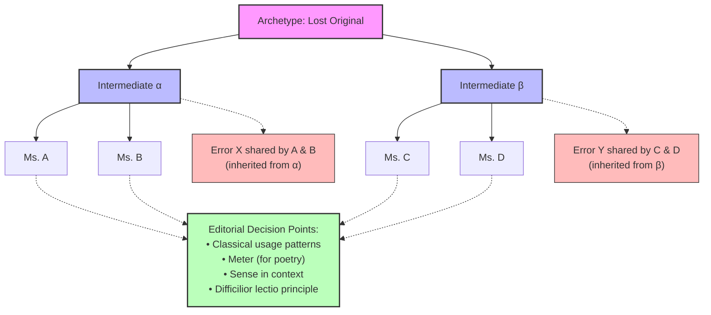

# Lesson 1: Renaissance Humanism as Paradigm Shift

## 1. First-Principles Intuition & Invariants

The transformation that swept through European intellectual life between roughly 1300 and 1600 represented not merely a cultural fashion or aesthetic preference, but a fundamental restructuring of how knowledge was produced, validated, and disseminated. To understand Renaissance humanism as a paradigm shift requires us to strip away romantic mythology and examine the actual mechanisms—social, technological, and epistemological—that enabled a relatively small cohort of scholars, patrons, and printers to dismantle medieval scholasticism's fifteen-century monopoly on learning.

The core invariant underlying this transformation was textual. Medieval knowledge systems had operated through chains of commentary and glosses, where Aristotle or the Church Fathers were accessed through layers of interpretation accumulated over centuries. The scholastic method privileged synthesis and harmonization: Peter Lombard's *Sentences*, Thomas Aquinas's *Summa*, and the elaborate apparatus of quaestiones and disputationes all aimed to reconcile authorities into seamless doctrinal unity. Direct engagement with primary sources was neither technically feasible—manuscripts were scarce and expensive—nor methodologically privileged. The authority of a text derived from its position within an established hierarchy of interpretation, not from its proximity to an original author's intent.

Renaissance humanism introduced a competing epistemology grounded in *ad fontes*—"to the sources." This was not mere antiquarian enthusiasm but a radical claim about how knowledge should be authenticated. Humanists argued that truth resided in the original words of classical authors, not in centuries of medieval commentary that had corrupted, mistranslated, and distorted those words to serve theological agendas. When Lorenzo Valla demonstrated in 1440 that the Donation of Constantine—the document legitimizing papal territorial claims—was a medieval forgery, he deployed philological tools: analyzing Latin syntax, vocabulary usage, and anachronistic references that could not have existed in the fourth century. This was forensic textual analysis weaponized against institutional authority.

The shift carried profound implications for what counted as legitimate knowledge work. Medieval scholars operated within bounded domains defined by faculty structure: theology reigned supreme, with philosophy serving as its handmaiden, and the trivium (grammar, rhetoric, logic) and quadrivium (arithmetic, geometry, music, astronomy) providing preparatory training. Humanist scholars rejected this hierarchy. They insisted that eloquence and wisdom were inseparable, that the ability to write elegant Latin prose was not decorative but constitutive of philosophical insight. Petrarch's attacks on scholastic logic as barbarous and obscurantist were not stylistic complaints but epistemological challenges: if knowledge could not be expressed in the crystalline clarity of Ciceronian periods, it was not knowledge at all but pedantic quibbling.

This redefinition created institutional friction. Universities remained largely scholastic bastions well into the sixteenth century, their curricula structured around Aristotelian physics, logic-chopping disputations, and theological commentary. Humanism flourished in alternative spaces: princely courts, independent academies, and the household schools established by wealthy merchant families. The Medici in Florence, the Gonzaga in Mantua, the Montefeltro in Urbino—these dynasties funded humanist scholars not merely as status ornaments but as political operatives. Chancellors trained in rhetoric could draft diplomatic correspondence that projected power through classical allusion and persuasive argument. Civic humanism, the ideology developed by Leonardo Bruni and Coluccio Salutati in Florence, explicitly linked eloquence to republican virtue, arguing that active citizenship required the rhetorical tools to deliberate in councils and persuade assemblies.

The patronage networks that sustained humanist scholarship operated on principles distinct from ecclesiastical or university funding structures. A humanist secured employment by dedicating manuscripts to powerful individuals, demonstrating mastery of classical languages and familiarity with obscure texts. This created an intellectual economy where scholarly prestige derived from manuscript acquisition, textual recovery, and philological prowess. When Poggio Bracciolini discovered manuscripts of Lucretius, Quintilian, and Vitruvius in Swiss and German monasteries, he became famous not for original philosophical insights but for making lost classical knowledge accessible. The humanist was a knowledge broker, a specialized intermediary who could navigate Latin, Greek, and increasingly Hebrew texts to extract wisdom relevant to contemporary political and moral problems.

The technological substrate enabling this transformation was the revolution in manuscript production and, ultimately, print. Before 1450, manuscript culture imposed severe constraints. A single copy of Livy's *Decades* required months of scribal labor and cost approximately what a skilled craftsman earned in a year. Libraries were tiny: the Sorbonne in 1338 held roughly 1,700 volumes. Textual corruption was endemic, as each copying introduced errors that cascaded through successive generations. Humanist scholars spent enormous energy establishing critical editions by collating multiple manuscripts to reconstruct an *ur-text* approximating the author's original. This philological labor was prerequisite to interpretation.

Gutenberg's printing press, operational by 1455, altered the economics and possibilities of textual diffusion with shocking rapidity. By 1500, European presses had produced approximately 30,000 editions totaling perhaps 12 million books—more than all manuscripts produced in the previous millennium. Prices collapsed: a printed book cost perhaps a fifth of a manuscript equivalent. More critically, print enabled standardization. Every copy of the 1478 Venetian edition of Pliny's *Natural History* was identical, allowing scholars separated by hundreds of miles to reference the same page and line. This created a networked epistemic community impossible under manuscript conditions.

The printing revolution had second-order effects on knowledge production that were not immediately apparent. Printers needed copy, and humanist scholars had stockpiles of transcribed classical texts. The alliance was symbiotic: scholars gained wider audiences and modest income from preparing editions; printers gained marketable content that educated elites would purchase. Aldus Manutius in Venice pioneered the octavo format—smaller, portable, affordable—and established editorial standards for Greek texts that became industry benchmarks. His Aldine editions, with their innovative italic typeface and scholarly apparatus, transformed reading from a communal, oral activity (manuscripts were often read aloud in groups) to a private, silent engagement where individual readers could annotate margins and pursue interpretative paths independently.

Secularization of knowledge production followed naturally from these structural changes. When textual authority derived from philological accuracy rather than theological orthodoxy, and when scholars depended on princely patrons rather than ecclesiastical benefices, the institutional church lost its monopoly on defining legitimate intellectual inquiry. This was not sudden or absolute—most humanists remained Christian, and many held clerical positions—but the center of gravity shifted. Niccolò Machiavelli's *The Prince*, written in 1513, analyzed political power with clinical detachment, ignoring Christian moral frameworks entirely. Its unpublished circulation in manuscript among Florentine political circles demonstrated that secular political science had become intellectually viable.

The paradigm shift crystallized around several methodological invariants. First, primacy of original languages: Hebrew for Old Testament study, Greek for the New Testament and ancient philosophy, classical Latin for republican Rome. This required linguistic training that medieval curricula did not provide, creating demand for grammars, dictionaries, and language pedagogy. Second, critical apparatus: scholarly editions included variant readings, manuscript provenance notes, and comparative analysis—the infrastructure of modern academic publishing. Third, historical contextualization: humanists insisted that texts must be understood within their original historical situations, not as timeless vessels of universal truth. This historicist move was profoundly destabilizing, as it implied that even scripture might be culturally conditioned.

The tensions inherent in this paradigm became explosive during the Reformation. When Martin Luther translated the Bible into German from Hebrew and Greek sources rather than the Latin Vulgate, he applied humanist philological methods to undermine Catholic textual authority. When Erasmus published his Greek New Testament in 1516 with a new Latin translation exposing errors in Jerome's Vulgate, he provided scholarly ammunition for Protestant critiques of tradition. The printing press then amplified theological controversy beyond elite control: Luther's Ninety-Five Theses, originally an academic disputation, were translated, printed, and disseminated across Germany within weeks. The combination of philological critique, vernacular translation, and rapid print diffusion shattered the Catholic Church's ability to manage doctrinal boundaries.

Understanding Renaissance humanism as paradigm shift requires recognizing that ideas never circulate in pure form. They move through material substrates—manuscript and print—and social networks—patronage, courts, universities, printing houses. The humanist recovery of antiquity was selective and interested, driven by contemporary concerns about political legitimacy, moral education, and institutional authority. Classical texts provided cultural capital that could be converted into employment, prestige, and political influence. The paradigm succeeded not because it was more true in some abstract sense, but because it aligned with the interests of emerging social groups—urban merchants, princely courts, centralizing monarchies—who needed knowledge systems distinct from those controlled by the medieval church and universities.

## 2. Core Architecture & Mechanics

The operational architecture of Renaissance humanism comprised four interlocking systems: textual recovery and philology, pedagogical institutions, patronage financing, and print infrastructure. Each system had distinct mechanics and failure modes, but their integration produced emergent properties that exceeded the sum of components.

**Textual Recovery Pipeline**

The manuscript recovery process began with intelligence networks. Humanist scholars corresponded extensively, exchanging information about monastery libraries, private collections, and rumors of lost texts. Poggio Bracciolini's 1417 expedition to Constance during the Church Council exemplified the method: he used downtime from his official duties to search nearby monastic libraries, identifying valuable manuscripts through title inspection and sample reading. Recovery was often physically difficult—manuscripts were stored in damp cellars or forgotten chests—and required negotiation with abbots who might not understand a text's value or be suspicious of secular scholars.

Once a manuscript was located, the scholar faced copying logistics. For a substantial work, this might require weeks of residence at a monastery, transcribing during daylight hours with quill and ink. The scribe developed specialized skills: abbreviation expansion, since manuscripts used extensive shorthand; paleographic decipherment, as scripts varied by period and region; and error detection, since no manuscript was free of corruptions. The resulting copy became the scholar's property, either for personal study or resale to a patron.

Critical edition construction involved collating multiple manuscripts to establish a stemma—a genealogical tree showing how copies descended from a common archetype. If manuscripts A and B shared errors not present in C, they likely derived from a common intermediate source distinct from C's lineage. By mapping these relationships, editors could make principled decisions about which readings to adopt in a reconstructed text. This required access to multiple manuscripts, often necessitating travel or correspondence with scholars in other cities.



The apparatus criticus—footnotes documenting variant readings—became standard in humanist editions. This transparency allowed readers to second-guess editorial decisions and demonstrated scholarly rigor. It also created a competitive dynamic: editions with fuller apparatus and more manuscripts consulted gained prestige, incentivizing deeper philological work.

**Pedagogical Architecture**

Humanist education operated outside university structures initially, through household tutorships and informal academies. The pedagogical model derived from Quintilian's *Institutio Oratoria*, recovered in 1416. Training progressed through developmental stages. Young students (ages 7-12) drilled Latin grammar through memorization, recitation, and translation exercises, using texts like Donatus's *Ars Grammatica* and Cato's *Distichs*. Intermediate students (12-16) read progressively complex authors—Cicero's letters, Virgil's *Aeneid*, Livy's histories—analyzing rhetorical devices, grammatical constructions, and ethical exempla. Advanced students composed original Latin prose and verse, imitating classical models through systematic stylistic exercises (*progymnasmata*): fables, descriptions, comparisons, prosopopoeia.

The curriculum had embedded assessment mechanisms. Students declaimed compositions publicly, subjecting their Latin to peer and teacher critique. This oral performance culture ensured that eloquence was not merely textual but embodied—students learned vocal projection, gestural rhetoric, and extemporaneous speaking. Memory training was intensive: students memorized hundreds of lines of poetry and entire orations, building a mental storehouse of classical expressions retrievable during composition or speech.

Studia humanitatis—the formal humanist curriculum—comprised five subjects: grammar, rhetoric, poetry, history, and moral philosophy. This integrated approach contrasted with medieval faculty separation. A student reading Livy's account of Hannibal's campaigns simultaneously learned historical narrative, rhetorical argumentation (through speeches Livy composed for his characters), and moral lessons about leadership and civic virtue. The pedagogy assumed that wisdom emerged from intensive engagement with exemplary texts, not from abstract logical propositions.

Academies formalized this informal tutorship model. The Platonic Academy in Florence, patronized by the Medici, held discussions on philosophical topics, translated Plato's dialogues, and synthesized Platonism with Christianity. The Roman Academy, founded by Pomponio Leto, focused on antiquarian studies—inscriptions, coins, architectural remains—reconstructing material details of ancient life. These institutions operated on membership models with minimal fees, sustained by wealthy patrons who valued association with learned discourse.

**Patronage Economics**

The financing architecture of humanism depended on converting cultural capital into material support. Scholars produced three primary commodities: dedicated manuscripts, educational services, and political counsel. A dedications economy emerged where scholars presented lavish manuscript copies to potential patrons with elaborate prefaces praising the patron's virtues and learning. If the patron was pleased, he might provide a cash gift, a benefice (ecclesiastical income), or ongoing employment as a secretary or tutor.

Employment contracts varied widely. Leonardo Bruni served as Chancellor of Florence, receiving a substantial salary and responsibility for all official correspondence. His humanist training translated directly into political function: diplomatic letters required classical eloquence; public orations legitimized government actions through historical analogy. Other scholars held less prestigious positions—librarian, household tutor, diplomatic envoy—but all depended on patronal favor that could be withdrawn arbitrarily.

The patronage system created perverse incentives. Scholars flattered patrons extravagantly, sometimes prostituting their eloquence to dubious causes. Giannozzo Manetti's biographical encomium of King Alfonso of Aragon lavished praise that strained credibility, but secured Manetti's employment. The economics also skewed research priorities toward topics that interested wealthy patrons—genealogies tracing noble lineages to Roman families, astrological consultations, panegyrics for military victories—rather than disinterested inquiry.

Competition for patronage was intense. Major courts—the papal curia in Rome, the Sforza court in Milan, the Este court in Ferrara—attracted dozens of humanist clients. Success required networking skills, political acuity, and willingness to engage in polemical feuds that demonstrated one's rhetorical prowess. Public intellectual combat served as advertising: a devastating rebuttal showcased command of invective and classical allusion, attracting attention from patrons who might need such talents.

**Print Infrastructure Mechanics**

The printing revolution required capital investment and technical skill. A printing shop needed multiple fonts (sets of metal type), presses (mechanical devices applying even pressure), paper (imported from Italy or produced at local mills), and skilled workers—compositors who set type, pressmen who operated presses, proofreaders who caught errors. Initial costs were substantial, affordable only to merchant-capitalists or partnerships pooling resources.

The production workflow operated in stages. An editor prepared a manuscript copy with corrections and annotations. Compositors set type letter by letter in a composing stick, forming lines that were assembled into pages in a metal frame (forme). Once a forme was complete, pressmen inked it and pulled impressions on paper, producing multiple sheets. After printing all formes, the sheets were folded and gathered in signatures (typically 16 or 32 pages), then bound. Large editions might produce 1,000-1,500 copies from a single typesetting, with careful storage of type for potential later reprints.

Quality control was critical but difficult. Compositors made errors—wrong letters, transposed words, omitted lines—that, if uncaught, would perpetuate across all copies. Printers employed scholarly proofreaders who checked sheets against manuscript copy, marking corrections. Errata lists were often included with finished books, acknowledging errors discovered after printing. High-quality editions like Aldus Manutius's Greek texts employed multiple rounds of proofing and invited scholarly readers to submit corrections for subsequent editions.

```text
Print Production Workflow:

[Manuscript Copy] 
      ↓
[Editorial Preparation: corrections, annotations]
      ↓
[Compositing: set metal type line by line]
      ↓
[Forme Assembly: lock type into pages]
      ↓
[Proofreading: check against manuscript]
      ↓
[Corrections: reset type if errors found]
      ↓
[Press Run: ink forme, pull impressions]
      ↓
[Drying: hang sheets to dry]
      ↓
[Folding & Gathering: assemble signatures]
      ↓
[Binding: sew signatures, attach covers]
      ↓
[Distribution: sell to book dealers or direct to customers]
```

Distribution networks leveraged existing trade routes. Printers sent sheets (unbound) to dealers at major commercial centers—Frankfurt book fairs, Lyon markets—where they were bound locally according to customer preference. This reduced transport costs and allowed customization. Book catalogues, printed and circulated, advertised available titles. Printers also took advance subscriptions, securing financing before production.

The economics favored certain genres. Classical texts had proven markets among educated elites. Religious works sold broadly, especially after the Reformation created demand for vernacular Bibles and theological polemic. Technical manuals—law codes, medical texts, mathematical treatises—served professional markets. Printers balanced prestige editions (beautiful typography, high-quality paper, limited runs) with cheap editions for wider diffusion. Aldus Manutius's pocket-sized classics exemplified the mass-market strategy: affordable prices, portable format, standardized content.

## 3. High-Performance Optimization & Failure Modes

**Scaling Textual Recovery**

The manuscript recovery operation faced fundamental bottlenecks. Individual scholars could only personally visit so many libraries, and access was often restricted by monastic rules or proprietary hoarding by collectors. The solution was collaborative networks with information-sharing protocols. Humanists developed standardized library cataloguing descriptions, specifying title, incipit (opening words), explicit (closing words), number of folios, and script type. This allowed remote identification without physical inspection.

Agents provided scaling capacity. Wealthy patrons employed book hunters who traveled continuously, acquiring manuscripts for institutional or personal libraries. The Vatican Library under Pope Nicholas V systematically acquired Greek manuscripts from Constantinople after 1453, employing agents in the Ottoman Empire who purchased texts from refugees and ransacked collections. This was knowledge transfer under distress conditions—the fall of Byzantium scattered manuscripts across Europe, making them accessible to Western scholars who previously had minimal Greek textual access.

Copying efficiency improved through scriptoria organization. Instead of single scribes working independently, workshops employed multiple scribes working from dictation. One reader spoke the text aloud while several scribes transcribed simultaneously, multiplying output. This introduced error risks—mishearing, dialect variation—but accelerated production. Wealthy patrons like Federico da Montefeltro at Urbino employed thirty to forty scribes, producing a major library within decades.

The transition to print eliminated manuscript bottlenecks but introduced new scaling challenges. Early printers faced capital constraints, limiting edition sizes. Successful titles might sell out, but reprinting required new capital for paper and labor. The solution was preorders and subscriptions, shifting financial risk to buyers. Aldus Manutius pioneered this model for his Greek editions, securing advance commitments from scholars and institutions before beginning production.

**Philological Optimization**

Critical edition construction was labor-intensive and error-prone. Collating multiple manuscripts manually required tracking hundreds of variants across thousands of lines. Humanists developed systematic notation protocols, using symbols to mark manuscript families and variant types. This enabled pattern recognition: if manuscripts A and B consistently agreed against C and D, the split likely reflected an early archetype bifurcation.

Conjectural emendation—proposing readings not found in any manuscript—was the highest-risk editorial move. Editors applied linguistic and contextual principles. For poetry, meter constrained possibilities: if a line was metrically deficient, the editor might conjecture a missing syllable. For prose, classical usage patterns guided emendation: if a manuscript reading used a word unattested in the author's period, a more period-appropriate synonym might be proposed. Successful conjecture required deep immersion in the author's language and style.

Failure modes were endemic. Over-confidence led to emendations that "corrected" genuinely difficult but authentic readings. Insufficient manuscript collation produced editions based on corrupt textual traditions. Bias toward smoothness led editors to flatten stylistic irregularities that were actually authorial. The iterative nature of critical editions meant that later scholars constantly revised earlier work, but this also meant foundational texts might have multiple competing editions with no definitive version.

**Pedagogical Failure Patterns**

Humanist education produced eloquent Latin stylists, but its narrow focus on classical languages and literature created blind spots. Students trained exclusively in humanities lacked mathematical, scientific, and vernacular literary knowledge. The idealization of antiquity fostered conservatism: students imitated classical models rather than developing original expressive forms. The equation of eloquence with wisdom was circular—those who could not write Ciceronian prose were excluded from intellectual legitimacy, regardless of insight.

The oral performance culture created anxiety and gatekeeping. Public declamations exposed students to harsh critique, rewarding verbal facility over depth. Memory feats were impressive but potentially superficial—a student might recite Virgil's *Aeneid* without deeply understanding its thematic complexity. The pedagogy also reinforced social stratification: only wealthy families could afford years of intensive tutoring; humanist culture remained elite.

Institutional resistance was persistent. Universities defended scholastic methods through faculty appointments and degree requirements. Humanist curricula remained supplementary or oppositional through much of the sixteenth century. Northern European universities integrated humanism more slowly than Italian ones, and theological faculties especially resisted secular classical learning as pagan corruption. The Reformation intensified these tensions, as Protestant universities emphasized biblical languages (Hebrew and Greek) while maintaining suspicion of pagan philosophy.

**Patronage System Brittleness**

The dependence on individual patrons created precarious stability. A patron's death, political fall, or financial crisis could destroy a scholar's livelihood overnight. The Sack of Rome in 1527 scattered the papal court's humanist clients, ending careers and dispersing libraries. Political conflicts forced scholars into exile or silence: Machiavelli's republican sympathies rendered him unemployable after the Medici restoration in Florence.

Intellectual compromise was the price of patronage. Scholars tailored research to patronal interests, suppressing controversial findings or pursuing topics they considered trivial. The system also incentivized sycophancy over critical inquiry. Those who challenged patron beliefs or political positions risked expulsion, while flatterers prospered regardless of scholarly merit.

Alternative funding models emerged slowly. University positions provided more stability but required accommodation to scholastic curricula. Printing offered income for scholars who could prepare marketable editions, but financial returns were modest unless one owned the printing house. The republic of letters—the transnational community of scholars exchanging books and letters—provided reputational capital that could be converted into employment, but this network was fragile and dependent on postal infrastructure.

**Print Revolution Externalities**

Rapid textual proliferation created information overload. By 1550, thousands of printed titles circulated, exceeding any individual's reading capacity. Scholars developed filtering mechanisms: bibliographies cataloguing books by subject, book reviews assessing quality, and social networks recommending texts. The library evolved from universal collection to curated selection reflecting institutional priorities.

Quality variance was extreme. Printers prioritized profit over accuracy, producing cheap editions filled with errors. Counterfeit editions falsely claimed prestigious printer imprints. The lack of copyright meant that anyone could reprint a text, often introducing new errors. Scholars navigated this by learning which printers were reliable and seeking specific editions.

Censorship mechanisms emerged in response to uncontrolled dissemination. The Catholic Church established the Index Librorum Prohibitorum in 1559, listing forbidden books. Secular authorities required printing licenses and censored seditious texts. Enforcement was inconsistent—banned books circulated through underground networks—but the regulatory apparatus constrained print's revolutionary potential.

The vernacular displacement of Latin had complex effects. Print made vernacular texts economically viable, expanding readership but fragmenting the republic of letters. A scholar reading only Italian could not access German or English works without translation. Latin remained the scholarly *lingua franca*, but vernacular scientific and philosophical works proliferated, creating parallel knowledge communities. This democratized knowledge but also introduced translation bottlenecks and misunderstandings.

Renaissance humanism's paradigm shift succeeded not through inevitable progress but through contingent alignments of technology, economics, and social structure. The printing press did not autonomously liberate knowledge; it required capital investment, scholarly labor, and market demand. Patronage networks did not altruistically fund learning; they converted cultural prestige into political legitimacy. Philological method did not objectively recover antiquity; it selectively reconstructed a past that served present needs. Understanding these mechanics reveals how paradigms shift: not through ideas alone, but through the material and social infrastructures that determine which ideas can circulate, who can produce them, and what uses they serve.
