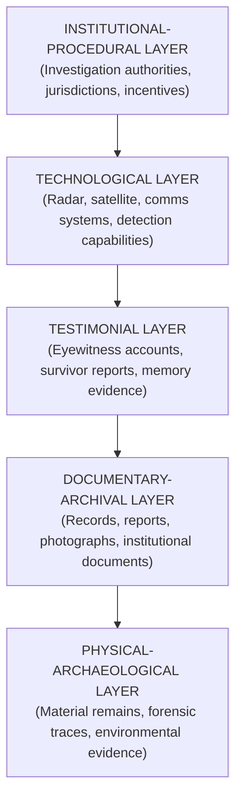

# Lesson 3: Modern Disappearances - Unsolved Historical Events

## 1. First-Principles Intuition & Invariants

The study of modern disappearances occupies a peculiar position in historical inquiry. Unlike ancient mysteries shrouded in mythological accretion or medieval events fragmented across scattered chronicles, modern disappearances occur within the glare of contemporary documentation, photographic evidence, and institutional record-keeping. Yet paradoxically, this surfeit of documentation often obscures rather than illuminates. The historian investigating these cases must navigate a terrain where abundance of data coexists with fundamental epistemic gaps—situations where the very modernity of the events creates false confidence in our ability to reconstruct what occurred.

At their core, disappearance mysteries present a specific class of historical problem: the collision between physical evidence, testimonial accounts, institutional records, and the limits of human knowledge. When a person, vessel, or aircraft vanishes, we are confronted with what philosophers call an *absence as presence*—the thing that is missing becomes the central object of historical inquiry. This inversion of normal investigative logic creates distinctive analytical challenges.

The first invariant of disappearance analysis is the **conservation principle**: matter and energy cannot vanish entirely from the physical universe. Every disappearance must have a material explanation. An aircraft does not simply cease to exist; it either crashed, was captured, was diverted, or suffered some other fate that left physical traces. A person does not evaporate; they either died, fled, or were removed. The historian's task is to reconstruct the most parsimonious explanation consistent with available evidence. This principle guards against supernatural thinking while acknowledging genuine uncertainty.

The second invariant is the **asymmetry of evidence decay**. Physical evidence deteriorates according to predictable natural laws—wood rots, metal corrodes, paper yellows and fragments, human remains decompose. However, documentary evidence can survive indefinitely if preserved in stable conditions, while testimonial evidence degrades through memory distortion, death of witnesses, and institutional forgetting. This creates a temporal gradient: the further removed an event, the more we rely on documentation and less on direct testimony. Conversely, events occurring within living memory benefit from rich witness testimony but may lack thorough documentary consolidation.

The third invariant is the **perspective dependency of historical reconstruction**. What appears as a complete disappearance from one vantage point may be well-documented from another. The *Mary Celeste* is famous for its crew's disappearance, yet the ship itself was recovered. An aircraft missing over open ocean appears to vanish, yet radar systems may have tracked its final moments. A colonial settlement abandoned in Virginia becomes "lost" only if we lack contemporary documentation and archaeological evidence. The historian must systematically map whose records exist, whose perspectives are preserved, and whose remain invisible.

These invariants establish the logical terrain upon which forensic historical reconstruction operates. They prevent us from confusing genuine mystery with mere informational vacuum, and they orient our investigative efforts toward material and documentary evidence rather than speculation.

## 2. Core Architecture & Mechanics

Effective investigation of modern disappearances requires a structured analytical framework that integrates multiple evidentiary domains. The historian must simultaneously work across five interconnected layers: the physical-archaeological layer, the documentary-archival layer, the testimonial layer, the technological layer, and the institutional-procedural layer. Each layer has distinct preservation dynamics, access mechanisms, and evidentiary weight.

**The Physical-Archaeological Layer** comprises material remains, environmental evidence, and forensic traces. For maritime disappearances like the *Mary Celeste*, this includes the condition of the vessel itself, the state of the life boats, provisions, and instruments. For aviation disappearances like Malaysia Airlines Flight 370, this includes radar returns, satellite handshakes, and ocean drift patterns. For terrestrial disappearances like Dyatlov Pass, this includes clothing, debris fields, and biological remains. The physical layer obeys deterministic laws—bodies decompose in predictable ways, metal corrodes, wood floats or sinks according to specific gravitational properties. Archaeological methodology here becomes crucial: proper documentation of artifact location, stratification, and association preserves information that rough handling destroys. The historian working with physical evidence must understand taphonomy—the science of how physical remains are transformed from living organisms or intact structures into the archaeological record.

**The Documentary-Archival Layer** encompasses written records, photographs, technical specifications, and institutional communications. For disappearance cases, relevant documents typically include: shipping manifests and passenger lists, flight plans and maintenance logs, newspaper accounts and official reports, personal correspondence and diaries, government memoranda and investigative files. The documentary layer is peculiar because it exists independent of the events it describes—a document written the day after an event reflects not what occurred but what someone believed or wanted others to believe occurred at that moment. Historical documents are not neutral mirrors but filtered observations, often constrained by the institutional purposes they served. A captain's log reflects not necessarily what happened but what the captain deemed worthy of recording. A government investigation report reflects not the complete truth but what investigators were authorized to investigate and what authorities permitted to be published.

**The Testimonial Layer** consists of eyewitness accounts, survivor interviews, and investigator reports based on human memory. This layer is notoriously fragile. Memory is reconstructive rather than reproductive—witnesses do not store perfect recordings but rather reconstruct experiences based on schemas, expectations, and subsequent information encountered. The "misinformation effect" demonstrates that post-event information can alter memory of the event itself. Moreover, testimonial accounts are shaped by social pressures, desire to appear credible, and unconscious narrative coherence-seeking. The historian must approach testimonial evidence systematically: collecting multiple independent accounts, identifying corroborations and contradictions, assessing witness position and cognitive capacity, and distinguishing between what witnesses directly observed versus what they inferred.

**The Technological Layer** encompasses the technical systems that generate evidence: radar systems that track aircraft, satellite systems that record imagery, transponder signals, communication logs, and navigation instruments. These systems are neither wholly objective nor purely subjective—they are technical artifacts that produce data according to their design parameters and operational constraints. A radar system produces echoes reflecting electromagnetic returns; it does not directly "see" aircraft. A satellite produces images at specific wavelengths and resolution; it does not capture complete reality. The historian must understand the capabilities and limitations of each technology, including what it could theoretically detect, what it was actually configured to detect, and what evidence of its operation survives.

**The Institutional-Procedural Layer** comprises the organizations that investigated disappearances, the formal processes they followed, and the incentive structures that shaped investigation. Every significant disappearance generates formal responses: military search operations, civilian investigative boards, insurance inquiries, diplomatic communications. These institutions operate under specific constraints—legal authority, funding, political pressure, bureaucratic protocols. Understanding why investigations reach particular conclusions requires understanding what investigators were empowered to investigate, what evidence they possessed access to, what political pressures they faced, and what professional incentives shaped their work.

The interaction among these five layers creates the complete evidentiary landscape. A case might have abundant physical evidence but sparse documentation, or comprehensive records but minimal physical traces. The historian must map which layers are richly preserved and which contain gaps.

Let us apply this framework to concrete cases to understand how these layers interact and where gaps create persistent mystery.

**Case Study 1: The Roanoke Colony (1587–1590)**

The Roanoke settlement in present-day North Carolina vanished between 1587 and 1590, leaving only archaeological traces and cryptic documentary evidence. Sir Walter Raleigh's colonial venture deposited 117 settlers under Governor John White, who returned to England for supplies. Upon his return three years later, the settlement was abandoned. The word "CROATOAN" was carved into a tree, and no bodies were found.

The institutional-procedural layer here is thin: colonial documentation, Raleigh's records, and scattered Spanish colonial intelligence reports. The technological layer is absent—no systematic mechanisms existed to track or monitor the colony. The testimonial layer depends on later accounts from survivors or their descendants, highly mediated and contaminated by colonial mythmaking. The documentary layer includes John White's journal entries and maps, but these were created before the disappearance and provide limited information about what occurred. The physical-archaeological layer has proven surprisingly rich: excavations at Fort Raleigh have revealed post molds, artifacts, and environmental data suggesting sustained occupation before abandonment.

What emerges from integrating these layers is not a solved mystery but rather a constrained set of possibilities. The colony either failed through disease or starvation, was absorbed into native populations, fled to different locations, or was attacked. The archaeological evidence suggests sustained occupation and organized abandonment rather than catastrophic destruction. The "CROATOAN" carving likely indicates relocation to Croatoan Island or among Croatoan peoples rather than a distress signal. Yet this reconstruction rests on inference from material remains and is vulnerable to revision as archaeological understanding deepens.

**Case Study 2: The Mary Celeste (1872)**

The merchant ship *Mary Celeste* was discovered under partial sail in the Atlantic with its crew missing, one of the most famous maritime disappearances. The physical layer here is exceptionally well-preserved: the ship itself was recovered, its condition documented, its cargo and instruments inventoried. The institutional layer includes salvage operations, maritime court inquiries, and insurance investigations. The testimonial layer comprises captain's logs, crew records, and depositions from the salvage crew that discovered the vessel.

Yet despite apparent abundance of evidence, the case remains enigmatic. The ship's condition—sails partially set, holds partially flooded, navigational instruments functional—permits multiple interpretations. The physical evidence does not indicate violence or catastrophic emergency. Crew abandonment appears voluntary rather than panicked. Yet the documented record provides no explanation for why a functioning vessel with supplies was abandoned at sea. Subsequent investigations and salvage records reveal that cargo holds showed signs of leakage that could have generated vapor concerns, life boats were missing, and crew behavior in the weeks preceding the voyage was unremarkable.

The persistence of mystery here reflects not missing evidence but rather the fundamental underdetermination of human motivation from physical traces. The material facts do not compel a single narrative. Multiple scenarios—cargo explosion fear, intoxication, navigational confusion, mutiny response—remain consistent with available evidence. The historian cannot prove definitively what occurred because the psychological and social factors driving crew decisions leave no certain material signature.

**Case Study 3: Amelia Earhart (1937)**

Amelia Earhart's disappearance during her attempted round-the-world flight in 1937 exemplifies how technological factors intersect with institutional authority and physical evidence. The technological layer includes radio transmission logs, fuel calculations, meteorological data, and aircraft specifications. Her final transmissions were received and documented: "We are running north and south." Radio direction finding equipment attempted to locate her signal. The institutional layer comprises the U.S. Navy search operations, the Civil Aeronautics Authority investigation, and subsequent private research efforts. The documentary layer includes flight plans, maintenance records, fuel calculations, and weather charts. The testimonial layer includes radio operator reports and witness accounts. The physical layer remains almost entirely absent—no confirmed wreckage has been recovered.

The case illustrates how absence of physical evidence creates analytical vulnerability. Earhart crashed somewhere in the Pacific Ocean near Howland Island. She either sank in deep water, was destroyed upon impact, or came to rest in an undiscovered location. Without physical remains, reconstruction relies on trajectory calculations, radio signal analysis, and fuel estimates. Different researchers emphasizing different aspects of available evidence reach different conclusions: some argue she crashed near Howland Island, others propose she ditched further north, still others claim she survived and reached other islands. The absence of physical evidence means these scenarios remain speculative despite the abundance of technical data.

Recent satellite analysis and deep-ocean search initiatives demonstrate how technological advances can potentially resolve such cases—but they also reveal how incomplete our technical coverage remains. The ocean remains largely unmapped and unsearched; vast areas of seafloor could conceal aircraft remains indefinitely.

**Case Study 4: Dyatlov Pass (1959)**

The Dyatlov Pass incident involved nine experienced Soviet hikers who perished in the Ural Mountains under mysterious circumstances. Their tent was found partially collapsed with occupants apparently fleeing into extreme cold. Some bodies showed signs of hypothermia, but others exhibited unusual injuries and contamination. The institutional layer comprises Soviet authorities who controlled investigation and information, Soviet mountain club records, and contemporary press accounts. The physical layer includes the tent site, bodies, equipment, and clothing. The testimonial layer includes autopsy reports, expedition diaries, and survivor interviews (none—all nine perished).

This case exemplifies how institutional control over evidence constrains historical reconstruction. Soviet secrecy regarding the investigation meant limited autopsy details, restricted access to the site, and censored documentation. The physical evidence is compromised by Soviet handling and by natural decomposition over winter months before discovery. Contemporary analysis must navigate both physical taphonomy and institutional censorship. Recent declassified Soviet documents and renewed expeditions have provided additional data, but fundamental questions remain underdetermined. Hypotheses range from avalanche to military weapons testing to hypothermia-induced behavioral anomalies to criminal acts. The physical evidence is consistent with multiple scenarios, none of which is compelled by available data.

**Case Study 5: D.B. Cooper (1971)**

The skyjacker known as D.B. Cooper parachuted from a commercial aircraft over Washington State with ransom money, vanishing into darkness and forest. The institutional layer comprises FBI investigation, airline records, and law enforcement documentation. The technological layer includes radar tracking, aircraft navigation systems, and aircraft design specifications. The documentary layer includes ransom notes, passenger manifests, and investigative files. The physical layer includes recovered money, aircraft evidence, and terrain analysis. The testimonial layer comprises pilot accounts and witness observations.

This case demonstrates how multiple evidentiary domains can establish partial facts while leaving core questions unanswered. We know approximately when and where Cooper jumped, what aircraft type he used, what altitude and approximate location the jump occurred, and what ransom money he carried. We recovered some of that money in 1980, suggesting his jump was real and not a hoax. Yet whether he survived the jump, where he landed, and what became of him remain unknown. The physical evidence supports the jump but does not determine survival. The terrain analysis suggests a difficult but potentially survivable landing. The money recovery suggests either his eventual death and decomposition in the forest or his survival and spending of the funds.

**Case Study 6: Malaysia Airlines Flight 370 (2014)**

MH370 disappeared in 2014 with 239 people aboard, becoming aviation's greatest mystery. The institutional layer comprises Malaysian authorities, international aviation bodies, and search operations spanning multiple nations. The technological layer is exceptionally rich: the aircraft had multiple communication systems (ACARS, transponder, HF radio, VHF radio), it was tracked by military radar, its engines generated periodic satellite handshakes, and its trajectory can be calculated from these data points. The documentary layer includes maintenance records, flight plans, and pilot communications. The physical layer includes aircraft debris recovered from Indian Ocean shores and the underwater search area. The testimonial layer comprises air traffic controller communications and investigative interviews.

Yet despite unprecedented technological capacity to track modern aircraft, MH370 remains unsolved. Military radar tracked the aircraft as it deviated from its planned route and turned back across Malaysia. Satellite handshakes continued after all other communication ceased, permitting calculation of a search corridor in the southern Indian Ocean. Yet the final resting place remains unknown despite the most extensive ocean search ever conducted. Physical debris recovered from African shores and Indian Ocean islands confirms the aircraft crashed but does not reveal the crash location or cause. Satellite data indicates the aircraft ran out of fuel in a specific region, but that region encompasses millions of square kilometers of ocean floor.

The case reveals the limits of technological omniscience. Modern aircraft generate extraordinary volumes of data, yet gaps in surveillance and limitations in data interpretation prevent complete reconstruction. The institutional layer became fraught with political tensions between nations, limiting access to radar data and military information. The absence of certain physical evidence—the flight data recorders and cockpit voice recorders—proved decisive; these devices would contain definitive information about what occurred but remain on the ocean floor.

## 3. High-Performance Optimization & Failure Modes

Systematic historical investigation of disappearance cases requires disciplined methodology that maximizes evidentiary yield while acknowledging inherent limitations. Historians and analysts working with such cases encounter recurring failure modes that undermine reliable reconstruction.

### Avoiding Investigative Pathologies

The primary failure mode in disappearance investigation is premature narrative convergence—the adoption of a single explanatory framework before sufficient evidence warrants it. This cognitive error manifests when investigators privilege one hypothesis (mechanical failure, deliberate action, criminal intervention) and subsequently filter evidence through that lens, discounting contradictions and amplifying confirmations. The Amelia Earhart case demonstrates this pathology across decades: the crash-and-sink hypothesis dominated official investigations despite credible witness testimony suggesting alternative scenarios, leading to decades of misdirected search efforts. Effective methodology requires maintaining multiple competing hypotheses simultaneously, explicitly tracking which evidence supports or contradicts each framework, and resisting institutional pressure toward premature closure. The temporal dimension compounds this challenge—early investigative decisions determine which evidence gets preserved, which witnesses get interviewed, and which physical sites get examined, creating path dependencies that constrain all subsequent analysis.

A second critical failure mode involves inadequate integration across evidentiary domains. Disappearance cases generate heterogeneous data—physical artifacts, documentary records, testimonial accounts, environmental conditions—that require cross-validation rather than isolated analysis. The MH370 investigation initially suffered from compartmentalized analysis: satellite engineers interpreted ping data, oceanographers modeled debris drift, and aviation experts analyzed flight systems, but inadequate synthesis delayed recognition of contradictions between models. High-performance investigation establishes explicit interfaces between analytical domains, using contradictions as diagnostic signals rather than anomalies to be explained away. The third pathology is scale mismatch between search resources and problem geometry: the Mary Celeste's potential drift zone, Earhart's possible crash sites, and MH370's calculated search corridor all encompass areas orders of magnitude larger than available search capacity can thoroughly examine. Effective methodology must acknowledge when physical search becomes probabilistic rather than comprehensive, shifting emphasis toward evidence that constrains the search space rather than exhaustively covering it. These cases ultimately reveal that some historical events resist complete reconstruction not due to methodological inadequacy but due to fundamental information loss—when critical evidence physically vanishes beneath ocean waters or deteriorates beyond recovery, certainty becomes unattainable regardless of analytical sophistication.

## Summary & Verification Matrix

| **Case** | **Core Mystery Mechanism** | **Evidentiary Domains** | **Key Diagnostic Criteria** | **Resolution Status & Limiting Factors** |
|----------|---------------------------|------------------------|----------------------------|------------------------------------------|
| **Mary Celeste (1872)** | Abandonment without distress signals in calm conditions | Physical: seaworthy vessel, missing lifeboat, cargo intact; Documentary: ship's log ending abruptly; Environmental: weather records, drift patterns | Absence of damage, violence, or theft; crew competency level; rational vs. panic-driven decision indicators | Unresolved—testimonial layer lost (crew deceased), physical evidence degraded; multiple hypotheses remain plausible |
| **Amelia Earhart (1937)** | Aircraft disappearance during transoceanic navigation attempt | Physical: aircraft wreckage (not definitively located), potential artifacts; Testimonial: witness accounts, radio transmissions; Documentary: flight plans, fuel calculations | Radio bearing accuracy, fuel range calculations, witness credibility assessment, artifact authentication protocols | Unresolved—vast search area, conflicting testimonial evidence, institutional classification barriers; crash-and-sink vs. survival hypotheses compete |
| **MH370 (2014)** | Commercial aircraft deviation and disappearance despite modern tracking | Physical: recovered debris (confirmed), satellite handshake data; Institutional: radar records (incomplete), military data (restricted); Technological: ACARS cessation, transponder deactivation | Satellite ping arc analysis, debris drift modeling, radar gap interpretation, deliberate vs. mechanical causation indicators | Unresolved—ocean floor search incomplete despite unprecedented scale; fuel exhaustion zone identified but not searched comprehensively; political access restrictions |
| **General Methodology** | Information asymmetry and evidence decay over time | Multi-domain integration required: physical, testimonial, documentary, environmental, institutional, technological | Hypothesis plurality maintenance, cross-domain contradiction detection, search geometry vs. resource matching | Success requires avoiding premature convergence, compartmentalized analysis, and scale mismatch; some cases fundamentally unresolvable due to irretrievable information loss |
