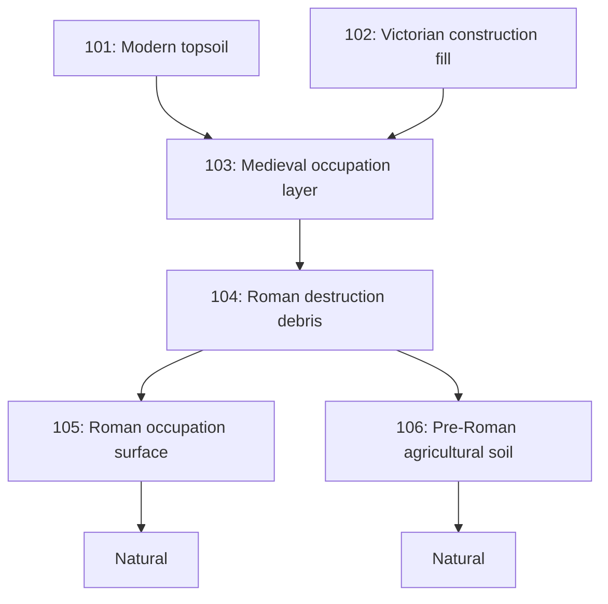
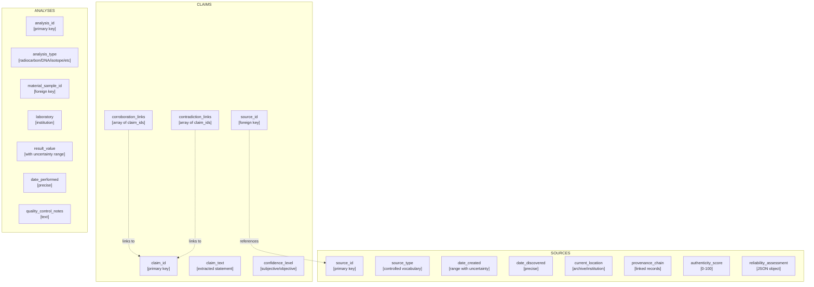

# Lesson 4: Investigative Methodologies - Historical Epistemology

## 1. First-Principles Intuition & Invariants

Historical mysteries occupy a peculiar epistemological space where the traditional scientific method encounters fundamental limitations. Unlike experimental sciences where hypotheses can be tested through repeatable observation, the historian investigating enigmas confronts a closed evidentiary universe: what survives is all that can ever be known, and the act of historical destruction is irreversible. This creates the first invariant of historical epistemology—the **principle of evidentiary finitude**. When examining the disappearance of the Roanoke colonists or the authorship of the Voynich manuscript, we work within boundaries defined not by what questions we can ask, but by what evidence time has chosen to preserve.

The investigative methodology for historical mysteries must therefore begin with a rigorous taxonomy of knowability. Some historical questions admit of definitive answers pending discovery of sufficient evidence, while others represent fundamental epistemic limits where probability ranges constitute the maximum attainable knowledge. The distinction matters profoundly for resource allocation and investigative strategy. A historian who fails to recognize that certain mysteries may be permanently underdetermined risks investing career-defining effort into problems that cannot yield proportional returns, while simultaneously missing adjacent questions where breakthrough synthesis remains possible.

Consider the methodological architecture that distinguishes historical investigation from juridical or journalistic inquiry. Legal proceedings operate under burden-of-proof standards (preponderance of evidence, clear and convincing, beyond reasonable doubt) that reflect institutional needs for decisional closure. Courts must render verdicts even when evidence remains ambiguous. Historical epistemology recognizes no such imperative. The professional historian's duty is not to force premature conclusions but to characterize the probability distribution across competing hypotheses with maximum fidelity to the surviving evidence. This creates a second invariant: **the obligation to quantify uncertainty rather than eliminate it artificially**.

The cognitive architecture of mystery investigation reveals systematic vulnerabilities that compromise analytical rigor. Human pattern-recognition systems evolved to detect agency and intentionality in ambiguous stimuli, generating survival advantages in ancestral environments where false negatives (failing to detect predators or hostile actors) carried greater penalties than false positives. This neurological inheritance manifests in historical investigation as **apophenia**—the tendency to perceive meaningful patterns in random or incomplete data. When examining fragmentary evidence from Roanoke, the mind instinctively constructs narratives of conspiracy, supernatural intervention, or dramatic conflict, even when mundane explanations (incremental assimilation into neighboring Indigenous communities following resource depletion) align more parsimoniously with the archaeological and documentary record.

The discipline of source criticism emerged in nineteenth-century German historiography as a systematic defense against these cognitive vulnerabilities. Leopold von Ranke's methodological revolution insisted that historical claims must be grounded in rigorous analysis of primary sources, evaluated through explicit protocols of authenticity, reliability, and bias. This framework remains foundational, but contemporary historical epistemology recognizes that Rankean positivism underestimated the extent to which all source interpretation involves theory-laden observation. The investigator's conceptual framework determines which features of a source register as salient evidence versus background noise.

Modern investigative methodology therefore incorporates metacognitive monitoring—explicit tracking of the investigator's own assumptions, prior beliefs, and motivated reasoning. When evaluating the Princes in the Tower mystery, a historian must consciously audit whether Ricardian sympathies or Tudor loyalties are coloring interpretation of ambiguous documentary evidence. The **principle of adversarial self-review** demands that investigators deliberately construct the strongest possible case against their preferred hypothesis, actively seeking disconfirming evidence rather than merely accumulating supporting data.

The interdisciplinary turn in historical investigation over the past half-century reflects recognition that documentary sources represent only one evidentiary stream. Archaeology provides material culture context that documents often omit or distort. Forensic anthropology can establish cause of death, nutritional stress, and kinship relations invisible to textual sources. Paleoclimatology reconstructs environmental constraints on historical agency. Computational linguistics can authenticate disputed texts through statistical analysis of vocabulary patterns and syntactic structures. The integration of these diverse methodologies creates the third invariant: **evidential synthesis across incommensurable data types**, each governed by distinct protocols of collection, analysis, and interpretation.

This synthetic epistemology introduces new failure modes. Each disciplinary methodology carries domain-specific uncertainties, error bars, and interpretive assumptions. When archaeological stratigraphy suggests occupation dates that conflict with radiocarbon chronologies, which takes precedence? When forensic facial reconstruction from skeletal remains contradicts contemporary portrait evidence, how do we weight competing forms of visual testimony? The investigator must become fluent in the reliability hierarchies and confidence intervals native to each contributing discipline, then construct meta-analytical frameworks for principled integration.

The limits of historical knowledge represent not merely practical constraints but fundamental features of the epistemic landscape. Certain categories of historical fact—internal mental states, private conversations, destroyed documents—may be permanently inaccessible regardless of methodological sophistication. The historian investigating mysteries must cultivate comfort with irreducible uncertainty, recognizing that the most intellectually honest conclusion may be a precisely articulated probability distribution rather than a definitive solution. This epistemic humility distinguishes rigorous historical analysis from speculative fiction masquerading as scholarship.

## 2. Core Architecture & Mechanics

The operational framework for investigating historical mysteries consists of four nested analytical layers, each with distinct protocols and outputs. The architecture proceeds from textual criticism through archaeological contextualization, forensic analysis, and finally synthetic interpretation. This is not a linear sequence but an iterative spiral where insights at any layer may trigger re-evaluation of prior layers.

**Layer One: Documentary Source Criticism** begins with the fundamental question of authenticity. Is the source what it purports to be, or does it represent forgery, later interpolation, or misattribution? The investigator applies a systematic battery of tests. Paleographic analysis examines handwriting characteristics, comparing letter forms, abbreviations, and orthographic conventions against authenticated exemplars from the claimed period and geographic origin. Paper composition analysis uses fiber microscopy and chemical markers to establish manufacturing date ranges—a document written on paper containing wood pulp cannot predate the 1840s when mechanical wood pulping was invented, regardless of what its content claims.

Provenance tracking reconstructs the chain of custody from original creation through present archival location. Gaps in provenance raise authenticity concerns proportional to the document's potential value as forgery target. A previously unknown Shakespeare manuscript appearing without documented ownership history merits extreme skepticism; a routine merchant account book from the same period requires less stringent authentication. The investigator constructs a **provenance reliability index** based on documentation completeness, custodian credibility, and opportunities for tampering.

Once authenticity is established, the analysis shifts to reliability and bias assessment. Every source emerges from a particular social location that shapes both what information its creator could access and what motivated distortions might influence its content. Court chronicles written for royal patrons systematically minimize monarchical incompetence and exaggerate foreign threats. Hagiographic sources depicting saints' lives follow generic conventions that obscure historical reality beneath layers of miraculous embellishment. The investigator must therefore engage in **perspectival inversion**—reading sources against their intended grain to extract information their creators did not consciously intend to convey.

Tax records and administrative documents generally offer higher reliability than narrative sources because their creators had different incentive structures. A Byzantine grain requisition papyrus provides trustworthy data about agricultural productivity not because its author valued historical accuracy but because fiscal administration required accurate accounting. Conversely, the document may systematically underreport peasant grain reserves if tax evasion was widespread, or overreport if administrators inflated figures to demonstrate bureaucratic efficiency. The investigator models these incentive structures explicitly:

```
Reliability Assessment Matrix:

Source Type: [Administrative / Narrative / Legal / Private]
Creator Social Position: [Elite / Bureaucratic / Subaltern]
Intended Audience: [Public / Private / Institutional]
Survival Bias: [Systematic Preservation / Random / Censored]

Incentive Alignment Score:
  Truth-telling rewards: [0-10]
  Distortion rewards: [0-10]
  Detection probability: [0-1]
  
Cross-validation opportunities: [None / Partial / Extensive]
```

The mechanical process of source criticism generates what we might term **evidential confidence coefficients**—not binary judgments of "reliable" versus "unreliable," but granular assessments of specific claims within a source. A chronicle might prove highly reliable for chronology (dates of battles, succession of rulers) while systematically distorting military outcomes or attributing implausible motives to foreign adversaries.

**Layer Two: Archaeological Contextualization** provides material culture grounding that documentary sources cannot supply. While texts describe elite activities disproportionately, archaeological evidence samples across social strata with different but analyzable biases. The investigator must understand taphonomic processes—the systematic transformations that occur between an object's use-life and its archaeological recovery. Organic materials decay differentially based on soil chemistry, water table levels, and microbial activity. Metal artifacts migrate vertically through soil profiles via frost heaving and bioturbation. Catastrophic destruction events like volcanic eruption or rapid burial preserve broader material culture ranges than gradual abandonment where valuable items are systematically removed.

Stratigraphic analysis establishes relative chronologies through the law of superposition—absent disturbance, lower layers predate higher layers. But bioturbation, construction activities, and geological processes violate this principle regularly. The investigator examines soil interfaces for signs of intrusion: differing soil textures, truncated artifact distributions, and discontinuous stratigraphic lenses. Modern excavation employs Harris Matrix methodology, constructing formal diagrams of stratigraphic relationships:



This formal representation makes chronological relationships explicit and testable. When artifact distributions seem anomalous—Roman coins appearing in medieval contexts—the Harris Matrix reveals whether stratigraphic integrity has been compromised.

Absolute chronologies derive from scientific dating methods, each with characteristic uncertainty ranges and applicable material types. Radiocarbon dating measures carbon-14 decay in organic materials, yielding dates with standard deviations typically ranging from ±30 to ±100 years depending on sample quality and laboratory protocols. Dendrochronology provides annual precision for wooden artifacts by matching growth ring patterns to master chronologies, but requires sufficient ring counts (typically 50+) and appropriate species. Thermoluminescence dates ceramic firing by measuring accumulated radiation damage in crystal structures, with uncertainties of ±5-10% of the sample age.

The investigator constructs **chronological probability distributions** by combining multiple dating methods through Bayesian statistical frameworks. If radiocarbon dating suggests a burial occurred between 1420-1520 CE (95% confidence), while ceramic typology indicates 1450-1500 CE, and a coin provides a terminus post quem of 1461 CE, Bayesian integration narrows the probability distribution by incorporating all constraints simultaneously.

**Layer Three: Forensic Analysis** applies medical and scientific methods to human remains, artifacts, and environmental samples. Skeletal analysis establishes biological profiles—age at death, sex, stature, ancestry—through established osteological protocols. Epiphyseal fusion patterns and dental eruption sequences indicate age in juveniles and young adults; pubic symphysis morphology and cranial suture closure extend age estimation into later adulthood, though with increasing uncertainty ranges. Pelvic morphology provides sex estimation with >95% accuracy in complete adult skeletons; fragmentary remains yield lower confidence.

Pathological markers reveal disease burden, nutritional stress, and trauma. Porotic hyperostosis and cribra orbitalia indicate childhood anemia, often from iron deficiency or parasitic infection. Linear enamel hypoplasias record systemic stress events during tooth formation, creating permanent archives of childhood health crises. Perimortem trauma analysis distinguishes injuries occurring at or near death from postmortem damage, informing reconstruction of violence or accident scenarios.

Ancient DNA analysis has revolutionized historical investigation over the past two decades, though methodological challenges remain substantial. DNA preservation depends critically on burial environment—cold, dry, or permanently waterlogged contexts preserve DNA far better than temperate fluctuating conditions. Contamination from handling and laboratory environment represents a persistent threat; ancient DNA protocols now demand stringent authentication criteria including characteristic damage patterns, appropriate fragment length distributions, and replication across independent laboratories.

When successfully recovered, ancient DNA reveals kinship networks invisible to documentary sources. The identification of Richard III's remains in a Leicester car park combined osteological analysis (scoliosis matching contemporary descriptions, perimortem trauma consistent with battlefield death) with mitochondrial DNA comparison to living matrilineal descendants. The convergence of multiple independent evidence streams transformed speculation into near-certainty.

Stable isotope analysis of bone collagen and tooth enamel reconstructs diet and geographic mobility. Carbon and nitrogen isotope ratios distinguish marine versus terrestrial protein sources and C3 versus C4 plant consumption. Strontium, oxygen, and lead isotopes vary geographically based on underlying geology; because tooth enamel forms in childhood and does not remodel, isotopic signatures record childhood residence. Comparing tooth enamel to bone collagen (which remodels throughout life) reveals whether an individual lived and died in their natal region or migrated as an adult.

**Layer Four: Synthetic Interpretation** integrates the outputs of prior layers into coherent historical reconstructions while explicitly tracking uncertainty propagation. Each analytical layer contributes probability assessments with characteristic confidence intervals; synthetic interpretation must compound these uncertainties rather than treating convergent evidence as eliminating doubt entirely.

The investigator employs **inference to the best explanation** (abductive reasoning) to evaluate competing hypotheses. This is not equivalent to selecting the most intuitively appealing narrative, but rather formalized comparison across multiple dimensions. A strong explanatory hypothesis must satisfy several criteria simultaneously: it must account for all significant evidence without ad hoc auxiliary assumptions, demonstrate causal mechanisms that were physically and socially possible in the historical context, and prove more parsimonious than alternatives.

The Bayesian probability framework provides formal architecture for this synthesis:

```
P(H|E) = P(E|H) × P(H) / P(E)

Where:
  P(H|E) = Posterior probability of hypothesis given evidence
  P(E|H) = Likelihood of observing this evidence if hypothesis is true
  P(H) = Prior probability based on background historical knowledge
  P(E) = Total probability of observing this evidence under all hypotheses

For multiple evidence streams:
  P(H|E1,E2,E3) ∝ P(E1|H) × P(E2|H) × P(E3|H) × P(H)
```

This formalization forces explicit reasoning about prior probabilities—what we should believe before examining case-specific evidence—and likelihood ratios—how much particular evidence should shift our beliefs. Consider the Princes in the Tower: documentary evidence establishes their presence in the Tower of London in 1483 and disappearance from public view shortly thereafter. Skeletal remains of two juveniles were discovered in 1674 during renovation work and reburied in Westminster Abbey. Do these remains belong to the princes?

The investigator must assess prior probabilities. How common was juvenile mortality in fifteenth-century London? What proportion of Tower deaths involved children? How many juvenile burials might we expect within the Tower precincts over centuries of occupation? The likelihood ratio asks: if these remains are the princes, what probability should we assign to their discovery location, osteological age estimates, and burial context versus alternative explanations (unrelated juvenile deaths, relocated burials from demolished churches, etc.)?

When the 1933 examination suggested ages consistent with the princes and the burial location aligns with a known Tower structure, these factors increase the likelihood ratio. However, the absence of DNA analysis (which would provide definitive identification or exclusion through comparison to known relatives) means substantial uncertainty persists. The intellectually honest conclusion is not "these are definitely the princes" but rather "the probability that these remains belong to the princes falls within a quantifiable range based on available evidence, substantially higher than random chance but not approaching certainty."

## 3. High-Performance Optimization & Failure Modes

The optimization of investigative workflow for historical mysteries requires strategic resource allocation across the four analytical layers described above. Time and funding constraints mean that exhaustive analysis at every layer for every source proves impossible; the investigator must develop heuristics for identifying high-leverage analytical interventions.

**Prioritization begins with consequence analysis**—not all uncertainties matter equally for historical reconstruction. When investigating the fate of the Roanoke colonists, establishing the precise month of the colony's abandonment matters far less than determining whether abandonment was voluntary or forced, whether colonists died or assimilated, and what role Indigenous polities played in their disappearance. The investigator constructs a **decision tree of historical questions** where certain nodes unlock large downstream inference chains while others represent historical minutiae with limited broader implications.

High-value analytical targets typically involve questions where multiple evidence streams can be brought to bear independently. If documentary sources, archaeological material culture, and skeletal biology all constrain the same historical parameter, their convergence generates geometric rather than linear confidence gains. The investigator should therefore preferentially pursue hypotheses that admit cross-disciplinary testing rather than those accessible only through single-method approaches.

The optimization of source criticism workflows involves developing pattern recognition for telltale authentication markers. Experienced paleographers recognize at a glance whether manuscript hands match period conventions or betray modern forgery attempts. This expertise develops through deliberate practice analyzing authenticated corpora, building internal mental libraries of period-specific letterforms, abbreviation systems, and layout conventions. The novice investigator requires hours per manuscript page; the expert achieves preliminary authentication assessment in minutes, reserving intensive analysis for genuinely ambiguous cases.

**Database infrastructure proves essential for managing complex multi-source investigations**. Professional historical mystery investigation requires systematic cataloging of every evidentiary fragment with standardized metadata: source type, date range, provenance, reliability assessment, and explicit linkages to related sources. Modern digital tools enable this at scales impossible for paper-based scholarship. Relational database structures capture the network of evidential relationships:



This structured approach transforms investigative work from linear narrative reconstruction into network analysis where the strength of competing hypotheses can be quantitatively assessed based on how many independent evidential pathways they successfully explain.

**Cognitive bias mitigation requires institutional protocols rather than individual willpower**. Confirmation bias—the tendency to seek and interpret evidence supporting pre-existing beliefs while minimizing contradictory data—operates largely below conscious awareness. The investigator who believes Richard III was a maligned monarch will subtly weight ambiguous evidence differently than one convinced of his villainy, often while sincerely believing themselves objectively neutral.

The most effective countermeasure involves **adversarial collaboration** where investigators with divergent prior beliefs jointly analyze evidence and make their disagreements explicit. When forced to articulate why a particular source interpretation seems compelling, unstated assumptions surface for critical examination. The discipline of constructing the strongest possible version of positions one opposes—steel-manning rather than straw-manning—develops intellectual flexibility essential for historical mystery investigation.

Pre-registration of analytical protocols before examining evidence provides another bias mitigation strategy borrowed from experimental sciences. The investigator publicly commits to specific analytical methods and interpretive criteria before data collection, preventing post-hoc rationalization where analytical choices unconsciously favor preferred conclusions. For archaeological excavations investigating historical mysteries, pre-registration might specify: sampling strategies for absolute dating, criteria for distinguishing primary deposits from later disturbance, and statistical thresholds for accepting or rejecting specific hypotheses.

**The major failure mode in historical mystery investigation is premature convergence on appealing narratives**. The human cognitive system finds uncertainty aversive; we experience psychological pressure to resolve ambiguity even when evidence remains insufficient for justified conclusion. This generates the familiar pattern where complex mysteries with legitimate explanatory challenges spawn elaborate alternative theories—ancient aliens, secret societies, supernatural intervention—that provide narrative satisfaction at the cost of evidential rigor.

The investigator must cultivate comfort with suspended judgment, treating "the evidence currently available does not permit determination between these three hypotheses" as a substantive intellectual contribution rather than analytic failure. This requires institutional structures that reward careful uncertainty quantification rather than definitive storytelling. Academic publishing incentives unfortunately often favor bold revisionist claims over measured probability assessments, creating systemic pressure toward overconfidence.

**Documentation standards represent another critical optimization target**. Future researchers will evaluate current investigative work through the same source-critical lens applied to historical documents. Archaeological excavation destroys the stratigraphic context it documents; if documentation proves inadequate, the information loss is permanent and irreversible. Modern excavation protocols therefore mandate multi-modal recording: written context sheets describing each stratigraphic unit, scaled plan and section drawings, high-resolution photography from multiple angles, and increasingly, photogrammetric 3D modeling and ground-penetrating radar survey.

The principle of **replicability through documentation** means that a future investigator with different theoretical commitments should be able to re-analyze the documented evidence independently. This requires separating observational description (what was found, where, in what association) from interpretation (what this means for historical reconstruction). Field notes should distinguish clearly between objective observations ("Context 103 contained 47 pottery sherds, 3 corroded iron nails, and charcoal fragments in a dark brown sandy loam matrix") and interpretive hypotheses ("Context 103 likely represents a destruction layer from the 1461 fire mentioned in chronicle sources").

**Interdisciplinary collaboration introduces communication challenges that require explicit protocols**. Archaeologists, historians, forensic anthropologists, and laboratory scientists operate within distinct epistemic cultures with different standards of evidence, uncertainty quantification, and publication norms. What a historian considers a well-established fact might be to an archaeologist a working hypothesis, while radiocarbon dates that a laboratory reports as "1450±30 BP" require calibration against atmospheric curves that introduce additional uncertainty archaeologists understand but historians often overlook.

Successful interdisciplinary investigation requires appointing an integration coordinator responsible for translating between disciplinary dialects and maintaining a master uncertainty register that tracks how confidence levels propagate through multi-stage inferences. When forensic analysis provides age-at-death estimates for skeletal remains with ±5 year uncertainty, and those remains are dated by radiocarbon to ±40 years, and historical documents provide a possible identity with birth date known to within ±2 years, the final synthesis must correctly compound rather than selectively minimize these uncertainty ranges.

The investigative methodology for historical mysteries ultimately represents not a formula for definitive solutions but a framework for maximizing the information extracted from finite evidence while maintaining intellectual honesty about epistemic limits. Certain mysteries will yield to rigorous analysis; others will remain permanently underdetermined despite methodological sophistication. The investigator's responsibility is to characterize this distinction with precision, resisting both the false confidence that declares mysteries solved prematurely and the false modesty that declares all historical knowledge equally uncertain. The methodological rigor lies not in achieving certainty but in accurately mapping the topology of the knowable, the probably knowable, and the permanently unknowable across the landscape of historical enigmas.
