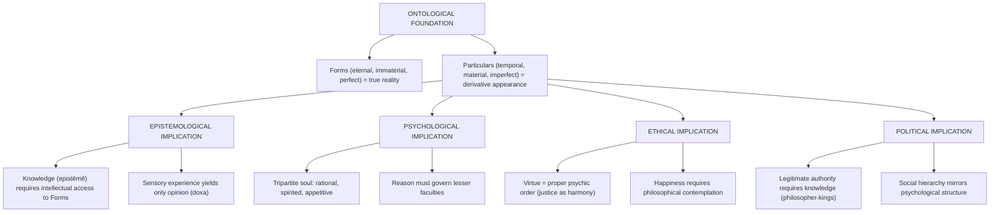

# Lesson 1: Foundations of Ancient Intellectual Traditions

## 1. First-Principles Intuition & Invariants

The intellectual historian approaching ancient philosophical systems confronts a methodological challenge that distinguishes this discipline from pure philosophy: we do not merely evaluate the logical coherence of ancient arguments, nor do we treat these systems as museum artifacts. Instead, we reconstruct the operational frameworks—the cognitive architectures—that structured how entire civilizations conceived of reality, knowledge, and human excellence. These frameworks functioned as interpretive lenses, problem-solving heuristics, and ethical decision protocols that governed everything from legal adjudication to medical practice, from agricultural calendars to military strategy.

When we examine the pre-Socratic philosophers of the Mediterranean, the Warring States thinkers of China, and the āstika and nāstika schools of classical India, we discover a remarkable convergence despite geographic and cultural isolation. Each tradition independently developed systematic methods for addressing three foundational invariants: the metaphysical question of ultimate reality and causation, the epistemological question of how secure knowledge becomes possible, and the ethical question of how human beings should organize individual conduct and collective institutions. These are not arbitrary philosophical curiosities. They represent the minimal sufficient set of conceptual tools required for any civilization to construct coherent explanatory models, transmit knowledge across generations, and coordinate complex social systems.

The pre-Socratic revolution beginning in sixth-century BCE Ionia marks the West's first systematic attempt to replace mythological causation with naturalistic explanation. Thales of Miletus proposed water as the *archē*—the fundamental substrate from which all phenomena emerge and to which they return. This hypothesis, though empirically wrong, established a transformative methodological precedent: the search for unifying principles beneath phenomenal diversity, the demand for explanatory parsimony, and the assumption that nature operates according to discoverable regularities rather than arbitrary divine caprice. Anaximander refined this approach by positing the *apeiron*—the indefinite or boundless—as a more abstract substrate, recognizing that any specific observable substance (water, fire, air) contains too much determinate character to serve as the source of all determinate things. Heraclitus introduced the concept of *logos*, a rational structural principle governing cosmic change, famously declaring that one cannot step into the same river twice because reality consists fundamentally of process rather than static substance. Parmenides countered with radical logical monism, arguing through deductive reasoning that change and multiplicity are logical impossibilities: true being must be eternal, uniform, and indivisible, making the sensory world of flux and diversity a realm of illusion.

This Parmenidean challenge—the apparent logical incompatibility between the demands of reason and the testimony of sense experience—generated the central problematic that occupied subsequent Greek metaphysics. Empedocles attempted reconciliation through his theory of four eternal roots (earth, air, fire, water) combined and separated by two cosmic forces (Love and Strife), preserving Parmenidean being at the elemental level while accounting for observable change through recombination. Anaxagoras proposed infinite qualitatively distinct seeds governed by cosmic *Nous* (Mind), introducing teleological ordering intelligence into naturalistic cosmology. Democritus and Leucippus developed atomism—indivisible, eternal particles moving through void—achieving a purely mechanical explanation that satisfied both the logical demands of Parmenidean being and the empirical reality of sensory change. These competing systems established the fundamental ontological options that Western philosophy has continuously revisited: material monism, substance dualism, process metaphysics, and atomistic mechanism.

The Socratic turn, transmitted primarily through Plato's dialogues, redirected philosophical attention from cosmology to anthropology, from external nature to human nature, from physics to ethics. Socrates pioneered the *elenchus*—systematic cross-examination designed to expose hidden contradictions in an interlocutor's beliefs. This method operated on a crucial epistemological principle: knowledge differs fundamentally from mere true belief. One possesses knowledge only when one can provide a *logos*—a rational account that explains why something is true, that articulates the essential nature that makes a thing what it is. Socrates demonstrated through repeated elenctic demonstrations that most people lack genuine knowledge even of concepts they use daily—justice, courage, piety, virtue. This recognition of ignorance, the famous Socratic wisdom, establishes the foundation for philosophical inquiry: the systematic examination of definitions and first principles.

Plato constructed his Theory of Forms to solve the epistemological crisis Socrates had exposed. If knowledge requires stable, eternal objects of cognition, yet the sensory world consists entirely of changing particulars, then genuine knowledge must concern a separate ontological realm. The Forms—eternal, immaterial, perfect archetypes—constitute true reality, while material particulars function as imperfect copies that "participate in" or "imitate" these transcendent paradigms. This theory provided Plato with solutions to multiple philosophical problems simultaneously. It explained how universal concepts apply to multiple particulars, how mathematical knowledge achieves certainty despite describing no physical objects, how ethical evaluation becomes possible if justice itself exists as an objective standard independent of human convention, and how learning occurs despite the paradox that we cannot seek what we already know, nor recognize what we have never encountered (Plato's solution: recollection of Forms known in a disembodied pre-existence).

Aristotle, Plato's most accomplished student and most incisive critic, rejected the ontological separation of Forms from particulars while preserving the commitment to systematic explanatory knowledge. His hylomorphic theory posited that individual substances consist of matter (*hylē*) structured by form (*morphē* or *eidos*), with form instantiated within matter rather than existing in transcendent isolation. Aristotelian form functions as the organizational principle that makes a thing what it is—the formal cause that determines essence, the final cause that specifies natural function and teleological development. This metaphysics grounded Aristotle's systematic empiricism: understanding natural phenomena requires careful observation of particulars followed by inductive generalization to grasp the formal principles governing each natural kind.

Aristotle's fourfold causal framework became the dominant explanatory model in Western science until the seventeenth century. To understand any phenomenon completely, one must identify its material cause (the substrate from which it is made), its formal cause (the essential structure that makes it what it is), its efficient cause (the agent or process that brought it into being), and its final cause (the purpose or function toward which it naturally develops). A bronze statue, for example, has bronze as its material cause, the shape of Athena as its formal cause, the sculptor's craft as its efficient cause, and the honoring of the goddess as its final cause. Natural substances possess inherent final causes: the acorn naturally develops toward the form of mature oak, the heart exists for the purpose of pumping blood, human beings naturally seek *eudaimonia*—flourishing or the good life achieved through virtuous activity in accordance with reason.

The Hellenistic period following Alexander's conquests generated new philosophical schools addressing the practical existential concerns of individuals navigating cosmopolitan empires lacking the stable civic identity of the classical *polis*. Epicureanism, founded by Epicurus in Athens, adapted Democritean atomism to ethical purposes, arguing that pleasure—understood as tranquility and absence of pain rather than sensory indulgence—constitutes the highest good. Epicurus developed a sophisticated hedonistic calculus: many pleasures must be rejected because they produce greater subsequent pains, while many pains must be embraced because they prevent greater pains or produce greater pleasures. The wise person cultivates simple desires easily satisfied, eliminates unnecessary fears (particularly fear of death and divine punishment), and pursues philosophical friendship and contemplation. Epicurean physics, though mechanistic and materialistic, served ethical purposes by demonstrating that the gods neither intervene in human affairs nor punish after death, thereby freeing humanity from superstitious terror.

Stoicism, founded by Zeno of Citium and systematized by Chrysippus, developed an alternative ethical framework based on radical acceptance of cosmic determinism. The Stoics conceived the universe as a living rational organism governed by divine *Logos*—rational necessity that determines all events with perfect necessity. Human freedom consists not in controlling external outcomes, which lie within the domain of fate, but in controlling one's own judgments, desires, and emotional responses. The Stoic sage achieves *apatheia*—not pathological absence of emotion, but freedom from irrational passions arising from false judgments about value. Health, wealth, reputation, even life itself are "preferred indifferents"—things reasonably chosen when available but not genuinely good, because virtue alone—acting in accordance with reason and nature—constitutes the good. This framework provided Stoic practitioners with a cognitive protocol for navigating adversity: distinguish what lies within one's control (prohairesis—moral purpose and rational assent) from what does not (external circumstances), invest no emotional attachment in the latter, and focus all effort on perfecting the former.

Skepticism, particularly in its Pyrrhonian form articulated by Pyrrho and systematized by Sextus Empiricus, challenged the epistemological foundations of all dogmatic philosophical schools. The Skeptics developed systematic techniques for generating *epochē*—suspension of judgment—by demonstrating that equally compelling arguments support contradictory conclusions. Their ten modes of suspension systematically exploited variations in perception across different perceivers, different conditions, different cultural frameworks, and different philosophical assumptions. The Skeptical project aimed not at knowledge but at *ataraxia*—tranquility achieved through abandoning the futile quest for certainty and living according to appearances, conventional customs, and natural inclinations without metaphysical commitments. Skepticism functioned as philosophical therapy: the patient suffering from dogmatism, consumed by anxiety about competing truth claims, achieves peace through recognizing the impossibility of rational adjudication between alternative systematic positions.

Concurrent with Mediterranean developments, Chinese classical thought during the Warring States period generated distinct but functionally analogous systematic frameworks. Confucius and his interpretive tradition developed an ethical and political philosophy centered on *ren*—humaneness or benevolence—cultivated through *li*, ritual propriety that structures social relationships, and manifested in proper conduct within the five fundamental relationships (ruler-subject, father-son, husband-wife, elder-younger, friend-friend). The Confucian program presumed that human nature, though requiring cultivation, possesses inherent moral potential, and that proper education in classical texts, ritual performance, and virtuous modeling transforms individuals into *junzi*—exemplary persons capable of ethical leadership and social harmony. Mencius extended this framework by explicitly defending the innate goodness of human nature, arguing that all humans possess incipient moral sensibilities—the "four sprouts" of compassion, shame, courtesy, and moral discrimination—that spontaneously respond to ethical situations and require only proper nurturing to develop into mature virtues.

Xunzi countered with a rival Confucian interpretation, arguing that human nature is fundamentally selfish and chaotic, requiring aggressive transformation through education, ritual, and law. Without cultural intervention, humans pursue narrow self-interest, generating social conflict and moral degradation. The sage-kings of antiquity invented ritual and propriety precisely to constrain and redirect natural tendencies, channeling antisocial impulses into structured, hierarchical social harmony. This anthropological pessimism grounds Xunzi's emphasis on institutional design, legal systems, and rigorous education rather than moral suasion alone. The contrast between Mencian optimism and Xunzian pessimism established a foundational axis in subsequent East Asian ethical discourse, roughly analogous to Western debates between Pelagian and Augustinian conceptions of original moral capacity.

Daoism, articulated in the *Daodejing* attributed to Laozi and the *Zhuangzi*, offered a radical alternative to Confucian moralism. The *Dao*—the Way—functions as the ultimate metaphysical principle, the generative source and natural pattern governing all existence, yet it resists conceptual articulation and linguistic capture. The Daoist critique targeted Confucian ritual and conventional morality as artificial impositions that distort natural spontaneity and create the very problems they purport to solve. By establishing rigid distinctions between virtue and vice, beautiful and ugly, beneficial and harmful, Confucianism generates conceptual violence and social conflict where none previously existed. The Daoist sage practices *wuwei*—non-coercive action aligned with natural processes—achieving efficacy through minimal intervention rather than aggressive control. This philosophical naturalism extended to political theory: the ideal government governs least, allowing people to live according to simple, natural patterns without the elaborate bureaucratic, ritual, and legal apparatus that Confucians and Legalists advocated.

Legalism, represented by Han Feizi and Li Si, developed a realist political philosophy that rejected both Confucian moral cultivation and Daoist naturalism in favor of institutional mechanisms—comprehensive law codes, systematic rewards and punishments, and strategic manipulation—to control behavior. Legalists diagnosed the failure of traditional moralistic governance: in an age of large-scale territorial states and intense military competition, appeals to virtue prove ineffective. Only predictable legal consequences, impartially administered, can coordinate large populations and consolidate state power. The Legalist ruler should remain inscrutable, revealing neither preferences nor intentions, using law as an impersonal instrument while personally remaining above and beyond its constraints. This anti-moralistic, instrumentalist approach to governance found its historical test in the Qin state's conquest and unification of China, followed by the dynasty's rapid collapse—a pattern that generated two millennia of Chinese debate about the proper relationship between law, virtue, and political order.

Indian philosophical systems during the classical period developed with extraordinary technical sophistication, generating six orthodox (*āstika*) schools accepting Vedic authority and several heterodox (*nāstika*) schools rejecting it. The *āstika* schools—Nyāya, Vaiśeṣika, Sāṃkhya, Yoga, Mīmāṃsā, and Vedānta—each developed specialized systematic contributions to Indian philosophy's collective enterprise. Nyāya established formal logic and epistemology, articulating four valid sources of knowledge (*pramāṇas*): perception (*pratyakṣa*), inference (*anumāna*), comparison (*upamāna*), and testimony (*śabda*). Nyāya logicians developed sophisticated theories of inference, distinguishing valid syllogistic forms, analyzing fallacies, and establishing debate protocols. Vaiśeṣika developed atomic ontology and natural philosophy, categorizing reality into seven fundamental categories: substance, quality, action, universal, particularity, inherence, and absence. These two schools merged in later centuries, creating a unified epistemological-ontological system.

Sāṃkhya articulated a dualistic metaphysics distinguishing *puruṣa* (pure consciousness, the unchanging witness) from *prakṛti* (primordial matter, the dynamic source of all phenomenal manifestation). Liberation consists in achieving discriminative knowledge (*viveka*) that recognizes the absolute distinction between consciousness and matter, freeing *puruṣa* from false identification with material processes. Yoga adopted Sāṃkhya metaphysics while adding a practical soteriological discipline: the eight-limbed path of ethical restraints, observances, posture, breath control, sensory withdrawal, concentration, meditation, and absorption (*samādhi*) designed to still mental fluctuations and achieve direct experiential realization of consciousness's independence from material conditioning.

Vedānta, the "end of the Vedas," interpreting the Upaniṣads, developed multiple competing schools centered on the nature of *brahman* (ultimate reality) and its relationship to *ātman* (individual self) and the phenomenal world. Advaita Vedānta, systematized by Śaṅkara, articulated non-dualism: *brahman* alone exists as the sole reality, while the apparent multiplicity of individual selves and material objects constitutes *māyā*—illusion or superimposition arising from ignorance (*avidyā*). Liberation consists in direct realization of one's identity with *brahman*, dissolving the false sense of individual selfhood. Viśiṣṭādvaita and Dvaita Vedānta developed qualified non-dualism and dualism respectively, preserving real distinction between God, souls, and world while maintaining various forms of ontological dependence. These competing Vedāntic interpretations engaged in centuries of sophisticated philosophical debate, producing elaborate commentarial traditions that rival anything in Western scholasticism.

Buddhism and Jainism, as *nāstika* schools rejecting Vedic authority, developed alternative soteriological frameworks. The Buddha's analysis identified *duḥkha* (suffering or unsatisfactoriness) as the fundamental characteristic of conditioned existence, arising from *tṛṣṇā* (craving or attachment) rooted in ignorance (*avidyā*) of reality's true nature. The Four Noble Truths constitute a medical diagnostic model: identifying the symptom (suffering), diagnosing the cause (craving), confirming the possibility of cure (cessation), and prescribing treatment (the Eightfold Path of ethical conduct, mental discipline, and wisdom). Buddhist metaphysics rejected the *ātman* doctrine central to orthodox schools, arguing instead for *anātman*—no-self. What appears as a unified self actually consists of five impermanent, conditioned aggregates (*skandhas*) of form, feeling, perception, mental formations, and consciousness, arising and passing in dependent origination (*pratītyasamutpāda*) with no permanent substrate. This anti-essentialist metaphysics generated profound implications: if no permanent self exists, then there is ultimately no one to suffer, no one to achieve liberation, making the entire soteriological project a therapeutic fiction to be transcended.

Jainism developed a pluralistic realism affirming the reality of both souls (*jīva*) and material atoms (*pudgala*), with souls trapped in karmic matter through action and liberated through ascetic purification. Jain epistemology developed the doctrine of *anekāntavāda*—many-sidedness or perspectivalism—arguing that reality possesses infinite aspects, making any single description necessarily partial. The famous parable of the blind men and the elephant illustrates this principle: each perceives one aspect truly but mistakes the part for the whole. This epistemological pluralism grounded Jain commitments to intellectual tolerance and the careful qualification of knowledge claims through a sevenfold predication scheme acknowledging multiple valid perspectives.

The intellectual historian analyzing these diverse traditions must resist two methodological errors. First, we cannot treat these systems as merely preliminary, primitive versions of modern philosophical positions, judging them solely by their conformity to contemporary standards. Such Whiggish history distorts the past by reading it as mere prelude to the present. Second, we cannot treat these traditions as hermetically sealed, culturally specific belief systems immune to critical analysis and comparative evaluation. This relativistic approach abandons the historian's responsibility to reconstruct the logical structure, internal tensions, and problem-solving efficacy of past intellectual frameworks.

Instead, the practitioner must develop the capacity to move fluidly between empathetic reconstruction and critical analysis. We reconstruct the conceptual grammar—the web of interconnected concepts, principles, and methods—that made claims intelligible and compelling within their original contexts. We identify the core problems each tradition attempted to solve: what counted as an adequate explanation, what constituted knowledge rather than mere opinion, what made human life worth living, what justified social and political institutions. We trace how internal logical pressures, empirical anomalies, and practical inadequacies generated modifications, schisms, and successor theories within each tradition. And we identify the structural features and problem-solving strategies that transcend particular cultural manifestations, revealing the invariant intellectual operations that characterize systematic philosophical inquiry across all human civilizations.

## 2. Core Architecture & Mechanics

The practicing intellectual historian approaching ancient philosophical systems requires a systematic framework for decomposing complex doctrinal structures into analyzable components while preserving the functional relationships that make these systems coherent problem-solving instruments. We can model each major philosophical tradition as a multi-layered architecture consisting of foundational ontological commitments, epistemological protocols, ethical-political applications, and soteriological or existential goals. Understanding how these layers interact and constrain one another reveals why specific doctrinal combinations occur and why certain modifications destabilize entire systems.

The ontological layer establishes what exists fundamentally and how derivative entities relate to ultimate reality. This layer answers the priority question: what has independent existence, and what exists only dependently or derivatively? Materialist monisms like Democritean atomism and Cārvāka materialism posit matter-energy as fundamental, with consciousness and meaning as emergent epiphenomena. Idealist monisms like Advaita Vedānta reverse this priority, making consciousness fundamental and material plurality illusory. Pluralistic realisms like Aristotelian hylomorphism, Nyāya-Vaiśeṣika, and Jainism affirm the irreducible reality of multiple substance categories. Each ontological commitment carries logical consequences that propagate through the entire system.

Consider the relationship between Platonic ontology and epistemology. Plato's Form-particular distinction generates a fundamental bifurcation in reality: eternal, immaterial, perfect Forms versus temporal, material, imperfect sensible particulars. This ontological structure necessitates a corresponding epistemological dualism: genuine knowledge (*epistēmē*) concerns Forms and requires intellectual apprehension, while sensory observation yields only opinion (*doxa*) because its objects constantly change. The psychological faculties must map to this ontological structure: reason (*nous*) cognizes Forms, while sensory perception (*aisthēsis*) registers material particulars. Educational theory follows necessarily: learning consists not in acquiring new information but in redirecting the soul from sensory to intellectual cognition, from shadows to light, as depicted in the Cave allegory. Political theory inherits these constraints: only those who have achieved intellectual vision of the Form of the Good possess the knowledge required for legitimate governance, justifying the philosopher-king thesis. The entire systematic edifice stands or falls with its ontological foundation.

We can map this structural dependency pattern:

Contrast this with the Aristotelian revision. By relocating form within particular substances rather than transcendent separation, Aristotle fundamentally restructures the entire architecture. Knowledge now begins with sensory observation of particulars, proceeds through inductive generalization to grasp formal principles, and achieves demonstrative certainty through deductive syllogism from first principles. The psychological faculties form a developmental continuum rather than metaphysical rupture: sensory perception, memory, experience, and rational intellect build sequentially on one another. Ethical virtue becomes a matter of habituated character formation rather than intellectual contemplation alone, making it accessible to properly educated citizens rather than exclusively to philosophical elites. Political legitimacy derives not from transcendent knowledge but from practical wisdom (*phronēsis*) developed through experience and refined through deliberation about contingent particulars.

The epistemological layer specifies what counts as knowledge, how knowledge is acquired, and what validates knowledge claims. Ancient traditions developed remarkably sophisticated protocols for distinguishing genuine knowledge from mere true belief, lucky guess, or inherited prejudice. These protocols functioned as operational decision procedures, not merely abstract theories: they guided how practitioners conducted inquiry, evaluated testimony, adjudicated disputes, and transmitted learning.

Indian epistemology achieved particular technical refinement in its *pramāṇa* doctrine—the systematic articulation and defense of valid knowledge sources. The Nyāya school's fourfold analysis provided practitioners with explicit criteria for each source. Perception (*pratyakṣa*) requires direct sensory contact between sense organ and object, producing non-erroneous, determinate cognition. Inference (*anumāna*) requires invariable concomitance (*vyāpti*) between reason (*hetu*) and predicate (*sādhya*): wherever smoke exists, fire exists, therefore observing smoke licenses inferring fire. Comparison (*upamāna*) operates through similarity recognition: learning that a gavaya resembles a cow allows one to identify an actual gavaya upon encounter. Testimony (*śabda*) requires that the speaker be reliable and the statement concern matters beyond one's direct perception or inference.

Buddhist epistemologists, particularly Dignāga and Dharmakīrti, streamlined this to two *pramāṇas*—perception and inference—arguing that comparison reduces to inference and testimony to either perception (of words) or inference (about reliability). This seemingly technical dispute actually reflects deeper ontological commitments. The Nyāya school accepted universals as real entities, making testimony about imperceptible dharma and metaphysical truths potentially valid. Buddhist nominalism, rejecting universal reals in favor of particular momentary existents, restricts valid knowledge to what can be directly perceived or reliably inferred from perception. The epistemological surface debate masks underlying ontological architecture.

We can represent the complete Nyāya epistemological system:

```mermaid
flowchart TD
    KAP["KNOWLEDGE ACQUISITION PROTOCOL"]
    
    KAP --> PERC["PERCEPTION (pratyakṣa)"]
    KAP --> INF["INFERENCE (anumāna)"]
    KAP --> COMP["COMPARISON (upamāna)"]
    KAP --> TEST["TESTIMONY (śabda)"]
    
    PERC --> OP["Ordinary Perception"]
    PERC --> YP["Yogic Perception (for advanced practitioners)"]
    
    OP --> SOC["Sense-object contact"]
    OP --> NE["Non-erroneous (correspondence)"]
    OP --> DET["Determinate (conceptualized)"]
    
    YP --> DC["Direct cognition of imperceptible objects"]
    
    INF --> FS["For Oneself (svārtha)"]
    INF --> FO["For Others (parārtha)"]
    
    FS --> DOGP["Direct observation → general principle"]
    
    FO --> P["Statement of thesis (pratijñā)"]
    FO --> H["Statement of reason (hetu)"]
    FO --> U["Statement of example (udāharaṇa)"]
    FO --> UP["Application (upanaya)"]
    FO --> N["Conclusion (nigamana)"]
    
    COMP --> SR["Similarity recognition based on authoritative description"]
    
    TEST --> RS["Reliable speaker (āpta)"]
    TEST --> CIM["Concern imperceptible matters"]
    
    RS --> KS["Knowledge of subject matter"]
    RS --> IC["Intention to communicate truth"]
    RS --> CE["Capacity to express clearly"]
    
    CIM --> PF["Past/future events"]
    CIM --> DL["Distant locations"]
    CIM --> MT["Metaphysical truths"]
```

The ethical layer translates ontological and epistemological commitments into normative frameworks governing individual conduct and social organization. Ancient ethical systems divided into roughly three structural types: teleological frameworks defining the good as a natural end toward which humans develop, deontological frameworks defining right action through principles or duties independent of outcomes, and consequentialist frameworks evaluating action by results produced. Though these modern taxonomic categories risk anachronism, they identify genuine structural differences in ancient ethical reasoning.

Aristotelian ethics exemplifies teleological structure. The good for humans consists in *eudaimonia*—flourishing achieved through excellent functioning. Since human nature essentially involves rationality, human excellence consists in rational activity performed well, which constitutes virtue. Virtues are neither innate nor taught intellectually but cultivated through habituation: one becomes brave by performing brave acts, temperate by performing temperate acts, until excellent action becomes second nature. The doctrine of the mean provides practitioners with a heuristic for identifying virtues: courage lies between cowardice (deficiency) and rashness (excess), generosity between stinginess and prodigality, proper pride between self-deprecation and vanity. This framework makes ethical evaluation inseparable from thick description of character: we cannot judge actions in isolation but must consider the agent's settled dispositions, the circumstances, and whether the action expresses excellent rational choice.

Stoic ethics demonstrates a deontological structure built on metaphysical foundations. Since cosmic nature operates according to rational necessity, living in accordance with nature means accepting whatever fate determines while perfecting one's own rational judgment and moral purpose. External circumstances—health, wealth, reputation, even life—lie outside the sphere of voluntary control and thus outside genuine good and evil. Only virtue (rational self-governance) is genuinely good; only vice (irrational passion) genuinely evil. This generates absolute deontological principles: the virtuous person would never lie, betray, or act unjustly regardless of consequences, because such actions violate reason's dictates. The Stoic practitioner employs cognitive therapy protocols, systematically examining value judgments for irrational components and training emotional responses through philosophical exercises like negative visualization (premeditatio malorum) and contemplation of nature's rational order.

Buddhist ethics combines consequentialist and deontological elements within a soteriological framework. Actions (*karma*) produce consequences not through divine judgment but through natural moral causation: wholesome mental states (non-greed, non-hatred, non-delusion) generate wholesome actions that produce pleasant results; unwholesome mental states generate unwholesome actions producing painful results. The Five Precepts (abstaining from killing, stealing, sexual misconduct, lying, intoxication) function as both deontological constraints and consequentialist heuristics: these actions invariably arise from and reinforce unwholesome mental states while harming others, making them wrong on both grounds. Yet the ultimate criterion remains soteriological: does this action lead toward or away from liberation? Advanced practitioners might violate precepts when skillfully doing so serves liberation—a consequentialist calculus constrained by wisdom's assessment rather than rule-following alone.

The soteriological layer, particularly prominent in Indian traditions but present in modified forms across ancient systems, addresses the existential problematic: given that ordinary human existence involves suffering, anxiety, ignorance, or incompleteness, what transformation achieves liberation, fulfillment, or transcendence? This layer specifies the human predicament's diagnosis, liberation's nature, and the path from bondage to freedom.

Classical Indian systems operated with a shared problematic despite divergent solutions. Sentient beings cycle through repeated births (*saṃsāra*) driven by karma and propelled by ignorance, desire, and aversion. This cycle inherently involves *duḥkha*—suffering, dissatisfaction, existential incompleteness. Liberation (*mokṣa*, *nirvāṇa*, *kaivalya*) consists in permanent escape from this cycle through transformation that eliminates the ignorance sustaining it. Systems diverge on liberation's precise nature (union with *brahman*, isolated consciousness, extinction of individuality) and the required path (knowledge, devotion, meditation, ethical purification, ascetic practice), but share the structural commitment to radical transformation as life's ultimate purpose.

## 3. High-Performance Optimization & Failure Modes

The advanced practitioner analyzing ancient intellectual traditions must develop optimization strategies for managing conceptual complexity, avoiding characteristic failure modes, and extracting maximum analytical insight from historical material. These protocols emerge from recognizing that intellectual history functions simultaneously as descriptive reconstruction and critical evaluation—we must both understand systems on their own terms and assess their logical coherence, empirical adequacy, and problem-solving power.

The first optimization strategy involves developing structured comparative frameworks that reveal deep structural similarities beneath surface doctrinal differences. Rather than treating each tradition as sui generis, map competing solutions to shared fundamental problems. The problem of permanence and change, for instance, generated parallel solution spaces across independent traditions. Parmenidean monism, Platonic Form-particular dualism, Aristotelian hylomorphism, Sāṃkhya puruṣa-prakṛti dualism, and Buddhist momentariness constitute distinct positions within a shared conceptual space defined by the tension between reason's demand for unchanging objects of knowledge and experience's testimony to ubiquitous flux. By constructing this solution space explicitly, we can identify the logical constraints forcing each position, the internal tensions each must manage, and the tradeoffs each accepts.

A high-performance comparative matrix structures this analysis:

```mermaid
flowchart TD
    ROOT["PERMANENCE–CHANGE PROBLEM\nSolution Space"]

    ROOT --> PARM
    ROOT --> HERA
    ROOT --> PLAT
    ROOT --> ARIS
    ROOT --> ATOM
    ROOT --> SANK
    ROOT --> BUDH
    ROOT --> ADVA

    subgraph PARM ["Parmenides"]
        PARM_P["Permanent: Being (monistic)"]
        PARM_C["Changing: Illusory"]
        PARM_R["Strategy: Deny reality of change"]
        PARM_P --> PARM_R
        PARM_C --> PARM_R
    end

    subgraph HERA ["Heraclitus"]
        HERA_P["Permanent: Logos (process)"]
        HERA_C["Changing: All phenomena"]
        HERA_R["Strategy: Ground change in rational pattern"]
        HERA_P --> HERA_R
        HERA_C --> HERA_R
    end

    subgraph PLAT ["Plato"]
        PLAT_P["Permanent: Forms"]
        PLAT_C["Changing: Particulars"]
        PLAT_R["Strategy: Ontological dualism"]
        PLAT_P --> PLAT_R
        PLAT_C --> PLAT_R
    end

    subgraph ARIS ["Aristotle"]
        ARIS_P["Permanent: Form in substance"]
        ARIS_C["Changing: Matter"]
        ARIS_R["Strategy: Hylomorphic composition"]
        ARIS_P --> ARIS_R
        ARIS_C --> ARIS_R
    end

    subgraph ATOM ["Atomism"]
        ATOM_P["Permanent: Atoms & void"]
        ATOM_C["Changing: Arrangements"]
        ATOM_R["Strategy: Recombination of permanents"]
        ATOM_P --> ATOM_R
        ATOM_C --> ATOM_R
    end

    subgraph SANK ["Sāṃkhya"]
        SANK_P["Permanent: Puruṣa (consciousness)"]
        SANK_C["Changing: Prakṛti (matter)"]
        SANK_R["Strategy: Consciousness–matter dualism"]
        SANK_P --> SANK_R
        SANK_C --> SANK_R
    end

    subgraph BUDH ["Buddhism"]
        BUDH_P["Permanent: None / Nirvāṇa"]
        BUDH_C["Changing: All dharmas"]
        BUDH_R["Strategy: Radical impermanence"]
        BUDH_P --> BUDH_R
        BUDH_C --> BUDH_R
    end

    subgraph ADVA ["Advaita Vedānta"]
        ADVA_P["Permanent: Brahman"]
        ADVA_C["Changing: Māyā (appearance)"]
        ADVA_R["Strategy: Appearance–reality distinction"]
        ADVA_P --> ADVA_R
        ADVA_C --> ADVA_R
    end

    style ROOT fill:#1a1a2e,color:#e0e0ff,stroke:#7070cc,stroke-width:2px
    style PARM_R fill:#2e1a1a,color:#ffd0d0,stroke:#cc7070
    style HERA_R fill:#1a2e1a,color:#d0ffd0,stroke:#70cc70
    style PLAT_R fill:#1a1a2e,color:#d0d0ff,stroke:#7070cc
    style ARIS_R fill:#2e2a1a,color:#fff0d0,stroke:#ccaa70
    style ATOM_R fill:#1a2a2e,color:#d0f0ff,stroke:#70aacc
    style SANK_R fill:#2a1a2e,color:#f0d0ff,stroke:#aa70cc
    style BUDH_R fill:#2e2e1a,color:#ffffd0,stroke:#cccc70
    style ADVA_R fill:#2e1a2a,color:#ffd0f0,stroke:#cc70aa
```

This matrix reveals that traditions faced forced choices: accept change as fully real and abandon permanent knowledge objects (Heraclitus, Buddhism), accept permanence and deny change's ultimate reality (Parmenides, Advaita), or construct dualistic or compositional solutions that partition reality into permanent and changing aspects (Plato, Aristotle, Sāṃkhya, Atomism). No tradition escaped this constraint, making the divergent responses illuminating about different intellectual priorities and methodological commitments.

The second optimization strategy involves systematic failure mode analysis. Ancient systems failed characteristically rather than randomly, and understanding failure patterns illuminates both historical development and ongoing philosophical relevance. Five major failure modes recur:

**Internal Logical Inconsistency**: The system contains premises that jointly entail contradictions. Platonic participation exemplifies this failure mode. If particulars participate in Forms, and the Form of Largeness makes things large, then the relation between Large Itself and large particulars (both being large) seems to require a third Form to explain their shared property (the Third Man argument). Plato recognized this objection in the *Parmenides* but never resolved it satisfactorily, leaving a fatal internal tension that motivated Aristotle's alternative.

**Epistemic Inaccessibility**: The system posits entities or states that its own epistemology cannot access. Skeptics exploited this mercilessly. If Stoics claim that only the sage possesses genuine knowledge, and achieving sagehood requires already possessing knowledge to judge what constitutes rational assent, the system generates vicious circularity. If Epicureans claim that atoms swerve randomly to explain free will, this postulated mechanism is empirically unverifiable by the materialist epistemology the system endorses.

**Existential Unlivability**: The system's requirements exceed realistic human capacity or generate practically absurd consequences. Stoic cosmopolitanism in its strong form—treating all humans with precisely equal concern, without special obligations to family or compatriots—conflicts with deep psychological realities and social necessities. Pyrrhonian skepticism's complete suspension of judgment, if actually achieved, would paralyze action: one cannot even reach for food without judging that eating is preferable to starving, violating *epochē*. Sextus attempted to resolve this through the "life according to appearances," but this concession essentially abandons the radical skeptical position.

**Empirical Inadequacy**: The system's factual claims conflict with observational evidence. Aristotelian cosmology's geocentrism, eternal celestial spheres, and elemental natural places all failed empirically, though the broader teleological framework and fourfold causal analysis proved more resilient. Buddhist momentariness—the doctrine that all phenomena exist only for single instants without perduring identity—faces the empirical objection that causal relations require temporal extension, making instantaneous cause-and-effect metaphysically problematic.

**Soteriological Inefficacy**: The system's prescribed path fails to reliably produce the promised transformation. This failure mode particularly affects Indian traditions making empirical predictions about liberation's achievability. If Advaita Vedānta claims that hearing, reflecting, and meditating on "Thou art That" liberates one through recognizing identity with *brahman*, the persistence of ignorance in practitioners who intellectually affirm this doctrine requires explanation. The system must either deny these practitioners genuine understanding (making criteria for genuine understanding dangerously vague), or admit that intellectual recognition alone proves insufficient (requiring supplementation with ethical, devotional, or yogic practices, compromising the pure jñāna-yoga position).

The third optimization strategy involves what we might call "principle extraction": identifying the generalizable intellectual methods and problem-solving strategies that transcend specific doctrinal content. Ancient philosophers developed reasoning protocols that remain operationally useful regardless of whether we endorse their substantive conclusions.

The Socratic *elenchus* provides a portable method for conceptual clarification and consistency testing. When analyzing any concept—justice, knowledge, consciousness, causation—the Socratic protocol applies: propose a definition, test it against counterexamples, identify necessary and sufficient conditions, check for hidden contradictions with other beliefs, iterate until achieving reflective equilibrium or recognizing genuine aporia. This method functions independently of Platonic metaphysics.

Aristotelian definitional analysis through genus and differentia gives practitioners a systematic tool for conceptual mapping. To define any term, locate the broader category it belongs to (genus) and specify the feature distinguishing it from other members of that category (differentia). Human = rational animal. Knowledge = justified true belief. Virtue = habituated disposition to choose the mean. This method imposes logical discipline on conceptual work, exposing vague definitions that fail to specify sufficient conditions or inconsistent definitions smuggling evaluative content into putatively descriptive categories.

Buddhist dependent origination analysis provides a protocol for causal decomposition that dissolves reification. Rather than treating phenomena as substantial entities, analyze them as processes arising from conditions: suffering arises from craving, craving from ignorance, ignorance from not perceiving impermanence. This method applies to psychological, social, and political analysis: rather than treating poverty, addiction, or political extremism as intrinsic properties of individuals, trace the causal networks producing these patterns, identifying intervention points that might disrupt reinforcing cycles.

Stoic dichotomy of control gives practitioners a cognitive tool for reducing anxiety and focusing effort. For any concern, ask: does this lie within my control or outside it? My judgments, desires, and intentions lie within control; others' opinions, natural events, and outcomes depending on external factors do not. Invest psychological energy only in the former; accept the latter with equanimity. This protocol translates into modern contexts: an academic can control research quality and teaching preparation, not hiring decisions or publication outcomes; invest effort accordingly.

The fourth optimization strategy addresses archival and textual management for research practitioners. Ancient intellectual history presents distinct research challenges: fragmentary textual survival, translation barriers, complex commentarial traditions, and the necessity of integrating philological, historical, and philosophical competencies. High-performance researchers develop systematic workflows managing these complexities.

For pre-Socratic fragments, establish a working corpus using standard editions (Diels-Kranz for Greek, Graham's Loeb edition for convenient access) while tracking scholarly debates about authenticity and interpretation. Build a structured research database organizing fragments by source (direct quotation, paraphrase, testimonia), theme (cosmology, epistemology, ethics), and scholarly interpretation divergences. When analyzing a fragment, trace it through ancient citations: if Aristotle quotes Heraclitus, is Aristotle's interpretation trustworthy, or does it distort for polemical purposes? Cross-reference doxographical traditions (Diogenes Laertius, Hippolytus, Sextus Empiricus) to identify where they converge (suggesting reliability) and diverge (requiring critical assessment).

For Platonic dialogues, resist treating them as systematic treatises. Dialogues present dramatic philosophical inquiry, with arguments embedded in literary structure, character development, and ironic distancing. Track not just the arguments but who presents them, under what circumstances, with what dramatic framing. The *Republic*'s philosophical arguments about justice unfold through Socrates' conversation with young men in morally ambiguous circumstances (a festival featuring foreign cults, the house of a wealthy metic who profits from war), with the frame narrative ultimately revealing Plato's brothers as interlocutors—adding autobiographical stakes to the political and ethical questions. High-performance Platonic interpretation integrates philosophical, literary, and historical analysis.

For Aristotelian corpus, recognize that surviving texts are esoteric works—lecture notes or research manuscripts—not polished compositions for public circulation. This explains their compressed style, abrupt transitions, and occasional apparent contradictions (possibly representing different lecture versions or unreconciled research positions). Track Aristotle's standard dialectical method: survey received opinions (*endoxa*), identify puzzles (*aporiai*), develop systematic solution, respond to objections. This structure guides research through difficult passages: apparent inconsistencies often reflect the dialectical setup (presenting objections) versus Aristotle's own position (appearing later in resolution).

For Indian philosophical traditions, engage simultaneously with root texts, commentaries, and sub-commentaries. The *Brahma-Sūtra*, for instance, consists of cryptic aphorisms intelligible only through commentarial tradition, with major commentaries by Śaṅkara, Rāmānuja, and Madhva constituting distinct philosophical schools. Research workflow must track the base text, the commentarial interpretation, and the philosophical innovations the commentary introduces. Similarly, Buddhist Abhidharma literature represents technical scholastic elaboration of canonical teachings, requiring simultaneous engagement with suttas/sutras and systematic treatises like Vasubandhu's *Abhidharmakośa* with its auto-commentary and sub-commentaries.

For Chinese classical texts, navigate the challenge that core texts like *Analects*, *Daodejing*, and *Zhuangzi* compile diverse material from different periods and authors. The *Analects* collects sayings across generations of disciples; the *Daodejing* reflects textual layers; the *Zhuangzi* distinguishes "Inner Chapters" (likely by Zhuang Zhou) from "Outer" and "Miscellaneous" chapters (by later followers). Research must track scholarly debate about textual strata while avoiding paralysis: even if the *Daodejing* contains interpolations, it functions as a coherent text within reception history, and that coherence itself constitutes historical fact worthy of analysis.

The fifth optimization strategy involves preventing characteristic interpretive failures that plague intellectual history:

**Conceptual Anachronism**: Projecting modern categories onto ancient thought. Discussing whether Aristotle was an "empiricist" or "rationalist," whether Confucius endorsed "deontology" or "virtue ethics," whether Nāgārjuna anticipated Wittgenstein imposes alien taxonomies. These comparisons can illuminate if handled carefully, but they distort when treated as literal descriptions. Ancient philosophers inhabited different conceptual worlds with different problem spaces and different criteria for adequate solutions.

**Whig History**: Treating ancient philosophy as primitive anticipation of modern positions, valuable only insofar as it approximates contemporary views. This error evaluates Democritus's atomism by quantum mechanics' standards, treats Aristotelian biology as proto-evolutionary theory, or dismisses Stoicism as "merely" cognitive-behavioral therapy. Such readings simultaneously disrespect the past (reducing complex systematic thought to crude precedent) and impoverish the present (missing insights that don't map neatly to current frameworks).

**Hagiographic Credulity**: Treating ancient philosophers as infallible sages whose every claim demands charitable interpretation and whose systems must ultimately cohere. This failure mode appears frequently in studying one's own tradition: Neo-Confucian scholars constructing elaborate harmonizations to resolve apparent Mencian-Xunzian contradictions, Vedāntic commentators explaining away Upaniṣadic tensions, Christian Aristotelians reconciling pagan philosophy with revealed theology. Charity and empathetic reconstruction differ from apologetic harmonization: the latter defends orthodoxy, the former seeks understanding.

**Dismissive Presentism**: The opposite error, treating ancient views as obviously absurd because they conflict with modern knowledge. Mocking Aristotelian celestial spheres from post-Newtonian physics, dismissing Stoic cosmic sympathy from mechanistic worldviews, or rejecting Buddhist no-self doctrine from neuroscientific perspectives demonstrates intellectual arrogance rather than critical acumen. The task is understanding why intelligent, rigorous thinkers found these positions compelling given available evidence and conceptual resources, not demonstrating one's own superiority by pointing out ancient errors.

**Isolated Doctrine Fallacy**: Extracting individual claims from systematic context and evaluating them in isolation. One cannot assess Platonic Forms without understanding how they function within epistemology, psychology, ethics, and politics. One cannot evaluate Buddhist no-self without grasping how it relates to dependent origination, impermanence, karma, and liberation. Systematic philosophies resemble organisms: individual organs cannot survive extraction from the supporting system, and their function becomes intelligible only within that system.

The sixth optimization strategy develops cross-cultural philosophical competency, enabling practitioners to move fluidly between Greek, Chinese, and Indian traditions without either collapsing distinctions or exaggerating incommensurability. These traditions share sufficient common concerns—the nature of reality, the basis of knowledge, the principles of right action, the possibility of human transformation—to enable meaningful comparison, yet they differ sufficiently in conceptual vocabulary, argumentative style, and background assumptions to require careful translation work.

Develop a working understanding of key untranslatable terms whose conceptual work differs from English approximations. Greek *logos* encompasses reason, rational principle, speech, and proportion—semantic range no single English term captures. Chinese *li* (禮) means ritual, propriety, and principle simultaneously, reflecting Confucian conviction that proper social form embodies cosmic order. Sanskrit *dharma* variously means law, duty, teaching, righteousness, and reality's fundamental nature, with different meanings foregrounded in different contexts (Buddhist vs. Hindu, legal vs. metaphysical). Develop semantic field maps for these terms rather than treating them as synonyms for English words.

Track how different traditions structure argumentative norms. Greek philosophical argument, especially post-Aristotelian, increasingly resembles deductive demonstration: establishing premises, deriving conclusions through valid inference, systematically addressing objections. Chinese classical texts frequently argue through analogy, precedent, and literary allusion rather than deductive logic: Mencius's analogies (child in well, Ox Mountain), Zhuangzi's parables (butterfly dream, Cook Ding), and constant citation of *Odes*, *Documents*, and ritual texts carry argumentative weight within their tradition's norms. Indian philosophical debate developed elaborate formal protocols (*vāda*) with precise rules for thesis statement, reason provision, example citation, and refutation, reaching logical sophistication matching anything in the West. Recognize these different argumentative styles as alternative systematization methods rather than superior-inferior hierarchy.

The ultimate optimization for advanced practitioners involves developing what we might call "philosophical bilingualism": the capacity to think within ancient frameworks rather than merely thinking about them. This requires temporary suspension of one's own metaphysical commitments to inhabit alien conceptual spaces. The practitioner must cultivate the ability to think Platonically about Forms, Stoically about fate and providence, Buddhistically about momentary dharmas, Confucianly about ritual and humaneness—not as theoretical exercises but as actual cognitive frameworks structuring interpretation and evaluation.

This philosophical bilingualism enables the deepest historical understanding while simultaneously expanding one's own conceptual repertoire. Ancient systems, even those we ultimately reject as false or inadequate, provide alternative ways of parsing experience, organizing concepts, and solving problems. The Stoic framework for managing anxiety through distinguishing what lies within and beyond one's control functions effectively regardless of whether cosmic determinism obtains. Buddhist no-self analysis illuminates psychological phenomena even if one ultimately affirms substantial selfhood. Confucian attention to ritual's role in constituting social relationships and personal identity reveals dimensions that individualistic frameworks obscure.

The intellectual historian's craft, practiced at the highest level, thus transcends mere antiquarian description of what ancient thinkers believed. It reconstructs the conceptual architectures—the systematic frameworks of categories, principles, and methods—that structured how entire civilizations understood reality, acquired knowledge, made ethical decisions, and pursued human flourishing. These frameworks represent humanity's diverse experimental solutions to perennial philosophical problems, solutions that remain live options and resources for contemporary thought. By developing the optimized protocols outlined here—systematic comparative frameworks, rigorous failure mode analysis, principle extraction, archival management, interpretive discipline, and philosophical bilingualism—the advanced practitioner transforms ancient intellectual history from passive scholarly inheritance into active philosophical resource, a repertoire of cognitive tools and conceptual possibilities that enrich human inquiry across all domains.
