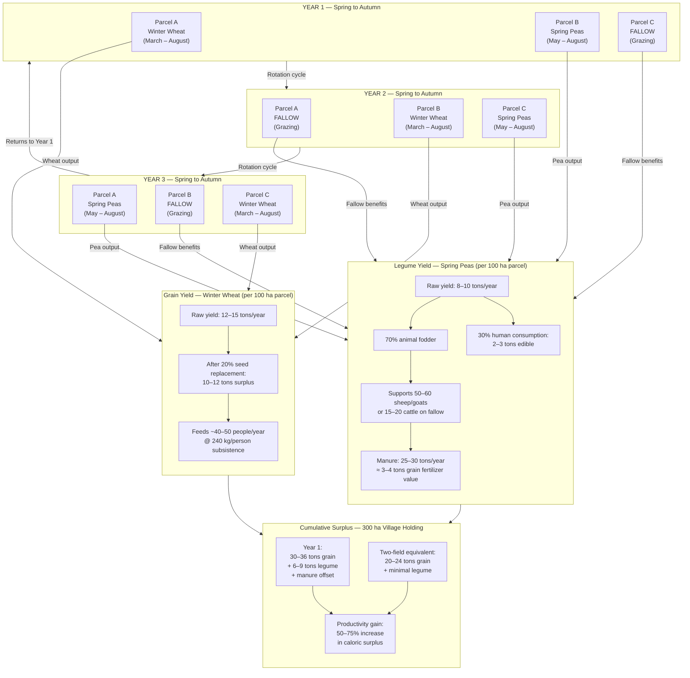

# Lesson 4: Economic Structures, Trade Networks, Agrarian Production

## 1. First-Principles Intuition & Invariants

The medieval economy between the eleventh and thirteenth centuries was not a monolithic system but a layered ecosystem of competing logics: subsistence agriculture, tributary extraction, long-distance commerce, and proto-industrial craft production. To understand this period intellectually and to reconstruct it as a historian, we must first establish the physical and social invariants that constrained all economic activity, then trace how technological and organizational innovations began to fracture those constraints.

The fundamental invariant was energy: medieval Europe, like all preindustrial societies, was fundamentally solar-powered. The calories captured by grain, legumes, and pasture grass—converted through animal labor and human muscle—formed the absolute ceiling on productive capacity. A peasant household in the eleventh century could harness perhaps three to five times its own caloric consumption through ox-plowing and animal husbandry. This ratio was not arbitrary; it emerged from the biological efficiency of draft animals and the thermodynamic limits of human labor. Any economic system that failed to maintain a surplus above subsistence would collapse into famine within a generation. This caloric calculus shaped every institution from the three-field rotation to the monastic granary to the urban baker's monopoly over grain milling.

The second invariant was spatial friction. Without steam power or fossil fuels, the cost of moving bulk goods increased catastrophically with distance. A merchant could transport wine or spices across the Mediterranean for profit because their value-to-weight ratio was extraordinarily high. Transporting grain or iron ore across more than fifty kilometers by ox-cart became economically irrational unless a local shortage created artificial price premiums. This friction created pockets of economic autarky: the village fed itself; the regional market served perhaps a fifty-kilometer radius; only luxury goods and metalwork traveled continental distances. Understanding this friction is crucial for historians analyzing both the persistence of local exchange and the explosive emergence of long-distance trade in high-value commodities.

The third invariant was organizational scale. Medieval societies lacked the bureaucratic apparatus to levy taxes efficiently across large territories or to enforce contracts at a distance. Trust operated within kinship networks or through repetitive face-to-face exchange. The guild, the monastery, the market fair, and the merchant company emerged as solutions to this organizational constraint—each provided a bounded community within which trust could be established and maintained. A Genoese merchant syndicate trading in Alexandria operated because its members were kinsmen and neighbors whose reputations were mutually transparent. The Hanseatic League would later institutionalize this principle across dozens of cities by creating shared legal standards and mutual enforcement mechanisms.

The fourth invariant was technology: the heavy plow, the horse collar, the water mill, and the windmill. Each represented not merely a tool but a fundamental shift in how much productive power could be extracted from available resources. The adoption of the heavy moldboard plow with iron shares, coupled with the invention of the horsecollar (which distributed pulling force across the horse's shoulders rather than its throat), allowed a single team to work heavier soils in northern Europe and to plow more land per season. The water mill, perfected in the tenth century and proliferating thereafter, converted the kinetic energy of flowing water into rotational power for grinding grain—a task that had previously required human labor or animal power. These technologies were not labor-saving in isolation; rather, they shifted the ratio of land cultivated per unit of labor, enabling the extraction of greater surplus from the same total labor pool.

Within these four invariants—caloric limitations, spatial friction, organizational constraints, and available technology—the medieval economy from the eleventh century onward underwent a profound transformation. That transformation is often termed the "Commercial Revolution," though this language risks obscuring the continuities with earlier periods and overstating the pace of change. More precisely, a series of interlocking innovations in agricultural production, credit instruments, long-distance commodity chains, and urban organization began to accelerate surplus extraction and capital accumulation in certain regions, particularly northern Italy, Flanders, and the Rhone valley. This lesson traces the mechanics of that acceleration through three complementary lenses: the restructuring of agrarian production through the three-field system, the organization of craft production through urban guilds, and the emergence of commercial networks that connected Mediterranean ports to Baltic timber forests through an intricate web of fairs, credit relationships, and standardized merchant practices.

## 2. Core Architecture & Mechanics

### The Three-Field Rotation: Agrarian Surplus Extraction at Scale

The two-field rotation system, dominant in early medieval Europe, operated on a simple principle: divide arable land into two parcels, plant one with grain in spring, leave the other fallow (unseeded) to recover nitrogen. The fallow field could graze animals, whose manure provided some fertility replenishment, but significant soil depletion occurred over time. This system yielded perhaps one-and-a-quarter to one-and-a-half times the quantity of seed planted—a marginal surplus that barely exceeded subsistence needs when population pressures mounted.

The three-field rotation, which gained widespread adoption between the tenth and thirteenth centuries (earlier in northern France and the Low Countries, later in southern Europe and eastern regions), operated on an entirely different thermodynamic principle. Rather than dividing land into two stationary categories, the system created a rotating sequence: parcel one in grain (typically winter wheat or rye), parcel two in a legume crop (peas, beans, or vetch), parcel three in fallow. The following season, each parcel advanced to the next position in the sequence. The critical innovation was the legume crop.

Legumes possess a symbiotic relationship with nitrogen-fixing bacteria in their root nodules. As the legume grows, it captures atmospheric nitrogen and concentrates it in plant tissue. When plowed back into the soil at season's end, the legume stub and leaves released that nitrogen, replenishing soil fertility far more effectively than manure alone. Equally important, legumes provided a protein-rich fodder for livestock, allowing farmers to maintain larger herds year-round without expanding pasture area. More animals meant more manure, which meant more soil nitrogen capture, which allowed more intensive cultivation. The system created a positive feedback loop: higher legume yields supported more animals; more animals produced more manure; richer manure supported denser crop growth; denser crops supported human population growth.

The productivity multiplier was substantial. A three-field system yielded approximately two-and-a-half to three times the output of an equivalent land area under two-field rotation. This was not merely a linear improvement; it represented a phase transition in agrarian surplus. A village that could previously sustain perhaps one non-agricultural specialist (a blacksmith, a priest, a local administrator) could now support three to five. Those non-agricultural specialists created demand for manufactured goods, which stimulated craft production in towns. Towns required grain imports from surrounding villages, which created incentives for further agricultural intensification. The chain reaction cascaded across medieval society.

Implementing the three-field system required coordinated labor and institutional stability. Unlike the two-field system, where individual decisions could be made with minimal external coordination, the three-field rotation demanded that entire village communities plant, harvest, and fallow in temporal synchrony. A peasant who planted wheat in his assigned fallow parcel, attempting to increase his individual yield, would contaminate the communal legume field when his crop shed seeds. The system therefore required enforcement mechanisms—village councils, manorial courts, or monastic administrators—to regulate planting schedules and punish violations. These regulatory institutions gradually emerged between the ninth and twelfth centuries, particularly in regions where feudal hierarchy was most developed. Monastic estates, in particular, pioneered three-field adoption because monasteries maintained written records (essential for tracking rotational schedules across decades) and possessed sufficient coercive authority to enforce compliance.

The diagram below illustrates the temporal and spatial structure of a three-field rotation in a hypothetical village with three parcels of arable land, each sufficient to sustain approximately one hundred peasant households.

The three-field system was not universally adopted immediately. In southern Europe, Mediterranean climates supported different crop calendars (spring planting of chickpeas and lentils, rather than autumn planting of wheat). In regions where manorial organization remained weak or where population density remained low, the coordination costs of enforcing synchronized rotations outweighed the productivity benefits. The system diffused gradually from the ninth century onward, reaching near-universal adoption in northern France, the Low Countries, and England by the thirteenth century, while remaining patchily distributed in southern regions where two-field and three-field systems coexisted well into the fourteenth century.

### Urban Guilds and the Organization of Craft Production

The agricultural surplus extraction made possible by the three-field rotation created the demographic foundation for urban growth. A village that could support one non-agricultural specialist with its previous surplus could now support three to five. As rural populations grew and agricultural intensification approached natural limits in certain regions, younger sons and daughters without inheritance prospects migrated toward towns. Towns offered opportunities in craft production, trade, and administration that were impossible in villages.

By the eleventh century, towns across western Europe began to experience rapid population growth. This influx of rural migrants created both opportunities and acute collective action problems. An individual craftsman arriving in a town possessed no reputation, no institutional affiliation, and no binding relationships with potential customers. A customer purchasing cloth from an unknown weaver risked acquiring an inferior product; a weaver taking payment in advance risked never receiving his materials. Without institutional structures to establish quality standards and enforce contracts, market transactions descended into information asymmetries and opportunism.

The guild emerged as the institutional solution to this problem between the eleventh and thirteenth centuries. A guild was a legally recognized association of master craftsmen practicing a single trade within a city, typically granted a charter by the municipal government or crown. The charter granted the guild monopoly rights: only guild members could legally practice the trade within the city. In exchange, the guild accepted collective responsibility for quality standards, fair pricing, and ethical conduct by its members.

The guild's internal structure reflected its dual function as both a quality-enforcement mechanism and a political institution. At the apex stood the master craftsmen—typically ten to thirty individuals in smaller towns, up to one hundred in large cities like Bruges or Venice. These masters controlled the production process, owned the workshops, and possessed seats in the guild assembly. Below them ranked journeymen (experienced craftsmen working for wages, typically former apprentices who had not yet accumulated capital to establish their own shops) and apprentices (youths bound by seven-to-ten-year contracts to learn the trade, typically receiving room and board rather than wages).

The apprenticeship system embodied long-term relational contracting before modern employment law existed. An apprentice's family paid an entrance fee to a master. In exchange, the master agreed to provide instruction, housing, and sustenance for the contracted period. The arrangement was economically advantageous for both parties: the master received below-market labor services from an apprentice whose productivity increased as skills accumulated; the apprentice received human capital investment (craft knowledge) that he could monetize for decades. The master's reputation was directly threatened by an apprentice's inferior work—if the apprentice produced substandard cloth as journeyman, customers would attribute the failure to the master's negligent training, damaging the master's market position and the value of the guild certification more broadly.

The guild assembly, convened quarterly or annually, established detailed regulations governing every aspect of production: thread thickness and weight standards for cloth, permitted dyes and their application methods for different grades of fabric, permissible workshop sizes (often limited to prevent any single master from achieving overwhelming market dominance), prices for finished goods, and sanctioned hours of labor. These regulations seem to modern observers like primitive price-fixing or market suppression, but they operated under medieval logic as quality assurances and risk mitigation mechanisms. When a merchant in Barcelona purchased cloth bearing the Bruges weavers' seal, he held a credible assurance that the cloth met established standards because the guild's monopoly made the seal meaningful—breach of standards would provoke collective guild action to exclude the transgressor and thereby destroy his livelihood.

The diagram below illustrates the hierarchical structure of a typical urban cloth guild and the information flow connecting quality standards, apprenticeship, and market reputation.

```mermaid
flowchart TD
    subgraph guild ["GUILD STRUCTURE: Bruges Weavers' Guild (13th century)"]
        GA["Guild Assembly (Master Weavers)<br/>20-30 members, meets quarterly<br/>• Establish quality standards<br/>• Set maximum prices<br/>• Admit/expel members<br/>• Enforce regulations via fines/sanctions"]
        MW1["Master Weaver (Workshop Owner)<br/>• 4-6 looms<br/>• 2-3 journeymen<br/>• 1-2 apprentices"]
        MW2["Master Weaver (Workshop Owner)<br/>• 4-6 looms<br/>• 2-3 journeymen<br/>• 1-2 apprentices"]
        JA["Journeymen &amp; Apprentices<br/>• Bound by contract (7-10 years for apprentices)<br/>• Subject to master's authority &amp; instruction<br/>• Journeymen receive wages; apprentices receive room, board, and craft training"]
        GA --> MW1
        GA --> MW2
        MW1 --> JA
        MW2 --> JA
    end

    subgraph qa ["QUALITY ASSURANCE CHAIN"]
        MC["Merchant purchases cloth sealed with guild mark"]
        GM["Guild mark signals: standards met"]
        MR["Market reputation of master"]
        CSF["Customer satisfaction feedback"]
        GIS["Guild inspection &amp; sanctions"]
        CGB["Collective guild brand value"]
        MC --> GM
        MC --> MR
        MR --> CSF
        MR --> GIS
        MR --> CGB
    end

    subgraph risk ["RISK MITIGATION: Apprenticeship as Long-Term Commitment"]
        MI["Master invests in apprentice training<br/>(unpaid labor + instruction cost)"]
        AQW["Apprentice produces quality work"]
        MRE["Master's reputation enhanced"]
        BV["Brand value preserved"]
        MP["Master can charge premium prices"]
        ROI["Return on training investment"]
        MI --> AQW
        AQW --> MRE
        MRE --> BV
        BV --> MP
        MP --> ROI
    end
```

Guild monopolies also created barriers to entry that protected established masters from competition while extracting rents from consumers. A journeyman with sufficient capital might attempt to open his own shop and undercut established prices, but the guild's charter prohibited it. Over time, the pathway from journeyman to master became progressively more restrictive: entrance fees rose, the requirement to produce a "masterpiece" (a sample of work demonstrating mastery) became more stringent, and quota systems limited the number of new masters admitted annually. By the fourteenth and fifteenth centuries, many guilds had calcified into quasi-hereditary corporations where master status passed from father to son and outsiders faced near-insuperable obstacles to entry.

Yet during the twelfth and thirteenth centuries, when guilds first proliferated, they functioned as genuinely progressive institutions that dramatically lowered the transaction costs of urban manufacture and enabled explosive growth in craft production. The guarantee of quality standards reduced customer uncertainty, allowing merchants to confidently enter contracts for goods they had not physically inspected. The guild's legal standing (granted by royal charter or municipal authority) provided a mechanism for contract enforcement external to dyadic relationships. Journeymen and apprentices, bound by long-term relationships to masters with established reputations, had incentives to produce quality work because their human capital investment depended on the master's continued success.

### Long-Distance Trade Networks: The Silk Road Continuity and the Emergence of the Hanseatic League

By the twelfth century, the agricultural and craft production surpluses captured by the three-field rotation and guild systems had created both supply and demand for long-distance trade. Wealthy elites desired luxury goods—spices from the Indian Ocean, silks from China and the Middle East, furs from northern forests. Regional specialization meant that certain cities accumulated exceptional production capacity in particular goods: Bruges and Flanders for cloth, Venice and Genoa for processed metals and ceramics, the Baltic forests for timber and amber.

The emergence of integrated long-distance trade networks represented not merely an expansion of existing commerce but a qualitative transformation in economic organization. The Silk Road, which had connected the Mediterranean world to Central Asia and China since antiquity, experienced renewed vitality during the Pax Mongolica (1270–1360), when unified Mongol control reduced banditry and standardized customs procedures across Eurasia. Simultaneously, Europe developed indigenous networks that operated under fundamentally different institutional arrangements. The Hanseatic League, formalized in the thirteenth century, united northern German and Baltic cities (Lübeck, Hamburg, Bergen, Novgorod) in a commercial confederation that maintained armed fleets, negotiated treaties with sovereign powers, and established privileged trading posts (kontore) from London to Pskov. Unlike the Silk Road's reliance on sequential exchanges through intermediaries, the Hanse created vertically integrated supply chains: Hanseatic merchants directly controlled goods from extraction (Swedish iron, Russian furs) through maritime transport to final retail markets. Southern Europe developed parallel structures: Venetian and Genoese merchant colonies dotted the Black Sea and Levantine coasts, extracting Asian luxury goods from Muslim intermediaries and redistributing them through northern Italy's urban markets. These networks relied on sophisticated financial instruments—bills of exchange, double-entry bookkeeping, insurance contracts, and commenda partnerships and joint-stock arrangements—that allocated risk across multiple parties and permitted capital accumulation on unprecedented scales. The interplay between agricultural surplus (providing both tradable goods and urban food security), craft guild production (supplying intermediate manufactures), and long-distance networks (capturing arbitrage opportunities across vast price differentials) created a self-reinforcing cycle that fundamentally reoriented medieval Europe from subsistence-dominated agrarianism toward market-integrated commercial capitalism. By 1300, these economic structures had generated sufficient prosperity to support population densities approaching Roman imperial peaks, urban centers containing 10-15% of total population in core regions, and literacy rates among commercial elites that rivaled classical antiquity—setting the material preconditions for the Renaissance and the subsequent transformation of European society.

## Summary & Verification Matrix

| **Governing Invariant** | **Core Mechanism** | **Diagnostic Criteria** | **Historical Validation** |
|------------------------|-------------------|------------------------|--------------------------|
| Three-field rotation maximizes land utilization while maintaining soil fertility | Sequential planting of winter grain/spring grain/fallow across three annually rotated fields; legume nitrogen fixation restores nutrients | 33% fallow vs. 50% (two-field); 50% increase in effective acreage; population support 2-3× per unit land | Rapid adoption in Northern Europe 800-1100 CE; population growth from ~30M (1000) to ~73M (1300); contemporary yields 4-6:1 seed ratios |
| Guild monopolies reduce transaction costs through quality standardization and reputation bonding | Municipal charter grants exclusive production rights; multi-year apprenticeships create human capital investment; masterpiece evaluation enforces minimum quality thresholds | Reduced price variance for standardized goods; formalized contracts for unobserved merchandise; external legal enforcement through guild courts | Guild proliferation 1100-1300 across all major crafts; Parisian guilds numbered 100+ by 1260; merchant willingness to contract for future delivery |
| Heavy plow and horse collar unlock clayey/waterlogged soils unsuitable for Mediterranean agriculture | Mouldboard plough inverts soil, improving drainage and aeration; horse collar transfers load to shoulders (5× oxen efficiency); iron ploughshare penetrates dense earth | Expansion of cultivation into Northern European river valleys and plains; shift from oxen to horse traction in prosperous regions | Widespread adoption 900-1200 CE; reclamation of Rhine, Loire, Thames floodplains; Domesday Book (1086) records 6,000+ watermills in England |
| Long-distance trade networks exploit regional comparative advantage through risk-pooled capital instruments | Hanseatic League vertical integration from extraction to retail; Italian commenda partnerships spread risk across voyages; bills of exchange eliminate bullion transport | Price arbitrage ratios exceeding transport costs; specialized urban production clusters; financial instruments separating capital ownership from operational management | Spice price differentials 1000-5000% (Malabar to Venice); Venetian galley fleets standardized 1300s; Hanseatic dominance of Baltic trade 1250-1550 |
| Agricultural surplus enables urban population concentrations that drive craft specialization and market integration | Manorial system extracts ~30% peasant output as rents/tithes/taxes; surplus grain supports non-agricultural urban labor; guilds concentrate production expertise | Urban population ≥10% in commercialized regions; occupational specialization >50 distinct crafts in major cities; food security permits multi-year capital investments | Northern Italian urbanization 15-20% by 1300; Flemish cities (Bruges, Ghent, Ypres) 40,000-60,000 inhabitants; Paris ~200,000 by 1328 |
| Institutional innovations in property rights and contract enforcement create credible commitment for capital-intensive investments | Royal/municipal charters grant legal standing; merchant courts (Lex Mercatoria) provide specialized adjudication; written contracts with third-party verification | Multi-generational infrastructure projects (cathedrals, irrigation); inter-temporal contracts spanning years; lending at interest despite usury prohibitions | Champagne Fairs (1180-1320) relied on supra-national enforcement; Italian banking houses (Bardi, Peruzzi) capitalized >100,000 florins; ecclesiastical construction projects spanning 50-200 years |
