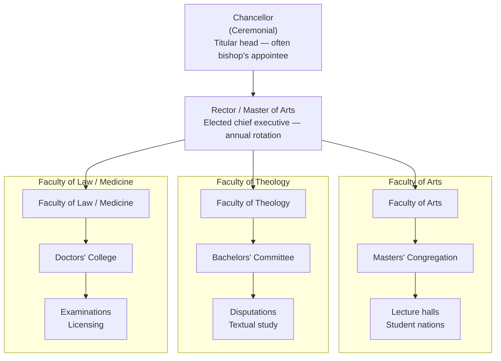
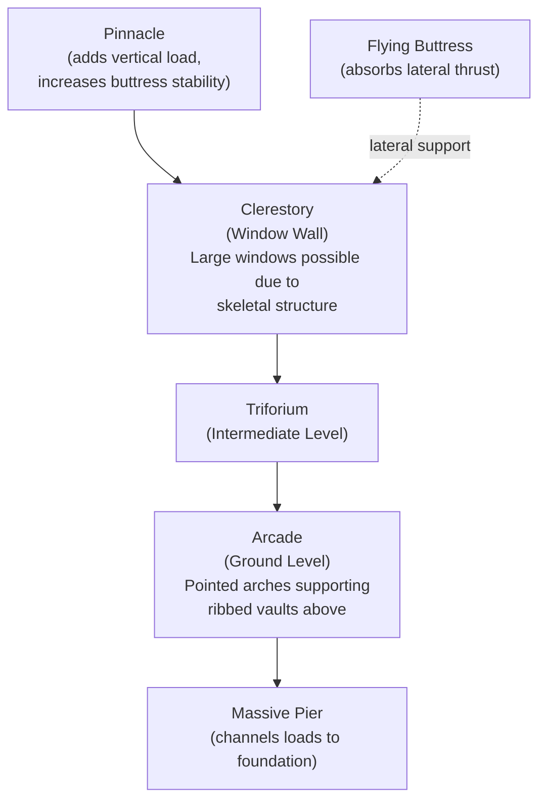

# Lesson 5: Cultural Production, Knowledge Transmission, Intellectual Movements

## 1. First-Principles Intuition & Invariants

The medieval period witnessed a fundamental transformation in how knowledge was created, preserved, and transmitted across generations—a shift as profound as the later invention of movable type or the modern internet. Understanding medieval cultural production requires abandoning the anachronistic assumption that intellectual life diminished after Rome's fall. Instead, we must recognize that medieval Europe, the Islamic world, and Byzantium constructed sophisticated knowledge infrastructures that operated under constraints radically different from classical antiquity or modernity. Where Roman intellectual life centered on wealthy private libraries, rhetorical education for civic participation, and manuscript circulation among aristocratic networks, medieval knowledge transmission developed institutional permanence through universities, monastic scriptoria, and translation centers that transcended individual patrons and survived political upheaval.

The core invariant governing medieval cultural production was scarcity combined with institutional memory. Parchment manufacturing required substantial animal resources—a single Vulgate Bible consumed the skins of approximately 250 calves or 500 sheep. A professional scribe working six hours daily needed four to five months to copy a complete Bible, and specialist illuminators might spend additional months on decoration. This material scarcity meant that manuscript production concentrated in institutions capable of sustaining multi-year projects: monasteries with sheep flocks and tanneries, cathedral chapters with endowments, universities with student copyist networks, and royal courts with dedicated scriptoria. Unlike the relatively liquid manuscript market of late antiquity, where commercial booksellers could produce multiple copies of popular texts within weeks, medieval book production operated on monastic time scales measured in seasons and years.

This scarcity created powerful selection pressures on which texts survived and how they circulated. Monastic communities prioritized liturgical texts, patristic commentaries, and rules governing religious life—content directly supporting their institutional mission. Cathedral schools and later universities required textbooks for the trivium (grammar, rhetoric, logic) and quadrivium (arithmetic, geometry, music, astronomy), creating demand for Aristotelian commentaries, Euclidean geometry, and legal codices. Royal courts patronized chronicles, genealogies, romances, and administrative manuals. Each institutional context acted as a filter, determining which classical and contemporary texts received the investment of scarce parchment and scribal labor. The survival of Virgil, Cicero, and Ovid owed much to their utility in grammar instruction; esoteric philosophical texts without pedagogical applications often perished.

Yet within these constraints, medieval scribes and scholars developed transmission protocols ensuring remarkable fidelity across centuries. Monastic scriptoria implemented quality control systems where senior monks reviewed copies against exemplars, correcting errors before manuscripts entered circulation. Colophons—scribal signatures at manuscripts' end—recorded the copyist's name, date, location, and often their physical condition ("the hand is tired, the body aches"). These colophons functioned as metadata, allowing later scholars to trace textual genealogies and reconstruct transmission paths. When errors accumulated across generations of copying, medieval scholars developed collation techniques, comparing multiple manuscript witnesses to establish authoritative readings. This philological method, refined by humanists like Lorenzo Valla in the fifteenth century, originated in medieval manuscript culture's practical need to maintain textual integrity across long temporal distances.

The intellectual movements examined in this lesson—the Carolingian Renaissance, the Twelfth-Century Renaissance, the translation movements of Toledo and Baghdad, the rise of universities—represent moments when institutional innovation lowered knowledge transmission barriers or connected previously isolated intellectual networks. Charlemagne's educational reforms created a empire-wide infrastructure of scribal training and textual standardization. The Toledo translation workshops bridged Arabic and Latin scholarly communities, importing Greek philosophy and Islamic science into European curriculum. The universities of Bologna, Paris, and Oxford institutionalized advanced education beyond monastic and cathedral contexts, creating permanent faculties, standardized curricula, and degree-granting authority. Each movement accelerated knowledge circulation by building institutional scaffolding that outlasted individual patrons or political regimes.

Understanding these movements requires analyzing them as complex systems with feedback loops, network effects, and path dependencies. The decision by Carolingian reformers to standardize on Caroline minuscule—a clear, economical script—reduced scribal training time and increased copying speed, enabling broader manuscript circulation. This circulation expanded the pool of available exemplars, which improved textual accuracy and revealed gaps in Latin knowledge of Greek philosophy, motivating later translation projects. Translated Arabic texts introduced new logical and metaphysical vocabularies, which stimulated theological debates, which created demand for higher education, which drove university formation. Each innovation created preconditions for subsequent developments in an autocatalytic process spanning four centuries.

The rise of vernacular literature—French chansons de geste, German Minnesang, Italian dolce stil nuovo, English romance—represents another fundamental shift in cultural production. Before the twelfth century, literary production concentrated almost exclusively in Latin, the language of Church, law, and learning. Vernacular oral traditions existed but left minimal written trace. The emergence of written vernacular literature required three preconditions: a courtly aristocratic audience with leisure for entertainment and sufficient literacy to consume written texts; poets and scribes willing to invest labor in languages lacking Latin's prestige; and material support from patrons who valued vernacular cultural production. The confluence of these factors in twelfth-century Provence, where troubadour poetry flourished under noble patronage, created a template replicated across Europe. Once vernacular literary culture achieved critical mass, network effects ensued—poets imitated successful models, patrons competed for cultural prestige, scribes developed orthographic conventions, and audiences expanded beyond the clerical elite.

Artistic patronage systems and Gothic architectural engineering demonstrate how cultural production depended on sophisticated resource mobilization and technical knowledge transmission. Constructing a cathedral required coordinating quarries, transport networks, masons' lodges, glaziers' workshops, and financing mechanisms across decades or centuries. The technical knowledge enabling pointed arches, ribbed vaults, flying buttresses, and structural analysis resided in master builders' guilds that transmitted craft secrets through apprenticeship rather than written treatises. Gothic architectural "technology" diffused through labor mobility—master masons contracted for projects across Europe, bringing design innovations and construction techniques. The Cistercian order, with its international network of monasteries sharing standardized architectural plans, functioned as a knowledge transmission system parallel to universities, spreading structural innovations through institutional channels.

The fundamental tension structuring medieval cultural production was between institutional preservation and innovation. Monastic scriptoria excelled at preserving authoritative texts across generations but showed limited interest in producing new knowledge. Universities created contexts for dialectical debate and commentary but remained conservative in curriculum, resisting incorporation of new disciplines. Royal courts patronized vernacular literature and chronicles but lacked institutional continuity—when a generous patron died, cultural production often collapsed. The most dynamic cultural movements occurred at interfaces between different institutional contexts: when university-trained clerics entered royal service as administrators and brought scholastic methods to governance; when Arabic-speaking Christians in Toledo collaborated with Jewish and Muslim scholars to translate philosophical texts for Latin audiences; when mendicant orders like Franciscans and Dominicans combined monastic learning with urban pastoral care, creating new theological and philosophical approaches.

Analyzing medieval cultural production through these systemic lenses reveals patterns invisible to narratives focused solely on individual genius or cultural decline. The "Twelfth-Century Renaissance" was not primarily about exceptional individuals like Peter Abelard or Hildegard of Bingen, though they exemplified broader trends. Rather, it resulted from institutional innovations (urban schools coalescing into universities), technological improvements (increased parchment availability, standardized scripts), and network integration (translation movements connecting Latin, Arabic, and Greek intellectual worlds). Individual brilliance operated within and was enabled by these structural transformations. Similarly, Gothic architecture's emergence cannot be reduced to a single inventor's insight but must be understood as the product of cumulative craft knowledge, competitive patronage dynamics, and institutional contexts (episcopal authority, urban communes, royal administration) that mobilized resources for monumental construction.

## 2. Core Architecture & Mechanics

### University Formation and Institutional Structure

The medieval university emerged not from deliberate planning but through accretionary processes as informal teaching communities acquired corporate legal status, standardized curricula, and degree-granting monopolies. The three archetypal universities—Bologna, Paris, and Oxford—followed divergent institutional paths that shaped European higher education for centuries.

Bologna originated as a guild of law students in the late eleventh century. Roman law, rediscovered and systematized by Irnerius around 1088, attracted students throughout Europe seeking legal training for ecclesiastical or secular administrative careers. These students, many mature adults with independent means, organized a universitas scholarium (corporation of students) to negotiate collectively with masters and the city commune. The student guild hired and fired professors, set lecture schedules, and imposed fines for inadequate teaching. Masters received fees directly from students rather than institutional salaries. This student-controlled model created competitive pressures driving pedagogical innovation—professors who could not attract fee-paying students faced unemployment.

The Bologna curriculum centered on legal texts: Justinian's Corpus Iuris Civilis for civil law, Gratian's Decretum for canon law. Students progressed through an eight-year course of study beginning with foundational texts (Institutes, then Digest, then Code), attending morning lectures where masters explicated texts clause by clause, and afternoon disputations where students debated problematic passages. The pedagogical method—close reading, logical analysis, reconciliation of contradictory authorities—derived from scholastic theology but adapted to legal material. Advanced students composed glosses (marginal annotations) and summae (systematic syntheses), gradually building comprehensive legal knowledge. After six to eight years, students petitioned for examination by a committee of doctors, who tested the candidate's ability to interpret texts, resolve legal puzzles, and defend propositions in disputation. Successful candidates received the licentia docendi (license to teach), entitling them to join the faculty and establishing their credentials for legal practice or administrative office.

Paris developed from the cathedral school of Notre-Dame, where masters like Peter Abelard taught dialectic and theology in the early twelfth century. Unlike Bologna's law students, Paris attracted younger students pursuing the arts curriculum (trivium and quadrivium) as preparation for theology. The masters rather than students controlled the university corporation, forming a universitas magistrorum modeled on craft guilds. The bishop of Paris initially claimed authority to license masters, but the university gradually secured autonomy through royal charters and papal privileges. By the thirteenth century, Paris organized into four faculties—arts, theology, law (canon law only, as Roman law was prohibited in France), and medicine—each with a dean and self-governing statutes.

The Paris curricular structure established the template for northern European universities. Students entered the faculty of arts around age fourteen after completing basic Latin grammar. The arts curriculum required four to six years, covering Aristotelian logic (the "old logic" of Categories and On Interpretation, the "new logic" of Prior and Posterior Analytics), natural philosophy (Physics, On the Soul, On Generation and Corruption), metaphysics, and ethics. Instruction followed the lectio and disputatio format: masters read and commented on authoritative texts in morning lectures; students participated in weekly disputations defending or attacking philosophical propositions. Twice yearly, faculties held quodlibetal disputations where any question could be raised, testing masters' ability to respond extemporaneously to challenges from students and colleagues. After completing the arts course and demonstrating competence through examinations, students received the bachelor of arts degree and could continue to the master of arts, which required additional study and public lectures.

The master of arts degree granted the ius ubique docendi—the right to teach anywhere—though in practice most universities required local licensing. Masters of arts could then enter higher faculties: theology, law, or medicine. Theology, the "queen of sciences," required eight to fifteen years of study beyond the arts degree. Theological students progressed through stages: biblical bachelor (lecturing on Scripture), sententiarius bachelor (commenting on Peter Lombard's Sentences), and formed bachelor (participating in disputations). Only after this extended apprenticeship could candidates sit for the doctorate in theology, which conferred the highest academic rank and entitled the holder to a cathedral canonry or similar ecclesiastical benefice.

Oxford emerged in the late twelfth century, modeled on Paris but with distinct features reflecting English ecclesiastical politics and royal governance. The university secured autonomy from the bishop of Lincoln and the town corporation through royal charters and papal bulls, establishing jurisdiction over students and masters. The Oxford curriculum closely followed Paris in arts and theology, but Oxford masters showed greater interest in natural philosophy and mathematics, producing figures like Robert Grosseteste and Roger Bacon who emphasized empirical observation and mathematical analysis.

The university system's core architectural innovation was the separation of teaching authority from ecclesiastical and civic governance. Earlier cathedral schools depended on bishops who appointed masters and controlled curriculum; monastic schools served primarily internal educational needs. Universities claimed corporate autonomy analogous to urban communes or craft guilds: self-governing communities with elected officials, internal judicial systems, and monopoly control over credential-granting. This institutional structure created stable career paths for scholars independent of aristocratic patronage or ecclesiastical preferment. A master could pursue intellectual work within the university's protected space, earning income through student fees or benefices attached to teaching positions.



The university's operational mechanics depended on several key infrastructures. Student "nations"—regional associations like the English nation, Norman nation, or Picard nation—provided mutual aid, lodging coordination, and political representation. Nations elected proctors who sat on university governing councils. This organizational layer helped integrate foreign students into local communities and gave students collective bargaining power. Colleges, initially charitable foundations providing housing and meals for poor students, gradually evolved into teaching institutions with resident masters offering supplementary instruction. Merton College at Oxford (1264) and the Sorbonne at Paris (1257) exemplified this institutional form, which eventually superseded the older lecture-and-disputation system.

### Translation Movements: Baghdad, Toledo, and Knowledge Transfer

The translation movements of the medieval period—particularly the Abbasid translation movement in ninth-century Baghdad and the Toledo translation school in twelfth-century Iberia—represent systematic knowledge transfer operations that connected Greek, Arabic, Latin, and Hebrew intellectual traditions. Understanding these movements requires analyzing the material conditions, social networks, and intellectual motivations that enabled cross-cultural scholarly collaboration.

The Abbasid translation movement, centered in Baghdad's Bayt al-Hikma (House of Wisdom), systematically translated Greek philosophical, mathematical, astronomical, and medical texts into Arabic, with the most systematic efforts from approximately 820 to 950 CE. Abbasid caliphs, particularly al-Ma'mun (r. 813–833), provided institutional and financial support, commissioning translations and establishing astronomical observatories and hospitals where translated knowledge could be applied. The movement drew on several source communities: Byzantine Greeks who fled iconoclasm, Nestorian Christians with Greek linguistic training, and Syriac-speaking communities who had previously translated Greek texts into Syriac as an intermediate stage.

The translation process typically involved multiple stages. A scholar fluent in Greek and Arabic would produce a rough translation, often quite literal. A second scholar, sometimes working collaboratively with the first, would polish the Arabic style and clarify ambiguous passages. For technical texts in mathematics or astronomy, diagrams required redrawing and numerical values converting to Arabic numerals and astronomical parameters adjusting to Baghdad's longitude. Translator-scholars like Hunayn ibn Ishaq (808–873) developed systematic philological methods, comparing multiple Greek manuscripts to establish accurate source texts before translating, and producing revised translations when superior Greek copies became available. Hunayn's translations of Galen's medical corpus exemplified this methodical approach—he noted textual variants, explained difficult passages, and corrected errors in existing Syriac translations.

The intellectual impact of the Abbasid translation movement extended far beyond simple knowledge transfer. Arabic scholars did not merely translate but actively engaged with and extended Greek thought. Al-Khwarizmi's algebra integrated Greek geometry with Indian numerals, creating new mathematical methods. Ibn Sina (Avicenna) synthesized Aristotelian metaphysics with Neoplatonic emanation theory and Islamic theology, producing an influential philosophical system that addressed problems Greek thinkers had left unresolved. Al-Haytham revolutionized optics by combining Greek geometric analysis with experimental methodology, testing theories about vision through controlled observations. This creative engagement meant that when these texts later reached Latin Europe, they transmitted not only Greek knowledge but also several centuries of Arabic elaboration, correction, and innovation.

The Toledo translation school operated in a dramatically different social context: the multicultural environment of recently reconquered Iberia, where Arabic-speaking Muslim and Jewish communities coexisted with Latin Christian rulers. Toledo, captured by Alfonso VI of Castile in 1085, preserved substantial Arabic libraries from its Islamic period. The translation school was not a formal institution but a network of collaborative teams active from approximately 1130 to 1200, though translation activity continued into the thirteenth century.

The typical Toledo translation team paired a scholar fluent in Arabic (often a Mozarab Christian or Jewish convert) with a Latinist (frequently an Italian or French cleric). The Arabic specialist would orally translate into Castilian Romance, and the Latinist would render the Castilian into Latin, sometimes consulting with the first translator to clarify technical terms. Gerard of Cremona (1114–1187), the most prolific Toledo translator, reportedly translated seventy-one works including Ptolemy's Almagest, Euclid's Elements, al-Khwarizmi's algebra, and substantial portions of Aristotelian natural philosophy and Galenic medicine. Gerard's translations introduced Latin Europe to the full Aristotelian corpus beyond the fragmentary logical works available earlier, triggering the intellectual ferment of the Twelfth-Century Renaissance.

The Toledo translations faced substantial technical challenges. Arabic philosophical vocabulary had been developed specifically to render Greek concepts—terms like hyle (matter) became hayula in Arabic, which Toledo translators rendered into Latin as materia or sometimes transliterated as heuila. Some Greek philosophical distinctions had been collapsed in Arabic, requiring translators to reconstruct original meanings from context. Mathematical and astronomical texts posed different challenges: Arabic texts used Indian numerals and sexagesimal notation inherited from Babylonian astronomy, both unfamiliar to Latin readers. Translators either explained these notations in glosses or substituted Roman numerals and Latinate terminology, sometimes introducing errors in the process.

The socio-political context profoundly shaped translation outcomes. Christian rulers like Alfonso X of Castile (r. 1252–1284) patronized translation projects as expressions of monarchical power and cultural sophistication. Alfonso's court produced Castilian translations of Arabic astronomical tables, legal codes, and historical chronicles, positioning Castilian as a literary language competitive with Latin. Jewish scholars like Abraham ibn Ezra served as intermediaries, translating Arabic texts into Hebrew or Latin and facilitating knowledge circulation across religious communities. This multidirectional translation activity—Arabic to Latin, Arabic to Hebrew, Hebrew to Latin, Latin to Romance vernaculars—created a complex textual network where ideas could flow through multiple linguistic channels.

```text
Translation Knowledge Flow (9th–13th centuries)

Greek Philosophical/Scientific Corpus
         │
         ├──────────────────────┐
         │                      │
    [Syriac intermediary]  [Direct Greek-Arabic]
         │                      │
         └──────────┬───────────┘
                    │
            Arabic Elaboration
         (Baghdad, Cordoba, Cairo)
         │
         ├─────────────────────────────────┐
         │                                 │
    Toledo School                    Sicily/Southern Italy
    (Arabic→Castilian→Latin)         (Greek→Latin, Arabic→Latin)
         │                                 │
         └─────────────┬───────────────────┘
                       │
               Latin Scholasticism
            (Paris, Oxford, Cologne)
                       │
              Vernacular Translations
           (French, Italian, English)
```

### Carolingian Renaissance and Manuscript Standardization

Charlemagne's educational and cultural reforms (ca. 780–820) created the institutional and technological infrastructure that preserved classical learning through the early medieval period and enabled subsequent intellectual movements. The Carolingian Renaissance was fundamentally a project of institutional state-building: Charlemagne sought to create a literate administrative class capable of governing his vast empire and a standardized liturgical practice that unified his religiously diverse territories. Cultural production served political imperatives.

The core innovation was the establishment of a palace school at Aachen under Alcuin of York, who brought Insular (Irish-English) educational methods to the Continent. Alcuin reorganized the trivium and quadrivium curricula, emphasizing Latin grammar through intensive study of classical authors—Virgil, Cicero, Sallust—as models of correct style. This classical revival was pragmatic rather than antiquarian: Charlemagne needed bureaucrats who could draft charters, compose diplomatic correspondence, and maintain fiscal records in competent Latin. The palace school trained not only royal administrators but also teachers who would staff monastic and cathedral schools throughout the empire, disseminating standardized pedagogical methods.

Charlemagne's capitularies mandated educational reforms across the empire's monasteries and bishoprics. The Admonitio Generalis (789) required every monastery and cathedral to establish a school teaching psalms, musical notation, computation (for calculating Easter), and grammar. Monks were instructed to correct liturgical books, eliminating scribal errors that had accumulated over generations of copying. This directive triggered massive manuscript production as monasteries systematically copied and corrected biblical texts, patristic writings, and liturgical books. The copying effort required developing standardized scripts and orthographic conventions to ensure consistency across the empire's scriptoria.

The script standardization centered on Caroline minuscule, a clear, easily-read book hand that emerged at the monastery of Corbie around 780 and spread empire-wide through Carolingian institutional networks. Caroline minuscule replaced the variety of local scripts—Merovingian cursive, Visigothic, Insular—that had developed regionally during the sixth and seventh centuries. These earlier scripts, while functional for their originating communities, posed legibility problems for readers trained in different scribal traditions. A manuscript copied in Visigothic script in Spain proved difficult for a Frankish monk trained in Merovingian cursive to read efficiently. Caroline minuscule solved this interoperability problem through simplification and standardization: consistent letter forms, clear word separation (earlier scripts ran words together), and reduced ligatures. A scribe trained in Caroline minuscule could read manuscripts from any Carolingian scriptorium, and copying became faster as the simplified letter forms required fewer pen strokes.

The material consequences of script standardization were profound. Copying speed increased by approximately 30–40 percent, enabling scriptoria to produce more manuscripts with equivalent scribal labor. The improved legibility reduced reading time and comprehension errors, making scholarship more efficient. Most significantly, Caroline minuscule's clarity made it suitable for preserving texts with minimal corruption across generations of copying. When Italian humanists in the fourteenth century rediscovered Carolingian manuscripts, they mistook Caroline minuscule for ancient Roman script and adopted it as their printing model, ensuring that this ninth-century innovation became the basis for modern lowercase letterforms.

Carolingian scriptoria implemented quality control protocols ensuring textual accuracy. The monastery of Corbie developed a systematic correction process where the armarius (librarian) reviewed completed manuscripts against exemplars, marking errors for correction before binding. Corrections were made by scraping parchment with a knife to remove erroneous text and writing the correct reading in the same hand. Alternatively, corrections appeared in margins or interlineated above the erroneous word, with sigla indicating their status. These correction systems, documented in surviving manuscripts and monastic customaries, reveal sophisticated textual scholarship operating within scriptoria—Carolingian monks were not mechanical copyists but active scholars engaged in philological work.

The Carolingian manuscript production system exhibited strong network effects. As more monasteries adopted Caroline minuscule and standardized texts, the value of individual manuscripts increased because they could circulate more widely and be read by more scholars. This circulation enabled comparative scholarship—a monk at Corbie could collate his monastery's copy of Virgil against a copy from Tours, identifying and correcting errors. The accumulation of corrected texts created progressively more accurate manuscript traditions. For some authors, the Carolingian period represents the stemmatic source from which all later medieval manuscripts descend—our modern editions of certain classical texts ultimately derive from Carolingian exemplars that no longer survive but whose readings were copied into later manuscripts.

The institutional infrastructure supporting Carolingian manuscript production included specialized roles and physical spaces. Large scriptoria like Tours or Corbie employed dozens of scribes working in dedicated writing rooms with good natural lighting. Parchment preparation occurred in separate workshops where skins were cleaned, stretched, scraped, and ruled for writing. Ink production required specialized knowledge—oak gall ink, the standard medieval writing medium, was produced by mixing gallnuts, iron sulfate, and gum arabic in specific proportions. Errors in ink chemistry could cause ink to corrode parchment or fade to illegibility. Scriptoria maintained ink recipes as closely guarded technical knowledge, and skilled ink-makers were valued specialists.

The Carolingian book production workflow divided labor among specialists: parchment preparers, scribes, rubricators (who added red-ink headings and initials), illuminators (who created decorated initials and miniatures), and binders. This division of labor increased efficiency but required careful coordination. A Gospel book might require two scribes working simultaneously on separate quires (folded parchment gatherings), a rubricator adding chapter headings after text completion, and an illuminator creating miniatures weeks or months later. The armarius managed this workflow, ensuring quires circulated among specialists in proper sequence and that completed gatherings were collated correctly before binding.

### Gothic Architecture: Engineering and Knowledge Transmission

Gothic architecture, developed between approximately 1140 and 1350, represents one of medieval Europe's most significant technical achievements: the creation of skeletal stone structures achieving unprecedented height and luminosity through innovative structural engineering. Understanding Gothic construction requires analyzing both the technical mechanics—how pointed arches, ribbed vaults, and flying buttresses distribute loads—and the social systems transmitting construction knowledge across generations and regions.

The structural innovation underlying Gothic architecture was the redistribution of roof loads from walls to discrete vertical supports, allowing walls to be replaced with glass. Romanesque architecture, dominant in the eleventh and twelfth centuries, used semicircular barrel vaults and groin vaults resting on continuous thick walls. These walls bore the vaults' lateral thrust, requiring massive masonry. Windows remained small to avoid weakening load-bearing walls. Gothic builders replaced this mass-based stability with skeletal precision, channeling forces through ribs, columns, and external buttresses.

The pointed arch provided the geometric foundation for Gothic structural systems. Unlike semicircular arches, pointed arches can be adjusted in height without changing their base width, allowing builders to create vaults covering irregular bays. More critically, pointed arches generate less lateral thrust than semicircular arches of equivalent span, reducing the buttressing required. The precise geometry of pointed arches—typically segments of circles with radii equal to or greater than the span—could be varied to create lancet (tall, narrow) or depressed (wide, shallow) arches suited to specific structural contexts.

Ribbed vaulting developed from the structural logic of pointed arches. Rather than constructing vaults as continuous shells, Gothic builders erected permanent stone ribs defining the vault's geometry, then filled spaces between ribs with lightweight masonry webbing. The ribs carried loads to vertical supports at vault corners, allowing the webbing to be relatively thin and reducing overall vault weight. Sexpartite vaults, used in early Gothic buildings like Notre-Dame de Paris, divided each bay into six compartments with diagonal and transverse ribs. Later High Gothic buildings adopted quadripartite vaults (four compartments) with simpler geometry and clearer load paths. The most elaborate Late Gothic vaults—fan vaults in England, net vaults in Germany—multiplied ribs into complex patterns that were partly structural and partly decorative.

Flying buttresses resolved the remaining structural challenge: countering the lateral thrust generated by high vaults. Early Gothic builders used internal buttresses—transverse walls hidden above aisle vaults—to absorb thrust from nave vaults. External flying buttresses, appearing by the 1170s–1180s, made this structural system visible and more efficient. A flying buttress consists of an inclined arch (the flyer) spanning from the nave wall to a massive external pier (the buttress pier). The flyer intercepts lateral thrust at the precise point where the nave vault exerts maximum outward force, typically about two-thirds of the way up the vault's height. The buttress pier's mass, combined with the flyer's geometry, redirects forces vertically into foundations. This external buttressing system freed the nave wall entirely from load-bearing requirements, allowing it to become a stone framework for stained glass.

The structural analysis underpinning Gothic architecture was empirical rather than mathematical. Medieval builders lacked analytical mechanics—the ability to calculate forces and stresses in structural members—yet they achieved sophisticated structural optimization through iterative experimentation and rule-of-thumb proportional systems. Master masons developed geometric design methods based on squares, equilateral triangles, and ad quadratum (45-degree) proportions that ensured structural stability. These geometric systems, recorded in mason's lodges and transmitted through apprenticeship, encoded accumulated structural knowledge without requiring mathematical calculation.



Construction knowledge transmission occurred primarily through the institution of the mason's lodge, a semi-permanent structure erected adjacent to a building site where masons worked during inclement weather, stored tools, and trained apprentices. Lodges functioned as craft guilds, maintaining secrecy around design methods and structural principles while providing mutual aid and regulating labor conditions. A master mason would train several apprentices over seven-year terms, teaching geometry, stone-cutting techniques, and design principles through hands-on practice. Journeymen masons traveled between projects, carrying technical knowledge across regions and introducing design innovations from distant workshops.

The mobility of master masons and their teams enabled rapid diffusion of Gothic architectural techniques. Villard de Honnecourt's portfolio (ca. 1225–1235), a unique surviving document from a traveling mason, contains drawings of Gothic structural details, geometric design methods, and mechanical devices observed across northern France. Villard's drawings suggest that masons systematically documented innovations encountered during travel, creating personal reference works that supplemented oral instruction from masters. This combination of apprenticeship training, documented design principles, and labor mobility created an effective knowledge transmission system despite the absence of written treatises or formal architectural education.

The financing and administration of Gothic construction projects required sophisticated project management and resource coordination. A cathedral building program typically began with the bishop and cathedral chapter securing donations from the king, nobility, and urban commune. The chapter appointed a master mason who produced a design, likely including wooden models showing structural details. Construction proceeded in phases, often spanning decades or centuries as funding permitted. The fabric (building committee) managed finances, purchased materials, negotiated contracts with quarries and transport providers, and supervised the workforce. Building accounts, surviving from several major projects, document expenditures with remarkable precision: quantities of stone from specific quarries, wages paid to different craft specialists, costs of scaffolding and lifting equipment, and payments to suppliers of lead, iron, and glass.

Large Gothic projects employed hundreds of workers in specialized roles: quarrymen extracting stone blocks, roughmasons squaring blocks at the quarry, freestone masons carving decorative elements, setters positioning stones with mortar, glaziers creating stained glass, carpenters building scaffolding and falsework (temporary wooden supports for arches and vaults during construction), smiths producing iron cramps and ties, and laborers hauling materials. This workforce exhibited strong seasonal patterns—most construction occurred between April and October when weather permitted outdoor work and mortar would cure properly. The winter months were devoted to indoor tasks: carving decorative elements in heated workshops, cutting templates, and planning the following season's work.

The technical complexity of Gothic construction generated new types of expertise and professional specialization. Stained glass production required knowledge of glass chemistry (adding metallic oxides to create colors), glass-cutting techniques, and leading (assembling cut glass pieces with lead strips). Glaziers worked from cartoons (full-scale drawings) provided by the master designer, and collaborated with painters who added details like facial features with vitreous paint fired onto glass. The result was an integrated system where architecture, structural engineering, and decorative arts collaborated to create unified spatial and luminous effects.

### Vernacular Literature and Manuscript Culture

The emergence of written vernacular literature between the eleventh and fourteenth centuries transformed European cultural production by creating literary traditions in languages other than Latin. This development was neither inevitable nor simple linguistic evolution—it required deliberate investments by poets, scribes, and patrons in languages that lacked the prestige, orthographic standardization, and literary conventions of Latin. Understanding vernacular literary emergence requires analyzing the social contexts creating demand for vernacular texts, the technical challenges of standardizing written forms of spoken languages, and the material conditions enabling vernacular manuscript production.

The earliest substantial vernacular literary works appeared in aristocratic courts where entertainment and cultural display drove literary patronage. The Provençal troubadours, active from the late eleventh century, created a sophisticated lyric poetry tradition celebrating fin'amor (refined love) in complex metrical forms. Troubadour poems were composed for oral performance with musical accompaniment, but their preservation in written manuscripts indicates that courtly audiences valued texts for repeated reading and study. The earliest troubadour manuscripts date from the mid-thirteenth century, roughly a century after the poets whose works they preserve. This temporal gap reveals that vernacular manuscript culture developed in response to established oral traditions, not as the primary medium of composition.

Troubadour poetry established linguistic and literary conventions that subsequent vernacular traditions adapted. The canso (love song) developed highly formalized structures with intricate rhyme schemes and metrical patterns. Poets competed in innovation within these constraints, creating new metaphors and refined emotional registers. The razo (prose explanation) and vida (poet biography) genres, appearing in later manuscripts, provided contextual apparatus helping readers understand poems' occasions and meanings. This apparatus development indicates vernacular literary culture's increasing sophistication—manuscripts were not merely preserving texts but creating scholarly frameworks for interpretation.

The Old French romance tradition, emerging in the twelfth century, created extensive narrative works in verse and later prose. Chrétien de Troyes composed Arthurian romances—Erec et Enide, Yvain, Lancelot—that combined Celtic legendary materials with contemporary chivalric values and courtly love conventions. These romances, running to several thousand lines, required sustained compositional effort and patronage support. Marie de France's lais, shorter narrative poems based on Breton folk tales, demonstrated that vernacular poetry could achieve literary sophistication comparable to Latin narrative. The romance tradition's commercial success—manuscripts were commissioned by wealthy bourgeois and minor nobility in addition to great aristocrats—created a market supporting professional scribes and illuminators specializing in vernacular production.

The technical challenge of vernacular writing was orthographic instability. Latin orthography had been standardized through centuries of scribal practice and grammatical instruction, but vernacular languages lacked authoritative norms. Regional dialect variations meant that Anglo-Norman French differed substantially from Parisian French, and German dialects showed even greater diversity. Early vernacular manuscripts exhibit phonetic spelling where scribes rendered words according to their pronunciation, producing inconsistent spellings across manuscripts and sometimes within a single text. Gradually, regional orthographic conventions emerged through manuscript production networks—Parisian French manuscripts developed relatively standardized spellings that influenced other northern French scriptoria, while Anglo-Norman retained distinctive features reflecting English phonological influences.

The Italian dolce stil novo poets of the late thirteenth century—Dante Alighieri and Guido Cavalcanti—elevated vernacular literary status by creating philosophically ambitious poetry in Tuscan Italian. Their precursor Guido Guinizelli, writing in Bolognese dialect, pioneered similar themes earlier in the century. Dante's Divine Comedy (ca. 1308–1320), a 14,233-line epic integrating Aristotelian philosophy, Thomistic theology, and contemporary political commentary, demonstrated that vernacular literature could achieve intellectual depth previously reserved for Latin. Dante's conscious choice of Italian rather than Latin for his masterwork, defended in his theoretical treatise De vulgari eloquentia, argued that vernacular languages possessed expressive capacities equal to Latin and offered accessibility to audiences beyond the clerical elite.

The rise of prose vernacular literature created different manuscript production dynamics. Verse's metrical constraints aided memorization and oral transmission, but prose required more careful written preservation. Historical chronicles like Villehardouin's account of the Fourth Crusade or Joinville's Life of Saint Louis created vernacular historiography competing with Latin chronicles. Didactic and devotional texts, including sermon collections, saints' lives, and prayer books, brought religious instruction to lay audiences. The Legenda Aurea, Jacobus de Voragine's compendium of saints' lives, was translated from Latin into virtually every European vernacular, becoming one of the most widely circulated medieval texts. These translations required bilingual clerics capable of rendering Latin theological vocabulary into vernacular equivalents while maintaining doctrinal orthodoxy.

Vernacular manuscript production costs shaped circulation patterns. Luxury manuscripts with illuminations and decorated initials remained expensive, affordable only to aristocratic and wealthy urban patrons. Simpler manuscripts without decoration reached broader audiences. The development of pecia systems—university-regulated manuscript rental—at Paris in the thirteenth century improved access to texts. Stationers maintained exemplars divided into sections (peciae) that could be rented separately to multiple scribes simultaneously, dramatically reducing copying time. Although peciae primarily served university textbook production, the system's organizational logic influenced vernacular book production in university towns, creating quasi-commercial manuscript distribution networks.

The emergence of professional secular scribes and booksellers in thirteenth-century urban centers commercialized manuscript production. Unlike monastic scriptoria producing books primarily for institutional use, urban workshops operated on commission, producing books for customers willing to pay. This commercial context created competitive pressures—workshops needed to produce manuscripts efficiently while maintaining quality that attracted patronage. Some workshops specialized in particular genres: law books in Bologna, theological texts in Paris, vernacular romances in London. This specialization increased efficiency through accumulated expertise and allowed workshops to maintain inventory of common texts ready for sale.

The material book underwent design innovations to serve vernacular audiences. Portable books of hours, containing devotional prayers for the canonical hours, became popular among wealthy laypeople, particularly women, who could not read Latin breviaries. These books combined Latin liturgical texts with vernacular prayers and often featured lavish illumination. The Très Riches Heures du Duc de Berry exemplifies this genre's artistic ambition—a calendar illustrated with idealized scenes of aristocratic life and peasant labor, alongside richly decorated prayers. Such books functioned as devotional instruments, status symbols, and art objects, demonstrating that vernacular manuscript culture could achieve luxury production values rivaling Latin manuscripts.

## 3. High-Performance Optimization & Failure Modes

### Optimizing Knowledge Transmission Systems

Medieval knowledge transmission systems operated under severe resource constraints—limited parchment, slow copying speeds, restricted communication networks. Yet within these constraints, particular institutional configurations achieved remarkable efficiency and resilience. Analyzing high-performance practices reveals optimization strategies applicable to resource-constrained knowledge work generally.

The most efficient scriptoria implemented parallel production workflows and quality control protocols that minimized error accumulation. The monastery of Tours under Alcuin's direction achieved sustained high-volume output by organizing scribes into teams copying different sections of the same text simultaneously. Quires were distributed to scribes of approximately equal skill, ensuring consistent script quality across the manuscript. After completion, an experienced corrector collated the quires, checking them against the exemplar and marking errors for correction. This division of labor—copyists focused on speed and legibility, correctors on accuracy—optimized each role's efficiency. The corrector, being more experienced, could work faster when reviewing text than when copying, and could focus attention on ambiguous or problematic passages where errors most often occurred.

Scriptoria maintaining exemplar libraries achieved substantial efficiency gains through reuse. Once a monastery possessed a corrected exemplar of a frequently copied text—Bibles, liturgical books, patristic writings—subsequent copies could be produced without obtaining external exemplars. This local availability reduced coordination costs and allowed copying to proceed whenever scribal labor was available rather than waiting for exemplar loans. Scriptoria with large exemplar libraries could offer copying services to other monasteries, creating informal market networks where monasteries with surplus scribal capacity produced books for institutions lacking adequate scriptoria.

Universities optimized knowledge transmission through curriculum standardization and the pecia rental system. By requiring all students to study the same texts in the same sequence—all arts students read Aristotle's Physics before Metaphysics, all law students began with Justinian's Institutes—universities created economies of scale in textbook production. Stationers could maintain pecia exemplars of required texts knowing that consistent demand would justify the investment. Students could purchase or rent copies produced to a predictable quality standard. This standardization also simplified teaching—masters could assume students possessed equivalent background knowledge, allowing instruction to build cumulatively.

The pecia system itself represented a sophisticated optimization of manuscript production. A typical university textbook might comprise twenty to thirty peciae, each consisting of several double-sided parchment leaves (bifolia). A stationer maintained the complete exemplar divided into these sections, each marked with a sequential number. A student or professional scribe would rent pecia one, copy it, return it, and rent pecia two, continuing until the entire text was copied. Meanwhile, other scribes could simultaneously rent different peciae, allowing parallel copying. If a student detected an error in a rented pecia, the stationer was obligated to correct the exemplar, improving future copies' accuracy. This system distributed the capital cost of maintaining corrected exemplars across many copyists and enabled rapid multiplication of texts when demand surged—for example, when a master's commentary became required reading.

Translation movements achieved high efficiency when institutional support aligned incentives and resources. The Abbasid translation movement's success derived from sustained caliphal patronage that compensated translators generously, enabling them to devote careers to translation rather than treating it as occasional work. Translators could afford to produce careful, revised translations rather than quick, literal versions. The existence of a scholarly community consuming translations created feedback mechanisms—readers who detected errors or unclear passages could correspond with translators, leading to improved later editions. This iterative refinement process, visible in Hunayn ibn Ishaq's repeated revisions of Galenic translations, produced progressively more accurate and readable texts.

The Toledo translation school optimized through linguistic specialization and collaborative workflows. Rather than requiring individual translators to possess expert-level fluency in both source and target languages—a rare skill—Toledo developed team-based translation where each member contributed specialized knowledge. The Arabic specialist provided accurate understanding of source texts; the Latinist produced elegant target-language prose. This specialization allowed recruiting from a larger talent pool and enabled greater output than would have been achievable through solitary polymath translators.

Gothic architectural projects optimized resource use through prefabrication and modular design. Master masons developed libraries of standardized templates for common architectural elements—column capitals, vault ribs, window tracery. These templates could be reused across multiple projects with minor modifications, reducing design time and enabling less-experienced masons to produce consistent work. Quarries could rough-cut stones to standard dimensions, reducing on-site finishing work. Prefabricated elements were marked with assembly codes—Roman numerals or mason's marks indicating each stone's position—allowing efficient construction sequencing. This systematization enabled cathedral construction to continue across generations with different masters and crews, as standardized designs and assembly codes provided institutional memory.

### Failure Modes and System Vulnerabilities

Medieval knowledge transmission systems exhibited several recurring failure modes that disrupted cultural production and caused knowledge loss. Understanding these failures reveals system vulnerabilities and strategies for resilience.

Manuscript corruption through accumulating copying errors represented a chronic failure mode. Each copying generation introduced small errors—letter transpositions, word omissions, misread abbreviations. Over multiple generations, these errors accumulated, potentially rendering texts unintelligible or doctrinally problematic. The corruption rate varied with text difficulty and scribal competence. Complex philosophical or technical texts with unfamiliar vocabulary suffered worse corruption than liturgical texts copied frequently by trained scribes. Corruption could compound when an erroneous manuscript became the exemplar for subsequent copies, propagating errors through entire textual traditions.

Medieval scholars developed defensive practices against corruption. Colophons documenting which exemplar was copied from allowed later scholars to construct stemmatic trees showing manuscript relationships and identify reliable textual branches. Comparative collation, where scholars checked multiple manuscript witnesses, enabled detecting and correcting errors. The practice of annotating manuscripts with variant readings (in margins or between lines) preserved textual alternatives even when a scribe chose one reading for the main text. These practices worked effectively when multiple manuscript witnesses survived, but were helpless against systematic corruption in isolated textual traditions where only one or two manuscripts existed.

Institutional collapse caused catastrophic knowledge loss. The dissolution of a monastery, whether through Viking raids, war, financial crisis, or secularization, typically resulted in library dispersal. Some manuscripts might be transferred to other institutions, but many were lost, destroyed, or sold as recycled parchment. The destruction of the monastery of Monte Cassino by Lombards in 581 resulted in substantial losses, though the community preserved core texts during their temporary exile. The Viking raids of the ninth century destroyed numerous Irish and English monastic libraries, particularly smaller foundations without stone buildings offering protection. Each such event represented not only loss of individual manuscripts but also destruction of accumulated scribal expertise—trained scribes dispersed or killed, apprentices untrained, local orthographic and textual traditions disrupted.

Political and religious censorship occasionally targeted entire categories of texts. Ecclesiastical censorship campaigns across multiple councils and periods targeted heretical texts. Joachim of Fiore's prophetic works were condemned at the Fourth Lateran Council (1215); Peter Abelard's theological writings were burned following earlier condemnation at the Council of Sens (1140); various texts associated with Cathar and Waldensian movements were destroyed through successive inquisitorial campaigns. While such censorship was rarely completely effective—condemned texts often survived in remote monasteries or private collections—it substantially reduced survival rates. The heterodox texts surviving to modernity often do so through single manuscripts preserved by accident or in hostile quotations by orthodox authors refuting them.

Translation movements could introduce systematic distortions when translators lacked adequate source-language comprehension or when target languages lacked equivalent conceptual vocabulary. Early medieval translations of Greek philosophical texts into Latin, produced before the twelfth-century translation movement, often garbled technical concepts due to translators' limited Greek competence and Latin's underdeveloped philosophical vocabulary. Some terms were transliterated rather than translated—e.g., Greek hypostasis rendered as Latin hypostasis rather than substantia—creating pseudo-technical vocabulary that obscured rather than clarified meanings. Only when later translators developed systematic philosophical Latin vocabulary through contact with Arabic philosophical traditions could Greek texts be rendered intelligibly.

The institutional conservatism of universities could obstruct intellectual innovation. University curricula, once standardized, proved resistant to revision. New texts required formal approval by faculty, which favored established authorities over recent works. This conservatism served quality control—preventing ephemeral trendy texts from displacing proven pedagogical foundations—but also delayed recognition of important innovations. Aristotelian natural philosophy, initially resisted by Paris theologians as potentially heretical in the early thirteenth century, gradually became orthodox through advocates like Albertus Magnus and Thomas Aquinas integrating it with Christian doctrine. Had this integration failed, universities might have excluded Aristotelian philosophy, substantially impoverishing Latin intellectual culture.

Gothic architecture's structural daring occasionally resulted in catastrophic failures. The collapse of Beauvais Cathedral's vaults in 1284, shortly after completion, demonstrated the limits of empirical structural knowledge. The vaults, among the highest ever attempted, exceeded the buttressing system's capacity to absorb thrust. The collapse forced reconstruction with additional buttressing, and the cathedral remained incomplete, its nave never built. Similar partial collapses occurred at other ambitious projects—the crossing tower at Ely Cathedral collapsed in 1322, the choir vaults at Cologne Cathedral required mid-construction reinforcement. These failures, while dramatic, actually supported system resilience by providing empirical data on structural limits. Master masons learned which proportional systems were unsafe, refining their geometric design rules to avoid future collapses.

Patron instability disrupted long-term cultural production projects. Cathedral construction depended on sustained funding across generations. When patrons lost interest, diverted resources to warfare, or died without successors committed to the project, construction stalled. Many Gothic cathedrals remained incomplete for decades or centuries during funding droughts. Westminster Abbey's nave took over a century to complete due to repeated funding interruptions. This vulnerability to patron whims meant that only projects with institutional backing—bishoprics with endowments, urban communes with tax revenues—achieved reliable completion. Projects dependent on individual aristocratic patrons faced higher incompletion risks.

The shift to vernacular literature created vulnerability through linguistic instability. Unlike Latin's standardized grammar and orthography, vernacular languages lacked authoritative norms. Early vernacular manuscripts show substantial spelling variation and grammatical inconsistency. While this flexibility allowed vernacular orthographies to evolve naturally, it created preservation challenges. Texts in archaic or minority dialects became unintelligible to later readers as language evolved. Middle English texts from the fourteenth century were difficult for fifteenth-century readers to understand without glossing; Old Occitan troubadour poetry required prose paraphrases for thirteenth-century northern French audiences. This linguistic drift threatened long-term textual preservation in ways Latin texts, with stable grammar and continuous institutional support through Church education, avoided.

### Resilience Strategies and Adaptive Responses

Medieval knowledge transmission systems developed several resilience strategies that enabled recovery from disruptions and adaptation to changing conditions. These strategies offer general lessons about building robust information systems under resource constraints.

Distributed manuscript networks created redundancy preventing single points of failure. Important texts were copied across multiple monasteries and cathedral libraries throughout Europe. The loss of one library, while damaging, did not cause complete textual extinction if copies existed elsewhere. Monastic orders with networks of affiliated houses—Benedictines, Cistercians, Carthusians—facilitated systematic manuscript distribution, with daughter houses receiving copies of texts from their founding houses. This distributed redundancy meant that even destructive events like the Dissolution of the Monasteries in sixteenth-century England, which destroyed many institutional libraries, did not cause complete loss of major texts, as Continental copies survived.

Informal manuscript exchange networks supplemented institutional channels. Scholars maintained correspondence networks, requesting loan of manuscripts for copying and exchanging information about newly discovered texts. These networks operated across political and religious boundaries—scholars in Islamic Spain corresponded with colleagues in Christian Europe, Jewish scholars in Provence exchanged manuscripts with contacts in Italy and Germany. This transnational scholarly community created multiple backup pathways for textual transmission, reducing vulnerability to local disruptions.

Universities' corporate autonomy provided institutional resilience. Unlike monasteries dependent on individual abbots or aristocratic patrons, universities governed themselves collectively through faculty councils. This corporate structure enabled continuity across leadership changes and reduced vulnerability to individual patrons' whims. When external authorities—kings, popes, bishops—attempted to control universities, faculty could threaten cessatio (strike) or migration to rival universities, creating bargaining power. This autonomy protected intellectual freedom and allowed universities to maintain consistent educational programs across political upheavals.

Translation movements responded to knowledge gaps by systematically addressing them. When twelfth-century Latin scholars recognized that large portions of the Greek philosophical corpus remained unknown, they organized translation projects specifically targeting missing works. Gerard of Cremona's translation program systematically covered Aristotelian natural philosophy, Ptolemaic astronomy, Galenic medicine, and Arabic mathematical works, filling major lacunae in Latin knowledge. This goal-oriented approach, rather than translating opportunistically whatever texts appeared, maximized intellectual impact.

Gothic architecture evolved through incremental refinement after failures. The Beauvais collapse led to widespread reassessment of structural proportions, resulting in more conservative later designs. Master masons incorporated lessons from failures into their geometric design rules, creating progressively more reliable structural systems. Late Gothic architecture, despite its visual complexity, was structurally more stable than early experiments like Beauvais because accumulated empirical knowledge had refined proportional systems.

Vernacular literary culture developed institutional support mechanisms ensuring long-term survival. Royal and ducal patronage of vernacular literature provided stable funding independent of individual patrons. Courts maintained permanent scribal staffs producing manuscripts for libraries and diplomatic gifts. Urban confraternities and guilds commissioned vernacular devotional and civic texts, creating middle-class patronage networks supplementing aristocratic support. This diversified patronage base reduced vulnerability to any single patron's loss of interest.

The emergence of commercial manuscript production created market-responsive knowledge transmission. When universities experienced enrollment surges, commercial scriptoria could rapidly increase textbook production to meet demand. When vernacular romance popularity soared in thirteenth-century urban centers, professional workshops shifted resources to vernacular production. This market responsiveness, while motivated by profit rather than cultural preservation, actually enhanced system resilience by creating adaptive capacity—production resources could shift to meet changing demands rather than remaining locked in institutional commitments.

Medieval knowledge transmission ultimately succeeded because it combined institutional stability with adaptive flexibility. Monasteries and universities provided long-term continuity, preserving core texts and training successive generations of scholars. Translation movements and commercial production provided adaptive responses to emerging needs and opportunities. The tension between these modes—conservation versus innovation, institutional control versus market responsiveness—generated a dynamic system capable of both preserving classical heritage and creating new knowledge forms. The Gothic cathedral, simultaneously embodying conservative theological programs through iconographic sculpture and innovative structural engineering through skeletal architecture, symbolizes this productive tension between tradition and innovation that characterized medieval cultural production at its most successful.
