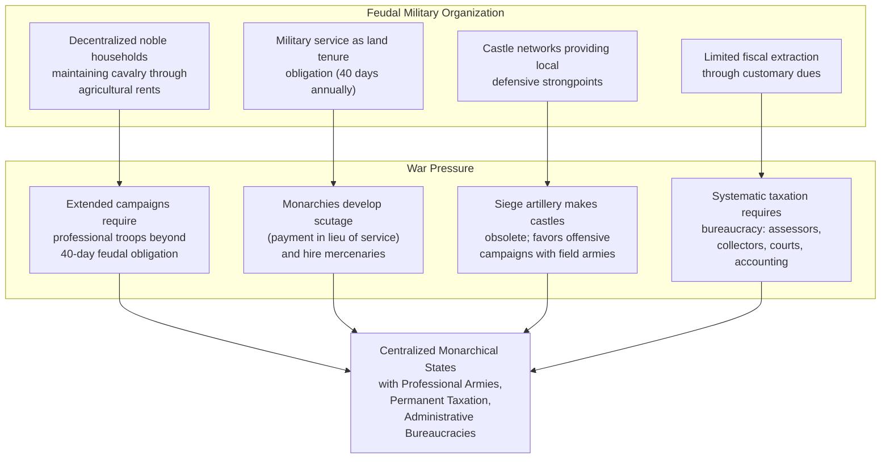

# Lesson 6: Crisis Mechanisms, Systemic Collapse, Transition Dynamics

## 1. First-Principles Intuition & Invariants

The mid-fourteenth through early fifteenth centuries witnessed a cascade of overlapping crises that fundamentally restructured European civilization. Understanding this period requires abandoning teleological narratives that treat the Renaissance as an inevitable progression and instead examining the specific mechanical failures within medieval systems that created transition vectors toward new organizational forms. The analytical framework demanded here resembles root-cause failure analysis in complex systems: identifying load-bearing structural elements, tracing cascading failure modes, and mapping how stress concentrations at multiple points simultaneously can trigger phase transitions in social organization.

At the foundation lies a demographic invariant that governed all medieval economies: agricultural surplus capacity determined population ceilings, labor value, land rent relationships, and the viability of non-productive warrior and clerical classes. Medieval Europe had reached its Malthusian ceiling by approximately 1300, with population density straining against technological limits in agricultural productivity. Marginal lands brought under cultivation yielded diminishing returns, while climate deterioration during the Little Ice Age reduced growing seasons and harvest reliability. This demographic pressure created a system primed for catastrophic reorganization, lacking the shock absorption capacity that surplus resources provide.

The Black Death arriving in 1347 functioned as an exogenous shock of unprecedented magnitude, but its transformative power derived from how it interacted with existing structural vulnerabilities. The pandemic reduced European population by thirty to sixty percent within five years, a demographic collapse that inverted fundamental economic relationships. Labor scarcity replaced labor surplus, empowering survivors to demand higher wages and greater mobility while simultaneously destroying the rent-extraction mechanisms that funded aristocratic military households and ecclesiastical institutions. This was not merely quantitative population loss but a qualitative phase transition in bargaining power dynamics between classes.

Concurrent with demographic catastrophe, the Hundred Years War between England and France created sustained pressure for state formation and military innovation. Traditional feudal military organization relied on decentralized aristocratic households maintaining armored cavalry through agricultural rents. Extended warfare requiring professional infantry, siege artillery, and permanent bureaucratic capacity to extract taxation forced monarchies to develop proto-modern state apparatuses. The mechanical logic here involves recognizing that war functions as an organizational selection pressure: polities that successfully concentrated coercive power and fiscal extraction survived, while those clinging to dispersed feudal arrangements faced military defeat and territorial loss.

The Western Schism splitting the papacy between Rome and Avignon from 1378 to 1417 undermined the ideological legitimacy framework that justified hierarchical authority throughout medieval society. When two competing popes excommunicated each other's followers and secular rulers strategically recognized whichever claimant advanced their territorial interests, the transcendent authority claims of the Church became transparently instrumental political tools. This erosion of sacred legitimacy created space for contractual and legalistic conceptions of authority that would eventually ground early modern sovereignty theory.

Ottoman expansion westward applied external military pressure that forced technological and organizational adaptation in Christian polities while simultaneously offering a civilizational alternative that highlighted European fragmentation. The fall of Constantinople in 1453 served as both symbolic endpoint of the medieval Roman imperial continuity and practical demonstration of gunpowder artillery superiority over static fortifications. This military-technological shift favored centralized states capable of funding expensive cannon foundries and professional artillery corps over dispersed feudal levies.

Peasant revolts erupting across Europe—the Jacquerie in France (1358), the English Peasants' Revolt (1381), and numerous urban insurrections—revealed the breakdown of the feudal contract's reciprocal obligations. When lords failed to provide security during plague and warfare while simultaneously demanding increased labor services from depleted populations, the implicit legitimacy exchange collapsed. These revolts generally failed militarily but succeeded in permanently altering labor relationships and seigneurial extraction capacity, creating heterogeneous regional outcomes that shaped divergent paths toward agrarian capitalism in England versus renewed serfdom in Eastern Europe.

The Renaissance transition vector emerged not as cultural rebirth but as adaptive response to systemic crisis. Italian city-states developed republican governance experiments and merchant-banking financial instruments because their survival depended on commercial networks rather than agricultural hinterlands. Humanist educational programs emphasizing rhetoric, classical texts, and civic virtue served practical functions in training diplomatic and administrative personnel for states lacking traditional aristocratic governance classes. The printing press arriving mid-fifteenth century functioned as communications infrastructure enabling coordination of dispersed commercial networks and religious reform movements that traditional scribal culture could not support at necessary scale.

## 2. Core Architecture & Mechanics

The demographic shock mechanism of the Black Death operated through specific epidemiological and economic transmission paths that can be mapped with precision. Yersinia pestis bacteria transmitted primarily through flea vectors from black rats created mortality rates varying by urban density, trade connectivity, and seasonal timing. Urban centers with population densities exceeding sustainable sanitation capacity experienced mortality approaching sixty to seventy percent, while dispersed rural settlements might see thirty to forty percent losses. The disease followed trade routes from Central Asian reservoirs through Crimean ports into Mediterranean shipping networks, reaching Sicily by October 1347, then spreading through Italy, France, and England by 1348, and Scandinavia and Eastern Europe by 1350.

The economic mechanics following population collapse inverted traditional supply-demand relationships across multiple domains. Labor markets shifted from chronic surplus to acute scarcity, with surviving agricultural workers able to demand wages two to three times pre-plague levels. The Statute of Labourers enacted in England in 1351 attempted to freeze wages at pre-plague levels and restrict labor mobility, revealing aristocratic recognition that traditional coercive mechanisms had lost effectiveness. When legal restrictions failed to bind mobile workers who could simply relocate to competing employers, the feudal system's fundamental enforcement mechanism—tied peasant populations bound to specific manors—unraveled.

Land value relationships underwent parallel inversion. Previously marginal lands abandoned during population collapse never returned to cultivation, concentrating agricultural activity on prime soils with higher yields per labor input. Aristocratic landholders competing for scarce labor converted demesne lands worked by servile labor into tenant farms leased for fixed rents, transferring productivity risk to tenants while guaranteeing landlords stable income streams. This shift from direct exploitation to rentier extraction represented a fundamental change in property relationships that prefigured agrarian capitalism.

The Hundred Years War state formation pressures created specific institutional innovations that can be traced through administrative records and fiscal archives. English and French monarchies required unprecedented revenue streams to fund professional armies, siege operations, and diplomatic networks. Traditional feudal obligations provided military service for forty days annually, insufficient for sustained campaigning. Monarchies developed systematic taxation requiring bureaucratic apparatus for assessment, collection, and enforcement. The French taille evolved from extraordinary levy to permanent direct tax, while English Parliament gained power through its control over customs duties and extraordinary taxation approval.

Military technology followed deterministic innovation paths driven by tactical problems. English longbowmen at Crécy (1346) and Agincourt (1415) demonstrated that massed archery from common infantry could defeat armored cavalry charges, undermining the military dominance that justified aristocratic social supremacy. Artillery technology progressed from unreliable bombards to effective siege cannon capable of reducing previously impregnable fortifications, shifting advantage toward attackers with capital resources for gunpowder and metallurgy. These technological shifts favored centralized states over dispersed feudal lordships, creating selection pressure for political consolidation.

The Western Schism's mechanics reveal how institutional legitimacy depends on coordination equilibria rather than intrinsic authority. When cardinals elected Urban VI in 1378 under pressure from Roman mobs demanding an Italian pope, then repudiated the election and chose Clement VII, who established himself at Avignon, the Church's governance mechanism fractured. Each pope claimed exclusive legitimacy, ordained bishops, collected revenues, and excommunicated opponents. Secular rulers recognized whichever claimant aligned with their territorial interests: France, Scotland, Castile, and Aragon backed Avignon, while England, the Holy Roman Empire, and most Italian states recognized Rome.

This division created practical coordination problems throughout Christian society. Which pope's appointee held legitimate authority in disputed dioceses? Which papal dispensations for marriages, benefices, and legal appeals were valid? The attempted solution through conciliarism—asserting that general councils of the Church held authority superior to popes—ultimately resolved the schism at the Council of Constance (1414-1418) but permanently weakened papal absolutist claims. The demonstration that ecclesiastical authority could be contested, negotiated, and reconstituted through institutional mechanisms rather than divine designation undermined the sacred legitimacy model for all hierarchical institutions.

Ottoman expansion mechanics combined military effectiveness with administrative sophistication that offered viable alternative to Christian European governance models. The devshirme system recruiting Christian boys for conversion and training as Janissary infantry and administrative officials created a meritocratic bureaucracy and professional military corps independent of traditional tribal aristocracies. Timar land grants provided cavalry forces through assignments that reverted to state control rather than becoming hereditary, preventing the feudal fragmentation that plagued Christian monarchies. Religious tolerance for Christian and Jewish subjects under dhimmi protected status created stable revenue bases in conquered territories while avoiding the religious uniformity conflicts tearing apart Christian Europe during Hussite Wars and later Reformation.

The siege of Constantinople demonstrated deterministic military-technological superiority. Mehmed II's Hungarian engineer Urban cast bronze cannon firing stone projectiles weighing up to six hundred kilograms, capable of breaching the Theodosian Walls that had protected the city for a millennium. The fifty-five day siege ending May 29, 1453, proved that no static fortification could withstand sustained artillery bombardment, forcing military architecture toward trace italienne star fort designs optimized for artillery defense. This technological shift favored polities with metallurgical industries, gunpowder production capacity, and fiscal resources to fund artillery trains—inherently centralizing technologies.

Peasant revolt mechanics followed consistent patterns despite regional variations. Initial triggers typically involved increased seigneurial demands on reduced populations, often through attempted restoration of labor services that population loss had made obsolete. Revolts organized around specific grievances articulated in legal or customary frameworks, demanding recognition of traditional rights rather than revolutionary social transformation. Leadership emerged from village officials, minor clergy, and artisans with organizational capacity and literacy to coordinate action and negotiate demands.

The English Peasants' Revolt of 1381 illustrates standard mechanics. The third poll tax in four years imposed flat per capita levies hitting peasants harder than wealthy households, while Statute of Labourers enforcement and seigneurial attempts to restore labor services created widespread grievances. Revolt began in Essex and Kent, spreading rapidly along communication networks as rebels coordinated through village networks and market town assemblies. Marching on London, rebels articulated demands including abolition of serfdom, rent reductions, and removal of corrupt officials. Richard II's initial concessions followed by violent suppression after rebel dispersal demonstrated state willingness to make strategic concessions under immediate threat while rejecting permanent structural change.

The long-term consequence of peasant revolts, however, contradicted their immediate military failures. Seigneurial recognition that coercive labor extraction had become impractical accelerated transition toward wage labor and fixed rents. Regional variation in outcomes mapped to specific power relationships: English lords converted to commercial agriculture employing free laborers, while Eastern European lords facing weaker monarchical authority and peasant populations lacking alternative employment opportunities imposed "second serfdom" with intensified coercion. These divergent paths created the foundations for early modern capitalism in Northwestern Europe versus agrarian lordships in Eastern Europe.

## 3. High-Performance Optimization & Failure Modes

Analyzing medieval crisis responses as optimization problems reveals why certain adaptive strategies succeeded while others collapsed. The fundamental challenge involved matching governance structures and economic arrangements to radically altered demographic and military realities. Polities that successfully optimized for the post-plague environment developed institutions that would dominate early modernity, while those clinging to obsolete organizational forms faced military defeat, fiscal insolvency, or revolutionary upheaval.

The English response to labor scarcity optimized by abandoning direct demesne cultivation and converting to commercial agriculture. Lords leased consolidated holdings to tenant farmers producing for market sale, transforming themselves from agricultural managers into rentiers collecting fixed payments. This strategy minimized enforcement costs of binding scarce laborers while capturing productivity gains through rent adjustments at lease renewal. The failure mode avoided here involved attempting to maintain demesne cultivation through coerced labor, which required expensive enforcement apparatus and provoked resistance from mobile workers with alternative employment options. The optimization succeeded because it aligned landlord incentives with economic realities rather than fighting demographic fundamentals.

French monarchy optimization focused on fiscal extraction capacity. Developing the taille as permanent direct tax required creating bureaucratic infrastructure for assessment and collection that could operate independently of feudal obligations. This institutional investment paid long-term returns by providing revenue streams that scaled with economic activity rather than remaining fixed by customary agreements. The Estates General lost power over taxation compared to English Parliament because French kings successfully established permanent fiscal apparatus that didn't require annual parliamentary grants. The optimization here involved trading short-term extraction efficiency for long-term institutional capacity that would enable absolutist state construction.

Italian city-states optimized for commercial network coordination and diplomatic flexibility rather than territorial consolidation. Venice, Genoa, and Florence developed republican institutions that balanced competing merchant factions while maintaining fiscal and military capacity through sophisticated public finance instruments including funded public debt and accounting innovations like double-entry bookkeeping. Their small territorial bases represented optimization for commercial rather than agricultural wealth generation, requiring naval power projection and diplomatic networks to protect trade routes rather than large land armies. The failure mode successfully avoided involved attempting territorial expansion that would have triggered coalition formation by threatened neighbors, as demonstrated by Milanese and Florentine territorial ambitions that provoked destructive Italian Wars.

Ottoman optimization combined military effectiveness with administrative incorporation of conquered populations. Religious tolerance for Christian and Jewish communities maintained productive capacity in conquered territories while collecting jizya poll tax that incentivized conversion without requiring it. The devshirme recruitment system created loyal administrative and military corps without hereditary privileges that could challenge sultanic authority. This organizational structure scaled effectively across diverse territories from Balkans to Levant, avoiding the coordination costs that plagued multi-ethnic empires attempting religious uniformity. The system's eventual failure mode emerged centuries later when Janissary corps acquired political power and resisted military modernization, demonstrating how initially optimal institutions can ossify into obstacles when environmental conditions change.

The Church's response to the Western Schism through conciliarism represented attempted optimization for coordination failure, but introduced new vulnerabilities. The Council of Constance successfully ended the schism by deposing all competing popes and electing Martin V, demonstrating that institutional mechanisms could resolve coordination deadlocks. However, conciliar theory asserting council superiority over popes threatened papal monarchical governance model. Subsequent popes rejected conciliarism and reasserted absolutist claims, but the demonstrated precedent that papal authority could be contested and reconstituted permanently weakened Church institutional resilience. The optimization failure here involved inability to acknowledge that legitimacy derived from institutional coordination rather than transcendent authority, leaving the Church vulnerable to Protestant Reformation challenges that would exploit this conceptual weakness.

Peasant revolt suppression followed consistent optimization logic: make tactical concessions under immediate military threat, then reassert control after dispersal while selectively granting economic concessions that reduced future revolt incentives. English response to 1381 revolt exemplified this pattern—Richard II granted rebel demands including serf emancipation during negotiations, then revoked concessions after military suppression while allowing labor market adjustments to proceed gradually through non-enforcement of Statute of Labourers. This strategy minimized enforcement costs while maintaining symbolic authority. The failure mode avoided involved massive punitive violence that would have destroyed remaining labor force, demonstrating pragmatic acceptance of changed economic realities despite ideological commitment to feudal hierarchy.

Renaissance patronage optimization by Italian merchant-banking families like the Medici represented strategy for converting commercial wealth into political legitimacy and social status. Funding humanist scholars, architectural projects, and artistic commissions served multiple functions: demonstrating civic virtue and magnificence, creating cultural capital that enhanced diplomatic prestige, and employing client networks that reinforced political control. The optimization succeeded because it addressed the legitimacy deficit of new commercial elites lacking traditional aristocratic pedigree by establishing alternative prestige hierarchy based on cultural patronage and civic improvement. This strategy proved more sustainable than direct political domination, as Medici de facto control of Florence through client networks and marriage alliances proved more durable than their brief experiments with formal lordship.

Printing press adoption represented technological optimization with cascading effects across multiple domains. Early adopters like Venice and Nuremberg that developed printing industries gained advantages in producing legal codes, commercial documents, religious texts, and humanist scholarship at scales impossible through scribal production. The technology favored standardization and vernacular literacy, creating cultural infrastructure for Protestant Reformation and commercial capitalism. The failure mode here affected institutions dependent on information scarcity: monastic scriptoria lost economic function, while Church control over textual interpretation collapsed when vernacular Bibles became widely available. The optimization logic demonstrates how communications infrastructure changes create irreversible phase transitions in institutional coordination capacity.

Military adaptation to gunpowder technology followed deterministic optimization paths. Polities that invested in artillery foundries, gunpowder production, and professional artillery crews gained decisive siege warfare advantages, while those maintaining traditional fortifications and cavalry-dominant armies faced military obsolescence. Ottoman success against Constantinople and Burgundian artillery investments both represent successful optimization, while Byzantine failure to modernize defenses and Burgundian defeat by Swiss pike infantry at Nancy (1477) demonstrate failure modes. The underlying principle involves recognizing that military technology shifts create temporary windows when investment in new systems yields disproportionate returns before adversaries adapt, rewarding early adoption and punishing conservative adherence to proven traditional methods.

The broader lesson for contemporary systemic crisis analysis involves recognizing that cascading failures across multiple domains create phase transition opportunities that reward institutional experimentation and adaptation while punishing rigid adherence to obsolete organizational forms. The mid-fourteenth through fifteenth century crises destroyed the demographic, economic, military, and ideological foundations of medieval civilization not through any single shock but through overlapping failures that made traditional institutional arrangements simultaneously unworkable. The polities, social classes, and institutional forms that thrived in the emerging early modern period were those that successfully optimized for radically altered realities rather than attempting restoration of pre-crisis equilibria. This analytical framework applies to any complex system facing multiple simultaneous stress points: identify load-bearing structural elements, map failure propagation paths, recognize when attempted repairs merely postpone inevitable collapse, and design adaptive strategies aligned with transformed environmental constraints rather than nostalgic restoration of superseded conditions.
