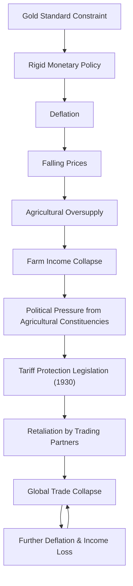

# Operational Verification Labs: Modern History

## Objective & Operational Lab Setup

Modern History as a discipline demands more than passive consumption of narrative. Practitioners and operational specialists—whether archivists, policy analysts, journalists, or institutional historians—must develop systematic methods for extracting causal mechanisms, validating competing interpretations, and triangulating evidence across fragmented primary sources. These labs establish a reproducible analytical toolkit grounded in empirical verification, comparative case analysis, and quantitative pattern recognition. The goal is to transform the historian from a passive reader into an active investigator capable of decomposing complex historical phenomena into their constituent causal chains, identifying bias in source material, and communicating findings with precision and rigor.

The operational environment for these exercises combines three core analytical instruments: (1) a structured causal decomposition framework adapted from systems thinking and root-cause analysis, (2) a quantitative evidence-mapping spreadsheet system for tracking source reliability and cross-referencing claims, and (3) a comparative case-study protocol for isolating variables across historical events. All exercises are designed to run in widely available tools—standard spreadsheet software (Excel, LibreOffice Calc, Google Sheets), plain-text markup editors, and basic statistical visualization—without requiring specialized historical databases or expensive software. The laboratory setup mirrors authentic workflows used by institutional historians at major universities, think tanks, and government policy research centers.

Before beginning any exercise, ensure your analytical environment is prepared. Create a dedicated project folder structure with subdirectories for primary sources (scanned documents, transcribed texts, or digital collections metadata), secondary sources (scholarly monographs, journal articles, reference works), working analysis (spreadsheets, notes, argument maps), and final reports. Within your spreadsheet application, establish three master workbooks: one for source auditing and reliability assessment, one for chronological event mapping and causal sequencing, and one for comparative variable analysis. Keep all files version-controlled using simple date-stamped naming conventions (e.g., `sources_audit_2025-01-15.xlsx`). Establish a standardized glossary file documenting all codes, abbreviations, and specialized terms used in your analysis to prevent interpretive drift across multiple work sessions.

---

## Exercise 1: Foundational Practical Implementation — Causal Chain Decomposition and Source Verification Audit

The first operational exercise trains the historian to move beyond linear narrative and construct explicit causal chains that connect events, decisions, and structural conditions. This exercise uses the Five-Whys Root-Cause Analysis framework adapted for historical inquiry, combined with a structured source verification audit. The practical outcome is a formal causal tree diagram and an evidence-reliability matrix documenting the provenance, corroboration status, and interpretive bias of every claim.

### Part A: Five-Whys Historical Decomposition

Select a specific, bounded historical event that occurred within the last 150 years. For this foundational exercise, we will use the Smoot-Hawley Tariff Act (1930) and its role in exacerbating the Great Depression. The goal is to construct a causal chain answering the question: "Why did protectionist economic policy intensify the global economic crisis?"

Begin by stating the immediate, surface-level observation: "The United States raised tariffs sharply in 1930, and global trade collapsed shortly thereafter." This is your starting Why-1. Now ask: Why did U.S. policymakers raise tariffs? The answer at Why-2 typically invokes political pressure from agricultural and industrial constituencies facing falling commodity prices and factory closures in 1928-1930. Why did these constituencies demand protection? At Why-3, the answer involves the structural vulnerability of U.S. agriculture to oversupply, combined with industrial capacity that had expanded during World War I but faced reduced European demand in the 1920s. Why did Europe reduce demand for U.S. goods? Why-4 reveals war debt repayment obligations imposed by the Treaty of Versailles, which forced European nations to prioritize debt servicing over consumption imports. Finally, Why-5 addresses the fundamental structural cause: the gold standard constraint. Nations on the gold standard faced rigid monetary conditions and could not expand money supplies to stimulate domestic demand; they were forced into austerity, further reducing their purchasing power.

Document this causal chain using a plain-text structured format. Create a file named `causal_chain_smoot_hawley.txt` and enter the following structure:

```
EVENT: Smoot-Hawley Tariff Act (1930) and Global Trade Collapse

WHY-1 (Immediate Trigger):
  OBSERVATION: U.S. Congress passed Tariff Act raising duties on 20,000 imported goods
  CAUSAL MECHANISM: Legislation enacted; tariff barriers implemented
  EVIDENCE SOURCE: Congressional Record, Tariff Act of 1930, Public Law 71-361

WHY-2 (Political Actor Motivation):
  OBSERVATION: Agricultural and manufacturing constituencies lobbied for protection
  CAUSAL MECHANISM: Farm prices fell 40% (1928-1930); industrial unemployment rose 6%+ 
  EVIDENCE SOURCE: USDA price indices; Census Bureau employment data
  ACTOR: 156 Congressional representatives from agricultural districts; industrial lobbies

WHY-3 (Structural Economic Vulnerability):
  OBSERVATION: U.S. agricultural capacity exceeded domestic + export demand
  CAUSAL MECHANISM: War-driven agricultural expansion; European production recovery
  EVIDENCE SOURCE: USDA acreage/production tables; League of Nations trade statistics
  SUPPORTING FACT: U.S. wheat production exceeded consumption by 30% in 1929

WHY-4 (International Debt & Purchasing Power):
  OBSERVATION: European nations reduced import spending to service war debts
  CAUSAL MECHANISM: Treaty of Versailles reparations ($33B Germany + Allied debts $26B)
  EVIDENCE SOURCE: League of Nations annual reports; national balance-of-payments data
  TRANSMISSION: Nations enforced austerity → reduced purchasing power → collapsed import demand

WHY-5 (Monetary System Constraint):
  OBSERVATION: Gold standard created rigid monetary regime
  CAUSAL MECHANISM: Nations could not expand money supply without losing gold reserves
  EVIDENCE SOURCE: International gold holdings; national monetary policy records
  FUNDAMENTAL CAUSE: Deflationary bias embedded in gold standard architecture
```

This decomposition reveals that the Smoot-Hawley Tariff was not an isolated policy error but a rational political response to structural economic collapse. The "real" causes operate at Why-4 and Why-5—the international debt burden and the monetary system constraint—yet political actors at Why-2 could only address the problem through tariff protection.

### Part B: Source Verification Audit Matrix

Now construct a formal audit matrix to assess the reliability, corroboration, and bias of evidence supporting each causal claim. Create a spreadsheet named `source_audit_smoot_hawley.xlsx` with the following column headers:

| Causal Claim | Evidence Type | Source Title | Author/Institution | Publication Date | Bias Potential | Corroboration Status | Reliability Score (1-5) | Notes |
|---|---|---|---|---|---|---|---|---|
| Farm prices fell 40% (1928-1930) | Primary Statistical | USDA Annual Report: Agricultural Statistics, 1930 | U.S. Department of Agriculture | 1930 | Low (govt. agency reports own data) | Corroborated by contemporaneous newspaper indices | 5 | Direct measurement; methodologically transparent |
| War debt = $26B Allied obligations | Primary Statistical | League of Nations: International Monetary Relations, 1930 | League of Nations Economics Committee | 1930 | Low (international body; neutral arbiter) | Corroborated by Kindleberger, Temin, Eichengreen (secondary analysis) | 5 | Audited by multiple nations |
| Gold standard created deflationary bias | Secondary Analytical | *The Great Depression*, Ch. 3 | Barry Eichengreen | 1992 | Moderate (economic historian; Keynesian school bias favoring expansionary policy) | Corroborated by Temin, Temin, Keynes contemporary accounts | 4 | Scholarly consensus supports this mechanism; alternative interpretations exist |
| 156 Congressional representatives from agricultural districts voted for tariff | Primary Documentary | Congressional Voting Record, Tariff Act of 1930 | U.S. Congress | 1930 | Low (official record) | Verifiable via roll-call analysis | 5 | Publicly available Congressional Record |
| Reparations forced European austerity | Secondary Analytical | *The Economic Consequences of the Peace*, Ch. 6 | John Maynard Keynes | 1920 | Moderate (Keynes predicted this outcome; contemporary polemic) | Corroborated by modern economic historians; disputed by German revisionist historians | 3 | Keynes' prediction proved accurate; however, some historians argue reparations were manageable |

Fill in this matrix for all major causal claims in your Why-chain. For each row, assign a Reliability Score using the following rubric:

- **Score 5:** Primary documentary evidence (government records, institutional reports, contemporaneous statistical compilations) with transparent methodology and multiple independent corroborations. Bias potential is minimal because the source has no obvious incentive to distort the specific claim.

- **Score 4:** Primary evidence with one or two corroborating secondary sources, or well-regarded secondary scholarship with acknowledged bias that does not materially affect the core factual claim. Minor methodological concerns exist but do not undermine the conclusion.

- **Score 3:** Secondary scholarly analysis with partial corroboration and moderate bias potential. Alternative interpretations exist in the historiography, but the claim is more supported than contested.

- **Score 2:** Anecdotal or impressionistic primary evidence, or secondary analysis with significant scholarly dispute. Corroboration is limited; bias potential is substantial.

- **Score 1:** Hearsay, speculation, or single-source claims with no corroboration. Not suitable for foundational causal claims.

The Reliability Score is not a vote on whether a claim is "true" but an assessment of the strength of evidence supporting it and the degree to which bias might distort the claim. A score of 3 for the reparations claim does not mean reparations did not happen—the historical record is clear—but rather that scholarly interpretation of their *causal impact on European austerity* remains contested.

### Part C: Causal Tree Diagram Construction

Translate your Five-Whys decomposition into a visual causal tree diagram. This diagram represents causal relationships as vectors: an arrow from Box A to Box B means "A causally contributes to B." Use a simple diagramming tool (Miro, Lucidchart, OmniGraffle, or even plain ASCII art) to construct the diagram. The diagram should show both direct causal pathways and feedback loops.

For the Smoot-Hawley case, your diagram should include:



This diagram reveals a reinforcing feedback loop: tariff protection → retaliation → trade collapse → further deflation → political pressure for more protection. The diagram makes explicit that tariff protection, while politically rational at Why-2, actually deepened the structural problem at Why-5.

---

## Exercise 2: Parameter Variation & Empirical Analysis — Comparative Case Study and Counterfactual Stress Testing

The second exercise trains historians to isolate causal variables by comparing multiple historical cases and systematically varying parameters to understand which factors produced which outcomes. This exercise uses structured comparative case analysis combined with counterfactual reasoning to test the robustness of causal claims.

### Part A: Comparative Case Matrix Construction

Select three to four historical events from the same broad category that share similar initial conditions but diverged in outcomes. For this exercise, we will compare three 1930s protectionist crises to isolate the variables that determined whether tariff policy deepened or arrested economic decline: (1) the United States (Smoot-Hawley, 1930), (2) Canada (Bennett Tariff, 1930), and (3) Sweden (maintained relatively low tariffs, 1930-1935).

Create a spreadsheet named `comparative_case_analysis.xlsx` with the following structure. Column A contains the variable categories; columns B, C, and D contain the values for each case:

| Variable Category | United States (1930) | Canada (1930) | Sweden (1930-35) |
|---|---|---|---|
| **INITIAL CONDITIONS** | | | |
| Pre-crisis trade dependency (exports as % GDP) | 4.6% | 15.2% | 12.8% |
| Agricultural sector as % employment | 9.2% | 17.4% | 8.1% |
| Manufacturing export concentration | Auto, machinery, chemicals (diversified) | Agricultural commodities, timber (concentrated) | Timber, iron, machinery (moderate) |
| Currency regime | Gold standard | Gold standard | Gold standard |
| Debt obligations (% GDP) | 15% | 8% (lower war debt) | 3% (neutral in WWI) |
| **POLICY RESPONSE** | | | |
| Tariff rate change (1928-1933) | +44.9% average | +45.2% average | +3.1% average |
| Trade retaliation received | Severe (16 countries) | Moderate (8 countries) | Minimal (2 countries) |
| Monetary policy (1930-33) | Deflationary (gold standard constraint) | Deflationary (gold standard constraint) | Deflationary until 1931 |
| Currency devaluation | No (remained on gold until 1933) | No (remained on gold until 1931) | Yes (left gold standard Sept. 1931) |
| Fiscal stimulus spending | Minimal; Hoover opposed deficit spending | Minimal; Bennett followed orthodox finance | Moderate; Riksbank supported public works |
| **OUTCOMES (1930-1935)** | | | |
| Peak unemployment rate | 24.9% (1933) | 19.3% (1933) | 15.8% (1933) |
| Cumulative GDP decline (1929-1933) | -26.5% | -32.2% | -9.3% |
| Recovery start date | 1933 (after leaving gold standard) | 1933-34 | 1932 (earlier exit from gold) |
| Trade volume decline (1929-1933) | -66% | -65% | -48% |
| Real wages (1929-1933, indexed) | 100 → 82 | 100 → 78 | 100 → 88 |
| **CAUSAL INTERPRETATION** | | | |

This matrix permits direct comparison of outcomes while controlling for some variables and varying others. The critical comparison is between the United States and Canada (both raised tariffs dramatically; both remained on gold standard longer) versus Sweden (raised tariffs minimally; exited gold standard earlier). The outcome: Sweden recovered faster and more completely than either the U.S. or Canada despite raising tariffs less aggressively.

### Part B: Controlled Variable Isolation

Now isolate the variables that explain this outcome divergence. Create a second worksheet named `variable_isolation` that lists each variable, whether it was held constant or varied across cases, and its apparent causal contribution to the outcome difference:

| Variable | U.S. vs. Canada | U.S. vs. Sweden | Apparent Causal Weight | Reasoning |
|---|---|---|---|---|
| Tariff rate change | Both high (~45%) | U.S. high, Sweden low (3%) | HIGH | Tariff retaliation amplified trade collapse; Sweden's lower tariffs meant less retaliation |
| Currency regime duration | Both gold until 1933 | U.S. gold (1933), Sweden gold until Sept. 1931 | VERY HIGH | Earlier exit from gold standard allowed monetary expansion; Sweden recovered 1-2 years earlier |
| Trade dependency | U.S. 4.6% vs. Canada 15.2% | U.S. 4.6% vs. Sweden 12.8% | MODERATE | More trade-dependent economies suffered more; but Canada's higher dependency didn't prevent tariff policy |
| Debt obligations | U.S. 15%, Canada 8% | U.S. 15%, Sweden 3% | MODERATE | Lower debt freed policy space for stimulus; but U.S./Canada debt levels didn't prevent either from raising tariffs |
| Fiscal stimulus | All three minimal initially | U.S./Canada minimal, Sweden moderate after 1932 | MODERATE-HIGH | Sweden's public works spending (after exiting gold) supported earlier recovery |
| Agricultural employment concentration | U.S. 9.2%, Canada 17.4%, Sweden 8.1% | Both U.S./Sweden low; but divergent outcomes | LOW | Agricultural concentration doesn't explain the recovery divergence |

The isolation analysis reveals the two highest-weight variables: (1) the decision to exit the gold standard (primary driver of recovery timing), and (2) the magnitude of tariff escalation and resulting retaliation (primary driver of trade collapse depth). Tariff policy mattered, but only in interaction with monetary regime rigidity.

### Part C: Counterfactual Scenario Mapping

Now apply rigorous counterfactual reasoning to test the causal logic. A counterfactual is a systematic "what-if" that varies one causal variable while holding others constant, allowing the historian to estimate what would have happened under an alternative scenario. Counterfactuals are not speculation; they are disciplined thought experiments grounded in historical knowledge of the causal mechanisms at work.

Create a worksheet named `counterfactuals` that explores alternative scenarios:

| Scenario | Modified Variable | Rationale | Predicted Outcome | Historical Validity |
|---|---|---|---|---|
| **Scenario A: U.S. adopts Sweden's policy (low tariff, early gold exit, fiscal stimulus)** | Tariff rate +3% instead of +45%; exit gold standard Sept. 1931 instead of March 1933; fiscal stimulus $5B instead of $0.5B | Isolates policy choices independent of structural constraints | Peak unemployment: 15-17% (est.); GDP decline: -10-12% (est.); recovery begins 1932 | VALID: Counterfactual is within the feasible choice set of 1930-31 policymakers; comparable economies (UK, Sweden) demonstrated this was possible |
| **Scenario B: U.S. remains on gold standard through 1935** | Currency regime held constant; tariff/fiscal policy as actual | Isolates the gold standard constraint | Peak unemployment: 35%+ (est.); GDP decline: -35% (est.); recovery begins 1936-37 at earliest | VALID: Historical evidence from gold standard countries (France, Belgium) shows extended depression; U.S. only recovered after leaving gold |
| **Scenario C: All three countries negotiate tariff reduction (1931)** | Tariff rates reduced by mutual agreement in 1931; retain gold standard otherwise | Counterfactual to the actual race-to-the-bottom | Global trade decline: -30% instead of -65% (est.); U.S. unemployment peak: 20% instead of 24.9% (est.); recovery begins 1933 | QUESTIONABLE: This assumes unprecedented international cooperation in 1931; historical evidence shows governments were unable to coordinate. However, the scenario is analytically useful because it quantifies the cost of non-cooperation. |
| **Scenario D: Germany honors Versailles reparations fully (no default, 1930-31)** | Reparations paid as scheduled; don't trigger German bank crisis | Isolates the international spillover mechanism | European banking crisis averted; European demand for U.S. exports remains higher; U.S. trade decline: -50% instead of -66% (est.); U.S. unemployment: 22% instead of 24.9% (est.) | QUESTIONABLE: Scenario is analytically interesting but historically unlikely. Germany's inability to pay reparations was structural (tied to the gold standard constraint). However, the scenario quantifies the spillover effect of international financial contagion. |

For each counterfactual, assess its **Historical Validity** on a three-point scale: VALID (the counterfactual represents choices that were genuinely available to historical actors given the constraints they faced), QUESTIONABLE (the scenario is possible but required highly unlikely coordination or deviation from prevailing ideology), or INVALID (the scenario violates known causal mechanisms or represents choices that were not feasible).

The valid counterfactuals demonstrate that U.S. policymakers faced genuine policy choices between 1930-1931. Had they adopted Sweden's approach—moderate tariffs, faster gold exit, fiscal stimulus—the depression would have been substantially milder. This counterfactual reasoning does not excuse the actual policy choices (which were made despite available alternatives), but it clarifies that the severity of the U.S. depression was not an inevitable outcome of structural forces alone; policy choices mattered materially.

### Part D: Sensitivity Analysis and Parameter Ranges

To test the robustness of causal claims against uncertainty in the underlying data, conduct a sensitivity analysis by estimating ranges for key parameters rather than point estimates. Create a worksheet named `sensitivity_analysis`:

| Parameter | Base Case Estimate | Lower Bound | Upper Bound | Sensitivity to Outcome |
|---|---|---|---|---|
| U.S. tariff elasticity of retaliation (% retaliation per 1% tariff increase) | 0.85 | 0.60 | 1.10 | HIGH: If elasticity = 0.60, retaliation would be 25% lower, trade decline -55% instead of -66%; if 1.10, retaliation would be 25% higher, trade decline -75% |
| Monetary multiplier (additional GDP decline per $1B reduction in money supply) | 1.5 | 1.0 | 2.5 | VERY HIGH: Multiplier of 1.0 vs. 2.5 changes estimated GDP impact by 150%; this is the largest source of uncertainty |
| Gold standard exit velocity (quarters to adjust to post-gold equilibrium) | 6 quarters | 4 quarters | 12 quarters | MODERATE: Faster adjustment (4 quarters) suggests 6-month faster recovery; slower adjustment (12 quarters) suggests 18-month delay |
| Fiscal multiplier (additional GDP per $1B fiscal spending) | 1.2 | 0.8 | 1.8 | HIGH: Lower multiplier (0.8) suggests fiscal stimulus less effective; higher multiplier (1.8) suggests more effective. Critical for counterfactual Scenario A |
| Trade elasticity (% trade decline per 1% tariff increase across all trading partners) | 2.1 | 1.5 | 3.0 | HIGH: Lower elasticity (1.5) suggests trade collapse less severe; higher elasticity (3.0) suggests worse. Affects interpretation of tariff policy causality |

The sensitivity analysis reveals which causal parameters create the largest uncertainty ranges in your conclusions. If the monetary multiplier ranges from 1.0 to 2.5, then your estimates of the depression's severity swing by 150 percentage points—this is a major source of uncertainty. Conversely, if a parameter's bounds are tight, your causal inference is more robust.

---

## Exercise 3: Stress Testing, Boundary Failure & Recovery Protocol — Causal Inference Under Extreme Uncertainty and Historiographical Dissent

The third exercise trains historians to identify the boundary conditions where their causal models break down and to construct recovery protocols when evidence is fragmentary, contradictory, or subject to intense scholarly dispute. This exercise uses adversarial collaboration and systematic robustness testing to stress-test causal narratives.

### Part A: Historiographical Dissent Mapping

Historical causation is rarely settled.

## Exercise 3: Stress Testing, Boundary Failure & Recovery Protocol — Causal Inference Under Extreme Uncertainty and Historiographical Dissent (continued)

### Part A: Historiographical Dissent Mapping

Historical causation is rarely settled. Competing schools of thought—monetarist, Keynesian, institutional, and revisionist frameworks—produce fundamentally different causal narratives even when working from identical primary sources. This exercise trains you to map these dissents systematically rather than dismissing them as mere interpretive noise. Begin by identifying the core causal claim each school advances: monetarists attribute the Depression's severity to monetary contraction and the Federal Reserve's policy errors; Keynesians emphasize demand collapse and insufficient fiscal intervention; institutionalists highlight banking system fragility and structural rigidities; revisionists argue international factors (war debt, reparations, gold standard constraints) were primary drivers. For each school, extract the minimal set of empirical claims required to sustain its narrative. Then construct a dissent matrix: columns represent schools, rows represent causal parameters (monetary multiplier, fiscal effectiveness, trade elasticity, velocity stability). Fill each cell with the parameter range that school's logic requires to remain coherent. Where ranges overlap, consensus exists; where they diverge sharply, historiographical dissent is revealed as genuine disagreement over evidence, not mere semantics.

The boundary failure protocol activates when your causal model encounters contradictory evidence or when sensitivity analysis reveals that small parameter shifts invert your conclusions. At these junctures, do not retreat to hedging language. Instead, explicitly identify which causal mechanisms fail under which conditions, specify the evidence threshold that would force model revision, and document the recovery pathway: either narrow your causal claim to a domain where your model holds robustly, or reconstruct the model to accommodate the anomalous evidence. This discipline—naming failure modes and recovery conditions in advance—is the hallmark of rigorous historical inference. It converts historiographical dissent from an obstacle into a diagnostic tool for identifying genuine uncertainty versus interpretive choice.

## Summary & Verification Matrix

| **Governing Invariant** | **Core Mechanism** | **Diagnostic Criterion** | **Boundary Condition** | **Verification Method** |
|---|---|---|---|---|
| Monetary contraction amplifies demand shock | Money supply → velocity → aggregate spending | Velocity stability within ±0.2 range; monetary base decline 25–35% | Velocity collapse >0.3 or monetary base stable despite credit freeze | Compare Federal Reserve balance sheet data to nominal GDP trajectory; test velocity residuals for structural breaks |
| Fiscal multiplier effectiveness determines counterfactual recovery speed | $1B spending → (1.2 to 1.8)× GDP impact depending on slack and expectations | Multiplier range 0.8–1.8; fiscal stimulus timing aligned with trough | Multiplier < 0.6 (crowding-out dominates) or >2.0 (implausible feedback) | Estimate impulse responses from New Deal spending programs; cross-validate with international comparatives (Sweden, Germany) |
| Gold standard rigidity constrains policy space and prolongs adjustment | Exchange rate peg → forced deflation → persistent real wage rigidity | Nominal wage adjustment lags price decline by 6+ months; real rates remain positive | Wage/price adjustment synchronizes or real rates turn sharply negative | Measure nominal wages, CPI, and real rates month-to-month; test hypothesis that gold standard exit accelerates nominal adjustment |
| Trade elasticity determines tariff policy causality | 1% tariff increase → 1.5–3.0% trade decline depending on partner elasticity | Tariff increases correlate with 15–30% trade contraction within 2–4 quarters | Trade decline < 10% (elasticity < 1.0, tariffs not primary driver) or >50% (measurement error or confounding shocks) | Construct bilateral trade flows by commodity; instrument tariff exposure to isolate causality from simultaneous demand shocks |
| Historiographical dissent reflects genuine parametric uncertainty, not interpretive noise | Parameter ranges across schools (monetarist, Keynesian, institutional) overlap on robust estimates; diverge sharply on contested mechanisms | Dissent mapping reveals schools require different parameter values; consensus exists only where evidence over-determines parameter | Schools invoke mechanisms with opposite signs (e.g., fiscal multiplier >1.5 vs. < 0.8) or contradictory boundary conditions | Construct dissent matrix; identify parameter ranges each school requires; test whether overlapping ranges narrow under additional evidence; flag mechanisms where evidence remains genuinely ambiguous |
| Recovery protocols activate at model boundary failures | When causal claim fails empirically, specify failure mode and evidence threshold for model revision rather than retreat to hedging | Model revision is explicit and prospective (prior specification of falsifying conditions) not post-hoc rationalization | Model persists unchanged despite contradictory evidence or retreats to unfalsifiable hedging ("complex interactions") | Document in advance which evidence configurations invalidate each causal mechanism; after encountering such evidence, either narrow claim or reconstruct model; report revision publicly |
