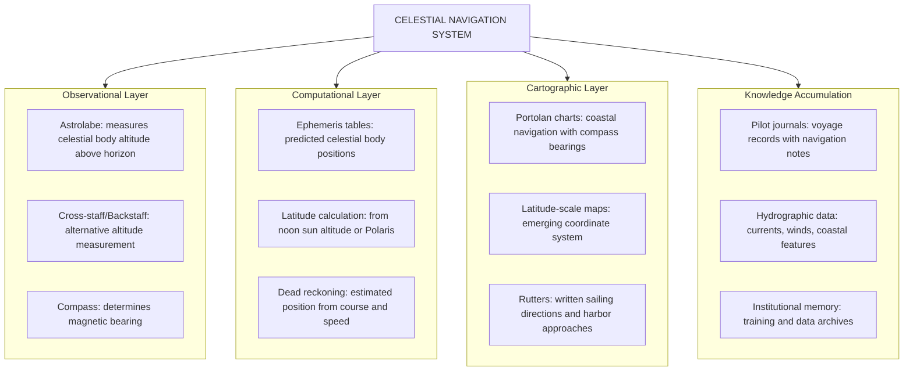
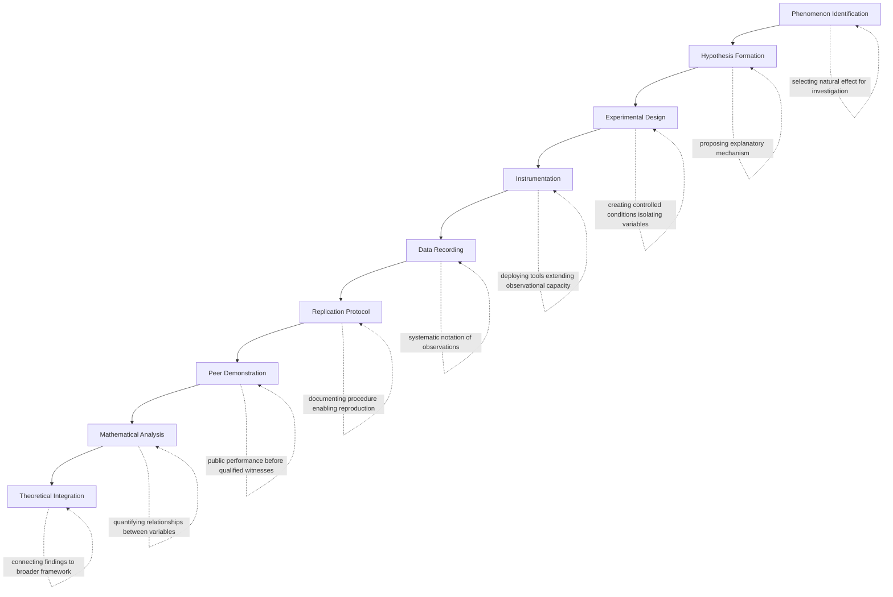

# Lesson 1: Early Modern Foundations

## 1. First-Principles Intuition & Invariants

The period spanning 1450 to 1700 represents one of history's most profound structural transformations, a cascade of interconnected disruptions that dismantled medieval certainties and constructed the institutional, intellectual, and geographical scaffolding of the modern world. To understand this epoch from first principles requires recognizing that historians do not merely catalog events in temporal sequence. Instead, the practitioner's task demands identifying the deep causal mechanisms, feedback loops, and emergent properties that drove systemic change across multiple domains simultaneously.

The historiographic challenge of early modernity lies in its polycrisis nature. Unlike periods dominated by single variables—a plague, a conquest, a technological breakthrough—the transition from medieval to modern world systems involved parallel revolutions in epistemology, theology, political organization, economic structure, and spatial consciousness. Renaissance humanism reconstituted the relationship between individual and knowledge. The Reformation shattered Christendom's monopolistic religious infrastructure. The Age of Exploration remapped planetary geography and initiated the first wave of genuine globalization. The emergence of sovereign nation-states replaced feudal particularism with centralized bureaucratic power. The Scientific Revolution overthrew Aristotelian natural philosophy and established empirical methodology as the foundational protocol for generating reliable knowledge about physical reality.

The historian's analytical framework must recognize these phenomena not as independent storylines but as mutually reinforcing transformations. Humanism's philological methods enabled Protestant reformers to challenge ecclesiastical authority by returning to original biblical texts. Exploration required navigational mathematics that accelerated scientific inquiry. Nation-state consolidation funded both overseas expansion and courtly patronage of natural philosophy. The printing press—invented around 1450—served as the information technology infrastructure enabling all other transformations by reducing the marginal cost of knowledge transmission to near zero.

From first principles, we must understand that historical causation operates through three fundamental mechanisms. Material causation involves changes in physical resources, technologies, or environmental constraints that alter the possibility space for human action. Ideational causation tracks how conceptual frameworks, belief systems, and epistemic paradigms shape collective behavior and institutional design. Structural causation examines how inherited institutions, power distributions, and social architectures channel human agency along particular paths while foreclosing others. The early modern period witnessed simultaneous revolutions in all three causal registers, creating a transformation cascade where changes in one domain accelerated shifts in others.

The invariant at the core of early modern transformation was the breakdown of medieval synthesis. The High Middle Ages had constructed an intellectually coherent world system where Aristotelian physics, Ptolemaic astronomy, Galenic medicine, Catholic theology, feudal social hierarchy, and manorial agriculture formed an interlocking totality. Each domain reinforced the others through analogical reasoning and hierarchical correspondence. The geocentric cosmos mirrored the pope-centered church which mirrored the king-centered realm which mirrored the soul-centered human microcosm. When one pillar of this synthesis cracked, the entire edifice became vulnerable to cascading failure.

Renaissance humanism initiated the crack by recovering classical texts that existed outside the medieval synthesis. Byzantine scholars fleeing the Ottoman conquest of Constantinople in 1453 brought Greek manuscripts to Italy, exposing Western intellectuals to Platonic philosophy, pre-Christian stoicism, and literary traditions that operated according to aesthetic and ethical principles independent of Christian revelation. The humanist philological method—comparing manuscript variants, analyzing linguistic evolution, identifying textual corruption—created critical distance between reader and text. This hermeneutic stance, initially applied to classical literature, inevitably turned toward scripture itself, destabilizing the church's interpretive monopoly.

The Reformation must be understood not merely as theological dispute but as a structural transformation in religious production and consumption enabled by technological and ideational preconditions. Martin Luther's 1517 posting of ninety-five theses attacking indulgence sales became consequential only because printing presses could reproduce and distribute his arguments across German-speaking territories within weeks. Earlier reformers like Jan Hus had articulated similar critiques but lacked the information infrastructure to achieve critical mass. Luther's theological innovation—justification by faith alone, priesthood of all believers, scriptural authority over ecclesiastical tradition—systematically dismantled Catholicism's institutional value proposition. If salvation required only faith and scripture access rather than sacramental mediation by ordained clergy, the church's hierarchical infrastructure became functionally redundant.

The resulting religious fragmentation generated a permanent condition of theological pluralism that fundamentally altered European political dynamics. The Peace of Augsburg in 1555 established the principle of *cuius regio, eius religio*—the ruler's religion determines the realm's religion—effectively subordinating religious identity to political sovereignty. This represented a categorical shift from medieval Christendom, where spiritual authority claimed precedence over temporal power. The Thirty Years' War, which devastated Central Europe from 1618 to 1648, demonstrated the destructive futility of attempting to restore religious uniformity through military force. The Peace of Westphalia that concluded the war institutionalized the sovereign nation-state as the fundamental unit of international order, a principle that remains operative in contemporary global politics.

The Age of Exploration constituted a material and cognitive revolution simultaneously. Portuguese navigators seeking maritime routes to Asian spice markets developed systematic protocols for deep-water navigation: improved cartography, the magnetic compass, the astrolabe for celestial positioning, and ship designs optimized for extended ocean voyages. These technical innovations enabled the Portuguese to round Africa's southern cape and establish direct trade with India by 1498, breaking the Venetian-Ottoman stranglehold on Eurasian commerce. Christopher Columbus's 1492 Atlantic crossing, seeking the same Asian markets via a western route, instead encountered continents entirely absent from European geographical consciousness.

The cognitive shock of discovering populated landmasses unknown to classical and biblical authorities cannot be overstated. If Ptolemy's geography and Genesis's account of human dispersal after Babel were both fundamentally incomplete, what other inherited certainties might prove unreliable? The Columbian Exchange—the biological transfer of crops, livestock, pathogens, and human populations between hemispheres—initiated the first genuinely planetary integration of previously isolated ecosystems. Maize and potatoes from the Americas transformed European and Asian agriculture, enabling population growth that would later fuel industrialization. European diseases devastated indigenous American populations lacking immunological resistance, facilitating colonial conquest. The Atlantic slave trade forcibly transported millions of Africans to plantation economies producing sugar, tobacco, and cotton for global markets.

This exploration-driven globalization generated wealth accumulation and commercial sophistication that undermined feudal economic structures. Joint-stock companies like the Dutch East India Company, chartered in 1602, mobilized capital at scales impossible under feudal landholding arrangements. Double-entry bookkeeping, bills of exchange, and maritime insurance created financial instruments for managing risk and tracking profit across extended trading networks. The Price Revolution—inflation driven by Spanish silver extracted from Andean mines—transferred wealth from feudal landlords receiving fixed rents to merchants and monarchs operating in monetized markets. Economic historians recognize this commercial capitalism as a necessary precondition for later industrial capitalism, establishing property rights regimes, contract enforcement mechanisms, and capital accumulation patterns that would eventually fund mechanized production.

The emergence of sovereign nation-states represented a political revolution as profound as the religious and economic transformations. Medieval political authority had been fragmented across multiple overlapping jurisdictions: feudal lordships, autonomous cities, ecclesiastical territories, and the shadowy universalist claims of Holy Roman Emperor and Pope. Early modern monarchs systematically concentrated power by subordinating noble autonomy, bureaucratizing administration, monopolizing legitimate violence through standing armies, and standardizing law across territories. The French monarchy under Louis XIV exemplified absolute sovereignty, claiming divine right, suppressing noble resistance through military force and court ritual, and asserting "L'état, c'est moi"—I am the state.

This state-building project required and generated new intellectual technologies for governance. Census-taking, taxation records, cadastral surveys mapping property ownership, and population statistics transformed territories and subjects into legible, administrable resources. The concept of "reason of state"—*raison d'état*—articulated by theorists like Giovanni Botero justified political action according to state interest rather than religious duty or dynastic honor. Niccolò Machiavelli's *The Prince*, written in 1513, scandalously separated political effectiveness from Christian morality, analyzing power acquisition and maintenance as technical problems requiring instrumental rationality. This instrumental approach to statecraft would later flower into political science as a distinct discipline.

The Scientific Revolution completed the epistemic transformation of early modernity by establishing experimental empiricism as the legitimate protocol for knowledge production about natural phenomena. The revolution unfolded through discrete paradigm shifts rather than linear accumulation. Nicolaus Copernicus's 1543 heliocentric model relocated Earth from cosmos center to planetary orbit, violating both Aristotelian physics and common sense observation. Johannes Kepler's discovery that planets follow elliptical rather than circular orbits demolished the ancient assumption that celestial motion must embody geometric perfection. Galileo Galilei's telescopic observations revealed moons orbiting Jupiter and phases of Venus, providing empirical confirmation of heliocentrism while demonstrating that instruments could extend observational capacity beyond unaided senses.

Isaac Newton's *Principia Mathematica*, published in 1687, synthesized these empirical discoveries into a comprehensive mathematical physics. Newton's three laws of motion and universal gravitation law demonstrated that the same mechanical principles governed terrestrial and celestial phenomena, eliminating the Aristotelian distinction between sublunary and superlunary realms. Equally important, Newton established mathematics as the language of physical law, shifting natural philosophy from qualitative description to quantitative prediction. The Newtonian synthesis represented an existence proof that human reason could uncover universal laws governing natural phenomena through systematic observation and mathematical reasoning.

The methodological innovations accompanying substantive discoveries proved equally consequential. Francis Bacon's *Novum Organum*, published in 1620, articulated systematic inductive method: conducting controlled experiments, recording observations, identifying patterns, and formulating general principles from particular instances. René Descartes's rationalist philosophy, centered on systematic doubt and mathematical deduction, provided an alternative epistemological foundation. The Royal Society of London, founded in 1660, and the French Académie des Sciences, founded in 1666, institutionalized scientific practice through peer review, public demonstration, and collective validation of experimental claims. These institutions established science as a social practice with explicit protocols for adjudicating competing knowledge claims.

The historian analyzing early modernity must trace not merely what changed but how changes interconnected through positive feedback mechanisms. Humanism's textual criticism enabled Reformation challenges to ecclesiastical authority. Religious fragmentation strengthened territorial sovereigns as arbiters of confessional identity. State consolidation funded exploration and colonial projects. Global trade generated capital accumulation and financial instruments. Commercial sophistication created demand for mathematical and navigational knowledge. Scientific advances provided practical tools for navigation, mining, and military technology. Each transformation accelerated and enabled others, creating an autocatalytic process that fundamentally reconstructed European civilization within two and a half centuries.

## 2. Core Architecture & Mechanics

The operational mechanics of early modern transformation require dissecting specific institutional structures, information flows, and decision architectures that translated abstract forces into concrete historical outcomes. The historian's analytical toolkit must include systematic methods for mapping power networks, tracing ideational diffusion, and modeling resource flows across time and space.

Renaissance humanism operated through a distributed network architecture rather than centralized institutional control. The movement lacked a headquarters, official doctrine, or formal membership structure. Instead, humanist scholars formed epistolary networks, exchanging letters that debated textual interpretations, shared manuscript discoveries, and coordinated collaborative projects. Desiderius Erasmus, the movement's most influential figure, maintained correspondence with hundreds of scholars across Europe, functioning as a human network hub that aggregated and disseminated humanist learning. The printing press amplified these networks by enabling asynchronous knowledge transmission. A scholar in Krakow could read a text printed in Venice without traveling or accessing a rare manuscript copy.

The humanist curriculum reform project targeted the trivium—grammar, rhetoric, logic—that formed medieval education's foundation. Humanists expanded grammar beyond Latin syntax to include philological analysis of textual transmission and corruption. They reconstituted rhetoric from formal disputation technique to persuasive civic discourse modeled on Cicero and Quintilian. They supplemented Aristotelian logic with Platonic dialectic and historical exempla. This curricular transformation propagated through educational institutions as humanist scholars secured teaching positions, wrote pedagogical texts, and trained students who carried methods to new venues.

The operational diagram of humanist knowledge production can be represented as:

```text
[Manuscript Recovery] → [Philological Analysis] → [Critical Edition]
         ↓                                              ↓
[Textual Comparison] ← [Scholarly Correspondence] → [Printing Press]
         ↓                                              ↓
[Interpretive Debate] → [Pedagogical Adoption] → [Curricular Diffusion]
```

Each stage involved specific practices. Manuscript recovery required patronage networks funding scholars to search monastery libraries and Byzantine collections. Philological analysis demanded linguistic expertise in Latin, Greek, and Hebrew plus knowledge of paleography to date manuscripts and identify textual variants. Critical editions aimed to reconstruct original texts from corrupted copies, requiring editorial judgment about which variants represented authorial intent. Scholarly correspondence circulated interpretive arguments and discoveries prior to formal publication. Printing presses transformed manuscripts into commodities with dramatically lower marginal costs. Interpretive debates occurred in published commentaries and letters. Pedagogical adoption happened as humanist-trained teachers implemented new methods and texts. Curricular diffusion proceeded through institutional replication as universities and grammar schools adopted humanist programs.

The Reformation's mechanical operation depended critically on information technology and state capacity. Luther's initial protest achieved European-wide visibility because printers recognized controversial theology as profitable merchandise. An estimated 300,000 copies of Luther's writings circulated in Germany between 1517 and 1520, creating mass awareness that made suppression impossible without comprehensive censorship infrastructure that did not yet exist. The printing press functioned as a bypassing technology that routed around the Catholic Church's information monopoly maintained through manuscript scarcity and clerical Latin literacy.

Protestant theology itself embodied an architectural shift from hierarchical to distributed religious authority. Catholic sacramental theology positioned ordained priests as necessary mediators between laity and divine grace. The seven sacraments—baptism, confirmation, Eucharist, penance, extreme unction, holy orders, matrimony—created lifecycle dependencies on clerical administration. Protestant soteriology—the doctrine of salvation—eliminated five sacraments, retained baptism and communion in modified form, and asserted that faith alone, granted by divine grace, secured salvation. This theological restructuring disintermediated the priesthood, reducing clergy to teachers and worship leaders rather than sacramental gatekeepers.

The institutional mechanics of Protestant church establishment varied by political context. In German principalities, Luther's doctrine of two kingdoms—spiritual and temporal—granted territorial rulers authority over external church governance while preserving doctrinal autonomy. Princes who adopted Protestantism confiscated Catholic monasteries and church properties, redirecting revenue to state coffers while establishing territorial churches under sovereign control. This model aligned Protestant conversion with state capacity expansion, creating material incentives beyond theological conviction.

In Geneva, John Calvin established a theocratic governance model with the Consistory—composed of pastors and lay elders—exercising moral surveillance over the population through quarterly communion examinations and disciplinary proceedings. Calvinist theology emphasized predestination, the doctrine that God predetermined each soul's salvation or damnation independent of human merit. This apparently fatalistic doctrine paradoxically generated intense worldly activism, as believers sought assurance of election through disciplined conduct and vocational success. The sociologist Max Weber later identified this "Protestant ethic" as contributing to capitalism's development by sacralizing productive labor and systematic wealth accumulation.

The Age of Exploration's operational mechanics combined navigational technology, capital mobilization, and geopolitical competition. Portuguese maritime expansion proceeded through systematic incremental progress, with each voyage extending slightly beyond the previous farthest point while establishing fortified trading posts along African coasts. Prince Henry the Navigator institutionalized exploration by sponsoring expeditions, collecting navigational data, and training pilots at Sagres. This state-directed model contrasted with later English and Dutch approaches that delegated exploration to chartered commercial companies operating under royal monopoly grants.

The navigation technology stack required integration of multiple instruments and knowledge domains:



Longitude determination remained unsolved until the eighteenth century, forcing navigators to rely on dead reckoning and coastal pilotage. This technical limitation explains why Columbus significantly miscalculated his westward distance to Asia and why early Atlantic crossings aimed for latitude sailing—reaching the target's latitude then sailing east or west until making landfall.

The commercial architecture of exploration evolved from royal expeditions to corporate enterprise. The Portuguese *Casa da India* functioned as a state trading monopoly, with all Asian spices passing through royal warehouses in Lisbon. The Spanish *Casa de Contratación* licensed ships, collected duties, and regulated American trade through the Seville bottleneck. Northern European powers developed a more distributed model. The English East India Company, chartered in 1600, and the Dutch East India Company operated as joint-stock corporations with shareholders receiving profit dividends. These companies maintained private armies, negotiated treaties, and governed colonial territories, functioning as sovereign entities in Asian contexts while remaining accountable to metropolitan investors and state oversight.

The Columbian Exchange operated through multiple transmission mechanisms with different temporal dynamics. Agricultural transfers required transporting viable seeds or cuttings, experimental cultivation in new environments, and adaptation to local growing conditions. Maize from the Americas reached China by the late sixteenth century, enabling cultivation of previously marginal lands and supporting population growth. Potatoes arrived significantly later, in the seventeenth or eighteenth century. Eurasian grains—wheat, barley, rice—established in American colonial settlements. Livestock transfers proved simpler, with European cattle, pigs, and horses rapidly establishing feral populations in American grasslands.

Pathogen transmission proceeded through direct human contact and vector species. Smallpox, measles, and typhus decimated American populations lacking prior exposure and immunological resistance. Demographic historians estimate that indigenous American populations declined by 80-95 percent in the century following contact, a catastrophic collapse enabling European colonization. The "virgin soil epidemic" model explains this disparity: Eurasian populations had achieved endemic equilibrium with crowd diseases through millennia of dense agricultural settlement and livestock domestication. American populations, arriving via Beringia following the last glacial maximum when many pathogens could not survive Arctic transit, encountered these pathogens as wholly novel threats.

Nation-state emergence involved centralizing previously dispersed sovereign functions through overlapping bureaucratic, military, fiscal, and symbolic mechanisms. The administrative architecture required creating specialized offices staffed by salaried officials rather than feudal vassals whose loyalty followed personal bonds rather than institutional hierarchy. The French monarchy established administrative divisions—généralités—governed by intendants appointed directly by the crown, answerable only to royal authority, and rotated frequently to prevent local capture. This bureaucratic structure enabled systematic tax collection, judicial standardization, and infrastructure coordination impossible under feudal fragmentation.

Military transformation proceeded from feudal levy and mercenary contract to permanent standing armies funded by state taxation. The Spanish *tercios*, formed in the early sixteenth century, combined pikemen and arquebusiers in tactical formations requiring extended drill and disciplined coordination. The Swedish military reforms under Gustavus Adolphus standardized unit organization, simplified command structures, and emphasized artillery mobility. Standing armies provided coercive capacity for domestic order maintenance and international power projection, but required massive fiscal resources unavailable to medieval polities.

The fiscal architecture supporting state expansion involved multiple revenue innovations:

```mermaid
flowchart TD
    Root["EARLY MODERN FISCAL STATE"]
    
    Revenue["Revenue Sources"]
    
    Direct["Direct Taxation"]
    DirectLand["Land tax: levied on agricultural production value"]
    DirectPoll["Poll tax: per capita assessment (regressive)"]
    DirectProperty["Property tax: assessed on moveable wealth"]
    
    Indirect["Indirect Taxation"]
    IndirectCustoms["Customs duties: tariffs on imports/exports"]
    IndirectExcise["Excise taxes: levied on commodities (salt, wine, tobacco)"]
    IndirectSales["Sales taxes: transaction-based revenue"]
    
    Monopoly["Monopoly Revenue"]
    MonopolyTrading["State trading monopolies: colonial products"]
    MonopolyMining["Mining concessions: precious metal extraction"]
    MonopolyLicense["License fees: regulated professions and activities"]
    
    Borrowing["Borrowing Mechanisms"]
    BorrowingOffices["Sale of offices: purchasable government positions"]
    BorrowingDebt["State debt: bonds and annuities sold to investors"]
    BorrowingFarming["Tax farming: private contractors advance revenue"]
    
    Root --> Revenue
    Revenue --> Direct
    Revenue --> Indirect
    Revenue --> Monopoly
    Revenue --> Borrowing
    
    Direct --> DirectLand
    Direct --> DirectPoll
    Direct --> DirectProperty
    
    Indirect --> IndirectCustoms
    Indirect --> IndirectExcise
    Indirect --> IndirectSales
    
    Monopoly --> MonopolyTrading
    Monopoly --> MonopolyMining
    Monopoly --> MonopolyLicense
    
    Borrowing --> BorrowingOffices
    Borrowing --> BorrowingDebt
    Borrowing --> BorrowingFarming
```



The fiscal state's success depended on creating legible populations and territories. Census records enabled per capita taxation. Cadastral surveys mapping property boundaries enabled land taxation. Standardized weights and measures enabled commodity taxation. This information infrastructure transformed abstract sovereignty into operational governance capacity.

The Scientific Revolution's institutional mechanics involved creating communities of practice with shared methodological protocols and validation procedures. Natural philosophy had traditionally been a solitary activity, with individual scholars developing comprehensive systems published in treatises. The scientific society model introduced collective investigation, experimental replication, and peer scrutiny as mechanisms for adjudicating knowledge claims. The Royal Society's motto—*Nullius in verba* (Take nobody's word for it)—expressed epistemic commitment to empirical demonstration over textual authority.

The experimental method architecture stratified into distinct layers:



Robert Boyle's air pump experiments exemplified this protocol. Boyle designed an apparatus evacuating air from a sealed chamber, enabling investigation of pneumatic phenomena. He demonstrated that sound cannot propagate in vacuum, that combustion requires air, and that respiration depends on atmospheric pressure. Crucially, Boyle published detailed diagrams and instructions enabling other natural philosophers to construct air pumps and replicate experiments. This replicability transformed experimental results from personal testimony into publicly validated knowledge.

The mathematical turn in natural philosophy required integrating geometry, algebra, and emerging calculus with physical observation. Galileo's analysis of projectile motion decomposed parabolic trajectories into horizontal inertial motion and vertical gravitational acceleration. Kepler's laws of planetary motion provided mathematical description—elliptical orbits, equal areas in equal times, harmonic relationship between orbital period and distance—without explaining physical cause. Newton unified description and explanation by demonstrating that inverse-square gravitational force mathematically necessitated Kepler's laws while also accounting for terrestrial falling bodies, tides, and lunar motion.

## 3. High-Performance Optimization & Failure Modes

The practitioner analyzing early modern history must develop systematic methods for identifying high-leverage causal factors, avoiding analytical pitfalls, and constructing robust interpretations resilient to counterevidence. Historical analysis differs from scientific experiment in lacking controlled conditions and reproducibility, but shares the requirement for rigorous evidential reasoning and explicit acknowledgment of inferential uncertainty.

The primary optimization challenge involves managing evidentiary abundance and scarcity simultaneously. Early modern Europe generated unprecedented documentary production—state archives, commercial records, printed books, personal correspondence—creating source bases that exceed any individual historian's processing capacity. Simultaneously, vast domains remain poorly documented. We possess extensive records of elite political and intellectual activity but fragmentary evidence of peasant life, women's experiences outside elite contexts, and non-European perspectives on European expansion. The optimization problem requires strategically sampling abundant sources while acknowledging blind spots created by archival silence.

The syntopical reading method provides a structured approach to comparative source analysis. When investigating a historical problem across multiple primary sources, the historian must:

Establish the core question requiring investigation, formulated with sufficient precision to guide source selection but adequate flexibility to accommodate unexpected evidence. Investigating "Why did the Reformation succeed?" proves too vague, while "What role did printing technology play in enabling Protestant doctrine dissemination in German-speaking territories between 1517 and 1525?" provides actionable specificity.

Identify source corpus relevant to the investigation, stratified by type: contemporary chronicles, official correspondence, theological treatises, pamphlets, inquisition records, iconographic evidence. Each source type embodies specific biases and blind spots. Chronicles narrate events from partisan perspectives. Official correspondence reveals elite decision-making but obscures implementation. Theological treatises articulate systematic doctrine but may misrepresent popular belief. Pamphlets provide windows into vernacular discourse but represent published opinion rather than private sentiment. Inquisition records document dissent but through the distorting lens of hostile interrogation.

Extract relevant passages addressing the core question, maintaining careful notation of source provenance and context. The historian constructs a synthetic narrative by triangulating across sources, identifying convergent testimony that earns higher credibility than isolated claims. When sources conflict, the task requires assessing relative reliability through source criticism: Which author had direct access to events? What motives might bias testimony? Does the claim align with material constraints and documented patterns?

The comparative method enables identifying divergent outcomes from similar initial conditions, isolating causal factors through controlled contrast. Why did Protestantism succeed in northern Europe but largely fail in Mediterranean regions? Comparing Reformation trajectories across political contexts reveals that decentralized polities—the German imperial cities and princely territories—provided institutional space for religious innovation, while centralized monarchies—Spain, France, Italy—possessed state capacity for effective suppression. The French Wars of Religion demonstrated that even where Protestantism gained substantial following, monarchical power ultimately enforced confessional uniformity.

Failure mode analysis requires systematic attention to pathologies that corrupt historical reasoning. Presentism—interpreting past actors through contemporary values and assumptions—generates fundamental category errors. Early modern Europeans operated within cosmological, theological, and social frameworks radically alien to secular modernity. Attributing Renaissance humanism to "progress" or "scientific rationality" anachronistically imports nineteenth-century concepts backward. Humanists remained Christians who believed in miracles, divine providence, and scriptural authority. Their classical revival sought moral and rhetorical exempla, not secular rationalism.

Teleological reasoning—interpreting events as necessary stages toward predetermined outcomes—imposes false inevitability on contingent processes. The narrative of "rise of the West" or "triumph of science" treats early modern developments as inexorable steps toward modernity, obscuring the genuine uncertainty contemporaries faced and contingent factors shaping outcomes. Protestant Reformation could have remained a minor monastic dispute had Frederick the Wise not protected Luther from imperial prosecution. Scientific Revolution could have stalled had patronage networks not funded sustained investigation. Recognizing contingency requires counterfactual reasoning: What alternative trajectories were possible given different circumstances?

The ecological fallacy—inferring individual behavior from aggregate patterns—creates spurious causation. The observation that regions adopting Protestantism subsequently exhibited higher literacy rates does not demonstrate that Protestant theology caused literacy. The causal mechanism requires specification: Protestant emphasis on scripture reading created demand for vernacular Bible translations and literacy instruction, operationalized through church-sponsored schools and catechism programs. The Catholic Church, recognizing this competitive pressure, launched its own educational initiatives through teaching orders like the Jesuits. The aggregate correlation between Protestantism and literacy reflects institutional responses rather than direct theological determination.

The base rate fallacy—ignoring prior probability when assessing evidence—leads to overinterpreting coincidence as causation. The observation that several major scientific figures were Protestant might suggest religious causation, but requires assessing the base rate: What proportion of educated Europeans in relevant regions and periods were Protestant? Given religious demographics, the Protestant representation among scientists may reflect population base rates rather than causal relationship. Proper Bayesian reasoning demands comparing observed frequency against expected frequency from null hypothesis.

Optimization of historical research workflow involves strategic source selection that maximizes information gain relative to time investment. Primary sources vary dramatically in information density and accessibility. Published source collections and translated documents provide efficient entry points but may reflect editorial selection biases. Archival research accessing manuscript sources yields novel findings but requires specialized paleographic skills and substantial time investment. The optimal strategy sequences research phases: Begin with historiographic literature review to map scholarly debates and identify unresolved questions. Conduct systematic survey of published primary sources to establish baseline factual understanding. Target archival research to specific gaps or questions where manuscript sources promise high marginal information return.

Digital humanities methods provide scaling mechanisms for analyzing large source corpora. Topic modeling algorithms can identify thematic patterns across thousands of documents, revealing discourse evolution that manual reading cannot detect. Network analysis mapping correspondence patterns can identify information brokers and community structure among intellectual networks. Geographic information systems enable spatial analysis of trade routes, religious distribution, and political boundaries. These computational methods supplement rather than replace close reading, generating hypotheses that require traditional interpretive validation.

The construction of robust historical arguments requires explicit acknowledgment of inferential uncertainty and alternative explanations. Strong claims demand strong evidence—multiple independent sources, material corroboration, alignment with documented constraints. Weak evidence warrants qualified conclusions using epistemic hedges: "suggests," "may indicate," "remains uncertain." The gold standard involves stating the argument's evidentiary basis, acknowledging counterevidence, and explaining why the interpretation remains preferable to alternatives.

Causal claims require particular care in specifying mechanism and eliminating confounds. Asserting that "printing caused the Reformation" oversimplifies a complex relationship. Printing was necessary but insufficient—it enabled rapid dissemination but did not generate theological content, political protection, or popular receptivity. A precise causal claim specifies mechanism: "Printing presses enabled Luther's theology to achieve Europe-wide visibility within months, creating distributed awareness that exceeded the Catholic Church's censorship capacity and enabled coordinated resistance to suppression efforts." This formulation identifies the specific causal contribution while acknowledging other necessary factors.

The early modern period's significance for subsequent history demands careful analysis of path dependencies and initial condition sensitivity. The nation-state system established at Westphalia in 1648 remains the fundamental architecture of international order. The scientific method institutionalized in the seventeenth century became the dominant epistemology for natural knowledge. The global trade networks initiated during the Age of Exploration evolved into contemporary economic globalization. The religious fragmentation produced by the Reformation created permanent pluralism that eventually generated secular political theory and religious toleration.

Yet recognizing long-term consequences does not justify treating early modern transformations as inevitable or optimal. The nation-state system enabled coordinated violence at unprecedented scale through world wars. Scientific rationality generated technological capacity for nuclear annihilation and anthropogenic climate change. Global trade networks facilitated pandemic disease transmission and ecological disruption. Religious pluralism emerged through devastating warfare rather than principled toleration. The historian's task involves tracing actual causal pathways with clear-eyed assessment of contingency, acknowledging that alternative trajectories remained possible and that outcomes included profound costs alongside benefits.

The practitioner's ultimate objective involves constructing analytical frameworks that illuminate present circumstances through rigorous understanding of formative past processes. Early modern history reveals how institutional innovations—bureaucratic states, scientific societies, global markets—emerged from specific conditions and solved particular problems while creating new challenges. These institutions now form our inherited infrastructure, shaping possibilities and constraints for contemporary action. Historical consciousness enables recognizing that present arrangements result from contingent choices rather than natural necessity, opening imaginative space for alternative institutional designs while respecting the difficult trade-offs earlier generations confronted. This constitutes history's practical value: not deterministic prediction but informed perspective on how complex human systems evolve through the interaction of material constraints, ideational frameworks, and strategic choices under uncertainty.
