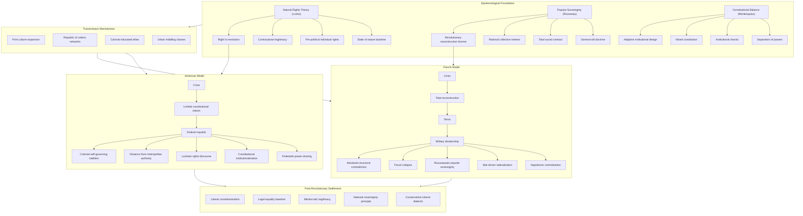

# Lesson 2: Enlightenment Revolutions

## 1. First-Principles Intuition & Invariants

The Enlightenment represents the most consequential intellectual revolution in modern Western history, establishing the epistemic and political frameworks that continue to structure contemporary governance, scientific inquiry, and individual rights discourse. Between 1700 and 1815, European and Atlantic societies underwent a fundamental recalibration of legitimacy itself, shifting from divine-right sovereignty and inherited privilege toward rationalist, contractarian, and empiricist foundations for political authority. This lesson dissects the causal architecture connecting philosophical premises to revolutionary action, analyzing how abstract propositions about human nature, knowledge acquisition, and social organization translated into concrete institutional upheaval across two continents.

The Enlightenment intellectual movement emerged from a specific epistemological crisis: the collapse of unified Christendom after the Reformation and the Thirty Years' War had shattered claims to absolute religious truth, while the Scientific Revolution demonstrated that systematic observation and mathematical reasoning could unlock natural laws previously attributed to divine mystery. Thinkers from Locke to Voltaire, Montesquieu to Rousseau, Hume to Kant, constructed new foundations for human knowledge and social order that bypassed ecclesiastical authority entirely. Their fundamental invariant was the autonomy of human reason—the claim that individuals possessed innate cognitive faculties capable of discerning truth, justice, and proper social arrangements without appealing to revelation or tradition.

This epistemic shift carried immediate political implications. If reason rather than divine ordination determined legitimate governance, then existing monarchical and aristocratic structures required rational justification. John Locke's contractarian framework, articulated most clearly in his *Second Treatise of Government* (1689), established the core logical structure that would animate both the American and French Revolutions. Locke's argument proceeded from a hypothetical state of nature where individuals possessed natural rights to life, liberty, and property, then reasoned that legitimate government could only arise from the voluntary consent of the governed, who delegated specific powers to protect these pre-political rights. Crucially, Locke's framework embedded a right to revolution: when governments systematically violated the rights they were established to protect, citizens retained the ultimate sovereignty to withdraw consent and reconstitute political authority.

The Enlightenment thus established a new grammar of political legitimacy with three foundational axioms. First, individual rights precede and constrain governmental authority rather than deriving from it. Second, political sovereignty ultimately resides in the people rather than in monarchs or aristocracies. Third, institutions must justify themselves through rational demonstration of their contribution to human welfare rather than through appeals to tradition, divine sanction, or inherited status. These axioms created a revolutionary potential that would destabilize the entire European state system, because they implied that virtually every existing regime lacked genuine legitimacy.

The practical translation of Enlightenment principles into revolutionary movements, however, revealed fundamental tensions within the philosophical framework itself. The American Revolution (1775-1783) and the French Revolution (1789-1799) both invoked Enlightenment axioms, yet their divergent trajectories exposed competing interpretations of reason, rights, and popular sovereignty. The American colonists constructed a limited, constitutionalist revolution focused on protecting existing liberties against metropolitan encroachment, while French revolutionaries pursued a total reconstruction of society according to rational principles. These contrasting approaches reflected deeper philosophical fissures within Enlightenment thought between Lockean natural rights liberalism and Rousseauian popular sovereignty, between skeptical empiricism and rationalist system-building, between evolutionary constitutional reform and revolutionary social transformation.

The Napoleonic consolidation (1799-1815) represented a third synthesis, combining revolutionary legal rationalization with authoritarian centralization, meritocratic institutions with military imperialism, Enlightenment universalism with French nationalism. Napoleon's regime exported revolutionary reforms—abolition of feudalism, legal equality, secular education, meritocratic civil service—at bayonet point across Europe, simultaneously destroying the Old Regime's institutional structure while discrediting revolutionary republicanism through military dictatorship. The post-Napoleonic settlement attempted to restore pre-revolutionary legitimacy while accommodating irreversible institutional changes, generating the liberal-conservative dialectic that would structure European politics throughout the nineteenth century.

Understanding this period requires analyzing it as a multi-layered causal system where philosophical premises, material conditions, institutional structures, and contingent events interacted to produce revolutionary ruptures. The Enlightenment provided the ideological ammunition, but structural factors—fiscal crisis, commercial transformation, print culture expansion, Atlantic trade networks—created the social forces capable of weaponizing those ideas. The revolutions themselves followed distinct causal pathways shaped by their starting institutional configurations, with the American colonists possessing substantial self-governing experience and the French confronting an absolutist monarchy in fiscal collapse. The outcomes established new baselines for political possibility: after 1815, no European regime could simply ignore demands for constitutional government, legal equality, and national self-determination, even when reactionary forces temporarily suppressed these aspirations.

The analytical task for historians examining this period involves reconstructing these causal chains with precision, distinguishing necessary from sufficient conditions, identifying critical junctures where alternative pathways remained open, and tracing how revolutionary dynamics radicalized through feedback loops between ideological competition, social mobilization, international war, and institutional breakdown. The Enlightenment Revolutions cannot be reduced to either idealist narratives where philosophical ideas directly cause political change or materialist accounts where economic interests merely deploy ideological justifications. Rather, this period demonstrates how abstract reasoning about human nature and political legitimacy, when transmitted through expanding print culture to audiences facing genuine institutional dysfunction, can generate self-reinforcing revolutionary processes that escape the control of their initiators and establish new structural parameters for subsequent political development.

## 2. Core Architecture & Mechanics

The Enlightenment intellectual architecture rested on a fundamental reorientation of epistemological method, shifting from scholastic syllogistic reasoning grounded in textual authority toward empirical observation, experimental verification, and mathematical formalization as the ultimate arbiters of truth claims. This methodological transformation, pioneered by natural philosophers like Galileo, Descartes, and Newton, extended into moral, political, and social inquiry through the work of philosophes who sought to establish a science of society analogous to the science of nature. The mechanical structure of Enlightenment argumentation typically proceeded through several sequential stages: first, positing a hypothetical state of nature or original condition to isolate fundamental human characteristics from contingent social arrangements; second, deriving universal principles or natural laws from these foundational premises through deductive reasoning; third, evaluating existing institutions against these rational standards; fourth, proposing reforms or reconstructions to align social reality with rational ideals.

John Locke's political theory exemplifies this analytical architecture with particular clarity. His *Second Treatise* begins by establishing the state of nature as a conceptual baseline—a condition of natural freedom and equality where individuals possess perfect liberty to order their actions and dispose of their property without requiring permission from others, bounded only by the law of nature prohibiting harm to others' life, health, liberty, or possessions. This conceptual device allows Locke to argue that rights inhere in individuals prior to and independent of governmental structures, rather than being granted by sovereigns. From this baseline, Locke constructs a contractarian derivation of legitimate political authority: rational individuals in the state of nature face certain inconveniences, particularly the lack of an impartial judge to resolve disputes and insufficient power to execute natural law consistently. They therefore voluntarily contract with one another to establish civil government, delegating specific powers while retaining ultimate sovereignty.

The logical structure of this argument contains several critical load-bearing components that would later prove unstable under revolutionary pressure. Locke maintained that individuals could only delegate powers they possessed in the state of nature, limiting legitimate governmental authority to protecting natural rights rather than pursuing perfectionist or paternalist projects. He distinguished between legislative, executive, and federative powers, anticipating the separation-of-powers doctrine that American revolutionaries would operationalize in constitutional design. Most importantly, he embedded within the contract theory itself a right to resistance: because legitimate authority derived from popular consent and existed solely to protect natural rights, any government that systematically violated these foundational purposes forfeited its legitimacy, returning power to the people.

The French Enlightenment developed parallel but divergent analytical frameworks, particularly in Montesquieu's climate-and-culture theory and Rousseau's general will doctrine. Montesquieu's *Spirit of the Laws* (1748) constructed a comparative-historical analysis of governmental forms, arguing that constitutional structures must adapt to local conditions including climate, geography, population size, economic base, and cultural traditions. This approach valorized the mixed constitution balancing monarchical, aristocratic, and democratic elements, which Montesquieu identified in the English system of king, Lords, and Commons operating through separation of powers. His analytical method emphasized institutional checks and balances as mechanisms to prevent tyranny through structural rivalry among competing power centers, rather than relying on the virtue of rulers or revolutionary transformation of social conditions.

Rousseau's *Social Contract* (1762) radicalized contractarian theory in a different direction, arguing that legitimate political authority required not merely consent but the total alienation of individual rights to the community, which then reconstituted them as expressions of the general will. Where Locke's contract established limited government to protect pre-political rights, Rousseau's formulation fused individual and collective sovereignty through the concept of the general will—the rational collective interest of the political community as distinct from the mere aggregation of particular private interests. This doctrine carried revolutionary implications: if legitimate law must express the general will, then existing regimes based on privilege, inequality, and particular interests lacked any claim to obedience. Rousseau's framework licensed total social reconstruction according to rational principles, limited only by the proper identification of the general will itself.

The transmission mechanism connecting these philosophical architectures to revolutionary practice operated through the eighteenth-century Republic of Letters—a decentralized network of print culture including books, pamphlets, newspapers, salons, coffeehouses, Masonic lodges, and scientific societies. This communication infrastructure allowed Enlightenment ideas to circulate beyond narrow academic circles, reaching educated middling classes, provincial lawyers, reform-minded aristocrats, and colonial elites. Crucially, these ideas traveled as modular components that readers could recombine and adapt to local circumstances rather than as fixed systems. American colonists selectively appropriated Lockean natural rights discourse while largely ignoring Rousseauian general will theory, whereas French revolutionaries would oscillate between liberal constitutionalism and Jacobin popular sovereignty as political circumstances shifted.

The American Revolutionary sequence demonstrates how Enlightenment premises translated into institutional practice through a specific causal pathway. Colonial resistance to British imperial reforms after 1763 initially framed grievances in traditional terms of violated English liberties and constitutional precedents. However, as the conflict escalated through the Stamp Act crisis, Townshend duties, the Tea Act, and the Coercive Acts, colonial pamphleteers increasingly deployed natural rights argumentation to justify resistance. Thomas Paine's *Common Sense* (1776) marked the decisive rhetorical shift, bypassing appeals to English constitutional tradition to argue directly from Enlightenment first principles that hereditary monarchy violated natural equality and that only republican self-government could protect natural rights.

The Declaration of Independence operationalized this Enlightenment architecture into a formal justification for revolution, structured as a logical syllogism. The opening section established universal premises: all men are created equal and endowed with unalienable rights including life, liberty, and the pursuit of happiness; governments derive their just powers from the consent of the governed; people retain the right to alter or abolish governments that become destructive of these ends. The middle section documented particular facts demonstrating that British rule had systematically violated these principles through a long train of abuses. The conclusion followed deductively: the colonies therefore possessed both the right and the duty to dissolve political bands and establish independent government. This argumentative structure exemplifies Enlightenment rationalism applied to political justification, claiming universal validity through logical demonstration rather than appealing to particular English traditions or colonial precedents.

The constitutional architecture that emerged from the American Revolution reflected Enlightenment institutional design principles filtered through federalist pragmatism. The Constitution of 1787 operationalized Montesquieu's separation of powers through distinct legislative, executive, and judicial branches with overlapping jurisdictions and mutual checks. It embedded Lockean limited government through enumerated powers rather than plenary sovereignty, with the Bill of Rights explicitly protecting individual liberties from governmental encroachment. The federal structure itself represented an innovative synthesis, creating divided sovereignty between national and state governments to accommodate both the need for effective central authority and the desire to preserve local self-government. This constitutional mechanism established procedural safeguards against tyranny through institutional rivalry and diffused power centers rather than relying on revolutionary virtue or popular mobilization.

The French Revolutionary trajectory followed a radically different causal pathway despite invoking similar Enlightenment principles. The Estates-General convened in May 1789 to address fiscal crisis, but the structural contradiction between absolutist monarchy and a politically mobilized educated public created revolutionary potential. When the Third Estate transformed itself into the National Assembly claiming to represent the sovereign nation, it operationalized Rousseauian popular sovereignty against monarchical authority. The Declaration of the Rights of Man and Citizen (August 1789) articulated Enlightenment axioms with even greater abstraction than the American Declaration: men are born and remain free and equal in rights; the aim of political association is the preservation of natural rights; sovereignty resides essentially in the nation; law is the expression of the general will.

These principles, however, contained internal tensions that French revolutionaries struggled to resolve as the Revolution radicalized. The contradiction between natural rights liberalism and popular sovereignty became acute: did individual rights constrain the general will, or could the sovereign people legitimately restructure society according to rational principles regardless of particular interests? The Jacobin phase (1792-1794) resolved this tension in favor of total popular sovereignty, justifying emergency dictatorship and mass violence as necessary to establish republican virtue against internal and external enemies. Robespierre's Republic of Virtue attempted to implement Rousseauian theory literally, using state power to forcibly create the social conditions for genuine popular sovereignty through the Terror, de-Christianization campaigns, and revolutionary festivals designed to regenerate civic culture.

The revolutionary dynamic operated through several reinforcing feedback loops that amplified radicalization beyond the original intentions of reform-minded aristocrats and constitutionalist deputies. First, international war with Austria and Prussia, beginning in April 1792, created emergency conditions that justified suspending normal constitutional protections and concentrating power in revolutionary committees. Second, internal counter-revolution and civil war, particularly in the Vendée, generated existential threats that legitimated repressive measures against suspected enemies of the Revolution. Third, factional competition among revolutionary groups created a ratchet effect where each faction had to adopt more radical positions to avoid being outflanked and accused of moderation or treason. Fourth, the abolition of traditional social structures—guilds, corporate privileges, regional parliaments, ecclesiastical authority—destroyed intermediate institutions that might have moderated conflict, leaving direct confrontation between centralized state power and atomized individuals.

The Napoleonic synthesis emerged from revolutionary exhaustion, combining elements of Enlightenment rationalism, revolutionary meritocracy, and authoritarian centralization. Napoleon's institutional architecture preserved revolutionary legal equality while suppressing revolutionary political participation. The Civil Code of 1804 rationalized French law, establishing uniform legal principles across the nation: equality before the law, property rights, freedom of contract, secular marriage, and abolition of feudal privileges. This legal framework exported revolutionary social transformations while eliminating revolutionary political instability. The administrative centralization through prefects, the meritocratic civil service, and the standardized education system created rational, efficient state capacity far exceeding the absolutist monarchy's capabilities.

The Napoleonic military system revolutionized warfare through mass conscription, rapid maneuver, and decisive battle-seeking strategy, translating revolutionary enthusiasm and national mobilization into overwhelming tactical advantage against professional armies of the Old Regime. The Grande Armée's organizational structure embedded meritocratic promotion, corps system flexibility, and artillery concentration, creating a military instrument capable of projecting French power across the entire European continent. However, this system contained inherent overextension risks: the military apparatus required continuous conquest to sustain itself through requisitioning and plunder, generating resistance nationalism in occupied territories and eventually overreaching in the Spanish and Russian campaigns.

The Napoleonic Wars' conclusion at Waterloo (1815) and the Congress of Vienna settlement attempted conservative restoration while accommodating irreversible revolutionary transformations. The Vienna system reestablished monarchical legitimacy and territorial balance of power, but could not resurrect feudal social structures or corporatist legal orders. The principle of national sovereignty, the demand for constitutional limits on monarchical authority, and the expectation of legal equality had become embedded in European political consciousness, creating permanent tension between restoration regimes and liberal-nationalist opposition movements.

## 3. High-Performance Optimization & Failure Modes

Historical analysis of the Enlightenment Revolutions requires mastering several critical methodological competencies to avoid common analytical pitfalls and to extract actionable insights applicable to understanding modern political transformations. The most fundamental optimization involves distinguishing between necessary and sufficient conditions in causal explanation, particularly when analyzing how philosophical ideas relate to revolutionary action. Weak historical reasoning often falls into either crude idealism—claiming that Enlightenment philosophy directly caused revolutions through the power of ideas—or reductive materialism—asserting that material interests entirely determined outcomes while ideology served merely as post-hoc rationalization. Neither monocausal framework captures the complex interactive causation actually operative in this period.

Advanced practitioners employ a multi-layered causal architecture that distinguishes between structural preconditions, triggering events, mediating mechanisms, and contingent factors. Structural preconditions include long-term transformations that create revolutionary potential: the fiscal-military state's expansion and accompanying tax burdens, commercial capitalism's growth and resulting social mobility, print culture's expansion and consequent public sphere emergence, Atlantic trade networks' development and associated colonial economic integration. These structural factors created tensions within existing institutional frameworks but did not deterministically produce revolution. Multiple European states faced similar structural pressures—Spain, Austria, Prussia—without experiencing comparable revolutionary ruptures during this period.

Triggering events concentrate political conflict and force institutional crises: the British imperial reforms after the Seven Years' War that sparked colonial resistance, the French monarchy's bankruptcy and forced Estates-General convocation in 1789, the Spanish royal family's collapse during Napoleon's intervention that enabled Latin American independence movements. These triggering events do not cause revolutions by themselves but rather expose contradictions within existing systems that structural transformations have rendered unsustainable. The analytical task involves tracing how triggering events interact with structural preconditions to open critical junctures where alternative institutional pathways become possible.

Mediating mechanisms explain how potential becomes actual—how structural tensions and triggering crises translate into revolutionary mobilization rather than accommodative reform. The eighteenth-century Republic of Letters functioned as a crucial mediating mechanism, providing the communication infrastructure through which Enlightenment ideas circulated, educated middling classes articulated grievances in universalistic language, and geographically dispersed opposition movements developed shared conceptual frameworks. Similarly, the revolutionary festival culture, political clubs, and urban mobilization networks in France served as organizational mechanisms converting ideological radicalization into collective action. American committees of correspondence and continental congresses performed analogous coordinating functions across the dispersed colonial territories.

Contingent factors—individual decisions, personality conflicts, military outcomes, weather events—inject path dependency into revolutionary sequences, explaining why similar structural conditions and ideological resources produced divergent outcomes in America and France. The American Revolution's relative moderation reflected multiple contingent factors: George Washington's personal restraint in refusing monarchical power, the revolution's military leadership by propertied colonial elites rather than urban sans-culottes, the physical distance from Britain enabling gradual institutional separation, and the absence of a land-based military threat after 1783 requiring mass mobilization. French radicalization stemmed from different contingent dynamics: the royal family's attempted flight in June 1791 that destroyed constitutional monarchist compromise, the August 1792 Brunswick Manifesto that radicalized Parisian opinion, the Jacobin factional victory over Girondins in spring 1793, and the military genius of particular generals including Napoleon himself.

Sophisticated historical analysis constructs explanatory frameworks that integrate these causal layers rather than privileging one level exclusively. The following optimization protocol enhances analytical rigor when examining revolutionary periods:

First, establish the structural baseline by reconstructing institutional configurations and identifying internal contradictions before the revolutionary crisis. For the American case, this requires analyzing the colonial political economy, particularly the quasi-autonomous self-governing institutions that colonial assemblies had developed during the period of salutary neglect before 1763, creating an expectation of local autonomy that metropolitan reforms violated. For France, structural analysis must capture the absolutist monarchy's contradictory position, simultaneously claiming unlimited sovereign authority while depending on corporatist intermediary bodies and privileged elites to actually collect taxes and administer justice, generating fiscal incapacity despite theoretical omnipotence.

Second, map the ideological resources available to political actors through careful primary source analysis of pamphlets, speeches, newspapers, personal correspondence, and legislative debates. This process reveals not a monolithic Enlightenment ideology but rather a contested terrain of competing concepts that actors deployed strategically according to political circumstances. American revolutionary discourse drew heavily on English republican traditions, Lockean natural rights theory, and Scottish common-sense philosophy, but also incorporated classical republican virtue language, Protestant millennialism, and pragmatic arguments about commercial interest. French revolutionary ideology exhibited even greater diversity, oscillating between constitutional monarchism, liberal natural rights, Rousseauian popular sovereignty, classical republican virtue, and proto-socialist egalitarianism as different factions gained ascendancy.

Third, trace the feedback loops between ideological radicalization and material conflict escalation. Revolutionary dynamics rarely follow linear trajectories from moderate reform to radical transformation; instead, they exhibit ratchet effects where each side's actions radicalize opponents, violence legitimates repression, and emergency conditions justify previously unthinkable measures. The American Revolution remained comparatively moderate partly because military conflict remained geographically contained and temporally bounded, concluding before radicalization dynamics could fully develop. The French Revolution spiraled through escalating radicalization because international war, civil war, and factional competition created mutually reinforcing pressures toward ideological extremism and political violence.

Fourth, analyze institutional design decisions as responses to perceived failures of previous regimes, understanding that constitutional framers construct safeguards against the particular tyrannies they have experienced rather than against abstract possibilities. The American Constitution's elaborate system of checks and balances, federalism, and enumerated powers reflected colonial experience with distant, unaccountable metropolitan authority and recent experience with weak central government under the Articles of Confederation. The French Constitution of 1791 created a weak executive because framers feared monarchical tyranny, inadvertently enabling the legislative paralysis and factional warfare that facilitated Jacobin dictatorship. Napoleonic centralization responded to revolutionary chaos by concentrating power in ways that revolutionary ideology theoretically opposed but revolutionary experience made attractive.

Fifth, assess the international system's role in shaping revolutionary trajectories. Revolutionary France's radicalization cannot be understood without analyzing the threat perception created by the Coalition Wars and the military mobilization dynamics they triggered. Napoleon's imperial expansion reflected not merely personal ambition but systemic incentives: the French military-fiscal apparatus required continuous conquest to sustain itself, conquered territories provided resources for further expansion, and military victory legitimated authoritarian governance. The international system's structure after 1815 reflected great powers' shared interest in preventing future revolutionary destabilization, creating the Concert of Europe mechanism for managing conflicts and suppressing revolutionary movements.

Common failure modes in analyzing this period stem from several methodological errors that compromise explanatory power and analytical precision. Presentism represents the most pervasive failure, projecting contemporary political categories and values backward onto historical actors who operated within fundamentally different conceptual frameworks. Modern readers often anachronistically interpret eighteenth-century "democracy" through twentieth-century universal suffrage rather than the restricted, propertied citizenship that revolutionaries actually envisioned. Similarly, reading contemporary human rights discourse backward into the Declaration of Independence or the Rights of Man obscures the historically specific meanings these documents carried, particularly their exclusion of women, enslaved people, and propertyless workers from the rights-bearing political community.

Cherry-picking primary sources to support predetermined interpretative frameworks rather than engaging the full complexity and contradiction within historical evidence generates a second failure mode. Every major revolutionary figure produced texts supporting multiple, sometimes contradictory positions as circumstances changed. Jefferson simultaneously proclaimed universal natural rights and defended slavery. Robespierre advocated for press freedom and popular sovereignty, then justified censorship and revolutionary dictatorship. Rather than selecting quotations that confirm particular interpretations, rigorous analysis must reconstruct how actors navigated between competing principles and adjusted positions as contexts shifted, treating contradiction and adaptation as historically significant rather than as embarrassing anomalies to be explained away.

Deterministic teleology—reading revolutionary outcomes backward to construct narratives where developments appear inevitable—represents a third major failure mode. The American Constitution was not the predetermined endpoint of colonial resistance but rather one contingent outcome among multiple possibilities that included continued British rule under reformed terms, fragmentation into separate regional confederations, or monarchical government under a different dynasty. The Terror was not the inevitable result of Enlightenment rationalism but rather one possible trajectory among many that French revolutionaries might have followed, highly dependent on war, economic crisis, and factional dynamics. Sophisticated counterfactual analysis, asking how different decisions at critical junctures might have altered outcomes, guards against spurious inevitability.

Monocausal explanation represents a fourth methodological trap, whether privileging ideas, interests, institutions, or individuals as the exclusive driver of historical change. The Enlightenment Revolutions resulted from complex interactions among all these factors. Enlightenment philosophy provided the conceptual vocabulary and normative standards for challenging existing institutions, but material interests shaped which actors mobilized around these ideas and how they deployed them strategically. Institutional structures determined the terrain on which conflicts played out and constrained the range of possible outcomes. Contingent individual decisions at critical moments—Washington refusing monarchical power, Napoleon seizing it—altered trajectories in ways structural factors alone could not determine.

The following analytical checklist optimizes explanatory rigor when examining revolutionary transformations:

**Structural Analysis:** Reconstruct pre-revolutionary institutional configurations, identify internal contradictions, map demographic and economic transformations, analyze fiscal-military state capacity, trace commercial network development, and assess communications infrastructure evolution.

**Ideological Mapping:** Survey intellectual resources available to actors, identify competing conceptual frameworks, trace transmission mechanisms through print culture and associational networks, analyze strategic deployment of ideas in political discourse, and distinguish between sincere beliefs and instrumental rhetoric through behavioral consistency analysis.

**Process Tracing:** Document triggering events and critical junctures, identify decision points where alternative pathways remained open, trace feedback loops between ideological radicalization and material conflict, analyze factional dynamics and coalition formation, and map escalation mechanisms and ratchet effects.

**Comparative Analysis:** Identify common structural factors across cases, explain divergent outcomes through differing institutional contexts and contingent factors, assess timing and sequencing effects, analyze demonstration effects and transnational diffusion, and evaluate international system constraints on domestic developments.

**Institutional Analysis:** Examine constitutional design as response to perceived previous failures, evaluate formal rules versus actual power distribution, assess implementation challenges and adaptation dynamics, identify unintended consequences of institutional reforms, and trace long-term stability and evolution patterns.

**Counterfactual Testing:** Specify critical junctures where alternative outcomes remained possible, identify minimum changes to initial conditions or decisions that would alter trajectories, distinguish between proximate and remote counterfactuals, assess plausibility constraints from structural factors, and use counterfactuals to identify causal mechanisms rather than merely entertaining alternative histories.

The practical value of mastering Enlightenment Revolutionary analysis extends far beyond historical scholarship to contemporary applications in political risk assessment, institutional design, and social movement analysis. Modern revolutionary movements from decolonization struggles to color revolutions to Arab Spring uprisings exhibit structural similarities to eighteenth-century cases: ideological challenges to regime legitimacy combining with fiscal crisis and social mobilization, international demonstration effects spreading resistance tactics, and radicalization dynamics driven by regime repression and factional competition. However, critical differences in technology, economic structure, international institutions, and military capabilities prevent simplistic analogies. Sophisticated practitioners extract generalizable causal mechanisms—how legitimacy crises interact with fiscal constraints, how print culture expansion enabled coordination before digital networks, how institutional vacuums invite authoritarian consolidation—while recognizing contextual specificity.

The liberal-conservative dialectic emerging from this period continues structuring contemporary political competition. Liberalism as a coherent political ideology crystallized through the Enlightenment Revolutions, emphasizing individual rights, constitutional government, legal equality, free markets, and limited state authority. Conservatism emerged as a systematic response, emphasizing tradition, gradual evolution, social hierarchy, organic community, and the limits of rational planning. This dialectical structure shaped nineteenth-century political development through cycles of revolution and reaction, reform and resistance, eventually stabilizing into competitive democratic systems where both orientations claimed legitimacy. Understanding the original formulation of this dialectic illuminates its contemporary iterations and identifies both its productive tensions and dangerous polarization dynamics.

Finally, analyzing the Enlightenment Revolutions trains crucial cognitive skills applicable across domains: constructing multi-layered causal explanations, distinguishing necessary from sufficient conditions, identifying feedback loops and path dependencies, evaluating competing interpretations against primary evidence, recognizing the limits of structural determinism and the role of contingency, and extracting generalizable patterns while respecting historical specificity. These analytical competencies enable rigorous thinking about any complex system where ideas, interests, institutions, and individuals interact to produce transformative change, whether in political revolutions, technological disruptions, market transitions, or organizational transformations. The practitioner who masters the analytical architecture required to explain how Enlightenment philosophy, colonial grievances, fiscal crisis, and contingent decisions combined to produce American independence or how similar ideological resources produced radically different French outcomes has acquired transferable reasoning tools applicable whenever understanding systemic transformation under conditions of uncertainty and competing causal forces.
