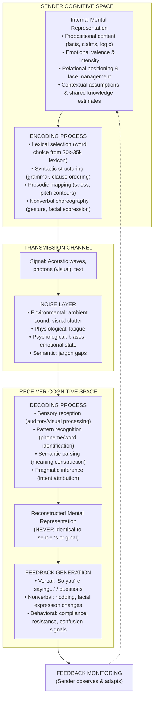

# Lesson 1: Communication Foundations

## 1. First-Principles Intuition & Invariants

Human communication operates as a bidirectional signal transmission system constrained by information theory, cognitive processing limits, and environmental interference. Unlike digital data transfer protocols that achieve near-perfect fidelity through error correction codes and acknowledgment packets, interpersonal communication suffers from lossy encoding, asymmetric interpretation frameworks, and multi-channel interference that degrades signal integrity at every stage. Understanding communication at the foundational level requires decomposing the process into its irreducible components: a sender possessing internal mental representations, an encoding mechanism that transforms these representations into transmissible symbols, a physical or virtual channel through which symbols propagate, environmental and psychological noise that corrupts the signal, a receiver's decoding apparatus that reconstructs meaning, and a feedback mechanism that enables iterative error correction.

The fundamental invariant governing all human communication is the **semantic gap**: the unbridgeable chasm between the sender's intended meaning and the receiver's interpreted meaning. This gap exists because meaning does not inhere in words themselves but emerges from the interaction between symbols and each participant's unique cognitive architecture, experiential history, cultural context, and momentary psychological state. When you speak the word "freedom," your neural activation patterns draw upon your personal experiences with constraint and autonomy, your ideological commitments, your emotional associations, and your current goals. The listener's brain constructs a different pattern entirely, shaped by their distinct history. No amount of technological advancement can eliminate this gap because it is not a technological problem—it is an epistemological constraint arising from the subjective nature of consciousness itself.

The second invariant is **channel capacity constraints**. Claude Shannon's information theory establishes that every communication channel possesses a maximum rate at which information can be transmitted reliably. Human verbal communication operates at approximately 125 words per minute in conversational speech, conveying roughly 39 bits of information per second once we account for redundancy and predictability in natural language. Human working memory can hold approximately four chunks of information simultaneously, and attention operates as a severely bandwidth-limited resource that must be allocated competitively among sensory inputs, internal thoughts, and emotional processing. These are not soft psychological preferences but hard cognitive ceilings imposed by neural architecture. Attempting to exceed these limits through rapid-fire information delivery or excessive complexity does not accelerate communication—it induces cognitive overload, forcing the receiver into lossy compression modes where they retain only fragments while discarding nuance.

The third invariant concerns **multi-channel redundancy and interference**. Human communication never occurs through a single isolated channel. When two people converse face-to-face, information flows simultaneously through multiple parallel channels: lexical content (the words themselves), prosody (pitch, rhythm, stress patterns), vocal tone and timbre, facial expressions engaging 43 distinct muscle groups, hand gestures, body orientation, proxemic distance, eye contact patterns, and physiological signals like pupil dilation and skin flushing. These channels can operate in alignment, producing redundant reinforcement that increases signal reliability, or in conflict, producing contradictory signals that force the receiver into effortful disambiguation. When your words say "I'm fine" but your vocal tone drops into a flat affectless register, your shoulders curl inward, and you break eye contact, the receiver must decide which channel to trust. Empirical research consistently demonstrates that when verbal and nonverbal channels conflict, listeners weight nonverbal signals more heavily, particularly for emotional and relational content. This weighting is not arbitrary—nonverbal channels are harder to consciously manipulate and thus function as more reliable indicators of genuine internal states.

The fourth invariant is **feedback dependency**. Communication is not a one-way broadcast but a continuous dynamic system requiring real-time error correction through feedback loops. In engineering control systems, feedback allows the system to compare actual output against desired output and adjust input accordingly. Human communication operates identically. As you speak, you monitor the listener's facial expressions, head nods, verbal acknowledgments, and questions to assess whether your message is being received as intended. This monitoring enables adaptive recalibration: elaborating points that generate confusion, compressing sections that are clearly understood, adjusting vocabulary to match the listener's demonstrated comprehension, and modulating emotional intensity based on the listener's receptivity. Without feedback, communication devolves into monologue, and the sender operates blind, unable to detect or correct misunderstandings until catastrophic failure occurs downstream.

These invariants interact to produce a harsh reality: **default human communication operates at shockingly low fidelity**. Studies of message retention demonstrate that listeners typically recall only 25-50% of what they hear immediately after a conversation, and this decays further over time. Miscommunication is not an occasional error state—it is the baseline condition. High-fidelity communication is a rare achievement requiring deliberate architectural design, active error correction, and continuous optimization against the system's natural tendency toward entropy.

## 2. Core Architecture & Mechanics

The canonical model of interpersonal communication follows a seven-stage pipeline architecture, each stage introducing potential failure modes that must be actively mitigated. We begin with **internal representation formation**, where the sender constructs a mental model of the message they wish to transmit. This model exists as a distributed pattern of neural activation across semantic networks, episodic memory systems, and emotional processing centers. The representation is inherently multidimensional, containing propositional content (facts and logical relations), procedural knowledge (how-to sequences), episodic details (specific experiences), emotional valence (positive/negative affect), and relational metadata (how this message positions the sender relative to the receiver).

The **encoding stage** transforms the internal representation into transmissible symbols. For verbal communication, this involves simultaneous lexical selection, syntactic structuring, and prosodic mapping. Lexical selection draws from your active vocabulary—typically 20,000 to 35,000 words for educated native speakers—to choose terms that approximate your intended meaning while accounting for estimated audience knowledge. This process operates under severe time pressure in real-time conversation, forcing reliance on high-frequency default words rather than optimal precision terms. Syntactic structuring determines clause ordering, embedding depth, and grammatical marking, all of which affect comprehension load. Center-embedded constructions like "The report that the analyst that the manager hired produced was flawed" impose high working memory demands and increase decoding failure rates. Prosodic mapping overlays stress patterns, pitch contours, and rhythm that carry crucial information about focus structure, sentence type (question versus statement), and emotional state.

Simultaneous with verbal encoding, the sender must choreograph **nonverbal signaling** across multiple channels. Facial expressions are constructed through coordinated activation of specific muscle groups: the corrugator supercilii (draws brows together, signals confusion or displeasure), orbicularis oculi (creates crow's feet, distinguishes genuine from posed smiles), and frontalis (raises brows, signals surprise or questioning). Hand gestures divide into beats (rhythmic pulses that emphasize speech rhythm), iconic gestures (pictorial representations of content), metaphoric gestures (spatial representations of abstract concepts), and deictic gestures (pointing to establish reference). Body orientation and proxemic distance encode relational information: directly facing someone at close range (0.5-1.2 meters in Western contexts) signals intimacy or confrontation, while angled positioning at greater distance (1.2-3.6 meters) signals formal or casual social interaction.

These encoded signals propagate through a **transmission channel** characterized by bandwidth, latency, and noise characteristics. Face-to-face channels offer maximum bandwidth, transmitting verbal, vocal, visual, and proxemic information simultaneously with minimal latency (milliseconds for light and sound propagation). Telephone channels eliminate visual information, reducing bandwidth by approximately 55% based on estimates of visual contribution to meaning, though research demonstrates these percentage estimates are context-dependent. Text-based channels (email, messaging) eliminate all prosodic and nonverbal information, imposing maximum compression requirements on lexical content alone. This compression makes text particularly vulnerable to misinterpretation because crucial emotional and relational metadata must be explicitly verbalized rather than conveyed through automatic nonverbal channels.

**Noise** infiltrates at every stage, degrading signal fidelity through four distinct mechanisms. Environmental noise includes literal acoustic interference (ambient sound masking speech), visual clutter (distracting movement or displays), and channel artifacts (audio compression, video lag). Physiological noise arises from bodily states: auditory fatigue from prolonged listening, visual strain, hunger, pain, or circadian rhythm effects that degrade cognitive processing. Psychological noise encompasses emotional states that distort encoding and decoding—anxiety that accelerates speech and reduces articulatory precision, anger that narrows attention and triggers hostile attribution biases, or preoccupation with other concerns that fragments attentional resources. Semantic noise results from knowledge asymmetries: jargon, cultural references, or implicit assumptions that the receiver cannot decode because they lack the requisite background knowledge.

The receiver's **decoding process** reverses the encoding sequence but introduces additional transformation and loss. Sensory reception converts acoustic pressure waves into neural firing patterns in the auditory cortex and photons into neural activation in the visual cortex. Pattern recognition systems identify phonemes (speech sound units) and combine them into recognized words through probabilistic inference heavily influenced by top-down expectations. This process is not passive playback—it is active construction where ambiguous signals are resolved using contextual priors, often leading to systematic misperception. The "McGurk effect" demonstrates this forcefully: when you see a video of someone mouthing "ga" while hearing the sound "ba," you perceive "da"—a phoneme that was neither seen nor heard, but constructed by your brain's attempt to reconcile conflicting visual and auditory inputs.

Semantic parsing constructs propositional meaning from word sequences, but this too is underdetermined by the surface signal. The sentence "I didn't say you stole my money" possesses at least seven distinct interpretations depending on which word receives stress emphasis, and the receiver must infer the speaker's intended focus structure from prosodic cues that are often subtle or ambiguous. Pragmatic inference layers additional meaning by attributing communicative intent: distinguishing literal statements from sarcasm, identifying indirect speech acts ("Can you pass the salt?" functions as a request, not a question about ability), and inferring relational messages embedded in how something is said rather than what is explicitly stated.

The receiver's reconstructed mental representation is never identical to the sender's original. Even under optimal conditions—shared language, shared context, minimal noise, high motivation—systematic distortions occur due to differences in semantic networks (words activate different associated concepts for different people), experiential databases (examples and prototypes vary), emotional associations, and active concerns that shape selective attention. This is not a correctable error but a necessary consequence of the fact that meaning is computed, not transmitted.

**Feedback mechanisms** enable iterative error correction by creating a closed-loop control system. Verbal feedback includes backchanneling ("mm-hmm," "right," "okay"), paraphrasing ("So what you're saying is..."), and clarifying questions ("Do you mean X or Y?"). Nonverbal feedback operates continuously and largely automatically: head nods signal agreement or tracking, forward leans indicate engagement, furrowed brows signal confusion, and facial expressions of surprise, disbelief, or concern provide real-time commentary on the sender's message. The sender must actively monitor these feedback signals and adjust encoding accordingly—slowing down when confusion signals appear, elaborating when interest signals peak, shifting approach when resistance patterns emerge.

The critical architectural insight is that **high-fidelity communication requires active management at every stage**. Default operation produces systematic failure. Optimization demands deliberate intervention: careful message design at the encoding stage, strategic channel selection aligned with message complexity and emotional content, proactive noise reduction, decoder-aware encoding that anticipates receiver knowledge and biases, and aggressive feedback monitoring with rapid adaptive recalibration.

## 3. High-Performance Optimization & Failure Modes

Achieving high-fidelity interpersonal communication in professional and high-stakes contexts requires systematic optimization against the natural entropy of the communication system. We begin with **encoding optimization techniques** that maximize signal clarity before transmission. The first principle is message architecture through hierarchical structuring. Complex messages must be decomposed into explicit hierarchical layers: a top-level summary statement that captures the core claim in a single sentence, followed by two to four primary supporting points, with each point elaborated through specific evidence or examples. This structure exploits the receiver's cognitive architecture, which processes information more efficiently when explicit organizational markers reduce parsing load. Opening with a clear preview statement—"I'm going to propose three changes to our deployment process"—activates anticipatory schemas that prepare the receiver's attention and memory systems to encode incoming information into the announced structure.

Lexical precision requires matching vocabulary to the audience's knowledge base while maintaining necessary technical specificity. This is not "dumbing down" but strategic encoding that avoids unnecessary semantic noise. When addressing mixed-expertise audiences, employ a layered disclosure strategy: introduce concepts using accessible high-level terms, then progressively add technical precision for those who possess the background knowledge to decode it. For instance, describing a system as "a feedback loop where the output affects the input" provides an accessible foundation before introducing terms like "negative feedback" or "homeostatic regulation." Crucially, define jargon explicitly upon first use rather than assuming shared vocabulary, and use concrete examples that ground abstract concepts in tangible referents.

Syntactic optimization involves managing sentence complexity to respect working memory constraints. Keep core clauses short, typically twelve to fifteen words for dense technical content. Use simple subject-verb-object construction for critical claims rather than passive voice or nominalizations that obscure agency and causation. Compare "A decision was made to deprecate the legacy API" (passive, agent obscured) with "Engineering decided to deprecate the legacy API" (active, agent clear). Break complex compound sentences into discrete simple sentences, sacrificing slight stylistic elegance for substantial gains in comprehension reliability. Reserve embedded clauses and subordinate constructions for supplementary information rather than critical content.

**Prosodic calibration** dramatically affects message reception but receives insufficient attention from most communicators. Vocal pacing should default to 120-150 words per minute for complex or emotionally significant content, substantially slower than the 160-180 word per minute rate common in casual conversation. This reduced rate provides additional processing time and signals importance. Strategic pausing creates cognitive space for consolidation: insert two-second pauses after key claims before providing supporting evidence, and use three-second pauses after completing major sections to allow mental reorganization. Silence feels uncomfortable to speakers but functions as essential white space for listeners.

Pitch modulation carries structural and emotional information that must be consciously managed. Upward pitch contours signal continuation, questions, or uncertainty, while downward contours signal completion, statements, and confidence. For critical claims, use falling terminal pitch to project certainty. Avoid the upward terminal pitch pattern (sometimes called "uptalk") that makes statements sound like questions, particularly in professional contexts where it undermines authority and expertise signaling. Vocal volume should vary strategically: slightly elevated volume draws attention to important information, while reduced volume (forcing the audience to listen more actively) can paradoxically increase engagement for crucial points.

**Channel selection** requires matching message characteristics to channel affordances. Face-to-face channels are optimal for emotionally significant messages, conflict resolution, complex negotiations, and any communication where real-time adaptation based on feedback is critical. The immediate feedback loop and full-bandwidth signal transmission justify the higher time cost and scheduling friction. Video conferencing preserves most face-to-face advantages while reducing travel costs but introduces latency that disrupts turn-taking rhythms and "Zoom fatigue" from sustained effortful attention to compressed visual fields.

Telephone channels work well for routine coordination, simple information exchange, and relationship maintenance when visual information is not essential. The absence of visual information focuses attention on vocal and verbal content, sometimes improving concentration for listeners who are easily distracted by visual stimuli. Text-based asynchronous channels excel for messages requiring documentation, messages to large or distributed audiences, and content where the receiver benefits from time to process and research before responding. However, text is actively unsuitable for emotionally charged content, ambiguous situations requiring rapid clarification, or complex negotiations where interpretation flexibility becomes a liability rather than an asset.

A common failure mode is channel mismatch: attempting to resolve conflicts via email, where the absence of vocal tone and body language enables hostile misinterpretation, or conversely, insisting on synchronous meetings for simple status updates that could be efficiently handled via brief text messages. Develop decision rules: if a message will significantly affect someone's emotions, welfare, or work, default to rich synchronous channels regardless of convenience costs. If a message thread requires more than three back-and-forth exchanges to resolve, escalate from text to voice or video rather than persisting in an inadequate channel.

**Noise reduction protocols** operate at multiple levels. Environmental noise reduction involves controlling the physical communication setting: eliminating competing audio sources, minimizing visual distractions, ensuring adequate lighting for visual signaling, and managing proxemics to establish appropriate intimate or social distance zones. For remote communication, this requires explicit audio hygiene: use headsets rather than speakers to eliminate echo, mute when not speaking in multi-party calls, and position cameras at eye level to enable natural gaze patterns.

Physiological noise reduction addresses bodily states that degrade processing capacity. Schedule critical communications during circadian performance peaks—typically mid-morning for most individuals—rather than post-lunch afternoon troughs or late-day fatigue periods. Manage conversation duration to respect attention limits: for dense content, structure in 15-20 minute focused segments with brief transitions that allow mental consolidation. Ensure basic physiological needs are met: hunger, thirst, and discomfort create background noise that fragments attention.

Psychological noise demands the most sophisticated intervention because it operates through unconscious biases and emotional states. As a sender, emotional self-regulation before high-stakes communication prevents anger, anxiety, or frustration from distorting your encoding through accelerated speech, hostile phrasing, or facial expressions that contradict your verbal message. The physiological intervention strategy is effective: deliberate diaphragmatic breathing (five-second inhale, seven-second exhale, repeated for two minutes) activates parasympathetic nervous system responses that reduce arousal and restore prefrontal cortical control over emotional reactivity.

As a receiver, psychological noise mitigation requires metacognitive monitoring for interpretive biases. The fundamental attribution error causes us to attribute others' negative behaviors to their character ("they're careless") while attributing our own negative behaviors to circumstances ("I was under time pressure"). Confirmation bias leads us to selectively attend to information consistent with preexisting beliefs while dismissing contradictory evidence. Actively counter these biases through perspective-taking: generate at least two alternative interpretations of ambiguous messages before settling on a conclusion, particularly for negative attributions.

Semantic noise reduction requires establishing shared vocabulary before substantive communication. In cross-functional professional contexts, explicitly negotiate definitions for key terms because disciplines often use identical words with different meanings. Engineering's "validation" differs from QA's "validation" differs from legal's "validation." Create a shared glossary for long-term collaborations, and define terms in context for one-off interactions. When introducing specialized jargon, follow the pattern: "By X, I mean Y" with a concrete example.

**Active listening architecture** transforms listening from passive reception into active signal processing with aggressive error correction. The foundational technique is **strategic attention allocation** that recognizes attention as a limited resource requiring explicit management. External attention must be focused on the speaker with ruthless elimination of competing demands: close laptops, silence phones, terminate internal rehearsal of your response while the speaker is still talking. Internal attention must be allocated to constructive processing: building a mental model of the speaker's message structure, identifying key claims and supporting evidence, and monitoring for comprehension gaps.

The **paraphrase-and-verify protocol** creates explicit checkpoints that surface misunderstandings before they compound. After the speaker completes a major point, reflect back your understanding in your own words: "Let me make sure I'm following—you're proposing that we delay the launch to address the security concerns, specifically the authentication vulnerabilities, even though that means missing the quarterly deadline. Is that correct?" This technique serves triple duty: it confirms your understanding, demonstrates engagement that strengthens rapport, and gives the speaker an opportunity to correct misinterpretations immediately when the context is fresh.

**Clarifying questions** target comprehension gaps actively rather than hoping context will resolve ambiguities later. Effective clarifying questions are specific rather than vague. "Can you say more about that?" is weak because it provides no guidance about what's unclear. "When you say 'unacceptable risk,' what's your threshold—are we talking about potential financial loss, regulatory exposure, or reputational damage?" is strong because it identifies the specific ambiguity and offers candidate interpretations that focus the speaker's response. Ask clarifying questions immediately when confusion arises rather than deferring, because deferral causes you to miss subsequent information that builds on the misunderstood foundation.

**Nonverbal attending behaviors** signal engagement and encourage continued disclosure. Maintain appropriate eye contact—in Western contexts, this typically means looking at the speaker 60-70% of the time while they talk, looking away briefly every 3-5 seconds to avoid oppressive staring. Orient your body toward the speaker with an open posture: uncrossed arms, slight forward lean, head tilted slightly to one side (a universal mammalian signal of attention and non-aggression). Provide periodic head nods and backchanneling vocalizations ("mm-hmm," "I see") that acknowledge receipt without interrupting flow. Mirror the speaker's emotional tone appropriately: a slight smile when they express satisfaction, concerned expression when they describe problems. This paralinguistic synchrony builds rapport and signals empathy.

**Comprehensive failure mode taxonomy** enables preemptive mitigation. Encoding failures include underdetermination (providing insufficient information for the receiver to reconstruct your intent), overcomplexity (exceeding working memory capacity through excessive embedding or rapid topic shifts), and incongruence (contradictions between verbal and nonverbal channels that force the receiver into effortful disambiguation). Transmission failures involve channel degradation (poor audio quality, video lag, environmental noise) and channel mismatch (using text for emotional content, using synchronous channels for simple information transfer).

Decoding failures arise from knowledge gaps (receiver lacks background to parse jargon or references), bias-driven interpretation (receiver's preconceptions override actual message content), and attention fragmentation (receiver is cognitively multitasking, capturing only fragments). Feedback failures occur when senders fail to monitor receiver signals, ignore confusion indicators, or when receivers fail to signal comprehension problems due to social face concerns (not wanting to appear ignorant or inattentive).

The meta-failure mode is **false consensus bias**: systematically overestimating how well you've been understood and how much agreement has been reached. Combat this through explicit verification protocols. At the conclusion of important conversations, have each party independently summarize their understanding of decisions, commitments, and next actions, then compare and reconcile discrepancies. This surface divergences before they manifest as coordination failures downstream.

Interpersonal communication at professional mastery level is not a soft skill built on intuition but a rigorous technical discipline built on understanding information flow, cognitive constraints, signal processing, and control system architecture. Every conversation is a high-dimensional engineering problem where success requires deliberate optimization against entropy. The practitioners who treat communication with the same systematic rigor they apply to other technical domains achieve extraordinary leverage, because communication quality determines how effectively all other expertise can be applied in collaborative contexts.
