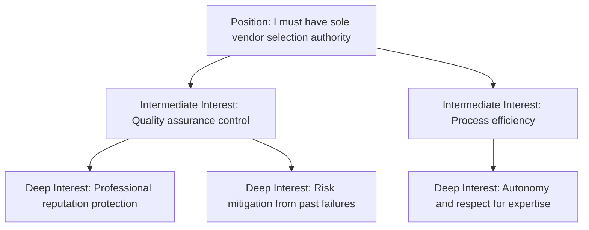

# Lesson 3: Conflict Resolution Negotiation

## 1. First-Principles Intuition & Invariants

Conflict emerges as an inevitable byproduct of scarcity, divergent interests, and information asymmetry. When two parties pursue objectives that appear mutually exclusive given perceived constraints, they enter a contested state where cooperative equilibrium has collapsed. The foundational error made by novice negotiators is treating conflict as a zero-sum game requiring dominance rather than recognizing it as a coordination problem amenable to interest alignment and boundary expansion.

The first-principles foundation of conflict resolution rests on distinguishing positions from interests. A position represents the stated demand or surface-level stance a party articulates: "I need this office," "The project must launch by October," "You must apologize publicly." An interest, by contrast, constitutes the underlying motivation, need, or value that the position attempts to satisfy: autonomy, professional recognition, safety, resource access, status preservation, or relationship continuity. Positions are fixed and binary; interests are fluid, negotiable, and frequently overlap between adversaries in ways neither party initially recognizes.

This distinction traces its formal articulation to the Harvard Negotiation Project's principled negotiation framework, though the insight itself appears in diplomatic archives stretching back millennia. The Roman tradition of *cui bono*—"to whose benefit?"—and the Socratic method of recursive questioning both aimed at excavating the concealed interest architecture beneath superficial disagreement. Modern game theory formalized this intuition by demonstrating that most real-world negotiations exist not as pure zero-sum contests but as mixed-motive games where integrative solutions expand total value before distributive bargaining allocates shares.

The second invariant governing all negotiation is the existence of alternatives. Every party enters negotiation with a walkaway threshold—the point at which continued bargaining becomes less valuable than pursuing an outside option. Roger Fisher and William Ury coined the acronym BATNA (Best Alternative To a Negotiated Agreement) to describe this reservation price. Your BATNA represents your power base: the stronger your alternative, the less pressure you face to accept unfavorable terms. Negotiation power flows not from charisma, aggression, or rhetorical skill but from asymmetric dependence. When your BATNA significantly exceeds your counterpart's, you command negotiating leverage; when alternatives are balanced, outcomes trend toward symmetrical compromise; when you lack viable alternatives, you negotiate from structural weakness regardless of tactical brilliance.

The third foundational principle is that conflict operates across multiple dimensions simultaneously. Surface content disputes—budget allocation, timeline targets, resource distribution—coexist with relational tensions around trust, respect, and status. Procedural conflicts emerge when parties disagree about decision-making authority, communication protocols, or fairness standards. Identity conflicts activate when disagreement threatens core self-concepts or group belonging. Effective resolution requires diagnosing which dimensions are genuinely contested versus which are secondary effects or misattributions. Many ostensibly financial conflicts mask status anxieties; many timeline disputes conceal autonomy battles; many personality clashes originate from unaddressed procedural injustice.

The final invariant is that all negotiation unfolds in the shadow of potential breakdown. Unlike pure economic exchange where both parties can simply walk away and seek other partners, many conflicts involve ongoing relationships, shared dependencies, or unavoidable interdependence. Workplace disputes, family conflicts, neighborhood tensions, and community disagreements all occur within durable systems where parties cannot fully exit. This transforms negotiation from a discrete transaction into reputation management across iterated interactions. The shadow of the future disciplines present behavior: parties who expect continued contact moderate demands, honor commitments, and invest in relationship maintenance because exploitation today destroys cooperation tomorrow.

These four principles—interest excavation, BATNA optimization, multidimensional diagnosis, and iterated-game dynamics—form the invariant substrate upon which all negotiation strategy builds. Mastery begins not with tactical maneuvers but with internalizing these structural realities until they shape perception automatically. The expert negotiator sees through positions to interests reflexively, calibrates every offer against BATNA floors instinctively, distinguishes content from relational dimensions intuitively, and weights long-term relationship value against short-term gains habitually. What appears as tactical genius to observers is actually structural clarity about the negotiation environment's true geometry.

## 2. Core Architecture & Mechanics

Effective conflict resolution operates through three sequential phases: diagnosis, design, and implementation. Each phase possesses distinct cognitive architectures and execution protocols. Collapsing these phases or executing them out of sequence produces characteristic failure modes that trap negotiators in superficial settlement or escalation spirals.

The diagnostic phase begins with conflict typology classification. Conflict falls into five primary categories, each requiring specialized intervention strategies. Data conflicts arise from missing information, misinformation, or divergent interpretation of shared facts. Parties may disagree about performance metrics, event chronology, causal attribution, or forecasting assumptions. Resolution requires establishing shared epistemic standards: agreeing on measurement methods, documentation protocols, or third-party expertise for adjudicating factual disputes. Interest conflicts represent genuine scarcity where parties pursue incompatible material objectives within fixed constraints. Resolution demands either constraint relaxation through creative problem-solving or explicit tradeoff negotiation. Structural conflicts emerge from asymmetric power, resource imbalances, or institutional design flaws that systematically advantage one party. Resolution requires power rebalancing, procedural reform, or external enforcement mechanisms. Value conflicts stem from incompatible belief systems, ideological commitments, or ethical frameworks. These conflicts are rarely fully resolvable but can be managed through mutual tolerance agreements, role differentiation, or agreeing to disagree on foundational premises while cooperating on instrumental goals. Relationship conflicts involve emotional distress, trust breakdown, communication failure, or perceived disrespect independent of material interests. Resolution requires process intervention: facilitated dialogue, active listening protocols, and trust-rebuilding mechanisms.

Accurate typology diagnosis prevents strategy mismatches. Attempting interest-based bargaining on value conflicts generates frustration as parties cannot simply trade concessions on non-negotiable principles. Applying relationship repair tactics to structural conflicts leaves root causes unaddressed. Treating data conflicts as relationship breakdowns wastes relational capital on problems solvable through better information sharing. The skilled diagnostician interviews parties separately, maps stated positions against inferred interests, identifies emotion patterns signaling relationship damage, and distinguishes genuine scarcity from artificial constraints.

The interest excavation protocol follows a structured recursive questioning sequence. Begin with the stated position and apply progressive "why" probing: "You've said you need exclusive decision authority on vendor selection. Help me understand what concerns that addresses for you." Responses typically reveal intermediate interests: "I need to ensure quality standards are met." Continue recursion: "What makes quality assurance particularly critical in this context?" This might surface deeper interests: "My professional reputation depends on project success, and past vendor failures damaged my standing with senior leadership." The excavation reveals that the surface position (decision authority) actually serves interests in professional security, competence signaling, and risk mitigation. These deeper interests admit multiple satisfaction pathways beyond the single position initially demanded.

Construct an interest map as a hierarchical tree structure:

This mapping immediately suggests alternative solutions. Rather than ceding total authority, you might propose a joint evaluation framework with clear quality criteria, establish a vendor vetting committee that includes the stakeholder's domain expertise, implement a pilot testing phase that addresses risk concerns, or create a documented decision protocol that provides accountability and reputation protection. Each alternative satisfies the underlying interests without requiring the binary position concession.

BATNA optimization operates as a parallel analytical process. Your BATNA represents the highest-value outcome available if negotiation fails. Most negotiators radically underestimate their alternatives through status quo bias, loss aversion, and inadequate option generation. BATNA improvement follows three steps: enumeration, enhancement, and concealment discipline. Enumeration requires systematically listing all walkaway alternatives without prematurely judging feasibility. If negotiating a job offer, alternatives include accepting a competing offer, remaining in your current position, freelancing, launching an independent venture, pursuing additional education, relocating geographically, or temporarily exiting the workforce. Each alternative generates a specific value estimate accounting for monetary compensation, growth potential, lifestyle preferences, and opportunity costs. Enhancement means actively developing alternatives rather than passively accepting your current option set. Before entering negotiation, cultivate competing offers, strengthen your current position, build external relationships, or acquire credentials that expand your choice space. The mere act of improvement shifts psychological power by reducing desperation and dependence.

Concealment discipline prevents premature revelation of BATNA strength or weakness. Disclosing a weak BATNA invites exploitation; advertising a strong BATNA can trigger defensive reactions or relationship damage if counterparts feel threatened. The optimal approach maintains strategic ambiguity through principled communication: focus discussion on objective criteria, market standards, precedent cases, and mutual interests rather than threatening walkaway. Reserve BATNA disclosure for deadlock situations where demonstrating seriousness becomes necessary to break impasse.

The design phase constructs solution architectures through two distinct bargaining modes: integrative negotiation for expanding value and distributive negotiation for allocating shares. Integrative bargaining exploits differences in valuation, risk preference, time horizon, probability assessment, and capability to create joint gains. The classic example involves two parties arguing over a single orange. Positional bargaining produces compromise—cutting the orange in half—leaving both parties moderately dissatisfied. Interest-based inquiry reveals that one party needs the peel for baking while the other wants the fruit for juice. The integrative solution gives each party their full interest satisfaction at zero cost to the counterpart.

Real negotiations rarely present such obvious complementarities, but systematic probing uncovers exploitable differences. Time-horizon divergence allows deferred payment structures, phased implementation schedules, or option contracts that provide immediate commitment flexibility valued by one party with long-term guarantees valued by the counterpart. Risk-preference differences enable contingent agreements where optimistic parties accept performance-based compensation while risk-averse parties receive guaranteed minimums. Capability asymmetries create opportunities for task specialization where each party contributes what they produce at low cost but the counterpart values highly: expertise, access, reputation lending, or resource sharing.

The zone of possible agreement (ZOPA) defines the negotiation range where both parties prefer settlement to walkaway. Your reservation price represents the minimally acceptable deal equaling your BATNA value; your aspiration represents the optimistic best-case outcome. The ZOPA exists when your reservation price falls below the counterpart's reservation price, creating an overlap region where both parties benefit from agreement. ZOPA analysis requires estimating the counterpart's BATNA and reservation price through market research, competitive intelligence, behavioral observation, and strategic questioning. Negotiators often assume ZOPA existence, but many conflicts present negative bargaining zones where no mutually acceptable agreement exists at current BATNA levels. Recognizing negative ZOPA situations early prevents wasteful bargaining cycles and redirects energy toward BATNA improvement or third-party intervention.

Offer sequencing follows strategic principles grounded in anchoring effects and concession interpretation. The party making the first offer establishes the negotiation anchor, pulling final settlement toward their preferred end of the ZOPA. Aggressive first offers capture more value when uncertainty about the counterpart's reservation price is high, but risk triggering walkaway if they fall outside the ZOPA. The optimal first offer sits at the edge of credibility—ambitious enough to anchor favorably but defensible through objective criteria, market comparables, or principled justification. Subsequent concession patterns signal bargaining posture: large initial concessions followed by resistance suggest the counterpart has reached their reservation price; steadily decreasing concessions (100, 75, 50, 25) indicate ongoing flexibility; erratic patterns confuse rather than inform.

The implementation phase translates settlement terms into durable agreements through four mechanisms: specificity, verification, contingency planning, and relationship repair. Vague agreements collapse when parties discover divergent interpretations during execution. High-resolution specification defines deliverables, timelines, quality standards, resource commitments, communication protocols, and decision authorities with minimal ambiguity. Written documentation creates shared reference points and reduces memory distortion. Verification mechanisms build trust through transparency: progress checkpoints, third-party auditing, documentation requirements, or staged implementation where later commitments activate only after earlier obligations are fulfilled.

Contingency planning embeds adaptation protocols directly into agreements rather than treating compliance failure as breach. Contracts specify renegotiation triggers, force majeure provisions, dispute resolution procedures, and penalty schedules that maintain cooperation incentives under uncertainty. This approach transforms rigid agreements prone to breakdown into flexible frameworks that accommodate environmental change without destroying the relationship.

Relationship repair addresses the emotional residue conflict deposits even after material terms settle. Procedural justice research demonstrates that parties evaluate negotiation outcomes not solely on distributional fairness but on process dignity: whether they received respectful treatment, adequate voice, transparent explanation, and sincere consideration. Post-settlement relationship repair includes acknowledgment of legitimate grievances, explanation of decision rationale, and symbolic gestures recognizing the counterpart's dignity. These low-cost relational investments pay compounding returns across iterated interactions by preventing resentment accumulation and maintaining cooperative norms.

## 3. High-Performance Optimization & Failure Modes

Advanced practitioners optimize negotiation performance through deliberate preparation rituals, real-time tactical frameworks, and systematic post-negotiation analysis. The preparation phase consumes 80% of negotiation success determinants despite occupying perhaps 20% of total time investment. Inadequate preparation forces reactive improvisation that consistently underperforms structured anticipation.

Preparation begins with comprehensive stakeholder mapping extending beyond direct negotiating counterparts. Complex organizational disputes involve multiple constituencies with divergent interests: decision-makers with formal authority, influencers who shape opinion, implementers who control execution, and blockers who possess veto power through obstruction. Map each stakeholder's interests, BATNA, influence relationships, and potential coalition structures. Identify which parties require direct persuasion, which need reassurance, which demand inclusion for procedural legitimacy, and which can be bypassed. This mapping reveals strategic sequencing: beginning negotiation with the most flexible stakeholders builds momentum and creates social proof that pressures holdouts; securing influential allies before approaching formal decision-makers pre-sells your proposal; addressing blocker concerns early prevents late-stage sabotage.

Scenario planning develops contingency responses for predictable negotiation branches. Game tree analysis maps decision nodes where parties face strategic choices: aggressive versus cooperative opening, immediate settlement versus prolonged bargaining, coalition formation versus bilateral negotiation, transparency versus information concealment. For each critical node, specify your default strategy, triggering conditions for alternative approaches, and prepared responses to counterpart moves. This mental rehearsal prevents mid-negotiation improvisation paralysis when counterparts deploy unexpected tactics. The scenario planning discipline also surfaces assumptions requiring validation: if your strategy depends on the counterpart valuing long-term relationship preservation, test that assumption early rather than discovering too late they view this as a one-shot transaction.

Real-time tactical execution demands managing three parallel cognitive streams: content tracking, relational monitoring, and process observation. Novice negotiators fixate entirely on content—the substantive proposals, counteroffers, and terms under discussion—while ignoring relational signals and process dynamics. Content tracking maintains a running mental model of offers exchanged, concessions made, remaining gaps, and ZOPA boundaries. Relational monitoring reads emotional states, respect signals, trust indicators, and relationship temperature through tone, body language, engagement patterns, and reciprocity gestures. Process observation evaluates whether negotiation procedures feel fair, whether communication flows productively, whether power imbalances are distorting outcomes, and whether parties have adequate voice.

Skilled negotiators toggle fluidly between these streams, recognizing when content progress stalls due to relational breakdown or procedural unfairness rather than genuine interest incompatibility. This diagnosis enables appropriate intervention: pausing substantive bargaining to address relationship repair, proposing process modifications to rebalance power, or calling timeout to allow emotional de-escalation. The tactical pattern resembles simultaneously playing three chess games on different boards while recognizing which board currently blocks overall progress.

De-escalation techniques interrupt conflict spirals where emotional arousal, threat perception, and retaliatory impulses override rational interest calculation. Escalation follows predictable behavioral sequences: parties shift from specific issues to global character attacks, from present disputes to historical grievance inventories, from descriptive language to inflammatory labeling, and from substantive disagreement to relationship rupture. Effective de-escalation applies circuit-breakers that disrupt this progression before it reaches irreversibility.

The simplest de-escalation tool is tactical silence. When a counterpart launches an emotional attack, instinct drives immediate counter-attack to defend status and reciprocate aggression. Resisting this impulse and maintaining calm silence for five to ten seconds interrupts the escalation rhythm. Silence creates psychological space for the counterpart's arousal to decay naturally, signals that you refuse to engage in emotional combat, and often prompts the counterpart to self-correct or moderate their tone. Following silence, reflective listening validates the emotional content without accepting the substantive attack: "I hear that you're deeply frustrated by the timeline delays. That's an important concern we need to address." This acknowledgment defuses emotional pressure while redirecting focus toward problem-solving.

Process proposals offer another de-escalation pathway. Rather than debating content while emotions run high, propose procedural modifications: "I think we're both feeling stuck. What if we took a 15-minute break and came back with fresh perspective?" or "It seems like we're talking past each other. Could we try a different approach where each of us summarizes the other's main concerns before responding?" Process focus shifts attention from contested substance to shared procedural control, rebuilding collaboration through small agreements before tackling larger conflicts.

Reframing transforms destructive conflict narratives into productive problem frames. Parties typically frame disputes as personal attacks ("You're undermining my authority"), moral failures ("They're being completely unreasonable"), or competitive battles ("I need to win this"). These frames trigger defensive, retaliatory, or dominance behaviors. Strategic reframing recasts the situation as a shared problem with mutual stakes: "We're both committed to project success and facing a coordination challenge about decision processes. How can we design a system that protects quality while respecting expertise?" This reframe shifts from adversarial to collaborative framing, from personal to systemic focus, and from past blame to future solutions.

Mediation architectures become necessary when direct bilateral negotiation reaches deadlock or when power imbalances, trust deficits, or emotional intensity prevent productive dialogue. Mediators do not impose solutions but restructure the negotiation environment to enable parties to reach voluntary settlement. The mediator performs several critical functions that parties cannot provide for themselves: neutral process management that ensures balanced participation; reality testing that challenges unrealistic expectations through probing questions; option generation that introduces creative alternatives neither party identified; emotion regulation that de-escalates intensity and maintains productive engagement; and face-saving provision that allows parties to concede without appearing weak.

The mediation process typically follows a five-stage protocol. The opening stage establishes ground rules, builds mediator credibility, and frames the process as collaborative problem-solving. Individual caucuses allow each party to express concerns privately, reveal information they cannot disclose publicly, and receive candid feedback about the strength of their case. Joint sessions facilitate direct dialogue under structured conditions: parties take turns presenting uninterrupted perspectives, practice active listening by summarizing the other's position, and engage in facilitated brainstorming to generate settlement options. Option evaluation analyzes each alternative against both parties' interests, identifies modifications that improve mutual satisfaction, and stress-tests proposed agreements for implementation feasibility. Agreement formalization documents settlement terms, specifies implementation responsibilities, establishes verification procedures, and creates dispute resolution protocols for future conflicts.

Consensus-building mechanisms scale conflict resolution beyond bilateral negotiation to multi-party disputes where numerous stakeholders hold diverse interests and any party can block collective action. Consensus is not unanimity—requiring every party to enthusiastically endorse the solution—but rather creating an agreement that all parties can live with even if it falls short of their ideal preference. This threshold acknowledges that perfect alignment rarely occurs but that livable compromise often suffices for forward progress.

The consensus-building process begins with stakeholder convening that brings all relevant parties to the table simultaneously rather than negotiating separately with each. Separate bilateral negotiations create inconsistent commitments, enable strategic misrepresentation, and prevent integrative solutions requiring multi-party cooperation. Inclusive convening ensures that affected parties have voice, preventing implementation sabotage from excluded stakeholders who lack ownership over outcomes they did not shape.

Interest aggregation maps the full spectrum of stakeholder concerns through structured elicitation: interviews, surveys, public forums, or facilitated dialogue sessions. This comprehensive inventory reveals interest clusters, common ground, and irreconcilable differences. Many multi-party conflicts appear intractable because parties fixate on their unique divergences while overlooking substantial overlapping interests. Systematic aggregation makes shared interests visible, creating foundation for coalition-building.

Option generation follows a divergent-then-convergent sequence. Divergent brainstorming suspends evaluation to maximize creative alternatives through quantity rather than quality filtering. Techniques include worst-option brainstorming where parties propose deliberately bad solutions to unlock psychological freedom, role reversal where parties advocate for counterpart interests to develop empathy, and constraint relaxation where artificial boundaries are temporarily removed. Convergent evaluation then applies shared criteria to filter options: feasibility analysis assesses implementation barriers, interest satisfaction matrices score how well each option serves different stakeholders, and scenario analysis projects long-term consequences.

Package construction bundles individual elements into comprehensive agreements rather than voting on items sequentially. Sequential voting encourages blocking behavior as parties withhold support to extract concessions on later items. Package deals enable logrolling where parties accept unfavorable terms on low-priority issues in exchange for winning high-priority items. This dynamic trading across issues expands the zone of possible agreement and enables agreements that would fail under item-by-item consideration.

Failure modes fall into predictable categories stemming from systematic cognitive biases and tactical errors. Reactive devaluation causes parties to reject proposals solely because they originated from opponents, even when the same proposal would be attractive if suggested by allies or neutrals. Mitigate this bias through neutral third-party proposal generation, reframing counterpart suggestions as joint exploration, or temporarily tabling proposals to evaluate them after emotional detachment.

Fixed-pie bias assumes resources are absolutely limited rather than exploring expansion opportunities through creativity, external resources, or time-horizon adjustments. Combat this bias by explicitly allocating preparation time to integrative brainstorming, using "how might we" framing that presupposes solutions exist, and researching precedent cases where similar disputes achieved mutual gains.

Anchoring bias locks parties into initial offers despite subsequent information revealing those anchors as arbitrary or unreasonable. Counteract unfavorable anchors through immediate rejection that prevents cognitive acceptance, deploying your own counter-anchor with strong justification, or refocusing discussion on objective criteria rather than anchored positions.

Attribution errors cause parties to explain counterpart behavior through dispositional traits—"They're stubborn," "They're greedy"—while excusing their own behavior through situational factors. This asymmetry amplifies conflict as parties view opponents as fundamentally adversarial rather than responding rationally to their circumstances. Correcting attribution errors requires perspective-taking exercises that map the negotiation from the counterpart's viewpoint, identifying how their behavior appears sensible given their interests, constraints, and information.

The fundamental optimization insight is that conflict resolution represents a trainable skill amenable to deliberate practice rather than an innate personality trait. Expertise develops through structured preparation protocols, tactical pattern recognition built through repetition, post-negotiation analysis that extracts lessons from outcomes, and meta-cognitive monitoring that observes your own negotiating behavior from an external perspective. The negotiator who treats each conflict as an isolated event learns slowly through trial and error; the practitioner who systematically dissects performance against framework principles accelerates toward mastery. This discipline transforms negotiation from an uncomfortable confrontation to be endured into an intellectual challenge offering continuous growth and strategic depth.
