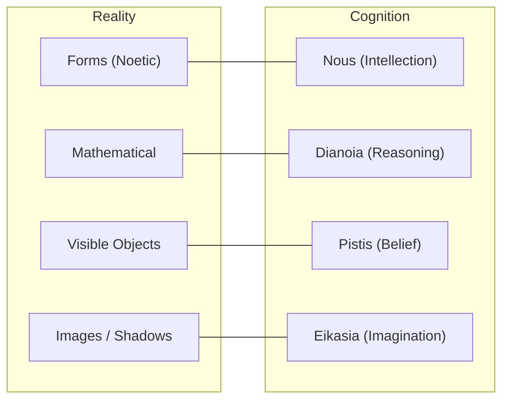

# Lesson 2: Classical to Medieval Aesthetic Architectures

## 1. First-Principles Intuition & Invariants

The fundamental problem of aesthetics—what makes something beautiful, why we respond to it with something beyond mere utility, and how beauty relates to reality itself—originates not in subjective taste or cultural convention, but in a rigorous metaphysical claim: that beauty is a structural property of being itself. From Plato through the medieval scholastics, aesthetic theory was never decoration or ornament to philosophy. It was foundational metaphysics made concrete, a direct window into how reality is organized and how human perception participates in that organization.

To understand this requires abandoning the modern assumption that aesthetics is about individual emotional response or artistic expression. Instead, we must recover the classical insight that aesthetics is about participation—the human mind and eye participating in intelligible structures that exist independently of any observer. Beauty, in this view, is not projected onto the world; it is discovered as an intrinsic feature of well-ordered being.

This distinction carries immediate practical consequences. If beauty is structural rather than subjective, then aesthetic judgment can be trained, refined, and systematized. The practitioner of aesthetics becomes someone who learns to perceive and articulate the hidden architectures that organize sensible experience. The goal of this lesson is to equip you with the conceptual instruments—the theoretical frameworks—that enable this trained perception.

The classical-to-medieval trajectory moves through four distinct but interlocking metaphysical systems, each solving the same core problem differently: How does the immaterial (Forms, divine essence, intelligible structure) express itself in material reality? And how does human consciousness bridge the gap between these two registers?

Plato's system anchors beauty in transcendent Forms existing in a realm beyond sensible experience. Aristotle relocates the organizing principle within material substance itself, making form immanent rather than transcendent. Plotinus develops a dynamical model in which reality flows hierarchically outward from a transcendent source through intermediate intelligible structures. Augustine and Aquinas integrate this Neoplatonic apparatus into Christian theology, grounding aesthetic perception in the mind's capacity to recognize divine order impressed into creation.

What unites these systems is a shared invariant: **Beauty is the sensible manifestation of intelligible proportion, hierarchy, and unity-in-multiplicity.** This invariant remains constant even as the metaphysical substrate shifts. A practitioner working across these frameworks learns to identify the same structural patterns operating at different levels of reality—from the proportions of a temple façade to the hierarchical organization of a theological cosmology to the internal structure of a musical composition.

## 2. Core Architecture & Mechanics

### Plato's System: Forms, Mimesis, and the Divided Line

Plato's aesthetic architecture begins with a radical metaphysical claim: the sensible world we perceive through our eyes and ears is not the primary locus of reality. Instead, reality consists fundamentally of eternal, unchanging, non-spatial Forms (or Ideas). A particular beautiful object—a face, a sunset, a melody—is beautiful only insofar as it participates in or imitates the Form of Beauty itself. Individual instances are always imperfect, temporary, and subject to decay; the Form is perfect, eternal, and self-identical.

The critical mechanism here is *mimesis*—imitation or representation. A particular beautiful thing is a copy or image of the Form. But this is not a crude copy like a photograph. Rather, mimesis describes a real participation or imaging relation: the Form somehow expresses itself through the particular instance. The particular object "strains toward" the Form, incomplete and dependent, while the Form shines through without being diminished.

To see how this operates in practice, consider Plato's divided line, which maps the entire structure of reality and corresponding modes of cognition:



The practitioner's task is to train the mind to ascend this ladder. Aesthetic experience, in Plato's system, is explicitly an engine for this ascent. When we encounter something beautiful in the sensible world—say, a mathematically proportioned temple—our immediate sensory experience (eikasia) can be refined into belief about its proportions (pistis), which can then be elevated to discursive reasoning about mathematical ratios (dianoia), and ultimately to direct intellectual apprehension of Beauty itself as a Form (nous). The sensible object is a stepping stone, not the destination.

This has an immediate consequence for the aesthetically trained observer: you learn to decode sensible objects as *signs or windows* onto intelligible structures. A beautiful façade is not valuable because it pleases the eye, but because its mathematical proportions—ratios of 1:2, 3:4, the golden ratio—express something about harmony, proportion, and unity that participates in the Form of Beauty. The eye becomes a diagnostic instrument for reading off the invisible mathematics that underlies visible order.

### Aristotle's Immanent Form: Substance, Configuration, and Catharsis

Aristotle inverts Plato's hierarchy. Rather than locating true reality in transcendent Forms, Aristotle argues that substance (ousia) consists of the *compound* of matter and form *as integrated in particular individuals*. A particular statue is beautiful not because it imitates a transcendent Form, but because its material (bronze or marble) has been configured by the sculptor's art into an optimal arrangement. Beauty is the result of formal organization *imposed upon* matter, but this form is realized only in the material instance, not in some separate realm.

This shift has profound implications. For Aristotle, beauty is no longer about ascending from sensible to intelligible; instead, beauty involves the perfection of a thing *according to its nature* and function. A knife is beautiful when its form—its shape, weight, balance, edge—perfectly suits its function of cutting. A building is beautiful when its structural form optimally realizes the purposes of shelter, assembly, or worship. An organism is beautiful when its internal organization expresses vigor and adaptation to its environment.

The operative mechanism is *eidos* (form) understood as the principle that organizes matter into a functional whole. This form is not transcendent but immanent—it exists only in and through the material particular. The form is known through reason, but it is embodied in sensation.

This architectural shift makes immediate contact with artistic practice. The sculptor begins with raw matter (marble) and, through technical skill (techne), imposes formal organization until the material instance achieves optimal expression of its intended character. The practitioner of aesthetics learns to read backward from the finished work to identify the formal principles—the intelligible order—that the artist has embedded in matter.

Aristotle's theory of catharsis extends this logic into the domain of dramatic performance. When we witness a tragic drama, we undergo an emotional response—fear and pity—that is then *purified* or *clarified* (catharsis) through the structured experience of the play. The mechanism works through a specific formal configuration: the plot is organized according to probability and necessity; characters are individuated with appropriate complexity; the spectacle (music, spectacle, language) is calibrated to intensity of feeling. Through this formal organization, raw emotions are channeled and transformed. We leave the theater not with our emotions in chaos, but with a clarified understanding of human suffering and divine justice.

For the practitioner, this means: aesthetic experience is not about passive enjoyment or emotional indulgence. It is about the structured refinement of perception and emotion through contact with formally perfected objects. The measure of a beautiful work is whether it successfully organizes matter or event in such a way that the perceiver's sensibility is refined, clarified, and elevated.

### Plotinus's Hierarchical Emanation: The One, Intellect, and Soul

Plotinus develops a radically new metaphysical architecture that will dominate medieval aesthetics. Rather than Plato's static transcendence or Aristotle's immanence, Plotinus proposes a dynamical hierarchy: reality flows continuously outward from a transcendent source (the One) through intermediate levels of intelligible structure (Intellect, World-Soul) into materiality. This is not creation in the theological sense, but *emanation*—an overflow or radiation of being downward through successive ontological levels.

The critical innovation is the introduction of *hierarchical mediation*. Between the utterly transcendent One and material particulars, there exists a vast intermediate realm of intelligible realities that serve as organizing principles. The World-Soul receives the Ideas as intelligible forms and projects them into the sensible cosmos. Each sensible particular is ordered by Soul, which receives order from Intellect, which receives its intelligibility from the One.

This creates a signal-path architecture:

```text
THE ONE (Absolute Transcendence)
      ↓ (Emanation)
INTELLECT (Intelligible Multiplicity - the Ideas/Forms)
      ↓ (Imaging)
WORLD-SOUL (Temporal Principles of Order)
      ↓ (Projection)
SENSIBLE COSMOS (Particular Material Instances)
```

At each level, the lower receives form and intelligibility from the higher, while the higher remains unchanged and undiminished by the outflow. This is crucial: emanation is not diminution in the source; it is a continuous radiating of being downward.

For aesthetic theory, this architecture has immediate force. A sensible object is beautiful when it successfully manifests the intelligible form that Soul projects into materiality. The practitioner's task is to learn to perceive not just the sensible surface but the invisible intelligible principle that organizes it. A beautiful face is not beautiful because of its material constituents (skin, bone, flesh), but because these material elements have been organized by Soul into a proportioned configuration that manifests an intelligible form.

Plotinus makes a further crucial move: he argues that the contemplative act of perceiving beauty is itself a mode of participation in higher reality. When the soul perceives sensible beauty and is moved by it, the soul is being elevated back toward the intelligible realities from which the sensible object emanates. Aesthetic contemplation becomes a literal ascent through the hierarchical levels of reality. The practitioner becomes a contemplative who learns to see through material form to the intelligible principles organizing it.

### Augustine: Divine Beauty and the Ordered Trinity

Augustine integrates Neoplatonic emanation theory into Christian theology while making a decisive innovation: beauty is no longer located in transcendent Forms or a World-Soul, but in God's creative will and providential ordering of the universe. God creates by impressing His own intelligible form—His eternal Ideas—into created matter. Every creature participates in Beauty insofar as it participates in this divine ordering.

Augustine's crucial contribution is the concept of *ordo* (order). Beauty consists fundamentally in the right ordering of parts according to proportion and hierarchy. A well-ordered commonwealth is beautiful; a well-ordered soul is beautiful; the cosmos itself is beautiful because it exhibits divine order. This moves aesthetic theory decisively away from passive contemplation and toward active discernment of divine intention embedded in creation.

The signal path becomes:

```text
GOD (Eternal Ideas)
    ↓ (Creation ex nihilo)
CREATED REALITY (Physical & Moral Order)
    ↓ (Perception)
HUMAN SOUL (Trained Contemplative Awareness)
```

For the practitioner, this means: aesthetic judgment is fundamentally about discerning whether something exhibits the proportion, harmony, and hierarchical order that reflects divine intentionality. When we perceive something as beautiful, we are recognizing a trace of God's creative thinking impressed into creation. The trained aesthetic observer becomes someone who learns to read off divine intention from created form.

### Aquinas: Integrity, Proportion, Clarity

Thomas Aquinas synthesizes everything that came before into a comprehensive system that becomes the definitive medieval aesthetic architecture. Drawing on Aristotle's metaphysics of form and matter, Neoplatonic emanation, and Augustinian theology, Aquinas proposes that beauty (pulchritudo) requires three essential constituents:

**Integritas (Integrity or Wholeness):** An object is beautiful when it is complete and undamaged. It possesses all the parts proper to its kind, none missing, none excess. This is the principle of formal completeness—the object achieves the fullness of its essence.

**Proportio (Proportion):** An object is beautiful when its parts stand in the right mathematical and harmonic relationship to each other and to the whole. Proportion is not arbitrary but follows from the object's essential nature and function. A human body is beautiful when its parts—head, torso, limbs—maintain correct ratios; a building is beautiful when its architectural elements stand in consonant relationships; a musical composition is beautiful when its intervals and rhythmic structures maintain harmonic ratios.

**Claritas (Clarity or Luminosity):** An object is beautiful when it radiates intelligibility—when its form shines through its matter with unmistakable clarity. This is the most Neoplatonic element: beauty is the intelligible made sensible. When we perceive something as beautiful, we are perceiving the Form (the intelligible organizing principle) radiating through matter.

These three are not sequential steps but simultaneous requirements. Remove any one, and beauty collapses. A sculpture that is complete in all its parts but whose proportions are confused lacks beauty. A building whose proportions are mathematically perfect but which is damaged or incomplete lacks beauty. A musical composition whose intervals are harmonious but whose themes and structures are obscure and confused lacks clarity and therefore lacks beauty.

The Thomistic framework becomes the practical diagnostic tool for the trained aesthetic observer. When examining any object—a cathedral, a manuscript illumination, a liturgical vestment, a theological argument—the practitioner learns to apply these three criteria systematically. Does the object possess integrity? Can I identify the essential form complete and undamaged? Do its parts maintain right proportion? Can I read off the mathematical or harmonic relationships organizing its components? Does its form shine with clarity? Can I perceive through its material substrate to the intelligible principle organizing it?

## 3. High-Performance Optimization & Failure Modes

### Aesthetic Training as Disciplined Perception

The classical and medieval aesthetic systems all presuppose a fundamental claim that has profound practical implications: aesthetic sensitivity is not innate but cultivated. The untrained eye sees surfaces; the trained eye sees through surfaces to intelligible structures. The untrained ear hears pleasant or unpleasant sounds; the trained ear perceives mathematical ratios, harmonic relationships, and compositional architectures.

This means that aesthetic development is a rigorous discipline requiring sustained practice. The practitioner begins with what might be called "sensory immersion"—spending extended time in direct contact with exemplary objects. This is not passive appreciation but active analysis. When studying a Greek temple, the practitioner measures proportions, sketches architectural relationships, identifies the hidden geometries organizing the façade. When studying a Bach fugue, the practitioner traces the interweaving of voices, maps the harmonic progressions, identifies the mathematical ratios determining rhythmic relationships.

The goal of this immersion is to retrain the perceptual apparatus itself. Over time, what initially requires conscious analytical effort becomes perceptual immediacy. The eye learns to see proportion automatically; the ear learns to perceive harmonic tension and resolution without conscious calculation. This is the internalization of aesthetic standards into the sensory apparatus.

A critical optimization in this process is the principle of *comparative analysis*. Rather than studying objects in isolation, the practitioner systematically compares exemplary instances. What mathematical relationships appear consistently across Greek temples? How do medieval illuminated manuscripts employ similar principles of proportion and hierarchical organization? Where do these principles appear in liturgical architecture, in musical composition, in theological argumentation? This comparative work builds a comprehensive taxonomy of aesthetic principles that transcend individual media or cultures.

### Boundary Cases and Failure Modes

The classical and medieval systems encounter several recurring failure modes that the sophisticated practitioner must navigate.

**The Appearance-Reality Problem:** The systems presuppose that sensible beauty reliably expresses intelligible Form. But what happens when matter resists form? What of the deformed body, the ruined building, the confused artistic vision? These objects do not achieve integrity, proportion, or clarity; yet they may provoke powerful aesthetic responses. The classical solution is to distinguish between lower sensory pleasure and genuine beauty. The deformed object may please through novelty or curiosity, but it is not truly beautiful because it fails to manifest intelligible form. However, this distinction becomes increasingly unstable in later medieval thought, where the possibility emerges that even apparent formlessness might express divine intention—that deformity itself might carry theological meaning.

**The Scale Problem:** Platonic and Neoplatonic systems work magnificently for formally perfected objects operating at human perceptual scale. But what of microscopic organisms imperceptible to the eye? What of vast cosmic structures that exceed the perceptual capacity of individual observers? Can the practitioner still apply principles of proportion and intelligibility to objects at scales beyond direct perception? The medieval response is typically to extend the principles theoretically: we may not perceive the proportions of celestial mechanics directly, but reason assures us they follow divine mathematical order. The perceiver ascends from sensible to intelligible through intellectual extrapolation.

**The Intentionality Problem:** The systems presuppose that sensible objects are organized by intelligible form—but who or what is doing the organizing? In Aristotle, it is the artist's skill (techne). In Plotinus, it is World-Soul. In Augustine and Aquinas, it is God's creative will and providential ordering. But this raises a practical question: when encountering an object, how can the observer distinguish between form deliberately imposed by intelligent agency and mere accident or material chance? A stone worn smooth by water may possess mathematical proportions, but lacks the intentional configuration that makes a deliberately carved sculpture beautiful. The solution involves what might be called "style analysis"—learning to recognize the fingerprints of intentional form-giving. Consistent patterns, hierarchical organization, harmonic relationships, and mathematical precision typically signal intelligent agency rather than chance.

**The Sensible-Intelligible Gap:** All these systems depend on a crucial cognitive leap: from perceiving sensible particulars to grasping intelligible principles. But how is this leap actually accomplished? The systems offer little guidance about the phenomenology of this transition. Modern phenomenological analysis might describe it as a kind of gestalt shift—where attention suddenly grasps the underlying organization rather than the surface elements. The practitioner learns to facilitate this shift through disciplined attention, systematic comparison, and intellectual extrapolation.

### Workflow Integration and Comparative Frameworks

The practitioner operating across classical and medieval aesthetics can develop a systematic comparative workflow that maximizes insight while managing complexity:

**Stage One: Sensory Immersion and Measurement.** Spend extended time in direct contact with an exemplary object. Record objective measurements: proportions, dimensions, mathematical ratios. Sketch structural relationships. For temporal arts (music, drama), notate recurring patterns and formal structures. The goal is to externalize the sensible data for subsequent analysis.

**Stage Two: Form Identification.** Apply the Thomistic criteria systematically. Identify the essential form or function the object is designed to express. Assess integrity: are all necessary parts present and undamaged? Analyze proportion: what mathematical or harmonic relationships organize the parts? Evaluate clarity: how distinctly does the intelligible form radiate through the material substrate?

**Stage Three: Genealogical Analysis.** Map the object backward to identify the tradition and intentional principles from which it derives. Is this object participating in Platonic, Aristotelian, Neoplatonic, or Thomistic aesthetic assumptions? What historical theological or philosophical commitments does its formal structure express? This allows the practitioner to decode the intelligible principles embedded in sensible form.

**Stage Four: Comparative Synthesis.** Compare the object to exemplary instances operating in different media, scales, or historical periods. Do similar proportions appear across Greek temples and medieval manuscripts? Do identical harmonic principles organize both musical composition and architectural space? This cross-domain comparison builds comprehensive understanding of trans-historical aesthetic principles.

**Stage Five: Contemplative Integration.** In the Plotinian mode, the practitioner uses the object as a springboard for contemplative ascent. Beginning from sensible perception, progressively abstract attention upward through intelligible principles toward direct apprehension of the universal Form organizing particular instances. The goal is not intellectual analysis alone, but a lived participation in the intelligible reality that the object manifests.

### Resolving Conflicts Between Frameworks

The practitioner will frequently encounter tension between these frameworks. Platonic transcendence seems incompatible with Aristotelian immanence. Neoplatonic emanation seems to conflict with Augustinian creation ex nihilo. How does the sophisticated practitioner navigate these tensions?

The solution is to recognize that each framework is solving a distinct problem and operating at a distinct metaphysical level.

**Plato addresses the transcendent source of intelligible order; Aristotle addresses its immanent actualization in material substrates; Plotinus addresses the dynamic process connecting transcendent to immanent through hierarchical emanation; Augustine addresses the theological ground of intelligibility in divine will; Aquinas synthesizes immanence and transcendence through analogical participation.** The practitioner does not choose between frameworks but deploys each where its explanatory power is strongest. When analyzing formal proportion in a specific artifact, Aristotelian hylomorphism provides the most precise analytical vocabulary. When tracing those proportions to their ultimate source, Platonic or Neoplatonic ascent becomes necessary. When situating aesthetic experience within the drama of creation and redemption, Augustinian or Thomistic frameworks supply the theological integration. The masterful practitioner moves fluidly between frameworks, recognizing that each illuminates a distinct dimension of the same phenomenon—beauty as the manifestation of intelligible order in sensible form.

This methodological pluralism does not constitute eclecticism or relativism, but rather reflects the complexity of beauty itself as a reality spanning multiple ontological levels. The sensible object genuinely embodies intelligible form (Aristotle); that form genuinely participates in transcendent universals (Plato); those universals genuinely emanate from or are created by an ultimate principle (Plotinus, Augustine, Aquinas); and the human soul genuinely ascends toward that principle through aesthetic contemplation (all frameworks). Each framework captures a genuine aspect of this comprehensive reality. The practitioner's task is not to select the "correct" framework but to develop sufficient facility with all frameworks to recognize which questions each answers and how they complement rather than contradict one another when properly understood at their appropriate metaphysical levels.

---

## Summary & Verification Matrix

| **Framework** | **Governing Invariant** | **Core Mechanism** | **Diagnostic Criteria** | **Primary Question Addressed** |
|---------------|------------------------|-------------------|------------------------|-------------------------------|
| **Platonic** | Beauty = sensible manifestation of transcendent Form; particular beautiful objects participate in Beauty Itself | Methexis (participation): particulars imperfectly instantiate eternal Forms; soul recollects pre-embodied knowledge through encounter with proportioned sensibles | Perfect mathematical proportion; symmetry as mark of intelligibility; beauty prompts philosophical eros and recollection | What is the ultimate ontological source of beauty? How do imperfect sensibles relate to perfect universals? |
| **Aristotelian** | Beauty = harmonious actualization of form in matter; entelechy realized through proportioned parts serving unified function | Hylomorphism: matter receives intelligible form; beauty emerges when material substrate fully actualizes formal potential within teleological constraints | Organic unity; functional integration; appropriate proportion relative to purpose; wholeness, harmony, radiance as criteria | How does beauty exist *in* material objects? What makes *this* particular thing beautiful? |
| **Plotinian (Neoplatonic)** | Beauty = luminous trace of The One descending through hierarchical emanation; degrees of beauty map degrees of being | Emanation: from The One → Intellect → Soul → Matter; beauty = transparent manifestation of higher intelligible reality through lower medium | Hierarchical gradation; translucent quality; capacity to redirect attention upward; contemplative ascent from sensible to intelligible to mystical union | How does the transcendent connect to the immanent? How does aesthetic experience enable metaphysical ascent? |
| **Augustinian** | Beauty = created order manifesting divine Wisdom; aesthetic experience as pedagogical discipline toward caritas | Divine exemplarism: God creates through eternal archetypes; beauty = vestigium Dei; ordo amoris directs cupiditas toward caritas through aesthetic habituation | Theological referentiality; moral-aesthetic integration; beauty as sign pointing beyond itself; serves conversion and sanctification | How does beauty relate to divine will and creation? How does aesthetic experience serve theological and moral formation? |
| **Thomistic (Synthetic)** | Beauty = transcendental convertible with Being; analogical participation allows immanent forms to manifest transcendent exemplars | Analogia entis: proportion, integrity, clarity as beauty's constituents; being manifests through graduated participation; natural and supernatural orders integrated | Formal analysis combined with transcendent referent; natural beauty compatible with supernatural end; reason and revelation harmonized | How can immanence and transcendence coexist? How does beauty function as both natural property and theological reality? |
| **Methodological Integration** | Each framework addresses distinct metaphysical level and question type; comprehensive understanding requires facility with all frameworks | Deploy Aristotelian analysis for immanent formal structures; Platonic/Plotinian frameworks for transcendent sources; Augustinian/Thomistic for theological integration | Recognize which framework provides strongest explanatory power for specific question; avoid false dilemmas by distinguishing levels of analysis | How do seemingly incompatible frameworks complement rather than contradict? What is the unified reality these frameworks collectively illuminate? |
