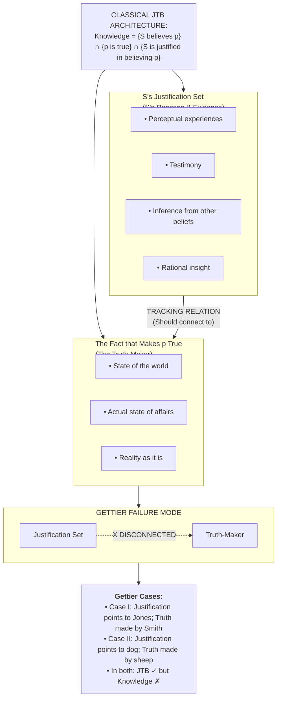

# Lesson 1: The Nature of Knowledge

## 1. First-Principles Intuition & Invariants

The question "What is knowledge?" appears deceptively simple until you attempt to answer it with precision. We encounter knowledge claims constantly in ordinary discourse—a meteorologist knows that a storm is approaching, a mathematician knows that the Pythagorean theorem holds, a witness knows what she observed at the crime scene. Yet these claims conceal a profound philosophical puzzle: what transforms a mere belief into knowledge? What distinguishes justified confidence from lucky guessing? What separates the person who believes the correct time on a broken clock from someone who actually knows the time?

For over two millennia, philosophers pursued what seemed like an obvious answer: knowledge is justified true belief. This tripartite formulation became so deeply embedded in the epistemic tradition that it acquired the status of near-axiom. Plato gestured toward it in the *Theaetetus*. Medieval and early modern epistemologists refined it. By the mid-twentieth century, the justified true belief account—henceforth JTB—had become the canonical definition taught in every introductory philosophy course. It possessed logical elegance, intuitive appeal, and apparent comprehensiveness. Knowledge appeared to require three and only three conditions: the belief must be true (you cannot know something false), the believer must hold it (knowledge requires a propositional attitude), and that belief must be justified (mere true opinion does not constitute knowledge).

This architectonic simplicity masked a structural vulnerability that would reshape epistemology itself. In 1963, Edmund Gettier published a three-page paper that demolished the JTB account through a series of ingeniously constructed counterexamples. These cases demonstrated that one could possess a justified true belief without possessing knowledge. The implications cascaded through the discipline. If the traditional tripartite analysis failed, then either knowledge required additional conditions beyond justification, truth, and belief, or the entire framework required fundamental reconceptualization. This rupture between intuitive philosophical analysis and counterintuitive edge cases became the generative problem motivating contemporary epistemology.

Understanding this rupture requires more than historical recitation. It demands that you reconstruct the logical structure underlying JTB, map the precise failure modes that Gettier exposed, and grasp why subsequent attempts to patch the account have proven systematically inadequate. This exercise is not antiquarian. It trains the practitioner to recognize how plausible theoretical frameworks can harbor hidden structural defects, how counterexamples function as diagnostic instruments, and how rigorous philosophical analysis operates as a tool for refining conceptual boundaries.

The foundational invariant here is this: knowledge is not merely a psychological state or a social convention. It concerns a relationship between a mind and reality, mediated through truth-conditions and justificatory standards. This relationship is neither transparent nor trivial. The conditions for knowledge are stronger than the conditions for rational belief, stronger than the conditions for justified belief, and stronger than the conditions for true belief. Knowledge occupies a narrower epistemic space than any of these three components alone. The JTB account attempted to specify this space through conjunction—knowledge is the intersection of justification, truth, and belief. But Gettier cases reveal that this intersection is not sufficient. Something else is required, something that the three traditional conditions fail to capture.

## 2. Core Architecture & Mechanics

### The Tripartite Structure: Decomposing the JTB Account

To understand why JTB fails, you must first master its internal architecture. Knowledge, on the traditional account, is a complex propositional attitude that can be analyzed into three necessary and jointly sufficient conditions. Let us examine each component and its logical function.

**Belief as the Propositional Substrate**

First, knowledge requires belief. This is the psychological foundation—the subjective stance one takes toward a proposition. When you know that Paris is the capital of France, you must minimally believe that proposition. Belief here is understood not as mere inclination or emotional conviction, but as a propositional attitude: a mental state directed toward a content that is capable of being true or false. The notation "S believes that p" represents the fundamental unit where S is a subject (knower) and p is a proposition (content).

Crucially, belief is not itself sufficient for knowledge. One can believe falsehoods, hold unjustified beliefs, or believe propositions that happen to be true purely by accident. A person who randomly guesses the outcome of a coin flip and happens to be correct possesses a true belief but not knowledge. The belief condition is therefore necessary but not sufficient—it establishes the minimal cognitive framework within which knowledge can occur.

**Truth as the Objective Anchor**

Second, knowledge requires truth. The proposition believed must correspond to reality. This is the objective constraint that distinguishes knowledge from mere subjective conviction. If your belief is false, you cannot possibly know the corresponding proposition, regardless of how justified or confident you feel. This condition embodies a core epistemological principle: knowledge cannot be systematically divorced from reality. A false belief, however rationally supported by available evidence, remains merely belief—it fails to constitute knowledge because it misaligns with how the world actually is.

The truth condition introduces a crucial asymmetry. Justification is accessible to the knower through introspection and rational reflection. Belief is a psychological state one can directly observe in oneself. Truth, however, is not always transparent to the subject. One can be completely justified in holding a false belief, can be utterly certain of a proposition that turns out to be false. Truth thus represents an objective standard that potentially exceeds the knower's epistemic access. This creates an important distinction between conditions that are internal to the subject's cognitive perspective and conditions that are external, anchored in the world itself.

**Justification as the Rational Warrant**

Third, knowledge requires justification. This is the most complex of the three conditions, and its structure merits careful exposition. Justification represents the rational ground for holding a belief—the evidence, reasons, and inferential support that make it rational to adopt and maintain a particular propositional attitude. 

Consider the distinction between true belief and knowledge through a concrete case. Two people observe a clock that reads 3:47 p.m. Both form the belief that the time is 3:47 p.m. Both beliefs are, in fact, true—the actual time is indeed 3:47 p.m. Yet they occupy radically different epistemic positions. One person observed a functioning, reliable clock and formed her belief through a well-established perceptual process. She possesses justification for her belief derived from the dependable testimony of an accurate instrument. The other person observed a broken clock that happened to display the correct time by sheer coincidence. She lacks justification—she had no rational ground to expect the broken clock to display accurate information. Though both possess a true belief about the time, only the first person seems to possess knowledge.

Justification operates through rational standards. These standards can take multiple forms: perceptual evidence from sensory experience, logical derivation from premises one already justifiably believes, inference to the best explanation, testimony from reliable sources, or rational introspection. The key function of justification is to render a belief non-arbitrary. A justified belief is one that a rational agent has adequate reasons to hold, given her cognitive circumstances and available evidence.

### The Gettier Counterexamples: Failure Mode Analysis

Edmund Gettier's 1963 paper "Is Justified True Belief Knowledge?" presented two cases that exposed the structural inadequacy of the JTB account. These are not marginal edge cases or philosophical curiosities—they represent diagnostic failures of the core framework. Let us examine them in detail.

**Case I: The Smith-Jones Scenario**

Imagine that Smith and Jones are candidates for a particular job. Smith has strong evidence for believing that Jones will get the job: the company's personnel director has assured him that Jones will be hired, and this director has always been reliable in the past. On the basis of this justification, Smith forms the belief: "The person who will get the job has ten coins in his pocket." Smith has this belief because he has counted the coins in Jones's pocket and knows that Jones has exactly ten coins.

Now consider what actually happens. Unbeknownst to Smith, Jones does not get the job—Smith himself does. Moreover, by pure coincidence, Smith also happens to have exactly ten coins in his own pocket. The proposition "The person who will get the job has ten coins in his pocket" is therefore true. Smith's belief is true. Smith's belief is also justified—he had excellent reasons to believe the personnel director's assurance about Jones, and he had directly observed the coins in what he thought was the relevant pocket.

Yet intuitively, Smith does not know that the person who will get the job has ten coins in his pocket. His belief is true and justified, but it reaches truth through an accidental route. Smith's justification terminates in false intermediate beliefs (that Jones will get the job, that the person getting the job is Jones). His true belief about the final proposition emerges from justified reasoning that tracks false propositions along the way. This case demonstrates that the three traditional conditions—belief, truth, and justification—can all be satisfied while knowledge remains absent.

**Case II: The Sheep in the Field**

Consider a landscape where a person sees what she takes to be a sheep in a distant field and forms the belief: "There is a sheep in that field." She has adequate perceptual justification for this belief based on her visual experience. The proposition is indeed true—there genuinely is a sheep in that field at the location she's observing.

However, what she is actually looking at is a dog that, from her distance and visual angle, closely resembles a sheep. The genuine sheep that makes her belief true is hidden behind a tree, invisible to her. She believes there is a sheep in the field, and she has justification for this belief (seemingly reliable perceptual evidence). The belief is true (a sheep is in the field). Yet she does not know there is a sheep in the field, because her justification connects to the wrong object—her evidence points to the dog, while her belief is made true by the concealed sheep.

### Structural Diagnosis: Why JTB Fails

These cases reveal a common failure pattern. Both involve situations where justified true belief achieves its truth through a kind of epistemic luck or accident rather than through a reliable connection between the justification and the truth-maker. In Case I, the justification tracks false propositions (Jones is hired, Jones will have the coins) while the belief is made true by an entirely different fact (Smith is hired, Smith has the coins). In Case II, the justification connects to the wrong object (the dog) while the truth is sustained by a different object (the concealed sheep).

The deeper insight is this: the JTB account treats justification as a purely internal property—a relationship between the subject and her reasons that depends only on her epistemic perspective and available evidence. It treats truth as an external property—whether reality aligns with the proposition believed. But it fails to require any connecting relationship between the justifying reasons and the truth-maker. The account permits a complete divorce between what justifies your belief and what makes that belief true.

This reveals a fundamental architectural gap in the traditional tripartite structure. Knowledge is not merely the conjunction of three independent conditions. Knowledge requires that these three conditions hang together in a particular way—that the justification actually relates to the truth, that the reasons supporting the belief connect appropriately to the fact that makes the belief true. The JTB account was blind to this requirement of internal coherence between its three components.

### Diagrammatic Representation of the Problem Space

## 3. High-Performance Optimization & Failure Modes

### Failure Mode I: Internal Justification Without External Tracking

The first critical failure mode that Gettier cases expose is the possibility of justification without appropriate tracking of the truth-maker. Your justification can be internally coherent, rationally impeccable from your subjective perspective, and yet systematically disconnected from the fact that actually makes your belief true.

Consider how this manifests in practical epistemic scenarios. A detective constructs a compelling case against a suspect, supported by seemingly reliable evidence: eyewitness testimony, motive, opportunity, partial physical evidence. The detective's belief that the suspect committed the crime is well-justified given her available evidence. If the suspect genuinely committed the crime, the detective's belief is true and justified. But if the suspect is innocent and someone else committed the crime, and if the detective's evidence accidentally happens to apply equally to the true perpetrator (perhaps they have similar builds, both had opportunity), then the detective might possess justified true belief without knowledge. Her justification, however internally sound, fails to track the actual source of guilt.

The practical lesson here is that strong subjective justification—the psychological sensation of rational confidence—is not equivalent to reliable tracking of truth. An epistemically responsible agent must not only accumulate reasons that seem sound from her perspective but must also remain alert to structural possibilities that her justification might connect to the wrong truth-maker. This requires what we might call *reflective skepticism about justification itself*—a willingness to question whether your reasons actually connect to the phenomena they purport to explain.

### Failure Mode II: Accidental Truth Through Non-Standard Routes

A second critical failure mode involves cases where a belief is true but achieves its truth through an accidental channel that bypasses the justifying reasons entirely. The broken clock displaying the correct time exemplifies this pattern: your belief about the time is true, your justification seemed compelling (you read an instrument), yet the truth arises through sheer coincidence rather than through the reliable process your justification invokes.

This failure mode is particularly insidious because it can occur even when both your belief and your justification appear perfectly normal in isolation. The problem emerges only when you examine the causal and logical relationships between your reasons and the actual state of affairs. In professional contexts, this manifests when someone reaches a correct conclusion through flawed reasoning—a financial analyst predicts a market movement based on incorrect macroeconomic assumptions, but the prediction happens to be correct because of an entirely different causal mechanism she failed to consider.

The defensive strategy against this failure mode is what might be called *causal-historical consciousness*—maintaining awareness of how your beliefs actually come to be true, not merely how they come to be justified. This requires tracing the genealogy of your justification: Did your reasons actually cause your belief in the right way? Does the path from evidence to conclusion actually pass through the mechanism that makes the conclusion true, or does it arrive at truth through an orthogonal route?

### Failure Mode III: Intermediate False Beliefs Sustaining Final True Beliefs

A third failure mode, particularly visible in Case I, involves complex inferential chains where intermediate false beliefs rationally support a final true belief. Smith justifiably believed Jones would get the job (false), justifiably believed Jones had ten coins (true in isolation, irrelevant to the final belief), and derived from these that the person getting the job would have ten coins (true, but for the wrong reasons—because Smith himself got the job, not Jones).

This pattern occurs frequently in scientific and intellectual contexts. A researcher operates within a theoretical framework that is partially false (incorrect assumptions about underlying mechanisms) but uses this framework to derive conclusions that happen to be true because they track certain phenomena that remain true even under the false theoretical interpretation. A programmer debugs code based on an incorrect mental model of how the system works but nonetheless identifies and fixes the actual bug because the bug manifests through consequences that align with what the incorrect model would predict.

The optimization strategy here involves what epistemologists call *sensitivity analysis*—the practice of examining not merely whether your conclusion is true but whether it would remain justified if intermediate components of your reasoning were false. If your final belief depends too heavily on false intermediate beliefs, then even if the final belief is true, it may not constitute knowledge because it relies on reasoning that only accidentally preserves truth.

### Reconstruction Paths: Attempts to Restore the Framework

Since Gettier's publication, epistemologists have pursued multiple strategies to restore or rehabilitate the knowledge-as-justified-true-belief framework. Understanding these attempts illuminates both the resilience and the fundamental inadequacy of the traditional account.

**The No-False-Lemmas Condition**

One prominent response, developed by philosophers including Gilbert Harman and others, proposes adding a condition stipulating that one's justification must not depend on any false beliefs serving as lemmas (intermediate inferences) in the reasoning chain leading to knowledge. Under this proposal, Smith fails to know because his justification essentially depends on the false belief that Jones will be hired. The person observing the dog-sheep fails to know because her justification depends on false beliefs about what object she is actually observing.

This amendment captures some intuitions but introduces new problems. First, it becomes difficult to specify exactly which false lemmas are disqualifying. After all, much of our reasoning depends on background assumptions that are partially false—we operate under idealizations, approximations, and simplifications that strictly speaking misrepresent reality. Second, the no-false-lemmas condition seems ad hoc, a patch added specifically to handle Gettier cases rather than emerging naturally from a principled analysis of knowledge.

**The Causal Theory**

Another influential response treats knowledge as a causal relationship between belief and truth. On this account, you know that p only if your belief that p is appropriately caused by the fact that makes p true. The causal theory elegantly handles the broken-clock case—your belief about the time is not caused by the fact that makes it true (the actual time); rather, it is caused by the broken clock's display. Similarly, in Case I, Smith's belief about the coins is not appropriately caused by the fact that actually makes it true (Smith himself having the coins); instead, it is caused by his false beliefs about Jones.

Yet the causal theory faces its own difficulties. Some knowledge, particularly mathematical and logical knowledge, seems to involve no causal process at all—you know that 7 + 5 = 12 not through causal interaction with arithmetic facts but through conceptual understanding and rational insight. Furthermore, causal accounts must specify what counts as an "appropriate" causal relationship, and this turns out to be nearly as philosophically complex as the original problem of analyzing knowledge.

**The Tracking Theory**

A third response, championed by Robert Nozick and others, proposes that knowledge requires that your belief track the truth—your belief-forming method must be reliably sensitive to whether p is true or false. Under this account, you know that p only if: (i) you believe p and p is true; (ii) if p were false, you wouldn't believe it; and (iii) if p were true, you would believe it.

The tracking theory captures an important intuition: knowledge involves a kind of reliable responsiveness to the truth. In the broken-clock case, your belief-forming method (reading the clock) would not track the actual time under counterfactual variations—if the time were different, you would still believe whatever the broken clock displayed. The theory handles Gettier cases by requiring not merely that your belief is true and justified, but that the mechanism generating your belief would reliably respond to changes in the actual truth-value.

However, tracking accounts face difficulties with certain types of knowledge that seem to involve necessary truths or stable facts unlikely to be false under realistic counterfactuals. If you know that 2 + 2 = 4, the counterfactual conditions might seem trivially satisfied in an uninformative way.

Despite this limitation, the tracking theory has proven influential precisely because it shifts attention from the static relationship between belief and evidence toward the dynamic, counterfactual-sensitive process by which beliefs are formed. Contemporary reliabilist and virtue epistemology frameworks have extended this core insight, arguing that what distinguishes knowledge from mere true belief is not some additional internal justificatory state but the external reliability of the cognitive process or faculty involved. On this view, perception, memory, testimony, and rational intuition each constitute legitimate epistemic sources when they reliably produce true beliefs across the range of conditions in which they are deployed. This does not dissolve the Gettier problem so much as reframe it: Gettier cases reveal that accidental truth is insufficient not because justification is missing, but because the connection between the believer's cognitive process and the truth-making facts is severed in the wrong way. The philosophical work then shifts to characterizing what "the right kind of connection" requires, a project that continues to occupy epistemologists and that connects directly to debates about epistemic luck, safety conditions, and the proper individuation of belief-forming methods.

Taken together, the classical analysis and its successors reveal a stable pattern in epistemological inquiry: each proposed account of knowledge captures genuine intuitions while generating cases that expose its limits. The JTB analysis codifies the evidential norms implicit in ordinary practice; Gettier cases show that justification and truth can come apart in ways that undermine cognitive achievement; causal and tracking theories respond by grounding knowledge in the right kind of nomological or counterfactual connection to the facts. What emerges from this dialectic is not a finished definition but a sharper map of the theoretical landscape. Knowledge appears to require at minimum true belief, some appropriate epistemic basis for that belief, and a non-accidental connection between the belief and the truth—a connection robust enough to survive relevant counterfactual variations and not merely the product of epistemic luck. These three desiderata form the core of any serious theory of knowledge and serve as the diagnostic framework for evaluating the cases and thought experiments that follow throughout this unit.

## Summary & Verification Matrix

| Concept | Governing Invariant | Core Mechanism | Diagnostic Criteria | Common Failure Mode |
|---|---|---|---|---|
| Classical JTB Analysis | Knowledge = justified true belief (necessary and sufficient conditions) | A believer S knows p iff S believes p, p is true, and S has adequate justification for p | Does the subject have truth, belief, and a recognized justificatory basis? | Conflates epistemic luck with knowledge; overthrown by Gettier-style counterexamples |
| Gettier Problem | Justified true belief is not sufficient for knowledge | Constructs cases where JTB conditions are met yet knowledge is intuitively absent due to accidental coincidence | Is the truth of the belief connected to the subject's justification, or coincidental? | Assuming that internally coherent justification guarantees the right belief-world relationship |
| Causal Theory | Knowledge requires an appropriate causal chain linking the fact to the belief | The truth-making fact must causally produce the belief via a continuous and appropriate process | Is there a traceable causal pathway from the fact p to the subject's belief that p? | Excludes a priori knowledge (mathematical, logical) where no causal interaction occurs |
| Tracking Theory (Nozick) | Belief must counterfactually covary with the truth of p | Sensitivity condition: if p were false, S would not believe p; adherence condition: if p were true, S would believe p | Would the subject's belief-forming method respond correctly under relevant counterfactual variations? | Struggles with necessary truths where the false-antecedent counterfactual is trivially or vacuously satisfied |
| Reliabilism / Virtue Epistemology | Knowledge is produced by a reliable or truth-conducive cognitive faculty or process | Epistemic legitimacy derives from the external track record and proper functioning of faculties (perception, memory, reason) | Does the belief-forming process reliably produce true beliefs across the relevant range of conditions? | The generality problem: difficulty in precisely individuating which process type to evaluate for reliability |
| Epistemic Luck | Accidental truth undermines knowledge even when other conditions are met | A belief is epistemically lucky when it is true in the actual world but false in many nearby possible worlds | Could the subject easily have held the same justified belief while it was false? | Conflating safety (the belief could not easily have been false) with mere statistical reliability of the source |
