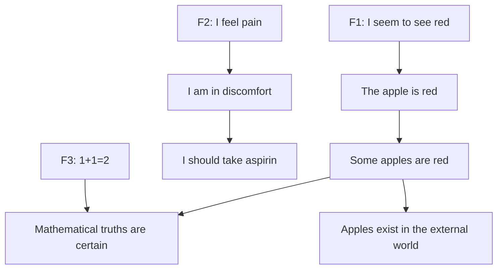
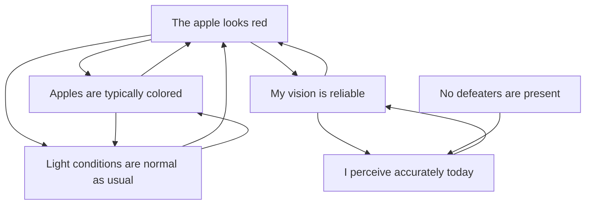

# Lesson 2: Theories of Epistemic Justification

## 1. First-Principles Intuition & Invariants

The problem of epistemic justification sits at the structural core of all knowledge claims. When you assert that you know something—that the Earth orbits the Sun, that water boils at 100°C at sea level, that your colleague is trustworthy—you implicitly claim not merely that your belief happens to be true, but that you possess adequate rational grounds for holding it. Epistemology demands an account of what transforms mere true belief into knowledge, and justification serves as the canonical bridge across that gap. Yet the architecture of justification itself presents a vexing regress problem that has fractured the epistemological landscape into competing structural theories, each offering radically different blueprints for how beliefs acquire their rational credentials.

The regress problem emerges with ruthless logical inevitability. Suppose you believe proposition P and I challenge your justification. You offer proposition Q as your justifying reason. But now Q itself requires justification, leading you to cite proposition R. This chain threatens to extend infinitely backward, never reaching stable ground. The ancient Pyrrhonian skeptics weaponized this observation, arguing that since no belief can be justified without presupposing unjustified premises, knowledge collapses into universal doubt. The regress presents exactly four logical possibilities: the chain terminates at foundational beliefs requiring no further justification, the chain loops back on itself in a coherent circle, the chain extends infinitely, or the chain simply halts arbitrarily without genuine justification. Each structural theory of justification embraces one of these horns, attempting to demonstrate that their chosen architecture avoids skepticism while respecting our intuitions about rational warrant.

Foundationalism accepts the first horn, positing a tier of basic or foundational beliefs that possess intrinsic justification independent of inferential support from other beliefs. These foundational beliefs serve as the axiomatic bedrock upon which all other justified beliefs rest through chains of inference. Classical foundationalists like Descartes identified indubitability as the hallmark of basicality—beliefs so certain they cannot coherently be doubted, such as one's own existence or immediate conscious states. Modest foundationalists relax this criterion, allowing beliefs formed through reliable perceptual or introspective mechanisms to count as properly basic even if they lack absolute certainty. The architectural invariant remains constant: justification flows unidirectionally from foundational beliefs upward through inferential chains, never requiring circular support or infinite regress.

Coherentism rejects foundational architecture entirely, embracing instead the second horn by arguing that justification emerges from mutual support relationships within a holistic web of beliefs. No belief possesses intrinsic justification in isolation; rather, each belief derives its warrant from coherence with the broader belief system. Justification becomes a network property rather than a linear chain. Laurence BonJour articulated the coherentist vision with particular clarity, specifying that a belief system achieves coherence through logical consistency, inferential connections, explanatory integration, and relative stability over time. A belief is justified to the degree it participates in and contributes to the coherence of the entire doxastic structure. The circularity that foundationalists decry as vicious becomes, for coherentists, a virtue—beliefs justify each other through a rich tapestry of mutual support that collectively resists external challenges.

Infinitism, championed most prominently by Peter Klein, accepts the third horn by arguing that justification chains genuinely extend infinitely backward, and that this presents no fatal defect. Klein distinguishes between showing that a belief is justified and actually being justified. To be justified requires only that you possess the capacity to provide reasons upon demand, reasons for those reasons, and so forth without termination. You need not consciously entertain this infinite chain; rather, you must be disposed to generate appropriate reasons at each level when challenged. Infinitism treats justification as a procedural capacity rather than a static architectural feature, emphasizing the dynamic process of reason-giving over fixed structural foundations.

Beyond these structural theories, a second axis cleaves epistemology: the internalism-externalism divide concerning the accessibility conditions for justification. Internalism maintains that all factors relevant to a belief's justification must be cognitively accessible to the believer through reflection or introspection. If you are justified in believing P, you must be able, at least in principle, to determine through rational reflection that you possess adequate grounds for P. This accessibility requirement captures powerful intuitions about epistemic responsibility—you can be rationally criticized or praised only for factors within your cognitive ken. Internalists argue that justification necessarily involves a deontological dimension, a matter of fulfilling epistemic duties that presupposes reflective access to your evidential situation.

Externalism severs this accessibility requirement, arguing that justification depends on objective relations between beliefs and the world that may lie entirely outside the believer's reflective awareness. A belief can be justified if it stands in the right external relation to truth-conducive processes or reliable mechanisms, regardless of whether the believer can access or understand these relations. This shift from internal rational coherence to external reliability marks a fundamental reorientation in epistemological methodology, treating knowledge as a natural phenomenon to be analyzed through empirical investigation of cognitive processes rather than purely a priori reflection on rational norms.

The foundationalism-coherentism-infinitism triad addresses structural architecture, while the internalism-externalism axis concerns the accessibility conditions and ultimate grounds of justification. These dimensions cross-cut each other, generating a rich space of possible positions. You might embrace foundationalism while remaining neutral on accessibility, or you might combine externalist commitments with coherentist structure. The two most influential externalist theories—reliabilism and virtue epistemology—have reshaped contemporary epistemology precisely by demonstrating how external conditions can ground justification without requiring internal accessibility.

Reliabilism, articulated definitively by Alvin Goldman, identifies justification with belief formation through reliable processes—cognitive mechanisms that produce true beliefs at a sufficiently high frequency across a wide range of circumstances. Perception, memory, deductive reasoning, and inductive generalization count as reliable processes when functioning properly, while wishful thinking, hasty generalization, and confirmation bias constitute unreliable processes. Crucially, a believer need not know that their belief-forming process is reliable for their belief to be justified. A child who has never studied vision science can nonetheless possess justified perceptual beliefs if their visual system operates reliably. Justification becomes a matter of objective statistical correlation between process and truth rather than subjective rational coherence.

Virtue epistemology extends externalism by locating justification not in isolated processes but in stable epistemic character traits or intellectual virtues. Ernest Sosa distinguishes animal knowledge, which arises from reliable processes, from reflective knowledge, which additionally requires the believer to appreciate the reliability of their cognitive faculties through a second-order epistemic perspective. Linda Zagzebski develops a virtue theory parallel to Aristotelian ethics, defining knowledge as belief arising from acts of intellectual virtue—character traits like open-mindedness, intellectual courage, and thoroughness that reliably lead to truth. Virtue epistemology promises to naturalize epistemology by studying actual human cognitive excellences while preserving normative dimensions through the evaluative framework of virtues and vices.

The practical stakes of these theoretical disputes emerge sharply when adjudicating real-world knowledge claims. Consider expert testimony in legal proceedings. An internalist demands that a witness be able to articulate their evidential grounds and reasoning process, ensuring transparent rational accountability. An externalist permits testimony from witnesses who cannot explain their reliable recognition capacities—the fingerprint analyst who can identify matches with high accuracy but cannot fully articulate the perceptual cues they utilize. Foundationalists insist that expert knowledge ultimately rests on observational bedrock, while coherentists emphasize how expert judgment integrates with broader theoretical frameworks. Each structural theory generates distinct protocols for evaluating testimonial knowledge, with concrete consequences for jurisprudence, scientific practice, and everyday epistemic assessment.

## 2. Core Architecture & Mechanics

Foundationalist architecture implements a directed acyclic graph structure with beliefs as nodes and justificatory relations as edges pointing from supporting beliefs to supported beliefs. The graph must satisfy a crucial constraint: there exists a distinguished subset of nodes marked as foundational beliefs that have in-degree zero—no incoming justificatory edges. All non-foundational beliefs must be reachable through directed paths originating from one or more foundational nodes. This ensures that justification terminates rather than regressing infinitely or forming cycles.



The foundationalist must specify both the demarcation criterion for basicality and the transmission principles governing inferential justification. Classical foundationalists like Descartes employed an indubitability criterion: a belief qualifies as foundational only if its denial generates logical or pragmatic contradiction. Cartesian foundational beliefs include one's own existence (the cogito), the contents of immediate conscious experience, and clear and distinct rational intuitions. The transmission principle demands deductive certainty—justified beliefs can support derived beliefs only through logically valid inference, ensuring that the absolute certainty of foundations transmits upward.

Modest foundationalism relaxes both the basicality criterion and transmission principles. Beliefs formed through properly functioning perceptual systems qualify as foundational even when fallible. Your belief that you see a red apple possesses defeasible prima facie justification simply by virtue of arising from visual experience, without requiring inference from other beliefs. Transmission principles permit inductive inference, inference to best explanation, and other ampliative reasoning patterns that extend beyond deductive certainty. The justificatory graph remains acyclic, but edges now carry probabilistic weights rather than certainty-preserving deductive links.

Coherentist architecture abandons the acyclic constraint entirely, permitting circular justificatory relations provided they participate in a globally coherent system. Beliefs justify each other through reciprocal support relations forming densely connected subgraphs. No belief possesses intrinsic justification; rather, justification emerges holistically from network topology and global coherence measures.



BonJour specifies five coherence dimensions that collectively determine justification strength. Logical consistency requires that no belief logically contradicts any other belief in the system. Probabilistic consistency extends this to statistical coherence—beliefs must assign coherent probability distributions. Inferential density measures the quantity and strength of support relations connecting beliefs. A maximally coherent system exhibits rich inferential interconnections where beliefs mutually reinforce each other through multiple independent pathways. Explanatory integration demands that beliefs cohere into unified explanatory narratives rather than fragmenting into isolated belief clusters. Finally, stability requires that the belief system resists fragmentation under evidential perturbations, maintaining coherence despite local belief revisions.

The coherentist faces the isolation objection: a perfectly coherent system of beliefs might remain entirely disconnected from reality, like an elaborate fantasy novel exhibiting perfect internal consistency but zero truth-tracking. BonJour responds with the Observation Requirement, mandating that coherent systems must include spontaneous observational beliefs—doxastic states triggered directly by perceptual experience rather than inference. These observational beliefs function not as foundational starting points but as anchor points that constrain coherence, preventing free-floating coherence from detaching entirely from empirical reality.

Infinitist architecture implements justification as an infinite tree structure where each belief node connects to multiple supporting reason nodes, which themselves connect to further supporting reasons without termination. Crucially, the tree must satisfy a non-repeating constraint: no reason appears twice along any branch, preventing trivial infinite cycles.

```text
Infinitist Architecture (Infinite Justification Tree):

Level 0:  [I know the table is brown]
               |
Level 1:  [I see the table and it appears brown]
               |
Level 2:  [My visual system is reliable in these conditions]
               |
Level 3:  [Past experience confirms visual reliability]
               |
Level 4:  [Memory of past confirmations is accurate]
               |
Level 5:  [Meta-cognitive monitoring indicates memory reliability]
               |
               ⋮ (extends infinitely)
```

Klein argues that the infinitist need not claim believers actually possess infinite mental states. Rather, justification consists in the dispositional capacity to generate appropriate reasons when challenged. You are justified in believing the table is brown if you can provide reason R1 when asked, reason R2 when R1 is challenged, and so forth indefinitely. The infinite structure exists potentially rather than actually, manifested only through the dialectical process of reason-giving.

The internalism-externalism axis orthogonally partitions the justification space by constraining which properties count as justification-makers. Internalism imposes an accessibility constraint formalized as a supervenience thesis: if two believers are in identical internal mental states, they possess identical justification for their beliefs. All justification-relevant factors must supervene on properties accessible to reflective awareness—phenomenal experience, memorial seemings, rational intuitions, and inferential relations among beliefs.

Access internalism demands strong accessibility: a believer can always determine through reflection whether they possess justification. Mentalism, a weaker variant, requires only that justification supervene on mental states without demanding reflective transparency. You might be justified by unconscious cognitive processes provided those processes remain mental rather than extending into external environmental factors.

Externalism rejects supervenience on internal states, permitting justification to depend on factors opaque to reflective awareness. Reliabilism implements externalism by defining justification through counterfactual reliability: a belief-forming process is reliable if it would produce true beliefs at high frequency across a wide range of possible circumstances, including circumstances the believer cannot distinguish from their actual situation.

Goldman's process reliabilism analyzes justification through the following schema: S's belief that P at time t is justified if and only if the belief was produced by a reliable cognitive process, where reliability is measured as the ratio of true to total beliefs the process would produce across relevant alternative situations. The normalization clause "relevant alternative situations" proves critical, preventing justification from collapsing under skeptical pressure. Your perceptual belief that you see a hand is justified if perception reliably produces true beliefs in normal circumstances, even if perception would fail in skeptical scenarios like brain-in-vat simulations, provided those scenarios are not relevant alternatives.

The generality problem threatens reliabilism by noting that any token belief-forming event can be typed under indefinitely many process descriptions, from maximally specific ("forming a visual belief about medium-sized dry goods in fluorescent lighting at 3pm on Tuesday") to maximally general ("forming beliefs through perception"). Reliability varies dramatically across type specifications. Goldman responds by individuating processes at the level that captures psychologically natural kinds—the grain size at which cognitive science identifies distinct mechanisms. Visual perception, auditory perception, deductive reasoning, and inductive generalization constitute distinct process types, while arbitrary gerrymandered disjunctions do not.

Virtue epistemology refines reliabilism by locating reliability in stable character traits rather than isolated processes. Sosa's faculty virtue reliabilism identifies justification with belief arising from competent exercise of cognitive faculties—perception, memory, reasoning—that reliably produce truth. A belief manifests knowledge when it succeeds (is true) because of (not merely correlated with) competent exercise of epistemic virtue. The because-of relation implements a counterfactual dependency: in nearby possible worlds where the belief is formed through the same faculty exercise, it remains true.

Zagzebski's responsibilist virtue epistemology shifts from faculties to character traits, defining intellectual virtues as acquired excellences of character that involve motivation toward truth. Open-mindedness, intellectual courage, attentiveness, and thoroughness constitute epistemic virtues not merely because they reliably generate true beliefs, but because they involve motivational structures oriented toward epistemic goods. This neo-Aristotelian framework integrates reliabilist externalism with an internalist recognition of epistemic agency and responsibility.

## 3. High-Performance Optimization & Failure Modes

Foundationalist systems optimize epistemic efficiency by minimizing inferential load on foundational beliefs while maximizing coverage of the justified belief space. A foundationalist architecture with too few foundational beliefs generates limited justification coverage, leaving vast domains of ordinary knowledge claims unjustified. Descartes's radical foundationalism exemplifies this failure mode—his restriction of foundations to indubitables left him struggling to justify belief in the external world, ultimately requiring the dubious inference through a benevolent deity. Conversely, a promiscuous foundationalism that admits too many beliefs as basic sacrifices epistemic rigor, permitting arbitrary beliefs to claim unjustified authority.

The calibration challenge demands specifying principled boundaries for basicality. Phenomenal conservatism, articulated by Michael Huemer, offers a pragmatic optimization: treat any belief accompanied by an intellectual seeming as possessing prima facie justification, absent defeating evidence. If it seems to you that 2+2=4, that you perceive a table, or that modus ponens is valid, you possess defeasible justification for those beliefs simply in virtue of the seeming. This permissive criterion expands foundational coverage dramatically while preserving a principled demarcation—only beliefs presenting with phenomenology of correctness qualify as basic.

Critics charge that phenomenal conservatism permits obviously unreliable processes like wishful thinking to generate justified beliefs, since motivated reasoning often produces strong intellectual seemings. Huemer responds with a defeat clause: justification persists only absent undermining evidence. If you possess evidence that your intellectual seeming arose through unreliable processes like wish-fulfillment or peer pressure, that evidence defeats the prima facie justification. This implements a default-and-challenge architecture: beliefs begin justified by virtue of seemings but remain perpetually vulnerable to empirical defeaters.

Foundationalism faces the bootstrapping objection in cases of circular testing procedures. Suppose you use your vision to test whether your vision is reliable by checking whether visually formed beliefs about observable states of affairs prove accurate. You look at a thermometer and form the visual belief that it reads 72°F, then touch the room and form a tactile belief that it feels appropriately warm, taking this correlation as evidence of visual reliability. But this procedure assumes visual reliability to test visual reliability—you rely on accurate visual reading of the thermometer to confirm vision's accuracy. The evidential circle appears viciously circular from a foundationalist perspective, yet the procedure seems intuitively legitimate.

Moderate foundationalists respond by distinguishing vicious from virtuous epistemic circularity. Rule-circular reasoning applies a cognitive faculty to validate itself, but this needn't be vicious provided the faculty possesses independent default justification. If visual perception begins with prima facie justification, you can legitimately use vision to gather evidence of vision's reliability, thereby upgrading default justification into reflectively validated justification. The initial justification doesn't derive from the circular test; rather, the test transforms basic justification into calibrated reliability estimates.

Coherentist systems optimize for global stability under belief revision. When new evidence arrives that contradicts existing beliefs, the coherentist must minimize system-wide incoherence by identifying the minimal belief set whose revision restores coherence. This implements a constraint satisfaction problem: preserve maximal coherence while accommodating new evidence. The Lewis-Williams Stability Principle specifies that entrenched beliefs—those with high inferential connectivity—should resist revision more strongly than peripheral beliefs with sparse connections.

The isolation objection presents coherentism's central failure mode. A belief system might achieve perfect internal coherence while systematically misrepresenting reality. Consider an individual suffering from Capgras delusion who believes that loved ones have been replaced by identical imposters. This delusional belief system can exhibit substantial internal coherence—the believer develops elaborate explanatory narratives for why the imposters behave like the originals, why no one else notices the replacement, why the conspiracy remains hidden. Each element coheres with others, yet the entire system detaches from reality.

BonJour's Observation Requirement attempts to block this failure mode by demanding that coherent systems incorporate spontaneous observational beliefs causally triggered by perceptual experience. These beliefs function as anchor points preventing complete detachment from empirical reality. But critics note that delusional systems typically do incorporate observational beliefs—the Capgras patient genuinely perceives their spouse and forms observational beliefs about visual appearance. The problem is not absence of observation but misinterpretation driven by prior belief commitments.

A more sophisticated coherentist response invokes explanatory power asymmetries. While delusional systems can achieve local coherence, they require increasingly elaborate auxiliary hypotheses to accommodate recalcitrant evidence, violating parsimony constraints. Veridical belief systems achieve coherence with greater explanatory efficiency. This implements an inference-to-best-explanation criterion: prefer belief systems that maximize coherence while minimizing complexity. But this revision reintroduces quasi-foundational elements—parsimony and explanatory power function as external constraints on coherence rather than emerging from coherence relations alone.

Infinitism faces the finite mind objection: human believers possess finite cognitive resources and cannot actually generate infinite justificatory chains. Klein's dispositional response treats justification as a capacity manifest through performance rather than an occurrent mental state. You are justified if you can produce reasons upon request, reasons for those reasons when challenged, and so forth. But critics press the regress: what justifies your belief that you possess this dispositional capacity? If you answer that you've successfully produced reasons in the past, we can ask what justified those past reason-giving episodes, initiating a second-order regress.

Klein embraces this consequence, arguing that justification is fundamentally procedural rather than static. There exists no point at which justification is complete; rather, justification consists in the ongoing dialectical practice of reason-giving. This threatens to collapse the normative force of justification—if justification never achieves closure, we cannot distinguish genuinely justified beliefs from unjustified beliefs that happen to survive challenge due to dialectical accidents.

Reliabilism optimizes epistemic performance by calibrating justification to statistical truth-tracking across relevant alternatives. A high-performance reliabilist system implements fine-grained process individuation that captures psychologically real mechanisms while remaining coarse enough to permit meaningful statistical generalization. The generality problem represents reliabilism's primary failure mode. Consider your belief formed through visual perception at time t. Under what type description should we assess reliability? "Visual perception" generally? "Visual perception in fluorescent lighting"? "Visual perception of medium-sized dry goods by a myopic observer wearing outdated prescriptions"? Each specification yields different reliability statistics.

Conee and Feldman's evidentialist objection highlights cases where reliable processes generate intuitively unjustified beliefs. Suppose a brain tumor causes you to believe the President is in New York, and by sheer coincidence the President is indeed in New York. Your belief is true and formed by a reliable process in the sense that the tumor consistently produces true beliefs about presidential location through clairvoyant mechanisms. Yet the belief seems paradigmatically unjustified because you possess no evidence accessible through reflection that tracks the belief's reliability.

Goldman introduces a no-defeater clause: a belief is justified only if it is reliably formed and the believer possesses no undefeated defeaters—beliefs or evidence that would undermine justification if properly processed. In the clairvoyance case, you possess extensive defeater evidence: the belief seems to arise spontaneously without perceptual or inferential basis, you have no track record of clairvoyant accuracy, and clairvoyance contradicts your justified beliefs about cognitive mechanisms. These defeaters undermine justification even given reliable formation.

Virtue epistemology addresses the clairvoyance problem by requiring that knowledge manifest competent faculty exercise where competence involves appropriate basing relations. Sosa distinguishes animal knowledge, which requires mere reliable indication, from reflective knowledge, which additionally requires aptness—success because of competence. Your clairvoyant belief fails to constitute knowledge because its truth does not result from competent exercise of recognized cognitive virtues. The tumor's reliability is accidental from the perspective of your cognitive agency.

Zagzebski's responsibilist virtue epistemology faces motivational integration challenges. Intellectual virtues involve not merely reliable truth-acquisition but also motivational structures oriented toward epistemic goods. Open-mindedness requires not merely considering alternative views but doing so from motivation toward truth rather than strategic advantage. Yet motivation appears neither necessary nor sufficient for justification. A cynic might reliably track truth while motivated purely by self-interest, and a sincere truth-seeker might employ unreliable methods despite exemplary motivation.

The practical synthesis for working epistemologists involves recognizing that different justification theories illuminate distinct aspects of epistemic evaluation. Foundationalism captures the intuition that perceptual experience and rational intuition provide defeasible starting points for inquiry without requiring infinite regress. Coherentism emphasizes the holistic character of justification—beliefs justify each other through mutual support rather than linear inference chains. Reliabilism and virtue epistemology highlight the objective dimension of justification, the fact that beliefs must track truth through reliable mechanisms regardless of internal accessibility.

A sophisticated epistemic agent implements a pluralistic protocol: use foundationalist default justification for perceptual and introspective beliefs, coherentist integration for theoretical belief revision, and reliabilist calibration for assessing whether belief-forming methods track truth reliably. When evaluating expert testimony, apply virtue epistemology's emphasis on intellectual character traits and competent exercise of domain-specific skills. When conducting first-personal epistemic assessment, respect internalist accessibility constraints by evaluating only factors within reflective ken. When engaging in third-personal epistemic evaluation of others' beliefs, permit externalist considerations about reliability and proper function that may be opaque to the believer.

The regress problem admits no conclusive solution that commands universal assent, but this theoretical plurality need not paralyze epistemic practice. Each theory identifies genuine normative dimensions of justification: groundedness in experience, systematic coherence, reliable connection to truth, and competent exercise of cognitive virtue. Master epistemologists recognize these as complementary tools for epistemic assessment rather than mutually exclusive dogmas requiring exclusive allegiance. Justification is not a monolithic property admitting a single correct analysis but a multidimensional normative status demanding evaluation along multiple complementary axes.
