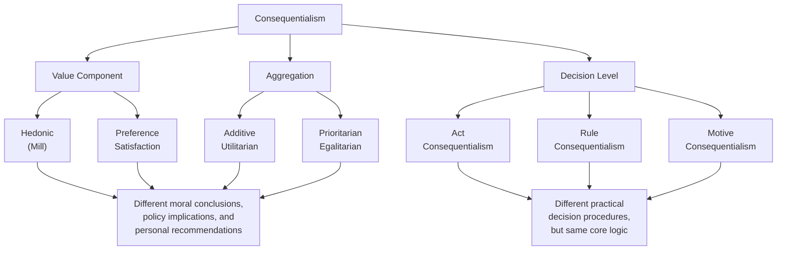

# Lesson 2: Consequentialist Ethical Systems

## 1. First-Principles Intuition & Invariants

Consequentialism begins with a deceptively simple intuition: the rightness or wrongness of an action depends entirely on its outcomes. This stands in sharp contrast to deontological systems, which ground moral judgment in duties, rules, or the intrinsic nature of acts themselves, and virtue ethics, which focuses on the character traits that an agent embodies. The consequentialist wager is that morality is fundamentally *forward-looking*—we assess an action by examining what it produces, what states of affairs it brings into being, and how those outcomes compare to the alternatives available to us.

This core principle operates as an invariant: consequences are the only morally relevant factor. Everything else—intentions, duties, social conventions, personal loyalties—becomes instrumentally important only insofar as it affects outcomes. A lie that saves a life is not merely permissible but potentially obligatory. A rule that produces harmful results should be abandoned. A relationship that generates suffering might need to be severed. The consequentialist framework transforms ethics from a system of constraints into an optimization problem: among all available courses of action, which produces the best consequences?

The theoretical grounding for consequentialism rests on two foundational premises. First, outcomes matter morally—this is almost universally accepted across ethical traditions. Even strict deontologists acknowledge that consequences are *relevant* to morality; they simply deny that consequences are the *only* thing that matters. Second, comparative evaluation is possible and necessary: we can meaningfully assess whether one outcome is better than another, and this comparative judgment is what grounds moral deliberation. Without this capacity for ranking outcomes, consequentialism becomes incoherent. We cannot navigate an optimization landscape without a metric.

Yet this simplicity obscures genuine philosophical complexity. The moment we ask "which consequences matter?", "how do we measure them?", and "whose consequences count?", consequentialism branches into multiple, sometimes contradictory variants. Utilitarianism—the most historically prominent consequentialist theory—identifies the relevant good as utility, typically understood as happiness, well-being, or preference satisfaction. But consequentialism itself is broader: it encompasses any theory that says "the right action is the one that produces the best outcomes" regardless of how "best" is defined. A consequentialist might care about justice, virtue, knowledge, beauty, or any other value, provided that value determines which outcomes are superior.

This distinction between the general architecture of consequentialism and particular consequentialist systems is crucial for practitioners. Understanding the structure allows us to identify which objections target the framework itself and which target only specific implementations. The aggregation problem—how to combine individual utilities into a social total—affects utilitarianism but not necessarily all consequentialist systems. The demandingness objection—that consequentialist morality requires constant self-sacrifice—arises from utilitarianism's particular commitment to impartial utility maximization but might not apply to a consequentialist theory that values agent-centered goods or recognizes moral prerogatives.

The invariant structure of consequentialism can be expressed formally: an action *A* is right if and only if the consequences of *A* are at least as good as the consequences of any alternative available to the agent. This formulation contains several critical load-bearing elements. The comparison is *relative*: rightness depends on what alternatives existed. The comparison is *counterfactual*: we must assess not just what actually happens but what would have happened under different choices. The evaluation is *holistic*: we assess entire states of affairs, not isolated elements. And the metric is *agent-neutral* in principle: the same standard applies regardless of who performs the action or what their personal interests are.

Understanding consequentialism requires grasping why these features create both its power and its problems. By making morality a matter of consequences rather than rules or intentions, consequentialism dissolves artificial barriers between different domains of choice. It offers a unified framework for thinking about personal decisions, policy design, institutional reform, and even long-term civilizational questions. A pharmaceutical executive deciding whether to fund a drug trial, a legislator crafting environmental policy, and an individual choosing whether to donate to charity all face the same fundamental moral question: which option produces the best outcomes? This universality is elegant and clarifying.

But this same universality generates profound tensions. If only consequences matter, then the intentions that generate actions become morally irrelevant—you can perform an evil act for good motives and be fully justified. If consequences are all that counts, then moral side constraints (prohibitions on, say, torturing an innocent person to prevent a greater harm) cannot be ultimately justified. If the consequentialist calculus is rigorous and impartial, then personal projects, family relationships, and individual flourishing become merely instrumentally valuable, sacrificeable whenever they conflict with aggregate good. These are not minor tensions but radical challenges to how most people understand the moral landscape.

## 2. Core Architecture & Mechanics

To navigate consequentialism rigorously, we must examine the internal machinery—the specific models of value, aggregation, and decision that different consequentialist systems employ. The architecture has distinct components, and each component is independently variable.

### The Value Component: What Counts as a Good Consequence?

The first architectural decision is *which outcomes to optimize for*. Utilitarianism historically grounded itself in hedonism: the good is pleasure or happiness, and the bad is pain or suffering. Jeremy Bentham's formulation was explicit and quantitative. In his *Introduction to the Principles of Morals and Legislation* (1789), Bentham wrote: "Nature has placed mankind under two sovereign masters, pleasure and pain. It is for them alone to point out what we ought to do, as well as to determine what we shall do." From this premise, Bentham constructed his hedonic calculus—a systematic framework for measuring pleasure by intensity, duration, certainty, propinquity, fecundity, purity, and extent (the number of people affected).

The hedonic calculus is not merely historical curiosity; it represents the first rigorous attempt to operationalize consequentialist thinking. By treating pleasure as a quantifiable dimension, Bentham created a model in which moral calculation becomes, in principle, computational. Consider a policy decision: should a government regulate industrial pollution? The consequentialist framework demands we compare the pleasure (clean air, health, aesthetic enjoyment) generated by stricter regulation against the pleasure (lower consumer costs, industrial employment, economic growth) preserved by lenient regulation, weighted by certainty and duration. Bentham's calculus provides a structure for this comparison, even if precise measurement remains impossible.

Yet Bentham's hedonism faces immediate objections, both philosophical and practical. John Stuart Mill, himself a utilitarian, recognized that pleasures differ not merely in quantity but in quality. The pleasure of intellectual contemplation differs fundamentally from the pleasure of physical sensation. A life of unreflective contentment is not equivalent to a life of meaningful engagement, even if both generate equivalent quantities of positive feeling. Mill's distinction between "higher" and "lower" pleasures introduced qualitative valuation into consequentialism, complicating the calculation but making it more psychologically and normatively defensible.

This evolution points to a broader architectural variable: consequentialists need not be hedonists. Modern consequentialists often appeal to *preference satisfaction* as the relevant good. On this view, an outcome is good to the extent that it satisfies the considered preferences of those affected. This avoids some difficulties with hedonism—it need not claim that all preferences reduce to pleasure-seeking—but introduces new complexities. Whose preferences count? Do we value satisfying someone's actual preferences or their hypothetically informed preferences? If someone prefers a life based on illusion to one based on truth, do we satisfy that preference?

Still other consequentialists identify the good with *objective list* theories: certain things are genuinely good—knowledge, beauty, virtuous character, authentic relationships—independent of whether anyone prefers or enjoys them. On this view, a world containing genuine beauty and intellectual achievement is better than one with identical pleasure but no real accomplishment. This approach preserves consequentialism's basic structure while avoiding the charge that utilitarianism renders morality hostage to subjective whim.

The value component also includes determining *whose good matters*. Classical utilitarianism is impartial: the happiness of every sentient being counts equally. Your suffering matters no more and no less than anyone else's. This impartiality follows logically from consequentialism—if consequences are all that matters, then there is no basis for privileging your own outcomes over others'. Yet this impartiality creates practical and theoretical strains. It seems to require constant self-sacrifice, perpetual focus on maximizing aggregate well-being rather than living a recognizably human life with projects, relationships, and partial loyalties.

Some consequentialists have attempted to accommodate agent-centered prerogatives: domains of personal choice where you may prioritize your own projects over maximizing aggregate good, provided you do not actively harm others. Others have embraced what philosophers call *agent-relative* values—goods that are genuinely better from a particular person's perspective. Your relationship with your child is not reducible to aggregate happiness; there is something specifically good about that bond from your vantage point. These refinements remain within consequentialist architecture but modulate the impartiality requirement.

### The Aggregation Component: How Do We Combine Individual Goods?

Once we identify what makes an outcome good (pleasure, preference satisfaction, objective goods), we face the aggregation problem: how do we combine individual goods into a social total? This is not a minor technical question; it determines fundamental moral conclusions about distribution, justice, and sacrifice.

Classical utilitarianism employs additive aggregation: the total good is the sum of individual utilities. If action *A* produces utility [10, 10, 10] for three people (total 30) and action *B* produces [15, 15, 0] (total 30), both are equally good on additive grounds, even though *B* leaves one person worse off. This aggregation model follows a simple logic—more good is better, period—but it permits what philosophers call *utility monster* scenarios. Imagine a person who can convert resources into pleasure with extraordinary efficiency. Classical utilitarianism might require transferring resources to this person indefinitely, even as others slide into deprivation, because aggregate utility increases. This seems to violate basic intuitions about fairness.

Alternative aggregation models address this by incorporating distributional concerns. *Prioritarian* aggregation assigns greater moral weight to benefits accruing to worse-off individuals. A unit of utility for someone in severe poverty counts more than a unit for the wealthy. This introduces a sensitivity to fairness without abandoning consequentialism entirely—we still care about outcomes, but we care more about certain distributions. The mathematical expression of prioritarianism typically employs concave utility functions: the marginal value of additional goods decreases as one becomes better off, so transferring from rich to poor increases total aggregate good even on consequentialist grounds.

*Egalitarian* aggregation takes this further, viewing inequality itself as a disvalue. A perfectly equal distribution generating moderate utility might be morally superior to an unequal distribution generating greater total utility. Philosophers like T.M. Scanlon have argued that extreme inequality is incompatible with equal respect, even if aggregate utility increases. Some egalitarian consequentialists use maximin aggregation: the right action is the one that maximizes the position of the worst-off member of society (borrowed from John Rawls's theory of justice, though Rawls himself is not a consequentialist).

These aggregation models have distinct practical implications for policy and personal ethics. Consider a question about wealth distribution. Additive utilitarianism might justify significant inequality if it generates economic incentives that maximize total production. Prioritarian aggregation would tolerate less inequality because benefits to the wealthy matter less morally. Egalitarian aggregation might require substantial redistribution even at the cost of aggregate utility. Each framework is consequentialist, but each yields different concrete recommendations.

The aggregation component also determines how we handle *certainty and probability*. Most realistic choices do not produce guaranteed outcomes but rather probabilistic distributions. Should we maximize expected value (expected good weighted by probability)? Average value? Some threshold-based approach? Expected utility maximization is computationally elegant—multiply utility by probability and sum across possible outcomes—but it can generate troubling conclusions. If saving one person with certainty is worth less expected utility than a small probability of saving millions, expected utility would mandate the gamble. Some consequentialists argue for *decision rules* that modify expected utility maximization in practice, even if the theory remains committed to maximizing expected value in principle.

### The Decision Model: Act-Level, Rule-Level, or Beyond?

The final major architectural choice is at what level consequentialist evaluation operates. *Act consequentialism* evaluates each individual action against the standard "right if and only if this act produces the best available consequences." When you face a choice, you assess each option and select the one with the best expected consequences. This is theoretically pure but practically demanding: it requires evaluating consequences for every decision you make, including countless mundane choices where careful calculation seems impossible or absurd.

*Rule consequentialism* shifts the evaluative lens: an action is right if and only if it conforms to a rule that would produce the best consequences if generally followed. Instead of evaluating each lie individually, the rule consequentialist asks whether a rule permitting deception would produce better outcomes if generally adopted. The answer is almost certainly no—widespread lying undermines trust and social cooperation. So rule consequentialism prohibits the lie, even if the individual lie would produce good consequences. This addresses the practical demandingness of act consequentialism and aligns better with common moral intuitions, but it generates new philosophical questions: should we evaluate rules against actual compliance or idealized compliance? If everyone followed the rule perfectly, would the consequences be best? Or should we account for the fact that people will often violate rules?

Between act and rule consequentialism lies a spectrum of intermediate positions. *Two-level utilitarianism*, developed by R.M. Hare, suggests that in everyday deliberation we should follow intuitive moral rules derived from consequentialist reasoning, but in reflective moments or when facing moral uncertainty, we should engage in direct consequence evaluation. *Motive consequentialism* evaluates actions by the motives that generate them rather than by the acts themselves or the rules they instantiate—an action is right if generated by motives that would produce the best consequences if universally adopted. This framework allows for genuine moral emotions like loyalty and compassion rather than requiring pure calculation.

These architectural variations cascade through the entire system. A theory built on hedonistic value, additive aggregation, and act-level evaluation generates fundamentally different practical recommendations than one built on objective goods, prioritarian aggregation, and rule-level evaluation. Practitioners must understand not just that someone claims to be a "consequentialist" but *which* consequentialist architecture they employ.

## 3. High-Performance Optimization & Failure Modes

Consequentialism is seductively clean in theory but ragingly complex in practice. The path from abstract principle to concrete decision is fraught with cognitive and epistemological obstacles. Understanding these failure modes is essential for rigorous consequentialist reasoning.

### The Epistemic Problem: Calculating Consequences

The most fundamental failure mode is epistemic: we cannot reliably predict consequences. Consequentialist ethics demands that we compare outcomes across possible futures, yet our ability to foresee the effects of our actions is severely limited. Bertrand Russell observed this problem with characteristic acuity: every action has ripple effects extending indefinitely into the future, and we cannot calculate them all. Plant a tree that grows to provide shade, which affects the microclimate and wildlife habitat, which alters ecological relationships, which influences human behavior—and the causal chain continues forever. We cannot realistically trace all consequences.

This creates a dilemma for consequentialists. We could bite the bullet and say that right action requires perfect foresight we do not and cannot have, which renders consequentialist morality systematically inaccessible. Alternatively, we could shift to evaluating actions based on *reasonably foreseeable* consequences or *expected* consequences given our actual epistemic limitations. This pragmatic move preserves consequentialism's applicability but introduces epistemic humility: an action might be right by the consequentialist standard given what we could reasonably know, yet produce terrible outcomes in reality due to unforeseen effects.

The practical consequence is that consequentialist reasoning must incorporate uncertainty mitigation. When calculating expected utility, we should discount for our own predictive unreliability. We should favor robust strategies that perform acceptably across diverse possible futures rather than strategies optimized for our best-guess scenario. In policy design, this means preferring reversible interventions, piloting before full implementation, and maintaining flexibility to adapt as unforeseen effects emerge. A government considering a major regulatory change does well to phase it in gradually, monitor outcomes, and adjust course rather than implementing wholesale reform based on theoretical calculations.

This also motivates rule consequentialism as a practical heuristic. Moral rules—"do not lie," "keep promises," "respect property"—are information-efficient summaries of consequentialist reasoning developed over generations. They encode the accumulated wisdom about which types of actions tend to produce good outcomes. When facing a novel situation with limited time and information, following established rules is often more consequence-promoting than attempting individual calculation. This does not abandon consequentialist reasoning; it recognizes that consequentialist reasoning *in practice* often recommends following tested rules rather than calculating afresh.

### The Measurement Problem: Comparing Incommensurable Goods

Consequentialism requires comparing outcomes, but many values resist quantification. How do we compare aesthetic beauty with intellectual achievement? How do we weigh a small benefit to many against a large benefit to few? How do we compare certain outcomes to probable ones?

The measurement problem becomes acute in what philosophers call *value incommensurability*: some goods cannot be reduced to a common metric for comparison. Joseph Raz argued that promising and fidelity to loved ones generate values that are fundamentally incomparable with aggregate happiness. Trying to reduce these to a utility scale that can be added and subtracted distorts their moral nature.

For practitioners, this implies that consequentialist calculation has limits. In genuinely incommensurable cases, we cannot derive a determinate right answer from consequentialist principles alone. We must supplement consequentialist reasoning with judgment—what Aristotle called *phronesis* or practical wisdom. This is not abandonment of consequentialism but recognition of its proper domain. Consequentialism excels when comparing outcomes along defined dimensions: Does policy A produce more reduction in poverty than policy B? Does strategy X generate more educational opportunity than strategy Y? It struggles when the question requires comparing fundamentally different kinds of value.

Sophisticated consequentialists address this through *satisficing* rather than maximizing. Instead of identifying the single best outcome, we identify an acceptable threshold and select actions that meet it. In cases of incommensurable values, we might seek an outcome that adequately promotes each relevant value rather than absolutely maximizing along a single dimension.

## Conclusion: The Practical Integration of Consequentialist Ethics

The consequentialist tradition, from Bentham's hedonic calculus through Mill's qualitative utilitarianism to contemporary rule and preference variants, demonstrates both remarkable analytical power and necessary humility about its own limits. Its strength lies in forcing explicit consideration of outcomes, demanding that moral reasoning engage with actual consequences rather than retreating into procedural formalism or unexamined intuition. For practitioners navigating complex institutional decisions—whether in medicine, policy, business, or technology—consequentialism provides an indispensable framework: it directs attention to stakeholder impacts, requires systematic comparison of alternatives, and makes moral reasoning transparent and contestable. Yet the demandingness objection, the knowledge problem, and value incommensurability reveal that pure consequentialism cannot stand alone as a complete ethical system. The insight is not that consequentialism fails, but that it succeeds within bounded domains where outcomes are measurable, consequences are reasonably foreseeable, and values share sufficient commensurability for comparison.

The mature consequentialist approach therefore integrates several corrective mechanisms: rule-consequentialism to address knowledge and coordination problems, satisficing to manage incommensurable values, and explicit acknowledgment of the role of virtue and judgment when calculation reaches its limits. This hybrid framework preserves consequentialism's core commitment—that morality must ultimately answer to the well-being of sentient creatures—while incorporating the wisdom of competing traditions. In practice, this means using consequentialist analysis as the default mode for institutional and policy decisions, supplemented by deontological side-constraints where rights are at stake and virtue-based judgment where values prove incommensurable. The practitioner's consequentialism is thus neither naive maximization nor theoretical purity, but rather a disciplined methodology that knows both its power and its proper place within the broader architecture of ethical reasoning.

## Summary & Verification Matrix

| **Invariant Principle** | **Core Mechanism** | **Diagnostic Criterion** | **Failure Mode** |
|------------------------|-------------------|-------------------------|------------------|
| **Right action = maximal good consequences** | Evaluate actions exclusively by outcomes; agent-relative considerations have no independent weight | If swapping consequences between actions swaps moral verdicts, consequentialism applies | Agent-neutrality violation: treating my promise as fundamentally different from others' promises |
| **Classical utilitarianism: maximize aggregate utility** | Bentham's hedonic calculus; sum pleasures minus pains across all affected parties | Policy increases total welfare even if through severe inequality or individual sacrifice | Repugnant conclusion; utility monster scenarios; demandingness (requires constant self-sacrifice) |
| **Mill's qualitative utilitarianism** | Higher/lower pleasures distinction; "better to be Socrates dissatisfied than a fool satisfied" | Competent judges prefer intellectual/moral pleasures despite lower intensity | Abandons hedonism's elegant monism; introduces contested value judgments about "higher" goods |
| **Rule-consequentialism** | Evaluate rules by consequences, not individual acts; internalizing optimal rules solves coordination problems | Following rule R generally produces better outcomes than act-by-act calculation | Rule worship: following rules when breaking them would clearly improve outcomes |
| **Preference utilitarianism** | Maximize preference-satisfaction rather than mental states; respects autonomy and diverse values | Accounts for preferences about process, dignity, rights—not just experiential outcomes | Adaptive preferences problem; expensive tastes; preferences formed under oppression |
| **Value incommensurability & satisficing** | Some goods lack common metric; seek acceptable threshold across values rather than maximum | When forced comparison feels like category error (love vs. money; beauty vs. justice) | Paralysis when satisficing threshold itself requires comparing incommensurable values; abandons optimization |
