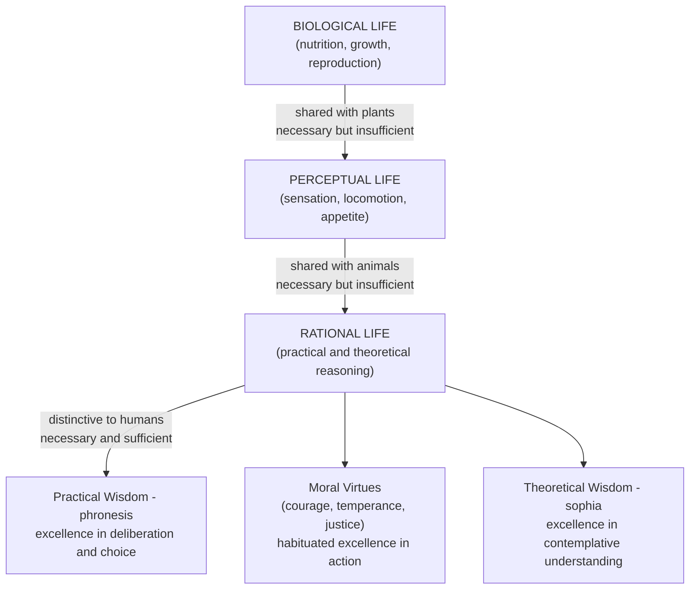
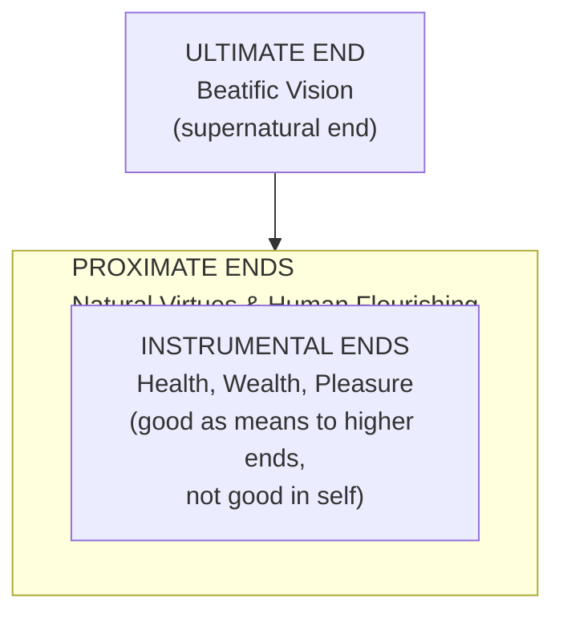

# Lesson 2: Teleological Frameworks — Purpose as Built-In End

## 1. First-Principles Intuition & Invariants

The contemporary crisis of purpose is, at root, a crisis of metaphysics. When individuals report feeling adrift, purposeless, or existentially hollow, they are articulating the downstream consequences of a profound philosophical rupture: the collapse of teleological thinking in modern Western consciousness. To understand how teleological frameworks construct purpose as an objective, discoverable feature of reality rather than a subjective invention demands that we strip away centuries of accumulated philosophical sediment and return to the foundational intuition that animated classical and medieval thought.

Teleology, derived from the Greek *telos* meaning end, goal, or purpose, is the doctrine that natural entities possess intrinsic directedness toward specific ends. Unlike mechanistic causation, which explains phenomena solely through antecedent efficient causes—billiard balls striking one another in deterministic chains—teleological explanation posits that entities behave as they do because they are oriented toward future states of completion or perfection. An acorn grows into an oak tree not merely because biochemical reactions push it forward, but because oak-tree-ness constitutes its inherent developmental trajectory, its built-in final cause.

This distinction between efficient and final causation represents one of philosophy's most consequential conceptual forks. Efficient causation answers the question "what made this happen?" while final causation answers "what is this for?" The Aristotelian revolution in metaphysics lay precisely in recognizing that complete explanatory adequacy requires both. A heart pumps because electrical signals trigger muscular contractions—that is efficient causation. But the heart pumps *in order to* circulate oxygenated blood throughout the organism—that is final causation. The teleological framework insists that the second explanation is not merely useful linguistic shorthand or anthropomorphic projection, but captures something objectively real about the heart's nature and role within the biological system.

The central invariant of all teleological frameworks is this: purpose is not constructed through subjective preference or cultural convention, but discovered through rational investigation of an entity's intrinsic functional architecture. When Aristotle asks what the *ergon* (function or characteristic activity) of a human being is, he is not soliciting opinions about what people happen to enjoy or what societies happen to value. He is conducting a metaphysical inquiry into human nature itself, seeking to identify the activity that uniquely defines and perfects human existence in the same way that cutting defines a knife and vision defines an eye.

This approach yields a radically non-relativistic account of purpose. If human beings possess a definite nature, and if that nature includes characteristic capacities and excellences, then human flourishing (*eudaimonia*) consists in the actualization of those capacities according to their proper standards of excellence. Purpose becomes not what we choose to make it, but what we are structurally fitted to become. The philosophical task shifts from invention to discovery, from preference-satisfaction to objective diagnosis.

The teleological worldview rests on three foundational commitments that distinguish it sharply from modern alternatives. First, it embraces metaphysical realism about natures and essences, holding that natural kinds possess stable, discoverable features that ground normative evaluations. Second, it recognizes hierarchical ordering in nature, where some activities and states constitute genuine perfections relative to others, not as mere subjective rankings but as objective facts about functional optimization. Third, it affirms the intelligibility of purpose-talk about natural entities independent of conscious design, allowing us to speak meaningfully about the purpose of lungs or digestive systems without attributing intentional agency to these organs themselves.

Contemporary resistance to teleological thinking stems largely from the scientific revolution's polemical rejection of Aristotelian physics, which incorrectly attributed goal-directedness to inanimate objects. When Galileo and Newton demonstrated that projectile motion could be exhaustively explained through mathematical laws of efficient causation without invoking the stone's "desire" to reach its natural place, Aristotelian final causes appeared superfluous across the board. The subsequent mechanization of the worldview, culminating in Darwinian natural selection's explanation of apparent biological design through non-teleological processes, seemed to complete teleology's demolition.

But this wholesale rejection constitutes a category error. The fact that hurricanes do not pursue goals does not entail that hearts lack functions, and the fact that natural selection operates without foresight does not eliminate the objective functional roles that evolved organs play within organisms. Even staunchly naturalistic biologists routinely employ teleological language—discussing what immune systems are "for" or how predator camouflage "serves" survival—because functional analysis remains explanatorily indispensable in biological contexts. The question is not whether teleological concepts prove useful, but whether they track mind-independent features of reality or merely reflect our pragmatic cognitive shortcuts.

The Aristotelian tradition answers unequivocally: functional roles and natural purposes constitute objective features of reality, grounded in the metaphysical structure of substances and their characteristic activities. This metaphysical commitment generates the conceptual space for objective, discoverable human purpose. If human nature exists as a stable, investigable reality, and if that nature includes distinctive rational and social capacities, then human flourishing consists in the excellent exercise of those capacities. Purpose becomes an achievement term, marking the actualization of human potentials according to standards inherent in human nature itself.

Theistic teleology, developed most systematically in medieval Christian philosophy, extends this natural teleology into an explicitly theological register. Thomas Aquinas synthesizes Aristotelian metaphysics with Christian doctrine by situating natural purposes within a comprehensive divine providential order. Every entity possesses both an intrinsic natural end and an ultimate supernatural end, both grounded in God's creative intentionality. The heart's natural purpose is circulatory function, but its ultimate purpose participates in the flourishing of a rational animal created for eternal communion with its transcendent source.

This double teleology—natural and supernatural, philosophical and theological—generates a rich conceptual architecture for human purpose. Human beings possess proximate natural ends discoverable through philosophical anthropology: the cultivation of intellectual and moral virtues, the formation of familial and civic bonds, the creation of beauty and knowledge. But these natural perfections themselves point beyond themselves toward a transcendent end: beatific union with God as the ultimate ground and completion of human rational nature. Natural teleology does not compete with divine teleology; rather, divine purpose constitutes the metaphysical explanation for why natural purposes exist at all.

The crucial invariant across both Aristotelian and Thomistic frameworks is that purpose operates as a metaphysical primitive, not derived from more fundamental non-purposive facts. Purposes are not reducible to causal histories, subjective preferences, or cultural constructions. They constitute irreducible explanatory posits necessary for rendering intelligible vast swaths of natural and human phenomena. This metaphysical robustness distinguishes teleological purpose from weaker alternatives that treat purpose-talk as merely instrumental or pragmatic.

## 2. Core Architecture & Mechanics

The Aristotelian *ergon* argument, presented in Book I of the *Nicomachean Ethics*, provides the canonical template for deriving human purpose from functional analysis. Aristotle's reasoning proceeds through a structured sequence of conceptual moves, each building on the previous to narrow the space of candidate purposes until a uniquely human function emerges.

The argument opens with an analogy from craft and professional roles. A sculptor possesses a characteristic function—sculpting—and excellence in sculpture consists in performing that function well. Similarly, a flautist has the function of flute-playing, and a good flautist is one who plays excellently. Aristotle then extends this functional analysis to biological organs: eyes have the function of seeing, hands the function of grasping and manipulating. In each case, the thing's *ergon* determines what counts as its excellence or virtue, and flourishing consists in realizing that excellence.

The critical question becomes whether human beings possess an *ergon* in the same way that sculptors, eyes, and hands do. Aristotle considers and rejects several inadequate candidates. The function cannot be mere life or biological activity, since even plants exhibit nutrition and growth. It cannot be perception, since animals possess sensory capacities without thereby achieving human excellence. What remains is "a kind of life of action belonging to the part that possesses reason," specifically the active exercise of reason in accordance with virtue.

This eliminative methodology deserves careful attention, as it reveals the argument's structural logic. Aristotle is not arbitrarily selecting reason as special to humans out of prejudice or convention. He is systematically identifying which capacities are *distinctive* to human nature—present in humans but absent in entities we recognize as falling short of full human flourishing. The argument's force depends on accepting that genuine functions must be characteristic of the entity in question, not merely shared with inferior types.

The conclusion yields a precise functional specification: the human good consists in "activity of soul in accordance with virtue, and if there are multiple virtues, in accordance with the best and most complete virtue, and moreover in a complete life." This formulation encodes several crucial features. First, purpose is realized through activity, not passive states; *eudaimonia* is achievement, not possession. Second, the activity must accord with virtue, meaning it must exhibit excellence in rational functioning rather than mere rational activity. Third, completeness requires sustained actualization over a full lifespan, not momentary episodes of virtuous action.

The conceptual architecture can be diagrammed as a nested hierarchy of functional specification:

This hierarchy establishes both necessary conditions—humans must be alive and sentient—and sufficient conditions—rational activity according to virtue constitutes complete human flourishing. The structure also reveals that human purpose is not monolithic but internally differentiated according to the plurality of rational excellences. A life dedicated solely to intellectual contemplation might realize theoretical virtue while neglecting practical and social virtues, falling short of complete *eudaimonia*.

Aristotle's metaphysical biology grounds this functional analysis in a sophisticated substance-attribute ontology. Every natural substance possesses both matter and form, where form constitutes the organizing principle that makes the substance the kind of thing it is. The soul serves as the form of a living body, the actualization of its biological potentials. Human souls include nutritive, perceptual, and rational capacities, arranged hierarchically with reason exercising governance over the lower functions.

This hylomorphic (matter-form) framework allows Aristotle to distinguish sharply between accidental and essential properties. That a particular human being is left-handed or enjoys music is accidental; that human beings possess rational capacities is essential. Purpose tracks essential rather than accidental features, which is why the *ergon* argument focuses on capacities universal to the human species rather than individual preferences or talents.

The move from descriptive functional analysis to normative prescription requires one additional step: the identification of function with proper function, or natural function with optimal function. When we say the function of the eye is to see, we mean not merely that eyes happen to produce visual experiences, but that seeing well constitutes the eye's characteristic excellence. An eye that produces blurry, distorted vision is a defective eye, falling short of its proper functional standard.

This normative dimension is not imposed externally but read off the internal functional architecture itself. Excellence consists in the full, unimpeded actualization of characteristic capacities according to their intrinsic standards of performance. The heart that pumps efficiently realizes its proper function; the heart that pumps weakly or irregularly is malfunction. Similarly, the rational agent who deliberates wisely, acts courageously, and judges justly realizes human excellence; the agent who reasons poorly, acts rashly, or judges unjustly falls short of proper human functioning.

Theistic teleology in the Thomistic tradition supplements this natural functional analysis with theological commitments about divine intentionality and providence. Aquinas accepts the Aristotelian *ergon* argument as delivering valid conclusions about natural human purpose but insists these natural ends require theological completion. The structure can be represented as concentric circles of purposive ordering:

Aquinas argues that natural reason can discover proximate human purposes through philosophical analysis, but revelation discloses that these natural perfections are themselves ordered toward a supernatural end beyond philosophical reach. Human beings are created *imago Dei*, in the image of God, which means rational nature is intrinsically oriented toward knowledge of and communion with its divine source. Natural virtues remain genuine goods but become inadequate as final purposes because rational nature's deepest orientation points beyond any created good toward the uncreated Good itself.

This theological completion does not negate natural teleology but radically recontextualizes it. The virtuous pagan philosopher who lives according to reason achieves real human goods but misses the ultimate purpose for which human nature was created. Natural and supernatural purposes form a continuous hierarchy rather than competing alternatives, with lower purposes finding their proper completion in higher ones.

The metaphysical grounding of divine command theory provides an alternative theological architecture. Rather than deriving purpose from natural functional analysis, divine command approaches locate purpose directly in God's creative will and explicit commandments. Human purpose is not to realize natural human excellences but to obey divine commands, fulfilling the role assigned by the Creator. This approach emphasizes radical divine voluntarism: things are good because God commands them, not vice versa.

However, sophisticated divine command theorists recognize the need to avoid rendering divine commands arbitrary. If God could command cruelty and thereby make cruelty good, divine commands seem to lose normative authority. The solution typically invokes God's necessary moral nature: God commands in accordance with divine goodness, which is both necessary and constitutive of moral truth. Human purpose is still discovered through revelation of divine will, but that will expresses a stable, rational divine nature rather than arbitrary fiat.

## 3. High-Performance Optimization & Failure Modes

Practitioners seeking to operationalize teleological frameworks for discovering life purpose face several characteristic failure modes that undermine effective execution. The first and most pervasive is what we might term *functional reductionism*: collapsing the multi-dimensional architecture of human purpose into a single dominant function, thereby impoverishing the account and generating practical pathologies.

The most common instance treats theoretical contemplation as exhausting human purpose, elevating intellectual achievement above practical wisdom and moral virtue. This monistic reading, sometimes attributed to Aristotle based on the *Nicomachean Ethics* Book X's elevation of contemplation, generates the life pattern of the scholar who neglects familial responsibilities, civic participation, and embodied human relationships in pursuit of abstract knowledge. While theoretical excellence constitutes a genuine human perfection, its realization in isolation from other excellences produces a lopsided human life failing to actualize the complete range of rational capacities.

The corrective requires maintaining Aristotle's full functional pluralism. Human purpose encompasses intellectual virtues (both practical and theoretical), moral virtues (courage, temperance, justice, and their network of related excellences), and social virtues (friendship, civic participation, familial bonds). These are not competing alternatives requiring forced choice but integrated dimensions of complete human flourishing. Optimization demands cultivating excellence across the full spectrum of rational capacities, accepting necessary tradeoffs where perfect optimization proves impossible but avoiding wholesale neglect of entire functional domains.

A second failure mode emerges from confusion about the relationship between universal human nature and individual particularity. The teleological framework grounds purpose in species-level essences: the human *ergon* applies to all humans in virtue of shared rational nature. But individuals differ significantly in natural talents, acquired skills, social circumstances, and biographical trajectories. How does the universal specification of human purpose accommodate this irreducible particularity?

The Aristotelian answer distinguishes between primary and secondary purposes, or ultimate and proximate ends. All humans share the ultimate end of *eudaimonia* through excellent rational activity, but the specific forms that excellence takes vary legitimately across individuals and contexts. One person may realize intellectual virtue primarily through scientific research, another through legal reasoning, another through artistic creation. One may actualize social virtue through political leadership, another through familial devotion, another through friendship networks. The universal human function specifies the formal structure of flourishing—excellent exercise of rational capacities—while leaving open the material content that fills that structure.

This generates a two-stage optimization process. First, diagnose one's particular constellation of natural capacities, social roles, and biographical circumstances. What rational talents are strongest? What social positions and relationships structure one's life? What historical moment and cultural context frames available possibilities? Second, construct a life plan that maximizes the actualization of rational excellences within those particular constraints. The universal purpose of rational excellence determines the optimization target; individual particularity determines the feasible set and optimal strategy for reaching that target.

Failure occurs when practitioners either reject individual particularity, attempting to force themselves into life patterns unsuited to their actual capacities and circumstances, or reject universal human purpose, treating individual preferences as self-justifying without reference to standards of rational excellence. The teleological framework demands both: fidelity to objective standards of human flourishing and intelligent adaptation to particular circumstances.

A third critical failure mode involves temporal myopia: treating purpose as a state to be achieved rather than an activity sustained over a complete life. Aristotle insists that *eudaimonia* requires "a complete life," not momentary episodes of virtuous action. This temporal dimension introduces vulnerability that philosophers have sometimes found troubling. Can a flourishing life be rendered non-flourishing by catastrophic events near its end? Does sustained flourishing earlier in life fail to count if one falls into vice or misery later?

The underlying issue concerns whether purpose is fundamentally a property of biographical arcs or of time-slices within those arcs. If the former, then evaluation must wait until the full life has unfolded, introducing radical uncertainty about whether one has achieved purpose until the very end. If the latter, then purpose becomes too episodic, failing to capture the developmental and narrative structure of human lives.

Aristotle's solution, though sometimes regarded as evasive, actually encodes important practical wisdom: while stable character and favorable external conditions enable sustained flourishing across a lifetime, genuine *eudaimonia* requires both excellent activity and reasonable permanence. One day of virtuous action does not make a flourishing life, but neither does a flourishing life become retroactively unfulfilled if misfortune strikes near the end. The optimization target is sustained excellent activity over as long a temporal span as possible, with recognition that external goods and stable character formation reduce vulnerability to disruption.

Practically, this means purpose-optimization must include the cultivation of robust virtues resistant to environmental perturbation and the securing of external goods—health, material resources, social relationships—that support sustained excellent activity. The agent cannot guarantee immunity to catastrophic misfortune, but can construct conditions maximally favorable to lifelong flourishing while preparing character resources to maintain virtue even under adverse circumstances.

Theistic teleological frameworks introduce distinct failure modes related to the relationship between natural and supernatural purposes. One failure mode treats supernatural purpose as negating natural purposes, as if God's salvific plan makes earthly human excellence irrelevant. This generates the otherworldly ascetic who neglects bodily health, intellectual development, and social relationships as mere distractions from spiritual salvation. But sophisticated Thomistic theology rejects this opposition: grace perfects nature rather than destroying it. Supernatural purpose includes and elevates natural purposes, not replaces them.

The corrective requires recognizing that natural virtues remain genuine goods even when insufficient as ultimate purposes. Health, friendship, knowledge, beauty, and justice are real perfections that contribute to human flourishing. Ordering them properly toward the ultimate supernatural end of divine communion does not negate their value but situates them within a larger purposive hierarchy. The theistically oriented life pursues natural excellences precisely as means of participating in divine creative purpose, not as competing alternatives to spiritual salvation.

A second theological failure mode concerns the accessibility of purpose-knowledge through natural reason versus revelation. Divine command approaches sometimes suggest that purpose remains entirely opaque apart from explicit divine communication, rendering philosophical analysis impotent. But this seems to generate deep problems: it makes human purpose radically contingent on exposure to particular revelatory traditions, and it severs the connection between purpose and human nature that makes purpose-discovery through rational reflection possible.

The Thomistic solution maintains that natural reason can discover real though incomplete truths about human purpose through philosophical anthropology, while revelation discloses the ultimate supernatural end toward which natural purposes point. This preserves the objectivity and discoverability of purpose while acknowledging limits to philosophical reflection. Optimization requires both: serious engagement with philosophical analysis of human nature and capacities, and theological reflection on humanity's relationship to its transcendent source and destiny.

The practitioner seeking to operationalize teleological purpose-discovery must therefore execute a complex, multi-stage diagnostic protocol. First, conduct honest anthropological analysis of human nature: what capacities distinguish humans from other entities? What activities count as excellent exercises of those capacities? This requires both philosophical reflection and empirical investigation of human psychology, social organization, and historical cultural achievements. Second, identify one's particular instantiation of universal human nature: which rational capacities are most developed? What social roles and relationships structure one's life? What opportunities and constraints define one's circumstances? Third, construct an integrated life plan that maximizes the actualization of rational excellences across intellectual, moral, and social domains within one's particular constraints. Fourth, cultivate robust character dispositions and secure external goods that enable sustained excellent activity over a complete lifespan. Fifth, for theistically committed practitioners, situate natural purposes within a comprehensive theological framework that orders them toward ultimate supernatural ends.

This protocol delivers objective, discoverable purpose grounded in metaphysical facts about human nature and rational capacities. Purpose is neither invented through subjective preference nor imposed through cultural convention, but diagnosed through systematic investigation of what humans are and what activities constitute their characteristic excellence. The teleological framework thus offers a robust alternative to constructivist and expressivist accounts, one that restores metaphysical realism and normative objectivity to the question of life purpose.
