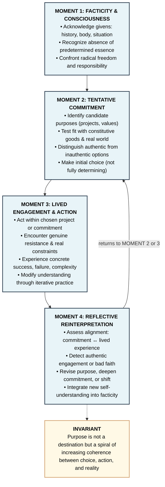

# Lesson 3: Subjective Accounts — Purpose as Constructed or Projected

## 1. First-Principles Intuition & Invariants

The question of whether life purpose exists *prior to* human consciousness—waiting to be discovered like an objective fact about the world—or whether purpose is *constituted through* human choice and interpretation marks the epistemological fault line of existentialist philosophy. This distinction is not merely academic; it fundamentally restructures how practitioners approach the question of meaning-making in their own lives.

To establish our first-principles ground, consider the stark phenomenological observation that distinguishes human consciousness from other entities in the world. A stone does not ask what its purpose is. A river flows without deliberating whether its trajectory aligns with some deeper calling. Even an organism pursuing survival and reproduction operates according to instinctual programming that precedes conscious reflection. But a human being—at the moment of self-aware consciousness—encounters a peculiar vertigo: the simultaneous recognition that (1) the world appears to lack any intrinsic instruction manual for human conduct, and (2) action is nonetheless inescapable. We must choose, even if choosing to remain silent or motionless is itself a choice.

Jean-Paul Sartre crystallized this predicament in his maxim: *existence precedes essence*. Unlike a paper-knife, which is designed with a predetermined essence (the property of cutting paper) before it exists, human beings first exist and then must create their essence through the choices they make. This inversion upends the medieval and Aristotelian frameworks that had dominated Western thought for centuries. In those traditions, human nature carried with it a teleological blueprint—eudaimonia (flourishing) was the natural end toward which rational beings oriented themselves. But in the existentialist account, no such blueprint exists at the outset. We are "condemned to be free," in Sartre's formulation, because we cannot escape the burden of creating ourselves through decision.

This freedom, however, is not the libertine freedom of whimsy or arbitrary selection. Simone de Beauvoir refined this picture by arguing that authentic freedom requires both the recognition of one's own radical freedom *and* the recognition of the equal freedom of others. To construct a meaningful life while denying others the capacity to construct theirs is to fall into what she called *bad faith*—a self-deceptive posture in which one pretends that constraints are absolute rather than chosen, or that one's own subjectivity is somehow privileged over others'. The invariant here is reciprocal recognition: authentic purpose-construction must acknowledge that all conscious agents face the same fundamental condition.

Albert Camus approached the same problem from a different angle, one particularly relevant to practitioners grappling with the apparent absurdity of existence. Camus observed that human beings possess a deep psychological hunger for meaning, pattern, and rational coherence. Yet the universe, indifferent to our desires, offers no guarantee that such meaning exists objectively. This collision between the human demand for meaning and the world's refusal to supply it constitutes the *absurd*. Camus rejected both the escape routes that others had proposed: neither religious faith (which he saw as a philosophical suicide, an abandonment of honest confrontation with the absurd) nor nihilistic resignation (which he saw as a physical suicide, a surrender to meaninglessness). Instead, Camus advocated for a defiant lucidity: acknowledge the absurdity fully, refuse false consolations, and choose to create and act anyway. In his famous closing line to *The Myth of Sisyphus*, he wrote: "One must imagine Sisyphus happy."

The core invariant across all these existentialist frameworks is this: *meaning is agent-relative and constructed through commitment, not discovered as a pre-existing fact*. This does not entail radical relativism—the false claim that all purposes are equally valid or that the subjective nature of purpose removes all rational constraints on its formation. Rather, it means that the grounds for evaluating a purpose must be located in the structure of the agent's own commitments, values, and the coherence of their chosen projects, not in some external cosmic order.

Consider the phenomenological texture of this recognition. When you experience a moment of profound alignment—say, the moment you realize that your work genuinely matters, or that a relationship embodies something you deeply care about—that alignment is not revealed to you as though a hidden label suddenly becomes visible on an object. Rather, it emerges through the progressive commitment you have made to that work or relationship. The meaning accrues through engagement. This is why purpose-searching that treats meaning as a hidden commodity to be excavated (via personality tests, career aptitude inventories, or life-coaching questionnaires) so often leaves practitioners feeling empty even after they receive an answer. The answer was not waiting to be found; it requires being built.

Yet this construction is not pure creation ex nihilo—conjuring meaning from the void like a magician. The existentialist construction of purpose operates within constraints. You do not construct your purpose in a vacuum; you construct it within a specific historical moment, a particular cultural context, with a body that has certain capacities and vulnerabilities, in relation to others whose freedom you must acknowledge. Sartre called these constraints "facticity"—the brute facts about your situation that you did not choose. Your age, your education, your economic circumstances, your nation of birth, the historical epoch in which you live—all these are facticities. But facticities are not deterministic. They are the raw material within which you exercise freedom, not the final word on what you can become.

This brings us to a crucial refinement introduced by philosophers who have extended and critiqued existentialism: the concepts of *engagement* and *authenticity*. Charles Taylor, in his work on the sources of the self, argued that while meaning may be constructed, not all constructions are equally authentic or sustainable. An authentic construction of purpose requires genuine engagement with what Taylor calls "constitutive goods"—things that matter not because we have decided arbitrarily that they matter, but because they represent real dimensions of human flourishing. For Taylor, authenticity is not the same as mere subjective sincerity. One can be sincerely committed to a false or hollow purpose. Authenticity requires alignment between (1) the purposes you have consciously adopted, (2) the deeper values that structure your engagement with the world, and (3) the actual conditions of human life and relationship.

Susan Wolf's distinction between *fitting* and *fulfilling* accounts of meaning provides another crucial mechanical distinction. A fulfilling account suggests that purpose is simply whatever provides subjective satisfaction—whatever feels meaningful to the agent who pursues it. Under this view, if you find deep satisfaction in collecting bottle caps, then collecting bottle caps *is* your purpose. The fitting account, by contrast, insists that some purposes *fit* the structure of a meaningful human life better than others, regardless of whether they provide subjective satisfaction. A purpose fits if it involves genuine engagement with something of real value—genuine intellectual challenge, authentic relationship, contribution to something beyond oneself, or confrontation with real constraints and real stakes. The fitting account does not deny that subjective experience matters; rather, it insists that subjective experience is a reliable guide to meaning only when it arises through genuine engagement with something that has objective structure and resistance.

The invariant that emerges from integrating these perspectives is this: *purpose is neither purely discovered nor purely invented; it is constructed through sustained engagement with constrained possibilities, and its authenticity is measured by the depth of genuine commitment and the fit between that commitment and real dimensions of human and worldly complexity*.

## 2. Core Architecture & Mechanics

To translate these philosophical frameworks into executable cognitive architecture, we must model the structure of purpose-construction itself. The existentialist account does not provide a linear algorithm for deriving purpose; instead, it offers a recursive, reflexive loop in which commitment, action, and reinterpretation continuously revise one another.

This loop differs fundamentally from instrumental planning models (where you set a goal, devise strategies, execute, and measure outcomes). In purpose-construction, the goal itself is not fixed at the outset; it evolves through the lived experience of pursuing it. A mathematician may begin with a tentative commitment to mathematical research, discovering only through years of engagement that the true purpose lies not in solving particular problems but in cultivating a form of intellectual humility before nature's complexity. A parent may discover that the purpose of parenting is not child-rearing according to some preset template but the daily practice of recognizing another being's irreducible otherness. The purpose emerges through the doing.

The second critical distinction within this architecture is the contrast between *bad faith* and *authentic commitment*. Sartre defined bad faith as a form of self-deception in which one either (1) pretends to be determined by forces outside one's control (treating oneself as a thing), or (2) pretends that one's freedom is absolute and unlimited (ignoring facticity). Bad faith serves a psychological function: it relieves the anxiety of responsibility. If you convince yourself that your job defines you absolutely—that you are "a lawyer" rather than someone who has chosen to practice law—then you can deflect the burden of ownership for your choices. If you convince yourself that you are a victim of circumstance—that poverty or family dysfunction makes your life trajectory inevitable—you can avoid the painful recognition that you remain, nonetheless, responsible for what you make of your situation.

Bad faith is particularly insidious in purpose-construction because it wears the mask of clarity. When someone says, "I have no choice; this is just who I am," or "Society/my parents/my genes made me this way," they are not expressing helplessness; they are performing a sophisticated evasion. The genuine acknowledgment of facticity looks different: "I was born into poverty, and that shapes my possibilities in real ways. Given those constraints, what can I authentically commit to? What purposes can I construct that acknowledge both my limitations and my freedom?" Authentic purpose-construction requires this double movement: neither denying facticity nor allowing facticity to collapse into determinism.

To operationalize this distinction, consider the diagnostic frame that can separate bad faith from authentic commitment:

**Authentic Commitment Diagnostic Frame**

When evaluating whether a claimed purpose represents authentic commitment or bad faith, systematically examine these four dimensions:

First, examine *ownership and justification*. In bad faith, when pressed to explain why a purpose matters, the agent deflects to external authority: "It's what my parents expected," "It's what society demands," "It's what makes money," "It's what my role requires." In authentic commitment, while external influences may be acknowledged as part of the context, the agent takes ownership: "I have chosen this because it engages my genuine capacities," "This matters to me because it expresses something I value," "I recognize this choice may disappoint others, but I am taking responsibility for it anyway." The key signal is whether the agent speaks as author of their commitment or as a conduit for external forces.

Second, examine *resistance and revision*. When you encounter evidence that contradicts a purpose pursued in bad faith, you typically respond by doubling down, rationalizing away the contradiction, or suddenly abandoning the purpose entirely when it becomes untenable. Authentic commitment exhibits a different pattern: it integrates contradictions and complications into a deepening understanding. You experience obstacles not as reasons to abandon the purpose but as invitations to understand it more deeply. A researcher committed to scientific truth will revise their hypothesis when evidence contradicts it, not because the hypothesis was inauthentic but because authenticity to scientific purpose requires responsiveness to reality. A person authentically committed to a relationship will work through conflict, not by pretending the conflict doesn't matter, but by integrating the experience of difference into a more complex understanding of intimacy.

Third, examine *vulnerability and stakes*. Bad faith purposes are often characterized by a peculiar invulnerability: they can be defended without risk because they are not truly owned. Authentic commitment is always vulnerable; it exposes the agent to the possibility of failure, loss, or irrelevance. If you are authentically committed to a creative project, you risk producing something that fails or is ignored. If you are authentically committed to a political cause, you risk compromising yourself or discovering that your ideals are naïve. If you are authentically committed to a person, you risk abandonment or betrayal. The presence of genuine stakes—real possibility of loss—is often a sign of authentic commitment.

Fourth, examine *integration across contexts*. In bad faith, purposes are often compartmentalized: you present different selves in different contexts without acknowledging the contradiction. You are ruthless in business but claim to value compassion in family; you preach environmental responsibility while arranging your life for maximum convenience. Authentic commitment, by contrast, seeks integration. This does not mean you behave identically in all contexts—context-appropriate adjustment is compatible with authenticity—but rather that you can articulate a coherent narrative in which your various commitments fit together coherently, and you acknowledge rather than deny the tensions between them.

Applying this diagnostic frame requires honest introspection and willingness to sit with discomfort. It is far easier to retreat into bad faith than to maintain the vigilance that authentic commitment demands. Sartre described this as the weight of responsibility; de Beauvoir grounded it in the ethical recognition that claiming freedom for oneself while denying it to others is ultimately self-undermining.

The third layer of this architecture concerns the relationship between *subjective meaning and objective structure*. The existentialist insistence that meaning is constructed or projected does not mean that meaning is arbitrary or purely psychological. Rather, meaning emerges at the intersection of subjective commitment and objective structure. To understand this intersection, return to Wolf's distinction between fitting and fulfilling accounts.

A fulfilling account of meaning treats purpose as purely subjective: if it feels meaningful to you, it is meaningful. Under this view, there are no external constraints on what can count as a meaningful purpose. The problem with pure fulfillment accounts is that they seem to permit trivial or hollow purposes to count as genuinely meaningful. If someone finds satisfaction in collecting bottle caps, and that is all they do with their life, should we regard that as a genuine purpose? The fulfillment theorist must say yes; the agent's subjective experience is definitive. But this verdict sits uncomfortably with our intuitions about what makes a life genuinely meaningful.

A fitting account introduces an objective dimension: purposes fit if they engage with something of real value and real complexity. What makes something genuinely valuable? The fitting account points to several candidates: intellectual challenge (understanding requires real resistance from the world; genuine knowledge cannot be merely invented); relationship (another person is not a creation of your consciousness; they have their own otherness that must be recognized and engaged); creative expression (art and craft encounter real materials with their own properties; not all visions can be realized in a given medium); contribution beyond oneself (morality, care, legacy all involve genuine obligations to something beyond subjective preference). These forms of value are *objective* in the sense that they have structure independent of individual preference, yet they are also accessible only through subjective engagement. You cannot know whether intellectual work genuinely matters to you without actually doing intellectual work and encountering its real difficulties and possibilities.

The deepest integration of subjective and objective occurs when an agent's authentic commitment aligns with engagement in something that has genuine objective structure. Consider a musician. The musician's purpose might be stated subjectively as "the pursuit of artistic excellence" or "the expression of something I deeply feel." But this subjective purpose gains reality and substance only through engagement with the objective structure of music itself—the physics of sound, the grammar of harmonic progression, the accumulated tradition of musical forms, the resistance of an instrument that does not automatically obey intention. The musician does not invent the rules of music; they inherit them and must learn to work within them. Yet neither are they merely passive recipients. Authentic musical purpose emerges through the lived intersection of subjective vision and objective musical reality.

This integration reveals why purpose-searching that treats meaning as a hidden commodity to be discovered through introspection alone so often fails. If you spend months journaling about "your authentic self," seeking to excavate some pre-existing essence, you are operating under the wrong model. The authentic self is not a fixed entity waiting to be revealed; it is constituted through engagement with real projects, real relationships, and real constraints. The most effective path to discovering your purpose is not deeper introspection but *strategic engagement with domains of real complexity*. Try teaching; try making things; try caring for others; try solving hard problems. Pay attention to where genuine engagement emerges—where you find yourself animated not by external reward or obligation but by the intrinsic interest of the work itself. Purpose germinates in engagement.

## 3. High-Performance Optimization & Failure Modes

The existentialist framework for purpose-construction, while philosophically robust, encounters predictable failure modes in practice.

### Conclusion: Beyond the Optimization Trap

The primary failure mode is what we might call *existential hyperoptimization*—the treatment of purpose-construction as an engineering problem requiring maximum efficiency and measurable ROI. This manifests when individuals approach purpose with the same algorithmic mindset they apply to productivity systems: seeking frameworks, shortcuts, and metrics to "solve" the purpose problem quickly. But purpose-construction resists optimization because it emerges from sustained engagement with inherently unpredictable domains. You cannot A/B test your way to meaning. The executive who cycles through meditation retreats, personality assessments, and coaching programs every quarter, constantly seeking better "purpose infrastructure," has mistaken the map for the territory. Real purpose coalesces slowly through repetitive engagement with specific problems and people—through the accumulated micro-decisions that constitute a life actually lived. The second failure mode is *projection collapse*—when the subjective purpose narrative loses contact with external reality entirely. This occurs when purpose becomes purely performative: the social media influencer whose stated purpose is "inspiring others" but whose actual behavior consists of optimizing engagement metrics; the entrepreneur whose mission statement emphasizes "changing lives" while the product remains vaporware. Without the corrective friction of objective constraints—real users, real craft demands, real relationships—purpose devolves into fantasy. The antidote to both failure modes is the same: commitment to specific, resistance-laden domains where your subjective vision must negotiate with objective reality, where consequences are real, and where excellence has standards independent of your preferences.

The existentialist insight, properly understood, is not that meaning is arbitrary or purely subjective, but that it emerges through the dialectical process of projecting purpose onto a world that resists, refines, and sometimes affirms those projections. Your purpose is neither discovered like a geological feature nor invented like a legal fiction—it is *constructed through sustained engagement*, the way a path is constructed by walking it repeatedly until the ground itself bears the mark of your passage. This explains why purpose often becomes clear only in retrospect, why it cannot be definitively settled by introspection alone, and why the most reliable method for finding it is not to search for it directly but to commit to projects of sufficient complexity and duration that purpose emerges as a byproduct of genuine engagement. The question shifts from "What is my purpose?" to "What engagement elicits my most authentic commitment?"—a question answerable only through experimental action, not contemplative analysis.

## Summary & Verification Matrix

| **Dimension** | **Governing Invariant** | **Core Mechanism** | **Diagnostic Criteria** | **Failure Mode** |
|---------------|-------------------------|-------------------|------------------------|------------------|
| **Ontological Status** | Purpose is neither discovered (realist) nor invented (pure subjectivist), but *constructed through engagement* | Dialectical negotiation between subjective projection and objective resistance from reality | Authentic purpose shows responsiveness to external constraints, develops over time through friction with real problems, cannot be generated by introspection alone | Treating purpose as pre-existing essence (leads to endless searching) or pure invention (leads to untethered fantasy) |
| **Emergence Conditions** | Purpose germinates in domains of *sufficient complexity and resistance* that require sustained engagement | Repeated interaction with specific problems/domains where subjective intention meets objective structure (craft constraints, relationship demands, disciplinary standards) | Experience of intrinsic motivation independent of external reward; temporal persistence through difficulty; measurable skill development in the domain | Optimization thinking (treating purpose as engineering problem with shortcuts); domain-hopping before sufficient engagement depth |
| **Verification Method** | Retrospective coherence + sustained commitment under adversity | Track patterns of voluntary return, willingness to endure domain-specific suffering, accumulation of domain capital over years | Can articulate specific problems within domain that compel attention; demonstrates progressive mastery; purpose withstands external skepticism | Projection collapse (purpose narrative disconnected from behavior); performative purpose (stated mission contradicts actual resource allocation) |
| **Realism Constraint** | Subjective purpose claims require validation through *objective achievement or relationship formation* | Purpose must pass through the filter of external reality—instruments that resist, audiences that judge, problems that have independent criteria for solution | Tangible outcomes in the world; recognition from competent practitioners; ability to teach or transmit the practice to others | Purpose remains perpetually "in process" with no accumulated evidence; chronic revision without external feedback integration |
