# Lesson 2: Proof Theory — Natural Deduction Calculi

## 1. First-Principles Intuition & Invariants

The central problem that proof theory addresses can be stated with deceptive simplicity: what does it mean for a logical claim to follow necessarily from a set of premises? In propositional and first-order logic, we distinguish between two fundamentally different answers to this question. *Semantic entailment*—written as Γ ⊨ φ—means that in every possible interpretation (or "possible world") where all formulas in Γ are true, the formula φ is also true. This is a statement about the *meaning* of logical formulas, about the universe of interpretations itself. By contrast, *syntactic derivability*—written as Γ ⊢ φ—means that there exists a formal proof, a finite sequence of symbolic manipulations following explicit rules, that transforms the premises in Γ into the conclusion φ. Syntactic derivability is a statement about *what we can construct*, about the mechanical operations we can perform on symbols without ever needing to know what those symbols mean.

The relationship between these two notions is not obvious. One of the deepest discoveries in mathematical logic is that for classical propositional and first-order logic, they coincide perfectly. This is the *completeness theorem*: Γ ⊨ φ if and only if Γ ⊢ φ. A proof that can be mechanically constructed using only symbol-manipulation rules will never prove something false, and conversely, anything that logically follows from the premises can be proven mechanically. This equivalence—between meaning and mechanical process—is not universal. In other logical systems (intuitionistic logic, modal logics, or many-valued logics), the correspondence breaks down. But for classical logic, the completeness theorem tells us something profound: logical meaning can be fully captured by formal rules.

Natural deduction is one of the most widely used calculi for proving formulas syntactically. Unlike axiomatic systems, which typically contain few inference rules but many axioms, natural deduction embeds the logical structure directly into its rules. For each logical connective (conjunction, disjunction, implication, negation, and in first-order logic, the quantifiers), natural deduction provides exactly two types of rules: *introduction rules*, which tell you how to construct a formula using that connective, and *elimination rules*, which tell you how to use a formula containing that connective to derive new conclusions.

The intuition behind this design is deeply practical. When you reason naturally, you don't cite abstract axioms; instead, you construct proofs by asking: "What do I need to show?" (this guides you toward introduction rules) or "What can I extract from what I already have?" (this guides you toward elimination rules). If you need to prove a conjunction, you must prove both conjuncts. If you have a conjunction, you can extract either conjunct. This structure mirrors the way mathematicians and logicians actually think. Natural deduction is therefore not merely a formal game but a *calculus that formalizes human reasoning practices*.

The fundamental invariant underlying natural deduction is the principle of *proof normalization*. Every proof in natural deduction can be transformed into a *normal form*—a canonical proof in which no formula is both introduced and then immediately eliminated. This property, proven by Gerhard Gentzen and further developed by mathematicians and computer scientists, ensures that proofs are as direct and transparent as possible. Detours and indirect reasoning can be eliminated, leaving only the essential logical content. This normalization property is not merely a theoretical curiosity; it grounds computational interpretations of logic, connecting formal proofs to computable functions via the *Curry-Howard correspondence*.

The second foundational principle is *soundness*. A proof system is sound if every formula it can prove is actually true (in the semantic sense) in all models of its premises. Natural deduction, when formulated over classical logic, is sound. This means that the rules are designed in such a way that they preserve truth. You cannot use the rules to derive a contradiction from consistent premises, and you cannot derive something false from something true. Soundness is the guarantee that your mechanical symbol-shuffling will not deceive you.

## 2. Core Architecture & Mechanics

Natural deduction proofs are tree structures where each node represents a formula and the edges represent applications of inference rules. The root of the tree is the conclusion we wish to prove, and the leaves are either premises (assumptions) or axioms. Understanding how to construct and navigate these proof trees is the fundamental skill of natural deduction.

Consider the simplest rules first: conjunction introduction and elimination. The *conjunction introduction rule*, denoted ∧I, states that if you have proven φ and you have proven ψ, then you may conclude φ ∧ ψ. In natural deduction notation, this is written:

```
φ    ψ
-------  (∧I)
φ ∧ ψ
```

The horizontal line represents the inference; above it are the premises required by the rule, below it is what the rule licenses us to conclude. The *conjunction elimination rules* (there are two, ∧E₁ and ∧E₂) state that if you have φ ∧ ψ, you may conclude either φ or ψ:

```
φ ∧ ψ          φ ∧ ψ
-------  (∧E₁) -------  (∧E₂)
φ              ψ
```

These rules formalize the intuition that a conjunction contains both of its conjuncts, and conversely, combining two proven statements yields their conjunction. Now observe what the introduction and elimination rules accomplish: they are *inverses* of each other. If we introduce a conjunction and then immediately eliminate it, we have done useless work. This redundancy is precisely what normalization eliminates.

Disjunction rules introduce a new dimension of complexity. The *disjunction introduction rules* state that if you have proven φ, you may conclude φ ∨ ψ (for any ψ), and similarly if you have proven ψ, you may conclude φ ∨ ψ:

```
φ              ψ
-------  (∨I₁) -------  (∨I₂)
φ ∨ ψ          φ ∨ ψ
```

The *disjunction elimination rule* is more complex because it must handle the uncertainty introduced by disjunction. If you have proven φ ∨ ψ, and you want to derive some conclusion χ, you must show that χ follows from φ alone *and* that χ follows from ψ alone. Only then can you be certain that χ follows from the disjunction:

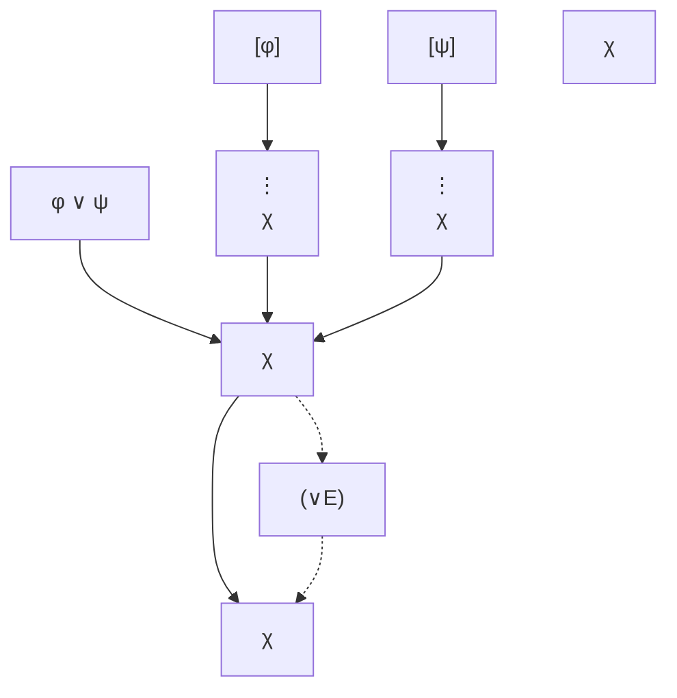

In this notation, the brackets around φ and ψ indicate that these are *assumptions* introduced locally within subproofs, not global premises. The rule says: given φ ∨ ψ, assume φ and derive χ; then assume ψ and derive χ; then you may discharge both assumptions and conclude χ. This rule captures the logical principle that if a conclusion follows from both disjuncts of a disjunction, it must follow from the disjunction itself.

Implication introduces the most powerful mechanism in natural deduction: the *conditional proof*. The *implication introduction rule* states that to prove φ → ψ, you may assume φ and attempt to derive ψ. If successful, you may discharge the assumption and conclude φ → ψ. This formalizes the fundamental principle that a conditional is proven by showing that the consequent follows from the antecedent:

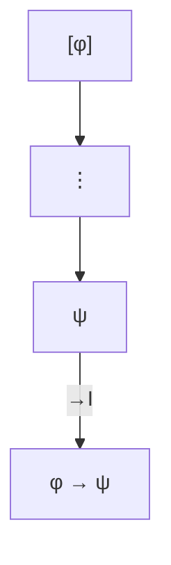

The *implication elimination rule*, also called *modus ponens*, states that if you have proven φ → ψ and you have proven φ, then you may conclude ψ:

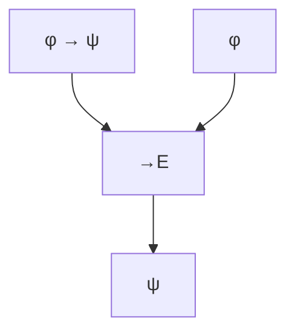

These two rules are inverses in a deep sense. The introduction rule packages an assumption and a derivation into a conditional; the elimination rule unpacks a conditional by combining it with an instance of its antecedent. The power of →I lies in its ability to introduce local assumptions, creating subproofs. This is where natural deduction captures the structure of human mathematical reasoning most directly: we frequently assume something "for the sake of argument" and then see what follows.

Negation in classical natural deduction is typically handled through the principle of *reductio ad absurdum* (proof by contradiction). The negation introduction rule states that to prove ¬φ, you may assume φ and derive a contradiction (denoted by the symbol ⊥ or falsum). If you can derive ⊥ from φ, then φ must be false, so ¬φ must be true:

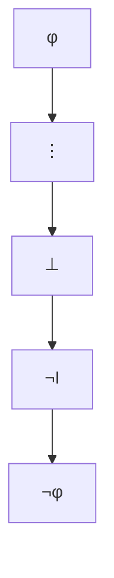

The *negation elimination rule* is simply that from φ and ¬φ, we may derive the contradiction ⊥:

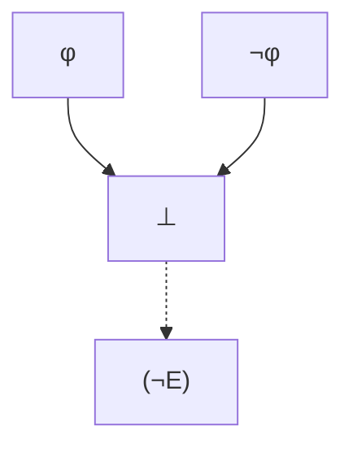

Additionally, classical logic includes the principle of *ex falso quodlibet* (from a contradiction, anything follows), which states that from ⊥, any formula φ may be derived:

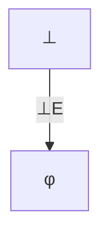

This rule is controversial in intuitionistic logic, where it is rejected as unjustified. In classical logic, it captures the idea that contradictions are so severe they invalidate the entire logical system, allowing us to derive anything we wish from them.

To illustrate how these rules compose into complete proofs, consider proving the law of excluded middle in a classical system augmented with the rule that allows us to derive ¬¬φ → φ (the principle of double negation elimination). Suppose we wish to prove φ ∨ ¬φ. We use a conditional proof to show ¬(φ ∨ ¬φ) → ⊥, then appeal to double negation elimination:

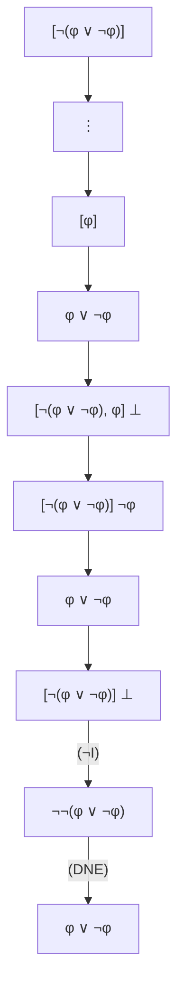

This proof demonstrates the mechanical structure: assumptions are opened and closed, subproofs are nested, and each rule transforms its inputs into outputs according to strict syntactic patterns.

For first-order logic, natural deduction extends with rules for the universal and existential quantifiers. The *universal introduction rule* states that if you have derived φ(x) where x is a variable that does not appear free in any unclosed assumption, then you may conclude ∀x φ(x). The intuition is that if you prove something about an arbitrary individual x (an individual you assumed nothing about except that it exists in the domain), then you have proven it about all individuals:

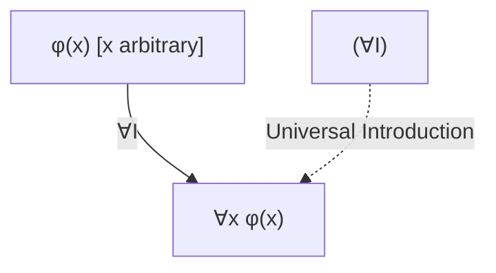

The *universal elimination rule* states that if you have proven ∀x φ(x), then you may instantiate this universally quantified formula with any term t in the domain, concluding φ(t):

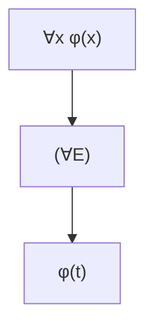

The *existential introduction rule* states that if you have proven φ(t) for some specific term t, then you may conclude ∃x φ(x):

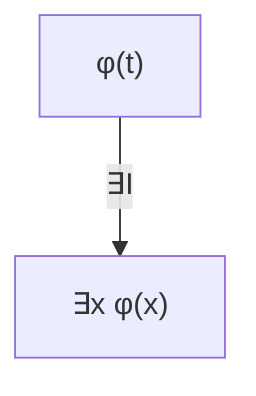

The *existential elimination rule* is more delicate. If you have proven ∃x φ(x), and you wish to derive a conclusion χ, you may assume φ(x) for some arbitrary x (where x does not appear in χ or any unclosed assumption) and derive χ. If you can derive χ under this assumption, then χ must follow from the existential:

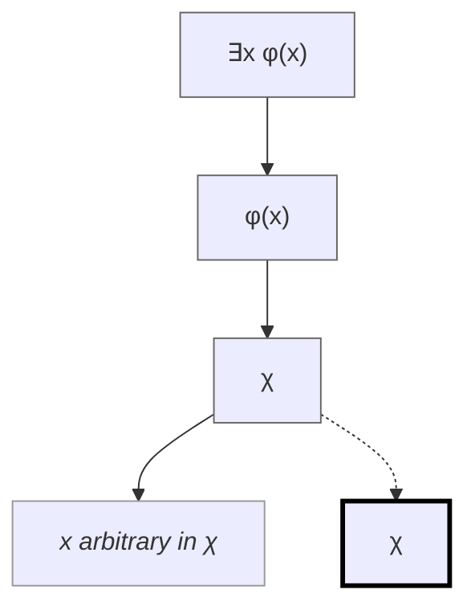

These quantifier rules preserve the separation between bound variables (those quantified over) and free variables (those appearing in assumptions or final conclusions), ensuring that the logic remains sound.

The architecture of natural deduction can be visualized through a proof tree diagram. Consider the formula (p → q) ∧ (q → r) ⊢ p → r (if p implies q and q implies r, then p implies r, assuming the conjunction of these two conditionals). The proof tree might look as follows:

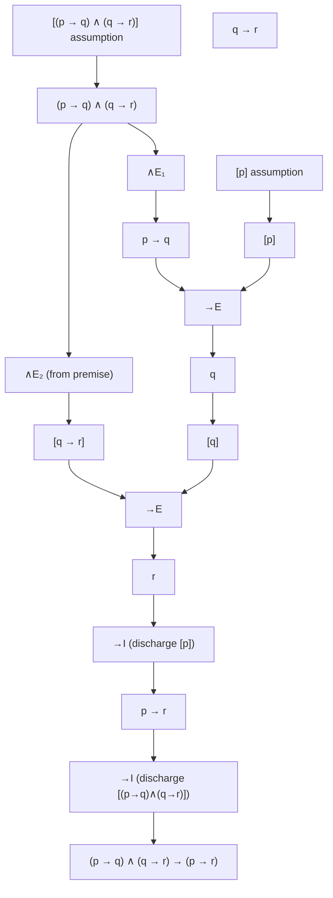

Each branch of this tree represents the application of a rule, with subproofs nested beneath it. The leaves are assumptions (shown in brackets) and the root is the final conclusion.

## 3. High-Performance Optimization & Failure Modes

The transition from understanding individual rules to constructing efficient proofs requires developing intuitive strategies for proof search. The practitioner must learn to recognize patterns that guide rule selection and avoid dead-end explorations of the proof space.

**Forward and Backward Chaining**: The most fundamental strategic distinction is between forward chaining (bottom-up reasoning) and backward chaining (top-down reasoning). Backward chaining begins with the goal formula and asks "what rule could produce this formula?" Working backward through the rules, you decompose the goal into subgoals until you reach assumptions or premises. This strategy is particularly powerful in natural deduction because introduction rules often suggest backward steps: to prove φ ∧ ψ, you must prove both φ and ψ; to prove φ → ψ, assume φ and prove ψ. Forward chaining, by contrast, begins with your premises and elimination rules, asking "what can I derive from what I already have?" The optimal proof strategy typically interleaves both approaches: use backward chaining to clarify the goal structure, then forward chaining to extract consequences from premises. Expert proof constructors develop an almost intuitive sense for when to switch between these modes.

Consider the slightly more complex formula ((p → q) → p) → p, known as Peirce's law. This is a classical tautology that cannot be proven in intuitionistic logic. To prove it, one might backward-chain: to prove A → p (where A is the abbreviation (p → q) → p), assume A and prove p. Now the goal is p and we have the assumption (p → q) → p. We cannot directly prove p from this assumption, so we must use a classical principle. The strategy is to assume ¬p and derive a contradiction. Assuming ¬p, we can derive q → ⊥ (since p is false, q must be false too if p were true, but we're assuming ¬p). Therefore (q → ⊥) → p is an assumption we've created, but we also know (p → q) → p by our outer assumption. This creates a logical entanglement that, when carefully managed, yields a contradiction. The proof requires recognizing that the classical principle of reductio ad absurdum is necessary and strategically placing the assumption ¬p at exactly the right point in the proof tree.

**Proof Search and Complexity**: The problem of automatically searching for proofs in natural deduction is computationally intensive. For propositional logic, the problem is NP-complete: no known algorithm can guarantee finding a proof (or determining that none exists) in polynomial time. The proof search space grows exponentially with formula complexity. Practical tools use heuristics to prune the search space: preferring rules that decompose formulas into smaller subformulas, avoiding cycles where the same formula appears at multiple points in a derivation, and recognizing when disjunctions lead to combinatorial explosions. Experts learn to avoid these traps by understanding the structure of the problem domain.

**The Pitfall of Proof Bloat**: One critical failure mode occurs when a proof, though correct, becomes unnecessarily long or convoluted. This happens when the prover introduces redundancies—deriving consequences that are never used, or proving formulas and then immediately unproving them through contradictory assumptions. The principle of normalization addresses this: any such "detour" can be eliminated by local transformations. A common practical error is failing to recognize when a goal can be discharged directly from an available assumption, leading to unnecessary introduction and elimination steps. For example, to prove p from the premises {p}, a novice might introduce a conditional p → p and then apply modus ponens, when direct discharge of the assumption suffices. Experienced proof constructors develop the habit of scanning available assumptions before introducing new logical machinery.

**Assumption Management**: In natural deduction, careful tracking of which assumptions are active (unclosed) and which have been discharged is essential. A frequent error is attempting to use an assumption that has already been discharged—the brackets indicate its scope, and outside that scope it is no longer available. Conversely, failure to discharge assumptions that should not appear in the final theorem leads to unsound proofs. If you attempt to prove φ but leave open an assumption [ψ] that you no longer need, your proof actually establishes ψ ⊢ φ, not the desired ⊢ φ. Modern formal proof systems (Coq, Lean, Isabelle) prevent these errors through type checking and scope enforcement, but manual construction requires careful attention.

**Quantifier Scope and Variable Capture**: First-order natural deduction introduces a subtle but critical failure mode: incorrect variable binding in quantifier rules. The restriction that in ∀I, the variable x must not appear free in any unclosed assumption, protects against deriving false universalizations. If you have the assumption Person(x) and derive Mortal(x), you cannot conclude ∀x Mortal(x), because x is not arbitrary—it is constrained by the assumption. Violating this restriction, you could prove "everyone is mortal" from the mere fact that a particular individual is mortal. Similarly, in ∃E, if the variable x appears in the conclusion χ, you cannot discharge the assumption [φ(x)] because the variable remains free. This would amount to smuggling information about a specific individual into a conclusion that should be independent of any particular choice. Experts internalize these restrictions and apply them automatically; novices must consciously check scope restrictions at each quantifier rule application.

**Closed vs. Open Proofs**: A crucial distinction separates proofs of theorems (closed proofs) from proofs of sequents with premises (open proofs). A closed proof of a formula φ is a proof of ⊢ φ with no unclosed assumptions. An open proof of φ from premises Γ is a proof of Γ ⊢ φ where the formulas in Γ are open assumptions. Many of the errors that arise stem from confusion between these modes. A formula might be provable from certain premises that would not be provable as a stand-alone theorem. For instance, p ∨ ¬p (the law of excluded middle) is not provable in intuitionistic logic, but it is easily provable from the assumption ¬¬(p ∨ ¬p) in either intuitionistic or classical logic.

**Proof Normalization and Redundancy Elimination**: While redundancies are conceptually understandable, formal proof systems often require or encourage normalization. A proof is in *normal form* if no formula is both the conclusion of an introduction rule and the major premise of the corresponding elimination rule. The process of converting a proof to normal form is called *normalization* or *reduction*. This is not merely an aesthetic concern; normalized proofs are maximally direct, containing no logical detours. They reveal the essential structure of the argument. Moreover, normalization is computationally useful: the Curry-Howard correspondence interprets normalized proofs as functional programs in a canonical form, and this connection unlocks computational insights about logic. The practitioner should understand that while a proof with redundancies might be correct, converting it to normal form exposes the proof's true logical content.

**Soundness vs. Completeness Verification**: Finally, practitioners must distinguish between two verification tasks when constructing proofs in natural deduction. *Checking* a proof's validity amounts to verifying soundness: given a proposed proof tree, does each rule application respect its premises and produce its conclusion correctly? This is a decidable, mechanical task. *Finding* a proof, by contrast, is a search problem. The completeness of natural deduction for classical logic guarantees that if a formula is a logical consequence of premises, a proof exists. But completeness does not help you *find* that proof. Automated theorem provers implement sophisticated search algorithms, but manual construction remains an art that combines pattern recognition, strategic thinking, and persistence through exploration of the proof space.

The relationship between natural deduction and semantic entailment—completeness—is the ultimate guarantee that your syntactic manipulations are meaningful. Every theorem proven in natural deduction is a true logical consequence; conversely, every logical consequence can be proven. This is not mysterious magic but a precise theorem with rigorous mathematical proof. It tells practitioners that the rules of natural deduction are not arbitrary conventions but the canonical formalization of logical consequence itself.
