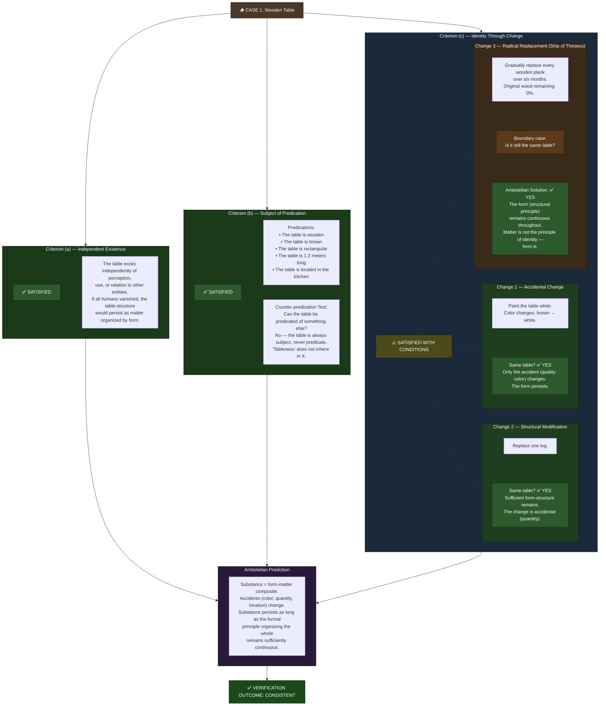
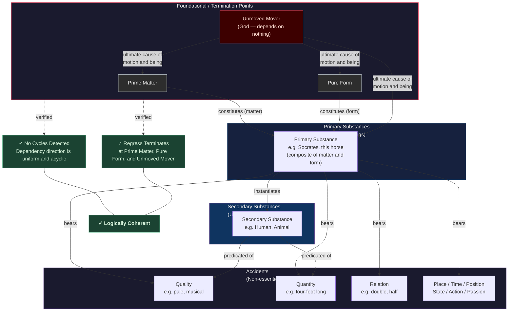
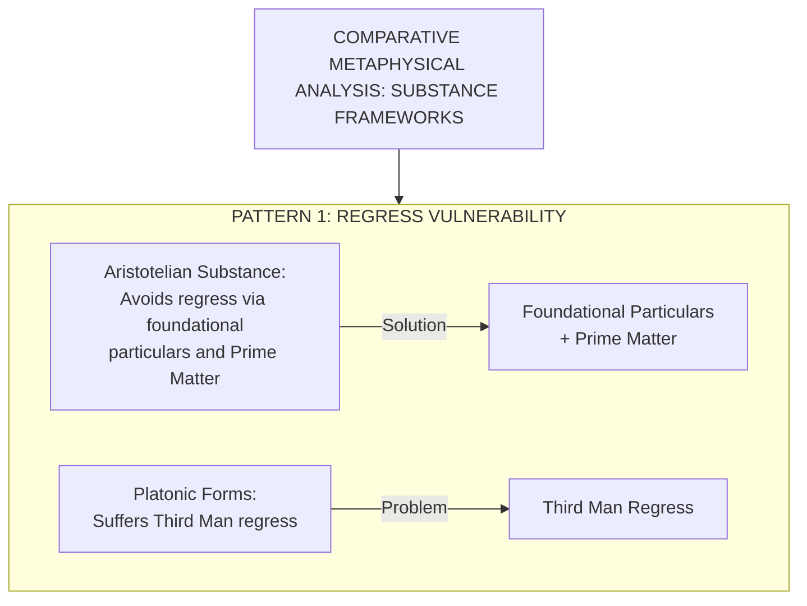

# Operational Verification Labs: Metaphysics

## Objective & Operational Lab Setup

Metaphysics, the discipline inquiring into the fundamental nature of reality, is not merely theoretical speculation divorced from practice. Rather, operational metaphysics requires the systematic verification of ontological claims—assertions about what exists, how entities relate, and what constitutes the fundamental structure of being—through rigorous analytical frameworks, empirical case auditing, and stress-tested logical reasoning. This laboratory guide equips practitioners with concrete diagnostic instruments to move from armchair theorizing into verifiable, reproducible metaphysical investigation.

The operational approach treats metaphysical systems as testable frameworks. Just as an engineer stress-tests a bridge design before deployment, a metaphysical practitioner must interrogate ontological commitments through systematic case analysis, logical stress-testing against boundary conditions, and comparative auditing of competing frameworks. This requires three essential instruments: the **ontological commitment audit**, which catalogs exactly what entities a given metaphysical system claims exist; the **logical stress test**, which systematically identifies where a system's core principles fail or produce contradiction under boundary conditions; and the **cross-system comparative matrix**, which maps how different metaphysical frameworks handle identical philosophical problems.

The laboratory environment integrates three primary toolsets. First, the **analytical research spreadsheet**, functioning as both calculation engine and audit ledger for tracking ontological claims, logical dependencies, and failure modes across case studies. Second, the **argument mapping and visual notation system**, enabling practitioners to represent complex metaphysical reasoning chains in explicit, verifiable form rather than relying on natural language ambiguity. Third, the **structured case study framework**, which instantiates abstract metaphysical claims into concrete scenarios, thereby grounding philosophical hypotheses in observable implications.

Before beginning these exercises, establish your working environment. You will need a spreadsheet application (LibreOffice Calc, Google Sheets, or Microsoft Excel), a text editor capable of markdown rendering, and a diagramming tool for argument visualization (draw.io, Obsidian with graph visualization, or Lucidchart). Create a dedicated project directory titled `metaphysics-verification-labs`. Within this directory, establish four subdirectories: `case-studies`, `audit-matrices`, `stress-tests`, and `reference-materials`. These organizational structures ensure reproducibility and enable systematic accumulation of verified results across sessions.

## Exercise 1: Foundational Practical Implementation

### The Ontological Commitment Audit

The first operational task confronts a fundamental problem: every metaphysical system makes claims about what exists. Yet practitioners rarely make these claims explicit and verifiable. The ontological commitment audit transforms vague assertions into a precise, auditable inventory. This exercise uses the metaphysical framework of **Aristotelian substance ontology** as the practical case study, though the methodology applies to any metaphysical system.

Begin by selecting a metaphysical text or framework. For this exercise, use Aristotle's *Categories* (Book 1, Chapters 1–5) or a standard secondary source summarizing substance ontology, such as Chapter 2 of David Oderberg's *Real Essentialism*. Read the text with **analytical reading** intensity: identify every explicit claim about what exists, how entities are classified, and what relationships hold between them.

Create a spreadsheet titled `ontological-inventory.csv` in your `audit-matrices` directory. Structure the spreadsheet with the following columns:

| Claim ID | Ontological Entity | Existence Status | Defining Characteristics | Dependency Relations | Logical Support | Counterexample Risk | Verification Method |
|----------|-------------------|------------------|------------------------|----------------------|-----------------|--------------------|--------------------|
| AR-01 | Substance (primary entity) | Fundamental/Independent | Capable of independent existence; subject of predication; neither predicate nor in a subject | None (foundational) | Appears in *Categories* I.5 as proto-definition | Forms, universals, accidents could undermine uniqueness | Case instantiation: individual dog |
| AR-02 | Quality (secondary entity) | Dependent | Non-relational property inhering in substance; color, shape, knowledge | Requires substance as substrate | *Categories* III discusses secondary substances; accidents explained via inherence | Nominalism denies quality-entity status; Platonism relocates to Forms | Definition match: "redness" vs. red objects |
| AR-03 | Relation | Dependent | Existence conditional upon relata; symmetry/asymmetry properties | Requires at least two substances or qualities | *Categories* VII; illustrated through "double" and "slave" examples | Trope bundle theory challenges relational primitives | Logical structure test: remove one relatum |
| AR-04 | Particular Individual | Fundamental | Unrepeatable, spatiotemporally located, subject of change | None (foundational) | Direct observation; principle of individuation via matter | Trope nominalism denies particulars, posits trope bundles | Leibniz identity test: could this individual exist in two places? |
| AR-05 | Universal (common nature) | Dependent | Repeatable across distinct substances; predicable of many; "humanity" shared by Socrates and Plato | Requires particulars as instantiation substrates | *Metaphysics* VII.13; *Physics* I.1 on indivisibility of form | Nominalism denies universals entirely; severe epistemological costs | Predication mapping: count distinct substances exemplifying the universal |

Populate this spreadsheet by working systematically through your chosen metaphysical text. For each entity the framework posits, record its existence status (Is it fundamental, or does it depend on other entities?), its defining characteristics, and the logical dependencies it maintains with other entities. The "Counterexample Risk" column identifies which alternative metaphysical frameworks or empirical scenarios might challenge this entity's status.

The "Verification Method" column is critical: it specifies exactly how you would test whether this entity claim holds in concrete cases. For Aristotelian substances, verification means instantiating the claim with a particular case—a specific dog, a unique color instance—and asking whether the case matches the predicted structure.

Complete the spreadsheet by adding at least two more Aristotelian categories (Quantity, Place) and three representative accidents (color, weight, temporal duration). Your completed audit matrix will contain 8–12 rows, each fully populated.

### Case Instantiation: Testing Substance via Particular Examples

With your ontological inventory complete, move to the second operational stage: instantiating abstract claims into concrete cases. Create a document titled `case-instantiation-aristotelian.md` in your `case-studies` directory.

Select three specific objects from your immediate environment: a wooden table, a cup of coffee, and a human being (yourself, or a specific person you know). For each object, perform a structured decomposition following the Aristotelian framework:

**Case 1: Wooden Table**

Begin with the foundational question: Is this table a *substance* in Aristotle's sense? According to the framework, a substance must be (a) capable of independent existence, (b) the subject of predication rather than a predicate of something else, and (c) the primary vehicle of identity through change.

The wooden table satisfies criterion (a): it exists independently of other entities. It is not inherent in anything else as a property; it stands alone. For criterion (b): we predicate properties of the table ("the table is brown," "the table is rectangular"), but the table itself is not predicated of anything. The table is never the predicate. Criterion (c) requires examining identity through change. This specific table may be repainted (brown becomes white), reshaped, moved to different locations, or have its legs replaced, yet we still identify it as *this same table*. What persists through these changes? Aristotle argues it is the *form* (morphe)—the structural principle organizing the matter. The matter (wood) remains roughly constant, but even if the wood were replaced, the table could persist if the form remained.

Document this analysis:



Repeat this case structure for the cup of coffee and for a specific human being. For the human, examine how Aristotelian substance handles growth (the person was once an infant; matter and size have changed radically), learning (the person's accidents—knowledge, disposition—change continuously), and biological continuity (cells replace themselves; the matter is different over time).

Document each case with equivalent rigor, including explicit criterion satisfaction, boundary condition testing, and verification outcome. This grounding transforms abstract metaphysical claims into testable hypotheses anchored in observable reality.

### Mapping Logical Dependencies: The Dependency Graph

Create a visual argument map representing the logical structure of the Aristotelian ontology. Use a tool like draw.io or Obsidian to construct a dependency graph where nodes represent ontological entities and directed edges represent logical dependencies. An edge from node A to node B means "B's existence or coherence depends on A."

For Aristotelian substance ontology, the dependency structure should resemble:

```
Independent Entities (Foundational)
├── Particular Substances
│   └── Individual things: Socrates, this table, this horse
│       ├─→ (composed of) Matter + Form
│       └─→ (subject for) Accidents
│
├── First Principles
│   ├── Substance (primary entity)
│   ├── Being qua Being
│   └── The Unmoved Mover (in natural theology)
│
Dependent Entities (Non-foundational)
├── Accidents (depend on substances as substrate)
│   ├── Quality (color, knowledge, health)
│   ├── Quantity (size, weight, number)
│   ├── Relation (double, slave, equal)
│   ├── When (temporal location)
│   ├── Where (spatial location)
│   └── Posture, State, Action, Passion
│
├── Secondary Substances (depend on particulars for instantiation)
│   ├── Species (human, dog, horse)
│   └── Genus (animal, substance, entity)
│
├── Universals (repeatable natures, dependent on particulars)
│   └── "Humanity" depends on individual humans for existence
│
└── Properties (essential vs. accidental)
    ├── Essential: What something is, without which it ceases to be that kind
    └── Accidental: What something has, which can change without ceasing to be that kind
```

This visual representation makes the metaphysical architecture explicit. Now examine the dependency graph for **circular dependencies** or **regress problems**. In Aristotle's system, are there any logical loops where A depends on B and B depends on A? Are there infinite regresses where A depends on B, B depends on C, C depends on D, and so forth, with no foundational ground? If circular dependencies exist, the system is logically incoherent. If infinite regress exists without stopping at foundational entities, the system requires infinite actual infinities, which most metaphysical frameworks reject.

In Aristotelian substance ontology, the dependency structure terminates at **primary substances** (particular things) and the **Unmoved Mover** (in natural theology), avoiding both circularity and infinite regress. Document this verification:



Save this analysis in your `stress-tests` directory as `dependency-analysis-aristotle.md`. This exercise reveals whether your chosen metaphysical system's internal structure is logically sound before you test it against empirical cases and alternative frameworks.

## Exercise 2: Parameter Variation & Empirical Analysis

### Comparative Metaphysical Matrix: Substance Across Frameworks

Having established Aristotelian substance as a baseline framework, the second operational exercise systematically compares how competing metaphysical systems handle the *same problem*: What is a substance? What explains the existence and identity of particular objects?

Create a spreadsheet titled `comparative-ontology-matrix.csv` in your `audit-matrices` directory with the following structure:

| Metaphysical Framework | Definition of Substance | Fundamental Entities | Treatment of Change | Identity Criterion | Problem Areas | Empirical Adequacy | Internal Coherence |
|------------------------|-------------------------|---------------------|--------------------|--------------------|---------------|--------------------|-------------------|
| Aristotelian Substance | Form-matter composite; subject of predication | Particular substances (Socrates, this horse); Prime Matter; Pure Form | Substance persists; accidents change; form enables identity through change | Continuity of formal principle organizing matter | Bundle theory challenges particulars; Problem of vague boundaries; Mereological challenges | Handles ordinary objects well; struggles with vague cases (heaps, gradual replacement) | High — no circularity; terminating dependency structure |
| Platonic Forms | Substance resides in eternal, unchanging Forms; physical particulars are mere imperfect copies | Transcendent Forms (Justice, Beauty, Humanity); particulars as deficient instances | Particulars change; Forms are eternal and unchanging | Exemplification: particulars are identical insofar as they instantiate the same Form | The Third Man regress; problem of participation; separation of Forms from physical world makes causation mysterious | Struggles with explaining causation between transcendent realm and physical world; cannot account for imperfect instances | Medium — plagued by Third Man regress; ontological dualism creates interaction problem |
| Leibnizian Monads | Substance is an indivisible, simple monad; no atoms or void; reality is plurality of monads | Infinite monads, each with complete internal state; no interaction between monads; God coordinates all monadic states | Monad contains all its states from creation to destruction; apparent change is illusion; pre-established harmony | Each monad is fully determined by its individual concept; identity is internal to the monad's complete state-set | Why posit infinite monads if they don't interact?; pre-established harmony strains credibility; how do we perceive a unified world if monads are isolated? | Logically possible but empirically unnecessary; introduces entities and mechanisms without empirical justification | High logical coherence but extreme metaphysical profligacy |
| Trope Nominalism | Substance is a mereological bundle of particular tropes (property instances); no universals; no bare particulars | Tropes (this-redness-here-now), abstract particulars that are not universals; bundles of co-located tropes constitute objects | Substance changes by acquiring or losing tropes; no underlying particular persists; change is identity-affecting | Identity is a function of trope-bundle composition; gradual trope replacement can preserve identity | Individuation problem: what makes two qualitatively identical objects distinct?; unity problem: what binds tropes into a single object? | Avoids commitment to universals and explains particularity directly; struggles with indiscernibles | Medium — avoids some traditional problems but creates new ones (unity, individuation) |
| Process Metaphysics (Whitehead) | Substance is not primary; reality is fundamentally events and processes; objects are abstractions from events | Events, processes, concrescence, and creative advance; objects are abstractions or stable patterns in the event-flux | Change is fundamental to reality; objects do not persist through change but are momentary occasions that give rise to successor occasions | Identity is relational continuity; objects endure through causal chains linking successive occasions | Radical nominalism about objects strains common sense; how are we to reconcile perceptual evidence of persistent things?; mechanism of concrescence is obscure | Elegant in avoiding substance dualism; explains emergence and novelty; struggles with mathematical precision | Medium — conceptually rich but technically underdeveloped; processes are less precisely defined than substances |
| Bundle Theory (Contemporary) | Object is a co-location of properties; no underlying bare substrate; particulars are just property-bundles | Properties (fundamental entities), space-time locations; objects are bundles of properties at a location | Object persists if the property-bundle persists with sufficient continuity | Identity is continuity of property-bundle composition; identity over time is conventional or indeterminate | Individuation of indiscernibles: two objects with identical properties at same location become identical; bare particular problem reappears; identity across time is indeterminate | Cannot distinguish numerically distinct indiscernible objects; struggles with identity criteria | Low-to-medium — elegant in principle but faces serious identity problems |
| Mereological Sum (Composition) | Any collection of entities (if they compose) forms a substance; substance is not fundamental but derivative from parts | Parts (atoms, simples, or lower-order wholes); composition relations; mereological sum | Substance persists iff constituent parts maintain compositional relation | Identity depends on part-composition and relation | Mereological explosion: absurd consequences (left shoe + right shoe + the moon = "substance"); indeterminacy of composition (when does a collection compose?); losing ordinary object identity | Prevents identifying intuitively distinct objects; conceptually radical; empirical inadequacy | Low — mereological explosion and composition indeterminacy make system unworkable without severe restrictions |

Populate this matrix by researching each framework using secondary sources. For Platonic Forms, consult Plato's *Republic* (Book VI–VII) or F. M. Cornford's *Plato's Theory of Knowledge*. For Leibnizian Monads, read Leibniz's *Monadology* (sections 1–30). For contemporary frameworks, consult Katherine Hawley's *How to be a Fundamentalist* (on composition and grounding) and D. M. Armstrong's *Universals: An Opinionated Introduction* (on bundle theory and tropes).

For each framework, complete the matrix by analyzing the following parameters:

**Definition of Substance:** State precisely how the framework defines a substance or primary entity. What is the fundamental unit of reality?

**Fundamental Entities:** What does the framework claim ultimately exists? What entities are basic, non-derivative? What entities are composite or dependent?

**Treatment of Change:** How does the framework explain change? Does substance persist through change, or is change fundamental with substance as an abstraction?

**Identity Criterion:** By what criterion does the framework determine whether an object at time T1 is identical to an object at time T2? What makes something *this same thing* across time?

**Problem Areas:** What are the known logical, metaphysical, or empirical problems plaguing the framework? List at least two specific difficulties.

**Empirical Adequacy:** Does the framework successfully account for observable phenomena (the persistence of objects, the distinctness of similar things, the reality of change)? Does it require counterintuitive metaphysical posits (abstract objects in multiple worlds, infinite entities, mereological sums of absurd collections)?

**Internal Coherence:** Does the framework avoid circular dependencies, infinite regresses, and logical contradiction? Does its internal structure hang together?

Once the matrix is complete, perform a **comparative analysis** by examining cross-framework patterns. Create a new document titled `comparative-analysis.md` in your `case-studies` directory:


