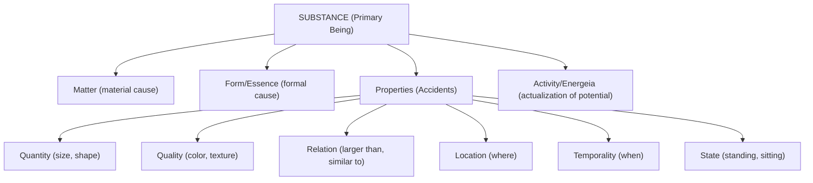
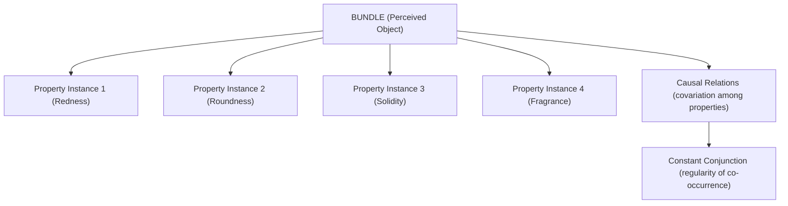
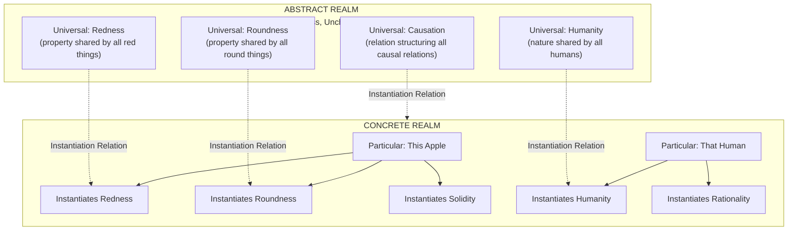
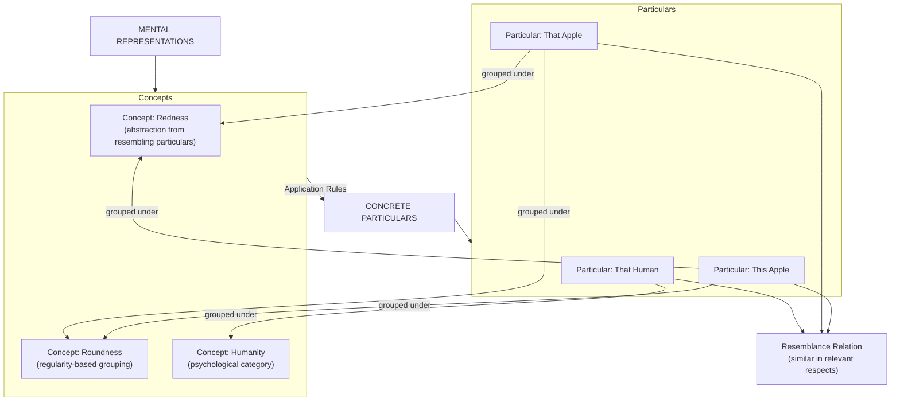
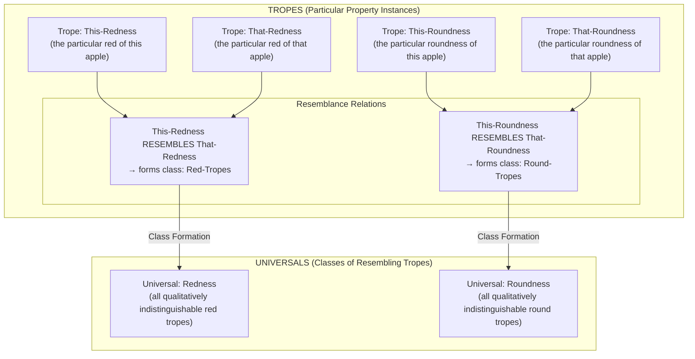

# Lesson 2: Substance, Universals, Particulars

## 1. First-Principles Intuition & Invariants

The question "What exists?" demands a precise answer. Yet the moment we attempt to catalog reality, we encounter a fundamental tension: the world appears simultaneously unified by recurring patterns and fragmented into individual, unrepeatable things. A particular red apple on your desk is distinct from every other apple that has ever existed, yet it shares the property "redness" with countless other objects. This apple will decay and cease to exist; redness, if it exists at all, seems eternal and unchanging. This duality—between the unique and the universal, the transient and the permanent—defines the central problem of substance metaphysics.

Aristotle approached this problem by asserting that individual, concrete substances constitute the fundamental stratum of reality. A substance, in Aristotle's technical sense, is that which exists independently and can serve as the substrate for properties. This particular apple is a substance; its redness is not. Substances possess attributes, undergo change, and persist through time. They are the primary bearers of being. When we ask "What is that?", we are asking for the substance—the underlying thing that possesses properties and undergoes accidents. This intuition reflects a deep phenomenological observation: when we perceive the world, we perceive individual objects as the primary existents, and their qualities as dependent modes of those objects.

Yet the universals problem immediately emerges. If only particular substances exist, how do we account for shared properties, classes, and definitions? All red things share something in common—the universal "redness." All human beings instantiate the universal "humanity." Without universals, knowledge becomes impossible; we could never formulate laws, make predictions, or communicate meaning. The properties we predicate of substances must have some status in reality; otherwise, language and thought would lack metaphysical grounding. Aristotle's response was to posit that universals exist as essences within particular substances. The universal "humanity" exists not as a separate, transcendent form (contra Plato), but as the essential nature instantiated in each individual human being.

David Hume, working within the empiricist tradition centuries later, rejected both Aristotelian substance and Platonic universals as metaphysical fictions. Hume observed that when he introspected his own mental states, he found no unified subject—no transcendent "I" that persisted as a substrate for successive impressions. Instead, he encountered only a "bundle" of perceptions: sensations, emotions, and thoughts arising and dissolving in rapid succession. This observation prompted Hume to reconceptualize both substances and universals. A substance is not a mysterious substratum underlying properties; it is simply a convention for grouping regularly co-occurring impressions. Similarly, universals are not real entities but psychological constructs—habits of mind that lead us to treat similar particular impressions as instances of a single kind.

The bundle theory dissolves the metaphysical weight traditionally assigned to substance. An object is not a thing-in-itself that possesses properties; rather, it is a cluster of causally interrelated properties that we habitually group together and label with a noun. The apple is not a substance underlying redness, solidity, and sweetness; it is the regular conjunction of those properties themselves. This eliminates the philosophical burden of explaining what a bare substance is, independent of any properties. Yet bundle theory faces its own difficulties. If an object is merely a bundle of properties, what makes this particular bundle this object? What individuates one bundle from another? Why do we perceive bundles as unified rather than as arbitrary collections?

The problem of universals crystallizes into three classical positions, each addressing how general terms and properties achieve their semantic and metaphysical status. Realism maintains that universals are genuine entities existing independently of any particular instantiation. When we use the word "red," we refer to an actual universal—a property that exists objectively in reality, instantiated in multiple particular objects. This position preserves the intuition that knowledge is objective and language is semantically grounded in reality. Yet realism requires a difficult metaphysical commitment: how do universals relate to particulars? How can one universal exist in multiple places simultaneously? How can an abstract entity causally interact with the concrete world?

Nominalism rejects universals altogether, asserting that only particulars exist. General terms like "red" do not refer to any entity; they are merely convenient labels applied to groups of particular objects that resemble one another. When we say "All dogs are animals," we are not expressing a fact about some universal essence of dogness; we are simply noting that particular dogs share certain resemblances and that we have adopted linguistic conventions for grouping them. Nominalism avoids the metaphysical extravagance of positing abstract entities, yet it struggles to explain the systematic structure of language, the objectivity of scientific laws, and the determinacy of meaning. If "red" is merely a label, why does it apply consistently across observers and contexts? Why can we make discoveries about properties, rather than merely stipulating which objects fall under which terms?

Conceptualism occupies a middle position: universals exist as concepts in minds. The universal "redness" is not a transcendent, mind-independent entity, nor is it merely a name applied to resembling particulars. Rather, it is a mental construct—a concept formed by abstraction from repeated experience of resembling particulars. When we observe multiple red objects, our minds extract the common feature and form the concept of redness. This concept is real in the sense that it is a genuine content of thought, but it is mind-dependent. External reality contains only resembling particulars; the universal is the product of cognitive activity. Conceptualism captures the intuition that universals are epistemically important without requiring that they exist independently of minds. Yet it faces the challenge of explaining how multiple minds can possess the same concept, and whether conceptualism can ground objective knowledge about reality or merely subjective mental states.

Trope theory offers a contemporary alternative that dissolves some classical tensions. Rather than positing either abstract universals or bare particulars, trope theory asserts that the fundamental constituents of reality are property instances—tropes. A trope is a particular instance of a property: not redness in general, but this redness, the particular shade of red of this particular apple at this particular moment. Two apples may possess numerically distinct tropes that are qualitatively indistinguishable (identical in color, texture, shape), yet these tropes remain distinct existents. Universals, on this view, are not primitive entities but rather classes or resemblance groups of tropes. All red tropes constitute the universal "redness" by virtue of their qualitative similarity. This approach preserves the intuition that properties are real components of the world while avoiding the metaphysical puzzle of how abstract universals relate to concrete particulars. Each trope is a concrete particular (the redness of this apple), yet multiple tropes can be grouped into classes (all red tropes) that function like universals.

The principle of the identity of indiscernibles (PII) emerges as a critical invariant in debates over substance and individuation. Formulated rigorously by Leibniz, PII states that if two entities possess all the same properties, they are numerically identical—they are one and the same thing. Conversely, if two entities are distinct, they must differ in at least one property. This principle seems intuitive: how could two genuinely different things be absolutely identical in every respect? Yet PII generates profound puzzles. Consider two qualitatively indistinguishable atoms in a universe with no other matter. Are they distinct particulars or identical? If they are distinct despite possessing identical properties, then there must be a basis for their distinctness beyond properties—a bare particular or substratum. If they are identical, then numerical distinctness requires no qualitative difference, and space-time location becomes a primitive individuation criterion.

The question of bare particulars directly addresses this tension. A bare particular is a substratum that possesses properties but has no properties of its own; it is pure "thisness" or haecceity—the quality of being this particular thing rather than another. Bare particulars provide an elegant solution to individuation: two objects are distinct because they are numerically different bare particulars, even if they possess identical properties. Yet this solution is metaphysically extravagant. What is a property-less substratum? How does it relate to properties? Can we even coherently conceive of a thing that has absolutely no characteristics whatsoever? The alternative—thick particulars—treats individual objects as intrinsically constituted by their properties and spatiotemporal location. Thisness or individuation is not added by a bare substratum but emerges from the particular configuration of properties and spatiotemporal coordinates. This view avoids positing occult metaphysical entities but requires that spatiotemporal properties themselves are metaphysically fundamental and sufficient for individuation.

These theoretical frameworks are not merely abstract puzzles; they have concrete implications for how we ontologize reality and structure knowledge. In natural science, the universals problem determines whether laws of nature refer to real features of reality or are merely instrumental predictive tools. In metaphysics of properties, realism about universals underwrites a correspondence theory of truth and objective semantics, while nominalism requires alternative explanations of linguistic meaning and truth conditions. In formal ontology and artificial intelligence, the decision between substance-based and bundle-based frameworks shapes how we model entities in knowledge representations and semantic networks.

## 2. Core Architecture & Mechanics

The debate between Aristotelian substance and Humean bundles can be formalized as two competing architectural models for how reality is structured. Each model posits different fundamental constituents and different principles of composition and individuation.

### Aristotelian Substance Architecture

The Aristotelian model posits a hierarchical architecture with substances as the primary layer. The schema can be visualized as follows:



In this architecture, the substance is the ontological foundation. A substance is a composite of matter and form. Matter provides the material substrate—the physical stuff from which the substance is constituted. Form provides the organizing principle—the principle that unifies matter into a coherent individual thing and makes it the kind of thing it is. An apple's matter is the carbon, hydrogen, nitrogen, and other elements that compose it; its form is the principle that organizes those elements into an apple-shaped organism with apple-typical functions (producing seeds, storing nutrients for the seed).

Crucially, the form is the substance's essence—it answers the question "What is it?" When we ask "What is that?", we are asking for the form. The form is universal (all apples share the form of apple), but it exists in this particular substance (this form exists in this particular apple, not as a transcendent entity in some Platonic heaven). The matter is particular (this specific collection of matter molecules), but matter alone cannot constitute a substance; it requires organization by form.

Properties or accidents inhere in the substance but do not constitute its essence. This particular apple is currently red, round, and located in my kitchen—but it need not always be red (it will eventually decay and turn brown), round (it can be cut and lose its spherical shape), or in my kitchen. These are accidental properties. The substance persists through changes in accidental properties because the form remains constant. The apple remains an apple even if its color changes because the form of apple persists.

This architecture solves the individuation problem through the principle of hyloform: each substance is a unique composition of matter and form. Two apples are distinct not because they instantiate an abstract universal "apple" in different ways, but because they are distinct hylomorphic composites—different collections of matter organized by the form of apple. Numerical distinctness is grounded in material distinctness. The form is shared (both apples possess the form of apple), but the matter is not; therefore, the substances are distinct.

### Bundle Theory Architecture

Hume's bundle model inverts this architecture. Rather than positing substances as primitive entities that possess properties, bundles treat properties as primitive and substances as derived:



In bundle theory, the object is constituted entirely by its properties and the causal relations among them. There is no underlying substance that the properties inhere in; the properties are all there is. When we perceive an apple, we perceive a cluster of sense impressions: a visual impression of redness and roundness, a tactile impression of solidity, an olfactory impression of apple-fragrance. These impressions regularly occur together (constant conjunction). Our habit of mind groups them into a single object.

The unity of the bundle is explained through causality and constant conjunction, not through a substratum. The bundle is unified because its constituent properties are causally interrelated—they tend to co-occur, depend on shared causes, and modify each other. The redness and roundness of the apple are connected not through a mysterious substance but through causal laws. They co-occur regularly, and their co-occurrence is explained by their common origination (both arise from the apple's material structure and its interaction with light).

Individuation in bundle theory is necessarily spatiotemporal. Two bundles are distinct if they occupy different spatiotemporal regions or if they persist through different temporal intervals. This particular apple is a distinct bundle from that apple because it occupies a different location in space. A single apple at different times comprises numerically different temporal stages of a bundle, unified by spatiotemporal continuity and causal connections.

### Universal Realism: The Platonic Stratification

Universal realism posits an additional ontological layer beyond particulars:



This architecture introduces a fundamental gap: how do abstract universals in a timeless realm relate to concrete particulars in the temporal world? The instantiation relation is primitive and unanalyzed. Universals are "multiply realizable"—they exist in multiple particulars simultaneously without being spatially divided or diminished. This preserves the objectivity of properties and grounds objective knowledge, but at the cost of metaphysical extravagance and the difficult problem of explaining how abstract entities causally interact with concrete ones.

### Nominalist Reduction: Property Classes as Mental Constructs

Nominalism eliminates the abstract realm entirely:



Nominalism grounds generality in resemblance and psychological categorization rather than in universals. When we call multiple things "red," we do so because they resemble each other (they have similar visual appearances) and because we have adopted a convention to apply the term "red" to things with that resemblance profile. The universality of meaning arises from shared psychology and linguistic convention, not from the existence of abstract entities.

### Trope Theory: Particular Properties as Primitives

Trope theory restructures the ontology around property particulars:



Trope theory retains particularity at the most fundamental level while still accounting for universals. Each trope is a particular—this redness, not redness in general—yet tropes can be grouped into classes based on resemblance. Two tropes are indistinguishable if they share all qualitative properties; they are merely numerically distinct. Universals emerge as second-order entities: classes of resembling tropes. This avoids the metaphysical extravagance of abstract Platonic forms while preserving the reality of properties as components of concrete particulars.

### The Identity of Indiscernibles and Individuation Mechanics

The principle of identity of indiscernibles (PII) functions as a constraint across all these architectures:

```text
PII Logical Form:
For all x and y: If (for all properties P: x has P iff y has P) 
                 Then x = y

Contrapositive (practical version):
If x ≠ y, then there exists a property P such that (x has P and y lacks P) 
            OR (y has P and x lacks P)
```

This principle generates a critical decision point: are spatiotemporal properties sufficient for individuation, or are they merely contingent properties like any other?

If spatiotemporal properties are included in the scope of PII, then any two objects in distinct spatiotemporal locations automatically violate the antecedent (they differ in spatiotemporal properties), and they are trivially distinct. Individuation is grounded in spatial separation and temporal succession.

If spatiotemporal properties are excluded from the scope of PII (treated as external to the intrinsic properties that constitute an object's essence), then the principle becomes more demanding. Two qualitatively indistinguishable atoms could, in principle, exist in the same place at the same time. If they are numerically distinct despite complete qualitative identity, then numerical distinctness is independent of all properties—grounded in bare particularity.

The bare particular theory responds to this puzzle:

```text
Bare Particular Model:
Object A = Bare Particular (A) + Properties {red, round, 2kg, ...}
Object B = Bare Particular (B) + Properties {red, round, 2kg, ...}

A ≠ B because Bare Particular (A) ≠ Bare Particular (B)
Even though: All Properties of A = All Properties of B

Individuation Basis: Bare Particularity (thisness, haecceity)
```

A bare particular is an abstract particular—a component of a concrete object that constitutes its numerical identity independent of any properties it possesses. It is "bare" because it has no properties of its own; it is a pure principle of individuation. Two objects with identical properties are distinct because they are constituted by distinct bare particulars.

The thick particular alternative rejects bare particulars:

```text
Thick Particular Model:
Object A = {red, round, 2kg, located-at-spacetime-point-1}
Object B = {red, round, 2kg, located-at-spacetime-point-2}

A ≠ B because Location-1 ≠ Location-2
(Spatiotemporal properties are intrinsic to objects, not external)

Individuation Basis: Spatiotemporal Configuration + Qualitative Properties
```

Thick particularity locates individuation within the object's intrinsic constitution. An object is individuated by the complete set of its properties, including spatiotemporal properties. There is no need to posit a bare substratum; the object itself, as a bundle or composite of properties and spatiotemporal coordinates, is the individuation basis. Distinctness arises from differences in the complete property configuration.

## 3. High-Performance Optimization & Failure Modes

The architectural frameworks presented above are not mere intellectual exercises; they function as competing ontological commitments that structure how metaphysical inquiry proceeds and what phenomena they can successfully explain. Understanding the strengths and limitations of each model—their failure modes—is essential for practitioners working in formal ontology, philosophical logic, and knowledge representation.

### Aristotelian Substance: Strengths and Limitations

Aristotelian hylomorphism succeeds admirably in capturing our pre-theoretical understanding of objects. We naturally perceive apples as unified wholes that persist through change. The appeal to form explains how an object remains the same thing despite alterations in accidental properties. The matter-form distinction illuminates the biological realm: organisms are seamlessly organized wholes whose essence lies in their organization (form) rather than their constituent matter (which is constantly being exchanged through metabolism). When we ask "What is a human being?", the substance framework provides an intuitive answer: a rational animal, a form that organizes matter into a living, thinking being.

Yet Aristotelian substance encounters severe difficulties in modern scientific contexts. The framework presupposes a teleological conception of nature—each thing has a natural function or purpose determined by its form. Nature is constituted by substances striving toward their characteristic ends (actualization of potential).

This teleological worldview clashes with the mechanistic explanatory paradigm of modern physics and biology, which eschews intrinsic purposes in favor of efficient causation and natural selection. Further, the substance framework struggles with quantum entities, fields, and processes that resist individuation into discrete, persisting objects with essential natures. Elementary particles exhibit contextual identity and violate classical individuation principles (via entanglement and indiscernibility). Composite artifacts present another challenge: a statue and the clay composing it occupy the same spatiotemporal region yet possess different modal properties (the statue cannot survive radical reshaping; the clay can). If substance is the fundamental unity, which entity is the true substance? The coincidence problem reveals that substance-based individuation cannot cleanly adjudicate cases of material constitution. Finally, the form-matter distinction becomes increasingly attenuated in fields like chemistry and materials science, where "organization" reduces to quantum-mechanical bonding patterns rather than teleological structure.

Trope theory and bundle theory offer superior granularity for modeling property instances and avoiding commitment to universals, making them attractive for nominalist programs and computational ontologies. Trope theory's modularity allows precise tracking of property transfers and causal relations at the instance level. Yet both frameworks face the compresence problem: what unifies tropes or properties into a single object rather than a mere aggregate? Appeal to spatial co-location is circular (it presumes the object's boundaries). Introducing primitive bundling relations threatens explanatory regress. Substratum theory avoids compresence issues by positing a substrate bearer, but at the cost of ontological opacity—bare particulars are by definition property-less and thus epistemically inaccessible, rendering the theory empirically idle. Each framework thus exhibits characteristic failure modes: substance theories falter on quantum indeterminacy and material constitution puzzles; bundle theories face compresence collapse; substratum theories succumb to epistemic inaccessibility. The practitioner's choice among these architectures depends on which explanatory desiderata and domain constraints dominate the target application—metaphysical inquiry is an exercise in navigating inevitable tradeoffs among competing theoretical virtues.

## Summary & Verification Matrix

| **Framework** | **Governing Invariant** | **Core Mechanism** | **Diagnostic Criteria** | **Primary Failure Mode** |
|---------------|------------------------|-------------------|------------------------|-------------------------|
| **Aristotelian Substance** | Identity persists through accidental change; essence (form) determines kind-membership | Hylomorphism: form organizes matter into unified wholes; distinction between essential and accidental properties | Object survives alterations in accidents but not in essence; form explains functional unity and teleological structure | Incompatibility with mechanistic causation; quantum indeterminacy; material constitution puzzles (statue/clay coincidence) |
| **Trope Theory** | Properties are non-repeatable particulars (tropes); no universal instantiation | Each property instance exists independently; objects are either bundles of compresent tropes or substances bearing tropes | Two red apples share resemblance, not a universal; precise tracking of property transfer and causal relations | Compresence problem: what unifies tropes into a single object rather than a scattered aggregate? |
| **Bundle Theory** | Objects are nothing over and above their complete property sets; no substrate | Properties bundle together via primitive compresence or spatiotemporal co-location | Object identity = complete property profile; no "bare particular" beneath properties; parsimony favored | Compresence circularity; Identity of Indiscernibles required; difficulty explaining property-less substrate intuitions |
| **Substratum Theory** | Properties inhere in a property-less bearer (bare particular); substrate individuates | Bare particulars serve as ontological pins; properties are modifications of substrate | Two qualitatively identical spheres remain numerically distinct via distinct substrata | Epistemic inaccessibility: bare particulars are by definition unobservable and explanatorily idle |
| **Universals (Realism)** | Properties are repeatable entities wholly present in multiple instances simultaneously | Universal instantiation relation: particular *a* exemplifies universal *F*-ness | Explains exact qualitative similarity; grounds objective resemblance and natural kinds | Commitment to abstract entities; explanatory regress risks (Third Man Argument); spatiotemporal location puzzles |
| **Nominalism** | Only particulars exist; property-talk reduces to predicates, sets, or resemblance classes | Various: predicate nominalism, class nominalism, resemblance nominalism, trope nominalism | Ontological parsimony; no commitment to abstract universals; aligns with empiricist scruples | Difficulty grounding objective similarity; gerrymandering problem (disjunctive predicates); modal and counterfactual fragility |
