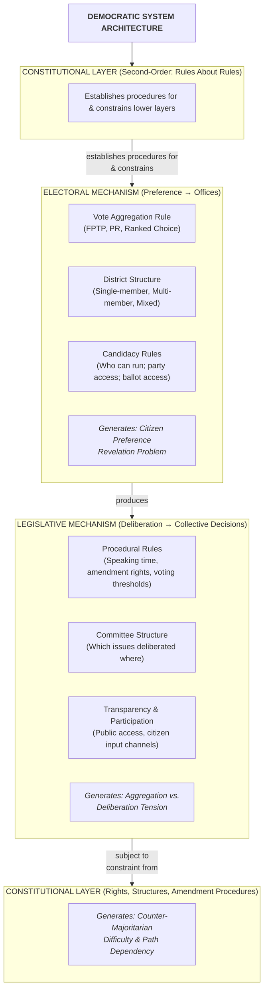

# Lesson 4: Democracy, Representation, Political Power

## 1. First-Principles Intuition & Invariants

Democracy is perhaps the most contested concept in political philosophy because it appears simple on its surface—rule by the people—yet fractures into incompatible interpretations the moment we press on its mechanisms. The foundational tension that animates all democratic theory concerns a fundamental asymmetry: the people cannot all participate in every decision simultaneously, yet democratic legitimacy seems to require that political power ultimately derives from the governed. This lesson excavates that tension and equips you with the conceptual tools to diagnose and navigate it in real political contexts.

Begin with an invariant that precedes any specific democratic model: all systems of governance must solve the problem of *collective decision-making under disagreement*. In any group larger than a handful of people, individuals will hold incompatible preferences about resource allocation, rights protection, and collective priorities. A political system is thus fundamentally a *mechanism* for converting heterogeneous individual preferences into binding collective decisions. The legitimacy question is not whether such conversion happens—it always does—but rather *on what grounds* can we justify that particular mechanism as authoritative over dissenters?

Consider a concrete invariant. In any functional political system, there must exist some decision rule that terminates deliberation and produces a binding outcome. This could be unanimous consent (which functionally guarantees that deliberation extends indefinitely in any real disagreement), simple majority vote, supermajority thresholds, lottery, random selection, expert designation, or hereditary succession. Each decision rule carries implicit assumptions about what makes a collective choice legitimate. Democracy, as a family of models, claims that legitimacy emerges when the governed have some meaningful role in authoring the rules that bind them. But "meaningful role" admits of radically different implementations, and the differences matter enormously for both stability and justice.

The classical liberal tradition, emerging from Hobbes and Locke, grounded legitimate political authority in *consent*. In this framework, individuals possess pre-political rights and enter into a social contract that sacrifices some liberty for the security of having rights protected uniformly by law. Democratic consent, on this reading, operates at the level of accepting the constitutional framework itself—the structure of institutions and the rules governing decision-making. Once a constitution is consented to, majority voting within that framework becomes legitimate because majorities operate under rules that minorities also consented to adopt.

Rousseau complicated this picture by introducing the notion of the *general will*—a collective wisdom that transcends mere preference aggregation. For Rousseau, democracy is not merely a voting mechanism but a form of collective self-governance in which citizens shed private interest and articulate what serves the common good. This distinction between aggregative models (which sum individual preferences as they stand) and deliberative models (which transform preferences through reasoned argument) creates a persistent fault line in democratic theory that remains unresolved today.

The 19th and 20th centuries witnessed the emergence of democratic theory as a technical discipline. Jeremy Bentham's utilitarian calculus attempted to ground democratic voting in a mathematical principle: maximize aggregate utility across the population. John Stuart Mill, while sympathetic to utilitarianism, recognized that equal counting of preferences (one person, one vote) did not necessarily optimize for utility or justice if some voters possessed superior understanding of complex policy questions. This observation opened the epistemological problem that haunts modern democracy: *Is democracy primarily a mechanism for aggregating preferences, or is it fundamentally a system for discovering truth about what policies actually serve collective flourishing?*

Arrow's Impossibility Theorem, proved in 1951, demonstrated mathematically that no voting system can simultaneously satisfy a set of seemingly minimal rationality conditions. Specifically, Arrow showed that any decision rule satisfying unrestricted domain (accepting any ordering of preferences), non-dictatorship (no single voter determines outcomes), Pareto efficiency (if all prefer A to B, A must win), and independence of irrelevant alternatives (the relative ranking of A and B should not depend on the presence of alternative C) does not exist. This theorem shattered the hope that there exists some "perfect" voting mechanism and revealed that every democratic system embodies compromises and potential pathologies.

Understanding Arrow's result is essential for practitioners because it dissolves a naive belief that better institutional design can make democracy "work perfectly." Instead, the theorem redirects attention toward normative questions: *Which compromises are acceptable, and on what grounds?* A system that violates independence of irrelevant alternatives might be perfectly defensible if the violation serves justice; a system that satisfies all of Arrow's conditions except Pareto efficiency might be superior if it protects minority rights more robustly.

The modern deliberative democracy tradition, anchored in the work of Jürgen Habermas, attempts to solve the aggregation problem by theorizing democracy not as preference counting but as reasoned deliberation. Habermas argues that legitimate political decisions emerge only through discourse in which participants offer reasons they believe others could accept *in principle*. This is not actual consent but rather the *counterfactual ideal* that all affected could recognize the decision as justified if they participated fully in unconstrained deliberation. Deliberative democracy shifts the problem from *Whose preferences count?* to *What reasons are acceptable in legitimate collective argument?*

Yet deliberative models introduce their own instabilities. They presume that reasoned argument can, in principle, converge on justified positions. But empirical political psychology reveals that humans are remarkably stubborn believers: we interpret evidence through ideological prisms, update our beliefs asymmetrically based on partisan identity, and often become more polarized the more information we receive. The gap between deliberative theory's aspirational account and actual deliberative practice creates a persistent pathology that no institutional redesign has yet resolved.

Epistocratic proposals, developed by philosophers like Jason Brennan and David Estlund, challenge the foundational democratic commitment to equal political power. These models argue that if democracy is instrumentally justified as a mechanism for discovering and implementing good policy, then weighting votes by epistemic competence—by educational attainment, demonstrated policy knowledge, or track record of sound judgment—could improve outcomes. Epistocracy accepts democratic legitimacy claims while rejecting the assumption that equal voting power is necessary to achieve it. The tension here is profound: epistocratic systems might produce better policy but at the cost of abandoning the principle that citizens are equal bearers of political authority.

The tension between majority rule and minority rights constitutes the deepest structural problem in democratic theory. Pure majoritarianism can generate tyrannies of the majority in which democratic processes systematically oppress minorities. Yet if we constrain majority power through entrenched rights protections, we limit democratic responsiveness and risk empowering unelected judges or constitutional bodies to override popular will. There is no theoretical solution to this tension—only practical navigation through constitutional design, legal interpretation, and political culture.

## 2. Core Architecture & Mechanics

Democratic systems in practice combine multiple decision-making mechanisms, each appropriate to different contexts and serving different functions. Understanding these mechanisms as distinct architectural components clarifies which tensions arise at which decision points and prevents category confusion in political analysis.

The **electoral mechanism** converts diffuse citizen preferences into discrete government assignments. Elections operate under a decision rule that specifies how votes become offices: plurality (first-past-the-post), majority runoff, proportional representation, ranked-choice voting, or other schemes. Each rule generates different incentive structures for voters and candidates. Plurality voting in single-member districts, dominant in English-speaking democracies, creates strong incentives for two large parties to form and for candidates to appeal to centrist median voters. It produces stable, coherent governments but systematically underrepresents minority preferences and third parties. Proportional representation systems distribute legislative seats proportional to vote share, giving smaller parties legislative voice but often fragmenting government coalitions into instability.

The key insight is that electoral rules are not neutral channels for preference expression but rather *mechanisms that shape which preferences can enter the political system at all*. A voter genuinely preferring candidate C might rationally vote for candidate A if the electoral rule makes A the only viable alternative to the disliked candidate B. This strategic voting creates a gap between revealed preferences (voting choices) and true preferences. In proportional systems, voters can vote for fringe parties without "wasting" their vote, but the fragmentation may prevent any coalition from commanding legislative majorities.

Consider the mechanics of a first-past-the-post (FPTP) electoral system in a single-member district. Suppose a district contains voters with the following preference distribution: 40% prefer Party A, 35% prefer Party B, and 25% prefer Party C. Under FPTP plurality rule, Party A wins despite being favored by fewer than half of voters. If Party C and B voters understand that only A or B can win, strategic voters preferring C might rationally defect to B to prevent A's victory. The outcome depends critically on voters' information about others' strategic calculations—information they typically lack.

This creates an architectural principle: *electoral systems generate cascading informational effects that alter preference revelation*. Polling, media narratives, and endorsements shape voter beliefs about the race's competitive landscape, which shapes strategic voting, which shapes actual outcomes, which validates or invalidates original polling. The system exhibits positive feedback loops that can amplify small initial shifts into large outcome swings.

Proportional representation mitigates this problem by eliminating wasted votes—a vote for any party contributes proportionally to that party's seat share. This removes the strategic pressure to vote insincerely. Yet it introduces a different architecture: multiparty coalitions become necessary to form governments, creating post-electoral bargaining among parties. The coalition partners who negotiate cabinet positions and policy priorities after the election may not reflect any coalition that voters consciously endorsed. A voter might prefer Party X's policies but find that X enters a coalition with Party Y on terms that shift policy sharply away from X's platform.

The **deliberative mechanism** operates at the legislative stage and involves reasoned argument among elected representatives (and sometimes among citizens in town halls, citizen assemblies, or public consultations). Deliberation's architecture depends on who can speak, under what procedures, with what information, and subject to what constraints. A legislature operating under strict time limits, where party leadership controls which members can speak and what amendments can be offered, creates very different deliberative conditions than a system with open floor time, robust amendment processes, and transparent committee hearings.

The architecture of deliberation shapes whose reasons enter the collective conversation. In legislatures where procedural control concentrates in majority leadership, minority voices struggle to introduce novel framings or evidence. Yet totally open deliberation with no time limits or agenda control generates its own pathologies: debates can drift into endless philosophical abstraction, dominated by the most verbose or well-resourced speakers, without converging toward decision.

Habermas theorized that legitimate deliberation requires *ideal speech conditions*: participants have equal opportunity to speak, can challenge any claim or proposition, and are motivated to reach understanding rather than to win. These conditions are approximated asymptotically in real institutions, never fully realized. The practical question becomes: *Which departures from ideal conditions are most damaging to legitimacy, and which can we tolerate?* A legislature might depart from equal speaking opportunities but maintain legitimacy if it supplements representative deliberation with robust consultation of affected constituencies through public comment periods, environmental impact assessments, or citizen panels.

The **constitutional mechanism** establishes the rules governing electoral and legislative processes themselves. Constitutions typically entrench certain provisions against easy amendment, protecting fundamental rights and structural principles from majoritarian override. This introduces the counter-majoritarian difficulty: if democracy means rule by the people, how can unelected judges enforce constitutional constraints against popular will?

The architecture here involves a temporal dimension. Citizens consent to a constitutional framework at one point (through ratification or, more weakly, through accepting the inherited constitutional order). That framework then constrains future majorities' capacity to remake political rules. The justification rests on distinguishing between *first-order* choices about specific policies (which majorities should decide) and *second-order* choices about the rules governing decision-making itself (which should be constrained by settled constitutional commitments). Yet the boundary between first-order and second-order choices is contested. Is voting rights expansion a constitutional matter requiring supermajority consensus, or a policy matter subject to ordinary legislation?

Different democracies resolve this differently. The U.S. Constitution explicitly requires supermajority amendment procedures for constitutional change; the British system treats Parliament as sovereign with no formal entrenched constitution; Germany embeds a "constitutional court" with power to strike down legislation; and many newer democracies adopt mixed models. Each architecture generates different pathologies. Overly rigid constitutions can crystallize injustices and prevent democratic adaptation to changed circumstances. Overly flexible constitutions offer majorities insufficient constraint and risk sliding toward authoritarian consolidation as leaders reshape institutions to entrench power.

Here is the architecture of these three mechanisms presented in relational form:

This tripartite architecture reveals why no single reform solves democratic problems. Electoral reform might improve preference revelation but cannot alter legislative deliberation quality. Constitutional entrenchment protects rights but constrains adaptive capacity. Complementary reforms must operate across all three layers, and reforms in one layer create feedback effects in others.

The aggregative versus deliberative tension manifests across this architecture. Aggregative models treat the electoral mechanism as the primary democratic site: the system is legitimate if citizens can remove officials through periodic elections and if elections accurately reflect citizen preferences. On this view, legislative deliberation is instrumentally valuable (good deliberation might produce better policy) but not constitutively necessary for legitimacy. Deliberative models claim that legitimacy also requires that legislative decisions be reasoned, that affected citizens have access to justifying reasons, and that outcomes reflect genuine engagement with the strongest arguments available rather than mere preference counting.

These models can coexist in hybrid form. A system might achieve legitimacy through electoral mechanisms that ensure electoral accountability while also cultivating deliberative quality through legislative procedure, citizen consultation, and constitutional protection for reasoned public discourse. Yet tension emerges when they conflict: deliberatively justified decisions might be electorally unpopular, and electorally responsive positions might not withstand deliberative scrutiny.

Epistocratic challenges to this architecture propose that we should weight electoral preferences by epistemic quality. In practice, this could mean literacy tests for voters (historically deployed to disenfranchise racial minorities), educational requirements for candidates, or voting weights proportional to demonstrated expertise in relevant policy domains. Brennan argues for a "*bloccish* epistocracy" where voters might earn extra votes by passing a civics exam, or where legislative seats might be reserved for experts in technical domains. The appeal is straightforward: if the point of democracy is good governance, why not optimize for it by empowering those most likely to choose wisely?

The counter-argument identifies three architectural problems with epistocracy. First, *who determines what counts as epistemic competence?* Educational attainment correlates with wealth and inherited privilege more than with actual policy wisdom. Tests designed to measure competence become tools for entrenching existing power structures. Second, *epistocracy removes the incentive for political elites to justify themselves to ordinary citizens*. Electoral democracy forces leaders to persuade the median voter; epistocracy allows them to persuade only the epistemically credentialed. This creates accountability pathologies where expert-selected policies may be technically sound but lack legitimacy with those affected. Third, *epistocracy assumes that policy expertise transfers across domains*. Someone genuinely expert in epidemiology might hold catastrophic views about economic policy or criminal justice. Weighting all votes by general education level treats domains asymmetrically and risks empowering generalists to override specialist judgment in specialized domains.

## 3. High-Performance Optimization & Failure Modes

The practical exercise of democratic theory involves diagnosing which tensions are acute in specific contexts and designing targeted reforms. This is where first-principles reasoning meets political reality, and where the practitioner's task becomes navigation among competing goods rather than discovery of perfect solutions.

Begin with a diagnostic framework for identifying democratic failure modes. When you encounter a political system generating widespread dissatisfaction, ask: *At which architectural layer is the primary malfunction occurring?* Is the system failing to translate citizen preferences into elected officials (electoral failure)? Is it translating preferences accurately but deliberating poorly, producing incoherent or unjust policy? Is it constrained by constitutional provisions that no longer serve legitimate purposes? Or is it suffering from a compound failure where multiple layers reinforce pathology?

Consider the institutional pathology of *partisan polarization amplification*. In contemporary democracies with proportional representation and multiple parties, ideological sorting has increased such that the left-right spectrum strongly predicts positions across unrelated policy domains. Voters who prefer left economics increasingly prefer left environmentalism, left social policy, and so forth, even where the policy domains have no logical connection. This creates an architectural problem: the electoral mechanism that previously allowed voters to form cross-cutting coalitions (voting left on economics but right on social policy, for example) now channels voters into monolithic ideological camps.

The mechanism operates through several feedback loops. Media coverage frames politics as ideological combat between unified teams rather than issue-specific deliberation. Party leadership enforces message discipline to maximize electoral appeal to ideologically sorted bases. Voters, observing that cultural and economic conflicts align with party positioning, update their own beliefs to align with partisan identity (rather than choosing parties that match pre-existing beliefs). Primary election systems that give power to ideologically extreme voters create incentives for candidates to appeal to purists rather than centrists. Gerrymandering of districts creates safe seats where general election competitiveness disappears and only primary elections matter, further amplifying ideological extremism.

The resulting pathology is that deliberation becomes impossible: representatives no longer view opposition as honest disagreement but as moral enemies. Compromise becomes electoral death, and any negotiation with the opposing party is framed as betrayal. Constitutional majorities become difficult to construct because genuine cross-party agreement dissolves. The system moves toward winner-take-all politics where holding power matters more than policy substance, and where power-holding involves extensive use of executive prerogatives and judicial nominations to entrench partisan advantage beyond the scope of normal legislative deliberation.

How can we diagnose whether this is primarily an electoral failure, deliberative failure, or constitutional failure? The diagnosis determines the appropriate reform.

The diagnosis of democratic pathology requires distinguishing which failure is primary because misidentification produces counterproductive remedies. An electoral failure diagnosis points toward ranked-choice voting, open primaries, or proportional representation as corrective mechanisms: the problem is that incentive structures reward extremism, and redesigning elections would shift those incentives. A deliberative failure diagnosis points instead toward institutional redesign of legislatures themselves, restoring committee power, requiring supermajority thresholds for certain votes, or creating citizens' assemblies that bypass partisan elites entirely. A constitutional failure diagnosis, the most serious, holds that the problem is not elections or deliberation but the foundational rules themselves: separated powers, counter-majoritarian veto points, and partisan judicial appointments have been weaponized to such a degree that no electoral or deliberative reform operating within the existing constitutional frame can break the cycle. In practice, the pathologies are mutually reinforcing rather than cleanly separable. Electoral sorting produces representatives who cannot deliberate, legislative dysfunction delegitimizes elections by suggesting outcomes are meaningless, and constitutional ambiguity creates incentives for each party to exploit gaps that the other party's future exploitation will make permanent. Accurate diagnosis therefore requires examining the temporal sequence: when did each failure become acute, and which preceded which? In the American case, constitutional veto structures predated partisan sorting and arguably created the conditions for it by making unified government so consequential that ideological discipline became rational strategy for party coalitions.

What follows from this analysis is a clarified framework for evaluating democratic legitimacy over time. Democracy's claim on our allegiance rests not merely on the fact of elections but on elections producing representatives who actually deliberate, on deliberation generating outputs that approximate the considered preferences of constituents, and on constitutional structures that keep any single faction from permanently foreclosing future revision. When any one of these links breaks, the remaining links come under structural stress. A society can sustain temporary deliberative failure if elections remain competitive and constitutional rules prevent entrenchment. It can sustain temporary electoral distortion if deliberative norms among elites remain strong and constitutional constraints hold. But when all three fail simultaneously and reinforce each other's failure, the political system loses its self-correcting capacity. The student of political philosophy must therefore evaluate democratic health not by any single metric but by tracking all three dimensions and, critically, by attending to the feedback dynamics among them, since the most dangerous democratic erosion occurs not in sudden ruptures but in gradual, mutually accelerating degradation that remains deniable at each individual step.

## Summary & Verification Matrix

| Dimension | Governing Invariant | Core Mechanism | Diagnostic Criterion | Failure Mode | Reform Lever |
|---|---|---|---|---|---|
| **Electoral Representation** | Elections must translate voter preferences into representative compositions without systematic distortion | Aggregation rules (plurality, PR, ranked-choice) convert vote shares into seat shares; district geometry shapes constituency composition | Does the seat distribution correspond to the population's expressed preferences across parties and issues? | Manufactured majorities via gerrymandering or plurality distortion; primary capture by ideological minorities | Redistricting reform, proportional or ranked-choice systems, open primaries |
| **Deliberative Legitimacy** | Legislative outcomes require justification through public reasoning, not mere preference aggregation | Committee structure, amendment procedures, and norms of reciprocity enable cross-factional negotiation; media framing shapes what counts as legitimate argument | Do legislators offer publicly articulable reasons, engage opposing arguments, and produce negotiated rather than purely party-line outputs? | Partisan sorting eliminates genuine deliberation; compromise becomes electorally punished; opposition treated as moral enemies | Restore committee authority, supermajority requirements for key votes, citizens' assembly mechanisms |
| **Constitutional Structure** | Foundational rules must remain revisable and must not be permanently capturable by any single faction | Veto points (bicameralism, executive veto, judicial review) distribute power; amendment procedures set thresholds for rule change; judicial appointments encode past majorities | Are constitutional ambiguities being exploited asymmetrically, and do current rules allow future majorities to reverse present entrenchments? | Weaponized counter-majoritarianism; judicial capture; executive prerogative expansion beyond legislative remedy | Constitutional clarification, norm codification into statute, appointment reform |
| **Partisan Sorting** | Ideological alignment across multiple issue dimensions amplifies political conflict and reduces cross-cutting coalitions | Media framing, primary incentives, and elite messaging discipline cause voters to align cultural and economic preferences with party identity | Has the correlation between party identity and positions across unrelated issue dimensions increased over time, reducing voters who split across policy areas? | Monolithic ideological camps make compromise illegible as betrayal; winner-take-all logic supersedes policy substance | Cross-cutting electoral incentives, media regulation, campaign finance reform to reduce primary extremism |
| **Legitimacy-Consent Link** | Political authority is legitimate only insofar as it remains traceable to meaningful, revisable consent | Chains of accountability running from citizen preferences through elections to legislative outputs to enforceable law; each link must transmit rather than distort preference | Can citizens identify how their expressed preferences produced or could produce policy outcomes, and do they retain credible mechanisms for future correction? | Alienation and disengagement when accountability chains are perceived as broken; legitimacy crisis enabling authoritarian alternatives | Transparency in procedure, genuine responsiveness demonstrated through policy outcomes, anti-corruption enforcement |
| **Systemic Feedback and Self-Correction** | A resilient democracy requires at least one functional self-correcting mechanism that operates even when other dimensions fail | Competitive elections correct deliberative failure; strong deliberative norms correct electoral distortion; constitutional constraints prevent entrenchment when both fail | Are the three primary dimensions (electoral, deliberative, constitutional) failing simultaneously and reinforcing each other, or is at least one functioning as a corrective check? | Mutually accelerating degradation where no single dimension can arrest decline in the others; erosion remains deniable at each incremental step | Prioritize whichever dimension retains the most residual functionality; sequence reforms to restore one corrective mechanism before attempting comprehensive redesign |
