# Lesson 6: Global Justice, Sovereignty, Transnational Obligation

## 1. First-Principles Intuition & Invariants

The question of justice across borders—who owes what to whom when people live under different sovereigns—stands as one of the most consequential and intellectually unresolved problems in contemporary political philosophy. Unlike domestic justice, where a state apparatus exists to enforce redistributive schemes and protect rights, the international domain presents a radically different problem structure. There is no world government, no enforcement mechanism comparable to domestic law, and no agreed-upon conception of how the basic structure of international society should be organized. Yet billions of people live in conditions of extreme deprivation while others accumulate vast wealth across the same planet, and moral intuition suggests this disparity cannot be dismissed simply because it crosses a border.

The first-principles problem can be stated starkly: Does justice have borders? And if it does, what principle determines their location and force?

This question contains within it several intertwined puzzles. The **jurisdictional puzzle** asks why national boundaries should carve up moral responsibility at all. A child dying of preventable malaria in rural Tanzania and a child dying of the same disease in rural Mississippi both die from identical causes producing identical harms. Why should geography permit vastly different levels of resource commitment to prevention? The **institutional puzzle** concerns itself with the relationship between justice and institutions. Many political philosophers—most prominently John Rawls, whose *Law of Peoples* stands as a watershed moment in this debate—argue that principles of distributive justice apply primarily within bounded institutional frameworks where power is coordinated through shared political structures. If this is correct, then questions of global justice may be categorically different from questions of domestic justice, since no genuine global institution coordinates coercive power globally. The **commitment puzzle** asks what principles bind individuals and states to care for strangers across borders, absent the reciprocal benefit and shared fate that characterizes domestic political community.

The historical backdrop to this contemporary debate reveals how recent the cosmopolitan impulse actually is in systematic form. For most of political philosophy's existence, the nation-state and its sovereignty were treated as fundamental moral units. Hobbes, Locke, and Rousseau all worked within frameworks where the Leviathan, the social contract, and the general will operated at the level of distinct, separate political bodies. The Peace of Westphalia (1648) institutionalized this compartmentalization, establishing the principle that sovereign states possessed exclusive jurisdiction within their territories and no external authority could legitimately override their decisions. This created what we might call the **sovereignty barrier**—a philosophical and institutional wall presuming that political philosophy's principles applied within states but not between them.

Yet the cosmopolitan tradition, dating back to the Stoics and running through figures like Immanuel Kant (whose *Perpetual Peace* imagined a federation of republican states bound by cosmopolitan right), carried a different thread: the idea that humanity itself forms a moral community, that humans qua humans—not qua citizens of particular states—possess rights and dignity that must be respected globally. This tension between particularist commitments to bounded political communities and universalist commitments to human dignity constitutes the generative fault line around which contemporary debate organizes itself.

The core invariant underlying all positions in this space is what we might call the **moral equality axiom**: most serious contemporary theorists accept as non-negotiable that human beings possess equal moral worth regardless of citizenship, ethnicity, or geography. No theorist who wishes to engage respectfully in this debate argues that people in poor countries matter less morally than people in rich ones. The dispute concerns not the axiom itself but its implications—what does equal moral worth require us to do, institutionally and individually, across borders?

Three additional invariants structure the problem space. First, the **feasibility constraint**: any theory of global justice must be capable of motivating actual institutional change and individual behavior. A theory so demanding that it cannot be realized or motivated in practice has limited force as a guide to action, even if logically coherent. Second, the **institutional realism constraint**: theories of global justice must account for the actual distribution of power, capability, and institutional capacity in the world system. We cannot simply imagine that states will voluntarily surrender sovereignty or that individuals will automatically comply with principles that demand radical sacrifice. Third, the **reciprocity asymmetry**: unlike domestic justice, where citizens contribute to the same basic structure and benefit from it reciprocally, global justice must address the fact that people in wealthy nations and poor nations participate in radically asymmetrical ways in international institutions, trade regimes, and power structures. This asymmetry generates distinctive moral questions.

## 2. Core Architecture & Mechanics

The debate over global justice can be mapped along several axes, each of which generates distinct positions, and each position's power lies in how it answers a specific set of generative questions. We can visualize this conceptual architecture as a decision tree, where answers at each node cascade into downstream commitments.

```
Global Justice Architecture
├── Scope Question: Does justice apply globally?
│   ├── YES → Cosmopolitanism branch
│   └── NO → Statism/Pluralism branch
│
├── Unit of Justice: What is the primary subject?
│   ├── Individuals → Individualist Cosmopolitanism
│   ├── States → Statist positions
│   └── Peoples/Nations → Nationalist positions
│
├── Triggering Principle: What generates obligations?
│   ├── Shared Coercive Institutions → Institutional View
│   ├── Humanity itself → Humanity-based View
│   ├── Beneficiary relationships → Beneficiary View
│   └── Voluntary Association → Associative View
│
└── Distributive Rule: What should be distributed?
    ├── Basic Liberties → Liberal Egalitarianism
    ├── Resources/Capabilities → Resource Egalitarianism
    ├── Opportunities → Opportunity Egalitarianism
    └── Sufficiency threshold → Sufficientarian View
```

This architecture reveals that positions are not simply "for" or "against" global justice but rather combinations of commitments across multiple dimensions. Let us move through each node with precision.

**The Institutional View and the Rawlsian Legacy**

John Rawls's *A Theory of Justice* (1971) stands as the foundational text for contemporary political philosophy, but its scope was explicitly domestic. Rawls proposed that principles of justice apply to the "basic structure" of society—the primary social, political, and economic institutions that shape citizens' life prospects from birth. His two principles of justice (equal basic liberties, and inequalities justified only if they benefit the least advantaged) were designed for a closed, bounded society with a coercive institutional framework through which political power is exercised. In *The Law of Peoples* (1999), Rawls extended his framework globally but with decisive qualifications.

Rawls's move here was philosophically conservative in an important sense: he argued that principles of distributive justice—his famous "difference principle" that inequalities must benefit the least advantaged—do not extend to the global level. Instead, he proposed a more limited set of principles for the international sphere, including a "duty of assistance" owed by wealthy societies to "burdened societies" (those lacking resources or institutions to maintain a stable, well-ordered regime) but not a commitment to global equality or even global difference-principle distribution.

The logical architecture of Rawls's position rests on a claim about what triggers obligations of distributive justice: the existence of shared coercive institutions. When people live under the same state with shared power over their basic structure, they enter into a framework of mutual obligation that requires justifying inequalities to those who bear them. But when people live under different sovereigns, the triggering condition is absent. International justice, on this view, concerns the "law of peoples"—principles governing how distinct peoples with their own self-governing institutions should interact—not the redistribution of resources and wealth globally.

This triggered what we might call the **Rawls wars** in contemporary philosophy. The institutional view's power lies in its parsimony: it explains why domestic justice might be more demanding than global justice (because the triggering conditions differ) while maintaining the moral equality axiom. Its vulnerability lies in what critics identify as arbitrary restriction: why should the mere fact of shared coercive institutions generate special obligations while the fact of shared humanity does not?

**Cosmopolitanism and Its Variants**

Against Rawls and the institutionalists, cosmopolitan theorists argue that distributive justice principles should apply globally, that the relevant unit of moral concern is the individual human being, and that principles justifying inequality or deprivation must be justifiable to all individuals regardless of citizenship. The cosmopolitan family is not monolithic, however, and distinguishing its internal divisions is crucial to understanding the contemporary debate.

**Individual Cosmopolitanism** (associated with philosophers like Thomas Pogge, Darrel Cole, and Charles Beitz in its early formulation) asserts that each individual human being has enforceable claims to certain goods and opportunities, and that existing global institutions create duties to ensure these claims are satisfied. Thomas Pogge's distinctive contribution lies in his analysis of how wealthy states are not merely failing to aid the global poor but are actively harming them through unjust global institutions—international trade regimes, intellectual property regimes, resource appropriation frameworks, and colonial history's ongoing structural effects. On Pogge's account, we do not owe positive assistance to distant strangers as a matter of charity; rather, we owe negative duties not to harm them, and the global institutional order systematically violates these duties. This transforms the cosmopolitan claim from aspirational ("we should care for all humans") to obligatory ("we are complicit in injustice").

The machinery of this argument involves identifying how global institutions function as a "basic structure" on Rawls's own terms. When wealthy nations impose trade agreements that prevent developing nations from protecting their domestic industries, when intellectual property regimes prevent access to life-saving medicines, when resource curse dynamics allow dictators to sell natural resources and pocket proceeds that belonged to their people—in each case, an institutional framework coordinated by wealthy states shapes the life prospects of the global poor. If this is a basic structure, then Rawlsian principles of justice apply to it, and the commitment to explain inequalities to the least advantaged becomes mandatory.

**Capability Cosmopolitanism**, developed by philosophers drawing on Amartya Sen and Martha Nussbaum's capabilities approach, shifts the focus from resource distribution to substantive freedoms and capabilities. Rather than asking simply whether resources are equally distributed, the capabilities view asks whether people have genuine opportunities to achieve certain central human functionings: health, education, political participation, personal autonomy, and affiliation with others. This view has the advantage of capturing intuitions about what matters for human flourishing while being somewhat less demanding than strict resource equality (since different people may require different resources to achieve equivalent capability levels). It also resonates with human rights discourse, which often emphasizes rights to education, health, and participation rather than rights to specific quantities of material wealth.

**Luck Egalitarian Cosmopolitanism** extends luck egalitarian principles globally. On the luck egalitarian view developed by figures like G.A. Cohen and Ronald Dworkin, justice requires compensating people for brute luck (factors beyond their control, like birth circumstances) while permitting unequal outcomes that result from voluntary choices. Applied globally, this suggests that the massive inequalities between nations resulting from accidents of birth—geography, natural resources, colonial history, disease burden, cultural factors—constitute brute luck and must be corrected through global redistribution. Conversely, if a wealthy country is wealthy because of its citizens' hard work and prudent choices, that provides some justification for retaining those gains (though arguments about unequal starting points and past injustice complicate this).

**Sufficientarian Cosmopolitanism** takes a more limited position, arguing that global justice requires ensuring that all humans have access to sufficient resources and capabilities to live decent lives—a threshold conception rather than an equality conception. On this view, we have strong obligations to eliminate severe deprivation and ensure basic needs are met globally, but we do not have obligations to equalize wealth or eliminate all inequalities beyond the sufficiency threshold. This position attempts to preserve cosmopolitan commitments while reducing demands and addressing feasibility concerns.

**Statism, Nationalism, and the Particularist Response**

Against cosmopolitanism, a suite of positions emphasizes that political obligation, distributive justice, and mutual responsibility arise within bounded political communities and do not extend globally in the same form. These positions share skepticism of cosmopolitanism but rest on distinct foundations.

**Liberal Statism**, associated with philosophers like Michael Walzer and Thomas Nagel, argues that principles of distributive justice apply specifically within bounded political communities because justice is inherently connected to legitimate political authority. Walzer's "spheres of justice" framework argues that different goods should be distributed according to different principles appropriate to their nature and social meaning. Medical care, education, and political power should not be allocated by market principles because their social meaning within liberal democratic communities is incompatible with commodification. But the scope of these principles is the political community itself. What one political community owes another is bounded respect for sovereignty and reciprocal recognition, not redistribution of resources. Walzer distinguishes between the "thick" obligations we have within political community (involving shared understandings and mutual commitment) and the "thin" obligations we have to outsiders (respecting rights and refraining from harm).

Thomas Nagel's position grounds statism in what he calls the "agent-centered prerogative" each state possesses. States are agents that act in the world, and agents require some freedom to pursue their own projects and values without being required to optimize for global welfare at every moment. While states have duties to respect individual rights and refrain from harming others, they are not required to structure their entire redistributive system around principles that would maximize global equality or satisfaction. This grounds a form of legitimate partiality for co-citizens without denying that some obligations extend globally.

**Communitarianism and Nationalist Positions** push particularism further by emphasizing that political obligation arises specifically from membership in a political community with shared history, culture, and self-governing practices. On this view, what one owes co-citizens derives from participation in a shared political project; what one owes distant strangers involves only respect for basic rights. David Miller's nationalism argues that nations (understood as communities bound by shared identity, history, and culture) are the appropriate units of political obligation and legitimate self-governance. This does not require denying moral equality—it can accommodate the claim that all humans have equal moral worth—but it insists that equal moral worth does not require equal access to political self-determination or equal shares in distributive schemes. Nations have legitimate interests in self-determination and cultural continuity that cosmopolitan redistribution might threaten.

**Relational Egalitarianism** offers a middle path, arguing that equality matters specifically as an expression of mutual respect within relationships of power and authority. On this view, when people live under shared political institutions, they stand in an egalitarian relationship that requires that inequalities be justifiable to all. But this relationship does not obtain globally absent shared institutions. However, to the extent that global institutions do coordinate behavior and exercise power—trade regimes, international law, financial systems—they create egalitarian relationships to which equality principles apply.

**The Architecture Visualized: Core Positions and Their Generating Questions**

We can map these positions against their foundational commitments:

```mermaid
flowchart TD
    Root["COSMOPOLITANISM vs. STATISM/PARTICULARISM"]
    
    Root --> Cosmo["Cosmopolitan Positions"]
    Root --> Statist["Statist/Particularist Positions"]
    
    Cosmo --> IC["Individual Cosmopolitanism<br/>(Pogge, Beitz)"]
    IC --> IC_T["Trigger: Shared humanity +<br/>Global institutional harm"]
    IC --> IC_S["Scope: Individual humans globally"]
    IC --> IC_P["Principle: Negative duties not to harm (primary)<br/>Positive duties to assist (secondary)"]
    
    Cosmo --> CC["Capability Cosmopolitanism<br/>(Nussbaum, Sen-inspired)"]
    CC --> CC_T["Trigger: Shared humanity +<br/>Central human functionings"]
    CC --> CC_S["Scope: All humans' capability to<br/>achieve central functionings"]
    CC --> CC_P["Principle: Ensure threshold of<br/>substantive freedoms"]
    
    Cosmo --> LEC["Luck Egalitarian Cosmopolitanism<br/>(Dworkin, Cohen)"]
    LEC --> LEC_T["Trigger: Brute luck<br/>(birth circumstances)"]
    LEC --> LEC_S["Scope: Compensation for factors<br/>beyond individual control"]
    LEC --> LEC_P["Principle: Redistribute to<br/>neutralize brute luck effects"]
    
    Cosmo --> SC["Sufficientarian Cosmopolitanism"]
    SC --> SC_T["Trigger: Basic human<br/>decency threshold"]
    SC --> SC_S["Scope: All humans above<br/>deprivation line"]
    SC --> SC_P["Principle: Ensure sufficiency,<br/>permit inequality above threshold"]
    
    Statist --> LS["Liberal Statism<br/>(Walzer, Nagel)"]
    LS --> LS_T["Trigger: Shared political<br/>institutions & authority"]
    LS --> LS_S["Scope: Co-citizens within<br/>bounded polity"]
    LS --> LS_P["Principle: 'Thick' justice within;<br/>'thin' respect without"]
    
    Statist --> RE["Relational Egalitarianism"]
    RE --> RE_T["Trigger: Power relationships &<br/>shared institutions"]
    RE --> RE_S["Scope: Those under shared<br/>authority relationships"]
    RE --> RE_P["Principle: Equality required<br/>where power is coordinated"]
    
    Statist --> Nat["Nationalism<br/>(Miller, Tamir)"]
    Nat --> Nat_T["Trigger: Shared national identity<br/>& self-governance"]
    Nat --> Nat_S["Scope: Nation members with legitimate<br/>claims to culture/autonomy"]
    Nat --> Nat_P["Principle: Self-determination +<br/>basic rights globally"]
```



## 3. High-Performance Optimization & Failure Modes

Understanding the internal mechanics of this debate requires examining how the positions succeed and fail under pressure, where they require supplementation, and how practitioners can evaluate competing frameworks for different practical contexts.

**The Institutional Triggering Problem and Its Downstream Consequences**

The cosmopolitan critique of statism focuses laser-like on the institutional triggering mechanism: the claim that justice principles apply only where shared coercive institutions exist. The cosmopolitan pressure here operates through what we might call the **institutional creep argument**. The world possesses genuine, if limited, coercive institutions: the World Bank, International Monetary Fund, World Trade Organization, and the network of trade agreements, investment treaties, and international law that coordinate behavior globally. These institutions do shape the life prospects of billions of people, particularly in developing nations. If Rawls's own criterion—that principles apply to basic structures shaping life prospects—is the triggering mechanism, then these global institutions trigger principles of justice, and the statist position becomes internally contradictory.

Rawls's defenders respond that these institutions do not constitute a unified basic structure in the relevant sense; they are not products of a global political decision-making process reflecting a peoples' collective will, nor do they rest on coercive power distributed through a legitimate global authority. But this response reveals a tension: either we are concerned about power's effects on life prospects (in which case global institutions do trigger justice principles despite their fragmented nature) or we are concerned about political legitimacy and authorization (in which case the character of political decision-making matters more than the institutional mechanism's material effects). The statist position requires choosing between these two grounds, and each choice creates its own vulnerabilities.

This generates a practical optimization problem for practitioners evaluating global justice claims. **When assessing whether justice principles should apply to a particular institutional domain, ask: Are we concerned fundamentally with institutional effects on life prospects, or with the legitimacy of decision-making procedures?** If the former, institutional scope expands dramatically, and sufficientarian cosmopolitanism becomes harder to resist. If the latter, political authorization becomes central, and the absence of a legitimate global democratic process limits justice's scope—but this creates a puzzle: why should absent political legitimacy eliminate obligations to distant people whose life prospects are shaped by institutions they did not authorize?

**The Sovereignty-Justice Tension: Competing Values in Conflict**

A central tension in global justice debates concerns the relationship between state sovereignty and justice. The statist position privileges sovereignty: states should retain the right to organize their own internal distributions, limit immigration, and resist external pressure to reorganize their institutions according to cosmopolitan principles. The cosmopolitan position subordinates sovereignty to justice: if a state's institutions violate cosmopolitan principles, external pressure or intervention to correct these violations may be justified.

This tension is not resolvable through abstract argument; it requires examining specific contexts. Consider the relationship between national self-determination and distributive justice. A nation with a strong culture of internal solidarity might democratically choose a more equal distribution than other nations, express this through public policy, and resist external pressure to modify this choice.

The sovereignty-justice tension ultimately cannot be resolved through hierarchical ordering of principles but rather through contextual judgment that acknowledges legitimate pluralism in how societies weigh competing values. The statist insight—that democratic self-determination and cultural autonomy carry genuine moral weight—remains valid even when cosmopolitan principles identify real injustices. Yet pure statism fails because it treats state boundaries as morally arbitrary cutoffs for obligation while simultaneously acknowledging that institutional arrangements profoundly shape life prospects across borders. The most defensible framework recognizes a graduated structure: strong presumptions favoring state discretion in internal distributions where democratic processes are robust and not grossly violating baseline human rights; proportionally stronger cosmopolitan obligations where institutions demonstrably produce severe deprivation, where affected populations lack voice in decisions shaping their circumstances, or where wealthy states possess capacity to remedy injustice at minimal cost. Critically, this framework rejects both the cosmopolitan claim that sovereignty is merely contingent on justice outcomes and the statist claim that democratic authorization within borders fully exhausts justice obligations. Instead, it treats sovereignty and justice as values in genuine tension that must be negotiated through transparent reasoning about institutional effects, democratic legitimacy across multiple levels, and the actual capacities and constraints of implementing agents.

The deepest insight from this unit is methodological: **global justice theory must shift from determining which principle is correct to specifying mechanisms for legitimate adjudication when principles conflict.** This recognition points toward institutional design questions: How should transnational bodies make decisions about justice claims? What procedural legitimacy do they require? How should authority be distributed between local, national, and global levels? These questions cannot be answered by pure theory alone; they require empirical investigation of what institutional arrangements actually produce both justice and legitimacy across borders, and they demand ongoing democratic deliberation rather than philosophical settlement.

## Summary & Verification Matrix

| **Governing Tension** | **Core Mechanism** | **Statist Position** | **Cosmopolitan Position** | **Diagnostic Criterion** | **Practical Implication** |
|---|---|---|---|---|---|
| **Scope of Justice** | Institutional effects on life prospects vs. procedural legitimacy | Justice obligations limited to co-members with shared political institutions | Justice obligations universal; apply wherever institutions shape life prospects | Does the institutional arrangement demonstrably affect material conditions for distant populations? | Broader institutional scope expands justice claims; narrower scope limits them to authorized political communities |
| **Authority Distribution** | Legitimate decision-making power across governance levels | State sovereignty as default; external pressure presumptively illegitimate | Democratic authorization required at all levels; state autonomy subordinate to justice | Are affected parties included in decision-making processes shaping their circumstances? | Graduated authority: stronger presumption for local discretion with robust democracy; stronger cosmopolitan obligation where affected populations lack voice |
| **Sovereignty-Justice Relationship** | Competing values requiring contextual negotiation | Sovereignty morally primary; justice secondary within state bounds | Justice primary; sovereignty contingent on justice outcomes | What institutional mechanisms exist to reconcile self-determination with cosmopolitan obligations? | Pure hierarchy rejected; graduated framework acknowledges both values as legitimate but requires transparent reasoning about trade-offs |
| **Implementation Challenge** | Translating abstract principles into institutional design | Implementation hazards: external enforcement risks paternalism and unintended consequences | Implementation hazards: state resistance and insufficient global enforcement capacity | Can the proposed mechanism achieve justice without sacrificing democratic legitimacy or creating perverse incentives? | Shift focus from determining correct principle to designing legitimate procedures for adjudicating conflicts |
