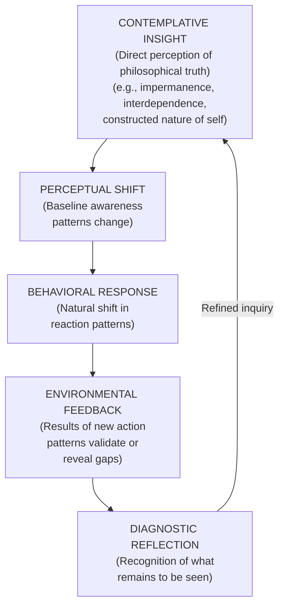

# Lesson 5: Ethics, Praxis, Transformative Pathways

## 1. First-Principles Intuition & Invariants

The central tension animating spiritual philosophy is deceptively simple yet operationally demanding: How does insight into the nature of reality translate into transformed action in the world? This question sits at the intersection of metaphysics, ethics, and phenomenology. To understand it rigorously, we must begin by recognizing that spirituality is not a domain of passive contemplation or abstract belief. Rather, it is a praxis—a lived system of intentional practice whose validity is measured by transformation in perception, cognition, and ethical responsiveness.

The first invariant is that spiritual development operates through *iterative feedback loops between insight and embodiment*. A philosophical understanding of non-attachment, for instance, remains inert theory until it manifests in actual patterns of renunciation, equanimity under loss, and freed attention. The Buddhist concept of *prajñapti* (conventional designation) versus *paramārtha* (ultimate truth) encodes precisely this distinction: we can intellectually grasp that the self is a conceptual construction, yet continue to operate from self-protective habit patterns. The work of praxis is to collapse this gap between intellectual assent and lived realization.

The second invariant emerges from the phenomenology of ethical development: *virtue is not added to the personality but rather emerges through systematic removal of obscurations*. This principle—articulated across Aristotelian habituation, Confucian self-cultivation, and Hindu *sādhana*—inverts the naive model where we acquire virtue like collecting objects. Instead, compassion arises naturally when fear-based contraction releases. Honesty emerges when the energy previously devoted to self-protection becomes available. This has profound methodological consequences: the practitioner's task is not to *manufacture* virtue but to progressively dismantle the cognitive and somatic patterns that obstruct its natural manifestation.

The third invariant concerns the architecture of soteriological goals—the ultimate aims that spiritual practice orients toward. These goals are not arbitrary destinations but rather descriptions of the endpoint state when all obscurations have been systematically removed. In Buddhist frameworks, this is *nirvana* (literally "blowing out" or cessation of reactive patterns). In Advaita Vedanta, it is *moksha* (liberation into recognition of non-dual Brahman). In Christian mysticism, it is *theosis* (union with divine nature). Despite terminological differences, these frameworks share a structural invariant: the ultimate aim is the cessation of the illusion of separation and the recognition of fundamental interconnection or unity. This is not a goal in the ego-driven sense of achievement but rather an uncovering of what has always been the case.

The tension between personal liberation and social engagement represents a crucial practical problem that deserves careful dismantling. The naive formulation presents a false dichotomy: either one pursues individual enlightenment (and is dismissed as selfish escapism) or one engages in social action (and is accused of worldly attachment). Yet this dichotomy collapses under examination. The Bodhisattva vow in Mahayana Buddhism—to defer one's own final liberation until all sentient beings are free—does not represent a compromise between spiritual and social commitments. Rather, it recognizes that *genuine spiritual insight necessarily generates compassionate action*. The person who deeply realizes interconnection cannot regard social suffering as external to their own liberation. Conversely, authentic social engagement rooted in genuine compassion (rather than ideological fervor or righteousness) emerges from spiritual insight into the fundamental interdependence of all beings.

This insight yields the operational principle: *the spiritual path and ethical action are not competing commitments but rather expressions of the same underlying realization, approached from different angles*. Personal contemplative practice generates the perceptual and cognitive stability from which wise action emerges. Engaged social action, when undertaken from genuine compassion rather than egoic ambition, functions as a mirror revealing remaining areas of attachment, aversion, and self-centered concern. The mature practitioner recognizes these as complementary practices in a unified system.

## 2. Core Architecture & Mechanics

To operationalize spiritual development, we must construct an explicit model of how practitioners progress through distinct stages, how each stage corresponds to specific ethical capacities, and how feedback loops between insight and embodiment function mechanically. This model integrates insights from developmental psychology (particularly Kegan's stages of self-authorship), contemplative phenomenology, and classical philosophical frameworks.

### The Architecture of Spiritual Development Stages

Consider the following five-stage developmental sequence, each characterized by distinct perceptual capabilities, ethical horizons, and characteristic obscurations:

**Stage 1: Reactive Egocentrism** represents the baseline human condition. The practitioner perceives reality through a survival-and-comfort optimization filter. The self is experienced as a bounded entity whose primary imperative is preservation and gratification. Ethical intuitions are externally imposed (fear of punishment, pursuit of reward, social conditioning). The characteristic obscuration is *ignorance* in the philosophical sense: fundamental misperception of the nature of self and other. Action flows from compulsive reactivity to stimuli. While not pathological, this stage is characterized by limited ethical responsiveness because moral understanding has not been internally integrated.

**Stage 2: Conventional Internalization** emerges through exposure to ethical frameworks and their internalization as identity-constitutive values. The practitioner begins to experience themselves as having a consistent character that is shaped by moral principles. Empathy develops—the capacity to recognize others' perspectives and suffering. This stage corresponds to what Kohlberg termed "conventional morality" and Kegan called the "socialized mind." Ethical capacity expands significantly because the practitioner now operates from internalized principles rather than external coercion. However, a crucial limitation remains: the ethical orientation is still fundamentally other-directed. The practitioner conforms to internalized social values and depends on these external frameworks to determine right action. The characteristic obscuration is *dependence on external authority for ethical direction*.

**Stage 3: Autonomous Integration** marks the emergence of capacity for genuine moral agency. Through contemplative practice and philosophical inquiry, the practitioner begins to directly investigate the validity of inherited ethical frameworks rather than merely accepting them. This stage corresponds to postconventional morality in Kohlberg's system. Crucially, it coincides with development of what might be called "perceptual flexibility"—the capacity to bracket automatic cognitive patterns and perceive situations with reduced conceptual filtering. This perceptual shift is essential: authentic ethical autonomy requires not merely intellectual rejection of inherited values but rather direct insight into ethical principles operating at a more fundamental level. The practitioner begins to recognize that principles like compassion, honesty, and non-harm emerge from the basic structure of interdependence rather than from conventional social agreement. Ethical responsiveness becomes increasingly fine-grained because the practitioner can perceive subtle relational dynamics and respond with precision rather than applying rigid rules. The characteristic obscuration that persists is *subtle self-deception about remaining egoic motivations*.

**Stage 4: Non-Dual Recognition** represents a qualitative transformation in fundamental perceptual orientation. Through sustained contemplative insight, typically cultivated through specific meditative methodologies, the practitioner begins to directly perceive the constructed nature of the sense of separate selfhood. This does not mean intellectual understanding but rather shift in the baseline perceptual field. The illusion of fundamental separation—the core perceptual error that generates all compulsive action—begins to dissolve. At this stage, compassion is no longer a moral principle one chooses to apply but rather the natural responsiveness that emerges when the sense of fundamental separation has been penetrated. Action flows with spontaneous appropriateness (*sahaja*) because the practitioner no longer operates from a position of strategic self-protection. The characteristic obscuration at this stage is subtle—patterns of attachment to the non-dual experience itself, or subtle forms of egoic pride about spiritual attainment.

**Stage 5: Integrated Embodiment** represents the final consolidation where non-dual insight is fully integrated into all dimensions of lived experience—perception, emotion, action, and social engagement. At this stage, the distinction between meditation and action dissolves. The practitioner's ordinary responsiveness to situations naturally reflects complete awareness of interdependence and genuine non-attachment. This stage is characterized not by withdrawal from the world but often by heightened engagement with social and ethical dimensions of human existence, precisely because personal liberation is recognized as inseparable from universal flourishing. The ethical framework is no longer something external to be applied but rather the natural expression of how reality is perceived and understood.

### The Feedback Loop Architecture

The transformation between stages is mediated by a specific feedback loop between contemplative insight and behavioral embodiment. This loop operates according to the following sequence:

**Initiation Phase**: The practitioner encounters a teaching or framework that points toward a deeper understanding of reality or a more refined ethical possibility. This might be direct instruction from a qualified teacher, encounter with philosophical texts, or observation of a realized practitioner. The key is that the framework creates a provisional hypothesis about how reality might be structured or how action might emerge from a less egoic orientation.

**Contemplative Investigation Phase**: The practitioner engages in sustained contemplative practice (meditation, philosophical reflection, phenomenological investigation) specifically aimed at testing this hypothesis through direct experience. In Buddhist frameworks, this is *bhavana* (cultivation). The practitioner is not attempting to believe the teaching but rather to perceive the phenomenon the teaching points toward. For instance, if the teaching is that all phenomena lack inherent, unchanging essence, the practitioner investigates whether this is verifiable through direct perception of their own experience. This phase generates two possible outcomes: either the hypothesis is validated through direct experience (generating genuine insight), or the investigation reveals the hypothesis as invalid and the practitioner adjusts their understanding.

**Behavioral Integration Phase**: When genuine insight has been generated, it naturally begins to affect behavioral patterns. This is crucial: authentic insight inevitably changes how a person responds to situations. If someone has genuinely perceived the constructed nature of their habitual emotional reactivity, their pattern of automatic anger in response to insult will naturally attenuate. This is not a matter of willpower or moral effort but rather automatic consequence of perceptual change. However, this phase is not instantaneous. Deep habit patterns have neurological and somatic substrates that persist even after intellectual understanding. The practitioner must repeatedly encounter triggering situations in order for new perceptual capacities to establish themselves as the new baseline response pattern.

**Feedback Recognition Phase**: As behavioral patterns shift, the practitioner encounters feedback from their environment that either validates the new mode of operation or reveals remaining obscurations. If genuine non-attachment has begun to emerge, for instance, the practitioner will discover that relationships become less fraught with anxiety about loss, social situations involve less desperate self-protection, and ethical decisions become clearer. Conversely, when the practitioner observes that they still react with defensiveness or self-centeredness in certain contexts, this provides crucial diagnostic information about what remains to be penetrated at the level of genuine insight. This feedback generates new questions and focuses contemplative inquiry more precisely.

**Loop Iteration**: Based on this feedback, the practitioner returns to contemplative investigation with more refined questioning. This cycle repeats, with each iteration typically revealing deeper, more subtle layers of egoic obscuration and generating correspondingly deeper insight. The loop is not linear but rather spiral-shaped, with the practitioner repeatedly encountering the same fundamental issues (fear, grasping, aversion) but at progressively more subtle and refined levels.

### Diagrammatic Representation

The following diagram illustrates how this feedback loop operates across the developmental stages:

This loop reveals why genuine spiritual development is necessarily *praxis* rather than abstract study. Knowledge of non-attachment remains sterile until it is tested in situations where attachment naturally arises. The practitioner who intellectually understands compassion but continues to hoard resources in moments of scarcity has not yet penetrated the insight. The environmental feedback—the persistence of hoarding behavior despite intellectual understanding—becomes diagnostic information that points toward what remains obscured. Perhaps the insight is genuine but not yet deeply integrated, or perhaps the understanding remains conceptual rather than perceptual.

### The Ethical Capacities Generated at Each Stage

Each developmental stage generates specific ethical capacities that reflect the perceptual and cognitive shifts characteristic of that stage:

**From Reactive Egocentrism**: The ethical capacity that emerges is basic *impulse modulation*. Even at this stage, the developing human begins to notice that immediate reactive responses sometimes produce negative consequences. This generates rudimentary capacity to pause before acting. While not yet rooted in ethical principle, this capacity for delay between stimulus and response (what Viktor Frankl called "the space between") is the precondition for all subsequent ethical development.

**From Conventional Internalization**: The capacity that emerges is *principled empathy*. The practitioner can now recognize others' perspectives, suffering, and dignity as genuinely real and worthy of consideration. This generates the capacity for authentic compassion rooted in recognition of shared humanity rather than mere sentimentality. Additionally, the practitioner develops capacity for *integrity*—alignment between stated values and behavior. The practitioner can now experience genuine shame or remorse when actions violate internalized principles, and this emotional response becomes a powerful motivator for behavioral change.

**From Autonomous Integration**: The capacity that emerges is *contextual ethical discernment*. Rather than applying predetermined rules, the practitioner can now perceive the unique relational and situational factors that determine what constitutes wise action. Additionally, the practitioner develops *genuine non-violence* that operates not merely at the level of physical action but at the level of intention. The capacity arises to notice when seemingly virtuous action is actually rooted in subtle aggression or self-righteousness. Furthermore, the practitioner develops *capacity for genuine listening*—the ability to encounter another person's perspective, values, and experience without immediately filtering it through one's own preconceptions.

**From Non-Dual Recognition**: The capacity that emerges is what might be called *spontaneous right action* or *sahaja karma*. At this stage, ethical responsiveness is not produced through deliberation but arises naturally and immediately as the right response to the situation. This is not a regression to unconscious reactivity but rather its opposite: highly refined responsiveness that operates with complete information (including awareness of subtle relational dynamics, others' needs and capacities, and systemic consequences). Additionally, the practitioner develops capacity for what Keats called "negative capability"—the ability to be present with uncertainty, moral ambiguity, and apparent contradictions without collapsing into premature certainty or defensive rigidity.

**From Integrated Embodiment**: The capacity that emerges is *authentic presence in service*. The practitioner's engagement with social and ethical dimensions of human existence is no longer motivated by either egoic ambition or ideological righteousness. Rather, engagement flows from genuine recognition that universal flourishing is inseparable from one's own liberation. This generates capacity for sustained ethical engagement without burnout or despair, precisely because the practitioner is not carrying the burden of personal agenda or attachment to outcomes.

## 3. High-Performance Optimization & Failure Modes

The practitioner who understands the architecture of spiritual development must also understand the characteristic failure modes and how to diagnose and navigate them. These failures do not represent terminal problems but rather predictable points where the system can become stuck or derailed. Recognition of these patterns is itself a crucial contemplative and ethical skill.

### Failure Mode 1: Conceptual Inflation Without Perceptual Shift

The most common failure mode is accumulation of sophisticated intellectual understanding without corresponding shift in actual perception and behavior. The practitioner studies non-dual philosophy intensively, can articulate complex arguments about the illusory nature of the separate self, yet continues to operate from fear-based self-protection and egoic concern. This is sometimes called "spiritual materialism"—the collection of teachings and practices as objects of acquisition rather than as means toward genuine transformation.

The diagnostic indicator of this failure mode is discrepancy between intellectual sophistication and behavioral capacity. The practitioner can speak eloquently about compassion yet continues to harm others through callousness. The practitioner understands theoretically that attachment generates suffering yet remains desperately grasping for security and comfort. This discrepancy itself is crucial feedback indicating that the inquiry has stalled at the conceptual level and has not penetrated to genuine perceptual insight.

The navigational strategy involves recognizing that intellectual understanding, while not inherently problematic, must be treated as provisional hypothesis rather than as realization. The practitioner must deliberately shift to more direct phenomenological investigation: meditation practice aimed at perceiving the actual structure of experience rather than thinking about it conceptually, behavioral experiments designed to test whether understanding translates to actual responsiveness, and solicitation of honest feedback from trusted practitioners about whether perceived behavioral shifts are actually occurring.

### Failure Mode 2: Premature Stabilization in an Intermediate Stage

The practitioner achieves genuine insight at one of the intermediate stages and then mistakes this for the endpoint of development. For instance, someone might achieve genuine perception of impermanence (characteristic of Stage 3 or early Stage 4) and conclude that they have realized non-dual awakening. Or someone might develop capacities for autonomous ethical discernment and suppose that they have transcended all remaining egoic patterns.

The diagnostic indicator is subtle but crucial: resistance to further inquiry, sense of arrival or completion, diminishment of genuine curiosity about what remains obscured. Additionally, the practitioner often becomes attached to practices or frameworks that generated the initial breakthrough and defensive about or dismissive of other approaches or perspectives. There may also be evidence of what Buddhists call *upadana* (grasping)—attempts to stabilize and hold onto the experience or state that was generated.

The navigational strategy involves cultivation of what the Zen tradition calls *beginner's mind*—radical openness to the possibility that even profound experiences are not the final realization.

The practitioner working through premature stabilization benefits from systematic exposure to what the Advaita tradition calls *turiya* (which Wilber incorporates into his framework) and what Tibetan traditions describe as the difference between *nyam* (temporary meditative experience) and *rigpa* (stable recognition of ground awareness). Concretely, this means seeking teachers or peers whose realization clearly exceeds one's own, deliberately entering situations that destabilize the acquired equilibrium, and returning to foundational practices with explicit instruction to look for what has not yet been seen. The Zen koan system is structurally designed for this purpose: each koan that "opens" reveals the next layer of obstruction, preventing any intermediate breakthrough from calcifying into a final resting point. The practitioner should also examine whether compassionate responsiveness extends consistently into domains of genuine personal cost, friction, or threat—since residual egoic patterning reliably surfaces under such conditions regardless of how stable meditative states appear in neutral circumstances.

### Failure Mode 3: Enacting the Realization in Only One Domain

A subtler and often unexamined failure involves genuine transformation in one dimension of life accompanied by arrested development or even compensatory regression in adjacent domains. The intellectually accomplished practitioner may undergo real cognitive and contemplative development while enacting relational immaturity. The devoted meditator may achieve sustained non-dual awareness while exhibiting ethical blind spots around power, money, or sexuality. The ethically scrupulous activist may develop genuine moral clarity while remaining entirely unexamined at the level of embodied presence or shadow. The diagnostic indicator here is asymmetry: conspicuous development along one axis paired with conspicuous stagnation or avoidance along another. The navigational strategy requires deliberate integration work across domains rather than deepening exclusively along the axis of greatest natural facility. This means submitting the whole of one's life—relationships, economics, embodiment, social roles—to the same quality of honest inquiry already applied to meditative or ethical development, using the gaps between domains as the most reliable signal of where genuine work remains.

---

## Summary & Verification Matrix

| Governing Invariant | Core Mechanism | Diagnostic Criteria | Failure Mode | Navigational Strategy | Cross-Tradition Reference |
|---|---|---|---|---|---|
| Realization must manifest across cognitive, behavioral, relational, and embodied domains simultaneously, not only in contemplative or intellectual registers | Integration of insight into the whole structure of lived action; Stage 4–5 development requires that ethical responsiveness and perceptual clarity become mutually reinforcing | Consistency of conduct under conditions of personal cost, social friction, and genuine threat; absence of conspicuous asymmetry between domains; corroboration from trusted external observers | Intellectual bypass: understanding substitutes for direct realization, producing sophisticated description without behavioral transformation | Shift from conceptual engagement to phenomenological investigation; behavioral experiments; solicit honest external feedback | Tibetan distinction between *tokpa* (conceptual understanding) and *nyams-su len-pa* (taking into experience); Zen insistence on "great doubt" preceding genuine breakthrough |
| No intermediate stage of development constitutes a final endpoint; every breakthrough reveals the next layer of obstruction | The structure of the path is recursive: each stabilized realization becomes the new platform from which subtler egoic patterns become visible | Resistance to further inquiry; sense of arrival; defensive attachment to practices or frameworks that generated the initial breakthrough; evidence of *upadana* (grasping) | Premature stabilization: genuine but partial insight mistaken for complete realization | Cultivation of beginner's mind; deliberate destabilization through advanced teachers, confrontational practice forms (koans), and high-friction life conditions | Zen koan system; Tibetan *nyam* versus *rigpa* distinction; Wilber's *turiya*; St. John of the Cross on the "dark night of the soul" as a necessary dissolution of intermediate attainments |
| Ethical praxis is both a consequence of and a cause of genuine realization; the relationship is bidirectional, not sequential | Behavioral enactment of insight restructures the perceptual field, making previously invisible patterns accessible; this is the mechanism underlying karma yoga and virtue ethics traditions | Actual change in habitual response patterns, especially under provocation; reduction in reactive self-protection; increased capacity for compassionate confrontation without ego investment | Enacting realization in only one domain: genuine depth in contemplation or ethics coexisting with arrested development in relational, embodied, or economic domains | Deliberate cross-domain integration; treating asymmetry between domains as the primary diagnostic signal for locating remaining work | Aristotle's *phronesis* as a whole-life virtue, not a cognitive skill; Tantric insistence on integrating *samaya* vows into every dimension of conduct |
| Transformative practice requires calibrated engagement with suffering rather than its avoidance or suppression | Contact with one's own suffering and that of others, held with non-reactive awareness, generates the motivational and perceptual conditions for genuine compassion and insight | Willingness to remain present with discomfort without immediately resolving it; capacity to hold paradox and uncertainty without premature closure; evidence of genuine equanimity rather than performed calm | Spiritual bypassing of shadow material: unintegrated trauma, grief, or aggression displaced into ostensibly spiritual frameworks, producing apparent serenity with intact egoic structure | Somatic and depth-psychological work alongside contemplative practice; shadow integration practices; deliberate engagement with grief, mortality, and interpersonal conflict | Jung's individuation process; Buddhist *dukkha* as the first noble truth (suffering as the entry point, not the obstacle); Rilke's injunction to "live the questions" |
| Communal and relational contexts are not auxiliary to development but constitute its necessary medium | The capacity for genuine intimacy, conflict repair, and other-recognition develops only through sustained relational engagement; isolated practice cannot generate these capacities regardless of its depth | Quality of actual relationships; capacity to be genuinely changed by an encounter with another person; ability to tolerate disagreement without withdrawal or aggression | Solitary development without relational testing: contemplative or ethical advances that never face the friction of genuine community or intimate relationship | Deliberate engagement in sangha, supervised relational practice, accountability structures, and feedback-rich communities of practice | Ubuntu philosophy ("I am because we are"); Buber's I-Thou versus I-It relational ontology; Confucian *ren* (benevolence) as intrinsically relational; Sufi emphasis on the *murshid* relationship |
| Authentic spiritual authority is verified by the quality of its fruits across time, not by the intensity of its experiences or the sophistication of its articulation | Development produces a characteristic signature: stable reduction in reactivity, increased availability for others, diminished need for self-confirmation, and growth in the capacity to bear uncertainty without distress | Long-term behavioral trajectory rather than peak states; response under conditions of failure, loss, or public challenge; absence of defensive self-presentation; willingness to be corrected | Charismatic performance of attainment: intense experiences or eloquent teaching substituted for the slow structural transformation that constitutes actual development | Longitudinal self-assessment against behavioral criteria; submission to peer and community accountability; explicit tracking of reactivity, generosity, and equanimity under adverse conditions | William James's pragmatic criterion ("by their fruits ye shall know them"); Theravāda *sīla-samādhi-paññā* sequence; Ignatius of Loyola's *discernment of spirits* as a fruit-based verification method |
