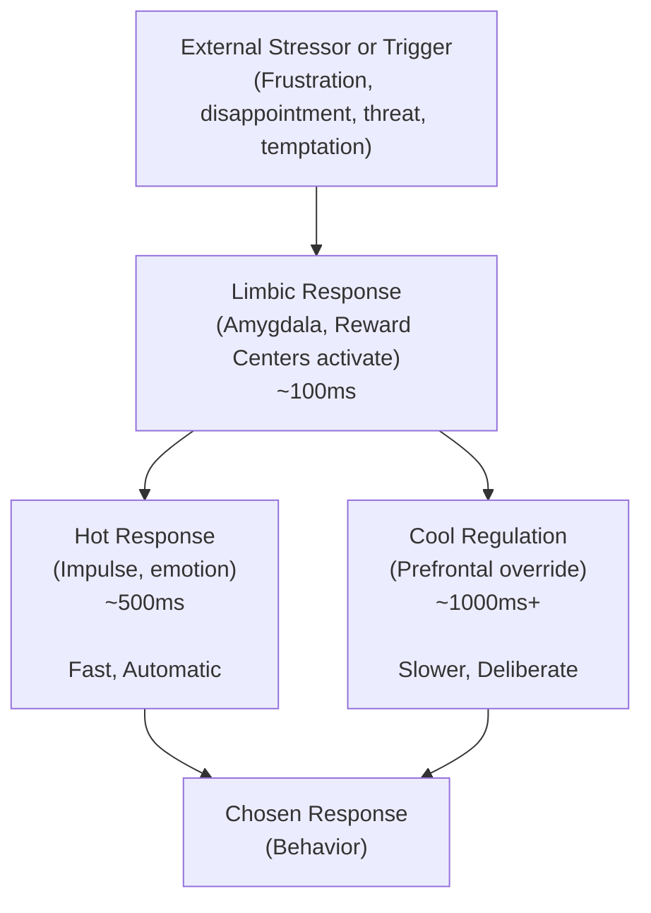

# Lesson 4: Emotional Regulation, Executive Function Development, Self-Control

## 1. First-Principles Intuition & Invariants

The human brain does not arrive in the world as a finished instrument of self-governance. A newborn possesses reflexive responses—crying when hungry, startle reactions to loud noises, primitive attraction to faces—but possesses virtually no capacity to modulate these responses or to delay gratification. The journey from reactive infant to thoughtful adult capable of managing impulses, tolerating frustration, and regulating emotional states represents one of the most profound developmental transformations in human psychology. Understanding this transformation is not merely academic; it is the foundation upon which all effective parenting practice rests.

At the most fundamental level, emotional regulation and executive function emerge from the progressive maturation of the prefrontal cortex—the newest evolutionary addition to the human brain. While limbic structures (the amygdala, hippocampus, and other emotion centers) are relatively mature by early childhood, the prefrontal cortex continues its developmental arc well into the mid-twenties. This asynchronous maturation creates the essential problem that parents must solve: children possess intense emotional and motivational systems long before they possess the neurobiological infrastructure to manage them effectively. The parent's role, therefore, is not to eliminate emotions or to demand impossible self-control, but rather to serve as an external regulator while gradually building the child's internal regulatory capacity.

The distinction between "hot" and "cool" executive functions provides critical clarity here. Cool executive functions are those deliberate, goal-directed processes we associate with planning, working memory, cognitive flexibility, and logical problem-solving. These functions operate in the dorsolateral prefrontal cortex and are relatively slow, effortful, and dependent on sustained attention. Hot executive functions, by contrast, are those emotionally-laden decision-making processes that occur when motivation, reward, and emotional salience are high. These functions operate through connections between prefrontal regions and limbic reward centers (the ventromedial prefrontal cortex and striatum) and represent the capacity to resist temptation, delay gratification, and manage impulses in contexts where something desirable is immediately available. A child might perform flawlessly on a laboratory measure of working memory or cognitive flexibility yet completely fail to apply those same capacities when emotionally aroused or when faced with an attractive reward. This discrepancy is not hypocrisy or willful defiance; it is a straightforward reflection of neurobiological reality.

The classic marshmallow test, conducted decades ago by Walter Mischel and colleagues, illustrated this principle with elegant simplicity. Children were offered a choice: take one marshmallow immediately, or wait fifteen minutes and receive two marshmallows. The critical finding was not merely that some children waited and others did not, but that the same child who successfully delayed gratification in one context often failed in another, depending on whether the reward was visible, whether distracting activities were available, or whether the child's emotional state had shifted. The capacity to regulate impulses is not a fixed trait but rather a context-dependent skill that develops through practice, that depends on available cognitive resources, and that can be systematically supported or undermined by environmental design.

Equally important is the understanding that emotion itself is not the problem to be solved. Parents often operate under the mistaken assumption that the goal is to eliminate negative emotions—anger, sadness, frustration, disappointment—from their children's experience. This misunderstanding leads to well-intentioned but counterproductive parenting practices: rescuing children from all discomfort, removing all sources of frustration, or punishing emotional expression. In fact, the developmental goal is not emotional absence but emotional literacy and emotional resilience. Children must develop the capacity to experience the full spectrum of human emotion, to recognize and name their emotional states, to understand the information that emotions convey, and to choose their behavioral responses even in the presence of strong feeling. This is regulation, not suppression.

The transition from co-regulation to self-regulation represents the central developmental arc that parenting must facilitate. Infants and toddlers are entirely dependent on their caregivers to regulate their emotional and physiological states. When an infant is distressed, the caregiver's soothing presence, gentle touch, and predictable response literally calm the child's nervous system through the process of co-regulation. Over time, as the prefrontal cortex matures and the child internalizes the experience of being soothed, the child gradually develops the capacity to regulate these states from within. However, this transition is not binary or sudden. The twelve-year-old still benefits from parental co-regulation when overwhelmed; the teenager still needs to know that regulation support is available even as they build their independent capacity. Understanding this developmental gradient prevents parents from either holding on too long or withdrawing support too soon.

The neurobiological substrate of this transition involves the progressive myelination and strengthening of connections between prefrontal and limbic regions. Myelination—the insulation of neural pathways with fatty sheaths—increases the speed and efficiency of neural signaling and continues throughout childhood and adolescence. Additionally, synaptic pruning eliminates unused connections while strengthening frequently-used pathways. When a child repeatedly practices managing frustration with parental support, the neural circuits that support this regulation become more efficient and more readily accessible. Conversely, when a child repeatedly fails or is left to manage overwhelming emotion alone without adequate support, the neural pathways that would support regulated response become less developed. Parenting, in this sense, is quite literally shaping neural architecture.

The concept of effortful control provides a bridge between these neurodevelopmental processes and observable behavior. Effortful control refers to the capacity to voluntarily direct attention, inhibit prepotent responses, and activate goal-directed behavior even in the presence of competing impulses or emotions. A child with strong effortful control can shift attention away from an attractive distraction when instructed to do so, can pause before responding when frustrated, and can maintain persistence toward a goal even when progress is slow. Effortful control is partially constitutionally determined—children vary in their baseline capacity due to genetic factors and early neurobiological development—but is also significantly shaped by parenting practices and environmental support. Importantly, effortful control is a learnable skill that can be strengthened through practice, much like a physical muscle.

Temperament, understood as the stable behavioral and emotional patterns that individuals exhibit across situations, represents another critical first-principle invariant. Children differ markedly in their emotional reactivity, their threshold for stimulation, their response to novelty, and their sociability. An intensely reactive child experiences emotions more acutely, has a lower threshold for overstimulation, and may require qualitatively different parenting approaches than a less reactive, more adaptable child. The optimal parenting approach is not universal but must be calibrated to the child's constitutional temperament—a principle known as temperament-parenting fit or goodness of fit. Parents who understand their child's temperament and adapt their approaches accordingly observe marked improvements in the child's regulatory capacity and emotional well-being. Parents who attempt to apply standardized approaches without accounting for temperament often inadvertently undermine the very regulatory capacities they seek to develop.

The final foundational principle concerns the distinction between emotion and behavior. Parents must internalize and communicate to their children that all emotions are acceptable and deserving of respect, while not all behaviors are acceptable. A child may feel intense anger toward a sibling; this feeling requires acknowledgment and understanding. The same child striking the sibling requires a clear boundary and consequence. This distinction prevents parents from either permitting harmful behavior in the name of respecting emotions or, conversely, punishing children for emotional experience itself. The goal is to help children become skilled at expressing and managing their emotions through socially acceptable and personally effective channels.

## 2. Core Architecture & Mechanics

The architecture of emotional regulation and executive function operates across multiple integrated neural systems, each with distinct temporal dynamics and functional properties. Understanding these systems and their interaction patterns is essential for designing effective parenting interventions.

The limbic-prefrontal circuit forms the foundation of emotional regulation. The amygdala, located deep within the temporal lobe, serves as the brain's emotional alarm system. It detects threat, assigns emotional significance to stimuli, and triggers rapid physiological responses—increased heart rate, heightened vigilance, muscle tension—that prepare the body for defense. This system operates quickly, on the order of milliseconds, and does not require conscious awareness. This is why a person can feel afraid of a snake before consciously recognizing it; the amygdala has already initiated a defensive response. In children, the amygdala is relatively mature by early childhood and in fact becomes somewhat hyperreactive during adolescence, contributing to the increased emotional intensity of the teenage years.

The prefrontal cortex, and particularly the ventromedial prefrontal cortex, serves a regulatory counterbalance to this amygdala activation. This region integrates information about emotional significance with contextual knowledge about actual threat level, learned associations, and goal-directed priorities. When a parent helps a frightened child by explaining that the dog is friendly, providing physical comfort, and demonstrating calm behavior, the parent is essentially recruiting the child's prefrontal regions to provide a corrective signal to the overactive amygdala: this situation, though emotionally arousing, is not actually dangerous. Over repeated exposures with this type of parental support, the child's own prefrontal regions gradually become more capable of generating this corrective signal independently. The trajectory of fear management in childhood—from complete dependence on parental reassurance to increasing self-reassurance—maps directly onto this progressive prefrontal maturation and circuit strengthening.

The anterior cingulate cortex and dorsolateral prefrontal cortex form what might be understood as the executive control hub. These regions support working memory, cognitive flexibility, attention allocation, and the monitoring of conflict between competing goals or impulses. When a child faces a situation where an impulse (grabbing a toy from a peer) conflicts with a goal (maintaining the friendship), the anterior cingulate registers this conflict and signals the dorsolateral prefrontal cortex to allocate additional attentional resources to inhibiting the prepotent response. This monitoring and resource allocation requires metabolic energy and conscious effort; it cannot be sustained indefinitely. This is why children—and adults—show degraded self-control when cognitively tired, emotionally depleted, or facing multiple competing demands simultaneously. Good parenting does not expect children to maintain constant vigilant self-control; rather, it structures the environment to reduce unnecessary conflicts and preserves the child's regulatory capacity for situations that truly matter.

The ventral striatum and related reward circuitry represent another crucial system. This system drives motivation and approach behavior toward rewarding outcomes. In children, this system is highly active and sensitive, which explains both the intense positive engagement children display toward enjoyable activities and their difficulty disengaging from rewarding stimuli. The classic inability of a young child to leave a fun activity when the parent announces it is time to transition reflects not defiance but rather the neural reality that the reward system is shouting "Stay! This is great!" while the prefrontal regulatory system whispers "We agreed to transition in five minutes." With maturation and practiced rehearsal, the prefrontal system gradually gains influence over these reward-driven impulses, but this process unfolds over years, not weeks.

The autonomic nervous system—the sympathetic and parasympathetic branches—provides the physiological substrate through which emotional and regulatory states manifest. Sympathetic activation increases heart rate, blood pressure, and respiratory rate and shifts blood flow away from the gut toward the large muscles and brain; this is the "fight or flight" response. Parasympathetic activation, particularly through the vagus nerve, produces the opposite pattern: heart rate slows, digestive function increases, and the body shifts into a calmer state amenable to social connection and thoughtful decision-making. When a child is in sympathetic dominance (flooded with stress hormones and defensive arousal), attempts at reasoning, logical consequence delivery, or behavioral instruction are largely futile; the neural systems supporting these functions are offline. The child's body must be returned to parasympathetic dominance through co-regulatory support—calm adult presence, physical closeness, deep breathing—before genuine learning and behavior change become possible. This explains why time-outs delivered during peak emotional escalation are ineffective, while the same consequence delivered after the child has been supported back toward calm can actually facilitate learning.

The development of these systems does not proceed in a linear or synchronous fashion. The amygdala reaches near-adult capacity relatively early—by ages six to eight—while the dorsolateral prefrontal cortex continues developing into the mid-twenties. The anterior cingulate, critical for monitoring conflict and error detection, shows substantial development between ages seven and twelve but continues refining through adolescence. The reward circuitry, particularly sensitive to dopamine and strongly driven during adolescence, contributes to both remarkable goal-directedness and increased vulnerability to impulsive decision-making during the teenage years. Parents who understand this temporal asynchrony avoid the common error of expecting adult-like judgment and impulse control from children whose brains are literally not yet capable of it, while still maintaining developmentally appropriate expectations.

Consider the following schematic representation of the regulatory circuit:

This temporal architecture explains why immediate emotional responses feel automatic and compelling while deliberate regulation requires effort and cannot be sustained indefinitely. It also explains why context matters enormously: in low-stress situations with ample cognitive resources, the prefrontal system can readily exert influence; in high-stress situations with depleted resources, the limbic system dominates. Skilled parents work with this architecture rather than against it, reducing unnecessary stressors, supporting the child's return to calm before attempting behavioral instruction, and systematically practicing regulatory skills under low-stress conditions so that they become more readily accessible under stress.

The distinction between hot and cool executive functions maps onto this temporal and neural architecture. Cool executive functions—working memory, cognitive flexibility, planning—involve the dorsolateral prefrontal cortex and operate in relatively low-emotion contexts. A child can perform admirably on a puzzle or math problem (cool function) while completely failing to apply similar logical thinking to a situation involving jealousy or desire (hot function). The neural circuitry is different, the time constants are different, and the motivational context is different. Effective parenting develops both systems but recognizes that they require different training approaches and different environmental supports.

The emotion coaching model, developed by John Gottman and colleagues, provides a practical framework for understanding and supporting this regulatory development. In this model, parents move through distinct stages in response to a child's emotional expression. The first stage is awareness and empathy—the parent recognizes the child's emotional state and responds with genuine understanding and acceptance. A parent might say, "I see you're really disappointed that you can't go to the party" rather than "Stop being so upset about this." The second stage involves labeling and validation—the parent helps the child identify the specific emotion and communicates that this emotion, while uncomfortable, is understandable and acceptable. "That's a big disappointment. It makes sense that you feel sad and frustrated." The third stage involves coaching—once the child is calm and receptive, the parent helps the child understand what triggered the emotion and what choices the child has in how to respond. "When things don't go the way we hoped, that disappointed feeling is normal. Some people want to talk about it, others want to be alone for a bit, others do something active to feel better. What helps you?" The fourth stage involves establishing limits and problem-solving—the parent affirms that the emotion is acceptable while establishing boundaries on behavior and collaboratively exploring solutions. "I understand you're angry, and you can feel angry. I also need you to use words, not hit your brother. Let's figure out what comes next."

This model is powerful precisely because it maps onto the neurobiological reality of emotional regulation development. By staying present with the child's emotion without dismissing or panicking about it, the parent co-regulates the child's nervous system. By labeling the emotion, the parent engages the child's prefrontal language centers, which themselves have a regulatory effect on limbic activation. By coaching skills and collaboratively problem-solving, the parent simultaneously supports the child's immediate need for regulation and builds the child's long-term capacity for self-regulation. Over time, children who receive this type of emotion coaching develop stronger prefrontal-limbic connections, greater emotional awareness, more effective regulatory strategies, and paradoxically, fewer behavioral problems overall.

The relationship between attention and impulse control deserves particular emphasis. Attention is not a unitary function but rather a distributed neural system involving the prefrontal cortex, parietal regions, and subcortical structures. Sustained attention—the ability to maintain focus on a task over time—relies heavily on the dorsolateral prefrontal cortex and becomes more stable through childhood and adolescence. Attentional capture—the automatic orientation of attention toward novel, emotional, or rewarding stimuli—involves more primitive systems and actually remains somewhat hyperresponsive throughout life, particularly to threat and reward. When a parent removes appealing distractions before asking a child to focus on a less exciting task, the parent is reducing the strength of bottom-up attentional capture, thereby requiring less top-down attentional control from the child. This is not "giving in" to the child's weakness but rather understanding neural architecture and designing the environment accordingly. Similarly, when a parent helps a child focus attention on the task itself ("Let's look at what we're building") rather than on the discomfort of the transition ("I know it's hard to stop playing"), the parent redirects the child's attention in a way that engages different neural systems and makes regulation more achievable.

## 3. High-Performance Optimization & Failure Modes

The development of emotional regulation and executive function is not an automatic process that unfolds identically in all children under all circumstances. Rather, it is a complex developmental achievement that depends on both the child's constitutional capacities and the environmental support provided by caregivers.

### Conclusion

The interplay between constitutional capacities and environmental scaffolding creates developmental trajectories that are probabilistic rather than deterministic. Children with naturally stronger prefrontal connectivity, higher baseline vagal tone, or temperamental characteristics favoring low reactivity require less environmental support to achieve competent self-regulation, while children with the opposite profile require substantially more intensive co-regulation, environmental structuring, and explicit teaching. Critically, the absence of such support does not simply delay development—it can fundamentally alter neural architecture through mechanisms including chronic stress-induced hippocampal and prefrontal atrophy, dysregulated HPA axis function, and the entrenchment of maladaptive regulatory strategies such as behavioral avoidance, emotional suppression, or externalizing aggression. The failure mode is not simply an incompetent child, but rather a child who has become competent at a different set of regulatory strategies—strategies that may be adaptive in chaotic or threatening environments but maladaptive in contexts requiring sustained attention, impulse inhibition, and flexible problem-solving. Conversely, optimal development occurs when parental co-regulation is consistently available during high-arousal states, when the environment is structured to reduce unnecessary regulatory demands, when children receive explicit teaching about their own emotional and cognitive processes, and when developmental expectations are calibrated to the child's actual neural maturity rather than chronological age or social comparison. The result is not merely behavioral compliance but the development of genuine self-regulatory capacity: the ability to recognize one's own internal states, deploy appropriate regulatory strategies, tolerate distress in service of valued goals, and flexibly adjust behavior in response to changing demands.

## Summary & Verification Matrix

| **Domain** | **Governing Invariant** | **Core Mechanism** | **Diagnostic Criteria** | **Failure Mode** |
|------------|------------------------|-------------------|------------------------|------------------|
| **Emotional Regulation** | Co-regulation precedes and enables self-regulation; regulation develops through repeated cycles of dysregulation-support-recovery | Caregiver labels emotion, validates experience, models strategy, provides physical/verbal soothing → child internalizes process | Child can name emotions, deploy age-appropriate strategies (distraction, reappraisal), recover from upset within developmentally typical timeframe with decreasing support | Chronic dysregulation, inability to identify internal states, rigid reliance on avoidance/suppression, or prolonged tantrums without caregiver ability to support recovery |
| **Executive Function Development** | Prefrontal cortex maturation extends through mid-20s; cognitive control emerges hierarchically (inhibition → working memory → cognitive flexibility) | Myelination of prefrontal-subcortical circuits + synaptic pruning + experience-dependent strengthening of regulatory networks | Age-appropriate performance on impulse control tasks, working memory span, task-switching; improvement with environmental scaffolding | Persistently poor inhibitory control despite scaffolding, extreme difficulty with transitions, working memory deficits interfering with daily function, inability to learn from consequences |
| **Attentional Systems** | Bottom-up attentional capture (automatic, fast, subcortical) precedes and competes with top-down attentional control (effortful, slow, prefrontal); environmental design reduces bottom-up load | Reduced environmental distractors decrease attentional capture demands → less prefrontal effort required → sustained attention becomes achievable | Child can sustain attention on non-preferred tasks for age-appropriate durations when environment is structured; gradual increase in tolerance for distractions over development | Inability to sustain attention even in optimized environment, constant attentional capture by irrelevant stimuli, or conversely, hyperfocus with inability to disengage |
| **Stress Response & HPA Axis** | Moderate, controllable stress with available support promotes resilience; chronic uncontrollable stress dysregulates HPA axis and impairs prefrontal development | Repeated co-regulation during stress → parasympathetic recovery → normalized cortisol patterns → preserved hippocampal/prefrontal structure and connectivity | Child shows physiological recovery after stress (heart rate, cortisol), seeks support appropriately, demonstrates increased stress tolerance over time | Chronic hyperarousal, flattened or chaotic cortisol patterns, learned helplessness, aggressive or withdrawn stress responses, or inability to access support |
| **Developmental Calibration** | Regulatory demands must match current neural capacity; mismatch creates either under-stimulation (no growth) or over-demand (dysregulation/failure) | Zone of proximal development for self-regulation: slightly beyond current capacity with available support → successful experience → neural strengthening → expanded capacity | Child experiences mostly successful regulation attempts with appropriate support, shows gradual independence, maintains confidence during challenges | Repeated regulatory failures leading to shame/defiance, or conversely, over-protection preventing any regulatory challenge and capability development |
| **Strategy Acquisition** | Regulatory strategies must be explicitly taught, practiced during low-arousal states, and supported during high-arousal application before autonomous use | Instruction + modeling → low-stakes practice → guided application under stress → independent deployment → strategy becomes automatic | Child can name and demonstrate strategies when calm, increasingly remembers and applies them when upset (with prompting, then independently), expands strategy repertoire over time | No knowledge of strategies, inability to access strategies under stress despite knowing them cognitively, or rigid reliance on single strategy regardless of context |
