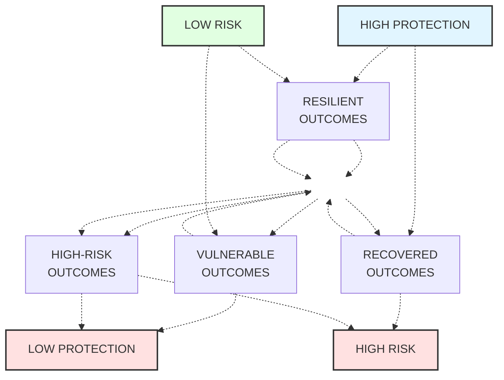

# Lesson 6: Risk, Resilience, Developmental Psychopathology, Intervention Frameworks

## 1. First-Principles Intuition & Invariants

The fundamental paradox of human development lies in this observation: two children exposed to identical adversity follow radically divergent life trajectories. One becomes trapped in cycles of dysfunction; the other emerges with strengthened adaptive capacity. This divergence is not random. It reflects the operation of identifiable mechanisms—risk factors, protective processes, and developmental timing—that determine whether environmental stress culminates in pathology or catalyzes resilience.

Developmental psychopathology rejects the traditional medical model's binary disease categorization. Rather than asking "Does this child have a disorder?" the field asks "What are the multiple pathways by which this developmental outcome emerged, and what alternative pathways might have led elsewhere?" This shift from categorical diagnosis to transactional process constitutes the theoretical foundation upon which modern parenting interventions rest.

At the deepest level, three invariants govern this process. First, **development is multidetermined**—any observed outcome results from confluent influences across biological, psychological, social, and contextual domains. A child's aggressive behavior cannot be reduced to temperament, family dynamics, peer relationships, or trauma exposure alone; it emerges from their interactive effects. Second, **risk and protection are relative, not absolute**—a factor's significance depends entirely on context, developmental stage, and the presence or absence of other influences. Parental strictness protective against delinquency in one ecological niche may precipitate rebellion in another. Third, **timing and sequencing matter profoundly**—the same stressor produces different developmental consequences depending on whether it occurs during sensitive periods of neural development, at times of high existing cumulative stress, or when protective resources are available.

The diathesis-stress model provides the conceptual architecture for integrating these invariants. Diathesis refers to predisposition—constitutional vulnerability, whether genetic, neurobiological, or established through prior experience. Stress refers to environmental demands, adversity, or triggering events. Pathology emerges not from either alone but from their interaction: high diathesis with minimal stress may remain latent; low diathesis with severe stress may be buffered by resilience mechanisms. The critical insight is that intervention can operate at either pole. We can reduce diathesis through biological or psychological treatment; we can reduce stress or improve stress processing through environmental modification or skill-building. Most powerful interventions target both simultaneously.

Adverse Childhood Experiences (ACEs)—including abuse, neglect, household substance abuse, parental mental illness, parental incarceration, and domestic violence—represent one critical category of stress. The seminal ACE study by Felitti and colleagues demonstrated dose-response relationships: children with four or more ACEs showed dramatically elevated rates of obesity, substance abuse, mental health disorders, and premature mortality in adulthood. Yet the study also revealed a sobering complexity: many high-ACE children do not develop these outcomes. This variability points directly to protective factors—the mechanisms through which some children maintain adaptive functioning despite significant adversity.

Protective factors operate through three primary mechanisms. **Promotive factors** reduce the impact of risk through direct beneficial effects—secure attachment relationships, cognitive ability, or access to quality education directly enhance functioning regardless of adversity level. **Buffering factors** reduce the harmful impact of specific risk exposures—a supportive teacher buffers the effects of family chaos; strong peer relationships buffer the effects of parental discord. **Challenge factors** transform adversity itself into developmental opportunity—age-appropriate responsibility, manageable stress exposure, and supported problem-solving build genuine resilience rather than mere symptom absence.

Equifinality and multifinality represent complementary developmental processes that fundamentally reshape how practitioners conceptualize outcomes. Equifinality means that different initial conditions and developmental pathways can converge on the same endpoint—multiple children with distinct risk profiles, experiences, and starting points all develop secure attachment, academic competence, or prosocial behavior. This principle undermines deterministic thinking. A child whose early history included deprivation, loss, or trauma is not mechanistically destined toward poor outcomes; alternative pathways remain available. Multifinality means that a single risk factor produces diverse outcomes across different children—early peer rejection precipitates social anxiety in one child, aggressive delinquency in another, and academic focus in a third. The same diathesis, filtered through different protective contexts and developmental moments, generates heterogeneous phenotypes.

These principles collectively establish the practitioner's fundamental task: not predicting fixed outcomes but identifying the specific constellation of risks, protections, and mechanisms operating in each family system, then strategically intervening to shift the balance toward adaptive development.

## 2. Core Architecture & Mechanics

The diathesis-stress framework operates as an interactive system in which environmental demands are processed through the lens of individual predisposition to generate developmental outcomes. To make this system legible for intervention, practitioners must decompose it into actionable components and assess their relative influence in specific cases.

**The Risk and Protective Factor Matrix** structures this assessment. Create a two-dimensional map with risk factors on one axis and protective factors on the other, then plot the specific family's position within this space.

This two-dimensional representation immediately illuminates why a high-risk child might show adaptive functioning (sufficient protection) and why a low-risk child might struggle (insufficient protective resources or emerging psychological distress unrelated to classical risk exposure). The map also identifies intervention leverage points: increase protective factors through skill-building or resource access, decrease risk exposure through safety planning, or both simultaneously.

Operationally, practitioners populate this matrix through structured assessment. On the risk dimension, catalogue distal factors (poverty, parental psychopathology, neighborhood violence), proximal factors (parenting harshness, family conflict, inconsistent discipline), and child factors (difficult temperament, neurodevelopmental challenges, prior trauma). On the protection dimension, identify individual child capacities (emotional regulation, social competence, cognitive ability), family resources (parental warmth, family cohesion, effective discipline), and extrafamilial supports (quality school, mentoring relationships, cultural/spiritual community, access to services).

The diathesis-stress interaction itself requires explicit mapping. Consider a specific child and a specific stressor. If the child has low diathesis (good emotional regulation, secure attachment history, high cognitive ability) and encounters moderate stress (single parental loss, school transition), the outcome is likely adaptive. If the same child encounters cumulative stress (parental bereavement plus parental depression plus school disruption), even low diathesis may be overwhelmed. Conversely, a child with high diathesis (impulsive temperament, prior trauma exposure, emerging emotional dysregulation) encountering minor stress may develop maladaptive responses through reinforcement loops. But that same child in a high-protection context—consistent parenting, evidence-based skill-building, and therapeutic support—may show genuine resilience. The principle: no outcome is predetermined; the interaction determines the trajectory.

**Cumulative Risk Models** capture a critical clinical reality: it is rarely a single risk factor that precipitates pathology but rather the accumulation, interaction, and timing of multiple adversities. A parenting intervention must therefore assess not isolated risks but cumulative burden. A common clinical tool, the Cumulative Risk Index, assigns points for presence of established risks (poverty, parental substance abuse, parental mental illness, harsh discipline, parental separation, neighborhood violence, peer rejection, academic failure) and calculates a total burden score. Children with scores above thresholds show significantly elevated rates of behavioral and emotional problems. The critical clinical insight: a child with three moderate risks and strong protection may show better outcomes than a child with one severe risk and minimal protection. This nonlinear, interactive model directly informs intervention design.

**Developmental Pathways and Cascade Effects** map how risk unfolds across time. The pathway concept rejects static categorization in favor of dynamic process. Consider this concrete cascade: early parental depression → reduced parental sensitivity and responsiveness → insecure attachment → reduced exploration and learning → academic delay → peer rejection → internalizing symptoms. This pathway is not inevitable; intervention at any point disrupts the cascade. A depression-specific parental intervention (addressing diathesis) plus structured parenting coaching (addressing proximal family risk) plus classroom accommodation and peer social skills training (addressing downstream effects) collectively shift the trajectory.

The **trauma-informed lens** requires special attention because traumatized children often present as "difficult" when their behavior reflects adaptive survival responses to threat. A child who seems oppositional during parenting may have learned that compliance invites abuse; apparent lack of remorse may reflect dissociation from emotions; apparent indifference to consequences may reflect altered threat perception. Standard parenting approaches that increase consequences, heighten parental intensity, or emphasize obedience can retraumatize by activating threat detection systems. Trauma-informed parenting instead prioritizes safety (predictability, physical and emotional safety), trustworthiness (transparency, consistency, honesty), choice and control (autonomy within structure), collaboration (partnership rather than hierarchy), and empowerment (recognizing strength and building mastery).

**Protective Factor Mechanisms** operate through specific psychological processes. The **social support mechanism** buffers stress through emotional, instrumental, and informational resources—a parent learns effective discipline through coaching, experiences emotional validation from a support group, and receives concrete help with childcare. The **competence mechanism** builds genuine resilience through mastery experiences—a child practices emotional regulation and experiences success; a parent learns to interpret child behavior through a developmental lens and experiences efficacy. The **meaning-making mechanism** transforms adversity into coherence—a family processes trauma through narrative, connects their struggle to broader resilience stories, and develops posttraumatic growth. Evidence-based interventions deliberately activate these mechanisms.

## 3. High-Performance Optimization & Failure Modes

**Evidence-Based Parenting Interventions: Comparative Architecture**

Three interventions represent the empirical gold standard: Parent-Child Interaction Therapy (PCIT), Parent Management Training (PMT), and the Triple P system. Each embodies distinct theoretical assumptions and targets different mechanisms, yet all demonstrate robust efficacy across diverse populations.

Parent-Child Interaction Therapy operates through live coaching of parent-child interaction. During sessions, the therapist watches parent and child play through a one-way mirror or via telehealth video. Using an earpiece connected to the parent, the therapist provides real-time feedback and modeling. In the "child-directed" phase, the therapist coaches the parent to follow the child's lead, use labeled praise, provide reflections, and build warmth—directly strengthening attachment and safety. In the "parent-directed" phase, the therapist coaches the parent to establish clear, consistent expectations; use effective commands; respond to compliance with praise; and respond to noncompliance with brief, consistent consequences. PCIT directly targets both diathesis (attachment security, emotion regulation capacity) and proximal risk (parenting harshness, inconsistency). Its power derives from real-time, behaviorally specific coaching in the actual interaction context rather than abstract instruction.

Parent Management Training emphasizes mastery of behavioral principles and consistent application within the family system. Parents learn to identify specific behavioral targets, understand the antecedents and consequences maintaining those behaviors, and systematically modify consequences to shape new patterns. PMT is particularly effective for oppositional and aggressive behavior because it interrupts reinforcement cycles—the parent learns that inconsistent attention to misbehavior (even angry attention) reinforces it; consistent, calm implementation of consequences combined with reinforcement of prosocial behavior reliably shifts behavior. PMT also addresses a critical failure mode: parents often recognize the problem but lack concrete skills or persistence to implement solutions. The intervention provides structure and support for sustained implementation.

Triple P (Positive Parenting Program) operates as a tiered prevention and intervention system, from population-level messaging (tier 1, universal prevention) through intensive individual therapy (tier 4, indicated prevention for high-risk families). Core content emphasizes positive family relationships, parental confidence and efficacy, and strategic problem-solving around specific behavioral challenges. Triple P's comparative advantage lies in its scalability—the same principles are delivered through group formats, individual coaching, online modules, or brief consultations—allowing population-level reach while maintaining intervention fidelity. For families with multiple risk factors, intensive Triple P combined with coordinated services (mental health treatment, substance abuse intervention, domestic violence support) demonstrates particular effectiveness.

**Mechanisms Targeted and Failure Mode Prevention**

Each intervention targets specific failure modes. PCIT prevents the failure mode of "parenting harshness and disconnection from child" by building attachment security and warmth directly. PMT prevents the failure mode of "inconsistent, ineffective discipline" by establishing clear behavioral contingencies and building parental mastery. Triple P prevents the failure mode of "isolated parenting stress without adequate support and skill development" by combining skill-building with broader support and problem-solving.

Yet interventions fail when mechanisms are not activated. PCIT fails if the parent experiences shame or defensiveness that prevents authentic engagement with coaching; if the child has severe developmental delays that limit conventional interaction; or if the family system includes active trauma, untreated parental mental illness, or substance abuse that overwhelms the parent's capacity to benefit. PMT fails if the parent cannot sustain the effort required for consistent implementation, if the family experiences overwhelming cumulative stress, or if the targeted behavior has become so deeply entrenched and reinforced that isolated parenting change is insufficient. Triple P fails if cultural adaptations are inadequate, if fundamental family needs (safety, basic resources) remain unmet, or if the parent lacks motivation due to depression, ambivalence, or competing demands.

**Integrated Assessment and Intervention Planning**

High-performance practice integrates assessment and intervention through this workflow:

First, conduct a **multidimensional family assessment** that maps risk and protective factors across child (developmental status, temperament, trauma history, strengths), parent (mental health, substance use, parenting skills, trauma history, motivation for change), and family system (conflict, cohesion, resources, safety, values). This assessment moves beyond symptom description to contextual understanding.

Second, establish a **shared conceptualization** with the family. Explain the diathesis-stress model in accessible terms. Help the family understand how their child's behavior reflects understandable responses to their particular constellation of influences. Identify together which factors are most modifiable in the near term. This shared understanding builds engagement and motivation.

Third, **prioritize interventions by leverage**. Not all problems can be addressed simultaneously. High-leverage interventions target mechanisms that, when addressed, produce cascading improvements. If the parent has untreated depression, parenting coaching will likely fail; depression treatment is prerequisite. If the family experiences housing instability or food insecurity, parenting skill-building is insufficient; basic needs must be met first. If the child has experienced trauma, trauma-specific treatment should precede or accompany parenting work. Sequencing matters profoundly.

Fourth, **implement with fidelity and flexibility**. Fidelity means maintaining core intervention components—the mechanisms that generate efficacy. Flexibility means adapting delivery format, cultural content, and pacing to the family's context and capacity. A family experiencing crisis requires crisis stabilization before parenting skill-building; a family with limited literacy requires concrete demonstration rather than reading assignments; a family with cultural values distinct from the intervention's original context requires thoughtful adaptation.

Fifth, **monitor mechanism activation**. Track not just behavioral outcomes but the specific processes through which change should occur. If implementing PMT, confirm that the parent understands behavioral principles, can identify specific antecedents and consequences, and is consistently implementing new consequences at home. If implementing PCIT, confirm that parent-child interaction time is occurring, that the parent is using coaching targets (labeled praise, reflections), and that warmth and safety are increasing. Mechanism monitoring allows rapid course correction if the intervention is not producing expected intermediate changes.

**Failure Mode: Cumulative Stress Overwhelming Family Capacity**

A critical failure mode emerges when interventions target isolated parenting behavior while the family experiences overwhelming cumulative stress. A parent cannot focus on learning positive discipline strategies while experiencing active domestic violence, severe depression, substance dependency, or housing instability. In such contexts, wraparound services become essential—coordinated access to mental health treatment, substance abuse intervention, housing assistance, domestic violence support, and concrete services (childcare, transportation, financial assistance) that reduce cumulative burden to levels at which parenting intervention becomes feasible.

**Failure Mode: Unaddressed Parental Trauma**

Parents with unprocessed trauma often experience triggered responses to their children's behavior that circumvent rational discipline. A parent whose own childhood included physical abuse may respond to child misbehavior with explosive anger that mimics their own traumatic experience. Parenting skill instruction alone is insufficient; trauma-focused therapy (Cognitive Processing Therapy, Prolonged Exposure, Eye Movement Desensitization and Reprocessing) that processes the parent's trauma and reduces threat reactivity becomes prerequisite to successful parenting work.

**Failure Mode: Inadequate Protective Factor Mobilization**

Interventions that focus exclusively on reducing risk or improving parenting but fail to build genuine protective factors—competence, meaningful relationships, cultural and spiritual connection, access to community resources—may produce behavioral compliance without true resilience. A child taught to comply through effective consequences but lacking secure relationships, genuine competence experiences, or sense of meaning remains vulnerable. High-performance practice deliberately builds protective mechanisms alongside reducing risks.

**Developmental Timing and Intervention Matching**

Intervention effectiveness depends critically on developmental stage. Early childhood interventions (targeting parents of 0–5-year-olds) activate attachment security and foundational self-regulation at a window of high neural plasticity; even brief interventions show substantial effects. School-age interventions target peer competence, academic engagement, and behavioral self-control during middle childhood consolidation. Adolescent interventions must account for normative autonomy seeking and peer orientation; interventions that ignore this developmental shift and attempt to maintain parental dominance frequently backfire. Tailoring intervention intensity, content, and delivery format to developmental stage dramatically improves outcomes.

**Measurement and Adaptive Intervention**

Practitioners implementing evidence-based interventions must track progress objectively. Specific, measurable behavioral targets (frequency of compliance, instances of aggressive behavior, completion of homework) should be monitored weekly. Parent skill acquisition should be verified through observation or structured self-report rather than assumed. If progress lags, diagnosis the failure mode rapidly: Has the family faced new crisis? Is the parent struggling with depression affecting engagement? Is the intervention not matched to the child's developmental level? Is implementation fidelity low? Adaptive intervention adjusts based on objective data rather than persistence with failing approaches.

The integration of risk and protective factor assessment, developmental understanding, trauma-informed practice, and evidence-based intervention mechanisms—all adjusted responsively through ongoing measurement—constitutes contemporary best practice in developmentally informed parenting intervention. This approach acknowledges the complexity of human development while providing practitioners with concrete, actionable tools for shifting family trajectories toward resilience and adaptive functioning.
