# Lesson 1: Adolescent Brain Development

## 1. First-Principles Intuition & Invariants

The adolescent brain represents one of the most dramatic developmental transformations in the human lifespan, rivaling only the explosive neurological growth of early childhood. To understand teenage behavior through a rigorous psychological and neuroscientific lens, practitioners must abandon folk explanations—"teenagers are just rebellious" or "hormones make them crazy"—and instead examine the structural, biochemical, and computational reconfigurations occurring within the central nervous system between approximately ages ten and twenty-five. This extended developmental window, far longer than previously recognized by twentieth-century developmental psychology, reflects a fundamental architectural redesign of the brain's executive control systems, reward processing circuits, and social cognition networks.

The first invariant principle governing adolescent neurodevelopment is **temporal asymmetry in maturation trajectories**. Subcortical limbic structures, particularly the nucleus accumbens, amygdala, and ventral striatum, undergo rapid functional changes during early puberty, becoming hyperresponsive to rewarding stimuli, novel experiences, and social feedback. These phylogenetically ancient structures, shared across mammalian species and responsible for processing emotional salience, threat detection, and reward anticipation, reach near-adult levels of activation during mid-adolescence. In stark contrast, the prefrontal cortex—the most recently evolved region of the human brain, responsible for executive functions including impulse inhibition, future-oriented planning, abstract reasoning, and emotional regulation—follows a protracted maturational timeline extending well into the mid-twenties. This developmental mismatch creates what neuroscientists describe as an "imbalanced brain system," where a highly sensitive accelerator (limbic system) operates alongside an immature brake mechanism (prefrontal cortex).

The second foundational principle involves **experience-dependent sculpting through synaptic pruning and selective myelination**. Contrary to the additive model of development, where capabilities simply accumulate over time, adolescent brain maturation operates primarily through strategic elimination and efficiency optimization. During childhood, the brain overproduces synaptic connections in a process called synaptogenesis, creating a dense network of potential neural pathways. Adolescence initiates a use-it-or-lose-it refinement process where frequently activated synapses strengthen through long-term potentiation while underutilized connections undergo programmed elimination. This synaptic pruning, particularly pronounced in prefrontal association cortices, can eliminate approximately 15–30% of cortical synapses during the teenage years, varying by region. Simultaneously, oligodendrocytes proliferate and wrap myelin sheaths around the axons of surviving neurons, dramatically increasing signal transmission speed and reducing conduction delays. This myelination process follows a posterior-to-anterior gradient, with sensory and motor regions achieving full myelination before association cortices and prefrontal regions.

The third invariant concerns **hormonal reorganization as a neuromodulatory force**. Puberty initiates a cascade of endocrine changes originating in the hypothalamic-pituitary-gonadal axis, flooding the developing brain with sex steroids including testosterone, estradiol, and progesterone. These hormones are not merely peripheral signals affecting secondary sexual characteristics; they function as powerful neuromodulators that bind to intracellular receptors within neurons and glial cells, directly altering gene transcription, synaptic plasticity, and neural excitability. Estradiol, for instance, modulates dopaminergic tone in the nucleus accumbens and prefrontal cortex, influencing reward sensitivity and risk assessment. Testosterone affects amygdala reactivity to social threat stimuli and competitive scenarios. Critically, these hormones interact with neurotransmitter systems—particularly dopamine, serotonin, and gamma-aminobutyric acid (GABA)—to reshape the functional connectivity between limbic and cortical regions. The adolescent brain is not simply "under construction" but actively recalibrating its neurochemical operating parameters in response to both genetic programs and environmental inputs.

Understanding these three invariants—temporal asymmetry, experience-dependent pruning, and hormonal neuromodulation—provides practitioners with a mechanistic framework for interpreting adolescent psychological phenomena. Risk-taking behavior, peer influence susceptibility, emotional volatility, sleep phase delay, and identity exploration are not character flaws or parenting failures but predictable outputs of a brain undergoing fundamental architectural transformation. The adolescent period represents an extended sensitive period for learning, particularly for acquiring complex social skills, cultural knowledge, and adaptive behaviors relevant to adult independence. Evolutionary developmental psychologists argue this protracted plasticity serves an adaptive function, allowing humans to fine-tune their neural architecture to the specific ecological, social, and cultural environments they will navigate as adults.

## 2. Core Architecture & Mechanics

The structural anatomy of adolescent brain development unfolds across multiple hierarchical levels, from gross morphological changes observable via structural magnetic resonance imaging (MRI) to molecular processes at the synaptic level. Practitioners analyzing adolescent populations must integrate data across these scales to construct accurate developmental profiles and identify deviations from normative trajectories that might indicate psychopathology or environmental trauma.

At the macrostructural level, total brain volume reaches approximately ninety-five percent of adult size by age six, yet profound reorganization continues throughout adolescence. Gray matter volume, composed primarily of neuronal cell bodies, dendrites, and unmyelinated axons, follows an inverted U-shaped developmental trajectory with regional specificity. Primary sensory and motor cortices reach peak gray matter volume earliest, during late childhood. Association cortices in parietal and temporal lobes peak during early adolescence, around ages ten to twelve. The prefrontal cortex, particularly the dorsolateral prefrontal cortex (DLPFC) and anterior cingulate cortex (ACC), shows the latest peak in gray matter volume, occurring during mid-adolescence around ages fourteen to sixteen, followed by a linear decline through the twenties. This decline does not represent neuronal death but rather the synaptic pruning process mentioned earlier, where inefficient connections are eliminated and the remaining circuitry becomes more specialized and computationally efficient.

White matter volume, in contrast, increases linearly throughout adolescence and young adulthood, reflecting ongoing myelination of long-range fiber tracts. Diffusion tensor imaging (DTI), a specialized MRI technique measuring water diffusion along axonal pathways, reveals systematic increases in fractional anisotropy (FA)—a proxy measure for white matter integrity and myelination—particularly in fiber tracts connecting frontal cortices to posterior and subcortical regions. The superior longitudinal fasciculus, connecting frontal and parietal cortices and essential for attention control and working memory, shows protracted maturation. The uncinate fasciculus, linking ventromedial prefrontal cortex to the amygdala and crucial for emotional regulation, continues strengthening into the twenties. These connectivity changes enable faster, more coordinated information transfer between distributed brain regions, supporting the emergence of integrated cognitive abilities like abstract reasoning, metacognition, and long-term planning.

Examining the prefrontal cortex at higher resolution reveals specialized functional subdivisions undergoing differential maturation. The dorsolateral prefrontal cortex supports working memory, cognitive flexibility, and planning. The ventromedial prefrontal cortex processes reward value, risk assessment, and emotional decision-making. The anterior cingulate cortex monitors conflicts between competing responses and signals the need for increased cognitive control. During adolescence, activation patterns within these regions shift from diffuse, inefficient recruitment to focal, task-specific engagement. Functional MRI studies using cognitive control tasks demonstrate that adolescents initially show greater spatial extent of prefrontal activation compared to adults performing the same tasks at equivalent accuracy levels, suggesting neural inefficiency. With maturation, activation becomes more circumscribed and metabolically efficient, reflecting both synaptic pruning and myelination-enhanced connectivity.

The limbic system architecture centers on several key structures forming interconnected circuits for processing emotional salience, reward, and social information. The amygdala, composed of multiple subnuclei with distinct connectivity patterns, shows heightened reactivity to emotional faces, fearful expressions, and social rejection stimuli during adolescence. Functional connectivity between the amygdala and ventromedial prefrontal cortex strengthens across adolescence, enabling more effective top-down regulation of emotional responses. The nucleus accumbens and ventral striatum, core components of the mesolimbic dopamine pathway, exhibit exaggerated responses to anticipated rewards during mid-adolescence, particularly rewards with social value like peer approval or status enhancement. This hypersensitivity appears to result from dopaminergic reorganization, with dopamine receptor density and synaptic dopamine levels undergoing non-linear developmental changes during puberty.

The adolescent dopamine system merits detailed mechanistic examination given its central role in motivation, learning, and risk-taking. Dopamine neurons originating in the ventral tegmental area project to the nucleus accumbens (mesolimbic pathway) and prefrontal cortex (mesocortical pathway), encoding reward prediction errors—the difference between expected and received rewards—that drive reinforcement learning. During adolescence, dopamine receptor expression, particularly D1 and D2 receptor subtypes, undergoes dramatic pruning, with receptor density in the striatum declining by approximately fifty percent from childhood to adulthood. This overproduction and pruning of dopamine receptors parallels synaptic refinement and may create a temporary state of heightened dopaminergic tone, increasing sensitivity to rewarding stimuli. Simultaneously, the balance between dopaminergic excitation and GABAergic inhibition shifts, potentially reducing the threshold for reward-seeking behavior while cognitive control systems remain immature.

The hormonal influences on neural architecture operate through multiple mechanisms across different timescales. Organizational effects, occurring during sensitive periods, produce permanent structural changes to brain circuits. Activational effects, occurring throughout life, produce reversible functional modulations of existing circuits. During adolescence, both processes operate simultaneously. Gonadal steroids bind to intracellular receptors functioning as transcription factors, directly regulating gene expression for neurotransmitter synthesis enzymes, receptor proteins, and synaptic structural components. Estradiol increases dendritic spine density in hippocampal and prefrontal neurons, enhancing synaptic plasticity. Testosterone modulates amygdala volume and connectivity, with effects varying by biological sex and individual sensitivity. These hormones also influence neurotransmitter systems: estradiol affects serotonin synthesis and reuptake, testosterone modulates GABA receptor expression, and both steroids interact with the dopamine system to shape reward processing and approach behavior.

The following diagram illustrates the temporal dynamics and functional relationships between key neural systems during adolescent development:

```mermaid
flowchart TD
    subgraph timeline["ADOLESCENT BRAIN DEVELOPMENT TIMELINE (Ages 10-25)"]
        direction LR
        
        subgraph limbic["Limbic System Activation"]
            L1["Childhood<br/>Low Activity"]
            L2["Peak Mid-Adolescence<br/>High Reward Sensitivity<br/>Emotional Reactivity"]
            L3["Young Adult<br/>Normalized"]
            L1 -->|▲▲▲▲▲| L2 -->|▼| L3
        end
        
        subgraph prefrontal["Prefrontal Cortex Maturation"]
            P1["Childhood<br/>Developing"]
            P2["Adolescence<br/>Gradual Development"]
            P3["Young Adult<br/>Complete<br/>Executive Function<br/>Impulse Control"]
            P1 -->|▲▲▲▲▲▲▲▲▲▲| P2 -->|▲▲▲▲▲| P3
        end
        
        subgraph synaptic["Synaptic Density - Gray Matter"]
            S1["Childhood Peak<br/>High Density"]
            S2["Adolescence<br/>Pruning & Specialization"]
            S3["Adult Baseline<br/>Optimized"]
            S1 -->|▼▼▼▼▼▼▼▼▼▼| S2 -->|▼| S3
        end
        
        subgraph myelination["Myelination - White Matter"]
            M1["Childhood<br/>Low Myelination"]
            M2["Adolescence & Young Adult<br/>Increasing Connectivity"]
            M3["Young Adult<br/>Complete<br/>Optimized Processing Speed"]
            M1 -->|▲▲▲▲▲▲▲▲▲▲| M2 -->|▲▲| M3
        end
        
        subgraph hormonal["Hormonal Surge"]
            H1["Pre-Puberty<br/>Low Levels"]
            H2["Mid-Puberty Peak<br/>Sex Steroids<br/>Neuromodulation"]
            H3["Adult Stability<br/>Regulated Levels"]
            H1 -->|▲▲▲▲▲▲| H2 -->|▼| H3
        end
        
        subgraph imbalance["⚠ IMBALANCE WINDOW - HIGH RISK PERIOD"]
            I["Ages 12-18<br/>Maximum Disparity Between<br/>Limbic Activation & Prefrontal Control"]
        end
    end
```

This temporal architecture creates the characteristic adolescent psychological profile. The imbalance between early-maturing limbic systems and late-maturing prefrontal systems produces a neurobiological vulnerability window where sensation-seeking increases, risk assessment accuracy decreases, and peer influence reaches maximum potency. Practitioners must recognize this is not a failure of the individual adolescent but an inherent feature of the developmental trajectory shared across cultures and, in modified form, across mammalian species including rodents and non-human primates.

Synaptic pruning operates through specific molecular mechanisms that practitioners should understand to appreciate both its precision and vulnerability to disruption. Microglia, the brain's resident immune cells, actively survey synaptic connections and selectively eliminate those marked by low activity levels. Synapses express "eat me" signals, particularly complement proteins like C1q and C3, that tag them for microglial phagocytosis. Active synapses upregulate protective signals that resist elimination. This activity-dependent pruning enables the brain to retain and strengthen circuits reflecting the individual's actual experiences, skills, and environmental demands while eliminating superfluous connections. Disruption of this process, whether through genetic mutations affecting microglial function, chronic stress elevating cortisol and driving excessive pruning, or neuroinflammation from infection or autoimmune processes, may contribute to adolescent-onset psychiatric disorders including schizophrenia, mood disorders, and anxiety conditions.

## 3. High-Performance Optimization & Failure Modes

Practitioners working with adolescent populations—whether clinical psychologists, educational specialists, juvenile justice professionals, or public health researchers—must translate neurodevelopmental knowledge into actionable interventions, accurate risk assessments, and evidence-based policy recommendations. Understanding the mechanics of adolescent brain development enables optimization of learning environments, identification of pathological deviations from normative trajectories, and mitigation of failure modes that can derail healthy development.

Optimizing cognitive development during adolescence requires aligning educational and skill-building interventions with the brain's current architectural state. The heightened plasticity of adolescent cortical circuits creates an extended sensitive period for acquiring complex cognitive skills, particularly those requiring integration of prefrontal executive functions with domain-specific knowledge networks. Working memory capacity, the ability to maintain and manipulate information in an active state, shows linear improvement throughout adolescence as prefrontal-parietal networks strengthen. Training programs targeting working memory can leverage this plasticity, but must account for the adolescent brain's current limitations: shorter sustained attention spans compared to adults, greater susceptibility to distraction from task-irrelevant emotionally salient stimuli, and difficulty maintaining focus during states of heightened emotional arousal. Effective interventions therefore incorporate shorter training blocks, frequent breaks, and explicit strategies for emotional regulation before engaging demanding cognitive tasks.

The dopaminergic reward system's heightened sensitivity during adolescence creates both risks and opportunities. On one hand, this hypersensitivity drives sensation-seeking and risk-taking that can result in injury, addiction, or legal consequences. On the other, it creates powerful motivational states that skilled practitioners can harness for positive development. Adolescents show enhanced learning from rewards compared to punishments, suggesting that positive reinforcement strategies outperform punishment-based approaches. Goal-setting interventions prove particularly effective when goals are framed as approach-oriented (achieve something desirable) rather than avoidance-oriented (prevent something negative), matching the adolescent brain's dopaminergic bias toward reward pursuit. Educational gamification, incorporating immediate feedback, visible progress metrics, and social recognition, leverages the nucleus accumbens's sensitivity to both rewards and social status to sustain engagement with academic material.

Sleep architecture undergoes specific changes during adolescence that practitioners must accommodate rather than fight against. The circadian timing system shifts toward later sleep and wake times, a phenomenon called sleep phase delay, driven by alterations in melatonin secretion timing and changes in the homeostatic sleep drive accumulation rate. Adolescents experience a biological push toward later bedtimes—typically midnight or later—and later wake times, with optimal sleep onset occurring two to three hours later than during childhood. This is not behavioral defiance but a neurobiologically driven shift in the timing of sleep-promoting signals. Forcing early school start times (before 8:30 AM) misaligns with this biology, resulting in chronic sleep restriction with cascading consequences: impaired prefrontal cortex function and executive control, heightened limbic reactivity and emotional dysregulation, reduced hippocampal-dependent memory consolidation, and increased risk for depression and anxiety disorders. Schools implementing later start times demonstrate measurable improvements in academic performance, reduced behavioral problems, and lower rates of traffic accidents among teenage drivers.

The social brain undergoes specialized development during adolescence, with enhanced sensitivity to peer evaluation, social rejection, and status hierarchies. Neuroimaging studies reveal that the medial prefrontal cortex, temporoparietal junction, and posterior superior temporal sulcus—regions comprising the mentalizing network for understanding others' thoughts and emotions—show heightened activation during social cognitive tasks in adolescents compared to children or adults. This enhanced social cognition supports the critical developmental tasks of establishing identity independent from family, forming intimate peer relationships, and navigating complex social hierarchies. However, it also creates vulnerability to peer influence, social anxiety, and rejection sensitivity. The ventral striatum responds more strongly to rewards delivered in the presence of peers than identical rewards received alone, explaining why adolescents take greater risks when with friends even though they possess equivalent knowledge about risks as adults in calm, individual assessment contexts.

Practitioners can optimize positive peer influence by structuring environments that harness rather than suppress adolescent social motivation. Cooperative learning structures where peer success contributes to individual rewards leverage the social reward system. Mentorship programs pairing younger adolescents with slightly older peers exploit the status and admiration adolescents accord to near-age role models. Interventions teaching emotion regulation skills prove more effective when delivered in peer groups rather than individually, both because peer presence increases motivation to engage and because social learning mechanisms (observation, modeling, vicarious reinforcement) operate powerfully during this developmental period.

Failure modes in adolescent brain development manifest across multiple dimensions, requiring practitioners to maintain vigilance for early warning signs of pathological trajectories. One critical failure mode involves disrupted synaptic pruning dynamics. Excessive pruning, potentially driven by chronic stress, malnutrition, or inflammatory processes, may eliminate functional synaptic connections, contributing to cognitive deficits and possibly schizophrenia, which typically emerges during late adolescence and early adulthood. Insufficient pruning, resulting in retention of immature, inefficient synaptic connections, has been implicated in autism spectrum disorders and intellectual disabilities. Neither extreme is optimal; the brain requires precisely calibrated pruning to achieve efficient, specialized neural circuitry.

Substance use during adolescence represents a particularly high-stakes failure mode given the brain's heightened plasticity and ongoing structural maturation. Alcohol, cannabis, nicotine, and other psychoactive substances directly interfere with the neurodevelopmental processes described throughout this lesson. Alcohol impairs hippocampal neurogenesis and disrupts white matter development, particularly in the corpus callosum and cerebellar peduncles, with deficits in executive function and memory detectable even after cessation of use. Cannabis, with THC binding to cannabinoid receptors densely expressed in prefrontal cortex and hippocampus during adolescence, disrupts endocannabinoid signaling in developing brain regions, and some studies associate adolescent cannabis use with cognitive changes in attention, working memory, and processing speed, though the mechanisms and persistence of deficits remain unclear. These substances essentially introduce noise into the activity-dependent sculpting process, causing the brain to prune and strengthen connections based on drug-altered neural activity patterns rather than adaptive environmental interactions.

The stress response system interaction with adolescent neurodevelopment creates another critical vulnerability. Chronic activation of the hypothalamic-pituitary-adrenal axis, releasing sustained high levels of cortisol, affects prefrontal cortex and hippocampal development. Cortisol receptors are abundantly expressed in these regions, and chronic elevation drives dendritic atrophy, reduces neurogenesis, and accelerates synaptic pruning. Adolescents exposed to chronic stress—whether from maltreatment, poverty, discrimination, or ongoing family conflict—show measurably altered brain development trajectories: reduced hippocampal and prefrontal cortex volumes, heightened amygdala reactivity, and altered connectivity patterns. These neural changes partially mediate the well-established links between adverse childhood experiences and elevated risk for mood disorders, anxiety disorders, substance use disorders, and impaired executive function in adulthood.

Practitioners conducting risk assessments must integrate multiple data sources to identify adolescents on maladaptive trajectories. Behavioral markers include dramatic changes in sleep patterns beyond normal adolescent phase delay, social withdrawal from previously enjoyed peer activities, marked decline in academic performance unrelated to increased course difficulty, persistent irritability or emotional volatility exceeding typical adolescent mood fluctuations, and engagement in high-risk behaviors without peer influence or social context. Neurocognitive assessment batteries measuring executive function domains—particularly response inhibition, working memory, and cognitive flexibility—can identify adolescents showing deficits relative to age-matched norms, suggesting prefrontal cortex dysfunction. Neuroimaging, while not appropriate for routine screening, can identify structural anomalies in clinical cases: accelerated cortical thinning, reduced white matter integrity, or abnormal functional connectivity patterns.

Intervention strategies for adolescents showing maladaptive trajectories should target multiple levels of the biopsychosocial system. At the neural level, interventions that promote healthy brain development include aerobic exercise, which increases hippocampal neurogenesis, enhances prefrontal cortex oxygenation, and improves mood through endorphin and endocannabinoid release. Mindfulness and meditation training strengthens prefrontal-amygdala connectivity and enhances emotion regulation capacity, with some structural imaging studies suggesting increases in gray matter density in regions including the anterior cingulate cortex, though effect sizes are modest and replication remains inconsistent. Cognitive training targeting executive functions produces both behavioral improvements and altered neural activation patterns, although transfer to untrained domains remains limited.

At the psychological level, evidence-based psychotherapies including cognitive-behavioral therapy and dialectical behavior therapy prove effective for adolescent mood and anxiety disorders, with mechanisms of action including modification of maladaptive thought patterns, emotion regulation skills training, and gradual exposure to feared stimuli enabling extinction learning. Critically, these therapies capitalize on adolescent neuroplasticity: the capacity to form new synaptic connections, establish new neural activation patterns, and consolidate adaptive responses. At the social-environmental level, interventions targeting family communication patterns, peer contexts, and school environments address the experiences that drive activity-dependent neural sculpting. Practitioners cannot directly rewire an adolescent brain, but they can systematically modify the environmental inputs and behavioral patterns that shape how that brain wires itself.

The integration of neurodevelopmental knowledge into juvenile justice systems represents a critical applied domain where understanding adolescent brain architecture should inform policy. The recognition that prefrontal cortex immaturity reduces capacity for impulse control, future-oriented thinking, and resistance to peer influence has informed Supreme Court decisions in the United States limiting sentences for juvenile offenders. Adolescents demonstrating criminal behavior are not simply small adults with poor character but individuals whose neural control systems remain under construction. This does not eliminate accountability but contextualizes it within developmental science, suggesting that rehabilitation approaches leveraging adolescent plasticity prove more effective than purely punitive approaches that ignore the developmental state of the offender's brain.

Practitioners must also recognize protective factors that promote resilient development trajectories even in the face of risk exposure. Secure attachment relationships with caregivers or mentors buffer stress responses and promote healthy prefrontal-limbic connectivity. Mastery experiences in academic, athletic, or artistic domains strengthen self-efficacy and provide dopaminergic rewards for productive effort. Cognitive reappraisal skills, teaching adolescents to reinterpret stressful situations in less threatening terms, reduce amygdala hyperreactivity and enhance prefrontal regulation. Community belonging and cultural identity provide meaning frameworks that contextualize adolescent development within broader narratives, reducing existential distress and identity confusion.

The practical workflow for practitioners assessing adolescent neurodevelopment integrates clinical observation, standardized assessment instruments, developmental history, and when appropriate, neurocognitive testing. Initial intake should establish pubertal timing and progression, given the tight coupling between pubertal hormones and neural maturation. Early or late puberty relative to peers creates distinct psychosocial stresses and may indicate endocrine abnormalities affecting brain development. Sleep patterns deserve detailed assessment: typical bedtime and wake time, sleep latency, nighttime awakenings, daytime sleepiness, and use of screens before bed. Substance use history requires careful, non-judgmental inquiry including specific substances, frequency, quantity, age of onset, and contexts of use.

Cognitive performance assessment should sample executive function domains using validated instruments. The Stroop task measures response inhibition and cognitive control. Digit span tasks assess working memory capacity. Trail Making Test Part B evaluates cognitive flexibility and set-shifting. Go/No-Go tasks measure impulse control. Tower of London or Hanoi tasks assess planning ability. Practitioners should interpret performance relative to age-specific norms, recognizing that executive function capacities develop progressively throughout adolescence. Deficits exceeding two standard deviations below age means warrant further investigation for neurodevelopmental disorders, learning disabilities, or acquired brain injury.

Emotional processing and social cognition assessment employs tasks measuring facial emotion recognition accuracy, theory of mind reasoning, and interpretation of social scenarios. Adolescents with autism spectrum disorder, social anxiety disorder, or trauma histories show characteristic patterns on these measures. Self-report instruments assessing depression, anxiety, impulsivity, and sensation-seeking provide subjective symptom data complementing objective cognitive assessment. Informant reports from parents and teachers offer external perspectives on behavioral changes, social functioning, and academic performance.

For adolescents presenting with severe psychopathology, chronic substance abuse, or suspected structural brain abnormalities, neuroimaging consultation may be appropriate. Structural MRI identifies lesions, tumors, vascular malformations, or abnormal brain development. Functional MRI during cognitive tasks reveals activation patterns in prefrontal and limbic regions. Advanced techniques including diffusion tensor imaging assess white matter integrity, resting-state functional connectivity MRI maps intrinsic network organization, and magnetic resonance spectroscopy measures neurochemical concentrations. These tools remain research instruments more than routine clinical assessments, but they provide objective neural data that can clarify diagnostic uncertainty and inform treatment planning.

The practitioner synthesizing all available data constructs a comprehensive developmental formulation positioning the adolescent's current functioning within the trajectory of normative brain maturation. This formulation identifies strengths and vulnerabilities at neural, cognitive, emotional, and social levels. It acknowledges the inherent imbalance between limbic and prefrontal systems while determining whether observed difficulties fall within normal variation or represent pathological deviations. It considers environmental factors—family dynamics, peer relationships, school context, trauma exposure, substance access—that shape neural development through experience-dependent plasticity. Most importantly, it generates specific, actionable intervention targets that either leverage adolescent neuroplasticity to build adaptive capacities or modify environmental inputs to reduce maladaptive neural sculpting.

The adolescent brain, viewed through this integrated lens, emerges not as a defective adult brain but as a brain exquisitely adapted for a specific developmental purpose: learning to navigate adult social, cognitive, and emotional challenges through direct experience while retaining sufficient plasticity to incorporate those lessons into refined, efficient neural architecture. Practitioners who grasp these principles can distinguish normal adolescent development from pathology, harness developmental processes for intervention rather than fighting against neurobiology, and advocate for social policies and institutional structures that align with rather than ignore the realities of brain maturation during the second decade of life.
