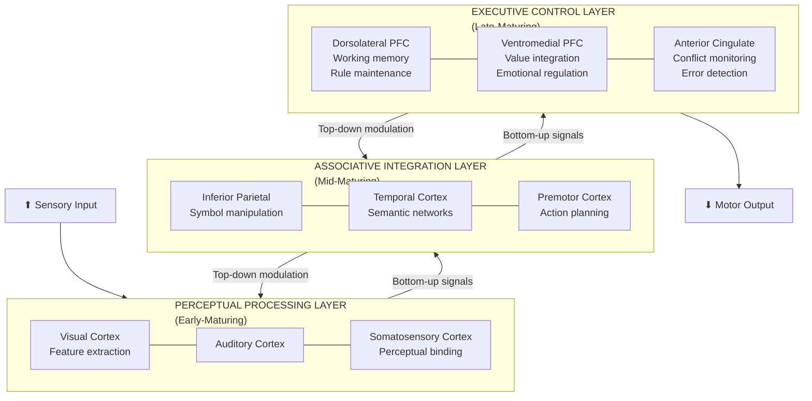
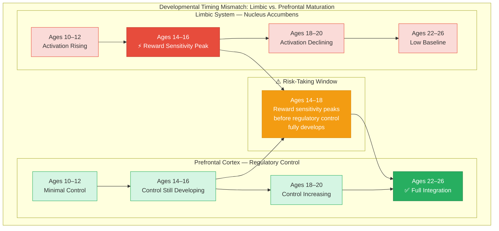

# Lesson 2: Cognitive Operational Shifts

## 1. First-Principles Intuition & Invariants

The adolescent brain undergoes one of the most dramatic cognitive reorganizations in the human lifespan, rivaling only the explosive neural development of early childhood. Between approximately eleven and twenty-five years of age, the cortical architecture supporting abstract reasoning, temporal projection, and self-reflective thought undergoes fundamental restructuring. This transformation is not merely quantitative—an accumulation of knowledge or processing speed—but qualitatively distinct in its operational characteristics. The teenager develops entirely new categories of cognitive operation that were neurologically unavailable during childhood.

Jean Piaget identified this watershed as the transition from concrete operational thinking to formal operational thinking, typically emerging around age eleven or twelve. Concrete operational children can perform logical operations on tangible, directly observable phenomena: they can conserve volume when water transfers between containers, classify objects into hierarchical taxonomies, and perform reversible mental operations on physical transformations. However, their reasoning remains tightly bound to the empirical and immediate. The concrete thinker struggles with hypothetical propositions, counterfactual reasoning, and systematic manipulation of abstract variables divorced from sensory experience.

Formal operational thinking shatters these constraints. The adolescent gains the capacity to reason about propositions themselves, independent of empirical grounding. They can manipulate symbols that represent other symbols, construct hypothetical-deductive frameworks, and systematically test variables in combinatorial fashion. This emergence of second-order abstraction enables scientific reasoning, philosophical inquiry, and complex moral deliberation. The formal operational thinker can reason about justice without requiring concrete examples of injustice, contemplate infinity despite never encountering an infinite object, and construct elaborate counterfactual scenarios exploring what might have been or could potentially be.

The neural substrate supporting this cognitive revolution involves two primary architectural transformations occurring in parallel but at different rates. First, synaptic pruning eliminates approximately forty percent of cortical synapses between early adolescence and the mid-twenties through experience-dependent selection. The brain operates under a use-it-or-lose-it principle: frequently activated neural pathways strengthen through long-term potentiation and myelination, while underutilized connections undergo programmed elimination. This synaptic pruning increases neural efficiency by reducing signal noise and metabolic overhead, transforming the densely interconnected but relatively slow childhood cortex into a leaner, faster processing architecture optimized for the cognitive demands the individual actually encounters.

Second, myelination—the deposition of fatty white matter sheaths around axons—accelerates signal transmission velocity and temporal precision. Myelination proceeds in a posterior-to-anterior gradient, with sensory and motor regions completing myelination before association cortices, and the prefrontal cortex myelinating last. This protracted prefrontal development has profound implications for executive function, impulse control, and future-oriented decision-making. The prefrontal cortex, particularly the dorsolateral prefrontal cortex, serves as the brain's chief executive officer, coordinating working memory, attentional control, cognitive flexibility, and inhibitory regulation. Its delayed maturation creates the characteristic adolescent dissociation between intellectual sophistication and behavioral regulation.

The core invariant governing adolescent cognitive development is temporal heterochrony: cognitive subsystems mature at dramatically different rates, creating temporary architectural imbalances. The limbic system, including the amygdala, nucleus accumbens, and ventral striatum, undergoes pubertal reorganization that heightens sensitivity to emotional salience, peer evaluation, and reward anticipation. This subcortical hypersensitivity peaks in mid-adolescence, around ages fourteen to sixteen, while the prefrontal regulatory systems that modulate emotional reactivity continue developing into the mid-twenties. The resulting imbalance produces the quintessential adolescent behavioral signature: heightened emotional intensity, elevated reward-seeking, increased peer influence susceptibility, and risk-taking behavior despite intact cognitive understanding of potential consequences.

This is not developmental deficiency but adaptive specialization. Evolutionary theorists argue that adolescent risk-taking, novelty-seeking, and peer orientation serve critical developmental functions. The imperative to separate from family structures, establish independent social networks, explore novel environments, and engage in status competition requires motivational systems that override the conservative, safety-prioritizing decision architecture of childhood. The adolescent brain is neurologically configured to facilitate the transition from family-dependent child to autonomously functioning adult, even though the behavioral manifestations of this transition frequently generate conflict with adult authority structures still operating under child-protection imperatives.

Metacognition—the capacity to reflect upon and regulate one's own cognitive processes—emerges as a distinct capability during adolescence. Children possess limited insight into their own thought processes and learning strategies, often unable to articulate why they understand certain concepts or struggle with others. The adolescent develops explicit awareness of cognitive operations themselves, enabling strategic deployment of attention, deliberate memory encoding strategies, comprehension monitoring during learning, and systematic debugging of reasoning errors. This metacognitive capacity transforms learning from passive information reception to active strategy optimization.

Executive function maturation during adolescence involves the progressive integration of multiple cognitive control components: working memory capacity, cognitive flexibility, inhibitory control, and planning horizon. Working memory—the mental workspace for actively maintaining and manipulating information—expands in both storage capacity and processing efficiency. Cognitive flexibility—the ability to shift between task sets, perspectives, or strategies—increases as frontostriatal circuits mature. Inhibitory control—the suppression of prepotent responses in favor of goal-directed alternatives—strengthens as prefrontal-subcortical connectivity develops. Planning horizon—the temporal distance over which consequences are projected and integrated into decision-making—extends from the immediate future orientation of childhood toward adult capacity for multi-year goal pursuit.

Risk assessment mechanisms in adolescence operate under fundamentally different parameters than adult risk evaluation. Adolescents do not take risks because they fail to perceive danger or underestimate probability of harm. Laboratory studies demonstrate that adolescents and adults show similar risk perception in cold cognition tasks involving hypothetical scenarios with explicit probability information. The divergence emerges in hot cognition contexts involving emotional arousal, peer presence, and immediate reward availability. Under these conditions, adolescents demonstrate hypersensitivity to potential rewards relative to potential costs, a shift in decision weights rather than miscalibration of probability estimates.

Temporal discounting—the rate at which future outcomes lose subjective value relative to immediate outcomes—follows a hyperbolic decay function that becomes progressively shallower across adolescence. Young adolescents heavily discount delayed rewards, preferring smaller immediate gains over larger delayed benefits at rates that appear economically irrational from adult perspective. This steep temporal discounting reflects both neurological immaturity in prefrontal regions supporting future simulation and adaptive calibration to the uncertainty of adolescent social environments where long-term planning yields unreliable returns. As prefrontal cortex matures and environmental stability increases, temporal discounting gradually moderates toward adult parameters.

The fundamental invariant underlying all adolescent cognitive shifts is the progressive expansion of temporal and abstract reasoning space. The child lives primarily in the concrete present, reasoning about directly observable transformations in the immediate environment. The adolescent progressively extends cognitive operations across longer temporal horizons, greater degrees of abstraction, and more complex relational structures. This expansion occurs through iterative cycles of cortical reorganization, experience-dependent learning, and metacognitive reflection that ultimately transform the cognitive architecture from specialized childhood configuration to generalized adult capability.

## 2. Core Architecture & Mechanics

The cognitive architecture supporting adolescent formal operational thinking can be modeled as a three-layer processing hierarchy with bidirectional feedback pathways connecting sensory input, associative integration, and executive control regions. At the foundation, posterior cortical regions including visual, auditory, and somatosensory cortices perform feature extraction and perceptual binding, transforming raw sensory data into coherent object representations. These posterior regions mature relatively early, achieving near-adult processing efficiency by late childhood.

The middle layer comprises associative cortices in temporal, parietal, and posterior frontal regions that construct higher-order conceptual representations through multi-modal integration. The inferior parietal lobule, angular gyrus, and supramarginal gyrus integrate spatial, linguistic, and mathematical information to support abstract symbol manipulation. The superior temporal sulcus processes social cues including biological motion, gaze direction, and vocal prosody. The temporoparietal junction supports perspective-taking and theory of mind reasoning. These associative regions undergo substantial refinement during adolescence through synaptic pruning and myelination, with connectivity patterns becoming increasingly specialized and efficient.

At the apex, prefrontal cortex regions implement executive control functions that orchestrate the entire cognitive system. The dorsolateral prefrontal cortex maintains task goals in working memory, implements rule-based decision strategies, and allocates attentional resources. The ventromedial prefrontal cortex integrates emotional valence with outcome predictions to guide value-based decision-making. The anterior cingulate cortex monitors for response conflict, detects prediction errors, and signals the need for increased cognitive control. These prefrontal regions exhibit the most protracted development trajectory, with structural maturation continuing into the mid-twenties.

The mechanics of formal operational reasoning emergence depend critically on the strengthening of long-range white matter tracts connecting distributed cortical regions into coherent functional networks. The superior longitudinal fasciculus connects frontal and parietal cortices, supporting working memory and attentional control. The uncinate fasciculus links ventromedial prefrontal cortex with anterior temporal regions, enabling integration of semantic knowledge with emotional valuation. The cingulum bundle connects anterior cingulate with posterior cingulate and medial temporal structures, supporting episodic memory retrieval and self-referential processing. Diffusion tensor imaging studies demonstrate that the integrity of these white matter tracts, measured by fractional anisotropy, increases linearly across adolescence and correlates strongly with improvements in executive function performance.

Metacognitive capacity depends on specialized neural circuitry supporting self-reflective processing. The anterior prefrontal cortex, particularly Brodmann area 10, activates specifically when individuals evaluate their own cognitive states, confidence judgments, or strategy effectiveness. This region shows particularly late structural maturation and functional refinement during adolescence. The anterior prefrontal cortex receives convergent input from diverse functional networks, enabling integration of performance monitoring signals, memory retrieval outcomes, and goal representations into unified metacognitive judgments.

Working memory expansion during adolescence reflects both increased storage capacity and enhanced resistance to interference. Neuroimaging studies reveal that children recruit prefrontal cortex more diffusely during working memory tasks, showing widespread activation patterns with substantial involvement of ventrolateral prefrontal regions. Adolescents demonstrate progressively more focused activation concentrated in dorsolateral prefrontal cortex, indicating more efficient neural implementation of working memory operations. This focalization results from synaptic pruning eliminating non-optimal connections and myelination accelerating transmission in task-relevant pathways.

The neural implementation of inhibitory control involves a distributed network centered on the right inferior frontal gyrus, which generates stop signals that suppress motor responses via projections to the basal ganglia. When successfully inhibiting a prepotent response, the right inferior frontal gyrus shows rapid activation preceding movement cancellation. Across adolescence, the latency of this inhibitory signal decreases while its magnitude increases, reflecting improved temporal precision and signal fidelity. The structural connectivity between right inferior frontal gyrus and subthalamic nucleus strengthens throughout adolescence, providing the anatomical substrate for enhanced inhibitory efficiency.

Cognitive flexibility depends on the ability to rapidly update task representations in working memory and switch between competing rule sets. The neural mechanism supporting set-shifting involves the dorsolateral prefrontal cortex maintaining current task rules, the anterior cingulate cortex detecting conditions requiring rule change, and the ventrolateral prefrontal cortex implementing the actual rule switch through active suppression of the no-longer-relevant rule set. During childhood, task switching incurs substantial performance costs in both accuracy and reaction time. These switch costs diminish across adolescence as the coordination between these prefrontal subregions becomes more efficient through strengthened structural connectivity and refined functional interactions.

Risk-taking behavior during adolescence emerges from the relative developmental timing of limbic and prefrontal systems. The nucleus accumbens, a key component of the brain's reward circuitry, undergoes dramatic reorganization during puberty characterized by increased dopaminergic innervation and heightened sensitivity to reward anticipation. Functional MRI studies demonstrate that adolescents show exaggerated nucleus accumbens activation in response to potential rewards compared to both children and adults, with peak sensitivity occurring around age fourteen to sixteen. Simultaneously, connectivity between nucleus accumbens and prefrontal control regions remains immature, limiting top-down regulation of reward-driven impulses.

The temporal discounting mechanism operates through competition between two distinct neural systems: an impulsive limbic system that assigns high value to immediate rewards and a deliberative prefrontal system that projects and integrates future outcomes. When choosing between immediate and delayed rewards, the ventral striatum and medial prefrontal cortex encode immediate reward value, while lateral prefrontal and parietal cortices encode the value of delayed rewards. The relative strength of these competing signals determines choice behavior. During early adolescence, the limbic immediate-reward system exerts disproportionate influence, producing steep temporal discounting. As prefrontal regions mature and their connectivity with subcortical structures strengthens, the deliberative system gains influence, enabling more patient, future-oriented decision-making.

Abstract reasoning capacity emerges through the formation of relational integration networks that bind multiple dimensions of information into unified representations. The rostrolateral prefrontal cortex specifically supports relational reasoning, activating more strongly as relational complexity increases from first-order relations between concrete entities to second-order relations between relations themselves. This region undergoes protracted development during adolescence, with gray matter volume peaking around age fourteen and then declining through synaptic pruning. The emergence of formal operational thinking correlates with the structural maturation of rostrolateral prefrontal cortex and its connections with posterior parietal regions supporting symbol manipulation.

Perspective-taking and theory of mind reasoning, while present in rudimentary form during childhood, undergo substantial refinement during adolescence. The neural network supporting social cognition includes the medial prefrontal cortex for self-referential processing, temporoparietal junction for distinguishing self and other perspectives, posterior superior temporal sulcus for biological motion perception, and temporal poles for semantic social knowledge. During adolescence, these regions show increasingly differentiated responses to social versus non-social stimuli and progressively more efficient coordination during complex social reasoning tasks. The ability to recursively embed mental states—understanding that Alice believes that Bob thinks that Carol wants—expands during adolescence as working memory capacity increases and prefrontal-posterior connectivity strengthens.

## 3. High-Performance Optimization & Failure Modes

Optimizing cognitive development during adolescence requires understanding the experience-dependent plasticity mechanisms that shape neural architecture. The synaptic pruning process operates according to Hebbian principles: connections that consistently participate in successful computational operations strengthen through long-term potentiation and receive protective myelination, while connections that rarely activate undergo elimination. This use-dependent selection means that the cognitive skills, reasoning patterns, and knowledge domains the adolescent actively engages will determine the neural architecture that persists into adulthood. Environmental enrichment—cognitively demanding academic work, musical training, athletic skill development, or complex social navigation—drives selective retention of neural pathways supporting those specific capabilities.

The most effective interventions for accelerating executive function maturation involve structured practice of cognitive control under progressively increasing difficulty gradients. Working memory training protocols that require maintenance and manipulation of increasingly complex information sets produce transfer effects to untrained executive function tasks when training maintains high difficulty adjusted to individual performance levels. Aerobic exercise enhances prefrontal function through multiple mechanisms: increased cerebral blood flow, elevated brain-derived neurotrophic factor promoting neuroplasticity, and enhanced dopaminergic and noradrenergic signaling supporting attentional control. Sleep optimization proves critical for memory consolidation and synaptic homeostasis, with chronic sleep restriction during adolescence producing measurable deficits in executive function and emotional regulation.

Metacognitive skill development benefits from explicit instruction in self-monitoring and strategy evaluation. Teaching adolescents to generate prediction judgments before task performance, monitor comprehension during learning, and evaluate strategy effectiveness after task completion produces durable improvements in learning efficiency. Structured reflection protocols that require articulating reasoning processes, identifying error sources, and generating alternative approaches enhance both metacognitive awareness and domain-specific problem-solving skill. The most effective metacognitive interventions combine domain-general strategy instruction with extensive practice applying those strategies within specific knowledge domains where the adolescent can develop both strategic flexibility and content expertise.

The characteristic adolescent vulnerability to peer influence reflects the heightened social-cognitive sensitivity of this developmental period. The medial prefrontal cortex and ventral striatum show exaggerated activation when adolescents believe peers are observing their performance or evaluating their choices. This neural hypersensitivity to social evaluation serves adaptive functions in facilitating peer group integration and social learning but creates vulnerability to peer pressure in risk-taking contexts. Interventions that reframe health-promoting behaviors as autonomous choices that resist adult manipulation rather than conformity to adult expectations prove more effective than traditional authority-based appeals because they align with adolescent sensitivity to autonomy and peer status.

Temporal discounting modification requires interventions that make delayed outcomes more concrete and psychologically immediate. Episodic future thinking exercises that prompt adolescents to vividly imagine specific future scenarios and their personal relevance reduce temporal discounting rates by engaging the episodic memory system to simulate future experiences. Goal-setting protocols that decompose long-term objectives into intermediate milestones with shorter temporal distances create more frequent reinforcement opportunities that maintain motivation across extended time horizons. Pre-commitment devices that restrict future choice options protect against impulsive preference reversals when immediately tempting alternatives become available.

The most pernicious failure mode in adolescent cognitive development is the crystallization of maladaptive reasoning patterns through repetitive engagement with cognitively impoverished environments. Adolescents who spend extensive time in passive entertainment consumption rather than active cognitive challenge miss the critical window for selective retention of neural pathways supporting complex reasoning. The use-it-or-lose-it principle operates bidirectionally: not only do actively engaged pathways strengthen, but unused capabilities atrophy through synaptic elimination. An adolescent who never practices sustained attention develops a neural architecture optimized for rapid task-switching but inefficient for deep focus. One who avoids abstract reasoning retains concrete thinking patterns into adulthood not through intellectual incapacity but through missed neuroplastic opportunity.

Chronic stress exposure during adolescence produces lasting alterations in prefrontal-limbic connectivity that compromise executive function and emotional regulation. Sustained elevation of glucocorticoid stress hormones accelerates amygdala development while impairing prefrontal cortex maturation, creating an exaggerated imbalance between emotional reactivity and regulatory control. Adolescents experiencing ongoing trauma, family dysfunction, or socioeconomic adversity show measurable reductions in prefrontal gray matter volume and working memory capacity. However, targeted interventions including stress-reduction training, supportive mentorship relationships, and cognitive skills instruction demonstrate capacity to partially remediate stress-induced deficits through compensatory plasticity mechanisms.

The educational system frequently operates under models optimized for childhood concrete operational thinking rather than adolescent formal operational capacity. Instruction that emphasizes rote memorization and procedural execution without requiring abstract reasoning, hypothesis generation, or metacognitive reflection fails to engage the emerging formal operational capabilities. Optimal adolescent education leverages their new capacity for abstract thinking through scientific inquiry, philosophical debate, mathematical proof, historical counterfactual analysis, and complex problem-solving that requires integrating multiple perspectives and evaluating evidence systematically. Adolescents demonstrate significantly greater engagement and learning efficiency when instruction formats align with their developmental cognitive capabilities.

Risk-taking behavior management requires distinguishing between pathological impulsivity reflecting executive dysfunction and normative exploratory behavior reflecting adaptive developmental programming. Interventions should focus not on eliminating all risk-taking but on channeling exploratory impulses toward domains offering skill development and manageable consequences while protecting against catastrophic outcomes. Providing structured opportunities for physical challenge, creative experimentation, and leadership responsibility satisfies adolescent needs for autonomy and novel experience within protective guardrails. Simultaneously, environmental modifications that increase friction for dangerous behaviors—delayed access to substances, restricted nighttime driving, parental monitoring of social contexts—reduce impulsive risk-taking without requiring moment-by-moment executive override of powerful subcortical impulses.

The digital media environment presents novel challenges to adolescent cognitive development through mechanisms affecting attention, social comparison, and reward conditioning. Social media platforms engineer variable-ratio reinforcement schedules that produce compulsive checking behavior by delivering unpredictable social feedback. This intermittent reinforcement pattern proves particularly potent during adolescence when social evaluation sensitivity peaks and impulse control remains immature. The constant availability of novel stimulation fragments sustained attention and reduces engagement with cognitively demanding tasks requiring prolonged focus. However, digital environments also offer unprecedented access to knowledge resources, communities of practice, and creative tools that can accelerate learning when used strategically rather than passively.

Sleep architecture changes during adolescence create a biological phase delay that shifts circadian rhythms approximately two hours later, making early school start times neurologically misaligned with adolescent sleep-wake cycles. This circadian shift combined with inadequate sleep duration impairs prefrontal function more severely in adolescents than adults because ongoing structural brain development creates heightened vulnerability to sleep disruption. Chronic sleep restriction during adolescence produces measurable deficits in working memory, impulse control, emotional regulation, and risk assessment that normalize with sleep restoration. Educational schedule modifications allowing later school start times produce substantial improvements in academic performance, mood regulation, and risk behavior reduction.

The transition to formal operational thinking does not occur uniformly across all reasoning domains. An adolescent may demonstrate sophisticated abstract reasoning about scientific or mathematical problems while applying concrete operational thinking to social or moral dilemmas. This domain-specificity reflects the experience-dependent nature of cognitive development: formal operational capabilities emerge first in domains where the adolescent has extensive knowledge and practice. Educational interventions prove most effective when they scaffold abstract reasoning within familiar contexts before expecting transfer to unfamiliar domains. Building bridges from concrete examples to abstract principles and back to novel applications facilitates the generalization of formal operational thinking across diverse reasoning contexts.

Executive function deficits associated with ADHD, autism spectrum conditions, or traumatic brain injury require compensatory strategy development that offloads cognitive control demands onto environmental structure. External working memory aids including written task lists, visual schedules, and organizational systems reduce working memory load. Environmental modifications that minimize distraction and segment complex tasks into discrete steps support sustained attention. Explicit instruction in planning strategies including backward chaining from goals to actions and time estimation calibration improves prospective memory and deadline management. These compensatory approaches prove most effective when implemented not as deficit remediation but as performance optimization tools that any individual can leverage to reduce cognitive friction.

The measurement of adolescent cognitive development requires assessment instruments sensitive to the qualitative shifts in reasoning capacity rather than merely quantitative performance improvements. Standard intelligence tests emphasizing processing speed and crystallized knowledge may miss fundamental changes in abstract reasoning capability, metacognitive sophistication, and executive function integration. Performance-based assessments requiring generation and evaluation of hypotheses, construction of logical arguments, metacognitive judgments about learning strategies, and complex planning under uncertainty provide more valid measurement of formal operational thinking. Longitudinal within-person assessment tracking individual developmental trajectories proves more informative than cross-sectional age norms because of substantial individual variation in developmental timing.

The ultimate optimization target for adolescent cognitive development is the construction of a flexible, reflective, strategically deployable cognitive architecture that supports lifelong learning and adaptive problem-solving. This requires not only the acquisition of domain-specific knowledge and skills but the development of metacognitive awareness, strategic reasoning capabilities, and epistemic humility that enables recognition of knowledge limits and active knowledge-seeking. Adolescents who emerge from this developmental transition with robust executive function, sophisticated metacognitive monitoring, capacity for abstract relational reasoning, and calibrated confidence in their cognitive abilities possess the mental tools necessary for navigating the complex, uncertain, rapidly changing environments that characterize adult life in technological societies.
