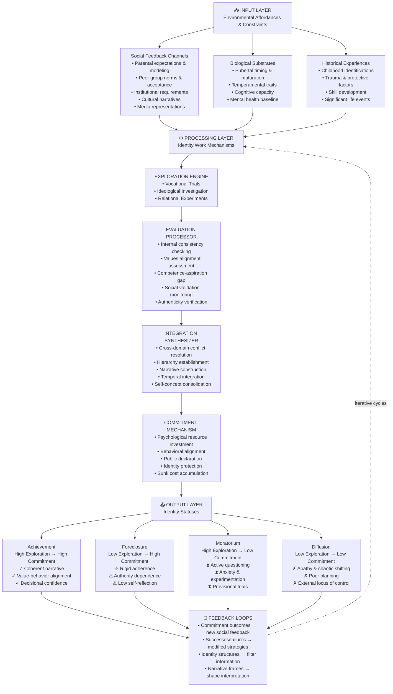

# Lesson 3: Identity Formation Processes

## 1. First-Principles Intuition & Invariants

The construction of a stable, coherent sense of self during adolescence represents one of the most consequential developmental tasks in human psychology. Unlike childhood, where identity remains largely defined by external authorities—parents, teachers, cultural institutions—adolescence inaugurates a fundamental renegotiation of the question "Who am I?" This renegotiation operates not as a discrete event but as a continuous, iterative process spanning years, involving multiple domains of life simultaneously, and producing outcomes that shape vocational trajectories, relational patterns, and psychological resilience across the entire lifespan.

Erik Erikson's psychosocial framework positions adolescence at the fifth stage of human development, characterized by the central tension between identity achievement and role confusion. This is not merely academic taxonomy. Erikson observed that societies universally provide adolescents with a psychosocial moratorium—a culturally sanctioned period of experimentation before adult commitments must be finalized. In traditional societies, this moratorium may be brief and ritualized through initiation ceremonies. In contemporary industrialized nations, it extends across secondary education, gap years, and early postsecondary exploration, sometimes persisting into the mid-twenties as emerging adulthood blurs historical developmental boundaries.

The psychosocial crisis Erikson describes operates through a dialectical mechanism. Identity formation requires the adolescent to synthesize childhood identifications, biological drives, aptitudes, and social opportunities into a unified self-concept that feels internally consistent and externally validated. When this synthesis succeeds, the individual emerges with ego identity—a stable sense of continuity across time and contexts, a reliable internal compass for decision-making, and a foundation for intimacy in later stages. When synthesis fails or is prematurely foreclosed, role confusion results: a fragmented self-experience, susceptibility to external definition, difficulty making commitments, and chronic identity diffusion that undermines adult functioning.

The invariant mechanism underlying identity formation is not abstract philosophical speculation but a concrete cognitive-developmental process. Adolescents gain access to formal operational thinking, enabling them to conceptualize hypothetical selves, evaluate counterfactuals, and engage in systematic introspection. This cognitive leap coincides with puberty's neurobiological reorganization, particularly prefrontal cortex maturation enabling executive functions and the limbic system's heightened sensitivity to social evaluation. The convergence creates both opportunity and vulnerability: adolescents can now construct complex self-narratives, but they do so with immature emotion regulation systems and heightened reactivity to peer judgment.

James Marcia extended Erikson's binary crisis-resolution model into a four-quadrant taxonomy based on two orthogonal dimensions: exploration and commitment. Exploration measures the degree to which an adolescent actively investigates alternative identities, values, and life directions. Commitment measures the degree to which the adolescent has made firm decisions and investments in specific identity elements. These dimensions generate four identity statuses, each representing a distinct developmental position with predictable psychological characteristics and developmental trajectories.

Identity achievement occurs when high exploration precedes high commitment. The adolescent has actively experimented with multiple roles, ideologies, and relational patterns, evaluated them against internal standards and external feedback, and arrived at personally meaningful commitments. This status correlates with psychological health indicators: higher self-esteem, more mature moral reasoning, greater resilience under stress, and more satisfying interpersonal relationships. Crucially, identity achievement is not static. Adults may cycle back into moratorium periods when life transitions—career changes, relationship dissolution, existential crises—destabilize previous commitments and demand renewed exploration.

Foreclosure represents high commitment without prior exploration. The adolescent adopts an identity wholesale from parents, cultural institutions, or other authorities without genuine experimentation. While foreclosure provides stability and can function adequately in stable environments matching the adopted identity, it creates brittleness. When environmental conditions change or when suppressed desires eventually surface, foreclosed individuals lack the exploration skills necessary for adaptive identity revision. They may experience acute crises in early adulthood when reality contradicts their adopted framework, having never developed the psychological flexibility that comes from genuine exploration.

Moratorium describes high exploration with low commitment—the active identity crisis Erikson considered normative and healthy during adolescence. The individual experiments with multiple provisional identities, tests values in real-world contexts, and tolerates the discomfort of uncertainty. While moratorium involves psychological distress—anxiety about the future, confusion about priorities, conflict with authority figures demanding premature closure—it represents the necessary developmental work of identity formation. Extended moratorium beyond typical developmental windows, however, can indicate avoidance or underlying psychopathology preventing commitment capacity.

Identity diffusion combines low exploration with low commitment, representing the most psychologically concerning status. The diffused adolescent neither actively explores alternatives nor commits to any particular identity elements. This may manifest as apathy, chronic indecision, or chaotic shifting between superficial identities without genuine engagement. Diffusion correlates with depression, substance abuse, academic failure, and difficulty forming stable relationships. It often reflects underlying attachment disturbances, trauma, or neurodevelopmental conditions that undermine the capacity for coherent self-construction.

The narrative identity framework, developed by Dan McAdams, shifts focus from categorical statuses to the storied self. Human beings are uniquely capable of constructing autobiographical narratives that integrate past experiences, present circumstances, and imagined futures into coherent life stories. These narratives are not merely retrospective summaries but constitutive of identity itself—the story becomes the self. Adolescence marks the developmental period when individuals first gain the cognitive sophistication to construct life stories with thematic coherence, psychological causation, and integrated meaning.

McAdams identifies three levels of personality relevant to identity formation. Dispositional traits—the Big Five personality dimensions—provide temperamental raw material but remain relatively stable and context-independent. Characteristic adaptations—goals, values, defense mechanisms, relational schemas—are more contextually responsive and developmentally dynamic. Narrative identity operates at the highest level of specificity and integration, weaving traits and adaptations into a meaningful life story that answers existential questions: What is my purpose? How did I become who I am? Where am I going?

Effective narrative identity construction requires several psychological capabilities that mature during adolescence. Autobiographical reasoning enables individuals to extract personal meaning from life events, identifying turning points, growth experiences, and formative influences. Thematic coherence allows integration of disparate experiences into unified themes—redemption sequences where suffering transforms into growth, contamination sequences where positive experiences are spoiled, agency themes emphasizing personal control, communion themes emphasizing connection. Temporal integration links past, present, and future into a continuous trajectory rather than disconnected episodes.

The exploration-commitment dynamic operates cyclically rather than linearly. Contemporary developmental models recognize that identity formation in complex, rapidly changing societies cannot be accomplished once during adolescence but requires ongoing renegotiation. The MAMA cycle—moratorium, achievement, moratorium, achievement—captures how adults periodically return to exploration when commitments become unsustainable or when new life phases demand identity revision. The quality of initial identity achievement during adolescence, however, establishes crucial process skills: comfort with uncertainty, systematic evaluation of alternatives, integration of feedback, and capacity for meaningful commitment.

Autonomy development represents a parallel process intertwined with identity formation but mechanistically distinct. Psychological autonomy involves developing an internal locus of evaluation, making decisions based on personally endorsed values rather than external pressure or approval-seeking, and taking responsibility for one's choices and their consequences. Behavioral autonomy involves practical self-governance: managing time, resources, and responsibilities without constant oversight. Emotional autonomy involves individuation from parents—forming a separate identity while maintaining connection, transitioning from idealization to realistic perception of caregivers, and regulating emotions independently.

The separation-individuation process during adolescence recapitulates and completes the toddler's initial separation-individuation but at a higher level of psychological complexity. Adolescents must psychologically separate from parents while remaining physically and financially dependent, creating inherent tension. Healthy autonomy development requires a delicate balance: parental support for exploration without premature disengagement, appropriate monitoring without intrusive control, emotional availability without enmeshment. When parents cannot tolerate adolescent differentiation or when adolescents lack secure attachment foundations, autonomy development becomes pathological—either pseudoautonomy through premature, defensive independence or prolonged dependence inhibiting identity consolidation.

Self-concept consolidation during adolescence involves integrating multiple domain-specific self-perceptions into a coherent global self-concept. Young adolescents typically experience compartmentalized selves—the self with peers differs dramatically from the self with parents, academic self-perception disconnects from athletic self-perception—creating confusion and distress. Developmental progression toward middle and late adolescence normally produces increasing integration: recognition that one can hold multiple roles without contradiction, prioritization of certain identity domains as more central or authentic, and meta-cognitive awareness of oneself as the integrating agent across contexts.

The looking-glass self mechanism, articulated by Charles Cooley and elaborated by symbolic interactionists, describes how self-concept forms through reflected appraisals—our perception of how others perceive us. During adolescence, the looking glass shifts from parents to peers as the primary reference group. This transition creates vulnerability: peer evaluation becomes disproportionately influential while evaluation capacity remains immature, leading to hypersensitivity to perceived judgment and potential distortions in self-perception. Social media has intensified this mechanism, providing continuous, quantified feedback that adolescents integrate into self-concept construction, often with deleterious effects on mental health.

Cultural context fundamentally shapes identity formation processes, determining which identity domains are salient, what exploration looks like, and what commitments are considered normative. Individualistic cultures emphasize personal uniqueness, self-expression, and autonomous choice, treating identity as self-authored. Collectivistic cultures emphasize social roles, family obligations, and cultural continuity, treating identity as socially embedded. Neither approach is intrinsically superior; each produces different identity structures suited to different social ecologies. Immigrant and bicultural adolescents face additional complexity, negotiating multiple cultural frameworks simultaneously and constructing integrated or alternating bicultural identities.

Gender identity development during adolescence involves consolidating a sense of oneself as male, female, non-binary, or otherwise positioned within gender systems. While gender identity typically stabilizes during childhood, adolescence brings renewed attention through pubertal changes, intensified gender socialization, and emerging sexuality. For most adolescents, gender identity aligns unproblematically with assigned sex and cultural gender categories. For gender-diverse adolescents, adolescence may involve exploration of gender expression, social transition, and integration of transgender or non-binary identity—processes that follow similar exploration-commitment dynamics but within a domain carrying significant social risk and requiring exceptional resilience.

Ethnic and racial identity development follows distinct trajectories, particularly for adolescents from marginalized groups. Phinney's model of ethnic identity development describes stages paralleling Marcia's framework: unexamined ethnic identity (analogous to foreclosure or diffusion), ethnic identity search (moratorium), and achieved ethnic identity. Adolescents from majority ethnic groups may never undergo active ethnic identity exploration, as their ethnicity remains unmarked and normative. Minority adolescents typically face external categorization, experiences of discrimination, and cultural dissonance that demand active identity work. Achieved ethnic identity—integrating positive ethnic self-concept with realistic awareness of social positioning—predicts better psychological outcomes than either assimilation or marginalization strategies.

## 2. Core Architecture & Mechanics

The structural architecture of identity formation can be modeled as a parallel processing system operating across multiple identity domains simultaneously. Each domain—vocational, ideological, relational, gender, ethnic, moral—undergoes its own exploration-commitment cycle, progressing at different rates with varying degrees of integration. The central executive function of the developing prefrontal cortex coordinates these parallel processes, attempting to resolve conflicts, establish hierarchies, and construct overarching coherence.

The exploration engine represents the active investigation phase where adolescents sample different identities, roles, and value systems. This is not abstract contemplation but concrete behavioral experimentation. Vocational exploration involves taking diverse classes, pursuing internships, conducting informational interviews with professionals, and engaging in extracurricular activities that reveal aptitudes and interests. Ideological exploration involves engaging with different philosophical, religious, and political systems, attending various religious services or political meetings, reading diverse intellectual traditions, and debating values with peers holding different worldviews. Relational exploration involves forming friendships and romantic relationships with diverse individuals, observing different relationship models, and discovering what qualities in others resonate with one's emerging values.

The quality of exploration varies significantly and predicts identity formation outcomes. Breadth-focused exploration—sampling many alternatives superficially—provides wide exposure but may lack depth needed for genuine evaluation. Depth-focused exploration—intensive engagement with fewer alternatives—enables authentic assessment but risks premature narrowing. Optimal exploration balances breadth and depth sequentially: initial wide sampling followed by intensive investigation of promising alternatives. Ruminative exploration—obsessive questioning without active experimentation—represents pathological exploration that increases anxiety without producing useful information. Proactive exploration—systematic, goal-directed investigation with clear evaluation criteria—most reliably produces identity achievement.

The evaluation processor continuously assesses provisional identity elements against multiple criteria. Internal consistency checking identifies contradictions between different identity components—aspiring to a helping profession while endorsing purely materialistic values signals misalignment requiring resolution. Values alignment assessment compares potential identity elements against core values established through exploration—a career opportunity offering high prestige but requiring ethical compromises fails this test. Competence-aspiration gap analysis evaluates whether identity goals align with realistic capabilities—aspiring to elite athletic performance despite limited talent creates unsustainable identity strain. Social validation monitoring tracks whether provisional identities receive adequate external recognition—an artistic identity that generates only criticism and rejection becomes difficult to sustain without extraordinary resilience.

Authenticity verification represents perhaps the most crucial yet most subjective evaluation criterion. Does this provisional identity feel genuine, or does it feel performed for external audiences? Phenomenological authenticity involves a subjective sense of rightness, of alignment between outer expression and inner experience. Adolescents developing meta-cognitive sophistication become increasingly adept at detecting their own inauthenticity, though cultural pressures and impression management needs can suppress this signal. Optimal identity formation requires environments safe enough for adolescents to acknowledge what genuinely resonates versus what merely satisfies external expectations.

The integration synthesizer addresses the fundamental challenge that identity elements explored independently often conflict when brought into proximity. An adolescent may develop progressive political values through peer exposure while simultaneously maintaining conservative religious commitments from family socialization. Career aspirations requiring geographic mobility may conflict with relational commitments to local community. The integration synthesizer employs several resolution strategies. Compartmentalization maintains conflicting identities in separate domains, activating whichever identity fits the current context—functional short-term but cognitively taxing and experienced as fragmented. Hierarchy establishment designates certain identity domains as more central or authentic, subordinating peripheral domains when conflicts arise—the adolescent who prioritizes religious identity resolves religious-political conflicts by filtering political positions through religious criteria. Genuine synthesis transforms conflicting elements through higher-order integration—discovering that apparent conflicts reflect superficial categorization while deeper values align, or constructing novel frameworks accommodating both elements.

Narrative construction represents the highest-order integration mechanism. By weaving identity elements into a coherent life story, adolescents transform discrete facts about themselves into meaningful psychological identity. Effective narratives require several structural features. Causal coherence explains how the protagonist became who they are through intelligible cause-effect chains rather than random events. Thematic coherence identifies recurring patterns that give life meaning—themes of overcoming adversity, pursuing creativity, serving others, seeking truth. Temporal coherence links childhood origins with present circumstances and imagined futures, creating continuity. Affective coherence integrates emotional experiences into the narrative rather than dissociating or minimizing them.

Redemptive narratives, particularly prevalent in American culture, follow a template where suffering, failure, or adversity transforms into growth, learning, or positive outcomes. The adolescent who was bullied becomes an advocate for marginalized peers. The student who failed academically discovers alternative intelligences and becomes an artist. Redemptive narratives predict psychological well-being and generative concern for future generations. Contamination narratives follow the opposite pattern: positive experiences spoiled by subsequent negative developments. The talented athlete whose career ends with injury that colors all subsequent experience. The academic star whose achievement feels hollow because it pleased parents rather than self. Contamination narratives predict depression and reduced well-being.

The commitment mechanism represents the transition from exploration to investment. Psychological commitment involves shifting from tentative trial to genuine investment—emotionally, cognitively, and behaviorally organizing around chosen identity elements. This transition is not discrete but gradual, with commitment depth existing on a continuum. Surface commitment involves intellectual endorsement without behavioral follow-through—the adolescent who claims environmental values but takes no environmental action. Deep commitment involves restructuring life around identity elements—the environmentally committed adolescent who adopts vegetarian diet, pursues environmental studies, participates in activism, and screens relationship partners for environmental values.

Commitment generates several downstream effects that stabilize identity. Behavioral alignment creates reinforcing feedback loops—committed action produces skill development, social recognition, and identity-consistent experiences that validate commitment. Public declaration increases commitment through consistency pressures—having announced an identity to social networks, adolescents face social costs for reversal. Identity protection mechanisms activate cognitive defenses that preserve commitment against disconfirming evidence—selective attention, motivated reasoning, rationalization. Sunk cost accumulation makes commitment reversal psychologically costly—years invested in a vocational path, relationships formed through identity-based communities, and self-concept structured around identity content all create barriers to abandonment.

The autonomy development trajectory operates through a gradual transfer of decision-making authority from parents to adolescents across multiple domains. Financial autonomy develops as adolescents gain employment, manage money, and make purchasing decisions independently. Practical autonomy develops as adolescents manage schedules, transportation, academic responsibilities, and health behaviors without parental micromanagement. Emotional autonomy develops as adolescents self-soothe, regulate emotions through internal strategies rather than parental comforting, and tolerate separation without distress. Values autonomy develops as adolescents construct personal value systems through critical examination rather than unquestioned parental adoption.

Optimal autonomy development follows a progressive pattern where parental scaffolding gradually withdraws as adolescent capacity increases. Early adolescence requires substantial structure with choices offered within constrained options—parents set homework time but adolescent chooses sequence of subjects. Middle adolescence permits broader autonomy with monitoring and consultation—adolescent sets own schedule but discusses major decisions with parents. Late adolescence approaches adult autonomy with parents serving as consultants for major decisions but respecting adolescent authority. Premature autonomy—granting decision-making authority before cognitive and emotional capacity exists—produces overwhelm and poor decisions. Delayed autonomy—maintaining childhood-level parental control despite adolescent capacity—produces either rebellion or prolonged dependence.

The parental paradox of adolescence requires simultaneously promoting autonomy and maintaining connection. Authoritative parenting navigates this paradox optimally by combining high warmth with high structure, supporting exploration while enforcing non-negotiable boundaries, and respecting emerging autonomy while remaining emotionally available. Authoritarian parenting emphasizes control over autonomy, producing either foreclosed identity through compliant adoption of parental identity or rebellious rejection. Permissive parenting grants premature autonomy without adequate structure, producing identity diffusion through inadequate guidance. Uninvolved parenting provides neither autonomy support nor structure, producing diffusion through neglect.

The digital age has fundamentally altered identity formation mechanics by providing unlimited identity experimentation opportunities in online spaces while simultaneously creating permanent, searchable records of provisional identities. Adolescents can explore alternative identities through social media profiles, online communities, avatars, and digital personas with reduced real-world consequences. This enables exploration previously impossible—the rural conservative adolescent can explore progressive political identity in online communities, the questioning adolescent can explore gender variance in supportive forums, the artistically inclined can find niche creative communities. However, digital identity exploration creates novel risks: cyberbullying that punishes exploration, permanent documentation of provisional identities that haunts future identity iterations, and comparison with curated identities that distort realistic self-evaluation.

## 3. High-Performance Optimization & Failure Modes

Optimizing identity formation at the practitioner level requires understanding leverage points where intervention produces disproportionate developmental benefit. The highest-leverage intervention targets environmental structure that enables high-quality exploration. Adolescents require sufficient freedom to experiment combined with sufficient safety that failed experiments do not produce catastrophic consequences. Educational environments optimized for identity formation offer diverse academic and extracurricular options, mentorship from adults embodying varied identity configurations, and explicit permission for exploration without premature commitment pressure. The gap year, study abroad programs, and liberal arts curricula represent institutionalized exploration spaces, though access remains socially stratified.

Parental intervention optimization follows non-intuitive principles. Direct instruction about identity—telling adolescents who they should be—consistently backfires, producing either foreclosure or reactive resistance. The highest-leverage parental interventions are indirect: modeling the process of values clarification, narrating one's own identity development including uncertainties and revisions, providing resources for diverse exploration opportunities, and offering structured reflection conversations that enhance adolescent meta-cognition without imposing conclusions. The parent who shares their own college major switches, career changes, and value evolution teaches identity process rather than identity content.

Therapeutic intervention for identity pathology must be precisely matched to the specific failure mode. For diffused adolescents, the primary intervention target is activation—reducing avoidance, establishing small exploratory steps with immediate success probability, and building basic decision-making skills before tackling identity questions. Cognitive-behavioral approaches addressing depression or anxiety that block exploration often precede identity work proper. For foreclosed adolescents, the intervention target is creating sufficient safety for questioning—building alliance, normalizing exploration, and very gradually introducing cognitive dissonance that destabilizes rigid commitments without triggering defensive rigidity. Foreclosed adolescents typically enter therapy only when external circumstances have forced awareness that their adopted identity does not fit, creating a therapeutic window.

For adolescents in extended, pathological moratorium—actively exploring beyond normative developmental windows without progressing toward commitment—the intervention target is evaluation capacity and commitment tolerance. These adolescents often possess adequate exploration skills but lack decision-making frameworks, fear making wrong choices, or use exploration as anxiety avoidance. Decision-making protocols that externalize criteria, cost-benefit analyses that make tradeoffs explicit, and graduated commitment exercises—making small, reversible commitments before large ones—help develop commitment capacity. Existential therapy addressing tolerance of uncertainty and acceptance that identity remains provisional can reduce the anxiety that prevents commitment.

Narrative therapy represents a specialized intervention leveraging the constitutive power of life story construction. Adolescents with fragmented, incoherent, or maladaptive narratives can be guided through systematic narrative reconstruction. Identifying turning points helps establish causal structure. Exploring alternative interpretations of events—reframing failures as learning, recognizing agency in situations initially perceived as victimhood—transforms contamination sequences into redemptive ones. Connecting disparate life episodes through thematic threads—recognizing how seemingly unrelated experiences all reflect a particular value or pattern—builds coherence. Explicitly constructing future chapters based on current identity commitments helps solidify those commitments through imaginative rehearsal.

Cross-cultural identity work requires specialized competence from practitioners. Imposing individualistic identity frameworks on adolescents from collectivistic cultures constitutes cultural imperialism and therapeutic malpractice. The adolescent from a collectivistic culture who has adopted a parent-selected career path is not necessarily foreclosed if that adoption involved genuine values alignment and the family-oriented self is experienced as authentic rather than imposed. Conversely, the collectivistic adolescent experiencing identity pathology may manifest distress differently—somatic symptoms, family conflict, or academic disengagement rather than explicit identity questioning. Practitioners must assess identity formation using culture-appropriate criteria and support identity structures congruent with the adolescent's cultural ecology.

Bicultural and immigrant adolescents face distinct identity challenges requiring specialized intervention. Integration strategies—constructing a bicultural identity that incorporates heritage and host cultures—predict better outcomes than assimilation (abandoning heritage culture), separation (rejecting host culture), or marginalization (rejecting both). Supporting integration requires validating both cultural frameworks, helping adolescents develop code-switching competence to navigate different cultural contexts, and building bicultural pride rather than treating cultural duality as deficit. Family therapy often proves necessary because immigrant families themselves undergo acculturation at different rates, with adolescents typically acculturating faster than parents, creating intergenerational cultural gaps.

Gender-diverse adolescents exploring transgender or non-binary identities require practitioners with specialized competence in gender development. The assessment task involves differentiating genuine gender dysphoria from other sources of distress while avoiding either premature foreclosure (assuming gender is the issue) or invalidation (dismissing gender as the issue). Gender identity exploration follows the same exploration-commitment dynamics as other identity domains but occurs in a context of intense social stigma, family rejection risk, and consequential medical decisions. The therapeutic stance involves providing non-judgmental space for exploration, psychoeducation about gender diversity, connection with gender-diverse peer communities, and family work to maintain support systems during exploration. Affirmative approaches support whatever gender identity emerges from genuine exploration, whether transgender, cisgender, or non-binary.

Failure modes in identity formation manifest predictably and require early recognition to prevent entrenchment. Prolonged diffusion extending into the twenties signals underlying pathology—severe attachment disturbance, dissociative disorders, trauma, or executive function deficits—requiring assessment and treatment of the underlying condition before identity work can progress. Rigid foreclosure persisting despite environmental changes signals authoritarian family dynamics or anxiety disorders that make exploration intolerable. Chronic moratorium cycling through multiple commitments without sustained engagement may reflect personality pathology, particularly borderline features, or represent adaptive response to genuinely unstable environments where commitment would be maladaptive.

Identity foreclosure in high-performing adolescents represents a subtle failure mode easily missed by parents and practitioners. The adolescent excelling academically, athletically, or artistically may have foreclosed on that identity domain prematurely, pursuing excellence to please parents or from fear of exploring alternatives. Assessment requires evaluating whether achievements reflect genuine passion or performed excellence, whether the adolescent can articulate intrinsic reasons for their pursuits, and whether they demonstrate curiosity about alternatives. Intervention involves creating permission structures for exploration—gap years, experimental coursework in disparate fields, exposure to alternative role models—despite family and institutional pressure toward premature specialization.

Social media has created novel failure modes requiring twenty-first-century intervention strategies. Curated identity performance on social platforms can bifurcate into authentic identity development, where online exploration facilitates offline identity formation, versus hollow identity performance, where adolescents construct elaborate online personas increasingly disconnected from lived experience. Assessment involves exploring alignment between online and offline selves, whether online activities produce genuine satisfaction or compulsive validation-seeking, and whether digital feedback influences self-concept in healthy or pathological ways. Intervention may involve digital detoxes, social media literacy education that demystifies curation and algorithmic manipulation, and explicit reflection on how digital presentation does or does not reflect authentic identity.

The optimization of institutional environments supporting adolescent identity formation remains largely unrealized in contemporary American society. Educational systems emphasizing early specialization, standardized assessment, and college admissions competition create perverse incentives for premature foreclosure. Economic pressures demanding immediate career returns on educational investment shorten the psychosocial moratorium Erikson considered developmentally essential. Interventions at systems level—educational policies supporting exploration, economic structures permitting gap years without class penalty, and cultural narratives validating non-linear developmental trajectories—would improve population-level identity formation outcomes far beyond individual intervention capacity.

The measurement of identity formation outcomes presents methodological challenges but enables intervention refinement. The Extended Objective Measure of Ego Identity Status provides quantitative assessment across Marcia's four statuses in multiple domains. The Identity Style Inventory measures informational style (systematic exploration), normative style (adherence to authority), and diffuse-avoidant style (procrastination and avoidance). Narrative complexity coding schemes assess life story coherence, thematic depth, and redemptive versus contamination sequences. These instruments enable practitioners to establish baselines, track intervention effects, and identify which identity domains require targeted work.

The ultimate optimization criterion for identity formation is not achieving any particular identity content but developing identity process competence—the capacity to engage in effective exploration, evaluate alternatives against articulated criteria, construct coherent narratives, make meaningful commitments, and revise identity when developmental progression or environmental changes demand it. Identity process competence serves individuals across the lifespan as they navigate multiple identity transitions in an increasingly complex, rapidly changing world where single, lifetime identity configurations have become historical artifacts rather than realistic developmental endpoints.
