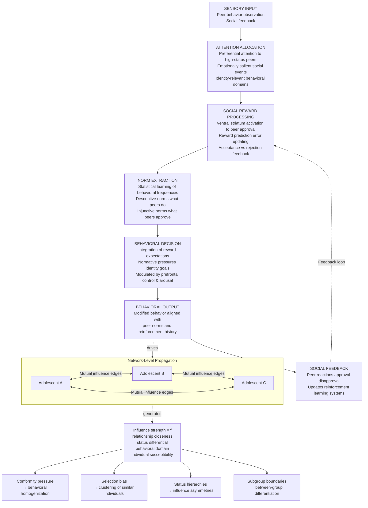

# Lesson 4: Social Contextual Dynamics

## 1. First-Principles Intuition & Invariants

Adolescence represents a developmental inflection point where the gravitational center of social influence migrates from family systems toward peer networks with remarkable velocity and consistency across cultures. This migration is not arbitrary rebellion but rather an evolutionarily conserved adaptation that serves critical developmental functions: the teenager must construct a social identity capable of operating independently within their generation's cultural ecology while simultaneously testing behavioral repertoires against novel social feedback mechanisms. Understanding this transition requires recognizing that the adolescent brain is fundamentally reorganizing its reward processing architecture, attachment hierarchies, and identity scaffolding systems in response to new adaptive pressures.

The first invariant governing social contextual dynamics during adolescence is that peer influence operates through fundamentally different neural and psychological mechanisms than parental influence operated during childhood. Where childhood social learning relied heavily on vertical transmission of cultural knowledge from authority figures through imitation and compliance pathways, adolescent social learning increasingly prioritizes horizontal transmission through peer networks via prestige bias and conformity dynamics. The adolescent prefrontal cortex demonstrates heightened sensitivity to social evaluation and peer acceptance feedback, creating a neurobiological substrate that amplifies the salience of peer opinions relative to adult guidance. This is not cognitive deficiency but adaptive recalibration: the teenager must learn to navigate the dominance hierarchies, coalition structures, and reputation management systems that will govern their adult social and reproductive success.

The second invariant concerns attachment reorganization. Adolescents do not simply abandon childhood attachment bonds to parents; instead, they execute a complex developmental maneuver that preserves secure base functionality while extending attachment behaviors toward romantic partners and close friends. John Bowlby's attachment theory, extended through Mary Ainsworth's empirical validation and later expanded by Phillip Shaver and Cindy Hazan into adolescent and adult attachment domains, provides the theoretical architecture for understanding this transition. Securely attached children typically maintain underlying trust in parental availability while reducing physical proximity-seeking and increasing psychological autonomy. Insecurely attached adolescents, conversely, may exhibit either premature detachment with excessive peer dependence or prolonged enmeshment with delayed autonomy development. The attachment system does not deactivate; it redistributes across a more complex network of relationships while maintaining its core function of regulating proximity to safe haven figures during threat and exploration from secure base positions during opportunity.

The third foundational principle derives from Henri Tajfel and John Turner's social identity theory, which provides a rigorous framework for understanding how adolescents construct self-concept through group membership. Social identity theory posits that individuals derive significant portions of their self-esteem and self-definition from the social categories to which they belong, leading to three interconnected psychological processes: social categorization (classifying people including oneself into groups), social identification (adopting the identity and emotional significance of group membership), and social comparison (evaluating one's in-group against relevant out-groups to establish positive distinctiveness). During adolescence, when personal identity is highly malleable and self-concept is under active construction, these processes intensify dramatically. The teenager experiments with multiple social identities—athlete, musician, gamer, activist—each providing distinct sources of esteem, behavioral scripts, and value frameworks. The cognitive and emotional labor of integrating these sometimes contradictory identities into a coherent self-narrative represents one of adolescence's central developmental tasks.

Cultural scaffolding effects introduce critical variability into these universal processes. Lev Vygotsky's sociocultural theory illuminates how cultural tools, practices, and institutional structures shape the zone of proximal development within which adolescents acquire competencies. In collectivist cultures with strong interdependence norms and extended family structures, the transition to peer orientation may be modulated by cultural expectations of filial piety and family loyalty that constrain the extent of peer dominance in decision-making. In individualist cultures emphasizing personal autonomy and self-actualization, adolescent separation-individuation processes may accelerate and intensify, with earlier behavioral and psychological independence from parents. Cultural display rules govern which emotions can be expressed in which contexts, shaping how adolescents communicate distress, affection, and conflict across family and peer domains. Religious institutions, educational structures, and economic conditions create vastly different opportunity ecologies that either facilitate or constrain adolescent identity exploration and social experimentation.

The contemporary digital revolution has introduced a discontinuity in adolescent social development whose magnitude we are only beginning to measure systematically. Digital social environments—social media platforms, multiplayer gaming communities, messaging applications, content creation platforms—have fundamentally altered the architecture of peer influence by removing spatial and temporal constraints on social interaction. The adolescent peer network, once limited to school, neighborhood, and activity-based groups that could exert influence primarily during face-to-face contact, now operates as a persistent ambient social field accessible continuously through smartphone connectivity. This transformation carries profound implications for identity development, social comparison processes, and emotional regulation. The asynchronous nature of digital communication allows for extensive curation of self-presentation, creating idealized identity performances that may diverge substantially from offline self-experience. The quantification of social feedback through likes, shares, comments, and follower counts creates explicit social status metrics that make dominance hierarchies and popularity structures visible and measurable in ways that were previously implicit and ambiguous. The algorithmic amplification of engaging content shifts the types of social behaviors that receive reinforcement, often favoring emotional intensity and moral outrage over nuanced discourse.

These digital dynamics intersect with and amplify existing developmental vulnerabilities. Adolescents high in social anxiety may experience temporary relief from digital communication's reduced real-time performance demands but simultaneously reinforce avoidance of in-person social skill development. Adolescents with insecure attachment patterns may engage in compulsive reassurance-seeking through constant messaging and online availability monitoring. The always-on nature of digital peer networks eliminates temporal boundaries that previously allowed recovery from social stress; a conflict that once would have remained confined to school hours now extends into evening and weekend family time through persistent group chat activity. Sleep disruption from nighttime phone use compounds these effects, creating cascading impacts on emotional regulation, academic performance, and physical health.

From a practitioner standpoint, understanding these first principles means recognizing that interventions targeting adolescent social dynamics must account for multiple simultaneous levels of influence operating through distinct mechanisms. Individual-level factors including temperament, attachment history, and cognitive maturity interact with family system dynamics including parenting style, marital quality, and sibling relationships. These nest within peer network structures characterized by varying coalition stability, dominance hierarchies, and prosocial versus antisocial normative climates. School and community institutions provide the physical and social infrastructure within which peer networks operate. Cultural meaning systems supply the interpretive frameworks through which adolescents understand identity, relationships, and appropriate behavior. Digital technologies mediate and modify all of these levels simultaneously, creating hybrid social ecologies that blend online and offline interaction in seamless and often indistinguishable ways.

## 2. Core Architecture & Mechanics

The operational architecture of peer influence during adolescence can be decomposed into several interconnected subsystems that process social information, generate behavioral outputs, and update internal models of social reality through feedback loops. Understanding this architecture requires mapping the specific mechanisms through which peer effects propagate through adolescent social networks and examining how these mechanisms interact with developmental changes in brain structure and function.

At the neurobiological level, adolescent peer influence operates through reward system hypersensitivity combined with incomplete prefrontal regulatory control. The ventral striatum, particularly the nucleus accumbens, demonstrates heightened activation in response to social rewards such as peer approval, acceptance, and status elevation during adolescence relative to childhood or adulthood. Functional magnetic resonance imaging studies by researchers including Laurence Steinberg, Sarah-Jayne Blakemore, and Eveline Crone have consistently demonstrated that this reward system hyperactivation is most pronounced in social contexts, especially when peers are present or when behavior is being evaluated by age-mates. This creates a neurobiological amplification system where behaviors that elicit peer approval receive disproportionate positive reinforcement relative to other potential sources of reward.

Simultaneously, the prefrontal cortex regions responsible for executive control, long-term planning, and impulse regulation continue developing throughout adolescence and into the mid-twenties. The cognitive control network, anchored in dorsolateral prefrontal cortex and supported by parietal attention systems, lags behind the social-emotional network in its developmental trajectory. This asynchrony creates what Steinberg terms a "dual systems" model of adolescent decision-making: a highly sensitive social-emotional accelerator operating alongside an incompletely developed cognitive control brake. When adolescents make decisions in emotionally arousing social contexts—precisely the conditions under which peer influence is strongest—the social-emotional system tends to dominate behavioral output.

The specific mechanisms through which peers influence adolescent behavior can be categorized into four primary pathways. First, conformity pressure operates through normative influence, where the adolescent modifies behavior to align with perceived group standards to avoid social rejection or gain acceptance. Solomon Asch's classic conformity experiments demonstrated that individuals will endorse obviously incorrect judgments when group consensus supports the error, revealing powerful pressures toward group uniformity even in the absence of explicit coercion. During adolescence, when belonging needs are heightened and identity is uncertain, conformity pressures intensify substantially. The adolescent monitors peer behavior to extract norms regarding appropriate dress, speech patterns, musical preferences, substance use, academic engagement, and virtually all other behavioral domains. Deviation from these extracted norms triggers anxiety about social exclusion, while conformity generates relief and acceptance.

Second, peer selection effects create homophily—the tendency for similar individuals to associate preferentially with one another. Adolescents actively choose friends based on shared attributes, interests, and values, then these friendships further reinforce similarity through socialization processes. Disentangling selection from socialization represents a persistent methodological challenge in peer influence research. Longitudinal social network analysis using stochastic actor-oriented models has enabled researchers to partition variance in adolescent behavior into components attributable to peer selection versus peer influence. These studies reveal that both processes operate simultaneously: adolescents select friends who share existing behavioral tendencies, then mutual influence within friendships amplifies those tendencies over time. For prosocial behaviors like academic engagement or athletic participation, this creates virtuous cycles of positive peer influence. For antisocial behaviors like substance use or delinquency, it creates deviance training feedback loops where antisocial youth reinforce each other's problematic behavior patterns.

Third, social learning through observation and modeling provides a mechanism by which adolescents acquire new behavioral repertoires from peers. Albert Bandura's social cognitive theory elucidates how observational learning operates through four component processes: attention to modeled behavior, retention of behavioral information in memory, reproduction of the behavior when appropriate contexts arise, and motivation to perform the behavior based on expected outcomes. Adolescents observe peers who possess desired attributes—social status, attractiveness, competence in valued domains—and selectively attend to their behaviors as potential models. High-status peers function as prestige models whose behavior is disproportionately influential because association with them or emulation of them provides indirect status benefits. The specific behaviors adopted through modeling depend on reinforcement contingencies: if modeled behavior appears to generate positive outcomes for the model, the observer is more likely to reproduce it.

Fourth, reputational dynamics create strategic incentives for behavior modification based on identity performance goals. Erving Goffman's dramaturgical framework conceptualizes social interaction as performance, where individuals manage impressions to control how others perceive them. During adolescence, reputation management becomes increasingly sophisticated and consequential. The adolescent recognizes that behavior in one context generates reputational information that propagates through peer networks and affects social opportunities in other contexts. A single instance of perceived cowardice, disloyalty, or norm violation can damage reputation across the entire peer network, while conspicuous displays of valued attributes—courage, loyalty, humor, attractiveness—can elevate status. This reputational awareness makes adolescents hypersensitive to audience effects: behavior varies substantially depending on who is observing and what reputational implications different behavioral choices carry.

The parent-adolescent relational shift operates through a complementary set of mechanisms focused on renegotiating autonomy and control within the attachment relationship. Diana Baumrind's parenting style typology provides a foundational framework for understanding these dynamics through two orthogonal dimensions: demandingness (expectations, monitoring, discipline) and responsiveness (warmth, support, emotional availability). Authoritative parenting, characterized by high demandingness and high responsiveness, consistently predicts optimal adolescent outcomes across cultures, though specific implementations vary with cultural values. Authoritative parents maintain clear expectations and boundaries while respecting the adolescent's growing capacity for autonomous decision-making and providing emotional support during stress and exploration.

The renegotiation process involves systematic revision of behavioral domains subject to parental control versus adolescent discretion. Judith Smetana's social domain theory distinguishes between moral issues (fairness, harm, rights), conventional issues (social norms, etiquette, roles), and personal issues (privacy, friendship choices, appearance). Research demonstrates that adolescents and parents generally agree that moral issues remain legitimately subject to parental authority, but they frequently disagree about the boundaries of the personal domain. Adolescents assert expanded personal jurisdiction over domains that parents continue to view as conventional or prudential (subject to parental guidance for the adolescent's own welfare). Much parent-adolescent conflict centers not on whether rules should exist but on who has legitimate authority to make decisions in contested domains.

The attachment reorganization process follows predictable developmental sequences. During early adolescence, physical proximity-seeking toward parents declines substantially while psychological proximity-seeking through disclosure and support-seeking shows more variable patterns. Securely attached adolescents maintain communication with parents about significant experiences, emotions, and concerns even as they spend increasing time with peers. They use parents as secure bases for exploration and safe havens during distress while simultaneously expanding their attachment network to include close friends and romantic partners. Dismissing attachment patterns, characterized by minimization of attachment needs, may manifest as premature autonomy claims and reduced parent-adolescent communication about emotional experiences. Preoccupied attachment patterns, involving excessive dependence on external validation, may produce adolescent anxiety about parent availability and difficulty with autonomous functioning.

Parent monitoring—defined not simply as surveillance but as parental knowledge of adolescent activities, companions, and whereabouts—consistently predicts reduced adolescent risk behavior. However, the mechanisms generating parental knowledge have shifted dramatically with recent research. Early conceptualizations assumed monitoring reflected primarily parental control and surveillance efforts. Stattin and Kerr's influential work revealed that adolescent voluntary disclosure represents the primary source of parental knowledge, far exceeding parental solicitation or control in predictive validity. Adolescents who trust parents and perceive parental interest as supportive rather than intrusive voluntarily share information about their activities. This disclosure provides parents with knowledge that enables appropriate guidance and intervention when necessary. Excessive parental control attempts, conversely, often backfire by damaging trust and reducing voluntary disclosure, thereby reducing effective monitoring despite increased control efforts.

Digital social environments introduce complex mediating effects throughout these relational dynamics. Parent-adolescent connection can be maintained through text messaging and social media contact during physical separation, potentially supporting attachment security. However, continuous partial attention to digital communication can reduce engagement quality during shared time, undermining relationship depth. Parental monitoring of digital activity presents ethical and practical dilemmas: surveillance may detect problems but simultaneously violate privacy and damage trust, while complete non-monitoring may leave adolescents vulnerable to online risks including cyberbullying, sexual solicitation, and exposure to harmful content. The optimal approach appears to involve transparent parental media mentorship rather than covert surveillance—establishing clear expectations, maintaining open communication about online experiences, and providing guidance about privacy management, critical evaluation of online content, and healthy digital habits.

The social comparison processes intensified by social media operate through several specific mechanisms. Festinger's social comparison theory posited that individuals evaluate their abilities and opinions through comparison with similar others when objective standards are unavailable. During adolescence, virtually all self-relevant attributes—attractiveness, social status, competence, worth—lack objective metrics and are instead evaluated through social comparison. Digital platforms intensify social comparison by making multitudes of comparison targets continuously accessible and by encouraging carefully curated self-presentation that emphasizes positive attributes while concealing struggles and imperfections. The resulting upward social comparisons—comparing oneself unfavorably to apparently superior others—reliably generate negative affect, self-criticism, and reduced self-esteem, particularly among adolescents with preexisting vulnerabilities including neuroticism, insecure attachment, or depression symptoms.

The quantification of social feedback through platform metrics transforms implicit social status into explicit numerical indicators. Likes, follower counts, comment volume, and share rates provide immediate, quantified feedback about social value and performance success. For some adolescents, these metrics provide desired validation and status confirmation. For others, they become sources of anxiety and obsessive monitoring as adolescents check their phones repeatedly for feedback on posted content. The intermittent reinforcement schedule—unpredictable timing and magnitude of social feedback—creates habit-forming properties similar to gambling, driving compulsive checking behavior. The public nature of these metrics adds reputational stakes: low engagement numbers signal low social value not just to the adolescent but to all network members who can observe them.

## 3. High-Performance Optimization & Failure Modes

Optimizing adolescent social development outcomes requires practitioners to implement interventions at multiple system levels while remaining alert to predictable failure modes that can undermine developmental progress. High-performance optimization does not mean eliminating peer influence—an impossible and undesirable goal—but rather channeling peer influence mechanisms toward prosocial outcomes while mitigating risks associated with deviant peer affiliations and toxic social dynamics.

At the family system level, optimizing parent-adolescent relationships during the autonomy renegotiation process centers on maintaining the authoritative parenting configuration despite provocations toward either authoritarian rigidity or permissive abdication. Adolescent testing of boundaries and assertions of independence commonly trigger parental anxiety about loss of influence and control, potentially driving increased restrictiveness precisely when developmental needs demand increased autonomy support. The high-performance approach maintains firm boundaries on genuinely high-stakes issues involving safety and legality while progressively expanding adolescent decision-making authority in lower-stakes domains. This requires explicit negotiation about which domains fall under which jurisdictional categories and revision of these boundaries as the adolescent demonstrates increasing competence and judgment reliability.

Supporting voluntary disclosure represents a critical optimization target. Families can implement structural practices that facilitate disclosure including regular shared meals without digital devices, routine check-in conversations following school or activities, and parent-initiated sharing about their own experiences to model disclosure reciprocity. The quality of parental responses to disclosure critically determines whether disclosure continues: judgmental, punitive, or dismissive responses train adolescents to conceal information, while interested, supportive responses reinforce continued sharing even when disclosed content reveals problems or poor decisions. When disciplinary responses are necessary, separating the behavior requiring correction from appreciation for the disclosure itself preserves the disclosure channel for future communication.

Monitoring digital social environments presents distinct challenges requiring updated strategies. Rather than covert surveillance, optimal approaches involve collaborative media mentorship beginning in late childhood before independent digital device ownership. This includes co-use of platforms to teach critical evaluation of online content, explicit instruction about privacy settings and information permanence, discussion of the constructed nature of online self-presentation and the risks of upward social comparison, and establishment of family media plans specifying device-free times and spaces. For adolescents exhibiting problematic use patterns including excessive time investment, sleep disruption, or mood deterioration associated with social media use, interventions may require temporary restriction paired with support for offline social connection and alternative reinforcing activities.

At the peer network level, optimization focuses on facilitating access to prosocial peer groups while reducing exposure to deviant peer influences. The selection component of peer influence means that intervention cannot focus solely on resisting peer pressure; adolescents must have access to peer networks whose normative influences align with positive developmental trajectories. This requires ensuring adolescent involvement in structured prosocial activities—athletics, arts, academic enrichment, volunteering, religious youth groups—that provide natural access to peers engaged in constructive pursuits. These contexts offer several advantages: adult supervision and mentorship, clear competence hierarchies based on skill rather than antisocial behavior, and institutional values promoting prosocial norms.

For adolescents already embedded in deviant peer networks, intervention requires disrupting the reinforcement contingencies maintaining antisocial behavior within those relationships. This rarely succeeds through direct prohibition of peer contact, which the adolescent will typically circumvent while sacrificing parental trust. More effective approaches create competing reinforcement sources through engagement with alternative peer networks, individual therapy to address underlying vulnerabilities driving deviant peer selection (depression, anxiety, trauma, social skill deficits), and family therapy to modify interaction patterns that may be inadvertently maintaining problem behavior. In some cases, environmental restructuring through school transfer or residential program placement becomes necessary when the local peer ecology offers no prosocial alternatives and the adolescent lacks capacity for unilateral behavior change within their existing social context.

School-based interventions can modify peer influence dynamics at the institutional level through several mechanisms. Social-emotional learning curricula teach emotion regulation, perspective-taking, and conflict resolution skills that improve peer relationship quality and reduce relational aggression. Anti-bullying programs that establish clear behavioral expectations, train staff in intervention protocols, and cultivate student upstander behavior rather than bystanderism can shift peer norms around aggression and victimization. Academic tracking systems and extracurricular participation structures shape peer network formation by determining which adolescents have regular contact; thoughtful design of these structures can prevent complete segregation into tracked peer networks while maintaining appropriate academic challenge.

Failure modes in parent-adolescent relationships during this transition typically manifest in several predictable patterns. Authoritarian parents may respond to adolescent autonomy bids with increased control and restriction, triggering escalating conflict cycles and potential adolescent withdrawal or deception. The parent attempts to maintain childhood-level oversight through surveillance and punishment, the adolescent experiences this as illegitimate intrusion and responds with secrecy and defiance, the parent interprets defiance as justifying increased control, and the cycle intensifies. This pattern erodes trust and voluntary disclosure while failing to prevent the behaviors the parent seeks to control, as the adolescent simply becomes more skilled at concealment. The intervention requires reframing the parent's understanding of age-appropriate autonomy and teaching collaborative problem-solving approaches that respect the adolescent's legitimate developmental needs while maintaining parental involvement in high-stakes decisions.

Permissive parents present the opposite failure mode: premature abdication of monitoring and guidance before the adolescent has developed sufficient self-regulation capacity and judgment reliability. This often stems from misunderstanding of attachment theory or democratic parenting philosophies, leading parents to believe that any limit-setting or monitoring represents authoritarian control that will damage the relationship. The resulting absence of structure and guidance leaves the adolescent vulnerable to poor decisions driven by immature judgment and peer pressure without appropriate adult input. The adolescent may appear to desire complete autonomy but typically experiences parental permissiveness as disinterest or abandonment rather than respect. The intervention involves helping parents distinguish between autonomy support (respecting the adolescent's perspectives and progressively expanding decision-making authority) and neglect (failing to provide necessary guidance, monitoring, and limit-setting on high-risk behaviors).

Intrusive parents implement what appears superficially similar to authoritative monitoring but differs critically in motivation and implementation: surveillance stems from parental anxiety and need for control rather than appropriate concern for adolescent welfare, boundaries are imposed to manage parental emotions rather than adolescent safety, and the adolescent experiences parental involvement as suffocating rather than supportive. Intrusive parenting predicts adolescent anxiety, depression, and difficulty with identity development because it communicates that the adolescent's own judgment and autonomous functioning are inadequate. Adolescents of intrusive parents often struggle to differentiate their own preferences and values from parental expectations, delaying identity consolidation. Intervention requires addressing the parent's underlying anxiety through therapy while coaching them to tolerate age-appropriate uncertainty about adolescent activities and to distinguish genuine safety concerns from anxiety-driven hypervigilance.

Peer relationship failure modes include several distinct patterns requiring different intervention approaches. Social isolation and peer rejection place adolescents at risk for depression, anxiety, and academic problems while depriving them of the social learning opportunities peer interaction provides. The underlying causes vary widely: social skill deficits preventing successful interaction initiation and maintenance, physical or behavioral characteristics triggering peer rejection, anxiety and avoidance preventing social approach behaviors, or interests and values misaligned with available peer groups. Assessment must identify the specific mechanisms maintaining isolation before designing interventions. Social skill deficits respond to direct social skill training teaching conversation skills, group entry strategies, conflict resolution, and emotion regulation. Anxiety-driven avoidance requires cognitive-behavioral therapy addressing social anxiety symptoms while gradually expanding social exposure through behavioral experiments. Value misalignment may require environmental restructuring to access peer groups with compatible interests.

Deviant peer affiliation represents a distinct risk pattern where the adolescent is socially successful within a peer network characterized by antisocial norms and behaviors. These adolescents typically do not exhibit social skill deficits but rather have selected peer contexts that reinforce problematic behavior patterns. The developmental trajectory of conduct problems demonstrates that late-onset adolescent antisocial behavior, driven primarily by peer influence within deviant networks, typically desists in early adulthood as individuals age out of these peer contexts and assume adult roles. However, during active involvement, risks include substance abuse, delinquency, academic failure, and legal consequences that can permanently constrain life opportunities. Intervention requires competing reinforcement sources as discussed previously, along with careful assessment for callous-unemotional traits or other indicators of more severe conduct disorder requiring intensive treatment.

Victimization through bullying or relational aggression presents serious risks for immediate psychological distress and long-term mental health problems. Traditional bullying involves repeated aggression by more powerful peers through physical, verbal, or relational means. Cyberbullying extends these dynamics into digital environments where anonymity, asynchronicity, and permanent records amplify harm potential. Victims experience depression, anxiety, academic decline, and in severe cases suicidal ideation. Effective intervention requires addressing multiple system levels: individual support for the victim including therapy for trauma symptoms and social skill building if deficits contributed to victimization risk; peer network intervention to mobilize prosocial bystanders rather than passive observers; institutional response through clear anti-bullying policies and consistent enforcement; and addressing perpetrators through both consequences and intervention for the underlying factors driving aggressive behavior.

Digital social environment failure modes warrant specific attention given their novelty and evolving nature. Problematic social media use exists on a continuum from heavy but non-impairing use through genuinely addictive patterns meeting behavioral addiction criteria: salience (the behavior dominates thinking), mood modification (used to alter emotional states), tolerance (increasing use needed for same effects), withdrawal (negative emotions when unable to use), conflict (causes problems in relationships or other life domains), and relapse (return to problematic use after periods of control). Genuinely addictive patterns are less common than heavy use but require intensive intervention addressing underlying psychopathology (commonly depression and social anxiety) while implementing digital abstinence or strict limitation protocols.

Social comparison spirals represent a more common digital failure mode where repeated exposure to curated positive self-presentations by peers triggers upward social comparisons, negative self-evaluation, and compensatory posting of curated content to restore self-esteem, perpetuating the cycle. This pattern particularly affects adolescent girls and is implicated in rising rates of depression and anxiety in this demographic. Intervention involves psychoeducation about the constructed nature of online self-presentation, cognitive restructuring targeting comparison thoughts and self-criticism, behavioral experiments comparing mood states following social media use versus alternative activities, and voluntary reduction in use particularly of image-focused platforms like Instagram and TikTok.

Cyberbullying victimization combines the traditional harms of bullying with unique aggravating factors: the 24/7 accessibility removing respite previously available when leaving school, the public and permanent nature of digital content amplifying humiliation, and the potential for anonymous perpetration reducing perpetrator accountability. Victims should document evidence, utilize platform reporting mechanisms and blocking functions, and may require school or legal intervention for severe cases. Many schools now have policies extending their jurisdiction to off-campus digital behavior when it substantially disrupts the school environment. Supporting the victim's offline social connections and self-worth while limiting exposure to the cyberbullying content (reducing checking behavior that maintains distress) provides psychological protection during resolution efforts.

Practitioners working with adolescent social development must maintain assessment vigilance across these multiple domains simultaneously. Comprehensive assessment protocols evaluate parent-adolescent relationship quality through both parent and adolescent report to detect discrepancies indicating problematic dynamics, peer network characteristics including friend antisocial behavior and prosocial involvement, school connectedness and academic engagement, digital social environment use patterns and associated mood changes, and individual psychological functioning including internalizing and externalizing symptoms. This multilevel assessment enables identification of the specific mechanisms maintaining problems and targeted intervention at the appropriate system levels.

The measurement instruments supporting this assessment include validated questionnaires, structured interviews, and direct observation when possible. The Inventory of Parent and Peer Attachment assesses attachment security across these relationship domains. The Alabama Parenting Questionnaire measures parenting practices including monitoring, positive involvement, and disciplinary consistency. The Network of Relationships Inventory evaluates multiple relationship quality dimensions including support, conflict, and intimacy across family and peer relationships. The Social Media Use Integration Scale and Bergen Social Media Addiction Scale assess problematic digital use patterns. Behavioral observation of parent-adolescent interaction during structured conflict discussion tasks reveals communication patterns including validation, coercion, and problem-solving effectiveness.

Intervention effectiveness monitoring requires ongoing measurement of targeted outcomes rather than assuming that intervention implementation produces change. Brief repeated measures of adolescent mood, peer relationship satisfaction, parent-adolescent conflict frequency, and academic performance provide feedback enabling intervention refinement. When interventions fail to produce expected change trajectories, practitioners must diagnose implementation failure (intervention not delivered as designed), theory failure (mechanisms targeted by intervention are not actually maintaining the problem), or measurement failure (change occurred but measures did not detect it) and modify the treatment plan accordingly.

The ultimate optimization goal transcends problem prevention to actively cultivate adolescent thriving through social connection. Secure attachment relationships with parents, supportive and prosocial peer friendships, involvement in structured activities providing competence development and adult mentorship, and cultural or spiritual community connection provide the social capital supporting resilient development. Practitioners serve not merely as problem-solvers but as architects of social ecologies that scaffold the adolescent's journey toward autonomy, identity, and generative contribution to their community.
