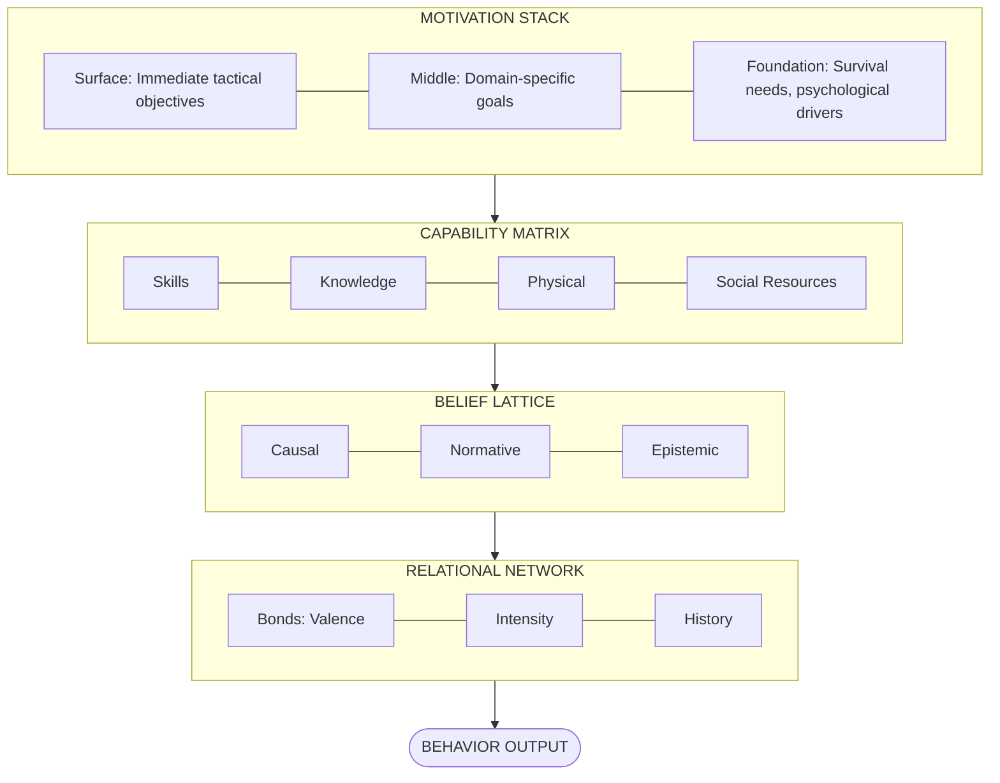

# Lesson 2: Character Systems

## 1. First-Principles Intuition & Invariants

Characters are not decorative elements in fiction. They are the primary cognitive interface through which readers experience narrative reality. When a reader abandons a novel in the first fifty pages, the failure point is almost never plot mechanics or setting detail—it is the absence of a character who generates sufficient psychological gravitational force to warrant continued attention. This gravitational force emerges from a precise engineering problem: constructing a simulated consciousness that exhibits behavioral coherence, emotional dimensionality, and volition legible enough to sustain predictive engagement while remaining surprising enough to defeat pattern exhaustion.

The foundational invariant of character construction is that fictional persons must operate as closed causal systems. Every character action must arise from a traceable chain of motivation, belief, capability, and environmental constraint. This is not a plea for realism in the mimetic sense—fantasy and science fiction characters operate under radically different physical and social laws—but rather a structural requirement that the character's decision-making apparatus remains internally consistent within the ontological rules you establish. A character who acts randomly or in service of plot convenience rather than internal logic triggers what cognitive scientists call a "theory of mind violation," the same neural alarm that fires when we encounter erratic or inexplicable behavior in actual humans. The reader's predictive machinery stalls, immersion fractures, and trust erodes.

The second invariant concerns the architecture of desire. Characters without legible wants are inert. Desire is the engine that converts static description into kinetic narrative. But desire alone is insufficient—it must encounter meaningful resistance. The magnitude of that resistance, calibrated against the intensity of the desire, generates what we perceive as dramatic tension. This is not metaphorical. When you construct a character's motivation profile, you are building a pressure differential, a gradient that will drive movement through your story's possibility space. Remove the obstacle and the gradient collapses; remove the desire and no gradient forms. The character becomes a passive recording device, a camera mounted on a tripod, documenting events but not shaping them.

The third invariant addresses transformation potential. Static characters—those whose belief systems, capabilities, and self-conception remain unchanged from opening to resolution—can function effectively in short fiction or as supporting ensemble members, but they cannot anchor novel-length narrative attention. The human pattern-recognition system is optimized to detect change, particularly change in social agents. A character who learns nothing, who fails to adapt under pressure, who maintains perfect psychological stasis through escalating conflict, reads as artificial. Transformation need not be redemptive or positive—a descent into paranoia or moral compromise constitutes change—but the character's internal state at the story's conclusion must differ substantively from their initial configuration. This transformation must emerge organically from the collision between the character's existing architecture and the events you subject them to, not as an externally imposed authorial decree.

These three invariants—causal coherence, desire-obstacle dynamics, and transformation potential—form the load-bearing columns of character engineering. Every other technique, from dialogue craft to physical description protocols, serves to reinforce these structural elements. When a character fails to convince, the diagnostic question is always: which invariant has been violated?

## 2. Core Architecture & Mechanics

Character construction begins not with physical description or biographical detail but with the motivation stack, a hierarchical arrangement of desires that determines behavioral priority under constraint. At the foundation sit survival needs and deep psychological drivers: physical safety, resource security, attachment bonds, status maintenance. The middle layers contain domain-specific goals: solve the murder, win the election, escape the planet. The surface layer holds immediate tactical objectives: get through this conversation without revealing the secret, find the correct door, survive the next five minutes. When multiple desires conflict—and all interesting scenes stage such conflicts—the character's resolution of that conflict reveals their value hierarchy and core identity.

Consider a character attempting to extract information from a witness who is also a close friend. The tactical desire (obtain the information) conflicts with the relational desire (preserve the friendship) and potentially with the ethical desire (avoid manipulation). A character who prioritizes the tactical goal will employ aggressive questioning, leverage emotional bonds instrumentally, and accept relational damage as operational cost. A character who elevates the friendship will pursue indirect methods, telegraph their questions, and potentially fail to obtain critical information. Neither choice is correct in an absolute sense, but the choice made—and crucially, the character's internal experience of making that choice—constructs their moral profile in the reader's cognitive map. 

The motivation stack interfaces with the capability matrix, an inventory of skills, knowledge domains, physical attributes, and social resources available to the character. Capability determines which desire-fulfillment strategies are executable. A character who wants to intimidate an opponent but lacks physical presence, verbal aggression skills, or social authority will either fail at intimidation or must acquire new capabilities to succeed. This acquisition process—training, alliance-building, tool construction—generates subplot and demonstrates character agency. Conversely, excessive capability relative to obstacles drains tension. A character who can trivially overcome all resistance through superior skill becomes boring unless you engineer obstacles that exploit capability gaps or force capability trade-offs.

The belief lattice maps the character's model of how reality operates: causal beliefs about what actions produce what results, normative beliefs about what should and should not be done, and epistemic beliefs about what is true. These beliefs gate behavior even when they are factually incorrect. A character who believes that vulnerability equals weakness will suppress emotional expression even when that suppression sabotages their relationships. A character who believes that violence never solves problems will attempt diplomatic solutions in contexts where force is the only effective response. The gap between the character's belief lattice and actual environmental dynamics creates dramatic irony, generates failure cascades, and establishes transformation prerequisites. Character growth almost always involves belief revision under pressure—the substitution of a dysfunctional belief with a more adaptive model after the original belief produces catastrophic results.

The relational network diagrams the character's bonds with other agents in the story. Each relationship should be encoded with a valence (positive, negative, ambivalent), an intensity level (weak, moderate, strong), and a history of significant interactions that established the current relational state. Relationships are never static; they respond dynamically to character behavior and story events. A character's decision to betray an ally converts a positive-valence bond to negative, which then constrains future interactions and generates new dramatic possibilities. The density and diversity of the relational network determine the character's social leverage and vulnerability profile. A character embedded in dense networks can mobilize allies but also faces complex obligation structures; a socially isolated character has fewer resources but also fewer entanglements.

Characterization methods translate this internal architecture into observable narrative data. Direct characterization provides explicit authorial statements about character attributes: "Marcus was cautious by nature" or "Elena had spent a decade mastering forensic accounting." This method is efficient for conveying baseline information but generates low reader engagement because it bypasses inference. Indirect characterization demonstrates attributes through behavior, dialogue, choices, and environmental interaction. When Marcus triple-checks the lock before entering the building, hesitates before answering direct questions, and maintains escape route awareness in unfamiliar spaces, the reader infers caution without being told. This inferential work increases cognitive investment and produces stronger character presence.

Dialogue functions as a dual-channel characterization system, simultaneously conveying semantic content and revealing character psychology through word choice, syntax, rhythm, and rhetorical strategy. A character who speaks in clipped imperatives signals either authority or anxiety depending on context. A character who deploys abstract philosophical vocabulary in casual conversation signals intellectualism or pretension. A character who never finishes sentences, constantly self-interrupts, and qualifies every assertion signals either uncertainty or recursive thought patterns. Authentic dialogue emerges not from transcribing actual human speech—which is far too digressive and incoherent for narrative purposes—but from constructing a consistent idiolect, a character-specific speech pattern that reflects their cognitive style, educational background, regional origin, and current emotional state.

Subtext, the gap between what a character says and what they mean, generates dialogue tension and reveals hidden motivations. When a character says "I'm fine" while their hands tremble and their gaze fixes on the floor, the contradiction between verbal and nonverbal channels signals suppression. When a character responds to a question with a tangential anecdote, they are often deflecting. When a character repeats a phrase verbatim across multiple scenes, that phrase likely anchors a core belief or unresolved trauma. Effective dialogue writes what is said while engineering what remains unsaid, trusting the reader to triangulate true meaning from contextual cues.

Internal conflict engines generate psychological complexity by staging incompatible desires, beliefs, or identity commitments within a single character. A prosecutor who discovers exculpatory evidence after securing a conviction faces a conflict between professional success (maintaining the conviction) and ethical commitment (pursuing justice). A parent who must choose between their child's safety and the greater good faces a conflict between particular attachment and abstract morality. These conflicts are structurally different from external obstacles because they cannot be resolved through increased effort or capability acquisition. Resolution requires value prioritization, identity revision, or acceptance of moral compromise. Internal conflicts produce hesitation, deliberation, and anguish—all signs of psychological depth.

The transformation arc maps the trajectory from initial character state to terminal character state, tracking the belief revisions, capability acquisitions, and relational reconfigurations that constitute change. The classical positive arc begins with a character imprisoned by a limiting belief, subjects them to escalating challenges that expose the belief's inadequacy, forces a crisis that makes the old belief untenable, and concludes with adoption of a more functional belief that enables previously impossible action. A character who believes "asking for help is weakness" will initially refuse assistance, suffer preventable failures, face a crisis that their solo capabilities cannot resolve, and either learn to accept help or suffer catastrophic defeat. The negative arc inverts this pattern: the character begins with a functional belief, encounters pressures that reward abandoning it, adopts a dysfunctional belief that produces short-term gains, and ultimately suffers consequences. A character who believes "honesty is essential" might learn that strategic deception advances their goals, begin lying habitually, and eventually find themselves isolated in a web of unsustainable fabrications.

Flat arcs, often misunderstood as indicating static characters, actually center characters whose core beliefs are already correct but whose environment is dysfunctional. The character's constancy serves as moral anchor while the world around them transforms. These arcs work effectively in thematic fiction where the character's unwavering commitment to a principle exposes corruption or injustice in surrounding systems. The character does not change because they are already optimally configured; instead, they act as catalyst for change in others.

## 3. High-Performance Optimization & Failure Modes

Character efficiency measures the ratio of characterization data provided to reader engagement generated. Low-efficiency characters accumulate vast quantities of biographical detail, physical description, and personality trait assertions without producing distinct behavioral signatures. High-efficiency characters establish clear identity through minimal, high-contrast details that generate immediate cognitive models. When introducing a character, select the one physical detail that signals something psychologically relevant—not a comprehensive visual inventory. A character who compulsively straightens objects in their environment reveals more than three paragraphs of height, hair color, and facial structure. The detail that matters is the detail that predicts behavior.

Dialogue optimization requires ruthless compression. Real human conversation contains massive redundancy, phatic communication, and semantic drift. Fictional dialogue must simulate conversational texture while advancing character revelation, plot progression, or thematic development with every exchange. A conversation that serves only one function is inefficient; engineer dialogue that operates on multiple channels simultaneously. When two characters argue about whether to investigate the abandoned warehouse, their disagreement can simultaneously reveal their differing risk tolerances (character), advance the plot decision about whether to proceed (plot), and explore themes of caution versus boldness (theme). Cut any exchange that does not perform this multi-channel work.

The greatest dialogue failure mode is on-the-nose exposition, where characters articulate information solely for reader benefit rather than for plausible communicative purposes. "As you know, Dr. Martinez, the quantum resonance field has been unstable since the accident three months ago that killed your predecessor" is pathological because Dr. Martinez obviously knows this information; the statement exists only to inform the reader. Repair this by embedding necessary information in authentic communicative contexts: conflict, disagreement, teaching, or discovery. If Dr. Martinez and a new technician argue about safety protocols, the technician's ignorance of the previous accident creates a plausible reason to discuss it.

Character ensemble management addresses the scaling problem: as character count increases, individual character clarity often degrades. In ensembles exceeding five significant characters, readers struggle to maintain distinct cognitive models for each. Mitigate this through role differentiation and behavioral contrast. Assign each character a distinct functional role in the narrative—strategist, enforcer, mediator, provocateur—and ensure their behavioral signatures do not overlap. Two characters who both speak in verbose abstractions and approach problems through careful analysis will blur together. Pair the verbose analyst with a terse pragmatist who values action over deliberation, and both characters sharpen through contrast.

The narrative distance problem concerns how closely the narration aligns with character consciousness. Close third-person or first-person narration filters all story information through the character's perceptual and cognitive apparatus, gaining psychological intimacy but constraining information flow to what the character observes and understands. Distant third-person narration allows broader informational scope but reduces psychological immediacy. The failure mode is inconsistent distance, where the narration randomly zooms in and out of character consciousness without structural justification. Select a distance protocol and maintain it unless you are deliberately manipulating distance for specific effect—pulling back at a moment of emotional overwhelm to create dissociation, for example.

Consistency maintenance across novel-length narratives requires systematic tracking. Characters must maintain behavioral coherence even as they transform. If a character displays photographic memory in chapter three, they cannot plausibly forget a crucial detail in chapter fifteen unless you have engineered a specific reason for the lapse—stress-induced cognitive impairment, traumatic suppression, deliberate self-deception. Maintain a character bible, a reference document that tracks established traits, capabilities, relationships, and significant history. As the character evolves, document the transformation logic: what event triggered the change, what old belief was abandoned, what new belief replaced it. This prevents inadvertent continuity violations and ensures that character development reads as organic rather than arbitrary.

The sympathy-agency paradox presents a strategic tension: readers invest more readily in characters who suffer and struggle, but excessive victimization erodes agency, converting the character into a passive object to whom things happen rather than an active agent who shapes outcomes. Calibrate this by ensuring that even when characters suffer setbacks, they continue to make meaningful choices that affect narrative direction. A character who is captured and imprisoned can still decide whether to cooperate with interrogation, attempt escape, or manipulate their captors. The circumstances are constrained, but the character retains volition within those constraints. Total passivity—the character simply waiting to be rescued with no attempt at self-liberation—drains engagement.

Secondary character optimization recognizes that not every character requires full architectural development. Tertiary characters who appear briefly to perform a single narrative function—the barista who serves coffee, the bureaucrat who stamps the form—need only sufficient detail to execute that function. Overwriting these characters wastes reader cognitive bandwidth and slows narrative momentum. Reserve full character architecture for major viewpoint characters and significant recurring characters whose relationships with the protagonist generate meaningful conflict or support. Secondary characters who recur but do not carry viewpoint can be rendered through a single vivid trait and a clear relational dynamic with the protagonist: the skeptical partner, the unreliable informant, the mentor figure. This trait plus dynamic formula provides sufficient characterization for their structural role without demanding the reader track complex psychology.

The desire escalation pattern addresses pacing. If a character's desire remains at constant intensity throughout the narrative, dramatic tension plateaus. Engineer escalation by increasing stakes, imposing time pressure, or adding conflicting secondary desires. A character who wants to find a missing person experiences escalation when they discover the person is in immediate danger rather than simply lost, when a deadline emerges beyond which rescue becomes impossible, or when they learn that finding the person will require betraying another commitment. This escalation maintains reader investment by continuously updating the pressure gradient that drives character action.

Failure as characterization resource inverts the common anxiety that characters must succeed to remain compelling. Strategic failure reveals character more efficiently than success because it exposes response patterns under stress. A character who fails and immediately seeks scapegoats reveals defensiveness; a character who fails and methodically analyzes what went wrong reveals self-awareness; a character who fails and retreats into isolation reveals shame management strategies. Engineer failures that force characters to confront their limitations, revise their strategies, or acknowledge uncomfortable truths. The character who succeeds easily at every challenge remains opaque; the character who fails, adapts, and tries again becomes known.

The transformation credibility threshold defines the maximum rate of character change that readers will accept without triggering disbelief. Instantaneous conversion experiences—the cruel antagonist who suddenly becomes compassionate after a single conversation—violate psychological realism unless you provide extraordinary justification. Credible transformation requires setup, pressure, and consolidation. Setup establishes the existing belief and demonstrates its rootedness. Pressure accumulates through repeated challenges that expose the belief's inadequacy. Consolidation shows the character testing the new belief, experiencing setbacks, and gradually integrating it into their behavioral repertoire. A character arc that completes this sequence across eighty thousand words reads as earned; the same arc compressed into a single chapter reads as authorial manipulation.

Physical embodiment prevents characters from becoming disembodied dialogue voices. Ground character consciousness in physical sensation and bodily response: the tension in shoulders during confrontation, the nausea of fear, the adrenaline tremor after danger passes. These somatic details anchor characters in material reality and provide indirect emotional characterization. A character who experiences chronic muscle tension signals anxiety without explicit emotional labeling. A character whose appetite disappears under stress versus a character whose appetite intensifies reveals different coping mechanisms. Use physical response as a supplementary characterization channel, but avoid repetitive tics—the character who constantly runs their fingers through their hair or clenches their jaw in every scene becomes a parody of physicality.

The ultimate optimization is velocity: how quickly can you establish a fully-realized character who generates reader investment? The answer is not through biographical data dumps or trait catalogs, but through immediate immersion in a high-stakes choice that reveals desire, capability, and values simultaneously. Begin with the character in the act of solving a problem or navigating a conflict that exposes who they are under pressure. A character who we first meet diffusing a hostage situation reveals crisis management style, risk tolerance, communication skills, and priorities through action. We learn who they are by watching how they operate, not by being told their backstory. Deploy biographical data only when it becomes operationally relevant to current action, not as front-loaded orientation. The character's past matters when it shapes their present decision, not as decorative context.
